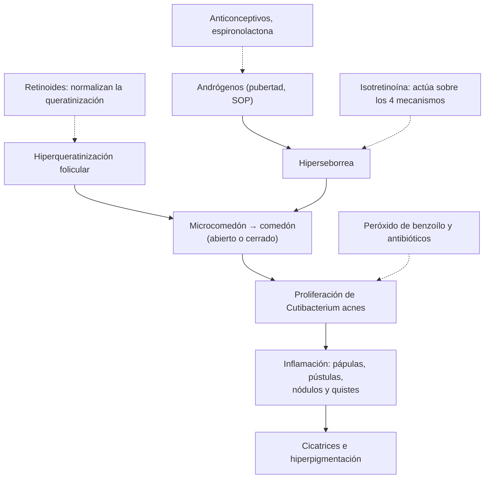

---
tags:
  - Dermatología
  - Frecuente en sala
---

# Acné y rosácea

**Subespecialidad**
Dermatología · Medicina familiar · Atención primaria

**Guías principales**
AAD 2024: manejo del acné vulgar (*J Am Acad Dermatol*) · Panel global ROSCO 2019: diagnóstico, clasificación y manejo de la rosácea (*Br J Dermatol* 2020)

**Otras fuentes**
Revisión del acné (Williams, *Lancet* 2012) · Ver [hirsutismo y síndrome de ovario poliquístico](../../endocrinologia/hirsutismo-amenorrea-y-ovario-poliquistico.md), [anticoncepción](../../ginecologia-obstetricia/anticoncepcion-y-metodos-naturales.md) y [depresión](../../geriatria/depresion.md)

**GES**
No.

**EUNACOM**
6.01.1.001 Acné (específico, completo, completo) · 6.01.1.026 Rosácea (específico, inicial, completo)

**Revisado**
Octubre 2026

!!! abstract "Resumen en 60 segundos"
    - **Acné**: enfermedad inflamatoria crónica de la **unidad pilosebácea**; afecta a **~ 85 %** de los adolescentes. Lesiones **no inflamatorias** (**comedones** abiertos y cerrados) e **inflamatorias** (pápulas, pústulas, **nódulos** y quistes) en la cara, el pecho y la espalda.
    - **Cuatro mecanismos**: **hiperseborrea** (andrógenos), **hiperqueratinización** folicular (comedón), ***Cutibacterium acnes*** e **inflamación**.
    - **Tratamiento escalonado** (AAD 2024):
        - **Leve**: **retinoide tópico** (adapaleno) y/o **peróxido de benzoílo**.
        - **Moderado**: agregar un **antibiótico tópico** (siempre con peróxido de benzoílo) o un **antibiótico oral** (doxiciclina) por **≤ 3–4 meses**, con retinoide tópico.
        - **Grave**, nodular, con cicatrices o refractario: **isotretinoína oral** (teratogénica: anticoncepción estricta).
        - **Mujeres**: **anticonceptivos combinados** o **espironolactona**.
    - **Nunca** antibiótico en **monoterapia** (resistencia). Siempre con peróxido de benzoílo o retinoide.
    - Buscar **hiperandrogenismo** (SOP) en las mujeres con acné tardío, hirsutismo o trastornos menstruales.
    - **Rosácea**: enfermedad inflamatoria **facial central** del adulto con **eritema persistente**, **rubor** (*flushing*), pápulas y pústulas **sin comedones**, telangiectasias, a veces **fimas** (rinofima) y compromiso **ocular**. Gatillantes: sol, calor, alcohol, picantes.
    - **Rosácea**: fotoprotección y evitar los gatillantes; **ivermectina**, **metronidazol** o **ácido azelaico** tópicos; **doxiciclina** en dosis bajas; **brimonidina** para el eritema. Evitar los **corticoides tópicos**.

## Definición

- **Acné vulgar**: dermatosis inflamatoria crónica de la **unidad pilosebácea**, de evolución en brotes, frecuente en la **adolescencia**, que puede persistir o iniciarse en la adultez (acné del adulto, sobre todo en **mujeres**).
- **Comedón**: tapón de queratina y sebo en el folículo; **abierto** ("punto negro", por oxidación de la melanina) o **cerrado** ("punto blanco").
- **Rosácea**: enfermedad inflamatoria **crónica** de la piel de la **zona central de la cara** (mejillas, nariz, mentón, frente), con episodios de **rubor** y **eritema persistente**, que puede comprometer los **ojos**.

## Epidemiología

### Mundial

- **Acné**: **~ 85 %** de los adolescentes de 12 a 24 años lo tiene en algún grado; **~ 9 %** de la población mundial. En los adultos, más frecuente en mujeres.
- Una de las **primeras causas de consulta** dermatológica; gran impacto **psicológico** (ansiedad, depresión, baja autoestima).
- **Rosácea**: **~ 5 %** de los adultos; inicio entre los **30 y 50 años**; más diagnosticada en mujeres de **fototipo claro**; las formas **fimatosas** son más frecuentes en hombres.

### Chile

!!! chile "Datos nacionales"
    - El acné es un motivo de consulta muy frecuente en la **APS** y en la dermatología; los tratamientos tópicos y la doxiciclina se manejan en el nivel primario.
    - La **isotretinoína** oral la indica el **dermatólogo**, con exámenes de control y **consentimiento informado** por su teratogenicidad.
    - La alta **radiación ultravioleta** del país (sobre todo en el norte y en la cordillera) es un gatillante relevante de la rosácea.

## Etiología y factores de riesgo

**Acné**:

- **Andrógenos** (pubertad, SOP, hiperplasia suprarrenal, tumores secretores, anabólicos).
- **Genética** (antecedentes familiares de acné grave).
- **Fármacos**: corticoides (acné **monomorfo**), anabólicos, litio, isoniazida, antiepilépticos, progestágenos androgénicos, vitamina B12, inhibidores del EGFR (erupción acneiforme).
- **Cosméticos** oclusivos, fricción (casco, mascarilla), manipulación de las lesiones.
- **Dieta**: alimentos de **alto índice glicémico** y lácteos descremados se asocian con más acné (evidencia moderada a baja).

**Rosácea**:

- Predisposición **genética**, fototipo claro.
- Disfunción **neurovascular** e **inmunidad innata** (catelicidinas).
- **Ácaros *Demodex*** en mayor densidad.
- **Gatillantes**: **sol**, **calor**, frío, ejercicio, **alcohol**, bebidas calientes, **picantes**, estrés, cosméticos irritantes y **corticoides tópicos** (rosácea esteroidea).

## Fisiopatología

*Figura 1. Fisiopatología del acné y sitio de acción de los tratamientos. Esquema propio basado en Williams (2012) y AAD 2024.*

- **Rosácea**: alteración de la **inmunidad innata** (receptores *toll-like* 2, exceso de **catelicidinas**), disfunción **neurovascular** (vasodilatación, receptores TRPV) y ***Demodex***, que generan **eritema**, **rubor**, inflamación y, con el tiempo, **fibrosis** e hiperplasia sebácea (fimas).

## Clasificación

**Gravedad del acné** (orientativa):

| Gravedad | Lesiones | Tratamiento base |
|---|---|---|
| **Leve** | Comedones con pocas pápulas o pústulas | Tópico: retinoide y/o peróxido de benzoílo (± antibiótico tópico) |
| **Moderado** | Más pápulas y pústulas, algunos nódulos | Tópico combinado + **antibiótico oral** o terapia hormonal |
| **Grave** | **Nódulos** y quistes, **cicatrices**, compromiso extenso del tronco | **Isotretinoína** oral |

**Formas especiales**: **acné conglobata** (nódulos, abscesos y trayectos fistulosos), **acné fulminans** (brusco, con fiebre, artralgias y lesiones ulceradas: urgencia dermatológica), acné **neonatal** e **infantil**, acné **excoriado**, acné **inducido por fármacos** (monomorfo, sin comedones).

**Rosácea** (ROSCO 2019, por **fenotipos**):

| Diagnóstico | Fenotipos |
|---|---|
| **Diagnósticos** (basta uno) | **Eritema centrofacial persistente** con aumento periódico; cambios **fimatosos** |
| **Mayores** (≥ 2) | **Rubor** (*flushing*), **pápulas y pústulas**, **telangiectasias**, manifestaciones **oculares** (blefaritis, ojo seco, queratitis) |
| **Secundarios** | Ardor, escozor, edema, sequedad |

## Clínica

- **Acné**:
    - **Comedones** en la frente, la nariz y el mentón (zona T); pápulas y pústulas; **nódulos** dolorosos en las formas graves.
    - Compromiso del **pecho y la espalda** en las formas moderadas a graves.
    - **Secuelas**: **cicatrices** (atróficas, hipertróficas) e **hiperpigmentación posinflamatoria** (fototipos oscuros).
    - **Acné de la mujer adulta**: lesiones inflamatorias en la **mandíbula** y el cuello, con exacerbación **premenstrual**.
- **Rosácea**:
    - **Eritema** centrofacial persistente, **rubor** con los gatillantes, **telangiectasias**, ardor.
    - **Pápulas y pústulas** **sin comedones** (diferencia clave con el acné).
    - **Rinofima** (nariz engrosada, bulbosa): más en hombres.
    - **Rosácea ocular** (~ 50 %): ojo rojo, sensación de cuerpo extraño, **blefaritis**, orzuelos o chalaziones recurrentes; puede haber **queratitis**.

!!! alarma "Signos de alarma"
    - **Acné fulminans**: inicio brusco con lesiones necróticas, **fiebre**, artralgias y leucocitosis: derivación urgente.
    - Acné con **virilización** (clitoromegalia, voz grave, calvicie de patrón masculino) o de inicio **muy precoz** (antes de los 8 años) o **tardío y brusco**: buscar un **tumor** secretor de andrógenos.
    - **Ideación suicida** o depresión importante en el adolescente con acné (y durante la isotretinoína).
    - **Rosácea ocular** con **dolor**, fotofobia o **baja visual** (queratitis): derivar a oftalmología.

## Diagnóstico

!!! guia "Puntos clave (AAD 2024; ROSCO 2019)"
    - Diagnóstico **clínico**.
    - **Acné**: registrar el tipo de lesiones, la **gravedad**, las **cicatrices**, el **impacto psicológico**, los fármacos y los cosméticos.
    - En las **mujeres** con acné e **hirsutismo**, **alopecia androgénica** o **irregularidad menstrual**: estudiar el **hiperandrogenismo** (testosterona total, SHBG, DHEA-S, 17-OH-progesterona, prolactina, ecografía ovárica).
    - **Rosácea**: diagnóstico por **fenotipos**; preguntar por los síntomas **oculares**.

## Laboratorio

- **No** se necesitan exámenes en el acné habitual.
- **Estudio hormonal** si hay signos de hiperandrogenismo.
- **Isotretinoína**: **β-hCG** (antes, mensual y al terminar), **perfil lipídico** y **transaminasas** basales y al mes (o según la evolución).
- **Espironolactona**: **potasio** solo si hay ERC, otros fármacos que lo suban o edad avanzada.

## Imágenes

- **Ecografía pélvica** si se sospecha un SOP o un tumor ovárico; **TC o RM suprarrenal** si la DHEA-S está muy elevada.

## Diagnóstico diferencial

| Diagnóstico | Claves |
|---|---|
| **Rosácea** | Adulto, eritema centrofacial, **sin comedones**, rubor |
| **Dermatitis perioral** | Pápulas pequeñas alrededor de la boca con un **borde libre** junto al labio; a menudo por **corticoides tópicos** |
| **Foliculitis** (bacteriana, *Malassezia*, por gramnegativos) | Pústulas foliculares monomorfas, prurito |
| **Acné por corticoides** | Pápulas y pústulas **monomorfas** en el tronco, sin comedones |
| **Pseudofoliculitis de la barba** | Zona de afeitado |
| **Lupus eritematoso** (frente a la rosácea) | Eritema malar que **respeta los surcos nasogenianos**, fotosensibilidad, síntomas sistémicos |
| **Dermatitis seborreica** | Eritema y descamación grasa en los surcos nasogenianos y las cejas |
| **Carcinoide**, **mastocitosis**, **menopausia** (frente al rubor) | Rubor con síntomas sistémicos |

## Tratamiento

### Acné

!!! guia "Recomendaciones (AAD 2024)"
    - **Recomendación fuerte**: **peróxido de benzoílo**, **retinoides tópicos** (adapaleno, tretinoína, tazaroteno), **antibióticos tópicos** (clindamicina, siempre combinados), **doxiciclina oral** e **isotretinoína oral**.
    - **Recomendación condicional**: ácido **azelaico**, ácido salicílico, **clascoterona**, minociclina o sarecyclina, **anticonceptivos orales combinados**, **espironolactona**, corticoide **intralesional** para los nódulos.
    - **Terapia combinada** (retinoide + peróxido de benzoílo ± antibiótico) por su sinergia.
    - **Antibióticos**: **nunca en monoterapia**; los orales, el **menor tiempo posible** (en general **3–4 meses**), siempre con peróxido de benzoílo o retinoide tópico.
    - **Mantención**: retinoide tópico al controlar el brote.
    - **Isotretinoína**: en el acné **grave**, **nodular**, con **cicatrices** o **refractario** a 3–6 meses de tratamiento adecuado.

!!! dosis "Tratamientos del acné"
    | Fármaco | Dosis | Comentario |
    |---|---|---|
    | **Adapaleno** 0,1–0,3 % gel | 1 vez en la noche | Irritación inicial; fotoprotección |
    | **Peróxido de benzoílo** 2,5–5 % | 1–2 veces al día | Mancha la ropa; evita la resistencia bacteriana |
    | **Adapaleno + peróxido de benzoílo** | 1 vez en la noche | Combinación de primera línea |
    | **Clindamicina 1 %** tópica | 1–2 veces al día | **Siempre** con peróxido de benzoílo |
    | **Doxiciclina** | **100 mg/día** (o 50 mg c/12 h) | ≤ 3–4 meses; **fotosensibilidad**, esofagitis (tomar con agua, sin acostarse); **no** en < 8 años ni en el embarazo |
    | **Anticonceptivo combinado** | Diario | Mujeres; revisar los criterios de elegibilidad |
    | **Espironolactona** | 50–100 mg/día (hasta 200 mg) | Mujeres; **teratogénica** (anticoncepción); irregularidad menstrual |
    | **Isotretinoína** | **0,5–1 mg/kg/día** hasta una dosis acumulada de ~ **120–150 mg/kg** | **Teratogénica**: **2 métodos anticonceptivos** desde 1 mes antes hasta 1 mes después; sequedad de mucosas, elevación de lípidos y transaminasas, mialgias; vigilar el **ánimo**. No combinar con tetraciclinas (hipertensión endocraneana) |

### Rosácea

- **Medidas generales**: **fotoprotección** diaria, evitar los **gatillantes**, limpiadores suaves e hidratantes, **suspender los corticoides tópicos**.
- **Eritema persistente**: **brimonidina** u oximetazolina tópicas (efecto transitorio), **láser** o luz pulsada para las telangiectasias.
- **Pápulas y pústulas**:
    - Tópicos: **ivermectina 1 %** (la más eficaz), **metronidazol** 0,75–1 %, **ácido azelaico** 15 %.
    - Orales en las formas moderadas a graves: **doxiciclina 40 mg/día** de liberación modificada (dosis antiinflamatoria) o 100 mg/día; **isotretinoína** en dosis bajas en las refractarias.
- **Fimas**: cirugía, láser ablativo o isotretinoína precoz.
- **Ocular**: higiene palpebral, lágrimas artificiales, doxiciclina; derivar a oftalmología si hay queratitis.

## Complicaciones

- **Acné**: **cicatrices** permanentes, hiperpigmentación, impacto **psicológico** (ansiedad, depresión, aislamiento, ideación suicida).
- **Isotretinoína**: **malformaciones** congénitas graves, hipertrigliceridemia, hepatitis, alteraciones del ánimo (asociación controvertida), hipertensión endocraneana (con tetraciclinas).
- **Antibióticos**: **resistencia bacteriana**, fotosensibilidad, candidiasis.
- **Rosácea**: **rinofima**, compromiso **ocular** (queratitis con riesgo visual), impacto psicosocial.

## Pronóstico y seguimiento

- El **acné** suele mejorar al final de la adolescencia, pero puede persistir; el tratamiento precoz **evita las cicatrices**.
- La respuesta a los tópicos se evalúa a las **8–12 semanas**.
- La **isotretinoína** logra una remisión prolongada en la mayoría; algunos requieren un segundo ciclo.
- La **rosácea** es **crónica** con brotes; el control de los gatillantes y la mantención tópica reducen las recaídas.

## Perlas para el internado

!!! perla "Para recordar"
    - **Acné** = **comedones**; **rosácea** = **sin comedones**, eritema centrofacial y rubor.
    - **Retinoide tópico + peróxido de benzoílo** es la base; el antibiótico **nunca solo**.
    - **Doxiciclina** por **≤ 3–4 meses** y siempre con un tópico.
    - **Isotretinoína**: acné grave, nodular, con cicatrices o refractario; **anticoncepción** estricta y control del ánimo.
    - Mujer con acné + **hirsutismo** + **oligomenorrea** = pensar en **SOP**.
    - **Corticoides tópicos** en la cara empeoran la rosácea y producen dermatitis perioral.
    - Rosácea con **ojo rojo** y fotofobia: derivar a oftalmología.

## Preguntas de repaso

??? repaso "1. Adolescente de 15 años con comedones abiertos y cerrados en la frente y algunas pápulas. ¿Qué indica?"
    **Acné leve** comedoniano o papular. Tratamiento tópico: **adapaleno** 0,1 % en la noche y/o **peróxido de benzoílo** 2,5–5 % (o la combinación fija), con hidratación y fotoprotección. Evaluar la respuesta a las 8–12 semanas. No requiere antibióticos.

??? repaso "2. Joven de 19 años con acné moderado papulopustuloso en la cara y la espalda que no mejoró con tópicos. ¿Qué agrega y por cuánto tiempo?"
    **Doxiciclina 100 mg/día** por **3–4 meses**, **junto** con un retinoide tópico y peróxido de benzoílo (nunca en monoterapia). Advertir la **fotosensibilidad** y la esofagitis. Al controlar, mantener con el retinoide tópico.

??? repaso "3. Hombre de 20 años con acné nodular y quístico en la cara y el tronco, con cicatrices. ¿Qué tratamiento corresponde y qué controles requiere?"
    **Isotretinoína oral** (0,5–1 mg/kg/día hasta una dosis acumulada de ~ 120–150 mg/kg), indicada por el dermatólogo. Controles: perfil lipídico y transaminasas basales y durante el tratamiento, **vigilancia del ánimo**, evitar las tetraciclinas. En las mujeres: **β-hCG** y **dos métodos anticonceptivos**.

??? repaso "4. Mujer de 26 años con acné en la mandíbula que empeora antes de la menstruación, hirsutismo y ciclos cada 45–60 días. ¿Qué sospecha y qué ofrece?"
    **Síndrome de ovario poliquístico** (hiperandrogenismo + oligomenorrea). Estudio hormonal y ecografía según el caso. Tratamiento: **anticonceptivo combinado** y/o **espironolactona** (con anticoncepción), más tratamiento tópico.

??? repaso "5. Mujer de 42 años con eritema persistente en las mejillas y la nariz, rubor con el vino y el calor, y pápulas sin comedones. ¿Diagnóstico y tratamiento?"
    **Rosácea** (eritema centrofacial persistente + rubor + pápulas, sin comedones). Tratamiento: **fotoprotección**, evitar los gatillantes, **ivermectina 1 %** o **metronidazol** tópicos; en las formas moderadas, **doxiciclina 40 mg/día**; brimonidina tópica para el eritema. Preguntar por los síntomas oculares.

??? repaso "6. ¿Por qué no se deben usar antibióticos en monoterapia en el acné?"
    Porque inducen **resistencia** de *Cutibacterium acnes* y de otras bacterias (por ejemplo, *S. aureus*). Se combinan siempre con **peróxido de benzoílo** (que evita la resistencia) y/o un **retinoide tópico**, y los orales se limitan a **3–4 meses**.

## Referencias

1. Reynolds RV, Yeung H, Cheng CE, et al. Guidelines of care for the management of acne vulgaris. *J Am Acad Dermatol.* 2024;90(5):1006.e1–1006.e30. doi:[10.1016/j.jaad.2023.12.017](https://doi.org/10.1016/j.jaad.2023.12.017)
2. Schaller M, Almeida LMC, Bewley A, et al. Recommendations for rosacea diagnosis, classification and management: update from the global ROSacea COnsensus 2019 panel. *Br J Dermatol.* 2020;182(5):1269–1276. doi:[10.1111/bjd.18420](https://doi.org/10.1111/bjd.18420)
3. Williams HC, Dellavalle RP, Garner S. Acne vulgaris. *Lancet.* 2012;379(9813):361–372. doi:[10.1016/S0140-6736(11)60321-8](https://doi.org/10.1016/S0140-6736(11)60321-8)
