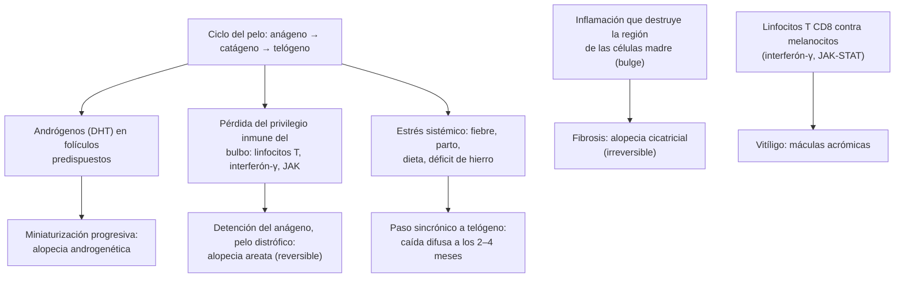

---
tags:
  - Dermatología
---

# Alopecias y vitíligo

**Subespecialidad**
Dermatología · Atención primaria · Endocrinología

**Guías principales**
Guía alemana S3 de alopecia areata 2026 (*J Dtsch Dermatol Ges*) · Guía europea S3 de alopecia androgenética 2018 (*J Eur Acad Dermatol Venereol*) · BAD 2021: manejo del vitíligo (*Br J Dermatol* 2022) · Consenso del European Dermatology Forum sobre vitíligo (*Br J Dermatol* 2013)

**Otras fuentes**
Ensayos TRuE-V de ruxolitinib crema (*N Engl J Med* 2022) · Efluvio telógeno (*Cleve Clin J Med* 2026) · Ver [micosis superficiales](micosis-superficiales-escabiosis-pediculosis-y-virosis-cutaneas.md) (tiña de la cabeza), [lupus discoide](ampollares-lupus-cutaneo-vasculitis-y-eritema-nodoso.md), [hipotiroidismo e hipertiroidismo](../../endocrinologia/hipotiroidismo-e-hipertiroidismo.md), [anemias](../../hematologia/anemias.md) y [hirsutismo y SOP](../../endocrinologia/hirsutismo-amenorrea-y-ovario-poliquistico.md)

**GES**
No.

**EUNACOM**
6.01.1.002 Alopecias (sospecha, inicial, derivar) · 6.01.1.032 Vitíligo (sospecha, inicial, derivar)

**Revisado**
Octubre 2026

!!! abstract "Resumen en 60 segundos"
    - **Primera pregunta en una alopecia**: ¿es **cicatricial** (piel lisa y brillante, **sin orificios foliculares**: daño permanente, biopsia urgente) o **no cicatricial** (folículos conservados: potencialmente reversible)?
    - **Alopecia androgenética**: la más frecuente. Hombres: entradas y coronilla; mujeres: adelgazamiento difuso de la **zona central** con línea frontal conservada. **Minoxidil** (tópico u oral en dosis bajas) y, en el hombre, **finasterida 1 mg/día**.
    - **Alopecia areata**: placas **redondas, lisas**, sin inflamación, con **pelos en signo de exclamación**; autoinmune. **Corticoides tópicos o intralesionales**; en las formas extensas, **inhibidores de JAK** (baricitinib, ritlecitinib).
    - **Efluvio telógeno**: caída **difusa y abundante** **2–4 meses** después de un gatillante (fiebre, parto, cirugía, dieta, déficit de hierro, hipotiroidismo, fármacos). Autolimitado en ~ 6 meses. Pedir **TSH**, **ferritina** y hemograma.
    - **Vitíligo**: máculas **acrómicas** (blanco tiza) bien delimitadas, simétricas, en la cara, las manos y alrededor de los orificios; resaltan con la **luz de Wood**. Autoinmune: buscar **tiroiditis** (TSH y anti-TPO). **Corticoides o tacrolimus tópicos**, **ruxolitinib crema** y **fototerapia UVB de banda angosta**.

## Definición

- **Alopecia**: pérdida de pelo de una zona donde normalmente existe.
    - **No cicatricial**: el folículo se conserva y el pelo puede volver a crecer.
    - **Cicatricial**: el folículo se **destruye** y es reemplazado por tejido fibroso; la pérdida es **permanente**.
- **Ciclo del pelo**: **anágeno** (crecimiento, 2–6 años, ~ 85–90 % de los pelos), **catágeno** (involución, semanas) y **telógeno** (reposo y caída, ~ 3 meses, ~ 10–15 %). Se pierden normalmente hasta **100 pelos al día**.
- **Efluvio telógeno**: paso **sincrónico** de muchos folículos a la fase telógena tras un estrés, con caída difusa ~ 3 meses después.
- **Efluvio anágeno**: caída en la fase de crecimiento por **detención mitótica** (quimioterapia, radioterapia, intoxicaciones); ocurre en días a semanas.
- **Vitíligo**: trastorno **autoinmune** adquirido con pérdida de los **melanocitos** funcionales de la piel y, a veces, del pelo, que produce máculas **despigmentadas**.

## Epidemiología

- **Mundial**:
    - **Alopecia androgenética**: afecta a ~ **50 % de los hombres** a los 50 años y a ~ **40 % de las mujeres** a los 70 años.
    - **Alopecia areata**: riesgo de por vida de ~ **2 %**; cualquier edad, frecuente en los niños y los adultos jóvenes.
    - **Efluvio telógeno**: la causa más frecuente de caída **difusa** del pelo en las mujeres.
    - **Vitíligo**: prevalencia de **0,5–2 %**; la mitad comienza **antes de los 20 años**; sin diferencias por sexo ni fototipo (más visible en la piel oscura). Antecedente familiar en ~ 20–30 %.
- **Chile**: no hay datos nacionales publicados de prevalencia de alopecias ni de vitíligo.

!!! chile "Datos nacionales"
    - Las alopecias y el vitíligo se manejan inicialmente en la **APS**, con derivación a dermatología de las formas extensas, cicatriciales, de diagnóstico dudoso o que no responden.
    - En el estudio de la caída difusa del pelo se dispone en la APS de **hemograma**, **ferritina** y **TSH**.
    - La **tiña de la cabeza** (por *Microsporum canis*, transmitida por gatos y perros) es una causa frecuente de alopecia en placas en los **niños** chilenos: no confundirla con la alopecia areata.

## Etiología y factores de riesgo

| Tipo | Causas |
|---|---|
| **Androgenética** | Predisposición **genética** poligénica y sensibilidad folicular a la **dihidrotestosterona** (DHT). En la mujer, buscar **hiperandrogenismo** (SOP) si hay hirsutismo, acné o trastornos menstruales |
| **Areata** | **Autoinmune** (linfocitos T contra el bulbo en fase anágena); asociada a **atopia**, **tiroiditis autoinmune**, vitíligo, enfermedad celíaca, síndrome de Down; gatillantes: estrés, infecciones |
| **Efluvio telógeno** | **Fiebre** alta o infección grave (incluido el COVID-19), **parto** (efluvio posparto), cirugía, **dietas** restrictivas y baja de peso rápida (incluida la asociada a **arGLP-1** y cirugía bariátrica), **déficit de hierro**, **hipotiroidismo e hipertiroidismo**, **fármacos** (anticonceptivos al suspenderlos, retinoides, anticoagulantes, betabloqueadores, litio, valproato), estrés emocional intenso |
| **Efluvio anágeno** | **Quimioterapia**, radioterapia, intoxicación por **talio** o arsénico |
| **Infecciosas** | **Tiña de la cabeza** (niños), **sífilis secundaria** (alopecia "apolillada") |
| **Por tracción o traumática** | Peinados tirantes (trenzas, extensiones); **tricotilomanía** (arrancamiento compulsivo: pelos de distintas longitudes) |
| **Cicatriciales** | **Lupus discoide**, **liquen plano pilar**, **alopecia frontal fibrosante** (mujeres posmenopáusicas), foliculitis decalvante, celulitis disecante, querion de Celso no tratado, esclerodermia localizada, quemaduras, radioterapia, tumores |
| **Vitíligo** | **Autoinmune** (linfocitos T CD8 citotóxicos contra los melanocitos, vía **interferón-γ y JAK-STAT**), predisposición genética, estrés oxidativo; gatillantes: traumatismos (**fenómeno de Koebner**), quemaduras solares, estrés |

## Fisiopatología

*Figura 1. Mecanismos de las alopecias y del vitíligo. Esquema propio basado en las guías S3 de alopecia areata (2026) y androgenética (2018) y en la guía de vitíligo de la BAD (2021).*

- Alopecia areata y vitíligo comparten la vía **interferón-γ / JAK-STAT**, lo que explica la eficacia de los **inhibidores de JAK** en ambas.

## Clasificación

| Alopecia | Patrón | Rasgos clave |
|---|---|---|
| **Androgenética masculina** | **Hamilton-Norwood** (I–VII) | Entradas frontotemporales y coronilla |
| **Androgenética femenina** | **Ludwig** (I–III) o Sinclair | Adelgazamiento **difuso central**, línea frontal **conservada**, "árbol de Navidad" en la raya |
| **Areata** | En placas, **ofiásica** (banda occipital y temporal; peor pronóstico), **total** (todo el cuero cabelludo), **universal** (todo el cuerpo) | Extensión según el **puntaje SALT** (porcentaje de cuero cabelludo sin pelo; SALT ≥ 50 = grave) |
| **Efluvio telógeno** | Agudo (< 6 meses) o crónico (> 6 meses) | Caída difusa con **prueba de tracción** positiva |
| **Cicatricial** | Linfocítica (lupus, liquen plano pilar), neutrofílica (foliculitis decalvante), mixta | Pérdida de los orificios foliculares |

| Vitíligo | Rasgos |
|---|---|
| **No segmentario** (~ 85–90 %) | **Simétrico**, bilateral: acrofacial (cara, manos, pies), generalizado, universal (> 80 % de la superficie), mucoso. Curso **impredecible**, progresivo. Asociado a **autoinmunidad** |
| **Segmentario** | **Unilateral**, en un dermatoma o bloque, inicio **precoz** (infancia), progresión rápida inicial y luego **estable**; compromete el pelo (poliosis). Responde bien a los **injertos** |
| **Mixto** | Segmentario más no segmentario |

## Clínica

- **Alopecia androgenética**: adelgazamiento **progresivo** (miniaturización) del pelo con el patrón descrito; piel normal. En la mujer con alopecia, **acné**, **hirsutismo** o **ciclos irregulares**: estudiar el hiperandrogenismo.
- **Alopecia areata**:
    - Una o varias **placas redondas u ovaladas**, de **piel lisa y normal** (sin escamas ni eritema), de aparición **súbita**.
    - En el borde: **pelos en signo de exclamación** (cortos, más gruesos en la punta y afinados hacia la base) y prueba de tracción positiva en la fase activa.
    - Puede afectar la barba, las cejas y las pestañas.
    - **Uñas**: **piqueteado** (*pitting*) fino y regular, traquioniquia.
    - El pelo que vuelve a crecer suele ser **blanco** al inicio.
- **Efluvio telógeno**: la paciente refiere caída **abundante** ("se me cae a mechones en la ducha y la almohada"), **difusa**, sin placas, **2–4 meses** después del gatillante. **Prueba de tracción** positiva (se desprenden más de 4–6 pelos de un mechón de ~ 60, con bulbo telógeno blanco). Se recupera en **3–6 meses** si el gatillante desaparece.
- **Tiña de la cabeza**: placas **descamativas** con **pelos cortados** a pocos milímetros, prurito, adenopatías; el **querion** es una placa inflamatoria supurativa dolorosa.
- **Tricotilomanía**: placas de bordes irregulares con pelos **rotos a distintas alturas**, en el lado dominante; asociada a ansiedad.
- **Alopecias cicatriciales**: placas **lisas, brillantes**, sin orificios foliculares, con eritema, escamas perifoliculares, **dolor**, prurito o pústulas según la causa.
- **Vitíligo**:
    - **Máculas** y manchas **blanco tiza** (acrómicas), de bordes **netos**, a veces con borde hiperpigmentado, asintomáticas.
    - Localización típica: **cara** (alrededor de los ojos y la boca), dorso de las **manos**, dedos, codos, rodillas, **genitales**, axilas y zonas de roce.
    - **Fenómeno de Koebner**: aparición en sitios de traumatismo.
    - **Poliosis** (pelo blanco en las lesiones) o leucotriquia: indica peor respuesta a la repigmentación.
    - **Signos de actividad**: lesiones en **confeti**, vitíligo **tricrómico** (zona intermedia de color), bordes mal definidos y Koebner.

!!! alarma "Signos de alarma"
    - Alopecia con **piel lisa, brillante y sin orificios foliculares**, con dolor, eritema o pústulas: **alopecia cicatricial** → biopsia y derivación **precoz** (cada mes de inflamación es pérdida permanente).
    - Alopecia con **hirsutismo**, **virilización** (clitoromegalia, voz grave) de inicio **rápido**: descartar un **tumor secretor de andrógenos** (ovárico o suprarrenal).
    - Caída difusa con **baja de peso**, astenia, fiebre o síntomas tiroideos: buscar la **enfermedad de base**.
    - Alopecia "apolillada" con lesiones cutáneas o mucosas: **sífilis secundaria** (VDRL o RPR).
    - Alopecia areata **extensa** y de progresión rápida, o vitíligo rápidamente **progresivo**: derivación preferente.

## Diagnóstico

!!! guia "Puntos clave (S3 alopecia areata 2026; S3 alopecia androgenética 2018; BAD vitíligo 2021)"
    - El diagnóstico de las alopecias es **clínico** en la mayoría: historia (inicio, ritmo, fármacos, gatillantes, dieta, historia menstrual), examen del cuero cabelludo, **prueba de tracción** y **tricoscopía** (dermatoscopía del cuero cabelludo).
    - **Tricoscopía**: alopecia areata (**puntos amarillos**, puntos negros, pelos en signo de exclamación); androgenética (**variabilidad del diámetro** del pelo > 20 %); cicatricial (ausencia de orificios foliculares).
    - **Biopsia** del cuero cabelludo (punch de 4 mm) en las alopecias **cicatriciales** y en los casos de diagnóstico dudoso.
    - **Alopecia areata**: el estudio de laboratorio (por ejemplo, la función tiroidea) se guía por la clínica.
    - **Vitíligo**: diagnóstico **clínico**, con **luz de Wood** (acentúa las lesiones en la piel clara, que se ven blanco azulado brillante). Biopsia solo si hay duda. Pedir **TSH** y **anti-TPO** (enfermedad tiroidea autoinmune asociada).

## Laboratorio

| Situación | Exámenes |
|---|---|
| **Caída difusa** (efluvio telógeno, alopecia femenina) | **Hemograma**, **ferritina** (algunos expertos buscan valores > 40 ng/mL en la caída del pelo), **TSH**; según la clínica: perfil bioquímico, vitamina D, zinc, VDRL o RPR, ANA |
| **Alopecia femenina con signos de hiperandrogenismo** | **Testosterona total**, SHBG, DHEA-S, 17-hidroxiprogesterona, prolactina (ver SOP) |
| **Alopecia en placas descamativa en un niño** | **Examen micológico directo** y **cultivo** (tiña de la cabeza) |
| **Alopecia areata** | TSH y anti-TPO si hay síntomas; ferritina y vitamina D según el caso |
| **Alopecia cicatricial** | **Biopsia** con inmunofluorescencia directa, ANA |
| **Vitíligo** | **TSH**, **anti-TPO**; según la clínica: glicemia, hemograma y vitamina B12 (anemia perniciosa), cortisol |

## Imágenes

- No se requieren imágenes en las alopecias ni en el vitíligo.
- **Ecografía transvaginal** o imágenes suprarrenales solo si se sospecha un **tumor secretor de andrógenos**.
- La **fotografía clínica** estandarizada sirve para seguir la respuesta al tratamiento.

## Diagnóstico diferencial

| Cuadro | Diferenciales |
|---|---|
| **Alopecia areata** | **Tiña de la cabeza** (escamas, pelos cortados, niño), **tricotilomanía** (pelos rotos a distintas alturas), alopecia por tracción, **sífilis secundaria**, lupus discoide (cicatricial) |
| **Alopecia androgenética femenina** | **Efluvio telógeno crónico**, alopecia areata difusa, hipotiroidismo, déficit de hierro |
| **Efluvio telógeno** | Alopecia androgenética (miniaturización), alopecia areata difusa, efluvio anágeno |
| **Vitíligo** | **Pitiriasis versicolor** (hipopigmentada con escama fina; examen directo positivo), **pitiriasis alba** (niños atópicos, mal delimitada), **hipopigmentación posinflamatoria**, **hipomelanosis guttata** (máculas pequeñas en las piernas del adulto mayor), **nevo anémico** (desaparece a la vitropresión), **lepra** (máculas hipopigmentadas **anestésicas**), **esclerosis tuberosa** (manchas "en hoja de fresno" desde el nacimiento), piebaldismo (congénito, mechón blanco frontal), liquen escleroso (genital), leucodermia por químicos |

## Tratamiento

!!! dosis "Alopecia androgenética (S3 2018)"
    | Tratamiento | Esquema | Comentario |
    |---|---|---|
    | **Minoxidil tópico** | **Hombre**: solución 5 % o espuma 5 %, 1 mL cada 12 horas. **Mujer**: solución 2 % cada 12 horas o espuma 5 % una vez al día | Efecto a los **3–6 meses**; puede causar una **caída inicial** transitoria; si se suspende, se pierde lo ganado. Dermatitis de contacto, hipertricosis facial |
    | **Minoxidil oral en dosis bajas** | **Mujer**: 0,25–1,25 mg/día; **hombre**: 1,25–5 mg/día | Uso **fuera de ficha técnica**, cada vez más usado (especialista). Hipertricosis, edema, taquicardia, hipotensión |
    | **Finasterida** | **1 mg/día** VO (**solo hombres**) | Inhibidor de la 5-α-reductasa. Disfunción sexual (poco frecuente), ánimo depresivo; **reduce el PSA a la mitad**. **Contraindicada en mujeres en edad fértil** (teratogénica) |
    | **Espironolactona** | 50–200 mg/día (mujeres, especialmente con hiperandrogenismo) | Anticoncepción eficaz; controlar el potasio en las personas con riesgo |
    | **Trasplante capilar** | Formas estables | Cirugía |

!!! dosis "Alopecia areata (S3 2026)"
    - **Placas limitadas** (adultos): **corticoides intralesionales** (acetónido de **triamcinolona 2,5–10 mg/mL**, 0,1 mL por punto cada 1 cm, cada 4–6 semanas) o **corticoides tópicos** potentes (clobetasol), a veces en oclusión. En los **niños**: corticoides tópicos de alta potencia.
    - **Formas extensas o graves** (SALT ≥ 50) en los adultos: **inhibidores de JAK** orales: **baricitinib** 2–4 mg/día, **ritlecitinib** 50 mg/día (aprobado desde los 12 años) o **deuruxolitinib** 8 mg cada 12 horas. Antes: hemograma, perfil lipídico y hepático, VHB, VHC, VIH y **pesquisa de TBC latente**. Las recaídas son frecuentes al suspenderlos.
    - Alternativas: **corticoides sistémicos** en pulsos en las formas agudas extensas (especialista), **inmunoterapia de contacto** con difenciprona, **metotrexato**.
    - **Apoyo psicológico** y opciones **cosméticas** (pelucas, prótesis capilares, micropigmentación de las cejas) para todas las personas.
    - En las placas pequeñas y recientes, la **observación** es una opción válida: ~ 50 % se recupera solo en el primer año.

- **Efluvio telógeno**: identificar y **corregir el gatillante** (suplementar hierro si la ferritina está baja, tratar la tiroides, revisar los fármacos y la dieta); **tranquilizar**: es reversible y no lleva a la calvicie; el minoxidil tópico puede acortar la caída en el efluvio crónico.
- **Tiña de la cabeza**: tratamiento **oral** (terbinafina o griseofulvina; ver [micosis superficiales](micosis-superficiales-escabiosis-pediculosis-y-virosis-cutaneas.md)).
- **Alopecias cicatriciales**: tratar la **inflamación activa** cuanto antes (corticoides tópicos o intralesionales, hidroxicloroquina en el lupus discoide y el liquen plano pilar, antibióticos en la foliculitis decalvante); el pelo perdido no se recupera.

!!! dosis "Vitíligo (BAD 2021; ensayos TRuE-V)"
    | Tratamiento | Indicación y esquema |
    |---|---|
    | **Corticoide tópico** potente (mometasona, clobetasol) | Lesiones limitadas **del cuerpo**; una vez al día, en ciclos (por ejemplo, 2 semanas sí y 2 semanas no, o 1 semana sí y 1 no) hasta **3–6 meses** para limitar la atrofia |
    | **Tacrolimus 0,1 %** pomada (o pimecrolimus) | **Cara**, cuello y pliegues; **cada 12 horas** por al menos 6 meses |
    | **Ruxolitinib 1,5 %** crema (inhibidor de JAK tópico) | Vitíligo no segmentario en ≥ 12 años, hasta el **10 %** de la superficie; **cada 12 horas**. En los ensayos TRuE-V, ~ 30 % logró una repigmentación facial ≥ 75 % a las 24 semanas, con mejoría progresiva hasta las 52 semanas |
    | **Fototerapia UVB de banda angosta** | Vitíligo **extenso** o activo; **2–3 veces por semana** por al menos **6–12 meses**; se puede combinar con tratamientos tópicos |
    | **Minipulsos de corticoide oral** | Vitíligo **rápidamente progresivo** (para detener la actividad); especialista |
    | **Cirugía** (injertos de melanocitos) | Vitíligo **segmentario** o **estable** ≥ 12 meses |
    | **Despigmentación** (monobenzona) | Vitíligo **universal** (> 80 %) en adultos, con consentimiento |

    - Para todos: **fotoprotección** de las lesiones (se queman con facilidad), **camuflaje** cosmético, **apoyo psicológico** y control de la **tiroides**.
    - Las zonas **acrales** (dedos, labios) y con **poliosis** responden poco. La **cara** y el cuello responden mejor.

## Complicaciones

- **Impacto psicosocial**: **ansiedad**, **depresión**, alteración de la imagen corporal y estigma, sobre todo en la alopecia areata extensa y en el vitíligo facial o en la piel oscura.
- **Alopecias cicatriciales**: pérdida **permanente** del pelo.
- **Vitíligo**: **quemaduras solares** en las lesiones; enfermedades **autoinmunes** asociadas (tiroiditis, alopecia areata, diabetes tipo 1, anemia perniciosa, enfermedad de Addison); alteraciones auditivas u oculares leves (uveítis) poco frecuentes.
- **Del tratamiento**: atrofia y estrías por los corticoides tópicos; hipertricosis por el minoxidil; efectos sistémicos de los inhibidores de JAK (infecciones, herpes zóster, dislipidemia, trombosis).

## Pronóstico y seguimiento

- **Androgenética**: progresiva; el tratamiento **detiene** la progresión y recupera parte del pelo, pero debe mantenerse **indefinidamente**. Evaluar la respuesta a los **6–12 meses**.
- **Areata**: curso **impredecible** con recaídas. Peor pronóstico con: inicio en la **infancia**, forma **ofiásica**, total o universal, larga duración (> 1 año), **atopia**, compromiso de las **uñas** y antecedentes familiares.
- **Efluvio telógeno agudo**: recuperación completa en **3–6 meses** (la densidad puede tardar hasta 12–18 meses).
- **Vitíligo**: curso crónico, impredecible; la repigmentación es **lenta** (meses) y comienza en los folículos (**repigmentación perifolicular**). El segmentario se estabiliza en 1–2 años.
- **Seguimiento**: TSH anual en el vitíligo y en la alopecia areata con autoinmunidad tiroidea; controles de laboratorio con los inhibidores de JAK.

## Perlas para el internado

!!! perla "Para recordar"
    - Lo primero: **¿hay orificios foliculares?** Si no los hay, es cicatricial y es urgente biopsiar.
    - Placa **redonda, lisa, sin escamas**, con **pelos en signo de exclamación**: **alopecia areata**. Con **escamas** y pelos cortados en un niño: **tiña de la cabeza** (examen micológico y tratamiento oral).
    - Caída **difusa** 3 meses después de un parto, una fiebre o una dieta: **efluvio telógeno**. Pedir **TSH, ferritina y hemograma** y tranquilizar.
    - Minoxidil: la caída inicial es esperable; el efecto se ve a los **3–6 meses** y se pierde si se suspende.
    - **Finasterida** solo en hombres; baja el **PSA a la mitad** (multiplicar por 2 al interpretarlo).
    - Mancha **blanco tiza** simétrica en la cara y las manos que resalta con la **luz de Wood**: **vitíligo**. Pedir **TSH y anti-TPO**.
    - Mancha hipopigmentada **con escama fina** en el tronco: **pitiriasis versicolor**, no vitíligo.
    - Mancha hipopigmentada **anestésica**: pensar en **lepra** (rara en Chile, pero posible en migrantes).

## Preguntas de repaso

??? repaso "1. Mujer de 29 años con caída abundante y difusa del pelo desde hace 1 mes; tuvo su parto hace 3 meses. Prueba de tracción positiva, sin placas. ¿Diagnóstico y manejo?"
    **Efluvio telógeno posparto**. Pedir **hemograma, ferritina y TSH** (tiroiditis posparto, déficit de hierro). Manejo: **tranquilizar** (es reversible en 3–6 meses y no produce calvicie), corregir el hierro si está bajo y tratar la tiroides si corresponde. Derivar si persiste más de 6 meses.

??? repaso "2. Niño de 8 años con una placa redonda de alopecia de 3 cm en el occipucio, de piel lisa, sin escamas, con pelos cortos que se afinan hacia la base en el borde. Sus uñas tienen un piqueteado fino. ¿Diagnóstico y tratamiento?"
    **Alopecia areata** (pelos en **signo de exclamación** y **piqueteado ungueal**). Tratamiento en el niño: **corticoide tópico de alta potencia** (o la observación, porque una placa única puede recuperarse sola). Los intralesionales se reservan para los mayores o adolescentes que los toleran. Derivar a dermatología si es extensa (SALT ≥ 50) o progresa. Diferenciarla de la **tiña de la cabeza** (escamas, pelos cortados).

??? repaso "3. Hombre de 27 años con entradas frontotemporales y adelgazamiento en la coronilla progresivos desde hace 4 años; su padre es calvo. ¿Diagnóstico y tratamiento?"
    **Alopecia androgenética masculina** (Hamilton-Norwood). Tratamiento: **minoxidil tópico 5 %** cada 12 horas y/o **finasterida 1 mg/día**, informando que el efecto se ve a los 3–6 meses, que debe mantenerse para conservar el resultado, los efectos adversos sexuales (poco frecuentes) y que la finasterida baja el PSA a la mitad. Alternativas: minoxidil oral en dosis bajas (especialista) y trasplante capilar.

??? repaso "4. Mujer de 55 años con una placa de alopecia en el vértex, con piel lisa, brillante, sin orificios foliculares, eritema perifolicular y prurito. ¿Qué hace?"
    Es una **alopecia cicatricial** (ausencia de orificios foliculares, inflamación activa). Derivar **con prioridad** a dermatología para **biopsia** (con inmunofluorescencia), porque el pelo perdido no se recupera y hay que detener la inflamación cuanto antes. Diferenciales: **liquen plano pilar**, **lupus discoide**, alopecia frontal fibrosante.

??? repaso "5. Joven de 19 años con máculas blanco tiza simétricas alrededor de los ojos, la boca y el dorso de las manos, que resaltan con la luz de Wood. ¿Diagnóstico, estudio y tratamiento?"
    **Vitíligo no segmentario** (acrofacial). Estudio: **TSH y anti-TPO** (tiroiditis autoinmune asociada). Tratamiento: en la cara, **tacrolimus 0,1 %** cada 12 horas o **ruxolitinib 1,5 % crema** (si hay acceso); en el cuerpo, **corticoide tópico** potente en ciclos; si es extenso o progresa, **fototerapia UVB de banda angosta**. Fotoprotección, camuflaje y apoyo psicológico; derivar a dermatología.

??? repaso "6. Niño de 6 años con una mancha blanca unilateral en la mejilla y el cuello que sigue un segmento, con algunos pelos blancos, que apareció hace 1 año y ya no crece. ¿Qué tipo de vitíligo es y qué opciones tiene?"
    **Vitíligo segmentario**: unilateral, inicio precoz, progresión inicial rápida y luego **estable**, con **poliosis**. Responde poco a los tratamientos médicos; por ser estable, es el mejor candidato a los **injertos** de melanocitos (cirugía) más adelante. Mientras tanto: fotoprotección, camuflaje y tratamiento tópico de prueba (tacrolimus o corticoide). No suele asociarse a autoinmunidad.

## Referencias

1. Blume-Peytavi U, Constantinou A, Tomova-Simitchieva T, et al. S3 guideline diagnostics and therapy of alopecia areata. Part 1: diagnostics and epidemiology. *J Dtsch Dermatol Ges.* 2026;24(7):e1000–e1015. doi:[10.1111/ddg.70065x](https://doi.org/10.1111/ddg.70065x)
2. Blume-Peytavi U, Constantinou A, Tomova-Simitchieva T, et al. S3 guideline diagnostics and therapy in alopecia areata. Part 2: therapy, psychosocial and cosmetic support. *J Dtsch Dermatol Ges.* 2026;24(8):e1155–e1177. doi:[10.1111/ddg.70130x](https://doi.org/10.1111/ddg.70130x)
3. Kanti V, Messenger A, Dobos G, et al. Evidence-based (S3) guideline for the treatment of androgenetic alopecia in women and in men: short version. *J Eur Acad Dermatol Venereol.* 2018;32(1):11–22. doi:[10.1111/jdv.14624](https://doi.org/10.1111/jdv.14624)
4. Bergfeld WF, Mendez D. Shedding: an updated guide to a common cause of hair loss. *Cleve Clin J Med.* 2026;93(10):616–622. doi:[10.3949/ccjm.93a.26008](https://doi.org/10.3949/ccjm.93a.26008)
5. Eleftheriadou V, Atkar R, Batchelor J, et al. British Association of Dermatologists guidelines for the management of people with vitiligo 2021. *Br J Dermatol.* 2022;186(1):18–29. doi:[10.1111/bjd.20596](https://doi.org/10.1111/bjd.20596)
6. Taieb A, Alomar A, Böhm M, et al. Guidelines for the management of vitiligo: the European Dermatology Forum consensus. *Br J Dermatol.* 2013;168(1):5–19. doi:[10.1111/j.1365-2133.2012.11197.x](https://doi.org/10.1111/j.1365-2133.2012.11197.x)
7. Rosmarin D, Passeron T, Pandya AG, et al. Two phase 3, randomized, controlled trials of ruxolitinib cream for vitiligo. *N Engl J Med.* 2022;387(16):1445–1455. doi:[10.1056/NEJMoa2118828](https://doi.org/10.1056/NEJMoa2118828)
