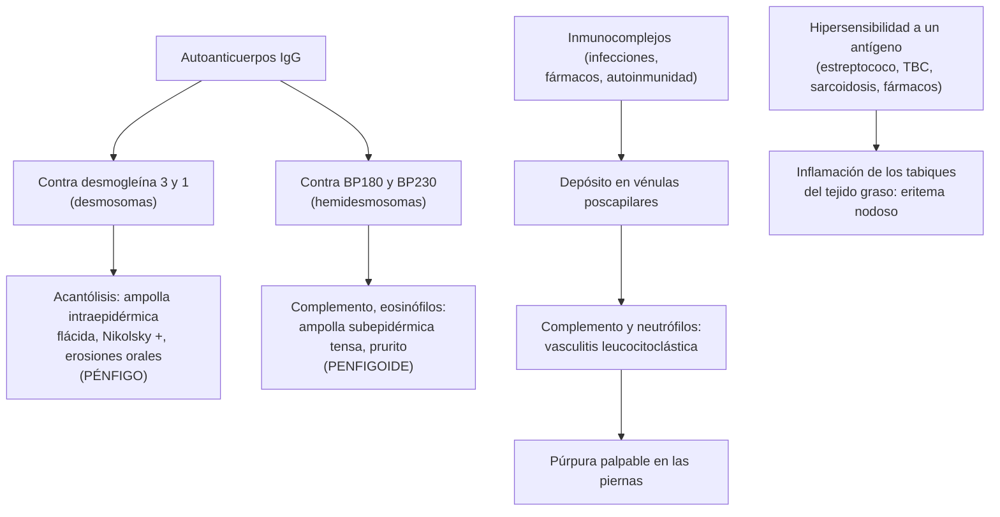

---
tags:
  - Dermatología
  - Frecuente en sala
---

# Enfermedades ampollares, lupus cutáneo, vasculitis cutáneas, eritema nodoso y piel en las enfermedades sistémicas

**Subespecialidad**
Dermatología · Reumatología · Medicina interna

**Guías principales**
EADV 2020: pénfigo vulgar y foliáceo (*J Eur Acad Dermatol Venereol*) · EADV 2022: penfigoide ampolloso · EADV 2026: enfermedades ampollares autoinmunes en niños y adolescentes · EDF/EADV 2017: tratamiento del lupus eritematoso cutáneo · Nomenclatura de las vasculitis cutáneas, anexo dermatológico de Chapel Hill (*Arthritis Rheumatol* 2018) · Guías de la vasculitis por IgA del adulto (*Nat Rev Rheumatol* 2026)

**Otras fuentes**
Enfoque práctico del eritema nodoso (*Am J Clin Dermatol* 2021) · Ver [lupus y otras mesenquimopatías](../../reumatologia/lupus-y-otras-mesenquimopatias.md), [tuberculosis](../../respiratorio/tuberculosis.md), [síndromes paraneoplásicos](../../hematologia/sindromes-paraneoplasicos.md), [enfermedad inflamatoria intestinal](../../gastroenterologia/enfermedad-inflamatoria-intestinal.md), [complicaciones crónicas de la diabetes](../../endocrinologia/complicaciones-cronicas-de-la-diabetes.md) y [reacciones cutáneas por fármacos](reacciones-cutaneas-por-farmacos-sjs-net-y-dress.md)

**GES**
El **lupus eritematoso sistémico** tiene GES (N.° 78); el lupus cutáneo aislado y las enfermedades ampollares, no.

**EUNACOM**
6.01.1.020 Pénfigo (sospecha, inicial, derivar) · 6.01.2.010 Pénfigo y penfigoide (sospecha, inicial, derivar) · 6.01.1.016 Lupus eritematoso cutáneo crónico: lupus discoide (sospecha, inicial, derivar) · 6.01.1.033 Vasculitis cutáneas (sospecha, inicial, derivar) · 6.01.1.009 Eritema nodoso y eritema indurado de Bazin (sospecha, inicial, derivar) · 6.01.3.003 Manifestaciones cutáneas de enfermedades sistémicas

**Revisado**
Octubre 2026

!!! abstract "Resumen en 60 segundos"
    - **Pénfigo vulgar**: autoanticuerpos contra la **desmogleína 3** (y 1). Ampolla **intraepidérmica**: **flácida**, se rompe fácil, deja **erosiones** dolorosas; **Nikolsky positivo**; comienza en la **boca** (erosiones orales en > 50 %). Adulto de 40–60 años. Tratamiento: **rituximab** más **prednisona**.
    - **Penfigoide ampolloso**: anticuerpos contra **BP180 y BP230**. Ampolla **subepidérmica**: **tensa**, sobre placas urticariales **pruriginosas**; **adulto mayor** (> 70 años), mucosas poco comprometidas. Asociado a **gliptinas** y enfermedades neurológicas. Tratamiento: **clobetasol tópico** extenso.
    - Ambos se confirman con **biopsia** e **inmunofluorescencia directa** (pénfigo: IgG intercelular "en red"; penfigoide: IgG y C3 **lineales** en la membrana basal).
    - **Lupus discoide**: placas eritematosas con escama adherente, **tapones foliculares** y **cicatriz atrófica** (y alopecia cicatricial) en la cara, las orejas y el cuero cabelludo. **Fotoprotección**, dejar de fumar, corticoides tópicos potentes e **hidroxicloroquina**. Una minoría evoluciona a LES.
    - **Vasculitis cutánea**: **púrpura palpable** en las piernas. Causas: idiopática, **infecciones**, **fármacos**, autoinmunes y neoplasias. Biopsia con inmunofluorescencia (IgA: vasculitis por IgA) y **examen de orina** siempre.
    - **Eritema nodoso**: **nódulos dolorosos pretibiales** bilaterales que no ulceran. Causas: idiopático, **estreptococo**, **sarcoidosis** (síndrome de Löfgren), **TBC**, fármacos, embarazo, EII. **Bazin**: nódulos en las **pantorrillas** que **ulceran**, por **tuberculosis**.

## Definición

- **Enfermedades ampollares autoinmunes**: autoanticuerpos contra las proteínas de **adhesión** de la piel.
    - **Pénfigos**: contra los **desmosomas** (desmogleínas) → pérdida de adhesión entre queratinocitos (**acantólisis**) → ampolla **intraepidérmica**.
    - **Penfigoides**: contra los **hemidesmosomas** (BP180 y BP230) → ampolla **subepidérmica**.
- **Lupus eritematoso cutáneo**: espectro de lesiones específicas del lupus en la piel: **agudo** (eritema malar), **subagudo** (anular o psoriasiforme, fotosensible) y **crónico** (**discoide**, lúpico profundo o paniculitis lúpica, sabañón lúpico, túmido). El discoide es la forma más frecuente.
- **Vasculitis cutánea**: inflamación de la pared de los vasos de la piel. Puede ser una vasculitis **limitada a la piel** (vasculitis leucocitoclástica cutánea aislada) o la manifestación cutánea de una vasculitis **sistémica**.
- **Eritema nodoso**: **paniculitis septal** sin vasculitis; reacción de hipersensibilidad a diversos estímulos.
- **Eritema indurado de Bazin** (vasculitis nodular): **paniculitis lobulillar** con vasculitis, asociada a una reacción de hipersensibilidad a ***Mycobacterium tuberculosis*** (tubercúlide).

## Epidemiología

- **Mundial**:
    - **Penfigoide ampolloso**: la enfermedad ampollar autoinmune **más frecuente** en Europa y Norteamérica. Incidencia de ~ **2–4 por 100.000** al año, que aumenta mucho después de los **80 años**.
    - **Pénfigo vulgar**: menos frecuente (~ 0,1–0,5 por 100.000 al año); más frecuente en las personas de origen judío asquenazí y mediterráneo; edad de inicio entre los 40 y 60 años.
    - **Lupus discoide**: predomina en las **mujeres** de 20–40 años y en las personas de piel oscura. Hasta el **25 %** de los pacientes con LES tiene lesiones discoides en algún momento.
    - **Eritema nodoso**: la **paniculitis más frecuente**; predomina en las **mujeres** de 20–45 años.
    - **Vasculitis cutánea leucocitoclástica**: la vasculitis más frecuente en la piel; en ~ **50 %** no se encuentra la causa.
- **Chile**: no hay registros nacionales publicados de enfermedades ampollares ni de vasculitis cutáneas. La **tuberculosis** tiene incidencia en aumento en el país: debe considerarse en el eritema nodoso y el eritema indurado.

!!! chile "Datos nacionales"
    - El **LES** es el **GES N.° 78**: el lupus cutáneo con síntomas sistémicos o laboratorio inmunológico positivo debe estudiarse para LES (ver [lupus](../../reumatologia/lupus-y-otras-mesenquimopatias.md)).
    - Las **gliptinas** (sitagliptina, vildagliptina, linagliptina) son de uso frecuente en la diabetes tipo 2 en Chile: ante un **adulto mayor** diabético con prurito y ampollas tensas, revisar la indicación.
    - El estudio del eritema nodoso en Chile incluye la **pesquisa de tuberculosis** (PPD o IGRA, radiografía de tórax), según el programa nacional de control de la TBC.

## Etiología y factores de riesgo

| Enfermedad | Causas y gatillantes |
|---|---|
| **Pénfigo vulgar** | Autoinmune (HLA-DR4, DR14); fármacos con grupo **tiol** (captopril, **penicilamina**), rifampicina; neoplasias (pénfigo **paraneoplásico**: linfomas, leucemia linfática crónica, enfermedad de Castleman, timoma) |
| **Penfigoide ampolloso** | Edad avanzada; **enfermedades neurológicas** (demencia, Parkinson, ACV, esclerosis múltiple); **gliptinas** (inhibidores de la DPP-4), diuréticos de asa, espironolactona; **inhibidores de PD-1/PD-L1**; radioterapia, quemaduras, UV |
| **Lupus discoide** | Autoinmune; **radiación UV** y **tabaco** (empeoran y reducen la respuesta a la hidroxicloroquina) |
| **Lupus cutáneo subagudo** inducido por fármacos | **Terbinafina**, **IBP**, **tiazidas**, bloqueadores de los canales de calcio, IECA, anti-TNF, docetaxel |
| **Vasculitis cutánea** | **Idiopática** (~ 50 %); **infecciones** (estreptococo, **hepatitis B y C**, VIH, endocarditis); **fármacos** (betalactámicos, sulfonamidas, AINE, alopurinol, propiltiouracilo, anti-TNF, levamisol en la cocaína); **autoinmunes** (LES, artritis reumatoide, Sjögren, crioglobulinemia); **neoplasias** (hematológicas); vasculitis sistémicas (por IgA, asociadas a ANCA) |
| **Eritema nodoso** | **Idiopático** (~ 30–50 %); **estreptococo** (la causa identificable más frecuente, sobre todo en los niños); **sarcoidosis**; **tuberculosis** (primoinfección); ***Yersinia***, *Salmonella*, *Campylobacter*, *Chlamydia*, micosis endémicas; **fármacos** (**anticonceptivos orales**, sulfonamidas, penicilinas); **embarazo**; **EII** (más en la enfermedad de Crohn); enfermedad de Behçet; linfomas |
| **Eritema indurado de Bazin** | **Tuberculosis** (con o sin foco activo; la mayoría con IGRA o PPD fuertemente positivo) |

## Fisiopatología

*Figura 1. Mecanismos de las enfermedades ampollares autoinmunes, la vasculitis cutánea y el eritema nodoso. Esquema propio basado en las guías de la EADV (2020, 2022) y el anexo dermatológico de Chapel Hill (2018).*

- **Pénfigo vulgar mucoso**: solo anti-desmogleína 3 (predomina en las mucosas). **Mucocutáneo**: anti-desmogleína 3 y 1. **Pénfigo foliáceo**: solo anti-desmogleína 1 (capas superficiales; sin mucosas).
- La **gravedad de la púrpura** en las piernas se debe a la **presión hidrostática** (las lesiones predominan en las zonas declive).

## Clasificación

| Pénfigo vulgar | Penfigoide ampolloso |
|---|---|
| 40–60 años | **> 70 años** |
| Ampolla **flácida**, se rompe rápido; erosiones | Ampolla **tensa**, contenido seroso o hemorrágico, dura días |
| Piel **sin** eritema previo | Sobre placas **urticariales** o eccematosas |
| **Mucosas** casi siempre (inicio oral) | Mucosas en < 20 % |
| Dolor | **Prurito** intenso (puede existir una fase no ampollar solo con prurito) |
| **Nikolsky positivo** | Nikolsky negativo |
| IFD: IgG y C3 **intercelulares** ("en red de pescar") | IFD: IgG y C3 **lineales** en la membrana basal |
| Anti-desmogleína 3 y 1 | Anti-BP180 y BP230 |
| Mortalidad alta sin tratamiento | Mortalidad ligada a la edad y las comorbilidades |

| Vasculitis cutáneas (Chapel Hill, anexo dermatológico 2018) | Ejemplos |
|---|---|
| **Pequeño vaso** | Vasculitis leucocitoclástica cutánea aislada, **vasculitis por IgA** (Schönlein-Henoch), crioglobulinémica, urticarial, asociadas a ANCA |
| **Mediano vaso** | Poliarteritis nodosa cutánea (nódulos, livedo racemosa, úlceras) |
| **Vaso variable** | Enfermedad de Behçet |

## Clínica

- **Pénfigo vulgar**: **erosiones orales** dolorosas y persistentes (encías, paladar, mucosa yugal) que preceden en semanas a meses a las lesiones cutáneas; luego **ampollas flácidas** sobre piel normal en el cuero cabelludo, la cara, el tronco y los pliegues, que se rompen y dejan **erosiones extensas** con costras. **Nikolsky** positivo y signo de **Asboe-Hansen** (la ampolla se extiende al presionarla).
- **Pénfigo foliáceo**: erosiones superficiales con **escamas y costras** en las zonas **seborreicas** (cara, cuero cabelludo, tórax superior); **sin mucosas**.
- **Penfigoide ampolloso**: adulto mayor con **prurito** intenso, **placas urticariales** o eccematosas y **ampollas tensas** en la cara flexora de las extremidades, el abdomen y los pliegues. Las ampollas curan sin cicatriz. La fase **prodrómica** (solo prurito y excoriaciones) puede durar meses.
- **Lupus discoide**: placas **eritematovioláceas** bien delimitadas con **escama adherente**, **tapones foliculares** (al retirar la escama, sus prolongaciones se ven como "tachuelas de alfombra"), que evolucionan a **cicatriz atrófica** con **hipopigmentación central** e **hiperpigmentación periférica**. En la **cara**, la **concha de la oreja**, el **cuero cabelludo** (**alopecia cicatricial** permanente) y el cuello. El ~ **5–10 %** de los pacientes con lupus discoide localizado evoluciona a LES (más si es generalizado).
- **Lupus cutáneo subagudo**: placas **anulares** policíclicas o **psoriasiformes**, **fotodistribuidas** (escote, espalda, brazos), que no dejan cicatriz; **anti-Ro** positivo en ~ 70 %; puede ser **inducido por fármacos**.
- **Vasculitis cutánea de pequeño vaso**: **púrpura palpable** (pápulas purpúricas que no desaparecen a la vitropresión), simétrica, en las **piernas** y zonas declive; a veces vesículas, pústulas, necrosis o úlceras superficiales; ardor o prurito. Aparece **7–10 días** después del gatillante. Buscar compromiso **sistémico**: artralgias, dolor abdominal o hemorragia digestiva, **hematuria** o proteinuria, neuropatía, hemoptisis.
- **Vasculitis por IgA** (Schönlein-Henoch): púrpura palpable en las piernas y los glúteos, **artritis**, **dolor abdominal** y **nefritis**. En los **adultos**, el compromiso renal es más frecuente y grave que en los niños.
- **Eritema nodoso**: **nódulos** eritematosos, calientes, **dolorosos**, de 1–5 cm, **bilaterales** en la cara **anterior de las piernas** (pretibiales), que **no ulceran** ni dejan cicatriz; evolucionan como un **hematoma** ("eritema contusiforme": rojo, violáceo, verde-amarillo) en **3–6 semanas**. Puede acompañarse de **fiebre**, malestar y **artralgias** (tobillos). **Síndrome de Löfgren**: eritema nodoso, **adenopatías hiliares bilaterales**, fiebre y artritis de tobillos (sarcoidosis aguda de buen pronóstico).
- **Eritema indurado de Bazin**: nódulos **profundos**, violáceos, poco dolorosos, en la cara **posterior de las piernas** (**pantorrillas**), en **mujeres** jóvenes o de mediana edad, que se **ulceran** y dejan **cicatriz**; curso **crónico y recurrente**.

!!! alarma "Signos de alarma"
    - **Erosiones orales** persistentes sin causa (más de 2–3 semanas) en un adulto: pensar en **pénfigo vulgar** y biopsiar.
    - Ampollas extensas con dolor, compromiso de mucosas o fiebre: descartar **SSJ/NET** y **pénfigo**; hospitalizar.
    - Pénfigo con lesiones mucosas graves y resistentes (conjuntivas, labios) en un paciente con linfoma o leucemia: **pénfigo paraneoplásico**.
    - **Púrpura palpable** con **hematuria**, proteinuria, creatinina elevada, **hemoptisis**, dolor abdominal, sangrado digestivo o neuropatía: **vasculitis sistémica** → hospitalizar y derivar a reumatología.
    - Púrpura **no palpable** o necrótica con fiebre y compromiso hemodinámico: **meningococcemia** o **púrpura fulminante** (urgencia).
    - Eritema nodoso con tos, baja de peso o sudoración nocturna: descartar **TBC** y **linfoma**.

## Diagnóstico

!!! guia "Puntos clave (EADV 2020 y 2022; Chapel Hill 2018)"
    - **Enfermedades ampollares**: **dos biopsias**: una de una **ampolla reciente** (histología) y otra de **piel perilesional** sana (**inmunofluorescencia directa**, el examen clave). Agregar la **serología**: ELISA de **anti-desmogleína 1 y 3** (pénfigo) o de **anti-BP180 y BP230** (penfigoide), o inmunofluorescencia indirecta.
    - **Lupus cutáneo**: **biopsia** (dermatitis de interfase, infiltrado perivascular y perianexial); **ANA**, **anti-DNA**, **anti-Ro y anti-La**, complemento, hemograma, **orina completa** y función renal para buscar el LES.
    - **Vasculitis cutánea**: **biopsia** de una lesión de **menos de 48 horas** (vasculitis leucocitoclástica) con **inmunofluorescencia directa** (los depósitos de **IgA** orientan a la vasculitis por IgA). **Siempre**: **orina completa** (hematuria, proteinuria) y **creatinina**.
    - **Eritema nodoso**: diagnóstico **clínico**; biopsia profunda (que incluya el **tejido graso**) solo en las formas atípicas, ulceradas o persistentes.

## Laboratorio

| Cuadro | Exámenes |
|---|---|
| **Pénfigo, penfigoide** | Biopsia con **IFD**, ELISA de anticuerpos (también sirven para seguir la actividad), hemograma (**eosinofilia** en el penfigoide), glicemia, función renal y hepática, serologías (VHB, VHC, VIH) y **PPD o IGRA** antes de la inmunosupresión |
| **Lupus cutáneo** | ANA, anti-DNA, anti-Ro, anti-La, C3, C4, hemograma, orina completa, función renal. Antes de la hidroxicloroquina: **examen oftalmológico** basal |
| **Vasculitis cutánea** | **Hemograma**, VHS, PCR, **orina completa**, **creatinina**, perfil hepático, **ANA**, **ANCA**, factor reumatoide, **complemento**, **crioglobulinas**, **VHB, VHC, VIH**, **ASO**, hemocultivos si hay fiebre (endocarditis), electroforesis de proteínas (adultos mayores) |
| **Eritema nodoso** | Hemograma, VHS, PCR, **ASO** y **cultivo faríngeo**, **PPD o IGRA**, **radiografía de tórax**, prueba de embarazo; según la clínica: coprocultivo (*Yersinia*), ECA sérica, calprotectina fecal |
| **Bazin** | **IGRA o PPD** (fuertemente positivo), biopsia profunda (paniculitis lobulillar con vasculitis y granulomas), PCR de *M. tuberculosis* en el tejido (a menudo negativa), radiografía de tórax |

## Imágenes

- **Radiografía de tórax** en el eritema nodoso (adenopatías **hiliares bilaterales** de la sarcoidosis, TBC), en la vasculitis con síntomas respiratorios (asociadas a ANCA) y antes de la inmunosupresión.
- **TC de tórax** si la radiografía sugiere sarcoidosis o linfoma.
- Estudio de **neoplasia** (TC de tórax, abdomen y pelvis) en el pénfigo paraneoplásico y en las vasculitis o eritema nodoso sin causa con síntomas generales.

## Diagnóstico diferencial

| Cuadro | Diferenciales |
|---|---|
| **Pénfigo vulgar** | Aftas orales, liquen plano erosivo, herpes, **SSJ**, eritema polimorfo mayor, penfigoide de las mucosas |
| **Penfigoide ampolloso** | Urticaria, eccema, escabiosis (prurito en el adulto mayor), **toxidermia**, penfigoide inducido por fármacos, dermatitis herpetiforme (vesículas agrupadas en los codos y las rodillas, asociada a la **enfermedad celíaca**), ampollas por edema o diabetes |
| **Lupus discoide** | Psoriasis, dermatitis seborreica, **tiña**, sarcoidosis, rosácea, **carcinoma basocelular** y espinocelular, liquen plano pilar (alopecia cicatricial) |
| **Vasculitis cutánea** | Púrpura **no palpable** (trombocitopenia, púrpura senil, por corticoides), **púrpura pigmentaria** crónica, embolias (endocarditis, colesterol), **vasculopatías trombóticas** (síndrome antifosfolípidos, CID, necrosis por cumarínicos, calcifilaxis) |
| **Eritema nodoso** | **Celulitis** (unilateral, sin nódulos), tromboflebitis superficial, **Bazin** (pantorrillas, ulcera), paniculitis pancreática (con ulceración y necrosis grasa), paniculitis lúpica, poliarteritis nodosa cutánea, picaduras |

## Tratamiento

!!! dosis "Pénfigo vulgar (EADV 2020)"
    - **Primera línea** en las formas moderadas a graves: **rituximab 1 g IV** en 2 dosis separadas por **2 semanas** más **prednisona 0,5–1 mg/kg/día**, con disminución progresiva en 3–6 meses. Mantención con rituximab 500 mg a los 12 y 18 meses según la actividad.
    - Formas leves: prednisona 0,5 mg/kg/día con rituximab o un **inmunosupresor ahorrador de corticoides** (azatioprina, micofenolato).
    - Refractario: inmunoglobulina IV, inmunoadsorción, ciclofosfamida.
    - **Cuidados de soporte**: curaciones con apósitos no adherentes, analgesia, higiene bucal con enjuagues antisépticos y corticoides tópicos orales, prevención de infecciones y de la **osteoporosis** (calcio, vitamina D, bifosfonato), profilaxis de *Pneumocystis* si corresponde, vacunación previa al rituximab.

!!! dosis "Penfigoide ampolloso (EADV 2022)"
    - **Primera línea**: **clobetasol propionato 0,05 % crema** en **todo el cuerpo** salvo la cara, **10–30 g/día** según la extensión (en las formas localizadas, solo en las lesiones), con disminución progresiva en **4–12 meses**. Tan eficaz como los corticoides orales y con **menor mortalidad**.
    - Si no es posible el tratamiento tópico extenso: **prednisona 0,5 mg/kg/día** con disminución progresiva.
    - Formas leves o moderadas: **doxiciclina 200 mg/día** (sola o con corticoide tópico).
    - Ahorradores de corticoides: **metotrexato** en dosis bajas (5–15 mg/semana), azatioprina, micofenolato. **Dupilumab** (aprobado por la FDA en junio de 2025 para el penfigoide ampolloso del adulto), **omalizumab** y **rituximab** en los casos refractarios.
    - **Suspender la gliptina** u otro fármaco gatillante (con el diabetólogo).

- **Lupus cutáneo** (EDF/EADV 2017):
    - **Fotoprotección** estricta (fotoprotector de amplio espectro con FPS ≥ 50) y **dejar de fumar**. Suspender el fármaco gatillante en el lupus subagudo inducido.
    - **Corticoides tópicos** potentes (clobetasol en las placas del tronco y el cuero cabelludo) o **intralesionales** (acetónido de triamcinolona); **inhibidores de la calcineurina** tópicos (tacrolimus 0,1 %) en la cara.
    - **Antimaláricos**: **hidroxicloroquina ≤ 5 mg/kg/día de peso real** (habitualmente 200–400 mg/día) en las formas extensas, cicatriciales o refractarias. Control **oftalmológico** basal y anual desde los 5 años de uso (retinopatía).
    - Segunda línea: **metotrexato**; luego retinoides, dapsona, micofenolato (especialista).
- **Vasculitis cutánea**:
    - **Suspender** el fármaco gatillante y **tratar la infección** o la enfermedad de base.
    - **Formas limitadas a la piel**: **reposo**, **elevación** de las piernas, **medias de compresión**, AINE y antihistamínicos para los síntomas. Suele resolver en **3–4 semanas**.
    - **Crónica o recurrente**: **colchicina** 0,5 mg cada 12 horas o **dapsona** (con control de la G6PD y la hemoglobina).
    - **Ulcerada, necrótica o con compromiso sistémico**: **prednisona 0,5–1 mg/kg/día** y derivar a **reumatología** (inmunosupresores en las vasculitis sistémicas).
- **Eritema nodoso**:
    - **Tratar la causa** (penicilina en la faringitis estreptocócica, suspender el anticonceptivo, tratar la EII o la TBC).
    - **Reposo**, **elevación** de las piernas, compresión y **AINE** (naproxeno 500 mg cada 12 horas o ibuprofeno 400–600 mg cada 8 horas).
    - Persistente: **yoduro de potasio** (300–900 mg/día por 3–4 semanas) o colchicina. Corticoides sistémicos **solo** si se descartó una infección (sobre todo la **TBC**).
- **Eritema indurado de Bazin**: **tratamiento antituberculoso completo** (esquema estándar de 6 meses), que suele llevar a la resolución; reposo y compresión.

## Complicaciones

- **Pénfigo**: **infecciones** cutáneas y sepsis, desequilibrio hidroelectrolítico, desnutrición por las lesiones orales; complicaciones del **tratamiento** (infecciones oportunistas, diabetes, osteoporosis). Mortalidad de ~ 75 % sin tratamiento en la era previa a los corticoides; actualmente < 10 %.
- **Penfigoide**: mortalidad al año de **~ 20–40 %** en los adultos mayores frágiles (por la edad, las comorbilidades y los corticoides sistémicos).
- **Lupus discoide**: **cicatrices** desfigurantes y **alopecia cicatricial** permanente; **carcinoma espinocelular** sobre lesiones antiguas; evolución a LES.
- **Vasculitis**: úlceras, cicatrices, compromiso **renal** (glomerulonefritis), digestivo, neurológico y pulmonar en las formas sistémicas.
- **Eritema nodoso**: autolimitado; las complicaciones dependen de la causa.
- **Bazin**: úlceras y cicatrices, recidivas si no se trata la TBC.

## Pronóstico y seguimiento

- **Pénfigo**: curso **crónico** con remisiones; con rituximab, la **remisión completa** sin tratamiento se logra en la mayoría a los 2 años. Seguimiento de los títulos de anti-desmogleína (predicen la recaída).
- **Penfigoide**: autolimitado en **2–5 años** en la mayoría; recaídas en ~ 30 % durante el primer año.
- **Lupus discoide**: crónico; el control mejora con la fotoprotección, el abandono del tabaco y la hidroxicloroquina. Controlar de por vida la aparición de **criterios de LES** (hemograma, orina completa, ANA).
- **Vasculitis cutánea aislada**: buen pronóstico; ~ 10 % se vuelve crónica o recurrente. Repetir el **examen de orina** a las semanas en la vasculitis por IgA (la nefritis puede aparecer después de la púrpura).
- **Eritema nodoso**: resolución espontánea en **3–6 semanas**; recurre en ~ 30 % (sobre todo si persiste la causa). El síndrome de Löfgren remite en > 90 % de los casos.

## Perlas para el internado

!!! perla "Para recordar: la piel en las enfermedades sistémicas"
    | Enfermedad | Manifestaciones cutáneas |
    |---|---|
    | **Diabetes** | **Acantosis nigricans** (resistencia a la insulina), **necrobiosis lipoídica** (placas amarillentas atróficas pretibiales), dermopatía diabética (máculas atróficas pretibiales), bullosis diabeticorum, infecciones (candidiasis, eritrasma), pie diabético |
    | **Tiroides** | **Hipertiroidismo**: piel caliente y húmeda, **mixedema pretibial** (Graves), onicólisis. **Hipotiroidismo**: piel fría, seca y pálida, **mixedema**, caída de la cola de las cejas |
    | **Hígado** | **Arañas vasculares**, **eritema palmar**, ictericia, prurito (colestasia), xantelasmas (colangitis biliar primaria), **porfiria cutánea tarda** (VHC, alcohol, hemocromatosis), uñas de Terry |
    | **Riñón** | **Prurito urémico**, xerosis, uñas "mitad y mitad", **calcifilaxis** (necrosis dolorosa), dermopatía perforante |
    | **Intestino** | **Eritema nodoso** y **pioderma gangrenoso** (EII); **dermatitis herpetiforme** (enfermedad celíaca); acrodermatitis (déficit de zinc) |
    | **Neoplasias** | **Acantosis nigricans maligna** (adenocarcinoma gástrico), **signo de Leser-Trélat**, **dermatomiositis**, **pénfigo paraneoplásico**, síndrome de **Sweet** (leucemia mieloide), eritema *gyratum repens*, tromboflebitis migratoria (signo de Trousseau) |
    | **Endocarditis** | **Nódulos de Osler** (dolorosos, pulpejos), **lesiones de Janeway** (indoloras, palmas y plantas), **hemorragias en astilla**, petequias conjuntivales |
    | **LES y dermatomiositis** | **Eritema malar** (respeta el surco nasogeniano), fotosensibilidad, úlceras orales, alopecia; **pápulas de Gottron** y **heliotropo** (dermatomiositis) |
    | **Esclerosis sistémica** | Esclerodactilia, **Raynaud**, telangiectasias, calcinosis, úlceras digitales |
    | **Sarcoidosis** | **Eritema nodoso** (Löfgren), **lupus pernio** (placas violáceas en la nariz), sarcoidosis en cicatrices |
    | **Endocrinas** | **Addison**: hiperpigmentación de los pliegues, las cicatrices y las mucosas. **Cushing**: **estrías violáceas** anchas, equimosis, acné, hirsutismo |
    | **Metabólicas** | **Xantomas** eruptivos (hipertrigliceridemia), tendinosos (hipercolesterolemia familiar); pelagra (dermatitis fotosensible, diarrea, demencia) |
    | **VIH** | Dermatitis seborreica grave, **sarcoma de Kaposi**, molusco extenso, candidiasis oral, leucoplasia vellosa, herpes zóster |

    - **Ampolla flácida + boca = pénfigo**; **ampolla tensa + prurito + adulto mayor = penfigoide**.
    - En el penfigoide, el **clobetasol tópico extenso** es tan eficaz como la prednisona y mata menos.
    - **Púrpura palpable**: siempre **orina completa** y creatinina.
    - **Eritema nodoso**: pretibial, doloroso, **no ulcera**. **Bazin**: pantorrillas, **ulcera**, **TBC**.
    - Eritema nodoso + **adenopatías hiliares bilaterales** + artritis de tobillos = **síndrome de Löfgren**.

## Preguntas de repaso

??? repaso "1. Mujer de 52 años con erosiones dolorosas en las encías y el paladar desde hace 2 meses; ahora presenta ampollas flácidas que se rompen fácilmente en el tronco. Nikolsky positivo. ¿Diagnóstico, estudio y tratamiento?"
    **Pénfigo vulgar** (mucocutáneo). Estudio: **biopsia** de una ampolla reciente (acantólisis suprabasal) y de la piel perilesional para **inmunofluorescencia directa** (IgG y C3 intercelulares), y ELISA de **anti-desmogleína 3 y 1**. Tratamiento (especialista): **rituximab 1 g IV** en 2 dosis separadas por 2 semanas más **prednisona 0,5–1 mg/kg/día** con disminución progresiva; cuidados de las erosiones, prevención de infecciones y de la osteoporosis.

??? repaso "2. Hombre de 84 años con demencia y diabetes tipo 2 en tratamiento con sitagliptina, con prurito intenso desde hace 3 meses y ahora ampollas tensas sobre placas urticariales en los muslos y el abdomen. Sin lesiones orales. ¿Diagnóstico y tratamiento?"
    **Penfigoide ampolloso** (posiblemente asociado a la **gliptina** y a la demencia). Confirmar con biopsia e **IFD** (IgG y C3 **lineales** en la membrana basal) y ELISA de anti-BP180. Tratamiento: **clobetasol 0,05 % crema** en todo el cuerpo salvo la cara (10–30 g/día) con disminución progresiva, o doxiciclina en las formas moderadas; **suspender la sitagliptina** y ajustar el tratamiento de la diabetes.

??? repaso "3. Mujer de 30 años, fumadora, con placas eritematosas con escama adherente en las mejillas y la concha de la oreja, y una placa de alopecia con cicatriz en el cuero cabelludo. ¿Diagnóstico, estudio y tratamiento?"
    **Lupus eritematoso discoide** (cutáneo crónico). Biopsia para confirmar; estudio de **LES**: ANA, anti-DNA, complemento, hemograma, **orina completa** y función renal. Tratamiento: **fotoprotección** estricta, **dejar de fumar**, **corticoides tópicos** potentes o intralesionales (tacrolimus en la cara) e **hidroxicloroquina** (≤ 5 mg/kg/día de peso real) por las lesiones cicatriciales, con control oftalmológico. Derivar a dermatología.

??? repaso "4. Hombre de 45 años con púrpura palpable en ambas piernas 8 días después de iniciar amoxicilina por una sinusitis. Sin otros síntomas. ¿Qué estudio y qué conducta indica?"
    **Vasculitis leucocitoclástica cutánea** probablemente inducida por **fármaco**. **Suspender la amoxicilina**. Estudio: **orina completa** (hematuria, proteinuria) y **creatinina**, hemograma, VHS, PCR, complemento, ANA, ANCA, crioglobulinas, serología de **VHB, VHC y VIH**; **biopsia** de una lesión de menos de 48 horas con IFD (IgA). Si está limitada a la piel: reposo, elevación de las piernas, compresión y AINE o antihistamínicos; suele resolverse en 3–4 semanas.

??? repaso "5. Mujer de 28 años con nódulos rojos, calientes y muy dolorosos en ambas regiones pretibiales, fiebre, artralgias de tobillos y adenopatías hiliares bilaterales en la radiografía de tórax. ¿Diagnóstico y manejo?"
    **Síndrome de Löfgren** (forma aguda de **sarcoidosis**): eritema nodoso, adenopatías hiliares bilaterales, fiebre y artritis de tobillos. Tiene **buen pronóstico** (remisión espontánea en > 90 %). Descartar la **TBC** (PPD o IGRA) y el linfoma; tratamiento con **reposo**, elevación y **AINE**; corticoides solo en los casos intensos y descartada la TBC. Derivar a broncopulmonar o reumatología.

??? repaso "6. Mujer de 40 años con nódulos violáceos recurrentes en ambas pantorrillas que se ulceran y dejan cicatriz, con IGRA fuertemente positivo. ¿Diagnóstico y tratamiento?"
    **Eritema indurado de Bazin** (vasculitis nodular), una **tubercúlide** (hipersensibilidad a *M. tuberculosis*). Biopsia profunda (paniculitis **lobulillar** con vasculitis), radiografía de tórax y búsqueda de foco de TBC. Tratamiento: **esquema antituberculoso completo** según el programa nacional, más reposo y compresión.

## Referencias

1. Joly P, Horvath B, Patsatsi A, et al. Updated S2K guidelines on the management of pemphigus vulgaris and foliaceus initiated by the European Academy of Dermatology and Venereology (EADV). *J Eur Acad Dermatol Venereol.* 2020;34(9):1900–1913. doi:[10.1111/jdv.16752](https://doi.org/10.1111/jdv.16752)
2. Borradori L, Van Beek N, Feliciani C, et al. Updated S2K guidelines for the management of bullous pemphigoid initiated by the European Academy of Dermatology and Venereology (EADV). *J Eur Acad Dermatol Venereol.* 2022;36(10):1689–1704. doi:[10.1111/jdv.18220](https://doi.org/10.1111/jdv.18220)
3. Nanda A, Tedbirt B, Bodemer C, et al. European S2k guidelines on management of autoimmune blistering diseases in children and adolescents. *J Eur Acad Dermatol Venereol.* 2026;40(7):1137–1161. doi:[10.1111/jdv.70308](https://doi.org/10.1111/jdv.70308)
4. Kuhn A, Aberer E, Bata-Csörgő Z, et al. S2k guideline for treatment of cutaneous lupus erythematosus, guided by the European Dermatology Forum (EDF) in cooperation with the European Academy of Dermatology and Venereology (EADV). *J Eur Acad Dermatol Venereol.* 2017;31(3):389–404. doi:[10.1111/jdv.14053](https://doi.org/10.1111/jdv.14053)
5. Sunderkötter CH, Zelger B, Chen KR, et al. Nomenclature of cutaneous vasculitis: dermatologic addendum to the 2012 revised International Chapel Hill Consensus Conference Nomenclature of Vasculitides. *Arthritis Rheumatol.* 2018;70(2):171–184. doi:[10.1002/art.40375](https://doi.org/10.1002/art.40375)
6. Audemard-Verger A, Pillebout E, Baier E, et al. Evidence-based guidelines for the diagnosis and management of adult-onset IgA vasculitis. *Nat Rev Rheumatol.* 2026;22(10):643–662. doi:[10.1038/s41584-026-01420-3](https://doi.org/10.1038/s41584-026-01420-3)
7. Pérez-Garza DM, Chavez-Alvarez S, Ocampo-Candiani J, et al. Erythema nodosum: a practical approach and diagnostic algorithm. *Am J Clin Dermatol.* 2021;22(3):367–378. doi:[10.1007/s40257-021-00592-w](https://doi.org/10.1007/s40257-021-00592-w)
