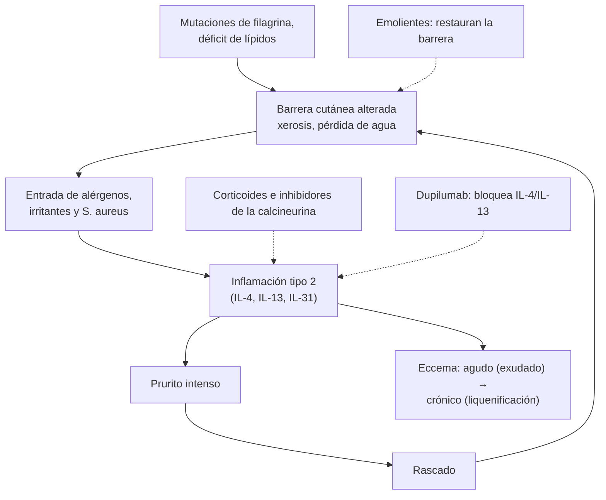

---
tags:
  - Dermatología
  - Frecuente en sala
---

# Dermatitis atópica, de contacto, seborreica y del pañal

**Subespecialidad**
Dermatología · Pediatría · Medicina familiar · Atención primaria

**Guías principales**
AAD 2023: dermatitis atópica del adulto con tratamientos tópicos · AAD 2024: dermatitis atópica con fototerapia y tratamientos sistémicos (y actualización focalizada de 2025)

**Otras fuentes**
Revisión de la dermatitis atópica (Langan, *Lancet* 2020) · Revisión de la dermatitis seborreica (Borda y Wikramanayake 2015) · Prevención y tratamiento de la dermatitis del pañal (Blume-Peytavi, *Pediatr Dermatol* 2018) · Ver [asma](../../respiratorio/asma.md), [infecciones de piel](../../infectologia/infecciones-piel-partes-blandas.md), [herpes](../../infectologia/varicela-y-herpes-zoster.md) y [VIH](../../infectologia/infeccion-por-vih.md)

**GES**
No.

**EUNACOM**
6.01.1.004 Dermatitis atópica (específico, completo, derivar) · 6.01.1.005 Dermatitis del pañal (específico, completo, completo) · 6.01.1.006 Dermatitis seborreica infantil y del adulto (específico, completo, completo) · 6.01.1.007 Dermitis de contacto (específico, completo, completo)

**Revisado**
Octubre 2026

!!! abstract "Resumen en 60 segundos"
    - **Eccema** (dermatitis): inflamación de la epidermis con **prurito**, eritema, vesículas o exudado (agudo) y **liquenificación** (crónico).
    - **Dermatitis atópica**: crónica, recurrente y muy **pruriginosa**; inicio en la **infancia** (~ 15–20 % de los niños). **Distribución según la edad**: mejillas y zonas de extensión en el lactante; **pliegues** (codos, rodillas) en el niño; manos, cuello y párpados en el adulto. Se asocia a **asma** y **rinitis alérgica** (marcha atópica).
    - **Base del tratamiento atópico**: **emolientes** diarios, evitar irritantes, **corticoides tópicos** en los brotes (potencia según la zona y la edad), **inhibidores de la calcineurina** (tacrolimus, pimecrolimus) en la cara y los pliegues. Moderada a grave refractaria: **fototerapia**, **dupilumab** y otros sistémicos (derivar).
    - **Dermatitis de contacto**: **irritativa** (la más frecuente: jabones, agua, detergentes; manos de trabajadores) o **alérgica** (hipersensibilidad **tipo IV**: **níquel**, perfumes, conservantes, cosméticos). Distribución según el **contacto**. Diagnóstico alérgico con el **test de parche**. Tratamiento: **evitar** el agente + corticoide tópico.
    - **Dermatitis seborreica**: eritema con **escamas grasas** amarillentas en el **cuero cabelludo**, las cejas, los **surcos nasogenianos** y el pecho; costra láctea en el lactante. Relacionada con ***Malassezia***. Tratamiento: **ketoconazol** tópico (champú o crema), corticoides de baja potencia por pocos días. Grave o de inicio brusco en el adulto: pensar en **VIH** o **Parkinson**.
    - **Dermatitis del pañal**: irritativa por la **humedad** y la oclusión; **respeta los pliegues**. Si **compromete los pliegues** con **lesiones satélite**: **candidiasis** (antifúngico tópico). Tratamiento: **cambios frecuentes**, aire, **pasta de óxido de zinc**.
    - **Alarmas**: **eccema herpético** (vesículas umbilicadas y erosiones en un atópico, con fiebre: **aciclovir** urgente) y **sobreinfección** por *S. aureus*.

## Definición

- **Dermatitis atópica**: enfermedad inflamatoria **crónica** y **recurrente** de la piel, caracterizada por **prurito intenso**, **xerosis** (piel seca) y lesiones eccematosas con una **distribución típica según la edad**, en personas con predisposición atópica.
- **Dermatitis de contacto**: reacción inflamatoria por la exposición de la piel a una sustancia externa:
    - **Irritativa**: daño **directo** no inmunológico (dosis-dependiente; cualquiera puede presentarla).
    - **Alérgica**: hipersensibilidad **retardada tipo IV** mediada por **linfocitos T** frente a un alérgeno, en una persona **sensibilizada**.
- **Dermatitis seborreica**: dermatosis inflamatoria crónica y recurrente de las zonas **seborreicas** (ricas en glándulas sebáceas), asociada a la levadura ***Malassezia***.
- **Dermatitis del pañal**: inflamación de la piel cubierta por el pañal (dermatitis de contacto **irritativa** por orina y heces, humedad y fricción), a menudo sobreinfectada por ***Candida***.

## Epidemiología

### Mundial

- **Dermatitis atópica**: **15–20 %** de los niños y **2–10 %** de los adultos; ~ **60 %** comienza en el **primer año** de vida y ~ 85 % antes de los 5 años. Más frecuente en países de **ingresos altos** y en zonas **urbanas**.
- **Dermatitis de contacto**: una de las primeras causas de **enfermedad dermatológica ocupacional** (manos); la **irritativa** representa ~ **80 %**.
- **Dermatitis seborreica**: **1–3 %** de los adultos (la caspa, mucho más); más en **hombres**, en los lactantes de 1–3 meses, en el **VIH** (hasta 30–80 %) y en el **Parkinson**.
- **Dermatitis del pañal**: hasta **50 %** de los lactantes presenta algún episodio; máximo entre los **9 y 12 meses**.

### Chile

!!! chile "Datos nacionales"
    - La dermatitis atópica es uno de los motivos de consulta más frecuentes en la **dermatología pediátrica** y en el control de **salud infantil** de la APS.
    - La **dermatitis de contacto ocupacional** (manos de trabajadores de la salud, la limpieza, la construcción por el **cemento** con cromo, la peluquería) se cubre como enfermedad profesional por la **Ley 16.744** (ver [accidentes del trabajo](../../traumatologia/accidentes-del-trabajo-y-enfermedades-profesionales.md)).
    - Los **emolientes** y los corticoides tópicos de baja y mediana potencia están disponibles en la APS; los biológicos (dupilumab) son de manejo del especialista.

## Etiología y factores de riesgo

- **Dermatitis atópica**:
    - **Disfunción de la barrera** cutánea (mutaciones de la **filagrina**), pérdida de agua transepidérmica.
    - **Inflamación tipo 2** (IL-4, IL-13, IL-31: prurito) y disbiosis con colonización por ***S. aureus***.
    - **Antecedentes familiares** de atopia (asma, rinitis, dermatitis).
    - **Gatillantes**: jabones y detergentes, lana, sudor, calor, estrés, aeroalérgenos (ácaros), infecciones; los **alimentos** rara vez son la causa en los niños mayores.
- **Dermatitis de contacto**:
    - **Irritativa**: agua y **lavado frecuente**, jabones, detergentes, solventes, guantes oclusivos, fricción.
    - **Alérgica**: **níquel** (bisutería, hebillas), **cromo** (cemento, cuero), **fragancias**, conservantes (**metilisotiazolinona**, formaldehído), **parafenilendiamina** (tinturas de pelo, tatuajes de henna negra), **látex**, neomicina, gomas, plantas.
- **Dermatitis seborreica**: ***Malassezia***, actividad sebácea, inmunodepresión (**VIH**), enfermedades neurológicas (**Parkinson**, ACV), estrés, frío.
- **Dermatitis del pañal**: **humedad** prolongada, **oclusión**, enzimas fecales (diarrea), cambios poco frecuentes, antibióticos (candidiasis).

## Fisiopatología

*Figura 1. Círculo de barrera alterada, inflamación tipo 2, prurito y rascado en la dermatitis atópica, y sitio de acción de los tratamientos. Esquema propio basado en Langan (2020) y AAD 2023.*

- **Dermatitis de contacto alérgica**: fase de **sensibilización** (el hapteno se une a proteínas y lo presentan las células de Langerhans a los linfocitos T) y fase de **elicitación** (nueva exposición → reacción en **24–72 horas**).

## Clasificación

| Tipo | Edad y distribución típicas | Claves |
|---|---|---|
| **Atópica del lactante** (< 2 años) | **Mejillas** (respeta el triángulo centrofacial), cuero cabelludo, superficies de **extensión**; respeta el área del pañal | Lesiones exudativas |
| **Atópica del niño** (2–12 años) | **Pliegues** de codos y rodillas, cuello, muñecas, tobillos | Liquenificación |
| **Atópica del adolescente y adulto** | **Cara** (párpados), **cuello**, **manos**, pliegues | Liquenificación, prurigo |
| **Contacto irritativa** | Zonas de exposición (**manos**, dorso y espacios interdigitales) | Ardor más que prurito; bordes difusos |
| **Contacto alérgica** | Forma del objeto (lóbulo de la oreja por aros, ombligo por hebilla, párpados por cosméticos) | **Prurito**, vesículas, bordes netos; puede **extenderse** |
| **Seborreica del lactante** | **Costra láctea** (cuero cabelludo), cara, pliegues, área del pañal | Poco prurito; 1–3 meses; autolimitada |
| **Seborreica del adulto** | Cuero cabelludo (caspa), **cejas**, **surcos nasogenianos**, retroauricular, preesternal | Escamas **grasas** amarillentas; crónica con brotes |
| **Pañal irritativa** | Zonas **convexas** en contacto con el pañal | **Respeta los pliegues** |
| **Pañal candidiásica** | **Compromete los pliegues** | Eritema intenso con **pápulas y pústulas satélite** |

## Clínica

- **Criterios de la dermatitis atópica** (Hanifin y Rajka, simplificados del Reino Unido): **prurito** + ≥ 3 de: antecedente de compromiso de los **pliegues**, antecedente personal de **asma o rinitis** (o familiar en < 4 años), **piel seca** generalizada, eccema **flexural** visible, **inicio antes de los 2 años**.
- **Signos menores** de atopia: pliegue de **Dennie-Morgan** (infraorbitario), oscurecimiento periorbitario, **pitiriasis alba**, queratosis pilar, hiperlinealidad palmar, dermografismo blanco.
- **Dermatitis de contacto alérgica**: placas eritematosas y vesiculosas **pruriginosas** con la forma del objeto, que aparecen 1–3 días tras el contacto.
- **Dermatitis seborreica**: placas eritematosas con **escamas grasas amarillentas** en las zonas seborreicas; **blefaritis**; empeora en invierno y con el estrés.
- **Dermatitis del pañal**: eritema brillante en los glúteos, los genitales y la parte baja del abdomen; las formas graves tienen erosiones (dermatitis de **Jacquet**).

!!! alarma "Signos de alarma"
    - **Eccema herpético** (erupción variceliforme de Kaposi): en un atópico, brusca aparición de **vesículas umbilicadas** y **erosiones** en sacabocado, con **fiebre** y malestar. **Aciclovir** urgente y derivar (riesgo de queratitis si es periocular).
    - **Sobreinfección bacteriana** (*S. aureus*): costras **melicéricas**, pústulas, exudado, fiebre.
    - **Eritrodermia** (> 90 % de la superficie): hospitalizar.
    - **Falla de crecimiento** o infecciones recurrentes graves con eccema: pensar en una **inmunodeficiencia** (Wiskott-Aldrich, síndrome de hiper-IgE).
    - **Dermatitis seborreica grave o refractaria** en un adulto joven: **VIH**.
    - **Dermatitis del pañal** con **pápulas, vesículas o lesiones purpúricas**, que no responde: pensar en **histiocitosis de células de Langerhans**, **déficit de zinc** (acrodermatitis enteropática), psoriasis o **abuso**.

## Diagnóstico

!!! guia "Puntos clave (AAD 2023)"
    - El diagnóstico de la dermatitis atópica es **clínico** (prurito, morfología y distribución según la edad, curso crónico y recurrente, atopia personal o familiar).
    - Evaluar la **gravedad** (extensión, intensidad, **prurito y sueño**, calidad de vida: escalas SCORAD o EASI) y las **comorbilidades** (asma, rinitis, ansiedad, depresión, alteración del sueño).
    - **No** pedir de rutina IgE ni pruebas de alergia alimentaria: pueden llevar a **dietas restrictivas innecesarias**. Solo si hay una historia clara de reacción inmediata a un alimento.
    - **Test de parche**: en la sospecha de **dermatitis de contacto alérgica** o en la atópica que no responde o cambia de distribución.
    - **KOH** o cultivo si se sospecha una infección fúngica; **PCR para herpes** en el eccema herpético; cultivo si hay sobreinfección.

## Laboratorio

| Examen | Cuándo |
|---|---|
| **Test de parche** (alérgenos estándar, lectura a las 48 y 96 horas) | Dermatitis de contacto alérgica |
| **KOH** y cultivo de hongos | Placas descamativas que podrían ser **tiña** |
| **PCR o Tzanck** para herpes | Eccema herpético |
| **Cultivo bacteriano** | Sobreinfección que no responde |
| **VIH** | Dermatitis seborreica grave en un adulto |
| **Zinc** plasmático | Dermatitis del pañal y perioral refractaria en un lactante (acrodermatitis enteropática) |

## Imágenes

- No se requieren.

## Diagnóstico diferencial

| Diagnóstico | Claves |
|---|---|
| **Escabiosis** (sarna) | Prurito **nocturno**, **surcos**, espacios interdigitales, convivientes afectados |
| **Psoriasis** | Placas **bien delimitadas** con escamas **plateadas**, codos y rodillas (extensión), uñas |
| **Tiña** (dermatofitosis) | Borde **activo** descamativo, curación central; KOH positivo |
| **Dermatitis seborreica** frente a **atópica** del lactante | La seborreica tiene escamas grasas, poco prurito y compromete el pañal |
| **Pitiriasis rosada** | Placa heraldo, disposición en "árbol de Navidad" |
| **Micosis fungoide** (linfoma cutáneo) | Adulto con placas fijas en zonas no expuestas, refractarias |
| **Lupus**, **rosácea** (frente a la seborreica facial) | Fotosensibilidad, sin escamas grasas |
| **Candidiasis**, **psoriasis del pañal**, **histiocitosis** (frente a la del pañal) | Ver alarmas |

## Tratamiento

### Dermatitis atópica

!!! guia "Tratamiento escalonado (AAD 2023 y 2024)"
    - **Para todos**:
        - **Emolientes** al menos **2 veces al día** (de preferencia sin perfume), sobre todo tras el baño.
        - **Baños** cortos y tibios, con **sustitutos del jabón** (syndets); secar sin frotar.
        - Evitar los irritantes (lana, perfumes, detergentes fuertes) y el **rascado** (uñas cortas).
    - **Brote leve a moderado**: **corticoide tópico** de potencia adecuada **1–2 veces al día** por 1–2 semanas (baja potencia en la cara, los pliegues y los lactantes; mediana a alta en el tronco y las extremidades).
    - **Cara, párpados y pliegues**, o uso prolongado: **inhibidores de la calcineurina** tópicos (**tacrolimus** 0,03–0,1 %, **pimecrolimus**). Alternativas: crisaborol y otros tópicos nuevos.
    - **Mantención proactiva** en los recurrentes: corticoide o tacrolimus **2 veces por semana** en las zonas que suelen brotar.
    - **Moderada a grave** que no responde: **derivar** para **fototerapia** (UVB de banda estrecha) o tratamientos **sistémicos**: **dupilumab**, tralokinumab, lebrikizumab; inhibidores de JAK (upadacitinib, abrocitinib); inmunosupresores clásicos (ciclosporina, metotrexato). Los **corticoides sistémicos** **no** se recomiendan (rebote).
    - **Prurito**: los **antihistamínicos** no tratan la dermatitis; los sedantes pueden ayudar al **sueño** por cortos períodos.
    - **Sobreinfección**: antibiótico tópico u oral; **baños con hipoclorito diluido** en los recurrentes.

!!! dosis "Corticoides tópicos y otros"
    | Potencia | Ejemplos | Uso |
    |---|---|---|
    | **Baja** | **Hidrocortisona** 1 % | Cara, pliegues, área del pañal, lactantes |
    | **Mediana** | **Mometasona** 0,1 %, betametasona valerato 0,1 % | Tronco y extremidades |
    | **Alta** | Betametasona dipropionato 0,05 % | Placas gruesas, palmas y plantas; por poco tiempo |
    | **Muy alta** | **Clobetasol** 0,05 % | Placas muy liquenificadas; no en la cara ni los pliegues |
    - **Unidad de la punta del dedo** (~ 0,5 g) cubre la superficie de **2 palmas** de adulto.
    - **Efectos adversos**: **atrofia**, estrías, telangiectasias, rosácea y dermatitis perioral (en la cara), absorción sistémica en los lactantes con uso extenso.
    - **Tacrolimus** 0,1 % (adultos) o 0,03 % (niños ≥ 2 años) 2 veces al día: ardor transitorio; no produce atrofia.
    - **Aciclovir** en el eccema herpético: 15 mg/kg/dosis 5 veces al día VO en niños (o EV en los graves), o 400 mg 3 veces al día en adultos, por 7–10 días.

### Dermatitis de contacto

- **Identificar y evitar** el agente (test de parche en la alérgica; adaptar el trabajo).
- **Corticoide tópico** de mediana a alta potencia por 1–2 semanas; **compresas** frías en la fase aguda exudativa.
- **Corticoide oral** (prednisona 0,5–1 mg/kg/día por ~ **2–3 semanas** con descenso) si es extensa (> 20 % de la superficie) o grave en la cara.
- **Protección**: guantes (de algodón bajo los de goma), **emolientes** y cremas barrera; en la irritativa de manos, reducir el lavado y usar alcohol gel con emolientes.

### Dermatitis seborreica

- **Adulto**: **ketoconazol 2 %** en champú o crema (2–3 veces por semana o diario en la cara) o ciclopirox; **corticoide de baja potencia** por pocos días en los brotes; **tacrolimus** o pimecrolimus como ahorradores de corticoides en la cara; champús de piritiona de zinc, sulfuro de selenio o alquitrán.
- **Lactante** (costra láctea): **aceites** o emolientes para ablandar las escamas, lavado suave y cepillado; ketoconazol en crema si es extensa; se resuelve en meses.

### Dermatitis del pañal

- **ABCDE**: **A**ire (tiempo sin pañal), **B**arrera (**pasta de óxido de zinc** o vaselina en cada cambio), **C**ambios frecuentes (pañales superabsorbentes) y limpieza suave con agua o toallitas sin perfume, **D**isminuir los irritantes, **E**ducación.
- **Candidiasis**: **nistatina**, **clotrimazol** o miconazol tópicos 2–3 veces al día por 7–14 días.
- **Corticoide de baja potencia** (hidrocortisona 1 %) por **pocos días** si hay mucha inflamación. **Evitar** los de alta potencia y las combinaciones con antibióticos o antifúngicos potentes en esta zona.

## Complicaciones

- **Atópica**: **sobreinfección** por *S. aureus*, **eccema herpético**, molusco contagioso extenso, alteración del **sueño**, bajo rendimiento escolar, ansiedad y depresión, efectos adversos de los corticoides.
- **De contacto**: cronificación, **incapacidad laboral**, sensibilización a nuevos alérgenos.
- **Seborreica**: blefaritis, sobreinfección.
- **Pañal**: candidiasis, sobreinfección bacteriana, erosiones.

## Pronóstico y seguimiento

- La **dermatitis atópica** mejora con la edad en la mayoría (~ 60–70 % remite o mejora en la adolescencia), pero puede persistir o reaparecer en el adulto; la **marcha atópica** puede llevar al asma y la rinitis.
- La **de contacto** se resuelve al evitar el agente; la alérgica persiste de por vida (la sensibilización no desaparece).
- La **seborreica del adulto** es crónica con brotes; la del lactante se resuelve en meses.
- Seguimiento según la gravedad; educación sobre el uso correcto de los emolientes y los corticoides ("corticofobia").

## Perlas para el internado

!!! perla "Para recordar"
    - **Atópica**: lactante → **mejillas y extensión**; niño → **pliegues**; adulto → **manos, cuello, párpados**.
    - **Emolientes** diarios en todos; **corticoide tópico** en los brotes; **tacrolimus** en la cara y los pliegues.
    - **No** pedir pruebas de alergia alimentaria de rutina en la dermatitis atópica.
    - **Atópico con vesículas umbilicadas, erosiones y fiebre** = **eccema herpético**: aciclovir urgente.
    - **Contacto alérgica** = forma del objeto (níquel en el ombligo o las orejas); **test de parche**.
    - **Seborreica** = escamas grasas en los surcos nasogenianos y las cejas; **ketoconazol**. Grave en un adulto joven = **VIH**.
    - **Pañal**: irritativa **respeta los pliegues**; **candidiásica** los **compromete** con lesiones satélite.

## Preguntas de repaso

??? repaso "1. Niño de 6 años con placas liquenificadas muy pruriginosas en los pliegues de los codos y las rodillas, piel seca y asma. ¿Diagnóstico y tratamiento?"
    **Dermatitis atópica** del niño. Tratamiento: **emolientes** 2 veces al día, baños cortos con sustitutos del jabón, evitar los irritantes; **corticoide tópico** de mediana potencia (mometasona) 1 vez al día por 1–2 semanas en las placas, y luego **mantención proactiva** 2 veces por semana si recurre. Educar a la familia.

??? repaso "2. Lactante de 8 meses con dermatitis atópica que en 48 horas presenta vesículas umbilicadas, erosiones en sacabocado en la cara y fiebre. ¿Qué tiene y qué hace?"
    **Eccema herpético** (infección por herpes simple sobre la dermatitis atópica). **Aciclovir** urgente (EV si es extenso o el niño está comprometido), hospitalizar según la gravedad, evaluar los **ojos** (oftalmología si hay lesiones perioculares) y tratar la sobreinfección bacteriana si existe.

??? repaso "3. Mujer de 30 años con placa eritematosa, vesiculosa y pruriginosa en la región periumbilical, justo donde apoya la hebilla del cinturón. ¿Diagnóstico y estudio?"
    **Dermatitis de contacto alérgica al níquel**. Confirmar con un **test de parche**. Tratamiento: **evitar el níquel** (cubrir la hebilla, cambiar la bisutería) y un **corticoide tópico** de mediana potencia por 1–2 semanas.

??? repaso "4. Hombre de 35 años con dermatitis seborreica extensa y grave de aparición reciente en la cara, el cuero cabelludo y el pecho. ¿Qué examen pide?"
    **VIH** (la dermatitis seborreica grave, extensa o de inicio brusco en un adulto joven es un marcador de inmunodepresión). Tratamiento con **ketoconazol** tópico y un corticoide de baja potencia por pocos días.

??? repaso "5. Lactante de 10 meses con eritema intenso en el área del pañal que compromete los pliegues inguinales y tiene pápulas y pústulas satélite. ¿Qué indica?"
    **Dermatitis del pañal con candidiasis**. Tratamiento: **antifúngico tópico** (nistatina o clotrimazol 2–3 veces al día por 7–14 días), **pasta de óxido de zinc** como barrera, **cambios frecuentes** y tiempo sin pañal. Hidrocortisona 1 % por pocos días si hay mucha inflamación.

??? repaso "6. ¿Cuándo derivar a un paciente con dermatitis atópica?"
    Cuando es **moderada a grave** y no responde al tratamiento tópico adecuado (para fototerapia o sistémicos como el **dupilumab**), si hay **eccema herpético** o infecciones recurrentes, **eritrodermia**, duda diagnóstica, sospecha de **dermatitis de contacto** sobreagregada (test de parche), **falla de crecimiento** o gran impacto en el sueño y la calidad de vida.

## Referencias

1. Sidbury R, Alikhan A, Bercovitch L, et al. Guidelines of care for the management of atopic dermatitis in adults with topical therapies. *J Am Acad Dermatol.* 2023;89(1):e1–e20. doi:[10.1016/j.jaad.2022.12.029](https://doi.org/10.1016/j.jaad.2022.12.029)
2. Davis DMR, Drucker AM, Alikhan A, et al. Guidelines of care for the management of atopic dermatitis in adults with phototherapy and systemic therapies. *J Am Acad Dermatol.* 2024;90(2):e43–e56. doi:[10.1016/j.jaad.2023.08.102](https://doi.org/10.1016/j.jaad.2023.08.102)
3. Davis DMR, Frazer-Green L, Alikhan A, et al. Focused update: guidelines of care for the management of atopic dermatitis in adults. *J Am Acad Dermatol.* 2025;93(3):745.e1–745.e7. doi:[10.1016/j.jaad.2025.05.1386](https://doi.org/10.1016/j.jaad.2025.05.1386)
4. Langan SM, Irvine AD, Weidinger S. Atopic dermatitis. *Lancet.* 2020;396(10247):345–360. doi:[10.1016/S0140-6736(20)31286-1](https://doi.org/10.1016/S0140-6736(20)31286-1)
5. Borda LJ, Wikramanayake TC. Seborrheic dermatitis and dandruff: a comprehensive review. *J Clin Investig Dermatol.* 2015;3(2). doi:[10.13188/2373-1044.1000019](https://doi.org/10.13188/2373-1044.1000019)
6. Blume-Peytavi U, Kanti V. Prevention and treatment of diaper dermatitis. *Pediatr Dermatol.* 2018;35(Suppl 1):s19–s23. doi:[10.1111/pde.13495](https://doi.org/10.1111/pde.13495)
