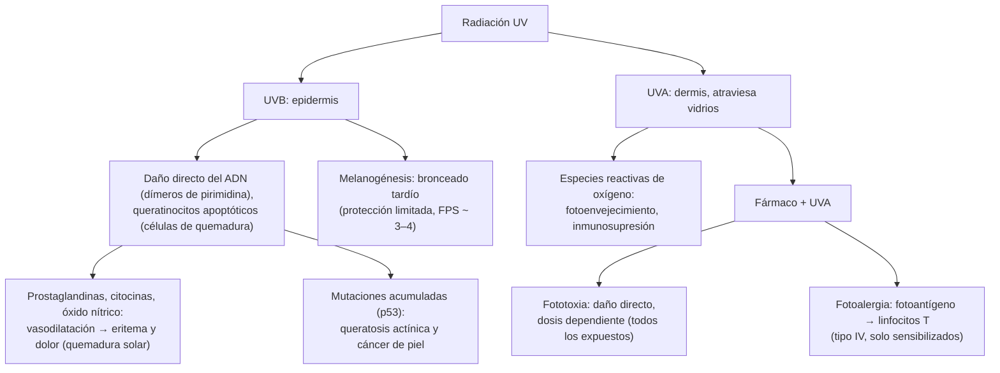

---
tags:
  - Dermatología
---

# Fotodermatosis, quemadura solar y fotoprotección

**Subespecialidad**
Dermatología · Atención primaria · Salud ocupacional

**Guías principales**
Guía Técnica de Radiación Ultravioleta de Origen Solar del MINSAL (2011) y D.S. N.° 594 modificado en 2011 · Ley 20.096 (2006) · Clasificación, evaluación y manejo de las fotodermatosis (*Br J Dermatol* 2009)

**Otras fuentes**
Ensayo de Nambour sobre fotoprotector y melanoma (*J Clin Oncol* 2011) · Revisiones de erupción polimorfa lumínica (*Dermatol Ther* 2021) y fotosensibilidad por fármacos (*Front Allergy* 2022) · Ver [tumores cutáneos](tumores-cutaneos-melanoma-carcinomas-y-lesiones-benignas.md), [lupus cutáneo](ampollares-lupus-cutaneo-vasculitis-y-eritema-nodoso.md), [dermatitis de contacto](dermatitis-atopica-contacto-seborreica-y-del-panal.md), [quemaduras](../../cirugia/piel-partes-blandas-y-quemaduras/quemaduras-secuelas-y-cicatrices.md) y [accidentes del trabajo y enfermedades profesionales](../../traumatologia/accidentes-del-trabajo-y-enfermedades-profesionales.md)

**GES**
No.

**EUNACOM**
6.01.1.011 Fotodermatosis (sospecha, inicial, completo) · 6.01.2.011 Quemadura solar (específico, completo, no requiere) · 6.01.3.001 Fotoprotección

**Revisado**
Octubre 2026

!!! abstract "Resumen en 60 segundos"
    - **Radiación UV**: **UVB** (290–320 nm) produce la **quemadura solar** y es la principal causa del cáncer de piel; **UVA** (320–400 nm) penetra más profundo, atraviesa los vidrios y causa **fotoenvejecimiento**, **fotosensibilidad por fármacos** y también cáncer.
    - **Quemadura solar**: eritema **doloroso** a las **3–6 horas**, máximo a las **12–24 horas**, con ampollas si es de segundo grado superficial. Tratamiento: **frío local**, **emolientes**, **AINE**, hidratación y evitar el sol. Los corticoides tópicos sirven poco.
    - **Fotodermatosis**: reacciones anormales a la luz. La más frecuente es la **erupción polimorfa lumínica** (pápulas pruriginosas en primavera, horas o días después de exponerse). Otras: **fototoxia** y **fotoalergia** por fármacos (doxiciclina, AINE, tiazidas, amiodarona, quinolonas), **fitofotodermatitis** (limón), **lupus**, **porfirias** y **pelagra**.
    - **Fotoprotección**: **sombra** entre las **11 y las 16 horas**, **ropa**, **sombrero** de ala ancha, **lentes** con filtro UV y **fotoprotector** de amplio espectro con **FPS ≥ 30** (≥ 50 en piel clara o alta exposición), en cantidad suficiente (**2 mg/cm²**, una cucharadita para la cara y el cuello) y **reaplicado cada 2 horas**. Niños < 6 meses: **sin sol directo**.
    - **Chile**: índice UV muy alto en verano; la normativa (D.S. N.° 594 y Guía Técnica del MINSAL de 2011) obliga a los empleadores a **proteger a los trabajadores expuestos** al sol.

## Definición

- **Quemadura solar**: reacción **inflamatoria aguda** de la piel por una exposición excesiva a la radiación UV (sobre todo **UVB**), equivalente a una quemadura de **primer grado** o de **segundo grado superficial**.
- **Fotodermatosis**: grupo de enfermedades en que la piel reacciona de forma **anormal** a la radiación UV o visible:
    - **Idiopáticas** (inmunológicas): erupción polimorfa lumínica, urticaria solar, prurigo actínico, dermatitis actínica crónica, hidroa vacciniforme.
    - **Por agentes exógenos**: **fototoxia** y **fotoalergia** (fármacos, plantas, cosméticos).
    - **Por defectos metabólicos o genéticos**: **porfirias** cutáneas, pelagra, xeroderma pigmentoso.
    - **Fotoagravadas**: **lupus eritematoso**, dermatomiositis, rosácea, herpes simple, dermatitis atópica (a veces), pénfigo.
- **Fotoprotección**: conjunto de medidas para reducir la exposición a la radiación UV y sus efectos dañinos.
- **Índice UV** (OMS): estimación de la intensidad de la radiación UV que produce eritema: **bajo** (1–2), **moderado** (3–5), **alto** (6–7), **muy alto** (8–10) y **extremo** (≥ 11). Con **≥ 3** se recomienda protegerse.

## Epidemiología

- **Mundial**:
    - La quemadura solar es muy frecuente: en muchos países, **más de un tercio** de los adultos refiere al menos una quemadura en el último año. Las quemaduras en la **infancia** aumentan el riesgo de **melanoma**.
    - La **erupción polimorfa lumínica** afecta a ~ **10–20 %** de la población en los países de clima templado; predomina en las **mujeres jóvenes** de piel clara.
    - La **fotosensibilidad por fármacos** representa una parte importante de las reacciones adversas cutáneas a medicamentos.
- **Chile**:
    - Por la latitud, la **altitud** (zona andina, altiplano), la **baja nubosidad** del norte y la cercanía al **agujero de ozono** en la primavera austral, el índice UV alcanza niveles **extremos** (≥ 11) en el verano en gran parte del país.
    - Los **trabajadores al aire libre** (agricultura, construcción, pesca, minería) están muy expuestos.

!!! chile "Normativa nacional"
    - **Ley 20.096** (2006): establece mecanismos de control de las sustancias que agotan la capa de ozono y medidas sobre la radiación UV. Exige que los **fotoprotectores** indiquen su **factor de protección** en el rotulado y que el índice UV se informe según la escala de la **OMS**; obliga a los empleadores a incluir el riesgo de la radiación UV en sus reglamentos internos.
    - **D.S. N.° 594 (modificado en 2011)** y **Guía Técnica de Radiación Ultravioleta de Origen Solar del MINSAL** (2011): obligatorias para las empresas con **trabajadores expuestos** al sol y para los administradores del seguro de la Ley 16.744. El empleador debe **informar** el riesgo, **publicar a diario** el índice UV estimado por la Dirección Meteorológica de Chile, aplicar medidas de **ingeniería** (sombra), **administrativas** (horarios) y entregar **elementos de protección personal** (fotoprotector, sombrero, ropa, lentes), con un programa de prevención y capacitación ([instructivo de la ACHS](https://www.achs.cl/doc-noticia/centro-de-noticias/Documents/Guia-Tecnica-Radiacion-UV.pdf)).
    - La Dirección Meteorológica de Chile publica el **pronóstico del índice UV** diario por ciudad.

## Etiología y factores de riesgo

| Cuadro | Causas y factores |
|---|---|
| **Quemadura solar** | **Fototipo** claro (I–II), niños, exposición **intermitente** intensa (vacaciones, playa, nieve, altura), horas centrales del día, **reflejo** (nieve ~ 80 %, arena y agua), fármacos fotosensibilizantes, falta de fotoprotección |
| **Fototoxia** | **Fármacos**: **doxiciclina** y otras tetraciclinas, **quinolonas**, **AINE** (piroxicam, naproxeno, ketoprofeno), **tiazidas** y furosemida, **amiodarona**, fenotiazinas, **voriconazol**, metotrexato, retinoides, psoralenos, vemurafenib. **Plantas** con **furocumarinas** (limón, lima, apio, higuera, chirivía): **fitofotodermatitis** |
| **Fotoalergia** | Filtros solares (benzofenonas, octocrileno), **ketoprofeno tópico**, perfumes, antisépticos, fenotiazinas tópicas |
| **Erupción polimorfa lumínica** | Predisposición genética; falta de adaptación de la piel a la UV en primavera |
| **Porfiria cutánea tarda** | Déficit de uroporfirinógeno descarboxilasa; gatillantes: **alcohol**, **VHC**, **hierro** (hemocromatosis), **estrógenos**, VIH |
| **Pelagra** | Déficit de **niacina** (alcoholismo, malabsorción, isoniazida, síndrome carcinoide) |

## Fisiopatología

*Figura 1. Efectos biológicos de la radiación ultravioleta. Esquema propio basado en Bylaite (2009) y Di Bartolomeo (2022).*

- El **bronceado** es una respuesta al **daño** del ADN y aporta una protección muy limitada. No existe un "bronceado seguro".
- La radiación UV produce **inmunosupresión** cutánea, que favorece el cáncer y la reactivación del herpes labial.

## Clasificación

| Fototipo (Fitzpatrick) | Respuesta al sol |
|---|---|
| **I** | Siempre se quema, nunca se broncea (piel muy blanca, pelirrojos, pecas) |
| **II** | Se quema con facilidad, se broncea poco |
| **III** | Se quema moderadamente, se broncea gradualmente |
| **IV** | Se quema poco, se broncea con facilidad |
| **V** | Rara vez se quema, piel morena |
| **VI** | Nunca se quema, piel negra |

| Fototoxia | Fotoalergia |
|---|---|
| Frecuente; puede afectar a **cualquier persona** con dosis suficiente | Poco frecuente; solo los **sensibilizados** |
| Aparece en **minutos a horas** desde la primera exposición | **24–72 horas** (requiere sensibilización previa) |
| Parece una **quemadura solar exagerada** (eritema, ampollas, hiperpigmentación posterior, fotoonicólisis) | Parece un **eccema** pruriginoso (vesículas, descamación) |
| Limitada **estrictamente** a la zona expuesta | Puede **extenderse** a la piel no expuesta |
| Dosis dependiente | No dosis dependiente |

## Clínica

- **Quemadura solar**: **eritema**, **calor** y **dolor** en las zonas expuestas que comienza **3–6 horas** después de la exposición, con máximo a las **12–24 horas** y resolución en **3–5 días** con **descamación**. En las formas intensas: **edema**, **vesículas o ampollas**, y síntomas sistémicos (**fiebre**, escalofríos, cefalea, náuseas, deshidratación; "intoxicación solar"). Respeta las zonas cubiertas y los pliegues.
- **Erupción polimorfa lumínica**: **pápulas**, placas o vesículas **muy pruriginosas** en las zonas expuestas en invierno (escote, antebrazos, dorso de las manos; la **cara** suele respetarse por la adaptación), **horas a días** después de las primeras exposiciones de la **primavera** o en las vacaciones. Mejora con la exposición repetida durante el verano ("endurecimiento").
- **Fototoxia por fármacos**: quemadura solar exagerada en el área expuesta; con las tetraciclinas y los psoralenos, **fotoonicólisis**; con la **amiodarona**, pigmentación **azul-grisácea**; con el **voriconazol**, riesgo de CEC.
- **Fitofotodermatitis**: lesiones **lineales**, en **gotas** o con la forma de las manos (escurrimiento de jugo de **limón** o lima), con eritema y ampollas y luego **hiperpigmentación** persistente. Típica en verano (bebidas con limón al sol, trabajadores que manipulan cítricos).
- **Fotoalergia**: **eccema** pruriginoso en las zonas expuestas que se extiende a zonas cubiertas.
- **Urticaria solar**: **habones** en minutos tras la exposición, que desaparecen en < 1–2 horas a la sombra.
- **Porfiria cutánea tarda**: **fragilidad cutánea**, **ampollas** y **erosiones** en el **dorso de las manos** tras traumatismos menores, quistes de milium, **hipertricosis** malar, hiperpigmentación. Orina de color oscuro.
- **Pelagra**: las "**3 D**": **dermatitis** fotosensible simétrica (dorso de las manos, **collar de Casal** en el cuello), **diarrea** y **demencia** (más una cuarta D: muerte).
- **Lupus cutáneo**: lesiones fotoinducidas (eritema malar, lupus subagudo); ver [lupus cutáneo](ampollares-lupus-cutaneo-vasculitis-y-eritema-nodoso.md).
- **Fotoenvejecimiento** (crónico): arrugas profundas, **elastosis** (piel amarillenta y engrosada), lentigos solares, telangiectasias, queratosis actínicas.

!!! alarma "Signos de alarma"
    - Quemadura solar **extensa** con **ampollas**, **fiebre**, escalofríos, vómitos, **deshidratación** o **compromiso de conciencia** (sobre todo en **niños** y **adultos mayores**): evaluar un **golpe de calor** asociado y hospitalizar si corresponde.
    - Quemadura en un **lactante**.
    - Fotosensibilidad nueva con **artralgias**, úlceras orales, fatiga o citopenias: **lupus**.
    - **Ampollas y fragilidad** en el dorso de las manos con orina oscura: **porfiria cutánea tarda** (buscar VHC, alcohol, hierro).
    - Fotosensibilidad con **diarrea** y **deterioro cognitivo** en un paciente alcohólico o desnutrido: **pelagra**.
    - Fotosensibilidad **desde la infancia** con muchas pecas y cánceres de piel precoces: **xeroderma pigmentoso** (derivar).

## Diagnóstico

!!! guia "Puntos clave (Bylaite 2009; guía técnica del MINSAL 2011)"
    - El diagnóstico es **clínico**: la **distribución** en las zonas **expuestas** (cara, escote en V, dorso de las manos y los antebrazos, orejas) **respetando** las zonas sombreadas (debajo del mentón, detrás de las orejas, párpados superiores, pliegues nasolabiales) sugiere una fotodermatosis.
    - Preguntar por el **tiempo** entre la exposición y la aparición, la **estación**, los **fármacos** (incluidos los tópicos y los de venta libre), los **cosméticos**, las **plantas** y la **ocupación**.
    - **Fototest** (fotoprovocación con UVA, UVB y luz visible) y **fotoparche** (fotoalergia): en centros especializados.
    - Laboratorio dirigido: **ANA** y **anti-Ro** (lupus), **porfirinas** en la orina, las heces y el plasma (porfirias).
    - **Quemadura solar**: diagnóstico clínico; graduarla como una quemadura (primer grado o segundo grado superficial) y estimar la superficie.

## Laboratorio

| Sospecha | Exámenes |
|---|---|
| **Lupus** | **ANA**, **anti-Ro y anti-La**, anti-DNA, hemograma, complemento, orina completa |
| **Porfiria cutánea tarda** | **Porfirinas** en orina (uroporfirina elevada; fluorescencia rosada con la luz de Wood), **ferritina** y saturación de transferrina, **VHC**, VIH, perfil hepático, estudio de **HFE** |
| **Protoporfiria eritropoyética** (dolor urente inmediato con el sol desde la infancia) | Protoporfirina en eritrocitos |
| **Pelagra** | Diagnóstico clínico y respuesta a la niacina; albúmina, otros déficits nutricionales |
| **Quemadura solar grave** | Electrolitos, función renal (deshidratación) |

## Imágenes

- No se requieren imágenes en las fotodermatosis.
- La **biopsia de piel** puede ayudar en las formas atípicas (erupción polimorfa lumínica frente a lupus).

## Diagnóstico diferencial

| Cuadro | Diferenciales |
|---|---|
| **Quemadura solar** | **Fototoxia** por fármacos (dosis de sol menor de la esperable), quemadura térmica o química, dermatitis de contacto, eritema por calor |
| **Erupción polimorfa lumínica** | **Lupus** cutáneo subagudo (más persistente, anular; anti-Ro), urticaria solar (minutos), prurigo actínico (niños, labios, de origen amerindio), **fotoalergia**, dermatitis de contacto aerotransportada |
| **Fitofotodermatitis** | Quemadura, dermatitis de contacto, **maltrato infantil** (lesiones en forma de mano) |
| **Fotoalergia** | Dermatitis de contacto alérgica (no fotodistribuida), dermatitis atópica, dermatitis actínica crónica (hombres mayores) |

## Tratamiento

!!! dosis "Quemadura solar"
    - **Salir del sol** y evitar exponerse hasta la recuperación.
    - **Frío local**: compresas frías, duchas frescas.
    - **Emolientes** o **geles con aloe vera** sin perfume ni anestésicos tópicos (benzocaína: riesgo de sensibilización).
    - **AINE** precoz: **ibuprofeno 400 mg cada 8 horas** (niños: 10 mg/kg cada 8 horas) o paracetamol.
    - **Hidratación** oral abundante.
    - **Ampollas**: no romperlas; si se rompen, curación como una **quemadura** superficial (limpieza y apósito no adherente).
    - **Corticoides tópicos**: de **poca utilidad** (beneficio mínimo, quizás en las primeras horas). Los corticoides sistémicos no están indicados.
    - **Hospitalizar** si es extensa con ampollas, hay deshidratación, fiebre alta o compromiso del estado general, sobre todo en los niños y los adultos mayores.

- **Erupción polimorfa lumínica**: **fotoprotección** (amplio espectro con protección **UVA** alta), **corticoides tópicos** de potencia media o alta en los brotes y antihistamínicos para el prurito. Prevención en los casos intensos: **fototerapia profiláctica** ("endurecimiento") con UVB de banda angosta en la primavera (especialista); hidroxicloroquina en casos seleccionados.
- **Fototoxia y fotoalergia**:
    - **Suspender o cambiar** el fármaco o el producto.
    - Si el fármaco es imprescindible (por ejemplo, la amiodarona), fotoprotección estricta.
    - Tratar como una quemadura (fototoxia) o un eccema (fotoalergia) con **corticoides tópicos**.
    - Advertir sobre la fotosensibilidad al recetar **doxiciclina**, **quinolonas**, **tiazidas**, **AINE**, **voriconazol** o **amiodarona**.
- **Fitofotodermatitis**: lavado de la zona, frío, corticoide tópico; la hiperpigmentación tarda meses en resolverse.
- **Porfiria cutánea tarda**: **suspender el alcohol** y los estrógenos, **flebotomías** (si hay sobrecarga de hierro) o **hidroxicloroquina en dosis bajas**, **tratar el VHC**, fotoprotección con protección contra la luz **visible** (fotoprotectores con color).
- **Pelagra**: **nicotinamida** 100 mg cada 6–8 horas VO (o 300–500 mg/día) hasta la resolución, más la corrección de la causa y otros déficits.

!!! dosis "Fotoprotección: recomendaciones"
    | Medida | Detalle |
    |---|---|
    | **Evitar el sol** de mayor intensidad | Entre las **11 y las 16 horas** o cuando la **sombra es más corta que la persona**; consultar el **índice UV** (protegerse desde 3) |
    | **Sombra** | Árboles, quitasoles, toldos (no protegen del reflejo) |
    | **Ropa** | Manga larga, tejidos densos y oscuros, ropa con **UPF** ≥ 30–50 |
    | **Sombrero** | **Ala ancha** (≥ 7–8 cm) o tipo **legionario** (cubre las orejas y el cuello) |
    | **Lentes de sol** | Con **filtro UV 100 %** (UV400), envolventes |
    | **Fotoprotector** | **Amplio espectro** (UVA y UVB), **FPS ≥ 30** (≥ 50 en fototipos claros, niños, alta exposición, trabajo al aire libre, antecedente de cáncer de piel), **resistente al agua** si hay sudor o baño |
    | **Cantidad** | **2 mg/cm²**: ~ **una cucharadita** (5 mL) para la cara, el cuello y las orejas; ~ **35 mL** (un vaso de licor) para todo el cuerpo de un adulto. La mayoría aplica menos de la mitad |
    | **Momento** | **15–30 minutos antes** de exponerse y **reaplicar cada 2 horas** y después de bañarse o sudar |
    | **Labios** | Bálsamo labial con FPS |
    | **Lactantes < 6 meses** | **Sin exposición solar directa**; protección física (sombra, ropa, sombrero). Fotoprotector solo en zonas pequeñas si no hay alternativa |
    | **Niños** | Fotoprotector mineral (dióxido de titanio, óxido de zinc) desde los 6 meses; educación en los colegios |
    | **Evitar** | **Camas solares** (aumentan el riesgo de melanoma) |
    | **Vitamina D** | El uso habitual de fotoprotector no produce un déficit relevante en la población general; suplementar en los grupos de riesgo según indicación |

    - El **FPS** mide la protección frente al **UVB** (eritema): FPS 15 bloquea ~ 93 %, FPS 30 ~ 97 % y FPS 50 ~ 98 % del UVB, **si se aplica en la cantidad correcta**.
    - El uso **diario** de fotoprotector en adultos redujo la incidencia de **CEC** y, en el seguimiento a 10 años, de **melanoma** (ensayo de Nambour, Australia).

## Complicaciones

- **Quemadura solar**: deshidratación, **golpe de calor**, infección de las ampollas, hiperpigmentación o hipopigmentación.
- **Exposición crónica a la UV**: **fotoenvejecimiento**, **queratosis actínicas**, **carcinoma basocelular y espinocelular**, **melanoma**, **cataratas**, **pterigión**, queratitis actínica ("ceguera de la nieve"), inmunosupresión cutánea.
- **Fotodermatosis**: alteración de la calidad de vida, hiperpigmentación posinflamatoria; la dermatitis actínica crónica puede ser incapacitante.
- **Fotoprotectores**: dermatitis de contacto alérgica o fotoalérgica (poco frecuentes), acné cosmético.

## Pronóstico y seguimiento

- **Quemadura solar**: se resuelve en **3–7 días**; cada quemadura, sobre todo en la **infancia**, **aumenta el riesgo acumulado** de melanoma y cáncer de piel.
- **Erupción polimorfa lumínica**: crónica y recurrente cada primavera; mejora en ~ 50 % en el curso de los años.
- **Fototoxia**: se resuelve al suspender el fármaco; la hiperpigmentación puede persistir meses.
- **Seguimiento**: educar en fotoprotección; en los pacientes con fototipo claro, muchos nevos o alta exposición (incluidos los **trabajadores al aire libre**), control dermatológico periódico y **autoexamen** de la piel.

## Perlas para el internado

!!! perla "Para recordar"
    - **UVB**: quemadura y cáncer. **UVA**: envejecimiento, fotosensibilidad por fármacos, atraviesa los vidrios.
    - Eritema que **respeta** debajo del mentón y detrás de las orejas: **fotodistribuido**.
    - Al recetar **doxiciclina** (también en la profilaxis de la leptospirosis o la malaria), **quinolonas**, **tiazidas**, **AINE**, **amiodarona** o **voriconazol**, advertir sobre la **fotosensibilidad**.
    - Lesiones lineales con ampollas en las manos o la boca tras tomar **limonada al sol**: **fitofotodermatitis** (no confundir con maltrato infantil).
    - Fotoprotector: **amplio espectro**, **FPS ≥ 30–50**, **suficiente** (una cucharadita para la cara) y **reaplicado cada 2 horas**. Es el complemento de la sombra y la ropa, no el reemplazo.
    - Lactante < 6 meses: **sin sol directo**.
    - Quemadura solar: frío, emolientes, **AINE** e hidratación. Corticoides tópicos: poco útiles.
    - En Chile, el empleador **debe** proteger a los trabajadores expuestos a la radiación UV (D.S. N.° 594 y Guía Técnica del MINSAL).

## Preguntas de repaso

??? repaso "1. Joven de 20 años con eritema doloroso en la espalda y los hombros, con algunas ampollas, 12 horas después de un día de playa sin fotoprotector. Sin fiebre. ¿Diagnóstico y manejo?"
    **Quemadura solar** de segundo grado superficial. Manejo ambulatorio: **evitar el sol**, **compresas frías**, **emolientes** o gel de aloe vera, **ibuprofeno 400 mg cada 8 horas**, **hidratación** oral, no romper las ampollas (curación si se rompen). Los corticoides tópicos son poco útiles. Educación en fotoprotección. Hospitalizar si fuera extensa con deshidratación, fiebre o compromiso general.

??? repaso "2. Mujer de 25 años que, cada primavera, a las pocas horas de exponerse al sol presenta pápulas muy pruriginosas en el escote y los antebrazos, respetando la cara; mejora a medida que avanza el verano. ¿Diagnóstico y manejo?"
    **Erupción polimorfa lumínica**. Manejo: **fotoprotección** con fotoprotector de amplio espectro y alta protección **UVA**, ropa y exposición gradual; **corticoides tópicos** en los brotes y antihistamínicos para el prurito. En los casos intensos, fototerapia profiláctica en primavera (especialista). Si las lesiones son anulares y persistentes, descartar un **lupus subagudo** (anti-Ro).

??? repaso "3. Hombre de 45 años en tratamiento con doxiciclina por acné rosácea presenta una quemadura intensa en la cara y el dorso de las manos tras exponerse 30 minutos al sol, con despegamiento de algunas uñas. ¿Qué ocurrió y qué hace?"
    **Fototoxia por doxiciclina** (con **fotoonicólisis**): quemadura solar exagerada limitada a las zonas expuestas, dosis dependiente. Manejo: tratar como una quemadura (frío, emolientes, AINE), **fotoprotección estricta** mientras use el fármaco o **cambiarlo** (por ejemplo, a otra opción para la rosácea). Advertir sobre la fotosensibilidad al recetar tetraciclinas.

??? repaso "4. Niño de 7 años con manchas lineales con ampollas y luego hiperpigmentadas en las manos y alrededor de la boca, después de preparar limonada al aire libre. ¿Diagnóstico?"
    **Fitofotodermatitis** por las **furocumarinas** del limón activadas por la luz UVA. Manejo: lavado, frío, corticoide tópico; la hiperpigmentación dura meses. Es importante reconocerla para **no confundirla con maltrato infantil** (lesiones con forma de dedos o de gotas).

??? repaso "5. ¿Qué medidas de fotoprotección indica a un trabajador agrícola de la Región de Coquimbo y qué obligación tiene su empleador?"
    Medidas: evitar la exposición en las **horas de mayor radiación** (11 a 16 horas) cuando sea posible, **sombra**, **ropa** de manga larga, **sombrero tipo legionario**, **lentes** con filtro UV y **fotoprotector** de amplio espectro **FPS ≥ 50**, resistente al agua, aplicado en cantidad suficiente y **reaplicado cada 2 horas**. El empleador, según el **D.S. N.° 594** y la **Guía Técnica de Radiación UV del MINSAL** (2011), debe **informar** el riesgo, **publicar a diario el índice UV**, aplicar medidas de control (sombras, horarios) y **entregar los elementos de protección** sin costo, con capacitación.

??? repaso "6. Hombre de 52 años, bebedor, con ampollas y erosiones recurrentes en el dorso de las manos tras traumatismos mínimos, quistes de milium, hipertricosis en los pómulos y orina oscura. ¿Diagnóstico y estudio?"
    **Porfiria cutánea tarda**. Estudio: **porfirinas en la orina** (uroporfirina elevada), **ferritina** y saturación de transferrina (y gen **HFE**), **VHC**, VIH y perfil hepático. Tratamiento: **suspender el alcohol**, **flebotomías** si hay sobrecarga de hierro o **hidroxicloroquina en dosis bajas**, tratar el VHC y fotoprotección (incluida la luz visible).

## Referencias

1. Ministerio de Salud de Chile. Guía Técnica Radiación Ultravioleta de Origen Solar. 2011. Resumen en el instructivo de la Asociación Chilena de Seguridad: [https://www.achs.cl/doc-noticia/centro-de-noticias/Documents/Guia-Tecnica-Radiacion-UV.pdf](https://www.achs.cl/doc-noticia/centro-de-noticias/Documents/Guia-Tecnica-Radiacion-UV.pdf)
2. Ley N.° 20.096. Establece mecanismos de control aplicables a las sustancias agotadoras de la capa de ozono. Chile, 2006. [https://www.bcn.cl/leychile/navegar?idNorma=248323](https://www.bcn.cl/leychile/navegar?idNorma=248323)
3. Bylaite M, Grigaitiene J, Lapinskaite GS. Photodermatoses: classification, evaluation and management. *Br J Dermatol.* 2009;161(Suppl 3):61–68. doi:[10.1111/j.1365-2133.2009.09451.x](https://doi.org/10.1111/j.1365-2133.2009.09451.x)
4. Kadurina M, Kazandjieva J, Bocheva G. Immunopathogenesis and management of polymorphic light eruption. *Dermatol Ther.* 2021;34(6):e15167. doi:[10.1111/dth.15167](https://doi.org/10.1111/dth.15167)
5. Di Bartolomeo L, Irrera N, Campo GM, et al. Drug-induced photosensitivity: clinical types of phototoxicity and photoallergy and pathogenetic mechanisms. *Front Allergy.* 2022;3:876695. doi:[10.3389/falgy.2022.876695](https://doi.org/10.3389/falgy.2022.876695)
6. Green AC, Williams GM, Logan V, et al. Reduced melanoma after regular sunscreen use: randomized trial follow-up. *J Clin Oncol.* 2011;29(3):257–263. doi:[10.1200/JCO.2010.28.7078](https://doi.org/10.1200/JCO.2010.28.7078)
