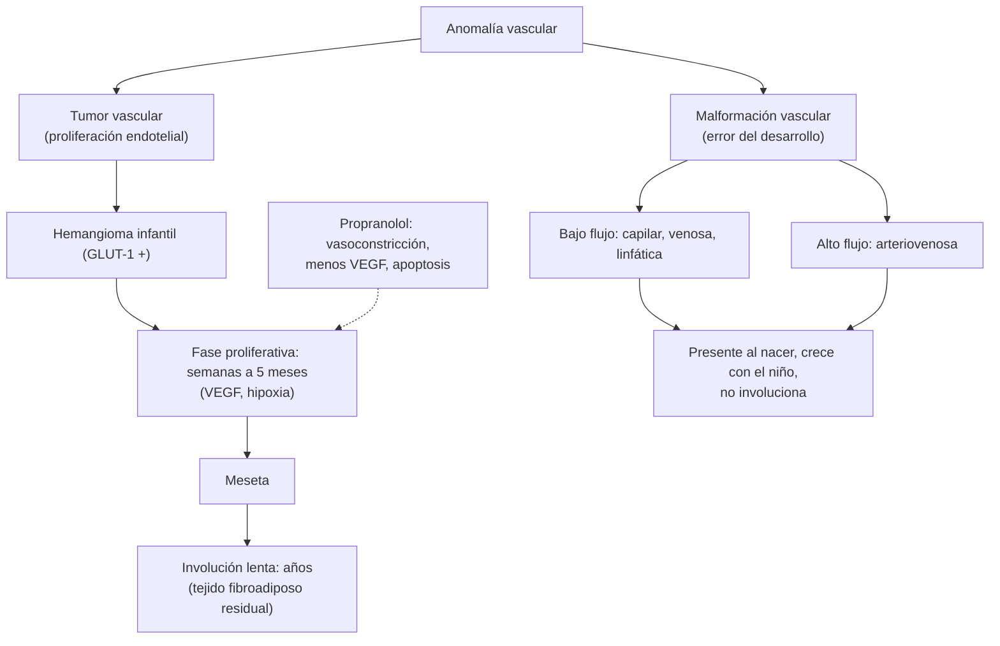

---
tags:
  - Dermatología
---

# Hemangiomas y malformaciones vasculares

**Subespecialidad**
Dermatología pediátrica · Pediatría · Neonatología · Cirugía infantil

**Guías principales**
AAP 2019: guía de práctica clínica para el manejo de los hemangiomas infantiles (*Pediatrics*) · Recomendaciones del grupo europeo de expertos para el tratamiento de los hemangiomas infantiles (*Eur J Pediatr* 2015) · Clasificación de anomalías vasculares de la ISSVA (2025)

**Otras fuentes**
Ensayo aleatorizado de propranolol oral (*N Engl J Med* 2015) · Revisión Cochrane de intervenciones (2018) · Rutas diagnósticas del grupo VASCERN-VASCA (*Eur J Med Genet* 2022) · Ver [tumores cutáneos](tumores-cutaneos-melanoma-carcinomas-y-lesiones-benignas.md) (granuloma piogénico), [trombocitopenias](../../hematologia/trombocitopenias.md) y [epilepsia](../../neurologia/crisis-epileptica-y-estado-epileptico.md)

**GES**
No.

**EUNACOM**
6.01.1.013 Hemangiomas cutáneos infantiles (específico, inicial, derivar) · 6.01.2.006 Hemangiomas y malformaciones vasculares del recién nacido (sospecha, inicial, derivar) · 2.01.1.111 Malformaciones vasculares cutáneas (pediatría)

**Revisado**
Octubre 2026

!!! abstract "Resumen en 60 segundos"
    - **Anomalías vasculares** (ISSVA): **tumores** (proliferan: el **hemangioma infantil** es el más frecuente) y **malformaciones** (errores del desarrollo vascular: están **desde el nacimiento**, crecen **en proporción** al niño y **no involucionan**).
    - **Hemangioma infantil**: el tumor más frecuente de la infancia (~ **4–5 %** de los lactantes); más en **niñas**, **prematuros** y de **bajo peso**. **Ausente o mínimo al nacer**, crece rápido en las primeras semanas (**la mayor parte del crecimiento ocurre antes de los 3 meses**), se estabiliza y luego **involuciona** lentamente en años. Marcador **GLUT-1** positivo.
    - **Hemangiomas de alto riesgo** (derivar **antes del mes de vida**): con riesgo **vital** (vía aérea "en barba", hepáticos múltiples), **funcional** (**periocular**: ambliopía), con **ulceración** (labio, zona del pañal), **segmentarios** faciales (síndrome **PHACE**) o lumbosacros (**LUMBAR**), y **desfigurantes** (nariz, labio). **≥ 5 hemangiomas cutáneos**: **ecografía hepática**.
    - **Tratamiento**: **propranolol oral 2–3 mg/kg/día** (en 2 dosis, con alimentación) por al menos **6 meses**. **Timolol tópico** en los superficiales pequeños.
    - **Malformaciones**: **capilar** (**mancha en vino de Oporto**; en el territorio V1, pensar en **Sturge-Weber**: glaucoma y epilepsia), **venosa** (azulada, compresible, crece con el esfuerzo), **linfática** (quística) y **arteriovenosa** (caliente, **pulsátil**, con frémito; la más agresiva). **Ecografía Doppler** y **RM**.
    - **Mancha salmón** (nevo simple, "beso del ángel" o "picotazo de la cigüeña"): frecuente y **benigna**; la de la frente y los párpados se aclara sola.

## Definición

- **Anomalías vasculares**: alteraciones de los vasos sanguíneos o linfáticos clasificadas por la **ISSVA** (International Society for the Study of Vascular Anomalies) en dos grandes grupos:
    - **Tumores vasculares**: hay **proliferación** celular (endotelio). Benignos (**hemangioma infantil**, hemangiomas congénitos, **granuloma piogénico**), localmente agresivos o intermedios (**hemangioendotelioma kaposiforme**, angioma en penacho) y malignos (angiosarcoma).
    - **Malformaciones vasculares**: **errores de la morfogénesis** de los vasos, sin proliferación; se clasifican según el vaso afectado (capilar, venosa, linfática, arteriovenosa o combinadas) y el **flujo** (bajo o alto).
- **Hemangioma infantil**: tumor vascular **benigno** de células endoteliales, **GLUT-1 positivo**, con un ciclo característico de **proliferación** e **involución**.
- **Hemangiomas congénitos**: tumores **completamente formados al nacer**, **GLUT-1 negativos**: de involución rápida (**RICH**), no involutivos (**NICH**) o de involución parcial (**PICH**).

## Epidemiología

- **Mundial**:
    - El **hemangioma infantil** afecta a ~ **4–5 %** de los lactantes. Es más frecuente en las **niñas** (2–3:1), los **prematuros**, los de **bajo peso de nacimiento**, los **gemelares**, los de raza blanca y los hijos de madres de mayor edad o con alteraciones placentarias (preeclampsia, placenta previa).
    - Localización: **cabeza y cuello** (~ 60 %), tronco y extremidades.
    - La mayoría (**~ 80 %**) es **única**; el resto es múltiple.
    - Solo una minoría (~ 10–15 %) requiere tratamiento.
    - **Malformaciones capilares** (mancha en vino de Oporto): ~ **0,3 %** de los recién nacidos. La **mancha salmón** es mucho más frecuente (hasta ~ 40 % de los recién nacidos).
- **Chile**: no hay datos nacionales publicados de prevalencia de hemangiomas ni de malformaciones vasculares.

!!! chile "Datos nacionales"
    - El **propranolol** está disponible en el arsenal de la APS; en los hemangiomas, su indicación e inicio corresponden al **dermatólogo pediatra** o al pediatra con experiencia.
    - El **control del niño sano** en la APS es la instancia clave para **detectar precozmente** los hemangiomas de alto riesgo y derivarlos **antes del mes de vida** (la ventana de tratamiento es corta).
    - Las anomalías vasculares complejas se manejan en centros de referencia con equipos multidisciplinarios (dermatología, cirugía infantil, radiología intervencional, hematología).

## Etiología y factores de riesgo

| Anomalía | Causa |
|---|---|
| **Hemangioma infantil** | Proliferación de células progenitoras endoteliales, probablemente favorecida por la **hipoxia** placentaria o tisular; factores de riesgo: sexo femenino, prematurez, bajo peso, gemelaridad, alteraciones placentarias |
| **Malformación capilar** (vino de Oporto) y Sturge-Weber | **Mutación somática** de ***GNAQ*** |
| **Malformación venosa** | Mutaciones de ***TEK*** (TIE2) o ***PIK3CA*** |
| **Malformación linfática** | Mutaciones de ***PIK3CA*** |
| **Malformación arteriovenosa** | Mutaciones de ***MAP2K1***, *KRAS* y otras; síndromes (telangiectasia hemorrágica hereditaria, *RASA1*) |
| **Síndromes con sobrecrecimiento** | **Klippel-Trénaunay** (malformación capilar-linfático-venosa con hipertrofia de la extremidad; espectro *PIK3CA*), **Parkes Weber** (malformación arteriovenosa con hipertrofia; *RASA1*) |

## Fisiopatología

*Figura 1. Tumores y malformaciones vasculares: comportamiento natural y diana del propranolol. Esquema propio basado en la clasificación de la ISSVA y en la guía de la AAP (2019).*

- En la **malformación venosa**, la sangre estancada produce **trombosis** local, **flebolitos** y una **coagulopatía intravascular localizada** (dímero D elevado).
- El **fenómeno de Kasabach-Merritt** (trombocitopenia grave y coagulopatía de consumo) se asocia al **hemangioendotelioma kaposiforme** y al angioma en penacho, **no** al hemangioma infantil común.

## Clasificación

| Hemangioma infantil | Rasgos |
|---|---|
| **Superficial** | Placa o nódulo **rojo brillante** ("en frutilla"), en la dermis superficial |
| **Profundo** | Nódulo **azulado** o del color de la piel, tibio, en la dermis profunda o el subcutáneo; aparece y crece más tarde |
| **Mixto** | Componente superficial y profundo |
| **Focal** | Localizado, de origen aparentemente único |
| **Segmentario** | Afecta un **territorio** extenso (placa); **mayor riesgo** de complicaciones y anomalías asociadas |
| **Multifocal** | ≥ 5 lesiones: buscar **hemangiomas hepáticos** |

| Malformación vascular | Flujo | Rasgos |
|---|---|---|
| **Capilar** (mancha en vino de Oporto) | Bajo | Mácula **rosada o roja** bien delimitada, presente al nacer, **no involuciona**; con los años se **oscurece** y engrosa (nódulos) |
| **Venosa** | Bajo | Masa **azulada**, **blanda**, **compresible**, que **aumenta** con el llanto, la maniobra de Valsalva o la posición declive; dolorosa (trombosis); flebolitos |
| **Linfática** | Bajo | **Macroquística** (masa blanda translúcida en el cuello o la axila, antes llamada higroma quístico) o **microquística** (vesículas superficiales "en caviar") |
| **Arteriovenosa** | **Alto** | Mancha rosada que se vuelve **caliente**, **pulsátil**, con **frémito** y **soplo**; puede ulcerarse, sangrar y producir insuficiencia cardíaca |
| **Combinadas y síndromes** | Variable | Klippel-Trénaunay, Parkes Weber, Sturge-Weber |

## Clínica

- **Hemangioma infantil**:
    - **Ausente al nacer** o presente como una **lesión precursora** (mácula pálida, telangiectasias o mancha rosada).
    - **Aparece en las primeras semanas** y **crece rápido**: la mayor parte del crecimiento ocurre entre las **5 y 8 semanas** de vida y ~ **80 %** del tamaño final se alcanza a los **3 meses**. Los profundos pueden crecer hasta los 6–9 meses.
    - **Meseta** y luego **involución**: el color se aclara a **gris**, la lesión se ablanda y aplana. La involución termina en la mayoría alrededor de los **4 años**, pero puede dejar **telangiectasias**, **piel redundante** o **tejido fibroadiposo** (sobre todo en los grandes y los superficiales gruesos).
- **Hemangiomas de alto riesgo** (AAP 2019):
    - **Riesgo vital**: hemangioma segmentario en **"barba"** (mandíbula, mentón, labio inferior, cuello: riesgo de **hemangioma de la vía aérea** con estridor); **hemangiomas hepáticos** múltiples o difusos (**insuficiencia cardíaca** de alto gasto, **hipotiroidismo** por consumo, hepatomegalia).
    - **Riesgo funcional**: **periocular** (**ambliopía** por obstrucción del eje visual, astigmatismo o compresión), **labio** y boca (alimentación), nariz, oído (conducto auditivo).
    - **Ulceración**: labio, **zona del pañal** (perineo, pliegues), cuello. Es la complicación **más frecuente** (~ 15 %), muy dolorosa, con sangrado e infección.
    - **Anomalías estructurales asociadas**:
        - **PHACE**: hemangioma **segmentario facial** grande (> 5 cm) con anomalías de la fosa **P**osterior, **H**emangioma, **A**rterias (cerebrales y cervicales), **C**ardíacas (**coartación** aórtica) y o**E**culares (*eye*).
        - **LUMBAR**: hemangioma **lumbosacro** segmentario con anomalías **urogenitales**, **anorrectales**, de la **médula** espinal (médula anclada), óseas y renales.
    - **Desfiguración**: punta de la **nariz** ("nariz de Cyrano"), **labio** (sobre todo si cruza el borde del bermellón), hemangiomas faciales grandes, mama en las niñas.
- **Hemangiomas congénitos** (RICH, NICH, PICH): **completamente formados al nacer**, a menudo como una placa violácea con telangiectasias y halo pálido; el RICH involuciona en el primer año.
- **Mancha salmón** (nevo simple): máculas **rosadas** en la **glabela**, los **párpados**, el labio superior ("beso del ángel") y la **nuca** ("picotazo de la cigüeña"); se aclaran con el tiempo, salvo la de la nuca, que suele persistir.
- **Mancha en vino de Oporto**: mácula roja **unilateral**, presente al nacer, que crece con el niño y se oscurece. Si compromete la **frente o el párpado superior** (territorio de **V1**), riesgo de **síndrome de Sturge-Weber**: **angiomatosis leptomeníngea** (**convulsiones**, hemiparesia, retraso del desarrollo) y **glaucoma**.
- **Malformación venosa**: masa azulada, blanda y compresible que se **vacía** al comprimirla o elevarla y se **llena** en declive; episodios dolorosos por **trombosis** (flebolitos).
- **Malformación linfática**: masa blanda indolora que puede crecer súbitamente por **infección** o **hemorragia** intralesional; en el cuello puede comprimir la vía aérea.
- **Malformación arteriovenosa**: inicialmente una mancha rosada caliente; en la pubertad o tras traumatismos progresa con **pulsatilidad**, **frémito**, dolor, ulceración y sangrado.

!!! alarma "Signos de alarma"
    - Hemangioma en "**barba**" con **estridor** o disfonía: hemangioma de la **vía aérea** → evaluación otorrinolaringológica urgente.
    - Hemangioma **periocular** que cierra el ojo o deforma el globo: riesgo de **ambliopía** → derivación urgente y oftalmología.
    - Hemangioma **ulcerado**, sangrante o muy doloroso.
    - **≥ 5 hemangiomas** cutáneos, **hepatomegalia**, **insuficiencia cardíaca** o **hipotiroidismo**: hemangiomatosis **hepática**.
    - Hemangioma **segmentario facial** (PHACE) o **lumbosacro** (LUMBAR).
    - Crecimiento **rápido** de una lesión vascular con **púrpura**, induración y **trombocitopenia**: **fenómeno de Kasabach-Merritt** (hemangioendotelioma kaposiforme) → urgencia hematológica.
    - Mancha en vino de Oporto en el territorio de **V1** o con **convulsiones**: **Sturge-Weber**.
    - Lesión vascular **caliente y pulsátil**: malformación **arteriovenosa**.
    - Lesión que **no sigue** el patrón típico (presente y grande al nacer, crecimiento atípico, firme): biopsia o imágenes para descartar un tumor maligno.

## Diagnóstico

!!! guia "Puntos clave (AAP 2019; ISSVA 2025)"
    - El diagnóstico del hemangioma infantil es **clínico** (aspecto e **historia natural**: aparece en las primeras semanas y crece rápido).
    - **Identificar precozmente los hemangiomas de alto riesgo** y **derivarlos** (idealmente **antes del mes de vida**) a un especialista, porque el crecimiento ocurre muy temprano y la **ventana** para el tratamiento óptimo es corta.
    - **Seguimiento frecuente** (cada pocas semanas) en los primeros meses; las **fotografías** seriadas ayudan.
    - **Ecografía Doppler** de partes blandas si el diagnóstico es dudoso (hemangioma: masa sólida de **alto flujo** en la fase proliferativa).
    - **≥ 5 hemangiomas cutáneos**: **ecografía abdominal** (hepática).
    - **PHACE**: **RM** y **angio-RM** de cerebro y cuello, **ecocardiograma** y evaluación **oftalmológica**.
    - **LUMBAR**: **ecografía** de la columna (antes de los 3–6 meses) o **RM**, y ecografía renal.
    - **Malformaciones**: **ecografía Doppler** (define el flujo) y **RM** con contraste (extensión).

## Laboratorio

| Situación | Exámenes |
|---|---|
| **Hemangiomatosis hepática** | **TSH y T4 libre** (hipotiroidismo por consumo: la desyodasa tipo 3 del tumor inactiva la hormona), pruebas hepáticas |
| **Sospecha de Kasabach-Merritt** | **Hemograma** (trombocitopenia grave), **fibrinógeno** (bajo), dímero D, TP y TTPA |
| **Malformación venosa extensa** | **Dímero D** (alto) y fibrinógeno: coagulopatía intravascular localizada; control antes de cirugías |
| **Antes de iniciar propranolol** | **No** se requieren exámenes de rutina; **glicemia** en los prematuros o con riesgo de hipoglicemia |
| **Biopsia** | Lesiones atípicas: **GLUT-1** positivo confirma el hemangioma infantil |

## Imágenes

- **Ecografía Doppler**: primera línea para caracterizar las lesiones profundas y diferenciar un tumor (masa sólida de alto flujo) de una malformación (canales sin masa sólida; bajo o alto flujo).
- **RM con contraste**: extensión de las malformaciones y de los hemangiomas grandes o segmentarios; **angio-RM** en el PHACE.
- **Ecografía abdominal**: hemangiomas hepáticos.
- **Ecografía o RM de la columna**: hemangiomas lumbosacros.
- **Radiografía**: flebolitos en la malformación venosa.
- **Angiografía**: en las malformaciones arteriovenosas, para planificar la **embolización**.

## Diagnóstico diferencial

| Cuadro | Claves |
|---|---|
| **Hemangioma congénito** (RICH, NICH) | **Completo al nacer**, no prolifera después; GLUT-1 negativo |
| **Malformación capilar** | Presente al nacer, **plana**, no crece de forma desproporcionada |
| **Malformación venosa o linfática** | Presente al nacer, **compresible**, crece con el niño; Doppler sin masa sólida |
| **Granuloma piogénico** | Pápula roja **friable** que **sangra**, aparece en meses o años (no en las primeras semanas) |
| **Hemangioendotelioma kaposiforme** | Placa **violácea indurada**, a veces presente al nacer, con **trombocitopenia** (Kasabach-Merritt) |
| **Tumores malignos** (fibrosarcoma infantil, rabdomiosarcoma, neuroblastoma) | Masa **firme**, de crecimiento atípico; **biopsia** |
| **Quiste dermoide**, encefalocele, glioma nasal | Línea media (nariz, ceja); no vascular; imágenes antes de cualquier procedimiento |
| **Mancha mongólica** | Mácula azul grisácea **lumbosacra** presente al nacer, sin relieve ni calor |

## Tratamiento

!!! dosis "Hemangioma infantil (AAP 2019; grupo europeo 2015)"
    | Tratamiento | Indicación y esquema |
    |---|---|
    | **Observación activa** | La mayoría (sin riesgo): controles y fotografías; educar a los padres sobre la historia natural |
    | **Propranolol oral** (primera línea) | Hemangiomas **de alto riesgo**. **2–3 mg/kg/día** dividido en **2 dosis** (cada 12 horas), **con o después de la alimentación**. Iniciar con 1 mg/kg/día y aumentar en 1–2 semanas. Duración: **al menos 6 meses** (a menudo hasta los **12 meses** de edad). Iniciar idealmente **antes de los 3 meses** de vida |
    | **Timolol maleato 0,5 % gel** (tópico) | Hemangiomas **superficiales pequeños** y delgados: 1 gota cada 12 horas sobre la lesión |
    | **Corticoides orales** (prednisolona 2–3 mg/kg/día) | Si el propranolol está contraindicado o no hay respuesta (segunda línea) |
    | **Láser de colorante pulsado** | Telangiectasias residuales; algunas úlceras |
    | **Cirugía** | **Tejido fibroadiposo** o piel redundante residual tras la involución (en la edad preescolar); casos seleccionados con obstrucción funcional |

    - **Efectos adversos del propranolol**: **hipoglicemia** (darlo **con alimentación** y **suspenderlo** si el niño no come o está vomitando, por ejemplo durante una enfermedad intercurrente), **broncoespasmo** (suspender durante las crisis de sibilancias), **bradicardia**, **hipotensión**, alteraciones del **sueño**, manos frías, diarrea.
    - **Antes de iniciarlo**: anamnesis y examen cardiovascular (frecuencia cardíaca, presión arterial, auscultación); **ECG** solo si hay **bradicardia**, arritmia, soplo o antecedente familiar de arritmias. En el **PHACE**, evaluar antes las **arterias cerebrales** (riesgo de isquemia con la hipotensión).
    - **Ulceración**: curaciones, apósitos no adherentes, **analgesia**, antibiótico tópico u oral si hay infección, propranolol (acelera la cicatrización), láser.
    - **Recurrencia** tras suspender el propranolol: ~ **10–25 %**, más si se suspende antes de los 9–12 meses de edad.

- **Hemangioma hepático difuso**: propranolol, **levotiroxina** en dosis altas si hay hipotiroidismo, manejo de la insuficiencia cardíaca.
- **Kasabach-Merritt**: **sirolimus** y/o **vincristina**, con o sin corticoides; manejo por hematología (las transfusiones de plaquetas pueden agrandar la lesión).
- **Malformaciones vasculares**:
    - **Capilar** (vino de Oporto): **láser de colorante pulsado** precoz (mejor respuesta en la infancia); en el territorio de V1, **RM cerebral** y control del **glaucoma** (presión intraocular) y neurológico.
    - **Venosa**: **compresión** elástica, **AINE** o **heparina de bajo peso molecular** en los episodios trombóticos dolorosos o la coagulopatía localizada, **escleroterapia** percutánea, cirugía; **sirolimus** en las formas extensas; **alpelisib** (inhibidor de PIK3CA) en las formas del espectro *PIK3CA* (especialista).
    - **Linfática**: **escleroterapia** (doxiciclina, bleomicina, OK-432), cirugía, **sirolimus** en las microquísticas extensas.
    - **Arteriovenosa**: equipo multidisciplinario; **embolización** seguida de **resección** en casos seleccionados; observación en las formas quiescentes.

## Complicaciones

- **Hemangioma infantil**: **ulceración** (la más frecuente), sangrado, infección, **cicatriz** y desfiguración, **ambliopía**, **obstrucción de la vía aérea**, insuficiencia cardíaca y **hipotiroidismo** (hepáticos), impacto psicosocial en la familia.
- **PHACE**: **ACV** isquémico, alteraciones del neurodesarrollo, coartación aórtica.
- **Malformación capilar**: engrosamiento y nódulos con la edad, **hipertrofia** de tejidos blandos; Sturge-Weber: epilepsia, hemiparesia, **glaucoma**, déficit cognitivo.
- **Malformación venosa**: dolor, **trombosis** y flebolitos, **coagulopatía intravascular localizada** (sangrado en las cirugías), deformidad, compromiso articular.
- **Malformación linfática**: infecciones, hemorragia intralesional, compresión de la vía aérea.
- **Malformación arteriovenosa**: ulceración, **hemorragia**, isquemia distal, **insuficiencia cardíaca de alto gasto**.

## Pronóstico y seguimiento

- **Hemangioma infantil**: buen pronóstico; involución completa en la mayoría alrededor de los **4 años**, pero hasta la mitad de los que no se tratan deja **secuelas** (telangiectasias, piel laxa, tejido fibroadiposo). El tratamiento **precoz** con propranolol reduce las secuelas.
- **Seguimiento**: controles **frecuentes** en los primeros meses (cada 2–4 semanas en la fase proliferativa si hay riesgo); durante el propranolol, control del peso (ajustar la dosis), la frecuencia cardíaca y los efectos adversos.
- **Malformaciones**: **no involucionan**; seguimiento de por vida, con riesgo de progresión en la **pubertad**, el **embarazo** y tras traumatismos.

## Perlas para el internado

!!! perla "Para recordar"
    - **Hemangioma**: **no está al nacer** (o es mínimo), **crece** rápido en las primeras semanas e **involuciona**. **Malformación**: **está al nacer**, crece **con el niño** y **no involuciona**.
    - **Derivar antes del mes de vida** los hemangiomas de alto riesgo: **periocular**, **en barba**, **labio y nariz**, **zona del pañal**, **segmentarios** grandes, **≥ 5 lesiones**.
    - **≥ 5 hemangiomas**: **ecografía hepática** (y TSH si hay lesiones hepáticas).
    - **Propranolol 2–3 mg/kg/día** en 2 dosis **con comida**. **Suspender** si el niño no come o tiene sibilancias.
    - **Kasabach-Merritt** no es del hemangioma común: es del **hemangioendotelioma kaposiforme**.
    - **Mancha en vino de Oporto en la frente (V1)**: **Sturge-Weber** (convulsiones y **glaucoma**).
    - **Mancha salmón** en la glabela o la nuca: benigna, no requiere estudio.
    - Lesión vascular **caliente y pulsátil**: malformación **arteriovenosa** (alto flujo).

## Preguntas de repaso

??? repaso "1. Lactante de 5 semanas, prematura, con una placa roja brillante elevada de 1,5 cm en el párpado superior derecho que apareció a los 10 días de vida y crece rápido, cubriendo parcialmente el ojo. ¿Diagnóstico y conducta?"
    **Hemangioma infantil periocular de alto riesgo** (riesgo de **ambliopía**). **Derivación urgente** a dermatología pediátrica y **oftalmología**. Tratamiento: **propranolol oral 2–3 mg/kg/día** en 2 dosis con la alimentación (iniciar con 1 mg/kg/día y aumentar), previa evaluación cardiovascular, por al menos 6 meses. Educar a los padres sobre la hipoglicemia (darlo con comida y suspenderlo si no come).

??? repaso "2. Lactante de 2 meses con un hemangioma superficial de 6 mm en el brazo, sin ulceración. ¿Qué hace?"
    Hemangioma **de bajo riesgo**. **Observación activa** con controles y fotografías; educar sobre la historia natural (crecimiento en los primeros meses e involución en años). Si crece o molesta, se puede considerar el **timolol 0,5 % gel** tópico. Derivar si aparece ulceración o crecimiento rápido.

??? repaso "3. Lactante de 3 meses con 7 hemangiomas cutáneos pequeños, hepatomegalia y signos de insuficiencia cardíaca. ¿Qué sospecha y qué estudia?"
    **Hemangiomatosis hepática** (hemangiomas hepáticos multifocales o difusos) con insuficiencia cardíaca de alto gasto. Estudio: **ecografía abdominal Doppler**, **TSH y T4 libre** (**hipotiroidismo** por consumo, por la desyodasa tipo 3), ecocardiograma. Tratamiento en un centro especializado: **propranolol**, **levotiroxina** si hay hipotiroidismo y manejo de la insuficiencia cardíaca.

??? repaso "4. Recién nacido con una mancha roja plana que cubre la frente y el párpado superior izquierdos, presente desde el nacimiento. ¿Qué sospecha y qué estudio indica?"
    **Malformación capilar** (mancha en vino de Oporto) en el territorio de **V1**: riesgo de **síndrome de Sturge-Weber** (angiomatosis leptomeníngea y **glaucoma**). Estudio: **evaluación oftalmológica** con **presión intraocular** periódica, **RM cerebral** con contraste y seguimiento neurológico (convulsiones). Derivar a dermatología para **láser de colorante pulsado** precoz.

??? repaso "5. Lactante de 4 meses con una placa violácea indurada en el muslo que creció rápidamente, con petequias alrededor y plaquetas de 15.000/µL y fibrinógeno bajo. ¿Diagnóstico?"
    **Fenómeno de Kasabach-Merritt** por un **hemangioendotelioma kaposiforme** (o angioma en penacho), **no** por un hemangioma infantil común. Es una urgencia: hospitalizar y manejar con **hematología**: **sirolimus** y/o **vincristina** con o sin corticoides; evitar las transfusiones de plaquetas salvo sangrado activo (pueden agrandar la lesión).

??? repaso "6. Niño de 8 años con una masa azulada en la mejilla, blanda y compresible, presente desde el nacimiento, que aumenta de tamaño al llorar o al agacharse. ¿Diagnóstico y estudio?"
    **Malformación venosa** (bajo flujo). Estudio: **ecografía Doppler** y **RM** con contraste (extensión), **radiografía** (flebolitos) y **dímero D** y fibrinógeno (coagulopatía intravascular localizada). Manejo en un centro especializado: compresión si es posible, **escleroterapia**, cirugía o sirolimus según la extensión. No involuciona.

## Referencias

1. Krowchuk DP, Frieden IJ, Mancini AJ, et al. Clinical practice guideline for the management of infantile hemangiomas. *Pediatrics.* 2019;143(1):e20183475. doi:[10.1542/peds.2018-3475](https://doi.org/10.1542/peds.2018-3475)
2. Hoeger PH, Harper JI, Baselga E, et al. Treatment of infantile haemangiomas: recommendations of a European expert group. *Eur J Pediatr.* 2015;174(7):855–865. doi:[10.1007/s00431-015-2570-0](https://doi.org/10.1007/s00431-015-2570-0)
3. International Society for the Study of Vascular Anomalies. ISSVA classification of vascular anomalies ©2025. [https://www.issva.org/classification](https://www.issva.org/classification)
4. Léauté-Labrèze C, Hoeger P, Mazereeuw-Hautier J, et al. A randomized, controlled trial of oral propranolol in infantile hemangioma. *N Engl J Med.* 2015;372(8):735–746. doi:[10.1056/NEJMoa1404710](https://doi.org/10.1056/NEJMoa1404710)
5. Novoa M, Baselga E, Beltran S, et al. Interventions for infantile haemangiomas of the skin. *Cochrane Database Syst Rev.* 2018;4(4):CD006545. doi:[10.1002/14651858.CD006545.pub3](https://doi.org/10.1002/14651858.CD006545.pub3)
6. Diociaiuti A, Baselga E, Boon LM, et al. The VASCERN-VASCA working group diagnostic and management pathways for severe and/or rare infantile hemangiomas. *Eur J Med Genet.* 2022;65(6):104517. doi:[10.1016/j.ejmg.2022.104517](https://doi.org/10.1016/j.ejmg.2022.104517)
