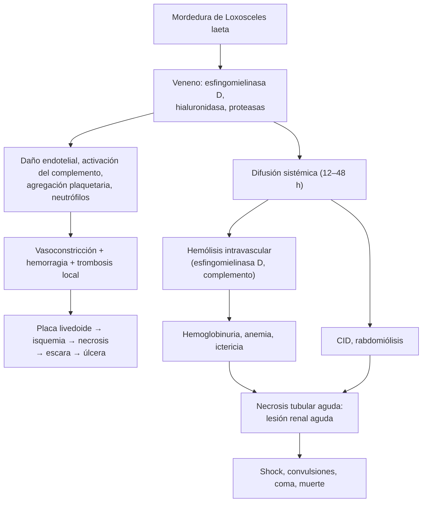

---
tags:
  - Dermatología
  - Urgencia
---

# Loxoscelismo e higiene de la vivienda

**Subespecialidad**
Dermatología · Urgencia · Toxicología · Pediatría · Atención primaria

**Guías principales**
MINSAL 2016: Guía para el manejo de mordedura de araña de los rincones, *Loxosceles laeta* (Departamento de Enfermedades Transmisibles)

**Otras fuentes**
Experiencia en 200 pacientes (*Rev Med Chil* 2021) · Serie hospitalaria de loxoscelismo cutáneo y cutáneo-visceral (*Rev Chilena Infectol* 2018) · Revisión sistemática chilena (*Rev Chilena Infectol* 2009) · Ver [lesión renal aguda](../../nefrologia/lesion-renal-aguda.md), [anemias](../../hematologia/anemias.md) (hemólisis), [infecciones de piel y partes blandas](../../infectologia/infecciones-piel-partes-blandas.md) y [accidentes del trabajo](../../traumatologia/accidentes-del-trabajo-y-enfermedades-profesionales.md)

**GES**
No.

**EUNACOM**
6.01.2.008 Loxoscelismo (específico, completo, completo) · 6.01.3.002 Higiene de la vivienda y profilaxis del loxoscelismo

**Revisado**
Octubre 2026

!!! abstract "Resumen en 60 segundos"
    - **Loxoscelismo**: cuadro tóxico por el veneno de la **araña de los rincones** (*Loxosceles laeta*), café, de ~ 1 cm, con **cefalotórax en forma de violín** y **6 ojos en triángulo**. Vive **dentro de las casas** (rincones, detrás de cuadros y muebles, ropa colgada). Muerde al **dormir** o al **vestirse**. Más frecuente en **verano**.
    - **Cutáneo necrótico** (> 80 %): **dolor** inmediato y progresivo, edema, y la **placa livedoide** (violácea, con zonas pálidas isquémicas y rojas hemorrágicas) que evoluciona a **necrosis** y **escara** en 4–7 días. **Cutáneo edematoso** (< 5 %): sobre todo en la **cara**, buen pronóstico.
    - **Cutáneo-visceral** (10–15 %): en las primeras **12–24 horas** (máximo 48): **fiebre**, compromiso general, **hemólisis intravascular**, **hemoglobinuria**, ictericia, CID y **lesión renal aguda**. Letalidad de **20–25 %** de las formas viscerales. **El tamaño de la lesión cutánea NO predice el compromiso visceral**.
    - **Control clave**: **hemoglobinuria cualitativa seriada** (cada 2–6 horas) y vigilancia por **24–48 horas**. Si es positiva: **hospitalizar en UCI**.
    - **Tratamiento** (MINSAL 2016): **frío local**, elevación, **antihistamínico parenteral** (clorfenamina) y analgesia; **sin corticoides** en el cutáneo puro. En el **visceral**: **hidrocortisona IV**, hidratación, manejo de la falla renal (diálisis) y de la hemólisis. El **suero antiloxosceles no se recomienda**.
    - **Prevención**: separar las **camas 10 cm** de los muros, **no colgar ropa** en las paredes, **sacudir ropa y zapatos**, aseo detrás de muebles y cuadros, aspirar.

## Definición

- **Loxoscelismo**: síndrome tóxico producido por el veneno de las arañas del género ***Loxosceles***, inyectado en la mordedura. En Chile lo produce ***Loxosceles laeta*** ("araña de los rincones").
- **Formas clínicas**:
    - **Loxoscelismo cutáneo necrótico**: lesión local con necrosis.
    - **Loxoscelismo cutáneo edematoso**: predomina el edema, sin necrosis o con necrosis mínima.
    - **Loxoscelismo cutáneo-visceral** (sistémico): lesión cutánea más **hemólisis intravascular** y daño de órganos.
- **Higiene de la vivienda**: conjunto de medidas de orden, aseo y modificación del entorno doméstico que reducen la presencia de la araña y el riesgo de mordedura.

## Epidemiología

- **Mundial**: el loxoscelismo se ha descrito en todos los continentes. En América del Sur, *L. laeta*, *L. intermedia* y *L. gaucho* son las especies más frecuentes; *L. laeta* tiene el veneno más peligroso. En Norteamérica predomina *L. reclusa*.
- **Chile**:
    - Es un **problema de salud pública**: el veneno de *L. laeta* produce una **mayor proporción de formas cutáneo-viscerales** que en otros países.
    - *L. laeta* se distribuye principalmente **desde el extremo norte hasta la zona del Biobío** (de la I a la VIII región en la numeración antigua), pero se han comunicado casos en todo el país.
    - Es más frecuente en **verano** (la araña es más activa con el calor) y de **noche**.
    - En la serie de 200 pacientes de un hospital universitario de Santiago (2013–2017), el **94 %** tuvo un loxoscelismo cutáneo y el **5,5 %** un cutáneo-visceral; el 73 % de los casos viscerales tenía síntomas sistémicos.
    - **Letalidad**: **1–3 %** del total de los casos y **20–25 %** de las formas cutáneo-viscerales (MINSAL 2016). Los cuadros son más graves en los **niños**.

!!! chile "Datos nacionales"
    - El MINSAL publicó en **2016** la **Guía para el manejo de mordedura de araña de los rincones**, que reemplazó a la guía de 2004 y **dejó de recomendar el suero antiloxosceles**.
    - La mordedura por **arácnido ponzoñoso** en el lugar de trabajo es un **accidente laboral**: el trabajador tiene derecho a atención médica, hospitalización y medicamentos por la **Ley 16.744**.
    - El **Centro de Información Toxicológica de la Universidad Católica (CITUC)** orienta a la población y a los equipos de salud por teléfono las 24 horas.
    - Llevar la **araña** al servicio de urgencia (viva en un frasco con un algodón húmedo, o muerta en un frasco seco) permite identificarla.

## Etiología y factores de riesgo

- **Agente**: *Loxosceles laeta*.
    - Color **café** parduzco, cuerpo de **~ 1 cm** (con las patas, hasta 4–5 cm), patas largas y delgadas.
    - **Cefalotórax piriforme ("en violín")** y **3 pares de ojos dispuestos en triángulo** (la mayoría de las arañas tiene 8 ojos): rasgo clave para identificarla.
    - **Hábitat intradomiciliario**: lugares **secos, oscuros y tranquilos**: rincones, detrás de **cuadros**, muebles y libreros, **closets**, ropa colgada en los muros, zapatos, bodegas, entretechos.
    - **No es agresiva**: muerde en **defensa** cuando se la comprime contra la piel: al **dormir** (~ 38 %) o al **vestirse** (~ 32 %) con ropa guardada o colgada.
    - Hábitos **nocturnos**; es muy veloz y huye de la luz. Su depredador natural es la **araña tigre** (*Scytodes globula*).
- **Factores de riesgo**:
    - **Viviendas** con muchos objetos acumulados, poco aseo detrás de los muebles, ropa colgada en los muros, camas pegadas a la pared.
    - **Verano**, zona centro y norte del país.
    - **Niños** (más veneno por kilo de peso: mayor riesgo de forma visceral y de muerte).
    - Mordedura en la **cabeza** y la cara.
    - Posible predisposición a la hemólisis por **déficit de G6PD**.

## Fisiopatología

*Figura 1. Fisiopatología del loxoscelismo. Esquema propio basado en la guía del MINSAL (2016).*

- La **esfingomielinasa D** es la principal toxina: es **dermonecrótica** y **hemolítica**.
- La **hialuronidasa** facilita la difusión del veneno, lo que explica el **inicio precoz** de los síntomas.
- El veneno es **cutáneo-necrosante**, **hemolítico**, **vasculítico** y **procoagulante**.

## Clasificación

| Forma | Frecuencia | Rasgos | Pronóstico |
|---|---|---|---|
| **Cutáneo necrótico** | **> 80 %** | Dolor, placa livedoide, necrosis, escara, úlcera | Bueno; cicatriza en **4–6 semanas** (puede requerir injerto) |
| **Cutáneo edematoso** | **< 5 %** | **Edema** importante (sobre todo en la **cara**), sin necrosis | Muy bueno; resuelve en **7–10 días** |
| **Cutáneo-visceral** | **10–15 %** | Lesión cutánea + **hemólisis**, hemoglobinuria, LRA, CID | **Grave**; letalidad de 20–25 % |

## Clínica

- **Mordedura**: en la **cara** y las **extremidades**. La araña es **vista** en ~ 60 % de los casos e **identificada** en ~ 13 %.
- **Loxoscelismo cutáneo necrótico**:
    - **Dolor** **inmediato**, urente y **progresivo** (desproporcionado), con **hiperestesia** perilesional, **edema** y **eritema**.
    - **Halo vasoconstrictivo** azul grisáceo alrededor de la mordedura.
    - **Placa livedoide**: lesión **violácea** de bordes irregulares, con zonas **pálidas** (isquemia), **rojas** (hemorragia) y **azules** (trombosis), rodeada de un halo eritematoso y edematoso; puede haber **vesículas** o **ampollas** serosas o hemorrágicas. El centro está **retraído** bajo el nivel de la piel.
    - **Necrosis** en **3–4 días**, **escara** en **4–7 días** (con disminución del dolor) y luego **úlcera** que cicatriza por segunda intención en **4–6 semanas**.
    - La lesión suele **crecer por gravedad** (hacia abajo). Rara vez hay adenopatía regional.
- **Loxoscelismo cutáneo edematoso**: edema **intenso** (más en la **cara**: párpados), sin necrosis o con necrosis muy pequeña; el veneno se diluye en el edema. Rara vez tiene compromiso sistémico.
- **Loxoscelismo cutáneo-visceral**:
    - Comienza como un cutáneo, pero a las **12–24 horas** (máximo **48 horas**) aparecen:
        - **Fiebre** alta, **compromiso del estado general**, palpitaciones, náuseas, vómitos, mialgias y artralgias.
        - **Hemólisis intravascular**: **anemia** de rápida instalación, **ictericia**, **hemoglobinuria** (orina oscura "color coca-cola") y hematuria (presentes en el **100 %** de los casos viscerales).
        - Evolución posible a **lesión renal aguda** (necrosis tubular), **CID**, hipotensión, **convulsiones**, **coma** y muerte.
    - **El tamaño y el aspecto de la lesión cutánea no guardan relación** con la aparición ni con la gravedad del compromiso visceral.

!!! alarma "Signos de alarma"
    - **Hemoglobinuria** u **orina oscura**, **hematuria**.
    - **Fiebre**, **compromiso del estado general**, vómitos, **ictericia**, palidez.
    - **Oliguria**, alza de la creatinina, hiperkalemia.
    - Petequias, sangrado (CID), **hipotensión**, compromiso de conciencia o **convulsiones**.
    - **Niño** pequeño, mordedura en la **cabeza** o la cara.
    - Ante cualquiera de ellos: **hospitalizar en UCI**.
    - **No subvalorar** una mordedura de araña: según la guía del MINSAL, la mayoría de los casos letales se debió a la **falta de sospecha**, de **monitorización** o a un manejo **tardío**.

## Diagnóstico

!!! guia "Puntos clave (MINSAL 2016)"
    - El diagnóstico es **esencialmente clínico**: **antecedente** de la mordedura y su circunstancia (al dormir o vestirse), **examen de la araña** si se dispone de ella y las **características de la lesión** y su progresión.
    - **No existen exámenes** que confirmen el diagnóstico (las pruebas de detección del veneno están en investigación).
    - En **todo** loxoscelismo cutáneo: **hemoglobinuria cualitativa** (cinta reactiva de orina) **seriada cada 2–6 horas** para detectar rápidamente el compromiso visceral, y **control por 24–48 horas**.
    - Si hay compromiso sistémico: **hemograma** con **reticulocitos**, **bilirrubina**, **pruebas de coagulación** (TP, TTPA), **orina completa**, **BUN** y **creatinina**.

- **Pista clínica**: dolor muy intenso desproporcionado, placa **livedoide** con centro deprimido y lesión que **avanza por gravedad**.
- Una **hematuria** aislada no siempre indica una forma visceral (serie de 200 pacientes, 2021): interpretar en conjunto con la clínica y los parámetros de hemólisis.

## Laboratorio

| Examen | Hallazgos en la forma visceral |
|---|---|
| **Cinta reactiva de orina** (seriada) | **Hemoglobinuria** (positiva para "sangre" sin glóbulos rojos en el sedimento) |
| **Hemograma** | **Anemia** hemolítica de instalación rápida, **leucocitosis** marcada, **trombocitopenia** |
| Reticulocitos, LDH, haptoglobina | Reticulocitosis, **LDH alta**, **haptoglobina baja** |
| **Bilirrubina** | **Hiperbilirrubinemia de predominio indirecto** |
| Perfil hepático | Elevación de las transaminasas |
| **Coagulación** (TP, TTPA, fibrinógeno, dímero D) | Alteradas; **CID** en los casos graves |
| **Orina completa** | Hematuria, **hemoglobinuria**, proteinuria |
| **BUN, creatinina, electrolitos** | **Lesión renal aguda**, **hiperkalemia** |
| CK | Rabdomiólisis |

## Imágenes

- No son necesarias para el diagnóstico.
- **Ecografía** de partes blandas si se sospecha un absceso o una colección sobreinfectada.
- **Fotografías** seriadas de la lesión para seguir su evolución.

## Diagnóstico diferencial

| Cuadro | Claves |
|---|---|
| **Celulitis o erisipela** (incluida la necrótica) | Fiebre precoz, eritema caliente sin placa livedoide, dolor menor al inicio; mejora con antibióticos |
| **Fascitis necrotizante** | Dolor desproporcionado, crepitación, compromiso sistémico rápido, sin mordedura; **urgencia quirúrgica** |
| **Infección por *S. aureus*** (forúnculo, ántrax estafilocócico, SARM) | Pústula central, supuración; muchas "mordeduras de araña" son en realidad infecciones por *S. aureus* |
| **Ántrax** (*Bacillus anthracis*) | Escara negra **indolora** con edema gelatinoso; contacto con animales o lana |
| **Herpes zóster** | Vesículas agrupadas en un dermatoma, dolor neuropático |
| **Pioderma gangrenoso** | Úlcera con borde violáceo socavado; EII, artritis; empeora con el desbridamiento |
| **Vasculitis** o **calcifilaxis** | Púrpura palpable, necrosis múltiple; insuficiencia renal crónica |
| **Necrosis química** o por extravasación | Antecedente de vía venosa (gluconato de calcio), ácidos o álcalis |
| **Latrodectismo** (*Latrodectus mactans*, "viuda negra" o araña del trigo) | Cuadro **neurotóxico**: dolor intenso, contracturas, **rigidez abdominal** ("abdomen agudo"), sudoración, hipertensión; lesión local mínima; rural |
| **Otras hemólisis** (forma visceral) | Déficit de G6PD, malaria, síndrome hemolítico urémico, anemias hemolíticas autoinmunes, reacciones transfusionales |

## Tratamiento

!!! dosis "Loxoscelismo cutáneo (MINSAL 2016)"
    - **Frío local** (hielo envuelto, sin contacto directo con la piel) y **elevación** de la extremidad, **reposo**.
    - **Aseo** de la lesión con agua y jabón.
    - **Antihistamínicos**, idealmente **parenterales al inicio** (IM o IV) por 2–3 días y luego **orales** en dosis decrecientes hasta que se delimite la necrosis y desaparezcan el dolor y el edema:
        - **Clorfenamina 0,4 mg/kg/día** (dividido cada 6–8 horas; en el adulto, 10 mg IM o IV cada 6–8 horas y luego 4 mg VO cada 6–8 horas).
        - O **dexclorfeniramina 0,15 mg/kg/día**.
    - **Analgesia** (paracetamol, AINE; opioides si el dolor es intenso).
    - **Hemoglobinuria cualitativa seriada** y control por **48 horas** (observación u hospitalización según el caso).
    - **No usar corticoides** en el loxoscelismo cutáneo puro (retardan la cicatrización).
    - **Desbridamiento** del tejido necrótico **solo cuando la necrosis esté bien delimitada** (nunca precoz).
    - **Antibióticos** **solo** si hay **sobreinfección** (cobertura de *S. aureus* y *S. pyogenes*, por ejemplo cefadroxilo o flucloxacilina; agregar anaerobios si corresponde). **No** se recomienda la profilaxis.
    - Úlceras profundas o **> 2,5 cm**: evaluar **injerto** (cirugía plástica).
    - **Dapsona** (50–200 mg/día por 10–25 días): reservada a lesiones cutáneas **extensas y graves** en adultos; puede **agravar la hemólisis** (descartar el déficit de G6PD).
    - Profilaxis **antitetánica** según el estado de vacunación.

!!! dosis "Loxoscelismo cutáneo-visceral (MINSAL 2016)"
    - **Hospitalizar en UCI**.
    - **Hidratación** IV abundante (proteger el riñón frente a la hemoglobinuria), corrección **hidroelectrolítica** y **oxígeno**.
    - **Antihistamínico parenteral** (como en la forma cutánea).
    - **Corticoides sistémicos parenterales**: **hidrocortisona 5 mg/kg/dosis cada 6 horas** (máximo **600 mg** por dosis) o **metilprednisolona 1–2 mg/kg/dosis**, por **2–3 días** o hasta que se corrijan la hematuria y la hemoglobinuria; luego **prednisona oral** en dosis decrecientes hasta completar **7–10 días**. La vía **oral** inicial es poco eficaz (edema de la mucosa intestinal).
    - **Transfusión** de glóbulos rojos según la anemia.
    - **Lesión renal aguda** con hiperkalemia o sobrecarga: **hemodiálisis** o peritoneodiálisis.
    - **Hemólisis refractaria**, **coma**, **CID** o leucocitosis extrema: **plasmaféresis** o **exsanguineotransfusión**.
    - **Suero antiloxosceles**: **no recomendado** (sin beneficio demostrado y con riesgo de reacciones adversas graves).

- **Medidas iniciales para la población** (MINSAL 2016): lavar la herida con agua y jabón, dejar en **reposo** la extremidad, mantener la **calma**, **llevar la araña** (sin aplastarla) e ir al servicio de urgencia más cercano.

!!! perla "Higiene de la vivienda y prevención del loxoscelismo (MINSAL 2016)"
    - **Separar las camas** al menos **10 cm** de los muros (y que la ropa de cama no toque el suelo).
    - **No colgar ropa ni toallas** en los muros; guardarlas en bolsas o cajas cerradas.
    - **Aseo y orden** detrás y debajo de los **muebles**, en los **rincones**, detrás de los **cuadros**, de los lavaplatos y de los artefactos del baño.
    - **Aspirar** periódica y prolijamente (incluidos los rincones, los cielos y detrás de los muebles).
    - **Revisar y sacudir** la **ropa** y los **zapatos** antes de ponérselos; **revisar la cama** antes de acostarse.
    - Evitar que los **niños** jueguen a las escondidas en closets o cajas sin revisión previa.
    - Entrar con **precaución**, **iluminando** y haciendo **ruido**, en recintos oscuros o cerrados por mucho tiempo (bodegas, entretechos).
    - **Sellar** grietas y conductos eléctricos o de cañerías; revisar los muebles y objetos que entran desde el exterior.
    - Evitar **acumular** objetos que favorezcan la proliferación de insectos (alimento de la araña).
    - Usar **guantes** y calzado al mover objetos acumulados por mucho tiempo (cajas, ropa, materiales de construcción).
    - **Insecticidas**: uso cauteloso; las arañas son resistentes a los insecticidas habituales. Usar formulaciones con efecto **aracnicida** en los lugares oscuros donde vive.
    - No eliminar a la **araña tigre**, su depredador natural.

## Complicaciones

- **Cutáneas**: **sobreinfección** bacteriana, **úlcera** extensa, **cicatriz** retráctil, necesidad de **injerto**, secuelas estéticas (sobre todo en la cara).
- **Sistémicas**: **anemia hemolítica** grave, **lesión renal aguda** (necrosis tubular aguda), **CID**, rabdomiólisis, falla hepática, shock, convulsiones, coma y **muerte**.
- **Del tratamiento**: hemólisis por **dapsona** (en especial con déficit de G6PD), metahemoglobinemia; reacciones a los antihistamínicos (sedación).

## Pronóstico y seguimiento

- **Cutáneo**: buen pronóstico; cicatrización en **4–6 semanas** (más si es extensa). En la serie hospitalaria de 2018, el 59 % cicatrizó al mes con cicatriz leve o hiperpigmentación.
- **Cutáneo edematoso**: recuperación espontánea en **7–10 días**.
- **Cutáneo-visceral**: el pronóstico depende de la **gravedad**, la **edad** (peor en los niños), la **localización** (peor en la cabeza) y la **precocidad del manejo**.
- **Seguimiento**: controles de la herida cada pocos días hasta la cicatrización; **educación** en higiene de la vivienda para evitar nuevas mordeduras.

## Perlas para el internado

!!! perla "Para recordar"
    - Araña **café**, **violín** en el dorso y **6 ojos en triángulo**: *Loxosceles laeta*.
    - Muerde al **dormir** o al **vestirse**; más en **verano**.
    - **Dolor** intenso + **placa livedoide**: loxoscelismo cutáneo.
    - **Hemoglobinuria cualitativa cada 2–6 horas** y vigilancia **24–48 horas**: la lesión cutánea **no** predice la forma visceral.
    - Cutáneo: **frío**, **antihistamínico parenteral**, analgesia. **Sin corticoides**. Sin antibióticos profilácticos. Desbridar **solo** cuando esté delimitado.
    - Visceral: **UCI**, hidratación, **hidrocortisona IV**, diálisis si hay LRA, plasmaféresis si es refractario.
    - **Suero antiloxosceles: no**.
    - Prevención: **camas a 10 cm del muro**, **no colgar ropa** en la pared, **sacudir** ropa y zapatos.

## Preguntas de repaso

??? repaso "1. Mujer de 34 años que, al ponerse un chaleco guardado en el closet, sintió una mordedura en el brazo. A las 4 horas tiene dolor intenso y una placa violácea con zonas pálidas y rojas, rodeada de eritema y edema. Sin fiebre. ¿Diagnóstico y manejo?"
    **Loxoscelismo cutáneo necrótico** (placa livedoide). Manejo: **frío local**, elevación y reposo, aseo, **antihistamínico parenteral** (clorfenamina IM o IV) y luego oral en dosis decrecientes, **analgesia**, profilaxis antitetánica según el esquema. **Hemoglobinuria cualitativa seriada cada 2–6 horas** y control por **48 horas**. Sin corticoides ni antibióticos profilácticos.

??? repaso "2. La misma paciente, a las 18 horas, presenta fiebre de 39 °C, vómitos, ictericia y orina oscura. La cinta de orina es positiva para sangre y el sedimento casi no tiene glóbulos rojos. ¿Qué ocurre y qué hace?"
    **Loxoscelismo cutáneo-visceral**: **hemólisis intravascular** con **hemoglobinuria**. **Hospitalizar en UCI**; **hidratación IV** abundante, corrección hidroelectrolítica, oxígeno, **antihistamínico** e **hidrocortisona 5 mg/kg/dosis cada 6 horas** IV (máximo 600 mg). Exámenes: hemograma con reticulocitos, bilirrubina, LDH, haptoglobina, coagulación, BUN, creatinina y electrolitos. Diálisis si hay LRA con hiperkalemia y plasmaféresis si la hemólisis es refractaria.

??? repaso "3. ¿La extensión de la lesión cutánea permite predecir el compromiso visceral?"
    **No**. Según la guía del MINSAL, el tamaño y las características de la lesión cutánea **no guardan relación** con la aparición ni la gravedad del compromiso sistémico. Por eso **todo** loxoscelismo debe vigilarse durante **24–48 horas** con **hemoglobinuria cualitativa seriada**.

??? repaso "4. ¿Indica suero antiloxosceles? ¿Y corticoides en una forma cutánea pura?"
    **Ninguno de los dos**. El **suero antiloxosceles** no tiene utilidad clínica demostrada y conlleva riesgo de reacciones adversas graves (no recomendado desde la guía del MINSAL de 2016). Los **corticoides** en el loxoscelismo **cutáneo puro** no se recomiendan porque retardan la cicatrización; se reservan para la forma **cutáneo-visceral**.

??? repaso "5. Niño de 4 años con edema importante del párpado y la mejilla tras una mordedura de araña mientras dormía, sin necrosis evidente. ¿Qué forma es y cuál es su pronóstico?"
    **Loxoscelismo cutáneo edematoso** (más frecuente en la **cara**). Suele tener **buen pronóstico**, con recuperación en 7–10 días. Sin embargo, por ser un **niño** y una mordedura en la **cabeza**, hay que **vigilar estrechamente** el compromiso visceral (hemoglobinuria seriada por 48 horas) y tratar con frío, antihistamínico y analgesia.

??? repaso "6. ¿Qué medidas de higiene de la vivienda recomienda a una familia para prevenir el loxoscelismo?"
    **Separar las camas al menos 10 cm** de los muros; **no colgar ropa** en las paredes; **aseo y orden** detrás de los muebles, cuadros y rincones; **aspirar** periódicamente; **revisar y sacudir** la ropa, los zapatos y la cama antes de usarlos; evitar que los niños jueguen en closets sin revisar; entrar con luz y ruido a lugares cerrados; sellar grietas; evitar acumular objetos; usar guantes al mover cosas guardadas; usar aracnicidas con cautela; no eliminar a la araña tigre.

## Referencias

1. Ministerio de Salud de Chile, Departamento de Enfermedades Transmisibles. Guía para el manejo de mordedura de araña de los rincones, *Loxosceles laeta*. Santiago: MINSAL; 2016. [https://www.minsal.cl/wp-content/uploads/2016/11/LOXOSCELES-FINAL.pdf](https://www.minsal.cl/wp-content/uploads/2016/11/LOXOSCELES-FINAL.pdf)
2. Droppelmann K, Majluf-Cáceres P, Sabatini-Ugarte N, et al. Loxoscelismo: experiencia en 200 pacientes. *Rev Med Chil.* 2021;149(5):682–688. doi:[10.4067/s0034-98872021000500682](https://doi.org/10.4067/s0034-98872021000500682)
3. Puerto CD, Saldías-Fuentes C, Curi M, et al. Experiencia en el manejo intrahospitalario del loxoscelismo cutáneo y cutáneo-visceral: clínica, evolución y propuesta terapéutica. *Rev Chilena Infectol.* 2018;35(3):266–275. doi:[10.4067/s0716-10182018000300266](https://doi.org/10.4067/s0716-10182018000300266)
4. Manríquez J, Silva S. Loxoscelismo cutáneo y cutáneo-visceral: revisión sistemática. *Rev Chilena Infectol.* 2009;26(5):420–432. [https://pubmed.ncbi.nlm.nih.gov/19915750/](https://pubmed.ncbi.nlm.nih.gov/19915750/)
