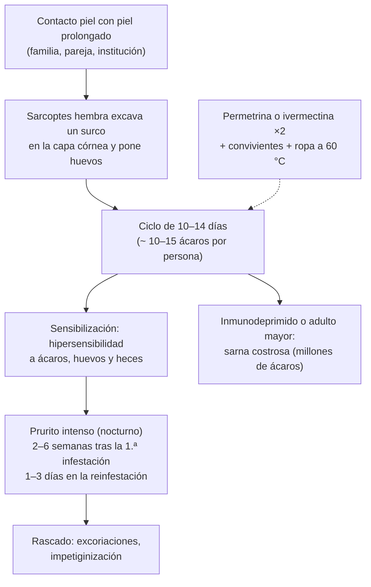

---
tags:
  - Dermatología
  - Frecuente en sala
---

# Micosis superficiales, escabiosis, pediculosis, virosis cutáneas (verrugas, molusco, herpes simple) y prúrigo por picaduras

**Subespecialidad**
Dermatología · Pediatría · Medicina familiar · Atención primaria

**Guías principales**
IACS 2020: criterios de consenso para el diagnóstico de la escabiosis · AAP 2015: pediculosis de la cabeza · BAD 2014: tiña de la cabeza · Revisión Cochrane de tratamientos tópicos de las verrugas (Kwok 2012)

**Otras fuentes**
Revisión de la escabiosis (Thomas, *J Am Acad Dermatol* 2020) · Diagnóstico y manejo de las tiñas (Ely, *Am Fam Physician* 2014) · Reacciones por picadura de insectos (Singh 2013) · Ver [varicela y herpes zóster](../../infectologia/varicela-y-herpes-zoster.md), [ITS (herpes genital, condilomas)](../../infectologia/infecciones-de-transmision-sexual-y-sifilis.md), [infecciones de piel](../../infectologia/infecciones-piel-partes-blandas.md) y [dermatitis](dermatitis-atopica-contacto-seborreica-y-del-panal.md)

**GES**
No.

**EUNACOM**
6.01.1.018 Micosis superficiales (específico, completo, completo) · 6.01.1.027 Sarna (específico, completo, completo) · 6.01.1.019 Pediculosis (específico, completo, completo) · 6.01.1.031 Verrugas, herpes simplex, herpes zóster, moluscos (específico, completo, completo) · 6.01.1.023 Prúrigo infantil agudo, picadura de insectos (específico, completo, completo)

**Revisado**
Octubre 2026

!!! abstract "Resumen en 60 segundos"
    - **Tiñas** (dermatofitos): **borde activo** descamativo con **curación central**. **Confirmar con KOH** antes de tratar si hay dudas. Tópicos (**clotrimazol**, terbinafina) en la tiña corporal, inguinal y del pie; **orales** en la **tiña de la cabeza** (niños) y la **onicomicosis** (terbinafina).
    - **Pitiriasis versicolor** (*Malassezia*): máculas **hipo o hiperpigmentadas** con descamación fina en el tronco ("signo de la uñada"); **ketoconazol** o sulfuro de selenio tópicos. **Candidiasis**: intertrigo con lesiones **satélite**.
    - **Escabiosis** (*Sarcoptes scabiei*): **prurito nocturno** intenso, **convivientes** con prurito, **surcos** en los espacios interdigitales, muñecas, cintura, genitales (nódulos en el pene) y areolas. Tratamiento: **permetrina 5 %** o **ivermectina oral**, **repetir a los 7 días** y tratar **a todos los convivientes a la vez**; lavar la ropa a **60 °C**.
    - **Pediculosis**: liendres adheridas al pelo y prurito retroauricular y de la nuca; **permetrina 1 %** o **dimeticona**, **repetir a los 7–10 días**, peinado con **liendrera**.
    - **Verrugas** (VPH): autolimitadas; **ácido salicílico** o **crioterapia**. **Molusco contagioso** (poxvirus): pápulas **umbilicadas** perladas; autolimitado (6–18 meses).
    - **Herpes simple**: vesículas agrupadas sobre una base eritematosa (labial, genital); **aciclovir** o **valaciclovir** precoz. Alarma: **eccema herpético**, **queratitis herpética**, **encefalitis**.
    - **Prúrigo infantil agudo** (urticaria papular): pápulas pruriginosas con **punto central** en las zonas descubiertas por **picaduras** (pulgas, mosquitos, chinches); controlar el vector (**mascotas**), antihistamínicos y corticoide tópico.

## Definición

- **Micosis superficiales**: infecciones de la **capa córnea**, el **pelo** y las **uñas** por:
    - **Dermatofitos** (*Trichophyton*, *Microsporum*, *Epidermophyton*): **tiñas** (dermatofitosis).
    - **Levaduras**: ***Malassezia*** (pitiriasis versicolor) y ***Candida*** (candidiasis cutánea y de mucosas).
- **Escabiosis** (sarna): infestación por el ácaro ***Sarcoptes scabiei* var. *hominis***, que excava **surcos** en la capa córnea.
- **Pediculosis**: infestación por piojos: de la **cabeza** (*Pediculus humanus capitis*), del **cuerpo** (*P. humanus corporis*) y del **pubis** (*Phthirus pubis*, "ladilla", ITS).
- **Verrugas**: proliferaciones epidérmicas benignas por el **virus del papiloma humano** (VPH).
- **Molusco contagioso**: infección epidérmica por un **poxvirus**.
- **Herpes simple**: infección por el **VHS-1** (sobre todo orolabial) y **VHS-2** (sobre todo genital), con **latencia** en los ganglios sensitivos y **recurrencias**.
- **Prúrigo infantil agudo** (urticaria papular, *strophulus*): reacción de **hipersensibilidad** a las **picaduras** de artrópodos.

## Epidemiología

### Mundial

- Las **micosis superficiales** afectan a **20–25 %** de la población mundial; la **tiña del pie** y la **onicomicosis** son las más frecuentes en los adultos; la **tiña de la cabeza** en los niños.
- **Escabiosis**: **> 200 millones** de personas afectadas en todo momento (enfermedad tropical desatendida según la OMS); brotes en **instituciones** (residencias de adultos mayores, cárceles, hogares de menores).
- **Pediculosis de la cabeza**: muy frecuente en escolares de **3 a 11 años**, más en niñas; no se relaciona con la falta de higiene.
- **Verrugas**: ~ 10 % de los niños y adolescentes. **Molusco**: niños de 2 a 5 años, atópicos e inmunodeprimidos.
- **VHS-1**: ~ 2/3 de la población menor de 50 años infectada; **VHS-2**: ~ 13 % de las personas de 15 a 49 años (OMS).

### Chile

!!! chile "Datos nacionales"
    - La **escabiosis** y la **pediculosis** son motivos de consulta frecuentes en la **APS**, con brotes en colegios, jardines infantiles y **establecimientos de larga estadía para adultos mayores**.
    - En Chile no existe la **ivermectina** en presentación de uso humano en todos los centros; la **permetrina** tópica es la primera línea habitual.
    - Las **pulgas** de las mascotas son una causa frecuente de **prúrigo** en los niños, sobre todo en primavera y verano.

## Etiología y factores de riesgo

| Infección | Factores de riesgo |
|---|---|
| **Tiña del pie** y **onicomicosis** | Calzado cerrado, duchas públicas, piscinas, diabetes, edad avanzada, enfermedad vascular |
| **Tiña de la cabeza** | Niños, contacto con **gatos y perros** (*Microsporum canis*) o con otros niños (*Trichophyton tonsurans*) |
| **Tiña corporal** | Contacto con animales, deportes de contacto (lucha) |
| **Pitiriasis versicolor** | Calor, **humedad**, sudoración, adolescencia y adultez joven, aceites |
| **Candidiasis cutánea** | **Pliegues** húmedos, **obesidad**, diabetes, **antibióticos**, corticoides, inmunodepresión, pañal |
| **Escabiosis** | **Contacto piel con piel** prolongado (familia, pareja), hacinamiento, instituciones; **sarna costrosa** en inmunodeprimidos y adultos mayores |
| **Pediculosis** | Contacto **cabeza con cabeza** (colegio), compartir peines y gorros |
| **Verrugas** | Microtrauma, piscinas, inmunodepresión, onicofagia |
| **Herpes recurrente** | Sol, fiebre, estrés, menstruación, inmunodepresión |
| **Prúrigo por picaduras** | Mascotas con **pulgas**, mosquitos, **chinches** de cama, niños de 1 a 7 años |

## Fisiopatología

*Figura 1. Ciclo de la escabiosis y origen del prurito. Esquema propio basado en Thomas (2020) y los criterios IACS 2020.*

- **Dermatofitos**: usan la **queratina** como nutriente; la inflamación del borde produce el **anillo** activo.
- ***Malassezia***: produce ácido azelaico, que **inhibe la tirosinasa** (máculas hipopigmentadas).
- **VPH**: infecta los queratinocitos basales a través de microlesiones y estimula su proliferación.
- **VHS**: replicación en el epitelio → **latencia** en los ganglios sensitivos → **reactivación** a lo largo del nervio.

## Clasificación

**Tiñas según la localización**:

| Tiña | Clínica | Tratamiento |
|---|---|---|
| **Corporal** | Placa **anular** con **borde activo** eritematodescamativo y centro claro | Tópico 2–4 semanas |
| **Inguinal** (crural) | Placa en la ingle y la raíz del muslo, **respeta el escroto** | Tópico |
| **Del pie** | **Interdigital** (maceración, fisuras en el 4.º espacio), en mocasín (hiperqueratosis plantar), vesicular | Tópico; oral si es extensa |
| **De la cabeza** (niños) | Placas **alopécicas** descamativas con pelos cortados; **querion** (placa inflamatoria supurativa) | **Oral** (los tópicos no penetran el folículo) |
| **Ungueal** (onicomicosis) | Uña engrosada, **amarilla**, friable, hiperqueratosis subungueal (pies > manos) | **Oral** (terbinafina); confirmar antes |
| **De la cara**, **de las manos** | Similar a la corporal ("una mano, dos pies") | Tópico u oral |
| ***Tinea incognito*** | Tiña modificada por **corticoides tópicos** (menos descamación, más extensa) | Suspender el corticoide; antifúngico |

**Verrugas**: **vulgares** (papulosas, hiperqueratósicas, manos), **plantares** (dolorosas, con puntos negros de capilares trombosados), **planas** (cara, dorso de las manos), **genitales** (condilomas acuminados: ITS).

## Clínica

- **Pitiriasis versicolor**: máculas **hipopigmentadas** (más visibles tras el sol), hiperpigmentadas o rosadas, con **descamación fina** al raspar ("signo de la uñada"), en el **tronco** y los hombros; poco prurito; recurrente.
- **Candidiasis**: **intertrigo** (pliegues submamarios, inguinales) con eritema intenso, maceración y **pústulas satélite**; **perlèche** (comisuras labiales); **paroniquia** crónica; muguet (oral); vulvovaginitis.
- **Escabiosis**:
    - **Prurito** intenso, de predominio **nocturno**, con **convivientes** afectados.
    - **Surcos** (líneas grisáceas de pocos milímetros), pápulas y vesículas en los **espacios interdigitales**, las **muñecas**, los codos, las axilas, la **cintura**, las nalgas, los **genitales** (**nódulos** en el pene y el escroto) y las **areolas**.
    - En los **lactantes**: compromiso de las **palmas, plantas** y la **cabeza**.
    - **Sarna costrosa** (noruega): placas **hiperqueratósicas** costrosas, con poco prurito, en inmunodeprimidos, adultos mayores institucionalizados y personas con discapacidad; **muy contagiosa**.
- **Pediculosis de la cabeza**: **prurito** retroauricular y en la **nuca**, **liendres** (huevos) firmemente adheridas al tallo del pelo (a diferencia de la caspa, que se desprende), piojos vivos, excoriaciones y adenopatías occipitales.
- **Molusco contagioso**: pápulas **perladas**, firmes, de 2–5 mm, con **umbilicación central**; en el tronco, los pliegues y la cara; en los adultos, en los **genitales** (ITS). Muchos o gigantes en la cara de un adulto: **VIH**.
- **Herpes simple**: pródromo de **ardor** u hormigueo; luego **vesículas agrupadas** sobre una base eritematosa que se rompen en **erosiones** y costras en 7–10 días. **Primoinfección**: **gingivoestomatitis herpética** en niños (fiebre, úlceras orales, odinofagia, deshidratación). Recurrente: herpes **labial**. Otras: **panadizo herpético** (dedo), herpes **gladiatorum**.
- **Prúrigo infantil agudo**: **pápulas** o **habones** muy pruriginosos con una **vesícula o punto central**, agrupados en las zonas **descubiertas** (piernas, brazos) o en patrón **lineal** ("desayuno, almuerzo y cena": chinches); en brotes, con excoriaciones y sobreinfección.

!!! alarma "Signos de alarma"
    - **Herpes** periocular o con **ojo rojo**, dolor o baja visual: **queratitis herpética** (oftalmología urgente; **no** corticoides tópicos).
    - **Eccema herpético** en un atópico (vesículas umbilicadas y erosiones con fiebre): aciclovir urgente.
    - **Fiebre, cefalea y alteración de conciencia** con herpes: **encefalitis**.
    - **Gingivoestomatitis herpética** con **deshidratación** en un niño: hospitalizar.
    - **Sarna costrosa**: aislamiento y tratamiento combinado; buscar inmunodepresión.
    - **Querion** (tiña inflamatoria del cuero cabelludo): tratamiento oral precoz para evitar la **alopecia cicatricial**; no drenar.
    - **Onicomicosis o tiña del pie** en un **diabético**: puerta de entrada de **celulitis**.

## Diagnóstico

!!! guia "Puntos clave (IACS 2020; AAP 2015; BAD 2014)"
    - **Micosis**: **KOH** (hifas en los dermatofitos; levaduras y seudohifas en *Candida*; "espaguetis con albóndigas" en *Malassezia*) y **cultivo** (sobre todo en la tiña de la cabeza y la onicomicosis antes del tratamiento oral). **Lámpara de Wood**: fluorescencia **verde** en *Microsporum* y **amarilla-anaranjada** en la pitiriasis versicolor.
    - **Escabiosis** (IACS 2020): **confirmada** si se visualizan ácaros, huevos o heces (raspado, **dermatoscopía**: signo del "ala delta"); **clínica** con surcos o lesiones típicas en genitales masculinos; **sospechada** con prurito + lesiones típicas + contacto con prurito.
    - **Pediculosis**: diagnóstico con la visualización de **piojos vivos** (peinado con liendrera en el pelo húmedo); las liendres a > 1 cm del cuero cabelludo suelen estar vacías.
    - **Herpes**: clínico; **PCR** del líquido de las vesículas (de elección) o Tzanck (células multinucleadas) si hay dudas.

## Laboratorio

| Examen | Uso |
|---|---|
| **KOH** del raspado | Tiñas, candidiasis, pitiriasis versicolor |
| **Cultivo micológico** | Tiña de la cabeza, onicomicosis (antes de terbinafina), casos refractarios |
| **Transaminasas** | Antes de la terbinafina oral prolongada si hay hepatopatía (opcional en los sanos) |
| **Raspado o dermatoscopía** | Escabiosis |
| **PCR para VHS** | Herpes atípico, eccema herpético, inmunodeprimidos |
| **VIH** | Molusco extenso en un adulto, herpes grave o crónico, sarna costrosa |
| **Glicemia** | Candidiasis recurrente |

## Imágenes

- No se requieren.

## Diagnóstico diferencial

| Cuadro | Diferenciales |
|---|---|
| **Tiña corporal** | **Eccema numular**, psoriasis, **pitiriasis rosada** (placa heraldo), granuloma anular (sin descamación) |
| **Pitiriasis versicolor** | **Vitíligo** (acrómico, sin descamación), pitiriasis alba (niños atópicos, cara), lepra |
| **Escabiosis** | **Dermatitis atópica**, prúrigo, urticaria, foliculitis, dermatitis herpetiforme |
| **Pediculosis** | Caspa, cilindros pilosos (se deslizan) |
| **Molusco** | Verrugas, criptococosis cutánea (VIH), carcinoma basocelular (adulto) |
| **Herpes simple** | **Impétigo** (costras melicéricas), **herpes zóster** (dermatomo), aftas (mucosa no queratinizada), herpangina |
| **Prúrigo por picaduras** | Varicela, escabiosis, urticaria |

## Tratamiento

!!! dosis "Micosis superficiales"
    | Cuadro | Tratamiento | Duración |
    |---|---|---|
    | **Tiña corporal, inguinal, del pie** | **Clotrimazol** 1 % o **terbinafina** 1 % tópicos 1–2 veces al día | 2–4 semanas (hasta 1–2 semanas tras la curación clínica) |
    | **Tiña de la cabeza** | **Terbinafina** oral (10–20 kg: 62,5 mg; 20–40 kg: 125 mg; > 40 kg: 250 mg/día) por **4 semanas** (*Trichophyton*), o **griseofulvina** 20–25 mg/kg/día por **6–8 semanas** (de elección en *Microsporum*) + champú de ketoconazol o sulfuro de selenio | Según el agente |
    | **Onicomicosis** (confirmada) | **Terbinafina 250 mg/día** por **6 semanas** (manos) o **12 semanas** (pies); alternativa: itraconazol en pulsos; tópicos (amorolfina, ciclopirox) si es leve y distal | La uña tarda 6–12 meses en crecer sana |
    | **Pitiriasis versicolor** | **Ketoconazol 2 %** champú (aplicar 5 minutos y enjuagar) por 1–3 días seguidos o diario por 5 días; sulfuro de selenio; **fluconazol** oral 300 mg semanal × 2 en las extensas | Profilaxis mensual en los recurrentes; la hipopigmentación tarda meses en resolverse |
    | **Candidiasis cutánea** | **Clotrimazol** o nistatina tópicos; mantener **seco** el pliegue | 2 semanas |

!!! dosis "Escabiosis y pediculosis"
    | Cuadro | Tratamiento |
    |---|---|
    | **Escabiosis** | **Permetrina 5 %** crema en **todo el cuerpo** desde el cuello (incluida la cabeza en los lactantes, bajo las uñas y los genitales), en la noche, por **8–12 horas**; **repetir a los 7 días**. Alternativa: **ivermectina oral 200 µg/kg** (en ≥ 15 kg y no embarazadas), **repetir a los 7–14 días**. En los lactantes < 2 meses y el embarazo: permetrina o vaselina azufrada |
    | **Medidas** | Tratar **a todos los convivientes y contactos** **el mismo día**, aunque no tengan síntomas. Lavar la ropa de cama y de vestir a **≥ 60 °C** o guardarla en una **bolsa cerrada por 72 horas**. El **prurito puede persistir 2–4 semanas** tras el tratamiento (no es fracaso): antihistamínicos y emolientes |
    | **Sarna costrosa** | **Ivermectina oral** (varias dosis) + **permetrina** + queratolíticos; aislamiento de contacto |
    | **Pediculosis de la cabeza** | **Permetrina 1 %** loción (10 minutos en el pelo seco y enjuagar) o **dimeticona 4 %** (mecanismo físico, sin resistencia); **repetir a los 7–10 días**; **peinado con liendrera** cada 2–3 días por 2 semanas; revisar a los convivientes. No es necesario excluir al niño del colegio |
    | **Pediculosis del pubis** | Permetrina 1 % y tratar a la pareja; estudiar otras **ITS** |

!!! dosis "Virosis cutáneas"
    | Cuadro | Tratamiento |
    |---|---|
    | **Verrugas vulgares y plantares** | Muchas **remiten solas** (2/3 en 2 años). **Ácido salicílico** 15–40 % diario tras limar (primera línea), **crioterapia** con nitrógeno líquido cada 2–3 semanas. Refractarias: derivar |
    | **Molusco contagioso** | **Autolimitado** (6–18 meses): observar. Si hay muchas lesiones, prurito o deseo: **curetaje**, crioterapia, **cantaridina** (por especialista), hidróxido de potasio tópico |
    | **Herpes labial recurrente** | **Valaciclovir 2 g c/12 h por 1 día** o aciclovir 400 mg 5 veces al día por 5 días, **al inicio** del pródromo; aciclovir tópico (beneficio menor); fotoprotección labial |
    | **Gingivoestomatitis herpética** | **Aciclovir** oral 15 mg/kg/dosis 5 veces al día por 7 días (si se inicia en las primeras 72–96 horas), analgesia, **hidratación** |
    | **Herpes genital** | Ver [ITS](../../infectologia/infecciones-de-transmision-sexual-y-sifilis.md) |

!!! dosis "Prúrigo infantil agudo y picaduras"
    - **Control del vector**: tratar a las **mascotas** (antipulgas) y desparasitar el hogar (aspirar alfombras y colchones), mosquiteros, **repelentes** (DEET o icaridina, según la edad).
    - **Sintomático**: **antihistamínicos** orales (cetirizina, loratadina, o clorfenamina en la noche), **corticoide tópico** de baja a mediana potencia por pocos días, compresas frías, uñas cortas.
    - Tratar la **impetiginización** si existe.

## Complicaciones

- **Micosis**: **celulitis** (tiña del pie en diabéticos), **querion** con alopecia cicatricial, *tinea incognito*, reacciones **id** (dermatofítides).
- **Escabiosis**: **impetiginización** (*S. pyogenes*), **glomerulonefritis postestreptocócica**, nódulos persistentes, brotes institucionales; la sarna costrosa puede llevar a **sepsis**.
- **Pediculosis**: sobreinfección de las excoriaciones, ansiedad, estigma.
- **Herpes**: **eccema herpético**, **queratitis** (ceguera), **encefalitis**, **eritema multiforme** recurrente, herpes neonatal (grave).
- **Picaduras**: sobreinfección, **reacciones alérgicas** sistémicas (raras), transmisión de enfermedades.

## Pronóstico y seguimiento

- Las **tiñas** responden bien al tratamiento; la **onicomicosis** recurre en ~ 20–25 %.
- La **pitiriasis versicolor** es **recurrente**; la pigmentación se normaliza en meses.
- La **escabiosis** se cura con un tratamiento correcto del paciente y **todos los contactos**; el fracaso suele deberse a no tratar a los convivientes o a una técnica inadecuada.
- Las **verrugas** y el **molusco** remiten espontáneamente en la mayoría.
- El **herpes** recurre; la **terapia supresiva** (valaciclovir diario) se usa en recurrencias frecuentes (≥ 6 al año).

## Perlas para el internado

!!! perla "Para recordar"
    - **Tiña** = borde activo con centro claro; **KOH** antes de tratar si hay dudas. Nunca corticoides tópicos sin diagnóstico (*tinea incognito*).
    - **Tiña de la cabeza** y **onicomicosis** = tratamiento **oral**.
    - **Pitiriasis versicolor**: descamación fina con el "signo de la uñada"; **ketoconazol** en champú.
    - **Sarna**: prurito **nocturno** + **convivientes** con prurito + espacios interdigitales y **genitales**. **Permetrina 5 %** × **2** (a los 7 días) a **todos** a la vez; ropa a **60 °C** o en bolsa **72 h**.
    - El **prurito puede durar semanas** tras tratar la sarna: no es fracaso.
    - **Pediculosis**: permetrina 1 % o dimeticona, **repetir a los 7–10 días** y **liendrera**.
    - **Molusco** = pápulas **umbilicadas**; extenso en un adulto = **VIH**.
    - **Herpes periocular**: oftalmología; **nunca** corticoides tópicos.
    - **Prúrigo**: picaduras con punto central en las zonas descubiertas → **tratar a la mascota**.

## Preguntas de repaso

??? repaso "1. Madre y dos hijos con prurito intenso que empeora en la noche desde hace 3 semanas. El niño tiene pápulas y surcos en los espacios interdigitales, las muñecas y nódulos en el escroto. ¿Diagnóstico y tratamiento?"
    **Escabiosis**. **Permetrina 5 %** en todo el cuerpo desde el cuello en la noche (8–12 horas), **repetir a los 7 días**, a **toda la familia el mismo día** (aunque no tengan síntomas). Lavar la ropa de cama y de vestir a ≥ 60 °C o guardarla en bolsa cerrada por 72 horas. Antihistamínicos para el prurito, que puede persistir 2–4 semanas.

??? repaso "2. Niño de 7 años con una placa alopécica descamativa en el cuero cabelludo con pelos cortados; tiene un gato. ¿Diagnóstico y tratamiento?"
    **Tiña de la cabeza** (probablemente por *Microsporum canis*; lámpara de Wood con fluorescencia verde, KOH y cultivo). Tratamiento **oral**: **griseofulvina** 20–25 mg/kg/día por 6–8 semanas (o terbinafina), más champú de ketoconazol o sulfuro de selenio; examinar y tratar al **gato**.

??? repaso "3. Adolescente con máculas hipopigmentadas en el tronco, con descamación fina al raspar, que se notaron tras el verano. ¿Diagnóstico y tratamiento?"
    **Pitiriasis versicolor** (*Malassezia*). Confirmar con KOH (levaduras e hifas cortas) o la lámpara de Wood. Tratamiento: **ketoconazol 2 % champú** (o sulfuro de selenio) en las zonas afectadas por 5 días; fluconazol oral si es extensa. Explicar que la **hipopigmentación tarda meses** en desaparecer y que puede recurrir.

??? repaso "4. Escolar de 8 años con prurito en la nuca y liendres adheridas al pelo. ¿Qué indica?"
    **Pediculosis de la cabeza**. **Permetrina 1 %** o **dimeticona 4 %**, **repetir a los 7–10 días**, **peinado con liendrera** en el pelo húmedo cada 2–3 días por 2 semanas y revisar a los convivientes. No requiere excluirlo del colegio.

??? repaso "5. Hombre de 30 años con herpes labial recurrente 6 veces al año que siente hormigueo en el labio. ¿Qué le indica?"
    **Valaciclovir 2 g c/12 h por 1 día**, iniciado al **primer síntoma** (pródromo). Con **≥ 6 recurrencias al año** se puede ofrecer **terapia supresiva** (valaciclovir 500 mg/día). Fotoprotección labial.

??? repaso "6. Niño de 4 años con pápulas muy pruriginosas con un punto central en las piernas, en brotes, en verano; el perro de la casa no ha sido desparasitado. ¿Qué tiene y qué indica?"
    **Prúrigo infantil agudo** (urticaria papular) por **picaduras de pulgas**. Tratamiento: **antihistamínico** oral, **corticoide tópico** de baja potencia por pocos días y, sobre todo, **control del vector** (antipulgas para el perro, limpieza del hogar). Tratar la impetiginización si aparece.

## Referencias

1. Engelman D, Yoshizumi J, Hay RJ, et al. The 2020 International Alliance for the Control of Scabies consensus criteria for the diagnosis of scabies. *Br J Dermatol.* 2020;183(5):808–820. doi:[10.1111/bjd.18943](https://doi.org/10.1111/bjd.18943)
2. Thomas C, Coates SJ, Engelman D, et al. Ectoparasites: scabies. *J Am Acad Dermatol.* 2020;82(3):533–548. doi:[10.1016/j.jaad.2019.05.109](https://doi.org/10.1016/j.jaad.2019.05.109)
3. Devore CD, Schutze GE; Council on School Health and Committee on Infectious Diseases. Head lice. *Pediatrics.* 2015;135(5):e1355–e1365. doi:[10.1542/peds.2015-0746](https://doi.org/10.1542/peds.2015-0746)
4. Fuller LC, Barton RC, Mohd Mustapa MF, et al. British Association of Dermatologists' guidelines for the management of tinea capitis 2014. *Br J Dermatol.* 2014;171(3):454–463. doi:[10.1111/bjd.13196](https://doi.org/10.1111/bjd.13196)
5. Ely JW, Rosenfeld S, Seabury Stone M. Diagnosis and management of tinea infections. *Am Fam Physician.* 2014;90(10):702–710. [aafp.org](https://www.aafp.org/pubs/afp/issues/2014/1115/p702.html)
6. Kwok CS, Gibbs S, Bennett C, et al. Topical treatments for cutaneous warts. *Cochrane Database Syst Rev.* 2012;(9):CD001781. doi:[10.1002/14651858.CD001781.pub3](https://doi.org/10.1002/14651858.CD001781.pub3)
7. Singh S, Mann BK. Insect bite reactions. *Indian J Dermatol Venereol Leprol.* 2013;79(2):151–164. doi:[10.4103/0378-6323.107629](https://doi.org/10.4103/0378-6323.107629)
