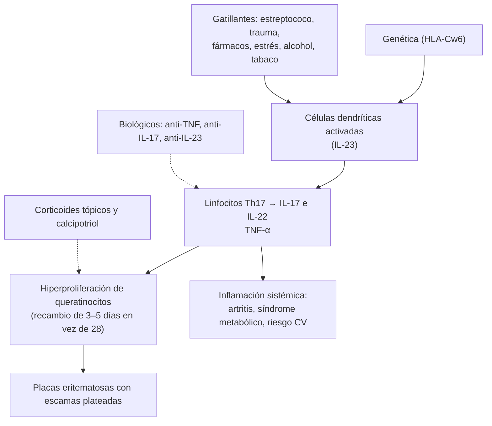

---
tags:
  - Dermatología
  - Urgencia
---

# Psoriasis, liquen plano, pitiriasis rosada y eritrodermia

**Subespecialidad**
Dermatología · Reumatología · Medicina interna

**Guías principales**
AAD-NPF 2019: psoriasis con biológicos · AAD-NPF 2021: psoriasis con tratamiento tópico y medidas de gravedad

**Otras fuentes**
Revisión de la psoriasis (Griffiths, *Lancet* 2021) · Revisión del liquen plano cutáneo y mucoso (Gorouhi 2014) · Clasificación de la pitiriasis rosada (Drago, *Dermatology* 2016) · Ver [artritis psoriásica y espondiloartritis](../../reumatologia/poliartritis-artritis-reumatoide-y-espondiloartritis.md), [dislipidemia](../../endocrinologia/dislipidemia.md), [obesidad y síndrome metabólico](../../endocrinologia/obesidad-y-sindrome-metabolico.md), [hepatitis crónica (VHC)](../../gastroenterologia/hepatitis-cronica-e-insuficiencia-hepatica-cronica.md) y [sífilis](../../infectologia/infecciones-de-transmision-sexual-y-sifilis.md)

**GES**
No.

**EUNACOM**
6.01.1.024 Psoriasis (específico, inicial, completo) · 6.01.1.015 Liquen plano (sospecha, inicial, derivar) · 6.01.1.022 Pitiriasis rosada de Gilbert (específico, completo, completo) · 6.01.2.004 Eritrodermia (sospecha, inicial, derivar)

**Revisado**
Octubre 2026

!!! abstract "Resumen en 60 segundos"
    - **Psoriasis**: enfermedad inflamatoria **crónica sistémica** inmunomediada (eje **IL-23/IL-17**), **~ 2–3 %** de la población. **Placas eritematosas bien delimitadas** con **escamas plateadas** en **codos, rodillas, cuero cabelludo** y región sacra; **uñas** (*pitting*, onicolisis); **fenómeno de Köebner**.
    - **Comorbilidades**: **artritis psoriásica** (~ 30 %), **síndrome metabólico**, enfermedad **cardiovascular**, depresión, enfermedad inflamatoria intestinal. Preguntar por **dolor articular** y controlar el riesgo CV.
    - **Tratamiento**: **leve** (< 10 % de superficie) → **corticoides tópicos** + **análogos de la vitamina D** (calcipotriol); **moderada a grave** o con artritis → **fototerapia**, **metotrexato** o **biológicos** (anti-TNF, anti-IL-17, anti-IL-23). **Evitar los corticoides sistémicos** (rebote pustuloso o eritrodérmico).
    - **Liquen plano**: pápulas **poligonales, planas, violáceas y pruriginosas** con **estrías de Wickham** en las **muñecas**, los tobillos y la región lumbar; **liquen plano oral** (reticular blanco); asociado al **VHC**. Tratamiento: corticoides tópicos potentes; derivar.
    - **Pitiriasis rosada de Gilbert**: **placa heraldo** ovalada seguida a los días de placas más pequeñas en el tronco en **"árbol de Navidad"**; probable relación con **VHH-6/7**; **autolimitada** (6–8 semanas). Descartar **sífilis secundaria** (VDRL o RPR).
    - **Eritrodermia**: eritema y descamación en **> 90 %** de la superficie corporal. Causas: **psoriasis**, **dermatitis atópica**, **fármacos** (DRESS), **linfoma cutáneo** (síndrome de Sézary) e idiopática. Riesgo de **hipotermia**, deshidratación, falla cardíaca de alto gasto y **sepsis**: **hospitalizar**.

## Definición

- **Psoriasis**: enfermedad inflamatoria crónica, inmunomediada, de base genética, que compromete la **piel**, las **uñas** y las **articulaciones**, con un componente **sistémico** (inflamación y riesgo cardiometabólico).
- **Liquen plano**: dermatosis inflamatoria **mediada por linfocitos T** contra los queratinocitos basales, que afecta la piel, las **mucosas**, el pelo y las uñas.
- **Pitiriasis rosada de Gilbert**: erupción **papuloescamosa aguda** y **autolimitada**, probablemente por la reactivación de los **herpesvirus humanos 6 y 7**.
- **Eritrodermia** (dermatitis exfoliativa generalizada): eritema y descamación que comprometen **> 90 %** de la superficie corporal; es un **síndrome** con varias causas, no un diagnóstico.

## Epidemiología

### Mundial

- **Psoriasis**: **~ 2–3 %** en los países occidentales (menos en Asia y África); dos picos de inicio: **20–30** y **50–60 años**. Igual en ambos sexos.
- **Artritis psoriásica**: **~ 20–30 %** de los pacientes con psoriasis; suele aparecer **años después** de la piel.
- **Liquen plano**: ~ 0,2–1 % (cutáneo); **liquen plano oral** ~ 1–2 %; edad media 30–60 años.
- **Pitiriasis rosada**: adolescentes y adultos jóvenes (10–35 años); más en primavera y otoño.
- **Eritrodermia**: rara (1–2 por 100 000 al año), más en hombres de edad media o avanzada.

### Chile

!!! chile "Datos nacionales"
    - La psoriasis se maneja en la APS en sus formas leves y en dermatología en las moderadas a graves; los **biológicos** los indica el especialista en los casos moderados a graves.
    - El **liquen plano** obliga a buscar el **VHC**, cuya infección en Chile es poco frecuente pero subdiagnosticada.

## Etiología y factores de riesgo

- **Psoriasis**:
    - **Genética**: HLA-**Cw6**, antecedentes familiares (~ 30–40 %).
    - **Gatillantes**: **infecciones** (estreptococo: **psoriasis en gotas** en niños y jóvenes), **trauma** cutáneo (Köebner), **estrés**, **alcohol**, **tabaco**, **obesidad**, frío y sequedad, **fármacos** (**litio**, **β-bloqueadores**, antimaláricos, **AINE**, IECA, interferón, **suspensión de corticoides sistémicos**).
    - **VIH**: psoriasis grave o de inicio brusco.
- **Liquen plano**: **VHC**, fármacos (**liquenoides**: β-bloqueadores, IECA, tiazidas, antimaláricos, oro, AINE), metales dentales (oral), enfermedad injerto contra huésped.
- **Pitiriasis rosada**: reactivación de **VHH-6/7**; también formas por **fármacos** y **vacunas**; en el **embarazo** se asocia a mayor riesgo de pérdida fetal en el primer trimestre.
- **Eritrodermia**: **psoriasis** (~ 25 %), **eccemas** (atópico, contacto, seborreico) (~ 20 %), **fármacos** (~ 15–20 %: anticonvulsivantes, alopurinol, sulfas, β-lactámicos), **linfoma cutáneo** (micosis fungoide, síndrome de **Sézary**), pitiriasis rubra pilaris, sarna costrosa, idiopática (~ 20 %).

## Fisiopatología

*Figura 1. Fisiopatología de la psoriasis: eje IL-23/IL-17 e hiperproliferación epidérmica. Esquema propio basado en Griffiths (2021).*

- **Liquen plano**: linfocitos T citotóxicos atacan la **capa basal** de la epidermis (dermatitis de interfase "en banda"), con degeneración de los queratinocitos basales (cuerpos coloides).
- **Pitiriasis rosada**: respuesta inmune a la reactivación de VHH-6/7.
- **Eritrodermia**: vasodilatación cutánea masiva → **pérdida de calor**, **agua** y **proteínas**; aumento del gasto cardíaco; alteración de la barrera (infecciones).

## Clasificación

**Formas clínicas de la psoriasis**:

| Forma | Características |
|---|---|
| **En placas** (vulgar, ~ 80–90 %) | Placas eritematoescamosas bien delimitadas en superficies de **extensión**, cuero cabelludo, sacro |
| **En gotas** (*guttata*) | Pequeñas pápulas en el tronco, en niños y jóvenes, **2–3 semanas después de una faringitis estreptocócica** |
| **Invertida** | **Pliegues** (axilas, ingle, submamario): placas lisas, brillantes, sin escamas |
| **Pustulosa generalizada** (von Zumbusch) | Pústulas estériles sobre eritema, **fiebre**, compromiso general: **urgencia** |
| **Pustulosa palmoplantar** | Pústulas en las palmas y plantas, tabaquismo |
| **Eritrodérmica** | > 90 % de la superficie: **urgencia** |
| **Ungueal** | ***Pitting*** (depresiones puntiformes), **onicolisis**, "mancha de aceite", hiperqueratosis subungueal |
| **Artritis psoriásica** | Oligoartritis asimétrica, interfalángicas distales, **dactilitis**, entesitis, compromiso axial |

**Gravedad**: **leve** < 3 % de la superficie corporal (BSA), **moderada** 3–10 %, **grave** > 10 % (o PASI > 10, o compromiso de zonas especiales: cara, genitales, palmas y plantas, uñas, o gran impacto en la calidad de vida, DLQI > 10).

**Liquen plano**: cutáneo clásico, **oral** (reticular, erosivo), hipertrófico, ungueal (pterigión), **pilar** (alopecia cicatricial), genital.

## Clínica

- **Psoriasis**: placas **eritematosas**, **bien delimitadas**, con **escamas plateadas** gruesas; prurito variable. **Signo de Auspitz** (puntillado hemorrágico al raspar las escamas). **Köebner** (lesiones en zonas de trauma).
- **Liquen plano**: las **"5 P"**: **P**ápulas **P**lanas, **P**oligonales, **P**urpúricas (violáceas) y **P**ruriginosas; **estrías de Wickham** (red blanquecina en la superficie); Köebner. **Oral**: lesiones **reticulares blancas** en la mucosa yugal; la forma **erosiva** es dolorosa y tiene un pequeño riesgo de **carcinoma espinocelular**.
- **Pitiriasis rosada**: **placa heraldo** (2–10 cm, ovalada, rosada, con **collarete** descamativo interno), seguida en 1–2 semanas por placas más pequeñas en el **tronco**, orientadas según las líneas de tensión de la piel (patrón en **"árbol de Navidad"**); prurito leve; puede haber pródromo viral.
- **Eritrodermia**: eritema difuso con descamación, **prurito**, **edema**, linfadenopatías, alopecia, alteraciones ungueales, **escalofríos** e hipotermia, taquicardia.

!!! alarma "Signos de alarma: hospitalizar o derivar con urgencia"
    - **Eritrodermia** (> 90 % de la superficie): riesgo de **hipotermia**, **deshidratación**, desequilibrio hidroelectrolítico, **hipoalbuminemia**, **falla cardíaca** de alto gasto y **sepsis**.
    - **Psoriasis pustulosa generalizada**: fiebre, pústulas generalizadas, leucocitosis.
    - **Eritrodermia con fiebre, eosinofilia, adenopatías y hepatitis** tras un fármaco nuevo: **DRESS**.
    - **Liquen plano oral erosivo** que no cicatriza o con induración: **biopsia** (carcinoma espinocelular).
    - Pitiriasis rosada en el **embarazo** temprano: control obstétrico.

## Diagnóstico

!!! guia "Puntos clave (AAD-NPF 2019 y 2021)"
    - Diagnóstico **clínico** en la mayoría.
    - **Psoriasis**: evaluar la **extensión** (BSA, PASI), las **zonas especiales**, las **uñas**, las **articulaciones** (dolor, rigidez matinal, dactilitis: derivar a reumatología) y las **comorbilidades** (peso, PA, glicemia, lípidos, tabaco, alcohol, depresión).
    - Antes de un tratamiento **sistémico o biológico**: hemograma, función hepática y renal, **VHB, VHC, VIH**, **tuberculosis latente** (PPD o IGRA), β-hCG.
    - **Liquen plano**: biopsia si hay dudas; pedir **VHC**.
    - **Pitiriasis rosada**: **VDRL o RPR** si las lesiones comprometen **palmas y plantas**, no hay placa heraldo o hay factores de riesgo de ITS (descartar **sífilis secundaria**).
    - **Eritrodermia**: historia de dermatosis previa y de **fármacos**, **biopsia** de piel (a veces varias), hemograma con **frotis** (células de **Sézary**), **eosinófilos**, función hepática y renal, electrolitos, albúmina, hemocultivos si hay fiebre.

## Laboratorio

| Situación | Exámenes |
|---|---|
| **Psoriasis en gotas** | **ASO** o cultivo faríngeo |
| **Psoriasis grave o de inicio brusco** | **VIH** |
| **Antes de sistémicos o biológicos** | Hemograma, perfil hepático, creatinina, **VHB, VHC, VIH**, **IGRA o PPD**, β-hCG, perfil lipídico |
| **Metotrexato** | Hemograma, transaminasas y creatinina periódicos |
| **Liquen plano** | **Anticuerpos anti-VHC** |
| **Pitiriasis rosada atípica** | **VDRL o RPR** |
| **Eritrodermia** | Hemograma con frotis, **eosinófilos**, perfil hepático y renal, **electrolitos**, **albúmina**, hemocultivos; citometría de flujo en sangre (Sézary) |

## Imágenes

- **Radiografías** o ecografía articular si hay artritis psoriásica (erosiones, "lápiz en copa").
- **Radiografía de tórax** antes de los biológicos (tuberculosis).
- **TC** para la etapificación si la eritrodermia es por un linfoma cutáneo.

## Diagnóstico diferencial

| Diagnóstico | Claves |
|---|---|
| **Dermatitis atópica o eccema numular** | Prurito intenso, bordes menos netos, exudado |
| **Dermatitis seborreica** (frente a la psoriasis del cuero cabelludo) | Escamas grasas amarillas; la psoriasis sobrepasa el borde del pelo |
| **Tiña corporis** | Borde activo con curación central; **KOH** positivo |
| **Sífilis secundaria** (frente a la pitiriasis rosada y la psoriasis en gotas) | **Palmas y plantas**, adenopatías, condiloma plano; **VDRL o RPR** |
| **Micosis fungoide** | Placas fijas en zonas no expuestas que no responden; biopsia |
| **Erupción liquenoide por fármacos** (frente al liquen plano) | Relación temporal con el fármaco, zonas fotoexpuestas |
| **Candidiasis**, **intertrigo** (frente a la psoriasis invertida) | Lesiones satélite, KOH positivo |
| **Onicomicosis** (frente a la psoriasis ungueal) | KOH y cultivo de uña |

## Tratamiento

### Psoriasis

!!! guia "Tratamiento escalonado (AAD-NPF 2019 y 2021)"
    - **Medidas generales**: **emolientes**, evitar los **gatillantes** (alcohol, tabaco, fármacos), **baja de peso** si hay obesidad, control del **riesgo cardiovascular** y de la depresión.
    - **Leve** (< 3–10 % de la superficie):
        - **Corticoides tópicos** de mediana a alta potencia (por 2–4 semanas, luego intermitentes).
        - **Calcipotriol** (análogo de la vitamina D), solo o **combinado** con betametasona (más eficaz y con menos efectos adversos).
        - **Inhibidores de la calcineurina** en la cara y los pliegues; queratolíticos (ácido salicílico), alquitrán.
    - **Moderada a grave**, zonas especiales o artritis:
        - **Fototerapia** UVB de banda estrecha.
        - **Sistémicos clásicos**: **metotrexato**, **ciclosporina** (corto plazo), acitretina, apremilast.
        - **Biológicos**: **anti-TNF** (adalimumab, etanercept, infliximab), **anti-IL-12/23** (ustekinumab), **anti-IL-17** (secukinumab, ixekizumab, brodalumab), **anti-IL-23** (guselkumab, risankizumab, tildrakizumab).
    - **Evitar los corticoides sistémicos**: al suspenderlos pueden desencadenar una **psoriasis pustulosa** o **eritrodérmica**.
    - **Psoriasis en gotas**: tópicos y fototerapia; tratar la faringitis estreptocócica si persiste.

!!! dosis "Fármacos frecuentes"
    | Fármaco | Dosis | Precauciones |
    |---|---|---|
    | **Calcipotriol + betametasona** (gel o ungüento) | 1 vez al día por 4 semanas, luego 2 veces por semana | No en > 30 % de la superficie (hipercalcemia) |
    | **Clobetasol 0,05 %** | 1–2 veces al día por ≤ 2–4 semanas | Atrofia; no en la cara ni los pliegues |
    | **Metotrexato** | **7,5–25 mg 1 vez a la semana** VO o SC + **ácido fólico** 5 mg semanal (otro día) | **Semanal, nunca diario**; hepatotoxicidad, mielosupresión, **teratogénico**; control de hemograma y transaminasas |
    | **Ciclosporina** | 2,5–5 mg/kg/día por ≤ 1 año | **HTA**, nefrotoxicidad |
    | **Acitretina** | 25–50 mg/día | **Teratogénica** (evitar el embarazo por 3 años), hiperlipidemia |

### Liquen plano

- **Corticoides tópicos potentes** (clobetasol) en las lesiones cutáneas; **corticoides en gel** o tacrolimus en el liquen plano **oral**; antihistamínicos para el prurito.
- Formas extensas: **corticoides orales** por corto plazo, fototerapia, acitretina o metotrexato (especialista).
- Suspender el **fármaco** sospechoso en la erupción liquenoide; tratar el **VHC**.
- **Seguimiento** del liquen plano oral erosivo (riesgo de carcinoma).

### Pitiriasis rosada

- **Autolimitada** (6–8 semanas, hasta 12): **tranquilizar**, emolientes, **antihistamínicos** o corticoide tópico de baja potencia para el prurito.
- **Aciclovir** oral en las formas extensas o con síntomas generales, en la fase precoz (evidencia moderada).
- Evitar el ejercicio intenso, el calor y los irritantes, que agravan la erupción.

### Eritrodermia

- **Hospitalizar**: control de la **temperatura** (ambiente cálido), **balance hídrico** y **electrolitos**, **nutrición** (pérdida proteica), **emolientes** abundantes y baños tibios, **corticoides tópicos de baja a mediana potencia**, antihistamínicos sedantes.
- **Suspender todo fármaco no esencial**; tratar las **infecciones**.
- **Tratamiento de la causa**: psoriasis (ciclosporina, biológicos; evitar los corticoides sistémicos), dermatitis atópica, DRESS (corticoides sistémicos), linfoma (oncología).

## Complicaciones

- **Psoriasis**: **artritis psoriásica** (deformidades), **síndrome metabólico**, **enfermedad cardiovascular**, hígado graso, depresión, impacto en la calidad de vida; efectos adversos de los tratamientos (infecciones con biológicos, tuberculosis).
- **Liquen plano**: **alopecia cicatricial** (liquen plano pilar), destrucción ungueal, **carcinoma espinocelular** oral (raro), hiperpigmentación posinflamatoria.
- **Pitiriasis rosada**: hiperpigmentación transitoria; riesgo fetal en el embarazo temprano.
- **Eritrodermia**: **hipotermia**, **sepsis**, falla cardíaca, hipoalbuminemia, muerte.

## Pronóstico y seguimiento

- **Psoriasis**: **crónica** con brotes y remisiones; los biológicos logran un blanqueamiento casi completo en muchos pacientes. Control de la piel, las articulaciones y el riesgo cardiometabólico.
- **Liquen plano** cutáneo: suele remitir en **1–2 años**; el **oral** es más crónico.
- **Pitiriasis rosada**: remisión espontánea en 6–8 semanas; rara vez recurre.
- **Eritrodermia**: depende de la causa; mortalidad relevante en el adulto mayor y en las de causa farmacológica o linfomatosa.

## Perlas para el internado

!!! perla "Para recordar"
    - **Psoriasis**: placas **bien delimitadas** con **escamas plateadas** en **codos y rodillas**, *pitting* ungueal, Köebner.
    - Preguntar siempre por **dolor articular** (artritis psoriásica) y controlar el **riesgo cardiovascular**.
    - **No** corticoides sistémicos en la psoriasis: **rebote pustuloso o eritrodérmico**.
    - **Litio, β-bloqueadores, antimaláricos y AINE** pueden empeorar la psoriasis.
    - **Psoriasis en gotas** = 2–3 semanas tras una **faringitis estreptocócica**.
    - **Metotrexato**: dosis **semanal** + ácido fólico.
    - **Liquen plano**: pápulas **violáceas poligonales** con **estrías de Wickham** en las muñecas; pedir **VHC**.
    - **Pitiriasis rosada**: **placa heraldo** + "árbol de Navidad"; **descartar sífilis** si es atípica.
    - **Eritrodermia** = **hospitalizar** (temperatura, líquidos, electrolitos, infecciones).

## Preguntas de repaso

??? repaso "1. Hombre de 35 años con placas eritematosas bien delimitadas con escamas plateadas en los codos, las rodillas y el cuero cabelludo, y depresiones puntiformes en las uñas. Compromete el 5 % de su superficie. ¿Diagnóstico y tratamiento?"
    **Psoriasis en placas** leve a moderada con compromiso **ungueal**. Tratamiento tópico: **calcipotriol + betametasona** 1 vez al día por 4 semanas y luego en mantención, emolientes; evaluar las **articulaciones** (artritis psoriásica), el peso, la PA, la glicemia y los lípidos, el tabaco y el alcohol. Si no responde o tiene artritis: derivar para fototerapia, metotrexato o biológicos.

??? repaso "2. Niño de 10 años con múltiples pápulas eritematoescamosas pequeñas en el tronco, 2 semanas después de una faringitis. ¿Qué tiene?"
    **Psoriasis en gotas** (*guttata*), desencadenada por una infección **estreptocócica**. Pedir **ASO** o cultivo faríngeo. Tratamiento: tópicos (corticoides, calcipotriol), fototerapia en las extensas; tratar la infección si persiste. Suele remitir en semanas a meses, pero puede evolucionar a psoriasis en placas.

??? repaso "3. Paciente con psoriasis extensa que recibió prednisona oral por una crisis asmática y al suspenderla desarrolla fiebre y pústulas generalizadas. ¿Qué ocurrió?"
    **Psoriasis pustulosa generalizada** (von Zumbusch) desencadenada por la **suspensión de corticoides sistémicos**. Es una urgencia: **hospitalizar**, hidratar, controlar la temperatura y los electrolitos, y tratar con fármacos sistémicos (ciclosporina, acitretina o biológicos) por especialista.

??? repaso "4. Mujer de 45 años con pápulas violáceas, planas, poligonales y muy pruriginosas en las muñecas, con estrías blanquecinas en su superficie y lesiones reticulares blancas en la mucosa yugal. ¿Diagnóstico y qué examen pide?"
    **Liquen plano** cutáneo y **oral**. Pedir **anticuerpos anti-VHC** y revisar los fármacos (erupción liquenoide). Tratamiento: corticoides tópicos potentes y, en la mucosa, corticoides en gel; seguimiento del componente oral (riesgo de carcinoma en las formas erosivas).

??? repaso "5. Joven de 20 años con una placa ovalada de 4 cm en el tórax y, a la semana, múltiples placas pequeñas en el tronco en patrón de 'árbol de Navidad'. ¿Diagnóstico y conducta?"
    **Pitiriasis rosada de Gilbert**. Tranquilizar (autolimitada en 6–8 semanas), emolientes y antihistamínicos o un corticoide tópico de baja potencia para el prurito. Pedir **VDRL o RPR** si hay compromiso de **palmas y plantas** o factores de riesgo de ITS (sífilis secundaria).

??? repaso "6. Hombre de 70 años con eritema y descamación de todo el cuerpo, escalofríos, edema de piernas y prurito intenso. ¿Qué hace?"
    **Eritrodermia**. **Hospitalizar**: ambiente cálido, balance hídrico y electrolitos, albúmina, emolientes y corticoides tópicos de baja a mediana potencia, suspender los fármacos no esenciales, buscar infecciones. Estudiar la causa: dermatosis previa (psoriasis, eccema), **fármacos** (DRESS), **linfoma cutáneo** (frotis con células de Sézary, biopsia).

## Referencias

1. Menter A, Strober BE, Kaplan DH, et al. Joint AAD-NPF guidelines of care for the management and treatment of psoriasis with biologics. *J Am Acad Dermatol.* 2019;80(4):1029–1072. doi:[10.1016/j.jaad.2018.11.057](https://doi.org/10.1016/j.jaad.2018.11.057)
2. Elmets CA, Korman NJ, Prater EF, et al. Joint AAD–NPF guidelines of care for the management and treatment of psoriasis with topical therapy and alternative medicine modalities for psoriasis severity measures. *J Am Acad Dermatol.* 2021;84(2):432–470. doi:[10.1016/j.jaad.2020.07.087](https://doi.org/10.1016/j.jaad.2020.07.087)
3. Griffiths CEM, Armstrong AW, Gudjonsson JE, et al. Psoriasis. *Lancet.* 2021;397(10281):1301–1315. doi:[10.1016/S0140-6736(20)32549-6](https://doi.org/10.1016/S0140-6736(20)32549-6)
4. Gorouhi F, Davari P, Fazel N. Cutaneous and mucosal lichen planus: a comprehensive review of clinical subtypes, risk factors, diagnosis, and prognosis. *ScientificWorldJournal.* 2014;2014:742826. doi:[10.1155/2014/742826](https://doi.org/10.1155/2014/742826)
5. Drago F, Ciccarese G, Rebora A, et al. Pityriasis rosea: a comprehensive classification. *Dermatology.* 2016;232(4):431–437. doi:[10.1159/000445375](https://doi.org/10.1159/000445375)
