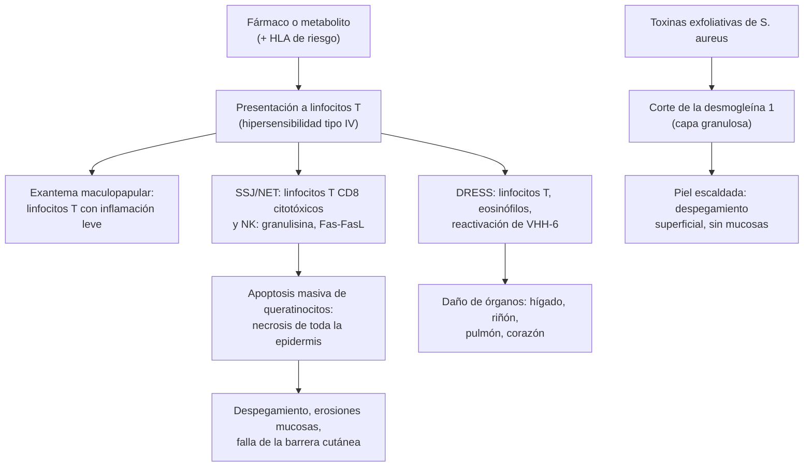

---
tags:
  - Dermatología
  - Urgencia
  - Frecuente en sala
---

# Reacciones cutáneas por fármacos, Stevens-Johnson, NET, DRESS y piel escaldada

**Subespecialidad**
Dermatología · Medicina interna · Urgencia y paciente crítico · Pediatría

**Guías principales**
Guía del Reino Unido 2016 para el SSJ/NET en adultos (*Br J Dermatol*) · Guía de cuidados de soporte del SSJ/NET de la Society of Dermatology Hospitalists 2020 (*J Am Acad Dermatol*) · Estudio prospectivo RegiSCAR del DRESS (*Br J Dermatol* 2013) · Posición de la EAACI 2025 sobre el DRESS en pediatría (*Pediatr Allergy Immunol*)

**Otras fuentes**
SCORTEN (2000) · ALDEN (2010) · Revisión del eritema multiforme (*Am Fam Physician* 2019) · Revisión del síndrome de piel escaldada estafilocócica (*World J Pediatr* 2018) · Ver [urticaria y angioedema](urticaria-y-angioedema.md), [infecciones de piel y partes blandas](../../infectologia/infecciones-piel-partes-blandas.md), [quemaduras](../../cirugia/piel-partes-blandas-y-quemaduras/quemaduras-secuelas-y-cicatrices.md), [gota](../../reumatologia/monoartritis-gota-artritis-septica.md) (alopurinol) y [epilepsia](../../neurologia/crisis-epileptica-y-estado-epileptico.md) (anticonvulsivantes)

**GES**
No.

**EUNACOM**
6.01.1.025 Reacciones cutáneas por drogas: exantema y toxidermia fija (específico, inicial, completo) · 6.01.1.010 Eritema polimorfo menor (específico, inicial, completo) · 6.01.2.009 Necrólisis epidérmica tóxica (sospecha, inicial, derivar) · 6.01.2.013 Síndrome de hipersensibilidad a drogas (sospecha, inicial, completo) · 6.01.2.014 Síndrome de piel escaldada por estafilococos (sospecha, inicial, no requiere) · 6.01.2.015 Síndrome de Stevens-Johnson (sospecha, inicial, derivar)

**Revisado**
Octubre 2026

!!! abstract "Resumen en 60 segundos"
    - **Exantema maculopapular** (morbiliforme): la reacción cutánea a fármacos **más frecuente**; aparece **4–14 días** después de iniciar el fármaco (antes si hubo exposición previa) y se resuelve en 1–2 semanas al suspenderlo.
    - **Toxidermia fija**: placa redonda **violácea** que **recurre en el mismo sitio** con cada exposición (labios, genitales, manos); deja **hiperpigmentación**. AINE, cotrimoxazol, tetraciclinas, paracetamol.
    - **Reacciones graves** (SCAR): **síndrome de Stevens-Johnson (SSJ)** y **necrólisis epidérmica tóxica (NET)**, **DRESS** y pustulosis exantemática aguda generalizada (PEGA). Signos de alarma: **dolor cutáneo**, **ampollas**, **Nikolsky positivo**, **mucosas** comprometidas, **fiebre**, **edema facial**, **eosinofilia** y alteración **hepática**.
    - **SSJ/NET**: despegamiento epidérmico **< 10 %** (SSJ), **10–30 %** (superposición) y **> 30 %** (NET), con **mucosas** comprometidas en > 90 %. **Alopurinol**, **anticonvulsivantes aromáticos**, **lamotrigina**, **cotrimoxazol**, **nevirapina**, **AINE oxicam**. **Suspender el fármaco**, **unidad de quemados o UCI**, soporte y **oftalmología precoz**. Pronóstico con **SCORTEN**.
    - **DRESS**: latencia **larga (2–8 semanas)**, fiebre, exantema extenso, **edema facial**, adenopatías, **eosinofilia** y **hepatitis**. Tratamiento: suspender el fármaco y **corticoides sistémicos** si hay daño de órgano.
    - **Eritema polimorfo**: lesiones **en diana** acrales, casi siempre por **herpes simple** (no por fármacos). **Piel escaldada estafilocócica**: niño **< 5 años**, eritema doloroso y despegamiento superficial **sin mucosas**; **cloxacilina** IV.

## Definición

- **Reacción adversa cutánea a fármacos** (toxidermia o farmacodermia): cualquier cambio indeseado de la piel, las mucosas o los anexos causado por un fármaco en dosis habituales.
- **Reacciones adversas cutáneas graves** (SCAR, por su sigla en inglés): reacciones de **hipersensibilidad tardía** (tipo IV, mediadas por **linfocitos T**) con riesgo vital: **SSJ/NET**, **DRESS** (*drug reaction with eosinophilia and systemic symptoms*, o síndrome de hipersensibilidad inducido por fármacos) y **PEGA**.
- **Eritema polimorfo** (eritema multiforme): reacción inmunitaria aguda, generalmente **postinfecciosa**, con lesiones **en diana típicas**. **Menor**: sin compromiso de mucosas o con compromiso de una sola, leve. **Mayor**: compromiso de **mucosas** importante, sin síntomas sistémicos graves. **No** es parte del espectro del SSJ/NET.
- **Síndrome de piel escaldada estafilocócica** (SSSS): dermatosis **exfoliativa** mediada por **toxinas exfoliativas** de *Staphylococcus aureus*.

## Epidemiología

- **Mundial**:
    - Las reacciones cutáneas afectan a ~ **2–3 %** de los pacientes hospitalizados. El **exantema maculopapular** representa ~ **75–95 %** de los casos.
    - **SSJ/NET**: incidencia de **1–6 casos por millón** al año (SSJ) y **0,4–1,2 por millón** (NET). Mortalidad de **~ 1–5 %** en el SSJ y de **25–35 %** en la NET. Riesgo **mucho mayor** en las personas con **VIH** (hasta 100 veces) y en el lupus.
    - **DRESS**: ~ **1 por cada 1.000–10.000** exposiciones a fármacos de riesgo. Mortalidad de **~ 2–10 %**, sobre todo por **insuficiencia hepática**.
    - **Factores genéticos**: **HLA-B\*15:02** con carbamazepina (asiáticos del sudeste) y **HLA-B\*58:01** con alopurinol (asiáticos, más frecuente en algunos grupos).
    - **Piel escaldada**: predomina en los **niños < 5 años** (inmadurez renal para eliminar la toxina). En los adultos se asocia a **insuficiencia renal** o **inmunosupresión** y tiene una mortalidad mayor.
- **Chile**: no hay registros nacionales publicados de incidencia de SSJ/NET o DRESS. La farmacovigilancia la coordina el **Instituto de Salud Pública (ISP)**.

!!! chile "Datos nacionales"
    - Toda sospecha de reacción adversa grave a medicamentos debe **notificarse** al **Subdepartamento de Farmacovigilancia del ISP** (formulario de notificación de sospecha de reacción adversa a medicamentos, también disponible en línea).
    - En Chile, el **alopurinol**, los **anticonvulsivantes** (carbamazepina, fenitoína, lamotrigina) y el **cotrimoxazol** son de uso masivo en la APS: son la principal fuente de reacciones graves. Iniciar el alopurinol en **dosis bajas** (50–100 mg/día) y subir de forma gradual.
    - Los casos de NET se tratan en las **unidades de quemados** de los hospitales de referencia o en la UCI.

## Etiología y factores de riesgo

| Reacción | Fármacos o causas principales | Latencia |
|---|---|---|
| **Exantema maculopapular** | **Aminopenicilinas** (amoxicilina; ~ 90 % de exantema si se usa en la **mononucleosis**), cefalosporinas, **sulfonamidas**, anticonvulsivantes, alopurinol, AINE | **4–14 días** |
| **Urticaria y anafilaxia** | Betalactámicos, AINE, contraste, relajantes musculares | **Minutos a horas** |
| **Toxidermia fija** | **AINE**, **cotrimoxazol**, **tetraciclinas**, paracetamol, barbitúricos, fenolftaleína | **30 minutos a 8 horas** tras la reexposición (1–2 semanas la primera vez) |
| **SSJ/NET** | **Alopurinol**, **carbamazepina**, **fenitoína**, **lamotrigina**, **fenobarbital**, **cotrimoxazol** y otras sulfonamidas, **nevirapina**, **AINE oxicam**; en los niños también *Mycoplasma pneumoniae* | **4–28 días** |
| **DRESS** | **Anticonvulsivantes aromáticos** (carbamazepina, fenitoína, fenobarbital, lamotrigina), **alopurinol**, **sulfonamidas** (sulfasalazina, dapsona, cotrimoxazol), **vancomicina**, **minociclina**, antituberculosos | **2–8 semanas** |
| **PEGA** | **Betalactámicos**, macrólidos, **hidroxicloroquina**, diltiazem | **< 48 horas** |
| **Eritema polimorfo** | **Virus herpes simple** (~ **90 %** del eritema polimorfo menor y recurrente), *Mycoplasma pneumoniae* (niños); fármacos en < 10 % | 1–3 semanas tras el herpes |
| **Piel escaldada** | Toxinas exfoliativas **ETA y ETB** de *S. aureus* (foco: conjuntivitis, otitis, ombligo, faringe, impétigo) | Días |

- **Factores de riesgo** de las reacciones graves: **VIH**, lupus, **edad avanzada**, **insuficiencia renal** (alopurinol en dosis altas), reactivación de **virus herpes** (VHH-6 en el DRESS), terapia oncológica, polifarmacia y predisposición **HLA**.

## Fisiopatología

*Figura 1. Mecanismos de las reacciones cutáneas graves. Esquema propio basado en Creamer (2016), Kardaun (2013) y Leung (2018).*

- La diferencia del **nivel de despegamiento** explica la gravedad: en la **NET** la necrosis es de **toda la epidermis** (dermis expuesta, como un gran quemado); en la **piel escaldada**, el corte es **intraepidérmico superficial** (subcorneal), por lo que cura sin cicatriz.

## Clasificación

| Cuadro | Superficie de despegamiento | Mucosas |
|---|---|---|
| **SSJ** | **< 10 %** | Sí (> 90 %) |
| **Superposición SSJ/NET** | **10–30 %** | Sí |
| **NET** (síndrome de Lyell) | **> 30 %** | Sí |
| **Eritema polimorfo menor** | Sin despegamiento extenso; dianas típicas acrales | No o una sola, leve |
| **Eritema polimorfo mayor** | Dianas típicas; despegamiento < 10 % | **Sí**, importante |

- **DRESS**: el puntaje **RegiSCAR** (fiebre, adenopatías, eosinofilia, linfocitos atípicos, extensión del exantema, características del exantema, daño de órganos, resolución en > 15 días y exclusión de otras causas) clasifica el caso como **descartado, posible, probable o definido**.

## Clínica

- **Exantema maculopapular**: máculas y pápulas eritematosas **simétricas**, que comienzan en el **tronco** y se extienden a las extremidades; **prurito**; afebril o con fiebre baja; **sin** compromiso de mucosas.
- **Toxidermia fija**: una o pocas placas **redondas, eritematovioláceas**, bien delimitadas, a veces con **ampolla central**; ardor; en los **labios**, los **genitales**, las manos y los pies. Al curar deja **hiperpigmentación** marrón. **Recurre en el mismo sitio** con cada exposición (y puede sumar placas nuevas).
- **SSJ/NET**:
    - **Pródromo** de 1–3 días: **fiebre**, malestar, odinofagia, **ardor ocular**.
    - Luego: máculas **purpúricas** o **dianas atípicas planas** que confluyen, en la cara y el tronco, con **dolor cutáneo** desproporcionado.
    - Evolucionan a **ampollas flácidas** y **despegamiento** en sábanas, con **signo de Nikolsky positivo** (la epidermis se desliza con la presión lateral).
    - **Mucosas** (> 90 %): erosiones **orales** con costras hemorrágicas en los labios, **conjuntivitis** (con riesgo de cicatrices y ceguera) y erosiones **genitales**.
- **DRESS**: **fiebre** alta, **exantema** morbiliforme extenso (> 50 % de la superficie), que puede volverse **eritrodérmico**, **edema facial** (característico), **adenopatías** generalizadas, **eosinofilia** (> 1.500/µL), **linfocitos atípicos** y daño de órganos: **hepatitis** (el más frecuente), **nefritis intersticial**, neumonitis, **miocarditis**. Curso **prolongado** con recaídas, a pesar de suspender el fármaco.
- **PEGA**: decenas de **pústulas pequeñas no foliculares** sobre eritema, en los **pliegues**, con **fiebre** y **neutrofilia**, a las pocas horas del fármaco; resuelve en ~ 2 semanas con descamación.
- **Eritema polimorfo**: lesiones **en diana típicas** de < 3 cm con **tres zonas** concéntricas (centro oscuro o ampolloso, anillo edematoso pálido y halo eritematoso), de distribución **acral** (manos, pies, codos, rodillas), **fijas** por al menos 7 días. Brotes **recurrentes** tras el herpes labial.
- **Piel escaldada estafilocócica**: niño con **fiebre** e irritabilidad, **eritema doloroso** que comienza en la cara y los **pliegues**, costras **periorificiales** (boca, ojos), luego **ampollas flácidas** y **despegamiento superficial** con **Nikolsky positivo**. **Sin compromiso de mucosas**. Cura en 1–2 semanas **sin cicatrices**.

!!! alarma "Signos de alarma: posible reacción grave"
    - **Dolor cutáneo**, **ampollas**, **despegamiento** o **Nikolsky positivo**.
    - **Erosiones de mucosas** (boca, ojos, genitales).
    - **Fiebre** alta, **edema facial**, **adenopatías**.
    - Lesiones **purpúricas**, dianas atípicas o necrosis.
    - **Eosinofilia**, **transaminasas** o **creatinina** elevadas.
    - Exantema que progresa a **eritrodermia**.
    - Ante cualquiera de ellos: **suspender todos los fármacos sospechosos** y hospitalizar.

## Diagnóstico

!!! guia "Puntos clave (guía del Reino Unido 2016; RegiSCAR)"
    - El diagnóstico es **clínico** y se apoya en la **cronología**: listar **todos** los fármacos con sus fechas de inicio en las **8 semanas** previas (cronograma de fármacos).
    - La causalidad del SSJ/NET se evalúa con el algoritmo **ALDEN** (latencia, presencia del fármaco en el día del inicio, reexposición, suspensión, notoriedad del fármaco y otras causas).
    - **Biopsia de piel** (con una segunda muestra para inmunofluorescencia directa) para confirmar el SSJ/NET y descartar los diferenciales autoinmunes ampollares.
    - Calcular el **SCORTEN** al ingreso y al día 3.
    - **DRESS**: puntaje **RegiSCAR** con hemograma, perfil hepático, función renal, examen de orina, troponina y, según el caso, la reactivación de VHH-6.
    - **No reexponer** al fármaco sospechoso. Las pruebas de **parche** o de transformación linfocitaria, si se hacen, las indica el especialista después de la recuperación. Las **pruebas de provocación** están **contraindicadas** en las SCAR.

!!! dosis "SCORTEN (1 punto cada uno)"
    | Variable | Criterio |
    |---|---|
    | Edad | **≥ 40 años** |
    | Neoplasia | Presente |
    | Frecuencia cardíaca | **≥ 120 lpm** |
    | Despegamiento al ingreso | **> 10 %** de la superficie |
    | Urea sérica | **> 10 mmol/L** (BUN > 28 mg/dL) |
    | Bicarbonato | **< 20 mmol/L** |
    | Glicemia | **> 14 mmol/L** (> 252 mg/dL) |

    Mortalidad estimada: **0–1 punto ~ 3 %**, 2 ~ 12 %, 3 ~ 35 %, 4 ~ 58 %, **≥ 5 > 90 %**.

## Laboratorio

| Examen | Hallazgo |
|---|---|
| **Hemograma** | **Eosinofilia** y linfocitos atípicos (DRESS); **neutrofilia** (PEGA); linfopenia y anemia (NET) |
| **Perfil hepático** | **Hepatitis** en el DRESS (hasta 80 %) |
| Función renal y orina | Nefritis intersticial (DRESS); falla prerrenal (NET) |
| Electrolitos, glicemia, bicarbonato, urea | SCORTEN; desequilibrio hidroelectrolítico en la NET |
| Troponina, ECG | Miocarditis en el DRESS |
| TSH (seguimiento) | **Tiroiditis autoinmune** tardía tras el DRESS |
| Hemocultivos y cultivos de piel | Sobreinfección en la NET (*S. aureus*, *Pseudomonas*); en la piel escaldada, cultivar el **foco** (las ampollas son **estériles**) |
| *Mycoplasma pneumoniae* (PCR o serología) | SSJ o eritema polimorfo en los niños |
| **Biopsia de piel** | **Necrosis epidérmica de todo el espesor** (SSJ/NET); despegamiento **subcorneal** sin necrosis (piel escaldada); infiltrado con eosinófilos (DRESS) |

## Imágenes

- **Radiografía de tórax** en la NET y el DRESS (neumonitis, sobreinfección).
- **Ecocardiograma** si hay sospecha de miocarditis en el DRESS.
- La NET puede comprometer la mucosa **respiratoria** y **digestiva**: broncoscopía o endoscopía según los síntomas.

## Diagnóstico diferencial

| Cuadro | Claves |
|---|---|
| **Exantema viral** | Pródromo infeccioso, sin relación con fármacos; en los niños, el más frecuente. Mononucleosis con amoxicilina: exantema por ambas causas |
| **Eritema polimorfo mayor vs SSJ** | Eritema polimorfo: dianas **típicas elevadas**, **acrales**, por **herpes**. SSJ: máculas purpúricas o dianas **atípicas planas**, en el **tronco**, por **fármacos** |
| **Piel escaldada vs NET** | Piel escaldada: niño, **sin mucosas**, despegamiento **superficial**, sin fármaco, biopsia subcorneal. NET: adulto, mucosas, necrosis epidérmica total |
| **Pénfigo vulgar**, penfigoide ampolloso | Curso crónico, sin fármaco; **inmunofluorescencia directa** positiva |
| **Síndrome de shock tóxico** | Eritrodermia "en quemadura solar", hipotensión y falla multiorgánica |
| **Enfermedad de Kawasaki** | Niño, fiebre ≥ 5 días, conjuntivitis no purulenta, labios fisurados, edema de manos y pies |
| **Enfermedad injerto contra huésped** | Antecedente de trasplante de médula ósea |
| **Lupus cutáneo subagudo** de tipo NET | Lupus conocido, fotodistribución |
| **Urticaria** | Habones **evanescentes** (< 24 horas), sin necrosis ni ampollas |

## Tratamiento

- **Regla de oro**: **suspender de inmediato** todos los fármacos sospechosos (y los no esenciales). La suspensión precoz reduce la mortalidad del SSJ/NET.
- **Exantema maculopapular** leve: suspender el fármaco (o, si es imprescindible y el cuadro es leve, continuar con vigilancia estrecha); **antihistamínicos orales** y **corticoides tópicos** de potencia media. Registrar la **alergia** en la ficha.
- **Toxidermia fija**: suspender y **evitar el fármaco de por vida**; **corticoide tópico** potente por pocos días; curaciones si hay erosión.

!!! guia "SSJ/NET (guía del Reino Unido 2016; Society of Dermatology Hospitalists 2020)"
    - **Trasladar** a una **unidad de quemados o UCI** si el despegamiento es > 10 % o el SCORTEN es ≥ 3.
    - **Soporte**: ambiente cálido (25–28 °C), **fluidos** guiados por la diuresis (menos que en un gran quemado), **nutrición** enteral precoz, **analgesia**, profilaxis de la tromboembolia y de la úlcera de estrés.
    - **Piel**: manejo **conservador**: dejar la epidermis despegada **in situ** como apósito biológico; **apósitos no adherentes**; emolientes; antisépticos. **No** desbridar de rutina.
    - **Antibióticos** solo si hay infección clínica (no profilácticos); cultivos seriados.
    - **Ojos**: evaluación por **oftalmología dentro de 24 horas** y a diario (lubricantes, corticoides tópicos, separar los fórnices; membrana amniótica en los casos graves).
    - **Boca y genitales**: enjuagues antisépticos y anestésicos, emolientes; en las mujeres, evaluación ginecológica para prevenir sinequias.
    - **Terapia inmunomoduladora**: ninguna tiene eficacia demostrada en ensayos grandes. Opciones usadas por el especialista: **ciclosporina** (3–5 mg/kg/día por 7–10 días; la evidencia observacional más favorable), **etanercept**, **corticoides** en pulsos precoces; la **inmunoglobulina IV** tiene resultados inconsistentes.

!!! dosis "DRESS, PEGA, eritema polimorfo y piel escaldada"
    | Cuadro | Tratamiento |
    |---|---|
    | **DRESS** sin daño de órganos grave | **Corticoide tópico** de alta potencia (clobetasol) y vigilancia |
    | **DRESS** con daño de órganos | **Prednisona 0,5–1 mg/kg/día** (o metilprednisolona) con **disminución lenta** en **6–8 semanas o más** (las recaídas son frecuentes si se retira rápido). Refractario: ciclosporina (especialista) |
    | **PEGA** | Suspender el fármaco; **corticoide tópico**; autolimitada |
    | **Eritema polimorfo menor** | Sintomático: antihistamínicos y corticoides tópicos; enjuagues en la boca. Si es **recurrente** por herpes: **aciclovir 400 mg cada 12 horas** o **valaciclovir 500 mg cada 12 horas** como **profilaxis** por 6 meses o más |
    | **Eritema polimorfo mayor** | Hospitalizar si no hay ingesta oral; corticoides sistémicos en casos seleccionados (especialista) |
    | **Piel escaldada** | Hospitalizar; **cloxacilina 100–200 mg/kg/día IV** cada 6 horas (o **cefazolina**); agregar **clindamicina** (inhibe la síntesis de toxinas); si hay riesgo de *S. aureus* resistente a meticilina, **vancomicina**. Analgesia, fluidos, emolientes, cuidado de la piel. **No** usar corticoides |

## Complicaciones

- **SSJ/NET**:
    - Agudas: **sepsis** (principal causa de muerte), **shock**, falla renal, desequilibrio hidroelectrolítico, **SDRA**, hemorragia digestiva.
    - Secuelas: **oculares** (ojo seco grave, simbléfaron, triquiasis, **ceguera**; las más frecuentes e invalidantes), **cicatrices** y discromías, **onicodistrofia**, alopecia, estenosis **esofágica**, uretral o vaginal, bronquiolitis obliterante; ansiedad y estrés postraumático.
- **DRESS**: **insuficiencia hepática fulminante**, miocarditis, nefritis; enfermedades **autoinmunes tardías** (meses a años): **tiroiditis**, **diabetes tipo 1**, lupus.
- **Piel escaldada**: deshidratación, hipotermia, sobreinfección y sepsis (sobre todo en los recién nacidos y los adultos con insuficiencia renal).

## Pronóstico y seguimiento

- **Exantema maculopapular** y **toxidermia fija**: resolución completa en 1–2 semanas tras suspender el fármaco.
- **SSJ/NET**: mortalidad según el **SCORTEN**. La reepitelización toma **2–3 semanas**. Seguimiento por **oftalmología** a largo plazo.
- **DRESS**: curso de **semanas a meses** con recaídas; controlar la **TSH** y la **glicemia** por al menos 1–2 años.
- **Piel escaldada**: excelente pronóstico en los niños (mortalidad < 5 %); peor en los adultos.
- **Siempre**:
    - Registrar la **alergia** al fármaco (y su grupo químico, por ejemplo los **anticonvulsivantes aromáticos** entre sí) en la ficha clínica.
    - **Entregar al paciente un documento escrito** con el fármaco prohibido; considerar un brazalete o una tarjeta.
    - **Notificar** al ISP.
    - En los **familiares de primer grado**, evaluar el riesgo genético (HLA) si corresponde.

## Perlas para el internado

!!! perla "Para recordar"
    - Ante un exantema en un paciente hospitalizado, revisar **todos** los fármacos de las **últimas 8 semanas**: la latencia apunta al culpable (**4–28 días** en el SSJ/NET, **2–8 semanas** en el DRESS).
    - **Dolor cutáneo + mucosas + Nikolsky**: SSJ/NET hasta que se demuestre lo contrario. **Suspender** y trasladar.
    - **Fiebre + exantema + edema facial + eosinofilia + transaminasas altas**: **DRESS**.
    - Eritema polimorfo = dianas **típicas** **acrales** por **herpes**. SSJ = máculas purpúricas en el **tronco** por **fármacos**.
    - Piel escaldada: **niño pequeño**, **sin mucosas**, ampollas **estériles**; cloxacilina más clindamicina.
    - **Alopurinol**: empezar con dosis bajas y ajustar a la función renal. Es una de las causas más frecuentes de SSJ/NET y DRESS.
    - **Amoxicilina en la mononucleosis**: exantema frecuente; no significa alergia verdadera a la penicilina.

## Preguntas de repaso

??? repaso "1. Hombre de 58 años que inició alopurinol 300 mg/día hace 3 semanas. Consulta por fiebre, ardor ocular, erosiones orales y máculas purpúricas en el tronco que se despegan con la presión (8 % de la superficie). ¿Diagnóstico y conducta?"
    **Síndrome de Stevens-Johnson** (despegamiento < 10 % con compromiso de mucosas) por **alopurinol**. Conducta: **suspender el alopurinol** y todo fármaco no esencial, **hospitalizar** (unidad de quemados o UCI si progresa), soporte (fluidos, analgesia, nutrición, ambiente cálido, cuidado conservador de la piel), **oftalmología dentro de 24 horas**, calcular el **SCORTEN** y notificar al ISP. No reintroducir nunca el fármaco.

??? repaso "2. Mujer de 32 años que inició carbamazepina hace 5 semanas. Presenta fiebre de 39 °C, exantema en el 70 % de la superficie, edema facial, adenopatías cervicales y axilares, eosinófilos 2.800/µL y GPT 420 U/L. ¿Diagnóstico y tratamiento?"
    **DRESS** (síndrome de hipersensibilidad a fármacos) por **carbamazepina**. Suspender el fármaco (no cambiarlo por fenitoína ni fenobarbital por la reactividad cruzada entre los anticonvulsivantes aromáticos; preferir levetiracetam o ácido valproico). Por la hepatitis: **prednisona 0,5–1 mg/kg/día** con **disminución lenta** en 6–8 semanas. Vigilar la función hepática y renal, la troponina y, a largo plazo, la TSH y la glicemia.

??? repaso "3. Hombre de 40 años con una placa violácea redonda en el labio que aparece cada vez que toma ibuprofeno por cefalea, siempre en el mismo sitio, y que deja una mancha oscura. ¿Diagnóstico y manejo?"
    **Toxidermia fija** por **AINE**. Manejo: **suspender y evitar el ibuprofeno** (y en general, los AINE del mismo grupo); **corticoide tópico** potente por pocos días; registrar la alergia. Para la cefalea, usar paracetamol (también puede causar toxidermia fija, por lo que conviene confirmar la tolerancia).

??? repaso "4. Joven de 18 años con brotes recurrentes de lesiones en diana de tres zonas en las palmas y el dorso de las manos, 10 días después de cada episodio de herpes labial. Sin compromiso de mucosas. ¿Diagnóstico y prevención?"
    **Eritema polimorfo menor** asociado a **virus herpes simple**. Tratamiento sintomático (antihistamínicos y corticoides tópicos). Por ser **recurrente**: **profilaxis antiviral continua** con **aciclovir 400 mg cada 12 horas** o **valaciclovir 500 mg cada 12 horas** por al menos 6 meses.

??? repaso "5. Niño de 2 años con fiebre, irritabilidad y eritema doloroso en la cara y los pliegues, con costras alrededor de la boca y despegamiento superficial con Nikolsky positivo. La mucosa oral está indemne. ¿Diagnóstico y tratamiento?"
    **Síndrome de piel escaldada estafilocócica**. **Hospitalizar**; **cloxacilina IV** (o cefazolina) más **clindamicina** para inhibir la producción de toxina; analgesia, hidratación, emolientes y cuidado de la piel. Cultivar el **foco** (las ampollas son estériles). No usar corticoides. Cura sin cicatrices en 1–2 semanas.

??? repaso "6. ¿Qué variables componen el SCORTEN y para qué sirve?"
    Siete variables (1 punto cada una): **edad ≥ 40 años**, **neoplasia**, **frecuencia cardíaca ≥ 120 lpm**, **despegamiento > 10 %** al ingreso, **urea > 10 mmol/L**, **bicarbonato < 20 mmol/L** y **glicemia > 14 mmol/L**. Estima la **mortalidad** del SSJ/NET (≥ 5 puntos: > 90 %) y ayuda a decidir el traslado a una unidad de quemados o UCI. Se calcula al ingreso y al día 3.

## Referencias

1. Creamer D, Walsh SA, Dziewulski P, et al. U.K. guidelines for the management of Stevens-Johnson syndrome/toxic epidermal necrolysis in adults 2016. *Br J Dermatol.* 2016;174(6):1194–1227. doi:[10.1111/bjd.14530](https://doi.org/10.1111/bjd.14530)
2. Seminario-Vidal L, Kroshinsky D, Malachowski SJ, et al. Society of Dermatology Hospitalists supportive care guidelines for the management of Stevens-Johnson syndrome/toxic epidermal necrolysis in adults. *J Am Acad Dermatol.* 2020;82(6):1553–1567. doi:[10.1016/j.jaad.2020.02.066](https://doi.org/10.1016/j.jaad.2020.02.066)
3. Bastuji-Garin S, Fouchard N, Bertocchi M, et al. SCORTEN: a severity-of-illness score for toxic epidermal necrolysis. *J Invest Dermatol.* 2000;115(2):149–153. doi:[10.1046/j.1523-1747.2000.00061.x](https://doi.org/10.1046/j.1523-1747.2000.00061.x)
4. Sassolas B, Haddad C, Mockenhaupt M, et al. ALDEN, an algorithm for assessment of drug causality in Stevens-Johnson syndrome and toxic epidermal necrolysis: comparison with case-control analysis. *Clin Pharmacol Ther.* 2010;88(1):60–68. doi:[10.1038/clpt.2009.252](https://doi.org/10.1038/clpt.2009.252)
5. Kardaun SH, Sekula P, Valeyrie-Allanore L, et al. Drug reaction with eosinophilia and systemic symptoms (DRESS): an original multisystem adverse drug reaction. Results from the prospective RegiSCAR study. *Br J Dermatol.* 2013;169(5):1071–1080. doi:[10.1111/bjd.12501](https://doi.org/10.1111/bjd.12501)
6. Kuyucu S, Blanca-Lopez N, Caubet JC, et al. Clinical diagnosis and management of drug reaction with eosinophilia and systemic symptoms (DRESS) in children: an EAACI position paper. *Pediatr Allergy Immunol.* 2025;36(7):e70103. doi:[10.1111/pai.70103](https://doi.org/10.1111/pai.70103)
7. Trayes KP, Love G, Studdiford JS. Erythema multiforme: recognition and management. *Am Fam Physician.* 2019;100(2):82–88. [https://www.aafp.org/pubs/afp/issues/2019/0715/p82.html](https://www.aafp.org/pubs/afp/issues/2019/0715/p82.html)
8. Leung AKC, Barankin B, Leong KF. Staphylococcal-scalded skin syndrome: evaluation, diagnosis, and management. *World J Pediatr.* 2018;14(2):116–120. doi:[10.1007/s12519-018-0150-x](https://doi.org/10.1007/s12519-018-0150-x)
