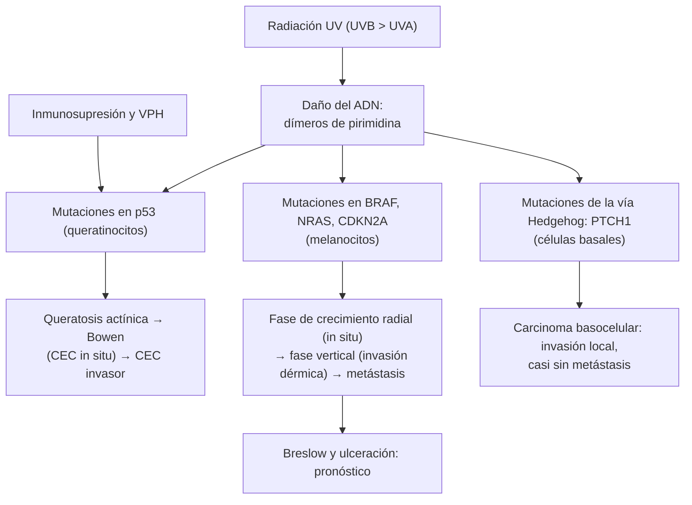

---
tags:
  - Dermatología
  - Frecuente en sala
---

# Tumores cutáneos: melanoma, carcinomas, lesiones premalignas, linfomas cutáneos y tumores benignos

**Subespecialidad**
Dermatología · Oncología · Cirugía plástica · Atención primaria

**Guías principales**
Consenso europeo interdisciplinario de melanoma, actualización 2024 (EADO/EDF/EORTC, *Eur J Cancer* 2025) · ESMO 2025: melanoma cutáneo (*Ann Oncol*) · Consenso europeo del carcinoma basocelular, actualización 2023 · Consenso europeo del carcinoma espinocelular cutáneo invasor, actualización 2026 (*Eur J Cancer*) · Consenso europeo de queratosis actínicas y cancerización de campo 2024 (*J Eur Acad Dermatol Venereol*) · EORTC 2023: micosis fungoide y síndrome de Sézary

**Otras fuentes**
Egresos hospitalarios por melanoma en Chile 2018–2021 (*Rev Confluencia* 2023) · Ver [tumores de partes blandas](../../cirugia/piel-partes-blandas-y-quemaduras/tumores-de-partes-blandas.md) (lipomas), [linfomas](../../hematologia/linfomas.md) y [síndromes paraneoplásicos](../../hematologia/sindromes-paraneoplasicos.md)

**GES**
No (el GES de cáncer en menores de 15 años y el de linfomas en personas de 15 años y más no incluyen los tumores cutáneos del adulto, salvo los linfomas).

**EUNACOM**
6.01.1.017 Melanoma maligno (sospecha, inicial, derivar) · 6.01.1.003 Cáncer de piel no melanoma: carcinoma basocelular y espinocelular (sospecha, inicial, derivar) · 6.01.1.029 Tumores premalignos: queratosis actínicas y enfermedad de Bowen (sospecha, inicial, completo) · 6.01.1.014 Linfomas cutáneos (sospecha, inicial, derivar) · 6.01.1.028 Tumores benignos de piel: quistes, lipomas, queratosis seborreica (específico, completo, completo) · 6.01.1.012 Granuloma piogénico (sospecha, completo, completo)

**Revisado**
Octubre 2026

!!! abstract "Resumen en 60 segundos"
    - **Radiación ultravioleta**: principal factor de riesgo de los cánceres de piel. Chile tiene **índices UV muy altos** en primavera y verano.
    - **Carcinoma basocelular (CBC)**: el **cáncer más frecuente** del ser humano. Pápula **perlada** con **telangiectasias** y borde enrollado, en la **cara**. Casi **nunca metastatiza**, pero invade localmente. **Extirpación** con margen (cirugía de Mohs en las zonas de alto riesgo de la cara).
    - **Carcinoma espinocelular (CEC)**: placa o nódulo **queratósico**, a veces ulcerado, sobre piel con daño solar o **queratosis actínicas**; en los **trasplantados** y en los labios. Metastatiza en ~ **2–5 %**. Extirpación con margen.
    - **Lesiones premalignas**: **queratosis actínica** (placa áspera en zonas fotoexpuestas) y **enfermedad de Bowen** (CEC *in situ*). Crioterapia, **5-fluorouracilo**, **imiquimod** o terapia fotodinámica.
    - **Melanoma**: el más letal. **ABCDE**, el **"patito feo"** y la **dermatoscopía**. Ante la sospecha: **biopsia excisional** con margen de 1–3 mm (no afeitado, no crioterapia). El pronóstico depende del **espesor de Breslow** y la **ulceración**.
    - **Micosis fungoide**: el linfoma cutáneo más frecuente; parches "eccematosos" persistentes en las zonas **no fotoexpuestas** que no responden al tratamiento: **biopsiar**.
    - **Benignos**: queratosis seborreica ("pegada" en la piel), quiste epidérmico (con **poro central**), lipoma, dermatofibroma. **Granuloma piogénico**: pápula roja friable que **sangra** con facilidad y crece en semanas: extirpar y **enviar a biopsia** (diferencial con el melanoma amelanótico).

## Definición

- **Melanoma**: neoplasia maligna de los **melanocitos**. Puede aparecer sobre piel sana (la mayoría) o sobre un nevo previo.
- **Cáncer de piel no melanoma**: **carcinoma basocelular** (de las células basales de la epidermis y el folículo) y **carcinoma espinocelular** (de los queratinocitos suprabasales).
- **Queratosis actínica**: proliferación de **queratinocitos atípicos** limitada a la epidermis, inducida por la radiación UV; es una lesión **precursora** del CEC. **Cancerización de campo**: área de piel con daño UV y múltiples lesiones subclínicas.
- **Enfermedad de Bowen**: **CEC *in situ*** (atipia de todo el espesor de la epidermis sin invasión de la dermis).
- **Linfomas cutáneos primarios**: linfomas no Hodgkin que se presentan en la piel **sin enfermedad extracutánea** al diagnóstico. Los de **células T** son ~ 75 % (sobre todo la **micosis fungoide**).
- **Granuloma piogénico** (hemangioma capilar lobular): tumor **vascular benigno** adquirido de crecimiento rápido.

## Epidemiología

- **Mundial**:
    - El **CBC** representa ~ **75–80 %** de los cánceres de piel no melanoma, y el **CEC** ~ **20 %**. Su incidencia aumenta con la **edad** y la exposición solar acumulada.
    - El **melanoma** es ~ **1–5 %** de los cánceres de piel, pero causa la **mayoría de las muertes** por cáncer cutáneo. Afecta a personas más jóvenes (edad media ~ **60 años**; es frecuente entre los 25 y 50 años).
    - Los **trasplantados** de órganos tienen un riesgo de CEC **65–250 veces** mayor que la población general.
    - La **micosis fungoide** representa ~ **50 %** de los linfomas cutáneos primarios. Predomina en los hombres mayores de 50 años.
- **Chile**:
    - La **radiación UV** es muy alta, sobre todo en el norte, en la altura y entre octubre y marzo.
    - Los **egresos hospitalarios** por melanoma alcanzaron **4,8 por 100.000** habitantes entre 2018 y 2021; la tasa aumenta con la **edad** y es mayor en los **hombres de 80 años y más** (Madero Mendoza y colaboradores, *Rev Confluencia* 2023).
    - La mortalidad por cáncer de piel ha aumentado en las últimas dos décadas, sobre todo en los **adultos mayores**.

!!! chile "Datos nacionales"
    - Los cánceres de piel **no tienen garantía GES** en el adulto.
    - El MINSAL difunde el **índice UV** diario (junto a la Dirección Meteorológica de Chile) y recomienda la **fotoprotección** (sombra, ropa, sombrero, lentes y fotoprotector) sobre todo entre las **11 y las 16 horas**.
    - En la APS, toda **lesión pigmentada sospechosa** debe derivarse **con prioridad** a dermatología.

## Etiología y factores de riesgo

| Factor | Melanoma | CBC | CEC |
|---|---|---|---|
| **Radiación UV** | **Intermitente e intensa** (quemaduras solares, sobre todo en la infancia); **camas solares** | Intermitente y acumulada | **Acumulada** (trabajadores al aire libre) |
| **Fototipo** | Claro (I–II), pelo rojo o rubio, efélides | Claro | Claro |
| **Nevos** | **> 50–100 nevos**, **nevos atípicos**, nevo congénito gigante | — | — |
| **Antecedentes** | **Familiares** (CDKN2A), melanoma previo | CBC previo; síndrome de Gorlin | **Queratosis actínicas**, Bowen, CEC previo |
| **Inmunosupresión** | Aumenta el riesgo | Aumenta el riesgo | **Trasplantados** (gran aumento), VIH, leucemia linfática crónica |
| **Otros** | Xeroderma pigmentoso | Arsénico, radioterapia | **VPH**, **cicatrices crónicas** y **úlceras** (úlcera de Marjolin), arsénico, tabaco (labio), radioterapia |

- **Queratosis seborreica**: edad y predisposición familiar. **Quiste epidérmico**: oclusión del infundíbulo folicular. **Granuloma piogénico**: **traumatismos** menores, **embarazo** (granuloma *gravidarum* en las encías), fármacos (**retinoides**, inhibidores del EGFR, antirretrovirales).

## Fisiopatología

*Figura 1. Carcinogénesis cutánea por radiación ultravioleta. Esquema propio basado en los consensos europeos de melanoma (2024), CBC (2023) y CEC (2026).*

- Estas vías tienen **implicancias terapéuticas**: inhibidores de **BRAF y MEK** en el melanoma con mutación **BRAF V600**; inhibidores de **Hedgehog** (vismodegib, sonidegib) en el CBC avanzado; **inmunoterapia anti-PD-1** en el melanoma y el CEC avanzado (alta carga mutacional por la UV).

## Clasificación

| Tipo de melanoma | Rasgos |
|---|---|
| **De extensión superficial** | El más frecuente (~ **60–70 %**); mácula o placa de bordes irregulares y varios colores, en el tronco (hombres) y las piernas (mujeres) |
| **Nodular** | ~ **15–30 %**; nódulo de **crecimiento rápido**, a menudo **sin fase radial**; puede ser amelanótico; peor pronóstico al diagnóstico |
| **Lentigo maligno melanoma** | Adulto mayor, **cara** con daño solar crónico; crecimiento lento |
| **Lentiginoso acral** | **Palmas, plantas y uñas** (**melanoniquia** longitudinal con signo de Hutchinson); el más frecuente en las personas de **piel oscura** y asiáticas; no relacionado con la UV |
| **Mucoso y uveal** | Biología distinta; peor pronóstico |

| Tipo de CBC | Rasgos |
|---|---|
| **Nodular** | El más frecuente; pápula **perlada** con **telangiectasias**, puede ulcerarse ("úlcera roedora") |
| **Superficial** | Placa eritematosa descamativa en el **tronco**; tratable con terapias tópicas |
| **Esclerodermiforme** (morfeiforme) e infiltrativo | Placa blanca indurada, bordes mal definidos; **alto riesgo** de recidiva |
| **Pigmentado** | Diferencial con el melanoma |

- **Pronóstico del melanoma**: estadificación **AJCC 8.ª edición**. El **espesor de Breslow** (mm desde la capa granulosa hasta la célula tumoral más profunda) y la **ulceración** definen la categoría T: **T1 ≤ 1 mm**, **T2 > 1–2 mm**, **T3 > 2–4 mm**, **T4 > 4 mm**.
- **Linfomas cutáneos** (clasificación OMS-EORTC): de **células T** (**micosis fungoide**, síndrome de Sézary, trastornos linfoproliferativos CD30+ como la papulosis linfomatoide) y de **células B** (centrofolicular, de la zona marginal, difuso de células grandes de tipo piernas).

## Clínica

- **Melanoma**: lesión pigmentada **nueva** o un nevo que **cambia**. Regla **ABCDE**:
    - **A**simetría.
    - **B**ordes irregulares.
    - **C**olor heterogéneo (negro, marrón, rojo, blanco, azul).
    - **D**iámetro **> 6 mm**.
    - **E**volución (cambio de tamaño, forma, color; sangrado, prurito).
    - **Signo del "patito feo"**: un nevo **distinto** de los demás nevos del mismo paciente.
    - Los melanomas **nodulares** no cumplen el ABCDE: usar la regla **EFG** (*elevated, firm, growing*: elevado, firme, que crece por más de 1 mes).
- **CBC**: pápula o nódulo **perlado**, translúcido, con **telangiectasias** arboriformes y **borde enrollado**, que puede ulcerarse y sangrar ("herida que no cicatriza"). **Cara** (nariz, canto interno, surco nasogeniano), cuero cabelludo y orejas.
- **CEC**: pápula, placa o nódulo **queratósico**, costroso, **indurado**, a veces ulcerado y **doloroso**, que crece en semanas a meses, en zonas **fotoexpuestas** (dorso de las manos, cara, cuero cabelludo calvo, **labio inferior**, orejas). **Queratoacantoma**: nódulo crateriforme con tapón de queratina que crece en semanas; se maneja como un CEC.
- **Queratosis actínica**: máculas o pápulas **ásperas** (se palpan mejor de lo que se ven), eritematosas, con escama adherente, en la **cara, el cuero cabelludo calvo, las orejas y el dorso de las manos**. **Queilitis actínica**: equivalente en el labio inferior.
- **Enfermedad de Bowen**: placa **eritematosa**, **descamativa**, de **bordes netos**, de crecimiento lento, que no responde a los corticoides tópicos (simula una psoriasis o un eccema numular).
- **Micosis fungoide**: **parches** eritematosos con fina descamación, a veces atróficos y poiquilodérmicos, en las zonas **no fotoexpuestas** (glúteos, caderas, mamas, "zona del traje de baño"); evoluciona en **años** a **placas** y luego a **tumores**. **Síndrome de Sézary**: **eritrodermia** pruriginosa, **adenopatías** y **células de Sézary** circulantes.
- **Queratosis seborreica**: pápulas o placas **marrones a negras**, **verrugosas**, con aspecto de estar "**pegadas**" a la piel; pseudoquistes córneos; tronco y cara, desde los 40 años. **Signo de Leser-Trélat**: aparición **súbita** de muchas queratosis seborreicas con prurito (paraneoplásico, sobre todo **adenocarcinoma gástrico**).
- **Quiste epidérmico** (mal llamado "sebáceo"): nódulo **móvil** dérmico con un **poro central** (punto negro), contenido de queratina blanca y maloliente; puede **inflamarse** y romperse. **Quiste triquilemal**: cuero cabelludo, sin poro, familiar.
- **Lipoma**: nódulo **subcutáneo blando**, móvil e indoloro.
- **Dermatofibroma**: pápula **firme** marrón en las piernas que se **hunde** al pellizcarla (signo del hoyuelo).
- **Acrocordones** (fibromas blandos): pápulas pediculadas en el cuello y las axilas (asociados a resistencia a la insulina).
- **Granuloma piogénico**: pápula o nódulo **rojo brillante**, **friable**, a menudo **pediculado**, que **sangra** con el roce y crece en **semanas**; en los **dedos**, los labios, la cara y las **encías** (embarazadas).

!!! alarma "Signos de alarma"
    - Lesión pigmentada **nueva** en un adulto o nevo que **cambia** (ABCDE, patito feo).
    - Nódulo **que crece** en semanas, **firme**, que **sangra** o se ulcera (melanoma nodular o amelanótico, CEC).
    - **Herida que no cicatriza** en 4–6 semanas sobre piel fotoexpuesta o sobre una cicatriz o úlcera crónica.
    - **Banda pigmentada** de la uña que se ensancha o con pigmento en el pliegue periungueal (**signo de Hutchinson**).
    - Lesión cutánea en un **trasplantado** que crece rápido.
    - "Eccema" o psoriasis **refractaria** en un adulto, en las zonas cubiertas: **biopsiar** (micosis fungoide).
    - Adenopatías regionales en un paciente con antecedente de cáncer de piel.

## Diagnóstico

!!! guia "Puntos clave (consensos europeos 2023–2026; ESMO 2025)"
    - **Examen de toda la piel** (incluidos el cuero cabelludo, las palmas, las plantas, las uñas y las mucosas) y de los **ganglios** regionales.
    - **Dermatoscopía**: mejora la exactitud diagnóstica del melanoma frente al examen a simple vista; la **fotografía corporal total** y la dermatoscopía digital sirven en los pacientes de **alto riesgo** con muchos nevos.
    - **Sospecha de melanoma**: **biopsia excisional** con **margen de 1–3 mm** que incluya el subcutáneo, orientada al eje del drenaje linfático. **No** biopsiar por afeitado superficial ni destruir la lesión (crioterapia, láser), porque se pierde el **espesor de Breslow**. La biopsia incisional se acepta en lesiones grandes o faciales.
    - **CBC y CEC**: **biopsia** (punch o incisional) si hay duda diagnóstica o antes de una cirugía mayor; muchas lesiones típicas se extirpan directamente con margen.
    - **Queratosis actínica**: diagnóstico **clínico**; biopsiar si hay **induración**, **dolor**, crecimiento rápido, ulceración o falta de respuesta (sospecha de CEC invasor).
    - **Micosis fungoide**: **biopsias múltiples** y repetidas (suspendiendo los corticoides tópicos 2–4 semanas antes), con inmunohistoquímica y estudio de **clonalidad** del receptor de células T.

## Laboratorio

- No hay exámenes de laboratorio para el diagnóstico de los tumores cutáneos: el diagnóstico es **histológico**.
- **Melanoma**: **LDH** sérica en el estadio IV (factor pronóstico de la clasificación AJCC); estudio de mutación **BRAF V600** en los estadios III y IV (define la terapia dirigida).
- **Síndrome de Sézary**: hemograma, **frotis** (células de Sézary con núcleo cerebriforme), citometría de flujo de sangre periférica (CD4+ CD7- o CD26-).
- **Biopsia del ganglio centinela** (melanoma): indicada desde el estadio **pT1b** (Breslow 0,8–1 mm o < 0,8 mm con ulceración) o con **Breslow > 1 mm**, sin metástasis clínicas.

## Imágenes

- **Ecografía** de los ganglios regionales en el melanoma desde el estadio IIB y en el CEC de alto riesgo.
- **TC o PET-TC** y **RM de cerebro** en el melanoma desde el estadio IIB–IIC o III y en el seguimiento de los casos de alto riesgo.
- **TC o RM** en el CBC o el CEC con sospecha de invasión de estructuras profundas (hueso, órbita, invasión perineural).
- Los tumores benignos típicos no requieren imágenes; la **ecografía** de partes blandas ayuda en los nódulos subcutáneos dudosos (lipoma frente a otros).

## Diagnóstico diferencial

| Lesión | Diferenciales | Claves |
|---|---|---|
| **Melanoma** | Nevo displásico, **queratosis seborreica** pigmentada, CBC pigmentado, lentigo solar, hemangioma trombosado, hematoma subungueal | Dermatoscopía; hematoma: antecedente de trauma, el pigmento **avanza** con el crecimiento de la uña |
| **CBC** | Hiperplasia sebácea (umbilicada, amarillenta), nevo intradérmico, CEC, Bowen | Brillo perlado y telangiectasias |
| **CEC** | **Queratoacantoma**, queratosis actínica hipertrófica, verruga vulgar, prurigo nodular | Induración, dolor y crecimiento |
| **Bowen** | **Psoriasis**, eccema numular, CBC superficial, tiña | Placa única que no responde a los corticoides |
| **Micosis fungoide** | Eccema, **psoriasis**, parapsoriasis, tiña, toxidermia | Zonas cubiertas, persistencia, biopsias |
| **Queratosis seborreica** | Melanoma, verruga vulgar, nevo | Aspecto "pegado", pseudoquistes córneos |
| **Granuloma piogénico** | **Melanoma amelanótico**, **CEC**, sarcoma de Kaposi, angiomatosis bacilar (VIH), metástasis cutánea | **Siempre** enviar a estudio histológico |

## Tratamiento

!!! dosis "Melanoma: márgenes de la ampliación quirúrgica (consenso europeo 2024; ESMO 2025)"
    | Espesor de Breslow | Margen |
    |---|---|
    | ***In situ*** | **0,5–1 cm** |
    | **≤ 2 mm** | **1 cm** |
    | **> 2 mm** | **2 cm** |

    - **Ganglio centinela** desde pT1b; si es positivo, **no** se requiere la linfadenectomía completa de rutina (seguimiento ecográfico).
    - **Terapia adyuvante** (oncología) tras la resección en los **estadios IIB–IIC y III**: inmunoterapia **anti-PD-1** (pembrolizumab, nivolumab) o, si hay **BRAF V600**, **dabrafenib más trametinib** en el estadio III. En el estadio III con ganglios palpables, la tendencia actual es la **inmunoterapia neoadyuvante** antes de la cirugía.
    - **Estadio IV** o irresecable: **inmunoterapia combinada** (anti-PD-1 más anti-CTLA-4 o anti-LAG-3) o **terapia dirigida** BRAF/MEK; radiocirugía de las metástasis cerebrales.

- **CBC** (consenso europeo 2023):
    - **Bajo riesgo**: **extirpación** con margen de **3–5 mm**. **Superficial** pequeño: **imiquimod 5 %** (5 veces por semana por 6 semanas), **5-fluorouracilo 5 %**, **terapia fotodinámica**, crioterapia o curetaje con electrocoagulación.
    - **Alto riesgo** (cara central, recidivado, esclerodermiforme, mal delimitado): **cirugía de Mohs** (control histológico de todos los márgenes) o márgenes amplios.
    - **Avanzado** o metastásico: **inhibidores de Hedgehog** (vismodegib, sonidegib); segunda línea: **cemiplimab**. Radioterapia si no es candidato a cirugía.
- **CEC** (consenso europeo 2026):
    - **Extirpación** con margen de **5 mm** en el bajo riesgo y de **6–10 mm** en el alto riesgo (> 2 cm, profundidad > 6 mm, invasión perineural, labio u oreja, inmunosupresión), o **cirugía de Mohs**.
    - Radioterapia adyuvante si hay invasión perineural extensa o márgenes comprometidos.
    - **Avanzado** o metastásico: **cemiplimab** o pembrolizumab (anti-PD-1).
    - **Trasplantados**: control dermatológico frecuente; considerar el cambio de la inmunosupresión (inhibidores de mTOR) y **nicotinamida** oral como quimioprevención.

!!! dosis "Queratosis actínica y enfermedad de Bowen (consenso europeo 2024)"
    | Tratamiento | Indicación y esquema |
    |---|---|
    | **Crioterapia** con nitrógeno líquido | Lesiones **aisladas**; 1–2 ciclos de 5–20 segundos |
    | **5-fluorouracilo 5 %** crema | **Campo** de cancerización; 1–2 veces al día por **2–4 semanas** (eritema, erosión y costras esperables) |
    | **Imiquimod 5 %** crema | Campo; 3 veces por semana por **4 semanas** (repetir si persiste) |
    | **Diclofenaco 3 %** gel | Lesiones leves; 2 veces al día por 60–90 días (menos eficaz) |
    | **Terapia fotodinámica** | Campo extenso y lesiones múltiples, buen resultado estético |
    | **Bowen** | Crioterapia, **5-fluorouracilo**, imiquimod, terapia fotodinámica, curetaje o **extirpación** |

    - **Fotoprotección** diaria con fotoprotector de amplio espectro (reduce la aparición de nuevas queratosis actínicas).

- **Linfomas cutáneos** (EORTC 2023): **micosis fungoide** temprana (parches y placas): **corticoides tópicos** potentes, **fototerapia** (UVB de banda angosta o PUVA), **clormetina** tópica, radioterapia localizada. Estadios avanzados y Sézary: terapias sistémicas (bexaroteno, interferón, metotrexato, **mogamulizumab**, brentuximab vedotina si CD30+, fotoaféresis extracorpórea, quimioterapia, trasplante alogénico). Manejo por **dermatología y hematología**.
- **Tumores benignos**:
    - **Queratosis seborreica**: no requiere tratamiento; si molesta o se irrita, **crioterapia**, curetaje o afeitado. Si hay duda con un melanoma, **biopsia**.
    - **Quiste epidérmico**: **extirpación completa con la cápsula** cuando **no está inflamado** (si queda cápsula, recidiva). Quiste **inflamado** o absceso: **incisión y drenaje**; la mayoría no está infectada (los antibióticos rara vez son necesarios); extirpar en un segundo tiempo.
    - **Lipoma**: extirpación si es sintomático, crece o es > 5 cm (descartar liposarcoma).
    - **Dermatofibroma** y acrocordones: observación; extirpación por estética o duda.
- **Granuloma piogénico**: **extirpación por afeitado** con **curetaje** y **electrocoagulación** de la base (o extirpación elíptica, con menor recidiva), y **estudio histológico siempre**. Alternativas: crioterapia o láser en lesiones pequeñas; **timolol** tópico en los niños. El del **embarazo** puede involucionar tras el parto.

## Complicaciones

- **Melanoma**: **metástasis** linfáticas y hematógenas (pulmón, hígado, **cerebro**, hueso). Efectos adversos **inmunomediados** de la inmunoterapia (colitis, hepatitis, tiroiditis, hipofisitis, neumonitis).
- **CBC**: **destrucción local** (párpados, nariz, oreja, órbita); recidiva.
- **CEC**: metástasis **ganglionares** (sobre todo en el labio, la oreja y los inmunosuprimidos); invasión **perineural**.
- **Micosis fungoide**: transformación a células grandes, **sepsis** por colonización por *S. aureus* en la eritrodermia, segundo cáncer.
- **Quiste epidérmico**: inflamación, rotura, absceso, recidiva.
- **Granuloma piogénico**: **sangrado** recurrente; recidiva (~ 3–15 %), a veces con lesiones satélites.

## Pronóstico y seguimiento

- **Melanoma**: la supervivencia a 10 años es > **95 %** en el estadio **IA** y baja de forma marcada con el espesor, la ulceración y el compromiso ganglionar. La inmunoterapia cambió el pronóstico del estadio IV (supervivencia a 5–10 años cercana al **50 %** con la terapia combinada).
- **Seguimiento del melanoma**: examen de la piel y los ganglios cada **3–6 meses** los primeros años según el estadio, con imágenes en los estadios IIB en adelante. El riesgo de un **segundo melanoma** primario es de ~ **5–8 %**: examen de la piel de por vida. Pesquisa en los **familiares de primer grado**.
- **CBC y CEC**: excelente pronóstico con la cirugía. Hasta el **40–50 %** desarrolla **otro** cáncer de piel no melanoma en 5 años: control dermatológico **anual** (más frecuente en los trasplantados).
- **Micosis fungoide temprana**: supervivencia similar a la de la población general; el síndrome de Sézary tiene una mediana de supervivencia de pocos años.
- **Prevención** (para todos): **fotoprotección**, evitar las **camas solares** (prohibidas para menores de edad en varios países), **autoexamen** mensual de la piel.

## Perlas para el internado

!!! perla "Para recordar"
    - **ABCDE** y **patito feo**. Un nevo nuevo o que cambia en un adulto se deriva a dermatología.
    - Sospecha de melanoma: **biopsia excisional completa** con margen estrecho. **Nunca** crioterapia ni afeitado.
    - El pronóstico del melanoma lo da el **Breslow** (y la ulceración).
    - **CBC**: perlado, telangiectasias, cara, **no metastatiza**. **CEC**: queratósico, indurado, sobre daño solar, **sí puede metastatizar**.
    - **Queratosis actínica** se **palpa** áspera; es precursora del CEC. Tratar con crioterapia o con 5-FU o imiquimod en el campo.
    - Placa eritematoescamosa única que no responde a los corticoides: **Bowen**. "Eccema" crónico en el glúteo de un adulto mayor: **micosis fungoide**.
    - **Granuloma piogénico**: sangra, crece rápido. **Siempre** a biopsia (melanoma amelanótico).
    - Erupción súbita de queratosis seborreicas: **Leser-Trélat** (buscar cáncer gástrico).
    - Quiste epidérmico: **drenar si está inflamado**; extirpar con la cápsula cuando esté frío.

## Preguntas de repaso

??? repaso "1. Mujer de 38 años con un nevo en la pantorrilla que en 6 meses creció a 9 mm, con bordes irregulares y zonas negras y rojizas. ¿Qué hace?"
    Sospecha de **melanoma** (cumple **ABCDE**). Derivar **con prioridad** a dermatología para **dermatoscopía** y **biopsia excisional** con **margen de 1–3 mm** incluyendo el subcutáneo. No hacer crioterapia ni biopsia por afeitado. Según el **Breslow**, se define la **ampliación** de los márgenes (1 cm si ≤ 2 mm, 2 cm si > 2 mm) y la indicación de **ganglio centinela** (desde pT1b).

??? repaso "2. Hombre de 70 años, agricultor, con una pápula perlada de 8 mm con telangiectasias y ulceración central en el ala nasal, de 1 año de evolución. ¿Diagnóstico y tratamiento?"
    **Carcinoma basocelular nodular**. Biopsia para confirmar y **extirpación**; por estar en la **cara central** (zona de alto riesgo), la mejor opción es la **cirugía de Mohs**. Casi nunca metastatiza, pero puede destruir localmente. Control anual de la piel y fotoprotección.

??? repaso "3. Hombre de 62 años, trasplantado renal, con un nódulo queratósico indurado y doloroso de 1,5 cm en el dorso de la mano que creció en 2 meses. ¿Qué sospecha y por qué es importante el antecedente?"
    **Carcinoma espinocelular**. Los **trasplantados** tienen un riesgo de CEC **65–250 veces** mayor y tumores más agresivos, con mayor riesgo de **metástasis**. Biopsia y **extirpación** con margen amplio (6–10 mm por ser de alto riesgo) o cirugía de Mohs; examen ganglionar; control dermatológico frecuente y evaluar el ajuste de la inmunosupresión (inhibidores de mTOR) y la nicotinamida como quimioprevención.

??? repaso "4. Mujer de 68 años con varias lesiones ásperas, eritematosas y con escama adherente en la frente y el dorso de las manos, que se palpan mejor que lo que se ven. ¿Diagnóstico y manejo?"
    **Queratosis actínicas**, lesiones precursoras del CEC. Manejo: lesiones aisladas con **crioterapia**; si son múltiples (**cancerización de campo**), **5-fluorouracilo 5 %** por 2–4 semanas, **imiquimod 5 %** o terapia fotodinámica. **Fotoprotección** diaria. Biopsiar las que estén induradas, dolorosas o que crezcan.

??? repaso "5. Hombre de 60 años con placas eritematosas descamativas en los glúteos y el abdomen bajo desde hace 4 años, tratadas como eccema con corticoides tópicos sin respuesta mantenida. ¿Qué sospecha y cómo lo confirma?"
    **Micosis fungoide** (linfoma cutáneo de células T): parches y placas persistentes en las zonas **no fotoexpuestas**. Confirmar con **biopsias múltiples** (tras suspender los corticoides tópicos 2–4 semanas), con **inmunohistoquímica** y estudio de **clonalidad** del receptor de células T. Derivar a dermatología. El tratamiento inicial suele ser con corticoides tópicos potentes y **fototerapia**.

??? repaso "6. Embarazada de 26 semanas con una pápula roja de 6 mm en la encía que sangra al cepillarse y que creció en 3 semanas. ¿Diagnóstico y conducta? ¿Y si la lesión estuviera en el dedo de un hombre de 55 años?"
    **Granuloma piogénico** del embarazo (granuloma *gravidarum*): puede involucionar tras el parto; si sangra mucho o molesta, extirpación con estudio histológico. En el **dedo** de un hombre adulto: **extirpación** por afeitado con curetaje y electrocoagulación de la base, **siempre con biopsia**, porque el principal diferencial es el **melanoma amelanótico** (y el CEC).

## Referencias

1. Garbe C, Amaral T, Peris K, et al. European consensus-based interdisciplinary guideline for melanoma. Part 1: diagnostics. Update 2024. *Eur J Cancer.* 2025;215:115152. doi:[10.1016/j.ejca.2024.115152](https://doi.org/10.1016/j.ejca.2024.115152)
2. Garbe C, Amaral T, Peris K, et al. European consensus-based interdisciplinary guideline for melanoma. Part 2: treatment. Update 2024. *Eur J Cancer.* 2025;215:115153. doi:[10.1016/j.ejca.2024.115153](https://doi.org/10.1016/j.ejca.2024.115153)
3. Amaral T, Ottaviano M, Arance A, et al. Cutaneous melanoma: ESMO Clinical Practice Guideline for diagnosis, treatment and follow-up. *Ann Oncol.* 2025;36(1):10–30. doi:[10.1016/j.annonc.2024.11.006](https://doi.org/10.1016/j.annonc.2024.11.006)
4. Peris K, Fargnoli MC, Kaufmann R, et al. European consensus-based interdisciplinary guideline for diagnosis and treatment of basal cell carcinoma: update 2023. *Eur J Cancer.* 2023;192:113254. doi:[10.1016/j.ejca.2023.113254](https://doi.org/10.1016/j.ejca.2023.113254)
5. Stratigos AJ, Dessinioti C, Garbe C, et al. European consensus-based interdisciplinary guideline for invasive cutaneous squamous cell carcinoma. Part 1: diagnostics and prevention. Update 2026. *Eur J Cancer.* 2026;243:116763. doi:[10.1016/j.ejca.2026.116763](https://doi.org/10.1016/j.ejca.2026.116763)
6. Kandolf L, Peris K, Malvehy J, et al. European consensus-based interdisciplinary guideline for diagnosis, treatment and prevention of actinic keratoses, epithelial UV-induced dysplasia and field cancerization. *J Eur Acad Dermatol Venereol.* 2024;38(6):1024–1047. doi:[10.1111/jdv.19897](https://doi.org/10.1111/jdv.19897)
7. Latzka J, Assaf C, Bagot M, et al. EORTC consensus recommendations for the treatment of mycosis fungoides/Sézary syndrome: update 2023. *Eur J Cancer.* 2023;195:113343. doi:[10.1016/j.ejca.2023.113343](https://doi.org/10.1016/j.ejca.2023.113343)
8. Madero Mendoza C, Fuentes Castro F, Perazzo Tornería F, Jarufe Gayoso A. Melanoma maligno de piel: ¿es algo de qué preocuparse? Un estudio sobre la tasa de egreso hospitalario entre los años 2018-2021 en Chile. *Rev Confluencia.* 2023;6(1):66–69. [https://revistas.udd.cl/index.php/confluencia/article/download/912/732/5801](https://revistas.udd.cl/index.php/confluencia/article/download/912/732/5801)
