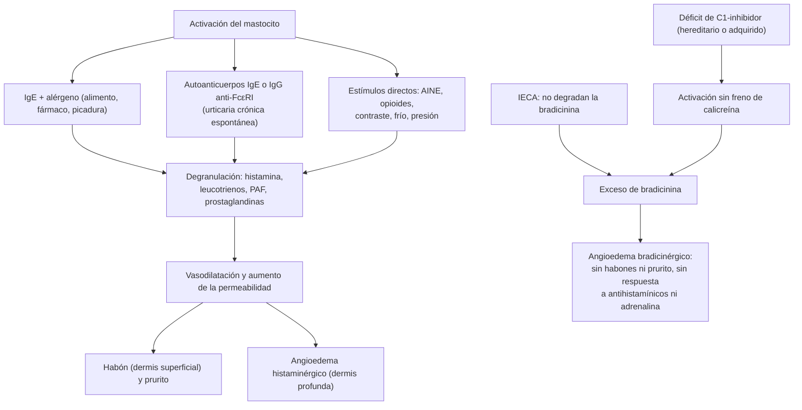

---
tags:
  - Dermatología
  - Urgencia
  - Frecuente en sala
---

# Urticaria y angioedema

**Subespecialidad**
Dermatología · Inmunología y alergia · Urgencia

**Guías principales**
EAACI/GA²LEN/EuroGuiDerm/APAAACI 2022: definición, clasificación, diagnóstico y manejo de la urticaria (*Allergy*) · WAO/EAACI 2021: angioedema hereditario (*Allergy* 2022) · WAO 2025: angioedema hereditario con foco en las disparidades de acceso (*World Allergy Organ J* 2026) · WAO 2020 y EAACI 2021: anafilaxia

**Otras fuentes**
Ensayos REMIX-1 y REMIX-2 de remibrutinib (*N Engl J Med* 2025) y LIBERTY-CSU CUPID de dupilumab (*JAMA Dermatol* 2026) · Ver [hipertensión arterial](../../cardiologia/hipertension-arterial.md) (angioedema por IECA), [asma](../../respiratorio/asma.md) y [hipotiroidismo e hipertiroidismo](../../endocrinologia/hipotiroidismo-e-hipertiroidismo.md) (autoinmunidad tiroidea)

**GES**
No. El **angioedema hereditario** tiene cobertura de la **Ley Ricarte Soto**.

**EUNACOM**
6.01.1.030 Urticaria aguda (específico, completo, completo) · 6.01.2.001 Angioedema de Quincke (sospecha, inicial, derivar) · 6.01.2.016 Urticaria y angioedema (específico, completo, completo)

**Revisado**
Octubre 2026

!!! abstract "Resumen en 60 segundos"
    - **Urticaria**: **habones** (ronchas) pruriginosos, evanescentes, que duran **< 24 horas** cada uno y no dejan marca; con o sin **angioedema** (edema profundo de la dermis y el subcutáneo, que dura **hasta 72 horas**).
    - **Aguda** (**< 6 semanas**): muy frecuente; causa en infecciones virales, fármacos (AINE, betalactámicos) y alimentos. **Crónica** (**≥ 6 semanas**): **espontánea** (la mayoría, a menudo autoinmune) o **inducible** (dermografismo, frío, presión, colinérgica).
    - **Tratamiento** (EAACI 2022): **antihistamínico H1 de segunda generación** en dosis estándar; si no hay control en 2–4 semanas, **subir hasta 4 veces** la dosis; luego **omalizumab**; luego **ciclosporina**. Corticoide oral **solo en ciclos cortos** (≤ 10 días) en las crisis.
    - **Angioedema sin habones**: pensar en **bradicinina** (**IECA**, **hereditario** o adquirido). **No responde** a antihistamínicos, corticoides ni adrenalina. Hereditario: **C4 bajo** y déficit de **C1-inhibidor**; crisis con **concentrado de C1-INH** o **icatibant**.
    - **Anafilaxia**: urticaria o angioedema **con** compromiso respiratorio, hipotensión o síntomas digestivos tras un alérgeno: **adrenalina IM 0,01 mg/kg (máx. 0,5 mg)** en el muslo, sin demora.

## Definición

- **Urticaria**: aparición de **habones**, **angioedema** o ambos. El habón tiene tres rasgos: **edema central** de tamaño variable rodeado de **eritema**, **prurito** (a veces ardor) y naturaleza **fugaz**: la piel vuelve a la normalidad en **30 minutos a 24 horas**.
- **Angioedema**: edema **súbito y pronunciado** de la **dermis profunda y el subcutáneo** o de las **mucosas**, más **doloroso que pruriginoso**, de resolución más lenta (**hasta 72 horas**). El término "angioedema de Quincke" es un nombre histórico del angioedema.
- **Urticaria aguda**: duración **< 6 semanas**. **Urticaria crónica**: **≥ 6 semanas**, con síntomas continuos o recurrentes.

## Epidemiología

- **Mundial**:
    - Hasta **1 de cada 5 personas** tiene un episodio de urticaria **aguda** en la vida; es más frecuente en los **niños** y en los **adultos jóvenes**.
    - La urticaria **crónica** tiene una prevalencia puntual cercana al **1 %**. Predomina en las **mujeres** (2:1) y entre los **20 y 40 años**. Dura en promedio **2–5 años**.
    - El **angioedema hereditario** es raro: ~ **1 por cada 50.000** personas.
    - El **angioedema por IECA** afecta a **0,1–0,7 %** de los usuarios. Es más frecuente en las personas **afrodescendientes**, los **fumadores** y las **mujeres**. Puede aparecer **años** después de iniciado el fármaco.
- **Chile**: no hay registros nacionales de prevalencia de urticaria.

!!! chile "Datos nacionales"
    - La urticaria aguda es una consulta muy frecuente en la **APS** y en los **servicios de urgencia**, sobre todo en los niños con infecciones virales.
    - El **angioedema hereditario** está incluido en la **Ley Ricarte Soto** (Ley 20.850). Exige la confirmación diagnóstica del déficit de **C1-inhibidor** y la postulación por el médico tratante (inmunólogo, internista o pediatra) en el sistema de Fonasa ([Superintendencia de Salud](https://www.superdesalud.gob.cl/orientacion-en-salud/angiodema-hereditario/)).
    - Los **IECA** (enalapril) son fármacos de uso masivo en el programa de salud cardiovascular. Ante un angioedema en un usuario de IECA, **suspender** el fármaco.

## Etiología y factores de riesgo

| Tipo | Causas y gatillantes |
|---|---|
| **Urticaria aguda** | **Infecciones** (sobre todo **virales** respiratorias en los niños; ~ 40 % de los casos); **fármacos**: **AINE** (por inhibición de la COX-1, no alérgica), **betalactámicos**, opioides, medios de contraste; **alimentos** (maní, frutos secos, mariscos, huevo, leche); **picaduras** de himenópteros; **látex**. En ~ **50 %** no se identifica la causa |
| **Urticaria crónica espontánea** | **Autoinmune**: tipo I o "autoalérgica" (IgE contra autoantígenos, por ejemplo IgE anti-TPO) y tipo IIb (**IgG anti-IgE** o **anti-FcεRI**); asociación con **tiroiditis de Hashimoto**. Empeoran con **AINE**, estrés e infecciones. Rara vez una causa alimentaria |
| **Urticaria crónica inducible** | **Dermografismo** sintomático (el más frecuente), por **frío**, por **presión** tardía, **solar**, por **calor**, **colinérgica** (ejercicio, sudor, ducha caliente), **acuagénica**, por **vibración**, **de contacto** |
| **Angioedema mediado por histamina** | Igual que la urticaria; casi siempre se acompaña de **habones** o de prurito |
| **Angioedema mediado por bradicinina** | **IECA** (también inhibidores de la DPP-4, sacubitrilo/valsartán, inhibidores de mTOR, alteplasa); **hereditario** (déficit de C1-INH, autosómico dominante; o con C1-INH normal); **adquirido** por consumo de C1-INH (**linfomas**, gammapatías monoclonales, autoinmunidad). **Sin habones** |
| **Angioedema idiopático** | Sin causa identificable; puede responder a antihistamínicos (histaminérgico) o no |

## Fisiopatología

*Figura 1. Las dos vías del angioedema: mastocito (histamina) y bradicinina. Esquema propio basado en EAACI 2022 y WAO/EAACI 2021.*

- Antihistamínicos, corticoides y adrenalina actúan sobre la vía del **mastocito**. La vía de la **bradicinina** se trata con **C1-INH**, **icatibant** (antagonista del receptor B2) o inhibidores de la **calicreína**.

## Clasificación

| Categoría | Subtipos |
|---|---|
| **Urticaria aguda** | < 6 semanas, espontánea |
| **Urticaria crónica espontánea** | ≥ 6 semanas, sin gatillante externo específico |
| **Urticaria crónica inducible** | Dermografismo, frío, presión tardía, solar, calor, vibratoria, colinérgica, de contacto, acuagénica |
| **Angioedema hereditario** | Tipo 1 (~ **85 %**: C1-INH **bajo** en cantidad); tipo 2 (cantidad normal, **función baja**); con **C1-INH normal** (mutaciones del factor XII y otras; predomina en las mujeres y se gatilla con estrógenos) |
| **Angioedema adquirido** | Por déficit adquirido de C1-INH (**C1q bajo**); por IECA y otros fármacos; idiopático |

- **Actividad** de la urticaria crónica: **UAS7** (puntaje de habones más prurito durante 7 días, de 0 a **42**). **Control**: **UCT** (≥ **12** puntos = controlada).

## Clínica

- **Habones**: pápulas o placas **eritematoedematosas**, de bordes netos, a menudo con centro pálido, de **tamaño y forma variables** (pueden confluir en placas geográficas). Son **migratorios**: cada lesión desaparece **en < 24 horas** sin dejar marca, mientras aparecen otras. **Prurito** intenso.
- **Angioedema**: aumento de volumen **asimétrico** de los **párpados**, los **labios**, la **lengua**, los genitales, las manos y los pies; sensación de tensión o dolor más que prurito.
- **Angioedema hereditario**: crisis recurrentes desde la **infancia o la adolescencia**, **sin habones**, de evolución lenta (**2–5 días**). Gatillantes: **traumatismos** o procedimientos dentales, estrés, infecciones, **estrógenos** (anticonceptivos, embarazo) e IECA. Las **crisis abdominales** (edema de la pared intestinal) simulan un **abdomen agudo** y llevan a cirugías innecesarias. El **edema laríngeo** puede ser mortal. A veces se precede de un **eritema marginado** (no pruriginoso, que no es urticaria). Antecedentes **familiares** en ~ 75 %.
- **Angioedema por IECA**: **labios, lengua y orofaringe**; sin habones ni prurito. Puede ser grave y comprometer la vía aérea.
- **Anafilaxia**: además de la piel (~ 90 %), compromiso **respiratorio** (estridor, disfonía, broncoespasmo), **cardiovascular** (hipotensión, síncope) o **digestivo** (vómitos, dolor abdominal cólico), minutos a horas tras la exposición.

!!! alarma "Signos de alarma"
    - **Estridor**, **disfonía**, disfagia, sialorrea o edema de la **lengua o la úvula**: riesgo de obstrucción de la **vía aérea**. Evaluar la intubación precoz (puede ser difícil: tener preparada la vía aérea quirúrgica).
    - **Hipotensión**, **síncope**, broncoespasmo o vómitos tras la exposición a un alérgeno: **anafilaxia** → **adrenalina IM** de inmediato.
    - Angioedema **sin habones** que **no responde** a antihistamínicos, corticoides ni adrenalina: **bradicinérgico** (IECA, hereditario).
    - Habones que duran **> 24 horas**, **dolorosos** o que dejan **púrpura** o hiperpigmentación: sospechar **vasculitis urticarial** → biopsia.
    - Urticaria con **fiebre**, artralgias o compromiso del estado general: descartar enfermedad sistémica (síndromes autoinflamatorios, LES, enfermedad del suero).

## Diagnóstico

!!! guia "Puntos clave (EAACI 2022; WAO/EAACI 2021)"
    - El diagnóstico de la urticaria es **clínico**: historia y examen (si no hay lesiones en la consulta, **fotografías**).
    - **Urticaria aguda**: **no se piden exámenes** de rutina, salvo sospecha de alergia tipo I (alimento, fármaco, látex): derivar a alergología para las **pruebas cutáneas** o la **IgE específica**.
    - **Urticaria crónica espontánea**: estudio **limitado**: **hemograma** con diferencial, **PCR** y/o **VHS**, **IgE total** e **IgG anti-TPO**. Exámenes adicionales solo según la historia. No pedir paneles extensos de alergia ni estudios parasitológicos o de *H. pylori* de rutina.
    - **Urticaria inducible**: **pruebas de provocación** (dermografismo con un objeto romo, cubo de hielo en el antebrazo para la urticaria por frío).
    - **Angioedema recurrente sin habones**: **C4** (tamizaje), **C1-INH cuantitativo y funcional** y **C1q**. Revisar siempre los **fármacos** (IECA).

- **Indicios de la vía**: el angioedema con **habones y prurito** es histaminérgico; el angioedema **aislado**, lento, con historia familiar o con IECA es bradicinérgico.
- **IgE total baja** y anti-TPO positiva sugieren urticaria autoinmune tipo IIb, que responde menos a omalizumab y mejor a ciclosporina.

## Laboratorio

| Examen | Uso |
|---|---|
| Hemograma, PCR, VHS | Urticaria crónica espontánea; eosinofilia (parásitos, fármacos) o PCR muy elevada (vasculitis, autoinflamatorias) |
| IgE total e IgG anti-TPO | Urticaria crónica espontánea; predicen la respuesta a omalizumab |
| TSH | Si hay anti-TPO positiva o clínica tiroidea |
| **C4** | Tamizaje del angioedema por déficit de C1-INH (bajo en > 95 % de los casos, sobre todo en las crisis) |
| **C1-INH** (cantidad y función) | Confirmación: tipo 1 (bajo/bajo), tipo 2 (normal/bajo) |
| **C1q** | **Bajo** en el angioedema **adquirido** (buscar linfoma o gammapatía) |
| **Triptasa** sérica | 1–2 horas tras una anafilaxia (confirma la activación del mastocito) |
| Biopsia de piel | Lesiones > 24 horas, púrpura o dolor (vasculitis urticarial) |
| Complemento (C3, C4), ANA | Vasculitis urticarial hipocomplementémica, LES |

## Imágenes

- No son necesarias para la urticaria.
- En las **crisis abdominales** del angioedema hereditario, la **ecografía** o la **TC** muestran **engrosamiento edematoso de la pared intestinal** y **líquido libre**, que se resuelven en días.
- En el angioedema de la vía aérea, la **nasofibrolaringoscopia** evalúa el edema laríngeo (sin retrasar el manejo de la vía aérea).

## Diagnóstico diferencial

| Cuadro | Claves |
|---|---|
| **Vasculitis urticarial** | Lesiones **> 24 horas**, **ardor o dolor**, dejan **púrpura** o hiperpigmentación; artralgias; a veces hipocomplementemia; **biopsia** |
| **Exantema por fármacos** | Máculas y pápulas **fijas** durante días, sin migrar |
| **Eritema multiforme** | Lesiones en **diana** fijas (3 zonas), acrales, por herpes; duran > 1 semana |
| **Picaduras de insecto** | Pápulas **agrupadas**, con punto central, en zonas expuestas; duran días |
| **Mastocitosis cutánea** | Máculas pardas persistentes; **signo de Darier** (se urtican al frotarlas) |
| **Síndromes autoinflamatorios** (síndromes periódicos asociados a criopirina, síndrome de Schnitzler) | Exantema urticariforme con **fiebre**, artralgias y PCR alta; poco pruriginoso |
| **Penfigoide ampolloso** en fase inicial | Placas urticariales en el adulto mayor, que persisten y luego forman ampollas |
| **Dermatitis de contacto**, celulitis, erisipela | Edema facial **fijo** con eritema, eccema o fiebre |
| **Hipotiroidismo** (mixedema), síndrome nefrótico, síndrome de vena cava superior | Edema **persistente**, no súbito |

## Tratamiento

- **Medidas generales**: identificar y **evitar el gatillante** (fármaco, alimento); **evitar AINE**, alcohol y calor si empeoran los síntomas; **suspender el IECA** ante cualquier angioedema (y no reintroducirlo).

!!! guia "Algoritmo de la urticaria crónica (EAACI 2022)"
    1. **Antihistamínico H1 de segunda generación** en **dosis estándar**, diario (no a demanda).
    2. Sin control en **2–4 semanas**: aumentar **hasta 4 veces** la dosis.
    3. Sin control en **2–4 semanas** más: agregar **omalizumab**.
    4. Sin control en **6 meses** (o antes si los síntomas son intolerables): agregar **ciclosporina**.
    - **Corticoides orales**: solo en **ciclos cortos** (**hasta 10 días**) para las exacerbaciones. **No** usarlos de forma prolongada.
    - Los antihistamínicos de **primera generación** (clorfenamina, hidroxicina) **no se recomiendan** como tratamiento de rutina (sedación, efectos anticolinérgicos, deterioro cognitivo y del rendimiento).
    - **Nuevas terapias**: **dupilumab** (aprobado en 2025 por la FDA para ≥ 12 años con urticaria crónica espontánea sin respuesta a antihistamínicos) y **remibrutinib**, inhibidor oral de la tirosina cinasa de Bruton (aprobado por la FDA en septiembre de 2025 para adultos sin respuesta a antihistamínicos; ensayos REMIX). Uso por especialista.

!!! dosis "Urticaria"
    | Fármaco | Dosis estándar en el adulto | Comentario |
    |---|---|---|
    | **Cetirizina** | **10 mg/día** | Puede producir somnolencia leve. Niños de 2–5 años: 2,5 mg cada 12 horas; 6–11 años: 5 mg cada 12 horas o 10 mg/día |
    | **Levocetirizina** | **5 mg/día** | |
    | **Loratadina** | **10 mg/día** | Disponible en la APS. Niños < 30 kg: 5 mg/día |
    | **Desloratadina** | **5 mg/día** | |
    | **Bilastina** | **20 mg/día** | En ayunas |
    | **Fexofenadina** | **180 mg/día** | |
    | **Dosis aumentada** | Hasta **4 veces** la dosis estándar (por ejemplo, cetirizina 10 mg cada 6 horas o 20 mg cada 12 horas) | Uso fuera de ficha técnica, respaldado por la guía |
    | **Prednisona** (crisis) | **0,5–1 mg/kg/día** (habitualmente 20–40 mg/día) por **3–7 días** (máximo 10) | Solo en las exacerbaciones intensas o con angioedema |
    | **Omalizumab** | **300 mg SC cada 4 semanas** (se puede subir hasta 600 mg o acortar el intervalo a cada 2 semanas) | Especialista. Respuesta en ~ 2/3 de los pacientes; mejor si la IgE total es normal o alta |
    | **Ciclosporina** | **3,5–5 mg/kg/día** | Especialista. Controlar la presión arterial y la creatinina |
    | **Dupilumab** | **600 mg SC** de carga, luego **300 mg cada 2 semanas** (adultos) | Especialista |
    | **Remibrutinib** | **25 mg VO cada 12 horas** | Especialista |

- **Urticaria aguda**: **antihistamínico de segunda generación** en dosis estándar (aumentar si es necesario) por **1–2 semanas** o hasta 1 semana después de la desaparición de las lesiones; **ciclo corto de prednisona** si es extensa o hay angioedema. Suspender el fármaco sospechoso.

!!! dosis "Anafilaxia (WAO 2020; EAACI 2021)"
    - **Adrenalina IM** (ampolla de **1 mg/mL**, es decir 1:1.000) **0,01 mg/kg** en la cara **anterolateral del muslo**; máximo **0,5 mg** en el adulto y **0,3 mg** en el niño. **Repetir cada 5–15 minutos** si no hay respuesta.
    - **Posición**: decúbito supino con las piernas elevadas (sentado si hay dificultad respiratoria; decúbito lateral izquierdo en la embarazada). No ponerse de pie bruscamente.
    - **Oxígeno** en alto flujo, **dos vías venosas**, **cristaloides 20 mL/kg** en bolo si hay hipotensión.
    - **Broncoespasmo** persistente: **salbutamol** inhalado. Shock refractario: adrenalina en **infusión** IV en un lugar con monitorización; **glucagón** en los usuarios de **betabloqueadores**.
    - Antihistamínicos y corticoides son **coadyuvantes** (solo para los síntomas cutáneos); **nunca** reemplazan ni retrasan la adrenalina.
    - **Observación** al menos **6–12 horas** (más si hubo síntomas graves, por el riesgo de reacción **bifásica**). Al alta: **autoinyector** de adrenalina, plan escrito y derivación a alergología.

!!! dosis "Angioedema mediado por bradicinina"
    - **Vía aérea primero**: posición sentada, oxígeno, evaluación por otorrinolaringología o anestesia; intubación precoz (con fibroscopio) si progresa el edema laríngeo.
    - **Crisis de angioedema hereditario** (WAO/EAACI 2021; tratar **toda crisis** que comprometa la vía aérea o sea abdominal, y lo antes posible):
        - **Concentrado de C1-INH** derivado del plasma **20 UI/kg IV**.
        - **Icatibant 30 mg SC** (antagonista del receptor B2 de bradicinina); se puede repetir cada 6 horas (máximo 3 dosis en 24 horas).
        - Si no hay terapia específica: **plasma fresco congelado** (contiene C1-INH; riesgo teórico de empeorar al inicio).
        - **No sirven** antihistamínicos, corticoides ni adrenalina (pueden usarse si no está claro el mecanismo, sin retrasar lo demás).
    - **Profilaxis a corto plazo** (antes de procedimientos dentales, endoscopías o cirugías): **C1-INH** 1–6 horas antes.
    - **Profilaxis a largo plazo** (especialista): **lanadelumab** (anticuerpo contra la calicreína), **berotralstat** oral o **C1-INH** subcutáneo. Los **andrógenos atenuados** (danazol) son una alternativa de segunda línea. Evitar **estrógenos** e **IECA**.
    - **Angioedema por IECA**: **suspender** el IECA para siempre; observación hasta la regresión (24–72 horas). Ninguna terapia específica tiene eficacia demostrada de forma consistente en ensayos aleatorizados (icatibant y C1-INH tuvieron resultados contradictorios). Los **ARA-II** tienen un riesgo bajo de recurrencia: usarlos con precaución.

## Complicaciones

- **Obstrucción de la vía aérea** por edema laríngeo (principal causa de muerte en el angioedema hereditario no tratado).
- **Anafilaxia** y shock.
- **Cirugías abdominales innecesarias** en las crisis no reconocidas de angioedema hereditario.
- Urticaria crónica: **mala calidad de vida**, alteración del **sueño**, ansiedad y depresión; efectos adversos por el uso **prolongado de corticoides**.
- Asociación con **autoinmunidad tiroidea** y otras enfermedades autoinmunes.

## Pronóstico y seguimiento

- **Urticaria aguda**: autolimitada en días a semanas; solo una minoría pasa a crónica.
- **Urticaria crónica espontánea**: remisión espontánea en ~ **50 %** a los **1–5 años**; peor pronóstico con angioedema, síntomas intensos, autoinmunidad o urticaria inducible asociada.
- **Seguimiento**: medir el control con **UCT** o **UAS7**; una vez controlada por al menos **3 meses**, **disminuir** gradualmente el antihistamínico.
- **Derivación**: a **dermatología o inmunología** la urticaria crónica que no se controla con 4 veces la dosis de antihistamínico; a **alergología** la sospecha de alergia a alimentos, fármacos, látex o himenópteros y toda anafilaxia; a **inmunología** el angioedema recurrente sin habones.
- **Angioedema hereditario**: **plan de acción escrito**, medicación de rescate en el domicilio, **tamizaje de familiares** (C4, C1-INH) y profilaxis antes de procedimientos.

## Perlas para el internado

!!! perla "Para recordar"
    - Habón: **< 24 horas** y migratorio. Si dura más, deja púrpura o duele, **biopsia** (vasculitis urticarial).
    - **Aguda < 6 semanas**, **crónica ≥ 6 semanas**. La aguda **no requiere exámenes**.
    - Primera línea: **antihistamínico H1 de segunda generación** diario, que se puede subir **hasta 4 veces** la dosis. Luego **omalizumab**.
    - Los corticoides son **solo para ciclos cortos**.
    - **AINE**: gatillan y agravan la urticaria. Pregúntelos siempre.
    - **Angioedema sin habones** en un usuario de **IECA**: suspender el IECA. No responde a la adrenalina ni a los corticoides.
    - **Dolor abdominal recurrente** con edema de la pared intestinal en una persona joven con angioedemas: pedir **C4** (angioedema hereditario).
    - En la **anafilaxia**, el primer fármaco es la **adrenalina IM**. Los antihistamínicos no salvan vidas.

## Preguntas de repaso

??? repaso "1. Niño de 5 años con ronchas pruriginosas migratorias en el tronco desde hace 2 días, en el contexto de un resfrío. Sin dificultad respiratoria. ¿Qué estudio y qué tratamiento corresponden?"
    **Urticaria aguda**, probablemente **postviral**. **No requiere exámenes**. Tratamiento: **antihistamínico H1 de segunda generación** en dosis según la edad (cetirizina 2,5 mg cada 12 horas o loratadina 5 mg/día) por 1–2 semanas, evitar los AINE y educar sobre los signos de alarma (dificultad respiratoria, edema de la lengua).

??? repaso "2. Mujer de 35 años con habones casi diarios desde hace 4 meses, sin gatillante. Tomó loratadina 10 mg a demanda sin respuesta. ¿Qué estudio y qué conducta indica?"
    **Urticaria crónica espontánea**. Estudio limitado: **hemograma**, **PCR o VHS**, **IgE total** e **IgG anti-TPO** (con TSH si es positiva). Tratamiento: antihistamínico de segunda generación **diario** en dosis estándar; si no hay control en 2–4 semanas, **subir hasta 4 veces la dosis**; si persiste, derivar para **omalizumab**.

??? repaso "3. Hombre de 62 años hipertenso, usuario de enalapril desde hace 3 años, consulta por aumento de volumen del labio inferior y la lengua desde hace 4 horas, sin ronchas ni prurito. ¿Qué mecanismo sospecha y qué hace?"
    **Angioedema por IECA**, **mediado por bradicinina**. Prioridad: **vía aérea** (evaluar estridor, disfonía, edema de la lengua y la úvula; preparar intubación con fibroscopio). **Suspender el enalapril** de forma definitiva. Antihistamínicos, corticoides y adrenalina suelen ser poco eficaces. Observar hasta la regresión y cambiar a otro antihipertensivo (un ARA-II con precaución, o un bloqueador de los canales de calcio).

??? repaso "4. Mujer de 22 años con episodios recurrentes desde la adolescencia de edema de las manos y la cara que duran 3 días, sin ronchas, y dolores abdominales intensos con vómitos. Su padre tiene un cuadro similar. Empeoró con anticonceptivos. ¿Qué sospecha y cómo lo confirma?"
    **Angioedema hereditario**. Tamizaje con **C4** (bajo) y confirmación con **C1-INH cuantitativo y funcional** (tipo 1: bajo; tipo 2: normal en cantidad con función baja). Suspender los **estrógenos**, derivar a **inmunología** (Ley Ricarte Soto), plan de crisis con **C1-INH** o **icatibant**, profilaxis antes de procedimientos y estudio de los familiares.

??? repaso "5. Joven de 20 años que, minutos después de comer maní, presenta habones generalizados, disfonía, sibilancias y presión arterial de 80/45 mmHg. ¿Cuál es el primer tratamiento y su dosis?"
    **Anafilaxia**. **Adrenalina IM 0,5 mg** (0,5 mL de la ampolla de 1 mg/mL) en la cara anterolateral del muslo, que se repite cada 5–15 minutos si no hay respuesta. Además: decúbito con las piernas elevadas, oxígeno, cristaloides en bolo y salbutamol. Antihistamínico y corticoide solo como coadyuvantes. Observación por al menos 6–12 horas, autoinyector al alta y derivación a alergología.

??? repaso "6. Mujer de 45 años con placas urticariales que duran 3 días, con ardor y que dejan manchas violáceas, más artralgias. ¿Qué diagnóstico debe descartar y cómo?"
    **Vasculitis urticarial**: lesiones de **> 24 horas**, con ardor y **púrpura residual**. Se confirma con **biopsia de piel** (vasculitis leucocitoclástica). Pedir **complemento** (C3, C4, C1q; la forma hipocomplementémica se asocia a LES), ANA y función renal, y derivar a dermatología o reumatología.

## Referencias

1. Zuberbier T, Abdul Latiff AH, Abuzakouk M, et al. The international EAACI/GA²LEN/EuroGuiDerm/APAAACI guideline for the definition, classification, diagnosis, and management of urticaria. *Allergy.* 2022;77(3):734–766. doi:[10.1111/all.15090](https://doi.org/10.1111/all.15090)
2. Maurer M, Magerl M, Betschel S, et al. The international WAO/EAACI guideline for the management of hereditary angioedema: the 2021 revision and update. *Allergy.* 2022;77(7):1961–1990. doi:[10.1111/all.15214](https://doi.org/10.1111/all.15214)
3. Vázquez DO, Giavina-Bianchi P, Josviack D, et al. The 2025 WAO Guidelines for the classification, diagnosis, and treatment of hereditary angioedema, with consideration of worldwide disparities. *World Allergy Organ J.* 2026;19(5):101335. doi:[10.1016/j.waojou.2026.101335](https://doi.org/10.1016/j.waojou.2026.101335)
4. Cardona V, Ansotegui IJ, Ebisawa M, et al. World Allergy Organization anaphylaxis guidance 2020. *World Allergy Organ J.* 2020;13(10):100472. doi:[10.1016/j.waojou.2020.100472](https://doi.org/10.1016/j.waojou.2020.100472)
5. Muraro A, Worm M, Alviani C, et al. EAACI guidelines: anaphylaxis (2021 update). *Allergy.* 2022;77(2):357–377. doi:[10.1111/all.15032](https://doi.org/10.1111/all.15032)
6. Metz M, Giménez-Arnau A, Hide M, et al. Remibrutinib in chronic spontaneous urticaria. *N Engl J Med.* 2025;392(10):984–994. doi:[10.1056/NEJMoa2408792](https://doi.org/10.1056/NEJMoa2408792)
7. Casale TB, Saini SS, Ben-Shoshan M, et al. Dupilumab in patients with chronic spontaneous urticaria: phase 3 LIBERTY-CSU CUPID randomized clinical trial. *JAMA Dermatol.* 2026;162(4):350–358. doi:[10.1001/jamadermatol.2025.6023](https://doi.org/10.1001/jamadermatol.2025.6023)
8. Superintendencia de Salud. Angioedema hereditario (Ley Ricarte Soto). [https://www.superdesalud.gob.cl/orientacion-en-salud/angiodema-hereditario/](https://www.superdesalud.gob.cl/orientacion-en-salud/angiodema-hereditario/)
