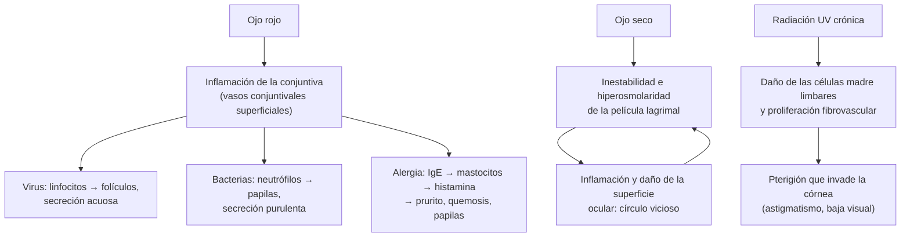

---
tags:
  - Oftalmología
  - Frecuente en sala
---

# Conjuntivitis, ojo seco y pterigión

**Subespecialidad**
Oftalmología · Atención primaria · Pediatría

**Guías principales**
AAO 2023: *Preferred Practice Pattern* de conjuntivitis (*Ophthalmology* 2024) · AAO 2023: *Preferred Practice Pattern* del síndrome de ojo seco (*Ophthalmology* 2024) · TFOS DEWS III 2025: informe internacional de ojo seco (*Am J Ophthalmol*)

**Otras fuentes**
Revisión sistemática de conjuntivitis (*JAMA* 2013) · Revisión Cochrane de autoinjerto conjuntival en el pterigión (2016) · Ver [infecciones de transmisión sexual](../../infectologia/infecciones-de-transmision-sexual-y-sifilis.md) (conjuntivitis por clamidia y gonococo), [infecciones de vías aéreas superiores](../../respiratorio/infecciones-de-vias-aereas-superiores.md), [dermatitis atópica](../dermatologia/dermatitis-atopica-contacto-seborreica-y-del-panal.md) y [síndrome de Sjögren](../../reumatologia/lupus-y-otras-mesenquimopatias.md)

**GES**
No.

**EUNACOM**
6.02.1.005 Conjuntivitis bacteriana aguda (específico, completo, completo) · 6.02.1.006 Conjuntivitis bacteriana crónica (sospecha, inicial, derivar) · 6.02.1.007 Conjuntivitis no infecciosa (específico, completo, derivar) · 6.02.1.008 Conjuntivitis viral no complicada (sospecha, inicial, derivar) · 6.02.1.024 Síndrome de ojo seco (sospecha, inicial, derivar) · 6.02.1.020 Pterigión (específico, inicial, derivar) · 2.01.1.095 Conjuntivitis aguda (pediatría)

**Revisado**
Octubre 2026

!!! abstract "Resumen en 60 segundos"
    - **Conjuntivitis**: la causa más frecuente de **ojo rojo**. Ojo rojo **sin dolor intenso**, **sin baja de visión** y con **pupila normal**. Si hay dolor, fotofobia o baja de la visión, **no es una conjuntivitis simple**.
    - **Viral** (la más frecuente en los adultos; **adenovirus**): secreción **acuosa**, **folículos**, **adenopatía preauricular**, muy **contagiosa**, a menudo bilateral secuencial. **Sin antibióticos**: compresas frías, lágrimas artificiales e **higiene de manos**.
    - **Bacteriana** (más frecuente en los niños): secreción **purulenta**, párpados pegados al despertar. **Autolimitada** en la mayoría; los antibióticos tópicos acortan la duración. **Hiperaguda** (gonococo): secreción muy abundante, urgencia.
    - **Alérgica**: **prurito** intenso, bilateral, acuosa, con atopia. **Antihistamínico con estabilizador de mastocitos tópico** (olopatadina, ketotifeno).
    - **Ojo seco**: sensación de **arenilla**, ardor, visión fluctuante que mejora con el parpadeo; más en **mujeres mayores**, pantallas, Sjögren, fármacos. **Lágrimas artificiales**, higiene palpebral, manejo de la causa.
    - **Pterigión**: pliegue fibrovascular **triangular** de la conjuntiva **nasal** que invade la **córnea**; por **radiación UV**. Lubricación y fotoprotección; **cirugía con autoinjerto conjuntival** si invade el eje visual o produce astigmatismo.
    - **No usar corticoides tópicos** sin evaluación oftalmológica (empeoran el herpes, producen glaucoma y catarata).

## Definición

- **Conjuntivitis**: inflamación de la **conjuntiva** (membrana mucosa que cubre la cara interna de los párpados y la esclera anterior).
    - **Aguda**: < 3–4 semanas. **Crónica**: > 4 semanas.
    - Según la causa: **infecciosa** (viral, bacteriana, por clamidia) o **no infecciosa** (alérgica, tóxica, mecánica, inmunológica).
- **Síndrome de ojo seco** (TFOS DEWS III 2025): enfermedad multifactorial de la **superficie ocular** con pérdida de la **homeostasis** de la película lagrimal, con síntomas oculares, en la que intervienen la **inestabilidad** y la **hiperosmolaridad** de la lágrima, la inflamación y el daño de la superficie ocular y alteraciones neurosensitivas.
- **Pterigión**: proliferación **fibrovascular** de la conjuntiva bulbar en forma de **ala** (triangular), que crece sobre la **córnea**. **Pinguécula**: lesión elevada amarillenta de la conjuntiva bulbar, **sin** invadir la córnea.

## Epidemiología

- **Mundial**:
    - La conjuntivitis aguda afecta a ~ **6 millones** de personas al año en los Estados Unidos; la **viral** causa hasta el **80 %** de los casos en los adultos.
    - La **bacteriana** es más frecuente en los **niños** (*H. influenzae* no tipificable, *S. pneumoniae*, *M. catarrhalis*); en los adultos, *S. aureus*.
    - La **alérgica** afecta a ~ **15–40 %** de la población, a menudo con rinitis alérgica.
    - **Ojo seco**: prevalencia de **5–50 %** según la definición y la población; aumenta con la **edad** y es más frecuente en las **mujeres**.
    - **Pterigión**: más frecuente en las zonas de **alta radiación UV** (cinturón entre los 37° de latitud norte y sur), en los hombres y en los **trabajadores al aire libre**.
- **Chile**: no hay datos nacionales publicados de prevalencia de conjuntivitis ni de ojo seco. El pterigión es frecuente en el **norte**, por la alta radiación UV.

!!! chile "Datos nacionales"
    - El **ojo rojo** es una de las consultas oftalmológicas más frecuentes en la **APS** y en los servicios de urgencia.
    - Las **Unidades de Atención Primaria Oftalmológica (UAPO)** de la red pública resuelven en la APS parte de las patologías oculares frecuentes (vicios de refracción, ojo rojo no complicado, pesquisa de glaucoma y de retinopatía diabética).
    - Los brotes de **conjuntivitis viral** (adenovirus) son frecuentes en las salas cuna, los jardines infantiles, los colegios y los hospitales: higiene de manos y aislamiento de contacto.
    - La **conjuntivitis neonatal** por *Chlamydia trachomatis* o *Neisseria gonorrhoeae* obliga a tratar a la madre y a su pareja (ver [ITS](../../infectologia/infecciones-de-transmision-sexual-y-sifilis.md)).

## Etiología y factores de riesgo

| Tipo | Agentes o causas |
|---|---|
| **Viral** | **Adenovirus** (65–90 %; queratoconjuntivitis epidémica, fiebre faringoconjuntival), **herpes simple** (unilateral, vesículas palpebrales), **herpes zóster** (signo de Hutchinson), enterovirus (conjuntivitis hemorrágica), molusco contagioso (palpebral), sarampión |
| **Bacteriana aguda** | *S. aureus*, *S. pneumoniae*, *H. influenzae*, *M. catarrhalis*; **usuarios de lentes de contacto**: *Pseudomonas* (riesgo de queratitis) |
| **Bacteriana hiperaguda** | ***Neisseria gonorrhoeae*** (adultos sexualmente activos y recién nacidos) |
| **Bacteriana crónica** | *S. aureus* con **blefaritis**, *Moraxella* (angular), **obstrucción de la vía lagrimal** (dacriocistitis crónica), ***Chlamydia trachomatis*** (conjuntivitis de inclusión del adulto y neonatal; tracoma en zonas endémicas) |
| **Alérgica** | **Estacional** (pólenes) o **perenne** (ácaros, epitelio de animales); **queratoconjuntivitis vernal** (niños varones, papilas gigantes) y **atópica** (adultos con dermatitis atópica) |
| **Tóxica o química** | Colirios (**conservantes** como el cloruro de benzalconio, aminoglicósidos, antivirales), cosméticos |
| **Mecánica** | Cuerpo extraño, lentes de contacto (conjuntivitis papilar gigante), triquiasis, ectropión |
| **Inmunológica o sistémica** | **Síndrome de Stevens-Johnson**, penfigoide de las mucosas, enfermedad de Kawasaki, artritis reactiva, enfermedad injerto contra huésped |
| **Ojo seco** | **Edad**, sexo **femenino**, **pantallas** (menos parpadeo), **lentes de contacto**, **disfunción de las glándulas de Meibomio** (la causa más frecuente de ojo seco evaporativo), **síndrome de Sjögren**, artritis reumatoide, LES, **fármacos** (antihistamínicos, antidepresivos, isotretinoína, betabloqueadores, diuréticos, anticolinérgicos), **cirugía refractiva** (LASIK), menopausia, diabetes, parálisis facial (lagoftalmo), orbitopatía tiroidea, ambiente seco o con viento |
| **Pterigión** | **Radiación UV**, polvo, viento, sequedad (trabajadores al aire libre, zonas cercanas al ecuador o de altura) |

## Fisiopatología

*Figura 1. Mecanismos de la conjuntivitis, el ojo seco y el pterigión. Esquema propio basado en las guías de la AAO (2023) y el informe TFOS DEWS III (2025).*

- La **película lagrimal** tiene tres componentes: **lipídico** (glándulas de Meibomio, evita la evaporación), **acuoso** (glándula lagrimal) y **mucinoso** (células caliciformes). El ojo seco puede ser por **déficit acuoso** (Sjögren) o **evaporativo** (disfunción de Meibomio, el más frecuente); a menudo es mixto.

## Clasificación

| Rasgo | Viral | Bacteriana | Alérgica |
|---|---|---|---|
| **Secreción** | **Acuosa** (serosa) | **Purulenta** o mucopurulenta | Acuosa o mucosa filante |
| **Prurito** | Leve | Leve | **Intenso** (síntoma cardinal) |
| **Lateralidad** | Unilateral que pasa al otro ojo en días | Unilateral o bilateral | **Bilateral** |
| **Reacción conjuntival** | **Folículos** (tarso inferior) | Papilas | **Papilas**, **quemosis** |
| **Adenopatía preauricular** | **Frecuente** | Rara (salvo gonococo) | No |
| **Otros** | Infección respiratoria, fiebre, contacto con enfermos | Párpados pegados al despertar | Rinitis alérgica, atopia, estacional |
| **Contagio** | **Muy alto** (10–14 días) | Moderado | No |

## Clínica

- **Conjuntivitis**:
    - **Ojo rojo** con **hiperemia conjuntival** difusa (más intensa en los fondos de saco y menos cerca del limbo), **secreción**, sensación de cuerpo extraño o arenilla, **sin dolor intenso**.
    - **Agudeza visual normal** (puede estar borrosa por la secreción, pero mejora al parpadear o limpiar).
    - **Pupila normal** y córnea transparente.
- **Conjuntivitis viral por adenovirus**: secreción acuosa, folículos, **adenopatía preauricular** dolorosa, a veces **membranas** o seudomembranas y **hemorragias subconjuntivales**. La **queratoconjuntivitis epidémica** puede dejar **infiltrados subepiteliales** corneales (fotofobia y visión borrosa por semanas). Dura **1–3 semanas**.
- **Conjuntivitis herpética**: **unilateral**, con **vesículas** en el párpado; riesgo de **queratitis** (úlcera dendrítica con fluoresceína). **Derivar**.
- **Conjuntivitis bacteriana aguda**: secreción **purulenta** que pega las pestañas, sobre todo al despertar; autolimitada en **1–2 semanas** en la mayoría.
- **Conjuntivitis hiperaguda gonocócica**: secreción **purulenta abundantísima** que reaparece en minutos tras limpiar, **quemosis**, edema palpebral, adenopatía preauricular; **riesgo de perforación corneal** en 24–48 horas. **Urgencia**.
- **Conjuntivitis por clamidia**: crónica (> 4 semanas), folicular, unilateral o bilateral, con adenopatía; en adultos jóvenes sexualmente activos; puede haber uretritis o cervicitis.
- **Conjuntivitis neonatal** (oftalmía neonatal): química (primeras 24 horas), **gonocócica** (2–5 días, hiperaguda), **por clamidia** (5–14 días; puede asociarse a **neumonía**), herpética (1–2 semanas).
- **Conjuntivitis alérgica**: **prurito**, lagrimeo, quemosis, edema palpebral, bilateral, recurrente o estacional; "ojeras alérgicas". **Vernal**: papilas gigantes ("en empedrado") en el tarso superior, **puntos de Horner-Trantas** en el limbo, riesgo de úlcera en escudo.
- **Ojo seco**: sensación de **arenilla** o **cuerpo extraño**, **ardor**, **visión borrosa fluctuante** que mejora al parpadear, ojo rojo leve, **lagrimeo paradójico** (lagrimeo reflejo), **empeoramiento al final del día**, con pantallas, viento o aire acondicionado. En los casos graves, **queratitis punteada**.
- **Pterigión**: lesión **triangular** carnosa, vascularizada, generalmente en el lado **nasal**, cuyo **vértice** avanza sobre la **córnea**; puede inflamarse (ojo rojo, sensación de cuerpo extraño), producir **astigmatismo** o invadir el **eje visual**.

!!! alarma "Signos de alarma: ojo rojo que NO es una conjuntivitis simple (derivar)"
    - **Dolor** ocular intenso o profundo.
    - **Baja de la agudeza visual** que no mejora al parpadear.
    - **Fotofobia** intensa.
    - **Pupila** anormal (miosis, midriasis media arreactiva o irregular).
    - **Inyección ciliar** (periquerática: hiperemia concentrada alrededor del limbo).
    - **Opacidad corneal**, **úlcera** o tinción con fluoresceína.
    - **Hipopión** (pus en la cámara anterior) o **hifema** (sangre en la cámara anterior).
    - **Presión intraocular elevada** (ojo duro).
    - **Usuario de lentes de contacto** con ojo rojo doloroso (riesgo de queratitis por *Pseudomonas* o *Acanthamoeba*).
    - **Trauma** ocular o **químicos**.
    - **Secreción hiperpurulenta** (gonococo), **recién nacido**, **vesículas herpéticas** o lesiones en la punta de la nariz (zóster con **signo de Hutchinson**).
    - Falta de respuesta al tratamiento en **7 días** o síntomas > 3–4 semanas.

## Diagnóstico

!!! guia "Puntos clave (AAO 2023, conjuntivitis y ojo seco)"
    - El diagnóstico de la conjuntivitis es **clínico**: historia (contactos, síntomas respiratorios, atopia, lentes de contacto, ITS) y examen con **agudeza visual**, **pupilas**, **fluoresceína** (para descartar úlcera o dendrita) y examen de los ganglios **preauriculares**.
    - **No** se requieren cultivos en la conjuntivitis aguda no complicada.
    - **Cultivo y Gram** de la secreción en: conjuntivitis **neonatal**, **hiperaguda** (gonococo), recurrente, refractaria al tratamiento o en usuarios de **lentes de contacto**. **PCR** o NAAT para **clamidia** y **gonococo** cuando se sospechen.
    - **Prueba rápida de antígeno de adenovirus** en la consulta: útil para evitar antibióticos innecesarios (si está disponible).
    - **Ojo seco**: cuestionarios de síntomas (OSDI, DEQ-5), **tiempo de ruptura de la película lagrimal** (< 10 segundos), **tinción** de la superficie ocular (fluoresceína, verde de lisamina), **prueba de Schirmer** (< 10 mm en 5 minutos sugiere déficit acuoso), osmolaridad lagrimal y evaluación de las **glándulas de Meibomio**. Buscar **Sjögren** si hay boca seca o artralgias.

## Laboratorio

| Situación | Exámenes |
|---|---|
| Conjuntivitis aguda no complicada | **Ninguno** |
| **Neonatal** o **hiperaguda** | **Gram** (diplococos gramnegativos intracelulares), **cultivo** (Thayer-Martin para gonococo), **PCR para clamidia y gonococo** |
| **Crónica** o folicular en un adulto joven | **PCR para *Chlamydia trachomatis*** (y estudio de otras ITS: VIH, sífilis) |
| **Ojo seco** con sospecha de autoinmunidad | **ANA**, **anti-Ro y anti-La**, factor reumatoide (Sjögren) |
| Pterigión | Ninguno; biopsia si hay sospecha de neoplasia escamosa de la superficie ocular |

## Imágenes

- No se requieren imágenes en la conjuntivitis ni en el ojo seco.
- Fotografía de la lesión y **topografía corneal** (astigmatismo) en el pterigión.
- **Lámpara de hendidura** (biomicroscopía): examen clave del especialista para la córnea, la cámara anterior y los fondos de saco.

## Diagnóstico diferencial

| Cuadro | Claves para diferenciar |
|---|---|
| **Hemorragia subconjuntival** | Mancha **roja homogénea** bien delimitada, **sin** secreción ni dolor; Valsalva, tos, HTA, anticoagulantes; benigna, se resuelve en 2 semanas |
| **Epiescleritis** | Hiperemia **sectorial**, leve molestia, sin secreción, blanquea con fenilefrina; benigna |
| **Escleritis** | Dolor **intenso**, profundo, que **despierta en la noche**; tinte violáceo; asociada a artritis reumatoide y vasculitis → derivación urgente |
| **Queratitis** y úlcera corneal | **Dolor**, fotofobia, **baja visual**, inyección ciliar, opacidad y tinción con fluoresceína |
| **Uveítis anterior** | Dolor, **fotofobia**, inyección **ciliar**, **miosis**, visión borrosa, células en la cámara anterior |
| **Glaucoma agudo de ángulo cerrado** | **Dolor intenso**, cefalea, náuseas, **halos**, **midriasis media arreactiva**, córnea **edematosa**, **ojo duro** |
| **Cuerpo extraño** | Antecedente; sensación de cuerpo extraño localizada; **evertir el párpado** |
| **Blefaritis** | Bordes palpebrales rojos con costras ("caspa" en las pestañas); a menudo coexiste con ojo seco |
| **Dacriocistitis** | Aumento de volumen doloroso del **canto interno** (saco lagrimal) |
| **Pinguécula** vs pterigión | La pinguécula **no** invade la córnea |
| **Neoplasia escamosa de la superficie ocular** | Lesión gelatinosa o leucoplásica en el limbo, con vasos nutricios; adultos mayores, VIH; **biopsia** |

## Tratamiento

!!! dosis "Conjuntivitis (AAO 2023)"
    | Tipo | Tratamiento |
    |---|---|
    | **Viral (adenovirus)** | **Sintomático**: **compresas frías**, **lágrimas artificiales** (sin conservantes, refrigeradas), **higiene de manos** estricta, no compartir toallas, **evitar el contacto** (licencia o ausencia escolar mientras haya secreción, en general 7–14 días). **No** usar antibióticos. **No** usar corticoides sin control oftalmológico (salvo membranas o infiltrados, por el especialista) |
    | **Herpética** | **Derivar**: aciclovir oral (400 mg 5 veces al día) o valaciclovir; ganciclovir gel tópico si hay compromiso corneal. **Nunca corticoides** sin especialista |
    | **Bacteriana aguda** | Autolimitada; los antibióticos tópicos **aceleran** la mejoría y reducen el contagio. **Cloranfenicol 0,5 % colirio** o **tobramicina 0,3 %** 1 gota cada **4–6 horas** por **5–7 días**; alternativas: **ciprofloxacino** o **moxifloxacino** colirio (de elección en los **usuarios de lentes de contacto**, por *Pseudomonas*), ungüento de eritromicina o tetraciclina en los niños. Aseo de la secreción con suero fisiológico |
    | **Hiperaguda gonocócica** | **Urgencia**: **ceftriaxona 1 g IM** dosis única (adulto) **más** irrigación con suero fisiológico frecuente y antibiótico tópico; tratar la clamidia concomitante (doxiciclina o azitromicina) y a la pareja; derivar al oftalmólogo el mismo día |
    | **Por clamidia** (adulto) | **Doxiciclina 100 mg cada 12 horas por 7 días** (o azitromicina 1 g dosis única); tratar a la pareja y estudiar otras ITS |
    | **Neonatal** | **Gonocócica**: **ceftriaxona 25–50 mg/kg IV o IM** (máximo 125 mg) dosis única, hospitalizar. **Por clamidia**: **azitromicina 20 mg/kg/día VO por 3 días** (o eritromicina 50 mg/kg/día por 14 días). Tratar a la madre y su pareja |
    | **Alérgica** | Evitar el alérgeno, **compresas frías**, lágrimas artificiales; **antihistamínico con estabilizador de mastocitos tópico** (**olopatadina 0,1 %** cada 12 horas o 0,2 % una vez al día, **ketotifeno 0,025 %** cada 12 horas); antihistamínico oral si hay rinitis. Formas graves o vernales: corticoides tópicos de baja potencia o **ciclosporina** tópica **por el especialista** |
    | **Tóxica** | Suspender el colirio responsable; lágrimas sin conservantes |

    - **Evitar**: colirios con **corticoides** o combinaciones antibiótico-corticoide sin evaluación oftalmológica (riesgo de **queratitis herpética**, **glaucoma** y **catarata**); **vasoconstrictores** tópicos (nafazolina) de uso prolongado (efecto rebote); usar **lentes de contacto** hasta la resolución.

!!! dosis "Ojo seco (AAO 2023; TFOS DEWS III 2025)"
    - **Medidas generales**: educar; **pausas** frente a las pantallas (regla 20-20-20: cada 20 minutos mirar a 6 metros por 20 segundos), parpadeo consciente, **humidificar** el ambiente, evitar el viento directo y el aire acondicionado, revisar los **fármacos** que lo producen.
    - **Lubricantes** (lágrimas artificiales): 4 veces al día o según necesidad; **sin conservantes** si se usan más de 4–6 veces al día; geles o ungüentos de noche.
    - **Higiene palpebral** y **compresas tibias** en la disfunción de las glándulas de Meibomio (ver blefaritis); omega-3 sin beneficio consistente.
    - **Antiinflamatorios** (especialista): **ciclosporina** tópica, **lifitegrast**, corticoides tópicos en ciclos cortos.
    - Casos refractarios (especialista): **tapones lagrimales**, suero autólogo, doxiciclina o azitromicina oral (Meibomio), dispositivos térmicos o luz pulsada intensa, lentes esclerales.
    - **Tratar la causa**: Sjögren (reumatología), lagoftalmo (parálisis facial), orbitopatía tiroidea.

- **Pterigión**:
    - **Lubricantes** y **fotoprotección** (lentes de sol con filtro UV y sombrero).
    - Si se inflama: ciclos cortos de antiinflamatorio tópico (por el especialista).
    - **Cirugía** si **invade el eje visual**, produce **astigmatismo** significativo, restringe la motilidad, hay inflamación recurrente o por estética. La técnica de elección es la **resección con autoinjerto conjuntival**, que tiene **menos recidiva** que la resección simple ("esclera desnuda"); adyuvantes: mitomicina C o injerto de membrana amniótica.

## Complicaciones

- **Conjuntivitis viral**: **infiltrados subepiteliales** corneales (visión borrosa por meses), **membranas**, simbléfaron; brotes epidémicos.
- **Herpética**: queratitis, cicatrices corneales (leucoma), pérdida de visión.
- **Bacteriana**: **queratitis** y úlcera (sobre todo con lentes de contacto), celulitis preseptal; **gonocócica**: **perforación corneal** y endoftalmitis; **neonatal**: ceguera, neumonía (clamidia), sepsis (gonococo).
- **Alérgica grave** (vernal, atópica): úlcera corneal en escudo, queratocono, cataratas y glaucoma por los corticoides.
- **Ojo seco grave**: **queratitis** punteada, úlcera y perforación corneal (Sjögren, SSJ), deterioro de la calidad de vida.
- **Pterigión**: **astigmatismo**, baja de visión, restricción de la motilidad; **recidiva** posoperatoria (más agresiva que la lesión original).

## Pronóstico y seguimiento

- **Viral**: autolimitada en **1–3 semanas**; los infiltrados pueden durar meses.
- **Bacteriana**: ~ **60 %** se resuelve sin antibióticos en 1–2 semanas; con antibióticos, la mejoría es más rápida.
- **Alérgica**: recurrente o estacional; buen control con tratamiento tópico.
- **Ojo seco**: **crónico**; el objetivo es el control de los síntomas.
- **Pterigión**: progresión lenta; la recidiva tras la cirugía con autoinjerto es baja.
- **Control**: si no mejora en **7 días** o aparecen signos de alarma, **derivar** a oftalmología.

## Perlas para el internado

!!! perla "Para recordar"
    - Ojo rojo + **dolor** o **baja de visión** o **fotofobia** o **pupila anormal** = **no es conjuntivitis**: derivar.
    - **Viral**: acuosa + folículos + **ganglio preauricular** + resfrío. **Sin antibióticos**, mucha higiene de manos.
    - **Bacteriana**: **purulenta**, pestañas pegadas. Cloranfenicol o tobramicina por 5–7 días. **Lentes de contacto**: quinolona (*Pseudomonas*) y sin lentes.
    - **Alérgica**: **prurito**. Olopatadina o ketotifeno.
    - **Secreción hiperpurulenta**: **gonococo** → ceftriaxona y derivar el mismo día.
    - **Recién nacido** con conjuntivitis: cultivo y PCR; gonococo (2–5 días) o clamidia (5–14 días).
    - **Nunca** corticoides tópicos sin oftalmólogo.
    - Ojo seco: **arenilla** al final del día que mejora al parpadear; **lágrimas artificiales** y pausas en las pantallas.
    - **Pterigión**: triangular, **nasal**, **invade la córnea**, por **UV**. Cirugía con **autoinjerto** si afecta la visión.

## Preguntas de repaso

??? repaso "1. Hombre de 30 años con ojo derecho rojo desde hace 2 días, secreción acuosa, sensación de arenilla y un ganglio preauricular doloroso; ahora empieza el ojo izquierdo. Su hijo tuvo lo mismo. Visión normal. ¿Diagnóstico y manejo?"
    **Conjuntivitis viral por adenovirus** (queratoconjuntivitis epidémica). Manejo **sintomático**: **compresas frías**, **lágrimas artificiales** sin conservantes, **higiene de manos** estricta, no compartir toallas y evitar el contacto (licencia laboral mientras haya secreción). **No** indicar antibióticos ni corticoides. Control si hay dolor, fotofobia o baja de visión (infiltrados corneales).

??? repaso "2. Niña de 4 años con secreción purulenta amarillenta en ambos ojos que le pega las pestañas al despertar, sin dolor ni fotofobia. ¿Tratamiento?"
    **Conjuntivitis bacteriana aguda**. Aseo de la secreción con suero fisiológico y **antibiótico tópico**: **cloranfenicol 0,5 % colirio** o **tobramicina 0,3 %** 1 gota cada 4–6 horas por 5–7 días (o ungüento de eritromicina). Higiene de manos; volver al jardín infantil tras 24 horas de tratamiento. Si coexiste **otitis media**, sospechar *H. influenzae* (síndrome conjuntivitis-otitis) y tratar por vía oral.

??? repaso "3. Mujer de 22 años con prurito ocular intenso bilateral, lagrimeo y edema palpebral cada primavera, con rinitis. ¿Diagnóstico y tratamiento?"
    **Conjuntivitis alérgica estacional**. Evitar el alérgeno, **compresas frías**, **lágrimas artificiales** (lavan el alérgeno) y **olopatadina** o **ketotifeno** tópicos (antihistamínico con estabilizador de mastocitos); antihistamínico oral y corticoide nasal para la rinitis. Evitar los vasoconstrictores tópicos prolongados y los corticoides oculares sin oftalmólogo.

??? repaso "4. Hombre de 24 años con secreción purulenta muy abundante en el ojo izquierdo de 12 horas de evolución, quemosis, edema palpebral y adenopatía preauricular. Refiere disuria y secreción uretral. ¿Qué sospecha y qué hace?"
    **Conjuntivitis hiperaguda gonocócica** (riesgo de **perforación corneal** en 24–48 horas). Gram y cultivo de la secreción y PCR para gonococo y clamidia; **ceftriaxona 1 g IM** dosis única, **irrigación** frecuente con suero fisiológico, tratamiento de la clamidia (doxiciclina), estudio de otras ITS y tratamiento de la pareja. **Derivación a oftalmología el mismo día**.

??? repaso "5. Mujer de 58 años con sensación de arenilla y ardor en ambos ojos que empeora al final del día y frente al computador, con visión borrosa que mejora al parpadear y boca seca. ¿Diagnóstico y manejo?"
    **Síndrome de ojo seco**, con sospecha de **síndrome de Sjögren** por la xerostomía. Manejo: pausas frente a las pantallas, humidificar el ambiente, **lágrimas artificiales** (sin conservantes si se usan con frecuencia), higiene palpebral y compresas tibias si hay disfunción de Meibomio; revisar los fármacos. Pedir **ANA, anti-Ro y anti-La** y derivar a oftalmología (y a reumatología si se confirma la autoinmunidad).

??? repaso "6. Hombre de 50 años, pescador de Antofagasta, con una lesión carnosa triangular en la conjuntiva nasal del ojo derecho que avanza 3 mm sobre la córnea y le produce visión borrosa. ¿Diagnóstico y conducta?"
    **Pterigión** que invade la córnea con probable **astigmatismo**. Lubricación y **fotoprotección** (lentes con filtro UV y sombrero). Derivar a oftalmología para **cirugía** (resección con **autoinjerto conjuntival**, que tiene menos recidiva) porque afecta la visión y progresa hacia el eje visual.

## Referencias

1. Cheung AY, Choi DS, Ahmad S, et al. Conjunctivitis Preferred Practice Pattern®. *Ophthalmology.* 2024;131(4):P134–P204. doi:[10.1016/j.ophtha.2023.12.037](https://doi.org/10.1016/j.ophtha.2023.12.037)
2. Amescua G, Ahmad S, Cheung AY, et al. Dry Eye Syndrome Preferred Practice Pattern®. *Ophthalmology.* 2024;131(4):P1–P49. doi:[10.1016/j.ophtha.2023.12.041](https://doi.org/10.1016/j.ophtha.2023.12.041)
3. Stapleton F, Argüeso P, Asbell P, et al. TFOS DEWS III: Digest. *Am J Ophthalmol.* 2025;279:451–553. doi:[10.1016/j.ajo.2025.05.040](https://doi.org/10.1016/j.ajo.2025.05.040)
4. Azari AA, Barney NP. Conjunctivitis: a systematic review of diagnosis and treatment. *JAMA.* 2013;310(16):1721–1729. doi:[10.1001/jama.2013.280318](https://doi.org/10.1001/jama.2013.280318)
5. Clearfield E, Muthappan V, Wang X, et al. Conjunctival autograft for pterygium. *Cochrane Database Syst Rev.* 2016;2(2):CD011349. doi:[10.1002/14651858.CD011349.pub2](https://doi.org/10.1002/14651858.CD011349.pub2)
