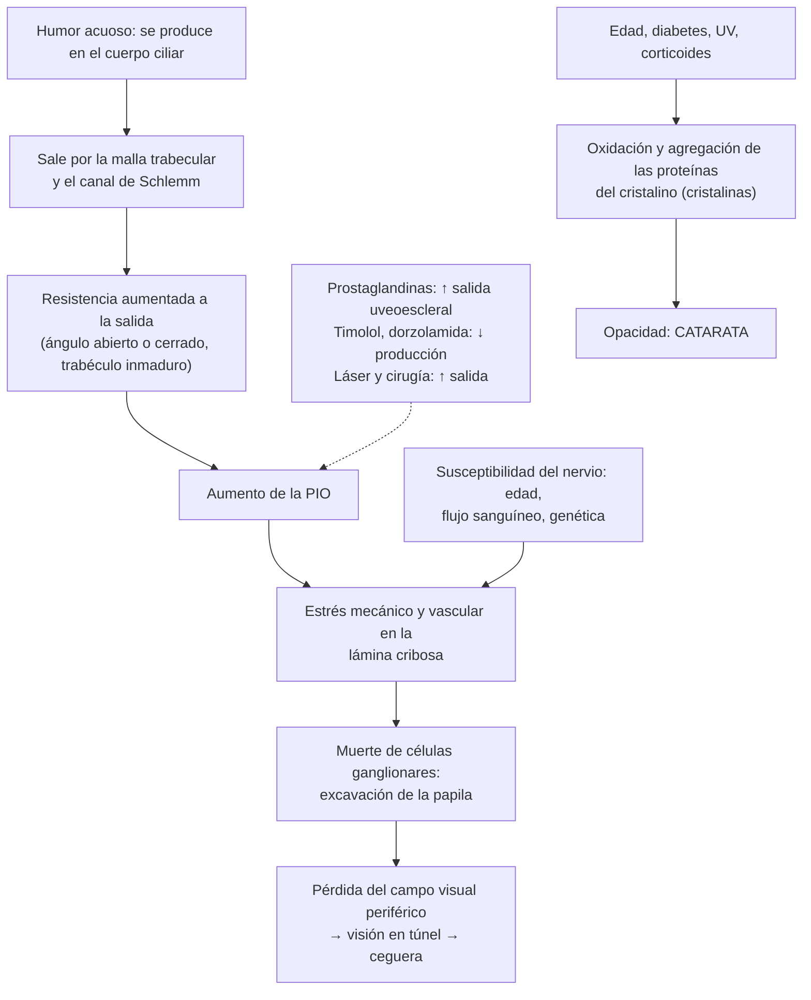

---
tags:
  - Oftalmología
  - GES
---

# Glaucoma crónico, glaucoma congénito y catarata

**Subespecialidad**
Oftalmología · Atención primaria · Geriatría · Pediatría

**Guías principales**
AAO 2020: *Preferred Practice Pattern* de glaucoma primario de ángulo abierto (*Ophthalmology* 2021) · European Glaucoma Society, 5.ª edición (2021) · AAO 2021: *Preferred Practice Pattern* de catarata del adulto (*Ophthalmology* 2022) · MINSAL: Guía GES N.° 11, tratamiento quirúrgico de cataratas congénitas y adquiridas (2018)

**Otras fuentes**
Ensayo LiGHT de trabeculoplastia láser selectiva (*Lancet* 2019) · Prevalencia global de glaucoma (*Ophthalmology* 2014) · Revisiones del *Lancet* sobre glaucoma (2023) y catarata (2017) · Superintendencia de Salud: garantías GES de cataratas · Ver [ojo rojo y glaucoma agudo](ojo-rojo-queratitis-uveitis-y-glaucoma-agudo.md), [párpados y vía lagrimal](parpados-y-via-lagrimal.md) (lagrimeo del lactante), [complicaciones crónicas de la diabetes](../../endocrinologia/complicaciones-cronicas-de-la-diabetes.md) y [caídas](../../geriatria/caidas-hipotension-ortostatica-y-fractura-de-cadera.md)

**GES**
Sí: **N.° 11, tratamiento quirúrgico de cataratas** (congénitas y adquiridas). El glaucoma no tiene GES.

**EUNACOM**
6.02.1.013 Glaucoma crónico (sospecha, inicial, derivar) · 6.02.1.012 Glaucoma congénito (sospecha, inicial, derivar) · 6.02.1.003 Catarata (específico, inicial, derivar)

**Revisado**
Octubre 2026

!!! abstract "Resumen en 60 segundos"
    - **Glaucoma**: neuropatía óptica **progresiva** con **excavación de la papila** y pérdida del **campo visual**, cuyo principal factor de riesgo modificable es la **presión intraocular (PIO)**. Es la principal causa de **ceguera irreversible** en el mundo.
    - **Glaucoma primario de ángulo abierto**: **asintomático** hasta etapas avanzadas (pérdida del campo visual periférico, "visión en túnel"). Riesgo: **edad > 40 años**, **antecedente familiar**, **afrodescendientes**, **miopía**, **diabetes**, **corticoides**. **Pesquisa**: fondo de ojo (**excavación > 0,5** o asimetría > 0,2), PIO, campo visual y OCT.
    - **Tratamiento**: bajar la PIO un **20–30 %**: **análogos de prostaglandinas** (latanoprost 1 gota en la noche) de primera línea, o **trabeculoplastia láser selectiva** (LiGHT); luego timolol, dorzolamida, brimonidina; cirugía (trabeculectomía).
    - **Glaucoma congénito**: lactante con **epífora**, **fotofobia** y **blefaroespasmo**, con **córnea grande** (buftalmos) u **opaca**. **Urgencia quirúrgica**.
    - **Catarata**: opacidad del **cristalino**, principal causa de **ceguera reversible**. **Visión borrosa progresiva indolora**, **encandilamiento**, **miopización** ("segunda visión"). Única terapia: **cirugía** (facoemulsificación con lente intraocular).
    - **GES N.° 11**: cirugía si la agudeza visual con corrección es **≤ 0,3** (en 180 días) o **≤ 0,1** en el mejor ojo (en 90 días). **Catarata congénita** (leucocoria, **rojo pupilar** alterado): cirugía **precoz** para evitar la ambliopía.

## Definición

- **Glaucoma**: grupo de neuropatías ópticas **progresivas** caracterizadas por la degeneración de las células ganglionares de la retina, con **excavación** característica de la papila y defectos del **campo visual**, en las que la **PIO** es el principal factor de riesgo modificable.
    - **Primario de ángulo abierto** (GPAA): el más frecuente en Occidente; ángulo iridocorneal abierto, sin causa secundaria.
    - **De tensión normal**: daño glaucomatoso con PIO siempre < 21 mmHg.
    - **Por cierre angular**: ángulo cerrado (agudo o crónico).
    - **Secundario**: por corticoides, pseudoexfoliación, dispersión pigmentaria, uveítis, trauma, **neovascular** (diabetes, oclusiones venosas).
    - **Hipertensión ocular**: PIO > 21 mmHg sin daño del nervio óptico ni del campo visual.
- **Glaucoma congénito primario**: glaucoma por un **desarrollo anómalo del ángulo** (trabéculo), que se manifiesta desde el nacimiento hasta los 3 años; forma parte de los **glaucomas de la infancia**.
- **Catarata**: **opacidad** del cristalino que disminuye la visión. **Congénita** (al nacer o en el primer año) o **adquirida** (senil, la más frecuente; secundaria).

## Epidemiología

- **Mundial**:
    - **Glaucoma**: prevalencia global de ~ **3,5 %** entre los 40 y 80 años; ~ **76 millones** de personas en 2020 y ~ **112 millones** proyectados para 2040 (Tham, 2014). Hasta la **mitad** de los casos no está diagnosticada en los países desarrollados (y más en los en desarrollo).
    - **Glaucoma congénito primario**: ~ **1 por cada 10.000–20.000** nacidos vivos en Occidente; ~ 2/3 son varones y ~ 2/3 bilaterales.
    - **Catarata**: **principal causa de ceguera** en el mundo (reversible); su prevalencia aumenta con la edad (la mayoría de las personas > 75 años tiene algún grado).
    - **Catarata congénita**: ~ **1–6 por cada 10.000** nacidos vivos; causa importante de ceguera infantil tratable.
- **Chile**: no hay datos nacionales publicados de prevalencia de glaucoma. La cirugía de cataratas es uno de los problemas GES de mayor volumen.

!!! chile "Datos nacionales"
    - **GES N.° 11 (Tratamiento quirúrgico de cataratas)**, según la Superintendencia de Salud:
        - **Diagnóstico**: dentro de **180 días** desde la sospecha (incluye ambos ojos).
        - **Tratamiento**: **agudeza visual ≤ 0,3 con corrección óptica en el mejor ojo**: cirugía dentro de **180 días** desde la confirmación. **≤ 0,1 en el mejor ojo**: dentro de **90 días**.
    - La guía GES de cataratas (2018) **recomienda el tamizaje visual en los menores de 5 años** y **sugiere** la cirugía en los niños con catarata (sobre todo si hay riesgo de **ambliopía**).
    - El **glaucoma no tiene GES**. La pesquisa se hace con el fondo de ojo y la tonometría en las **UAPO** y en el control de los pacientes con **diabetes** del programa de salud cardiovascular.
    - Los **vicios de refracción en las personas de 65 años y más** tienen GES (N.° 29), y la **retinopatía diabética** (N.° 31).

## Etiología y factores de riesgo

| Cuadro | Factores de riesgo |
|---|---|
| **Glaucoma de ángulo abierto** | **Edad** > 40 años, **PIO elevada**, **antecedente familiar** de primer grado (riesgo ~ 4–9 veces), **afrodescendientes**, **miopía** alta, **córnea delgada** (paquimetría baja), **diabetes**, **corticoides** (tópicos, inhalados, sistémicos), hipotensión nocturna, apnea del sueño, migraña y fenómeno de Raynaud (tensión normal) |
| **Glaucoma congénito primario** | Mutaciones de ***CYP1B1*** (la más frecuente), *LTBP2*, *MYOC*; consanguinidad. **Secundarios** de la infancia: síndrome de **Sturge-Weber**, aniridia, Axenfeld-Rieger, **rubéola congénita**, neurofibromatosis, posquirúrgico (tras la cirugía de catarata congénita) |
| **Catarata senil** | **Edad**, **diabetes**, **tabaco**, **radiación UV**, **corticoides** (catarata **subcapsular posterior**), alcohol, desnutrición, miopía alta |
| **Catarata secundaria** | **Trauma** (contuso o penetrante), **uveítis**, cirugía ocular previa (vitrectomía), radiación ionizante, fármacos (corticoides, fenotiazinas, amiodarona), enfermedades sistémicas (**diabetes**, hipocalcemia, distrofia miotónica, enfermedad de Wilson, dermatitis atópica) |
| **Catarata congénita** | **Idiopática** (~ 50 %), **hereditaria** (autosómica dominante), **infecciones intrauterinas** (**rubéola**, toxoplasmosis, CMV, herpes, sífilis, varicela: TORCH), **metabólicas** (**galactosemia**, hipoglicemia), **cromosómicas** (**trisomía 21**, 13, 18), síndrome de Lowe, prematurez |

## Fisiopatología

*Figura 1. Fisiopatología del glaucoma y de la catarata, y sitio de acción del tratamiento antiglaucomatoso. Esquema propio basado en las guías de la AAO (2020, 2021) y de la European Glaucoma Society (2021).*

- El daño del glaucoma es **irreversible**: el tratamiento solo **detiene o enlentece** la progresión. La pérdida visual de la catarata es **reversible** con la cirugía.

## Clasificación

| Tipo de catarata | Rasgos |
|---|---|
| **Nuclear** | Opacidad central amarillenta-marrón; **miopización** (el paciente vuelve a leer sin lentes: "segunda visión"); visión de lejos peor |
| **Cortical** | Opacidades en rayos de rueda desde la periferia; **encandilamiento** |
| **Subcapsular posterior** | Placa en la cápsula posterior; afecta mucho la **visión cercana** y con luz intensa; **diabetes**, **corticoides**, uveítis, radiación; más precoz |
| **Madura o hipermadura** | Cristalino blanco (leucocoria del adulto); riesgo de glaucoma facolítico o facomórfico |

| Estadio del glaucoma (orientativo) | Hallazgos |
|---|---|
| **Sospecha** | PIO alta o papila sospechosa, campo visual normal |
| **Leve** | Daño de la papila con campo visual normal o defectos tempranos |
| **Moderado** | Defectos del campo visual en un hemicampo |
| **Avanzado** | Defectos en ambos hemicampos o a < 5° de la fijación |

## Clínica

- **Glaucoma de ángulo abierto**:
    - **Asintomático** durante años (el "**ladrón silencioso de la visión**"): el campo visual central se conserva hasta etapas avanzadas.
    - La pérdida empieza en el campo **periférico** (escotomas arqueados, escalón nasal) y avanza a la **visión en túnel**; el paciente puede notar tropiezos, choques o dificultad para conducir.
    - **Fondo de ojo**: **aumento de la excavación** (relación excavación/disco > **0,5–0,6**), **asimetría** entre ambos ojos > **0,2**, adelgazamiento del anillo neurorretiniano (sobre todo en los polos superior e inferior), hemorragias en astilla en el borde de la papila, **muesca** del anillo.
- **Glaucoma congénito**:
    - Tríada: **epífora**, **fotofobia** y **blefaroespasmo**.
    - **Buftalmos** (globo ocular grande), **megalocórnea** (diámetro corneal > **11 mm** en el recién nacido o > **12 mm** al año), **opacidad corneal** por edema, **estrías de Haab** (roturas de la membrana de Descemet), **miopía** progresiva.
    - Frecuentemente **bilateral** y asimétrico.
- **Catarata senil**:
    - **Disminución progresiva e indolora** de la visión (de meses a años), visión **borrosa** o "**nublada**".
    - **Encandilamiento** (deslumbramiento con las luces, sobre todo al conducir de noche), halos.
    - Baja de la **sensibilidad al contraste**, colores **apagados** o amarillentos.
    - **Cambio frecuente de lentes**; **miopización** en la catarata nuclear.
    - **Diplopía monocular**.
    - **Rojo pupilar** opaco o con sombras; en la catarata madura, **pupila blanca**.
- **Catarata congénita**:
    - **Leucocoria** (pupila blanca) o **rojo pupilar** ausente, asimétrico u opaco en el examen del recién nacido.
    - **Nistagmo** (si es bilateral y densa, aparece hacia los 2–3 meses), **estrabismo**, falta de fijación o seguimiento visual.
    - **Ambliopía** profunda si no se opera a tiempo.

!!! alarma "Signos de alarma"
    - **Lactante** con lagrimeo, **fotofobia**, blefaroespasmo y **córnea grande u opaca**: **glaucoma congénito** → derivación **urgente** a oftalmología infantil.
    - **Leucocoria** o **rojo pupilar alterado** en un recién nacido o lactante: **catarata congénita** o **retinoblastoma** → derivación **urgente**.
    - **Excavación papilar** > 0,6 o asimétrica, **PIO > 21 mmHg**, o antecedente familiar de glaucoma: derivar para estudio de glaucoma.
    - **Baja visual brusca** (no progresiva): no es una catarata; descartar oclusiones vasculares, desprendimiento de retina, neuropatía óptica.
    - **Dolor y ojo rojo** en un paciente con catarata madura: glaucoma **facolítico** o **facomórfico**.
    - Paciente **operado de catarata** con dolor, ojo rojo, baja de visión e **hipopión** en los primeros días: **endoftalmitis** → urgencia.
    - **Uso prolongado de corticoides** (tópicos oculares, inhalados en dosis altas o sistémicos): control de la PIO y del cristalino.

## Diagnóstico

!!! guia "Puntos clave (AAO 2020 y 2021; EGS 2021; GES N.° 11)"
    - **Glaucoma**: evaluación completa con **agudeza visual**, **tonometría** (PIO normal: **10–21 mmHg**; la tonometría de aplanación de Goldmann es el estándar), **gonioscopía** (ángulo abierto o cerrado), **paquimetría** (grosor corneal: una córnea delgada subestima la PIO), **fondo de ojo** con dilatación (papila y capa de fibras nerviosas), **campo visual** automatizado (perimetría) y **OCT** de la capa de fibras nerviosas y de las células ganglionares.
    - **Pesquisa**: examen oftalmológico periódico desde los **40 años** (más frecuente si hay factores de riesgo: familiares, afrodescendientes, miopía alta, diabetes, uso de corticoides). Ninguna prueba aislada (ni la PIO sola) es suficiente para el tamizaje.
    - **Glaucoma congénito**: examen bajo **anestesia**: PIO, **diámetro corneal**, gonioscopía, fondo de ojo y biometría (longitud axial).
    - **Catarata**: **agudeza visual** con la mejor corrección, **biomicroscopía** con pupila dilatada (tipo y densidad), **fondo de ojo** (descartar otras causas de baja visual) y biometría preoperatoria (cálculo del lente intraocular). La indicación quirúrgica se basa en el **impacto en la función visual** y la calidad de vida, no solo en la agudeza visual.
    - **Recién nacido**: **examen del rojo pupilar** (test de Bruckner) en la maternidad y en los controles del niño sano.

## Laboratorio

- No hay exámenes de laboratorio para el diagnóstico del glaucoma ni de la catarata.
- **Catarata congénita**: estudio de la causa según la clínica: serologías **TORCH**, **galactosa** y galactosa-1-fosfato uridiltransferasa (galactosemia), cariotipo, calcio, glicemia, aminoácidos en orina (síndrome de Lowe).
- **Catarata en un adulto joven**: glicemia (**diabetes**), calcio (hipoparatiroidismo); revisar el uso de corticoides.
- **Evaluación preoperatoria** de la cirugía de catarata en el adulto: no se requieren exámenes de rutina en la mayoría de los pacientes (cirugía de bajo riesgo con anestesia local); se piden según las comorbilidades.

## Imágenes

- **OCT** de la capa de fibras nerviosas de la retina y del complejo de células ganglionares: diagnóstico precoz y seguimiento del glaucoma.
- **Retinografía** de la papila: registro basal y seguimiento.
- **Perimetría** automatizada (Humphrey): campo visual.
- **Ecografía modo B** si la catarata impide ver el fondo de ojo (descartar desprendimiento de retina o tumor antes de operar).
- **Biometría óptica** (longitud axial y queratometría) para calcular el poder del lente intraocular.

## Diagnóstico diferencial

| Cuadro | Diferenciales |
|---|---|
| **Excavación papilar aumentada** | Excavación **fisiológica** grande (simétrica, campo normal, papila grande), **neuropatía óptica compresiva** (tumores: palidez mayor que la excavación), neuropatía óptica isquémica antigua, papilas miópicas |
| **Glaucoma congénito** | **Obstrucción congénita del conducto nasolagrimal** (lagrimeo con secreción, **sin fotofobia**, córnea normal), megalocórnea benigna, traumatismo del parto (fórceps: estrías corneales), mucopolisacaridosis (opacidad corneal), conjuntivitis |
| **Leucocoria** | **Catarata congénita**, **retinoblastoma** (urgencia), retinopatía del prematuro avanzada, enfermedad de Coats, persistencia de la vasculatura fetal, toxocariasis, coloboma |
| **Baja visual progresiva del adulto mayor** | **Catarata**, **degeneración macular relacionada con la edad**, **retinopatía diabética**, **glaucoma** avanzado, vicios de refracción |

## Tratamiento

!!! dosis "Glaucoma de ángulo abierto (AAO 2020; EGS 2021)"
    - **Objetivo**: alcanzar una **PIO meta**, en general una **reducción de 20–30 %** de la basal (mayor si el daño es avanzado), y vigilar la progresión.
    | Tratamiento | Esquema y comentarios |
    |---|---|
    | **Análogos de prostaglandinas** (primera línea) | **Latanoprost 0,005 %** 1 gota **en la noche** (también travoprost, bimatoprost, tafluprost). Aumentan la salida **uveoescleral**; bajan la PIO ~ 25–33 %. Efectos: hiperemia, **crecimiento de las pestañas**, **oscurecimiento del iris** y de la piel periocular, atrofia de la grasa orbitaria |
    | **Betabloqueadores** | **Timolol 0,5 %** 1 gota cada 12 horas. Reducen la producción de humor acuoso. **Contraindicados** en el **asma**, la EPOC grave, la **bradicardia** y el bloqueo AV (absorción sistémica) |
    | **Inhibidores de la anhidrasa carbónica** tópicos | **Dorzolamida 2 %** cada 8–12 horas o brinzolamida; combinaciones fijas con timolol |
    | **Agonistas α2** | **Brimonidina 0,2 %** cada 12 horas. **Contraindicada en los lactantes** (depresión del SNC y apnea); alergia folicular frecuente |
    | **Inhibidores de la Rho cinasa** | Netarsudil (en algunos países) |
    | **Trabeculoplastia láser selectiva** (SLT) | Opción de **primera línea** (ensayo **LiGHT**: tan eficaz como los colirios, con buen control a 3 años y sin colirios en la mayoría) o cuando hay mala adherencia o efectos adversos |
    | **Cirugía** | **Trabeculectomía**, dispositivos de drenaje, cirugías mínimamente invasivas (MIGS); si la PIO no se controla o hay progresión |

    - **Técnica de aplicación**: una gota por vez, **ocluir el punto lagrimal** (presión en el canto interno) o cerrar los ojos por 1–2 minutos para reducir la absorción sistémica; esperar **5 minutos** entre colirios distintos.
    - **Adherencia**: es el principal problema (enfermedad asintomática y crónica); educar y simplificar el esquema.

- **Glaucoma congénito**: tratamiento **quirúrgico** **precoz** (**goniotomía** o **trabeculotomía**); los colirios hipotensores solo como puente (evitar la brimonidina). Corrección óptica y tratamiento de la **ambliopía**.
- **Catarata del adulto** (AAO 2021):
    - **No** existe tratamiento médico eficaz.
    - Mientras la visión sea funcional: **corrección óptica** actualizada, buena iluminación, lentes con filtro.
    - **Cirugía**: **facoemulsificación** con implante de **lente intraocular** (habitualmente ambulatoria con anestesia tópica o local). Indicada cuando la catarata **limita la función visual** o la calidad de vida (lectura, conducción, riesgo de **caídas**), o por razones médicas (glaucoma facomórfico o facolítico, necesidad de ver el fondo de ojo en la retinopatía diabética).
    - En Chile, la **garantía GES** aplica con **agudeza visual ≤ 0,3** con corrección en el mejor ojo.
    - **No es necesario suspender** los anticoagulantes ni los antiagregantes en la mayoría de los casos (cirugía de bajo riesgo de sangrado con anestesia tópica); revisar el uso de **tamsulosina** u otros bloqueadores α1 (síndrome del iris flácido intraoperatorio).
    - **Posoperatorio**: colirios de **antibiótico** y **corticoide** (o AINE) por algunas semanas; control al día siguiente.
- **Catarata congénita**: **cirugía precoz** si es **visualmente significativa** (densa, central, > 3 mm): idealmente **antes de las 6 semanas** de vida en la **unilateral** y antes de las **8–10 semanas** en la **bilateral**, para evitar la **ambliopía** irreversible; luego **corrección óptica** (lentes de contacto, anteojos o lente intraocular según la edad) y **oclusión** del ojo sano. Seguimiento de por vida (riesgo de **glaucoma** posquirúrgico).

## Complicaciones

- **Glaucoma**: **ceguera irreversible**, caídas y accidentes de tránsito por la pérdida del campo visual, depresión; efectos adversos de los colirios (broncoespasmo y bradicardia por **timolol**, alergia por brimonidina) y de la cirugía (hipotonía, infección de la ampolla filtrante, catarata).
- **Glaucoma congénito**: **ambliopía**, miopía alta, opacidad corneal permanente, ceguera.
- **Catarata no operada**: ceguera, **caídas** y fracturas, deterioro funcional y cognitivo, glaucoma facolítico o facomórfico, uveítis facoantigénica.
- **Cirugía de catarata**: **opacificación de la cápsula posterior** (la más frecuente, meses o años después; se trata con **capsulotomía con láser Nd:YAG**), **edema macular cistoide** (síndrome de Irvine-Gass), **endoftalmitis** (rara, < 0,1–0,2 %, la más grave), desprendimiento de retina (más en los miopes), aumento de la PIO, edema corneal, luxación del lente.
- **Catarata congénita**: **ambliopía**, estrabismo, nistagmo, **glaucoma afáquico** posquirúrgico.

## Pronóstico y seguimiento

- **Glaucoma**: con tratamiento y adherencia, la mayoría conserva una **visión útil** de por vida; la progresión es más rápida si el daño inicial es avanzado o la PIO no se controla. Seguimiento con PIO cada **3–6 meses** y campo visual y OCT **1–2 veces al año**. **Pesquisa en los familiares de primer grado**.
- **Glaucoma congénito**: pronóstico visual variable; mejor con la cirugía precoz; seguimiento de por vida.
- **Catarata**: la cirugía recupera la visión en > **90 %** de los casos sin otra patología ocular; mejora la calidad de vida, la conducción y reduce las **caídas**.
- **Catarata congénita**: el pronóstico depende de la **edad de la cirugía**, la lateralidad (peor en las unilaterales) y la **adherencia** a la corrección óptica y la oclusión.

## Perlas para el internado

!!! perla "Para recordar"
    - **Glaucoma**: **asintomático**, pérdida del **campo visual periférico**, **excavación** > 0,5 o asimétrica. Primera línea: **latanoprost** en la noche (o láser SLT).
    - **Timolol** colirio: puede producir **broncoespasmo** y **bradicardia**. Preguntar por asma antes de indicarlo.
    - **Brimonidina**: **contraindicada en los lactantes**.
    - **Corticoides** prolongados: **glaucoma** y **catarata subcapsular posterior**.
    - **Lactante** con lagrimeo + **fotofobia** + córnea grande u opaca: **glaucoma congénito** (no es una obstrucción lagrimal).
    - **Catarata**: baja visual **progresiva e indolora**, **encandilamiento**, "segunda visión". **Cirugía** cuando limita la vida diaria; **GES** con AV ≤ 0,3.
    - **Leucocoria** o **rojo pupilar alterado**: catarata congénita o **retinoblastoma** → derivar urgente. **Operar antes de las 6–10 semanas** (ambliopía).
    - Operado de catarata con **dolor**, **ojo rojo** e **hipopión**: **endoftalmitis**. Visión borrosa meses después: **opacidad capsular** (láser YAG).

## Preguntas de repaso

??? repaso "1. Hombre de 62 años con diabetes, sin síntomas visuales, cuyo padre quedó ciego por glaucoma. En el fondo de ojo tiene una excavación de 0,7 en el ojo derecho y de 0,4 en el izquierdo. ¿Qué sospecha y qué estudio indica?"
    **Glaucoma primario de ángulo abierto** (excavación aumentada y **asimétrica** > 0,2, antecedente familiar). Derivar a oftalmología para **tonometría**, **gonioscopía**, **paquimetría**, **campo visual** automatizado y **OCT** de la capa de fibras nerviosas. Si se confirma: **latanoprost** en la noche o **trabeculoplastia láser selectiva**, con una meta de reducción de la PIO de 20–30 %, y pesquisa en los familiares.

??? repaso "2. Mujer de 70 años con glaucoma y asma, en tratamiento con timolol 0,5 % colirio, consulta por más crisis de broncoespasmo y bradicardia de 48 lpm. ¿Qué ocurre y qué hace?"
    **Efectos sistémicos del timolol** (betabloqueador con absorción sistémica a través de la mucosa nasal): broncoespasmo y bradicardia. **Suspender el timolol** (contraindicado en el asma) y coordinar con oftalmología el cambio a un **análogo de prostaglandinas** (latanoprost), dorzolamida o láser. Enseñar la **oclusión del punto lagrimal** al aplicar colirios.

??? repaso "3. Lactante de 4 meses con lagrimeo constante, fotofobia (esconde la cara de la luz) y ojos que parecen "grandes y brillantes", con córneas de 13 mm y algo opacas. ¿Diagnóstico y conducta?"
    **Glaucoma congénito primario** (tríada de **epífora, fotofobia y blefaroespasmo**, con **buftalmos** y **megalocórnea** con edema corneal). **Derivación urgente** a oftalmología infantil para examen bajo anestesia y **cirugía** (goniotomía o trabeculotomía). No confundir con una obstrucción del conducto nasolagrimal (ojo blanco, sin fotofobia, córnea normal). Evitar la brimonidina.

??? repaso "4. Mujer de 76 años con visión borrosa progresiva e indolora de 2 años en ambos ojos, encandilamiento al conducir de noche y que ahora lee sin anteojos. Su agudeza visual con corrección es 0,2 en el mejor ojo. ¿Diagnóstico y conducta en Chile?"
    **Catarata senil** (probablemente **nuclear**, por la **miopización** o "segunda visión"). Tiene indicación de **cirugía** (facoemulsificación con lente intraocular) y cumple el criterio **GES N.° 11** (agudeza visual **≤ 0,3** con corrección en el mejor ojo): la cirugía debe realizarse dentro de **180 días** desde la confirmación diagnóstica. Advertir sobre el riesgo de caídas y la conducción nocturna mientras tanto.

??? repaso "5. En el control de un recién nacido de 10 días, el rojo pupilar del ojo izquierdo está ausente y se ve blanquecino. ¿Qué diagnósticos sospecha y qué hace?"
    **Leucocoria**: sospechar **catarata congénita** y descartar **retinoblastoma** (y otras causas como la persistencia de la vasculatura fetal). **Derivación urgente** a oftalmología infantil. Si es una catarata unilateral visualmente significativa, la **cirugía** debe hacerse idealmente **antes de las 6 semanas** de vida, seguida de corrección óptica y oclusión del ojo sano para prevenir la **ambliopía**. Estudio de la causa (TORCH, galactosemia) según la clínica.

??? repaso "6. Hombre de 68 años operado de catarata hace 3 días consulta por dolor ocular intenso, ojo rojo, baja de visión marcada y un nivel blanco en la cámara anterior. ¿Diagnóstico y conducta? ¿Y si consultara 2 años después solo por visión borrosa progresiva?"
    A los 3 días: **endoftalmitis posoperatoria aguda** (hipopión). **Urgencia oftalmológica**: toma de muestras de humor acuoso y vítreo, **antibióticos intravítreos** (vancomicina y ceftazidima) y eventualmente vitrectomía. A los 2 años con visión borrosa progresiva sin dolor: **opacificación de la cápsula posterior**, que se trata con **capsulotomía con láser Nd:YAG** de forma ambulatoria.

## Referencias

1. Gedde SJ, Vinod K, Wright MM, et al. Primary Open-Angle Glaucoma Preferred Practice Pattern®. *Ophthalmology.* 2021;128(1):P71–P150. doi:[10.1016/j.ophtha.2020.10.022](https://doi.org/10.1016/j.ophtha.2020.10.022)
2. European Glaucoma Society. Terminology and Guidelines for Glaucoma, 5th edition. *Br J Ophthalmol.* 2021;105(Suppl 1):1–169. doi:[10.1136/bjophthalmol-2021-egsguidelines](https://doi.org/10.1136/bjophthalmol-2021-egsguidelines)
3. Miller KM, Oetting TA, Tweeten JP, et al. Cataract in the Adult Eye Preferred Practice Pattern®. *Ophthalmology.* 2022;129(1):P1–P126. doi:[10.1016/j.ophtha.2021.10.006](https://doi.org/10.1016/j.ophtha.2021.10.006)
4. Ministerio de Salud de Chile. Guía de Práctica Clínica GES N.° 11: Tratamiento quirúrgico de cataratas congénitas y adquiridas. Recomendaciones (2018). [https://diprece.minsal.cl/le-informamos/auge/acceso-guias-clinicas/guias-clinicas-desarrolladas-utilizando-manual-metodologico/tratamiento-quirurgico-de-cataratas-congenitas-y-adquiridas/recomendaciones/](https://diprece.minsal.cl/le-informamos/auge/acceso-guias-clinicas/guias-clinicas-desarrolladas-utilizando-manual-metodologico/tratamiento-quirurgico-de-cataratas-congenitas-y-adquiridas/recomendaciones/)
5. Superintendencia de Salud. Problema de salud N.° 11: Tratamiento quirúrgico de cataratas. [https://www.superdesalud.gob.cl/orientacion-en-salud/tratamiento-quirurgico-de-cataratas/](https://www.superdesalud.gob.cl/orientacion-en-salud/tratamiento-quirurgico-de-cataratas/)
6. Gazzard G, Konstantakopoulou E, Garway-Heath D, et al. Selective laser trabeculoplasty versus eye drops for first-line treatment of ocular hypertension and glaucoma (LiGHT): a multicentre randomised controlled trial. *Lancet.* 2019;393(10180):1505–1516. doi:[10.1016/S0140-6736(18)32213-X](https://doi.org/10.1016/S0140-6736(18)32213-X)
7. Tham YC, Li X, Wong TY, et al. Global prevalence of glaucoma and projections of glaucoma burden through 2040: a systematic review and meta-analysis. *Ophthalmology.* 2014;121(11):2081–2090. doi:[10.1016/j.ophtha.2014.05.013](https://doi.org/10.1016/j.ophtha.2014.05.013)
8. Jayaram H, Kolko M, Friedman DS, et al. Glaucoma: now and beyond. *Lancet.* 2023;402(10414):1788–1801. doi:[10.1016/S0140-6736(23)01289-8](https://doi.org/10.1016/S0140-6736(23)01289-8)
9. Liu YC, Wilkins M, Kim T, et al. Cataracts. *Lancet.* 2017;390(10094):600–612. doi:[10.1016/S0140-6736(17)30544-5](https://doi.org/10.1016/S0140-6736(17)30544-5)
