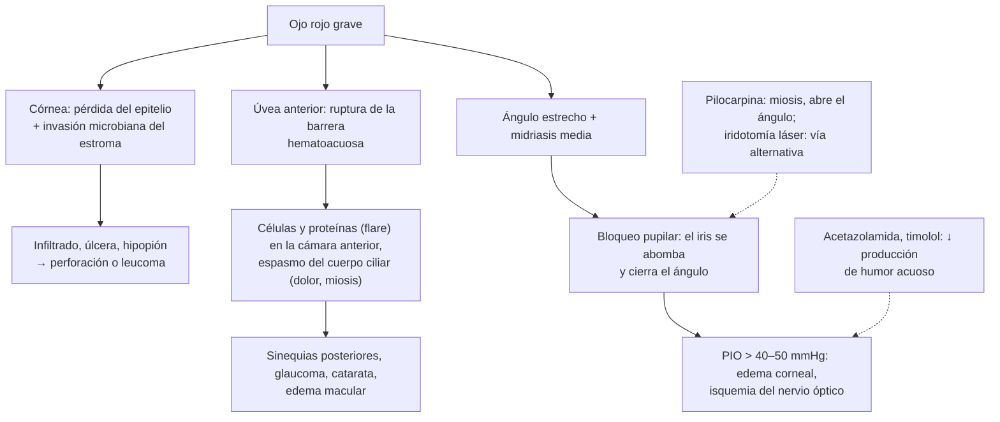

---
tags:
  - Oftalmología
  - Urgencia
---

# Ojo rojo grave: queratitis, úlcera corneal, leucoma, uveítis y glaucoma agudo

**Subespecialidad**
Oftalmología · Urgencia · Atención primaria · Reumatología

**Guías principales**
AAO 2023: *Preferred Practice Pattern* de queratitis bacteriana (*Ophthalmology* 2024) · AAO 2020: *Preferred Practice Pattern* de enfermedad por cierre angular primario (*Ophthalmology* 2021) · European Glaucoma Society, 5.ª edición (2021) · Consenso de la Sociedad de Glaucoma de Asia-Pacífico sobre el ataque agudo de cierre angular (2025) · Nomenclatura estandarizada de uveítis, SUN (2005)

**Otras fuentes**
Estudio HEDS de profilaxis con aciclovir (*N Engl J Med* 1998) · Revisión de la queratitis herpética (*Clin Ophthalmol* 2017) · Ver [conjuntivitis](conjuntivitis-ojo-seco-y-pterigion.md), [herpes zóster](../../infectologia/varicela-y-herpes-zoster.md), [espondiloartritis](../../reumatologia/poliartritis-artritis-reumatoide-y-espondiloartritis.md), [enfermedad inflamatoria intestinal](../../gastroenterologia/enfermedad-inflamatoria-intestinal.md) y [cefalea](../../neurologia/cefalea.md)

**GES**
No.

**EUNACOM**
6.02.1.021 Queratitis (sospecha, inicial, derivar) · 6.02.2.010 Úlcera corneal (específico, inicial, derivar) · 6.02.1.015 Leucoma corneal (específico, inicial, derivar) · 6.02.1.030 Uveítis anterior o posterior (sospecha, inicial, derivar) · 6.02.2.005 Glaucoma agudo (sospecha, inicial, derivar) · 2.01.1.097 Ojo rojo (pediatría)

**Revisado**
Octubre 2026

!!! abstract "Resumen en 60 segundos"
    - **Ojo rojo con dolor, fotofobia, baja de visión o pupila anormal** = **ojo rojo grave**: queratitis, úlcera corneal, uveítis anterior, glaucoma agudo, escleritis, trauma o endoftalmitis. **Derivar a oftalmología el mismo día**.
    - Signo clave: **inyección ciliar** (periquerática, alrededor del limbo), a diferencia de la hiperemia conjuntival periférica de la conjuntivitis.
    - **Úlcera corneal bacteriana**: dolor, fotofobia, **infiltrado blanco** con defecto epitelial que **tiñe con fluoresceína**, a veces **hipopión**. Principal factor de riesgo: **lentes de contacto** (*Pseudomonas*). **Cultivo** y **colirios fortificados o quinolona** cada hora.
    - **Queratitis herpética**: úlcera **dendrítica** (fluoresceína), unilateral, recurrente. **Antiviral** (aciclovir oral o ganciclovir gel). **Nunca corticoides** en el epitelial.
    - **Uveítis anterior**: dolor, **fotofobia**, inyección ciliar, **miosis**, células en la cámara anterior. Asociada a **HLA-B27** (espondiloartritis, EII). **Corticoides tópicos y midriáticos** por el oftalmólogo.
    - **Glaucoma agudo por cierre angular**: dolor ocular intenso, **cefalea**, **náuseas y vómitos**, **halos**, **midriasis media arreactiva**, córnea **edematosa**, **ojo duro** (PIO > 40 mmHg). **Urgencia**: **acetazolamida**, **timolol**, **pilocarpina**, **manitol** y luego **iridotomía láser** en ambos ojos.
    - **Leucoma**: cicatriz corneal blanca, secuela de una úlcera o un trauma; si está en el eje visual, **trasplante de córnea**.

## Definición

- **Ojo rojo**: hiperemia de los vasos de la conjuntiva, la epiesclera o la esclera. Es **grave** cuando compromete la **córnea**, el **interior del ojo** o la **presión intraocular**, con riesgo de pérdida visual.
- **Queratitis**: inflamación de la **córnea**, infecciosa (bacterias, virus, hongos, *Acanthamoeba*) o no infecciosa (exposición, ojo seco, tóxica).
- **Úlcera corneal**: pérdida del epitelio corneal con **infiltrado** inflamatorio del estroma subyacente; la forma infecciosa es una **urgencia**.
- **Leucoma**: **opacidad blanca** y densa de la córnea por **cicatrización** del estroma (nubécula: opacidad leve; mácula: moderada; leucoma: densa).
- **Uveítis**: inflamación de la **úvea** (iris, cuerpo ciliar y coroides). Según la localización (SUN 2005): **anterior** (iritis, iridociclitis; la más frecuente), **intermedia** (vítreo), **posterior** (coroides, retina) y **panuveítis**.
- **Glaucoma agudo por cierre angular primario**: aumento **brusco** de la **presión intraocular** (PIO) por el **cierre del ángulo** iridocorneal que impide la salida del humor acuoso, con riesgo de daño del nervio óptico en horas.

## Epidemiología

- **Mundial**:
    - La **queratitis infecciosa** es una de las principales causas de **ceguera corneal** unilateral en el mundo; los usuarios de **lentes de contacto** tienen un riesgo mucho mayor, en especial si **duermen** con ellos.
    - La **queratitis por herpes simple** es la causa infecciosa más frecuente de ceguera corneal en los países desarrollados; recurre en ~ 1/3 de los pacientes en 5 años.
    - **Uveítis**: incidencia de ~ **17–52 por 100.000** al año; la **anterior** representa ~ 50–90 % de los casos; ~ **50 %** de las uveítis anteriores agudas son **HLA-B27** positivas.
    - **Glaucoma por cierre angular**: más frecuente en las **mujeres**, los **asiáticos**, los mayores de **60 años** y los **hipermétropes**.
- **Chile**: no hay datos nacionales publicados de incidencia de queratitis, uveítis ni glaucoma agudo.

!!! chile "Datos nacionales"
    - Todo **ojo rojo grave** detectado en la APS o en el servicio de urgencia debe derivarse **de inmediato** a la urgencia oftalmológica del hospital de referencia.
    - El **trauma ocular grave** tiene garantía GES (**N.° 50**), incluidas las quemaduras químicas.
    - El glaucoma **no** tiene garantía GES; la pesquisa se hace en los controles de salud y en las UAPO.

## Etiología y factores de riesgo

| Cuadro | Causas y factores de riesgo |
|---|---|
| **Queratitis bacteriana** | **Lentes de contacto** (sobre todo de uso **nocturno** o mal higienizados: *Pseudomonas aeruginosa*), **trauma** corneal, **ojo seco**, exposición corneal (parálisis facial, coma, UCI), corticoides tópicos, cirugía ocular, diabetes, inmunosupresión. Agentes: *S. aureus*, *S. epidermidis*, *S. pneumoniae*, *Pseudomonas*, *Moraxella* |
| **Queratitis micótica** | **Trauma con material vegetal** (ramas, agricultura): *Fusarium*, *Aspergillus*; *Candida* en las superficies oculares enfermas |
| **Queratitis por *Acanthamoeba*** | Lentes de contacto expuestos al **agua** (piscinas, duchas, agua de la llave, soluciones caseras); dolor **desproporcionado** |
| **Queratitis herpética** | **Virus herpes simple tipo 1** (reactivación desde el ganglio trigeminal: fiebre, estrés, UV, inmunosupresión, cirugía); **herpes zóster oftálmico** |
| **Queratitis por exposición** | Lagoftalmo (**parálisis facial**), proptosis (**orbitopatía tiroidea**), pacientes sedados en la UCI |
| **Queratitis actínica** | **Radiación UV** sin protección: **soldadura** al arco, nieve ("ceguera de la nieve"), camas solares |
| **Uveítis anterior** | **Idiopática** (~ 1/3), **HLA-B27** y **espondiloartritis** (espondilitis anquilosante, artritis reactiva y psoriásica, **EII**), **artritis idiopática juvenil** (niñas con ANA positivos: uveítis **asintomática**), **sarcoidosis**, **Behçet**, herpes, **sífilis**, **TBC**, **VIH**, trauma, fármacos |
| **Uveítis posterior** | **Toxoplasmosis** (la causa más frecuente de uveítis posterior), CMV (VIH), toxocariasis, sífilis, TBC, sarcoidosis, Behçet, enfermedad de Vogt-Koyanagi-Harada, endoftalmitis endógena |
| **Glaucoma agudo** | Ojo con **ángulo estrecho**: **hipermetropía**, ojo pequeño, **cristalino grueso** (edad, catarata), mujeres, asiáticos, antecedente familiar. **Gatillantes**: **midriasis** por **oscuridad**, estrés, **fármacos** (**anticolinérgicos**, antihistamínicos, antidepresivos tricíclicos, **topiramato**, simpaticomiméticos, **midriáticos** para el fondo de ojo, ipratropio nebulizado, descongestionantes) |
| **Leucoma** | Secuela de **úlceras infecciosas** (bacterianas, herpéticas recurrentes), **trauma**, **quemaduras químicas**, tracoma, distrofias corneales |

## Fisiopatología

*Figura 1. Mecanismos del ojo rojo grave y sitio de acción del tratamiento del glaucoma agudo. Esquema propio basado en las guías de la AAO (2020, 2023) y en el consenso de la Sociedad de Glaucoma de Asia-Pacífico (2025).*

## Clasificación

| Rasgo | Conjuntivitis | Queratitis o úlcera | Uveítis anterior | Glaucoma agudo |
|---|---|---|---|---|
| **Dolor** | Leve, arenilla | **Intenso**, superficial | **Moderado**, profundo | **Muy intenso**, con **cefalea** y vómitos |
| **Visión** | Normal | **Disminuida** | **Borrosa** | **Muy disminuida**, **halos** |
| **Fotofobia** | No | **Sí** | **Intensa** | Moderada |
| **Secreción** | Sí | Lagrimeo o purulenta | Lagrimeo | Lagrimeo |
| **Hiperemia** | **Conjuntival** periférica | **Ciliar** | **Ciliar** | **Mixta** |
| **Córnea** | Transparente | **Opacidad**, **tiñe con fluoresceína** | Precipitados queráticos | **Edematosa** (empañada) |
| **Pupila** | Normal | Normal o miosis | **Miosis**, irregular (sinequias) | **Midriasis media arreactiva** |
| **PIO** | Normal | Normal | Normal, baja o alta | **Muy alta** (ojo duro) |

## Clínica

- **Úlcera corneal bacteriana**: dolor, **fotofobia**, lagrimeo o secreción, **baja de la visión**, inyección ciliar, **infiltrado blanco-grisáceo** con defecto epitelial (tinción con **fluoresceína**), edema corneal y, en las graves, **hipopión**. Con *Pseudomonas*, progresión **rápida** (horas) con necrosis y riesgo de **perforación**.
- **Queratitis micótica**: curso **más lento**, infiltrado de bordes **plumosos**, lesiones satélites; antecedente de trauma vegetal.
- **Queratitis por *Acanthamoeba***: usuario de lentes de contacto con **dolor desproporcionado** al aspecto, infiltrado en **anillo**, curso crónico con mala respuesta a los antibióticos.
- **Queratitis herpética**:
    - **Epitelial**: úlcera **dendrítica** (ramificada con bulbos terminales) que tiñe con fluoresceína; sensación de cuerpo extraño, lagrimeo, fotofobia, **hipoestesia corneal**.
    - **Estromal**: opacidad e inflamación del estroma (inmunológica), con riesgo de **leucoma** y vascularización.
    - **Recurrente** y **unilateral**.
- **Herpes zóster oftálmico**: vesículas en el territorio de **V1**; el **signo de Hutchinson** (vesículas en la punta de la nariz, nervio nasociliar) predice compromiso ocular (queratitis, uveítis).
- **Queratitis actínica**: dolor intenso **bilateral**, fotofobia y lagrimeo **6–12 horas** después de la exposición UV (soldadura, nieve); queratitis punteada; se resuelve en 24–48 horas.
- **Uveítis anterior aguda**: **dolor** ocular profundo, **fotofobia** intensa, **visión borrosa**, **inyección ciliar**, **miosis** (pupila pequeña e irregular por **sinequias posteriores**), **células y flare** en la cámara anterior (lámpara de hendidura), **precipitados queráticos**, a veces **hipopión** (HLA-B27, Behçet). Suele ser **unilateral** y **recurrente**, a veces alternante (HLA-B27).
- **Uveítis de la artritis idiopática juvenil**: **crónica y asintomática** (ojo blanco), con riesgo de catarata, glaucoma y queratopatía en banda: requiere **tamizaje** oftalmológico periódico.
- **Uveítis posterior**: **visión borrosa**, **miodesopsias** ("moscas volantes"), escaso dolor y ojo poco rojo; **toxoplasmosis**: foco de **retinocoroiditis** blanco-amarillento junto a una cicatriz pigmentada ("faro en la niebla").
- **Glaucoma agudo por cierre angular**:
    - **Dolor ocular intenso** súbito, **cefalea** hemicránea, **náuseas y vómitos** (puede confundirse con un cuadro abdominal o una migraña).
    - **Visión borrosa** y **halos de colores** alrededor de las luces.
    - **Ojo rojo** con inyección mixta, **córnea edematosa** (empañada), **cámara anterior estrecha**, **pupila en midriasis media arreactiva** (fija, ovalada).
    - **Ojo duro** a la palpación digital; **PIO > 40–50 mmHg**.
    - Puede gatillarse en un ambiente **oscuro** (cine) o tras un fármaco **anticolinérgico** o un **midriático**.
- **Leucoma**: opacidad corneal **blanca** densa; si está en el eje visual produce **baja de visión** importante; a veces vascularizado.

!!! alarma "Signos de alarma (derivación inmediata a oftalmología)"
    - **Úlcera corneal** (tinción con fluoresceína con infiltrado blanco), sobre todo en **usuarios de lentes de contacto**.
    - **Hipopión** o **hifema**.
    - **Pupila en midriasis media arreactiva** con ojo duro y vómitos: **glaucoma agudo**.
    - **Dolor intenso** que no cede, **baja de visión** marcada.
    - **Herpes zóster oftálmico** con signo de Hutchinson.
    - **Quemadura química** (irrigar abundantemente antes de derivar).
    - Ojo rojo **después de una cirugía ocular** o inyección intravítrea: **endoftalmitis**.
    - Uveítis con **síntomas sistémicos** (lumbalgia inflamatoria, diarrea crónica, úlceras orales y genitales, lesiones cutáneas).

## Diagnóstico

!!! guia "Puntos clave (AAO 2020 y 2023; SUN 2005)"
    - En **todo ojo rojo**: **agudeza visual** (cada ojo por separado), **pupilas** (tamaño, forma y reflejo), tipo de **hiperemia**, transparencia de la **córnea**, **tinción con fluoresceína** con luz azul, **cámara anterior** (hipopión, hifema, profundidad) y estimación de la **presión intraocular** (palpación bidigital o tonómetro).
    - **Antes de la fluoresceína**, la **anestesia tópica** (proparacaína) solo con fines **diagnósticos**: **nunca** recetarla (retarda la cicatrización y produce úlceras).
    - **Úlcera corneal**: **raspado corneal** para **Gram** y **cultivo** (bacterias, hongos, *Acanthamoeba*) **antes** de iniciar los antibióticos en las úlceras **grandes** (> 1–2 mm), **centrales**, profundas, con mucha reacción o que no responden. Cultivar también los **lentes de contacto** y su estuche.
    - **Uveítis**: clasificar por localización (SUN). Primer episodio de uveítis anterior **unilateral** no granulomatosa leve: estudio dirigido (**HLA-B27**). **Bilateral**, **granulomatosa**, **recurrente** o **posterior**: estudio completo (sífilis, TBC, sarcoidosis, toxoplasmosis, VIH).
    - **Glaucoma agudo**: diagnóstico **clínico** con medición de la **PIO** y **gonioscopía** (ángulo cerrado). Evaluar el **ojo contralateral** (ángulo estrecho).

## Laboratorio

| Situación | Exámenes |
|---|---|
| **Úlcera corneal** | **Gram**, **cultivo** (agar sangre, chocolate, Sabouraud), **KOH** o calcoflúor (hongos), PCR o cultivo para *Acanthamoeba* y herpes según el caso |
| **Uveítis anterior** recurrente o con síntomas sistémicos | **HLA-B27**, hemograma, VHS, PCR, **VDRL o RPR y prueba treponémica** (sífilis), **IGRA o PPD** (TBC), **ECA** sérica y **radiografía de tórax** (sarcoidosis), **VIH**, orina completa |
| **Uveítis posterior** | Serología de **toxoplasma**, sífilis, TBC, VIH, CMV, toxocara; PCR en humor acuoso o vítreo (especialista) |
| **Uveítis en un niño** | **ANA** y factor reumatoide (artritis idiopática juvenil) |
| **Glaucoma agudo** | Electrolitos, función renal antes de la **acetazolamida** y el **manitol** (evitar en la insuficiencia renal y en la alergia a sulfonamidas), glicemia |

## Imágenes

- **Lámpara de hendidura** (biomicroscopía): examen clave del especialista para la córnea, la cámara anterior y el cristalino.
- **Ecografía ocular (modo B)** si no se ve el fondo de ojo (hipopión denso, opacidad corneal): descartar endoftalmitis, desprendimiento de retina o tumor.
- **OCT del segmento anterior** y **gonioscopía**: evalúan el ángulo en el glaucoma por cierre angular.
- **OCT macular**: edema macular en la uveítis.
- **Radiografía de la columna sacroilíaca** o **RM** si hay uveítis HLA-B27 con lumbalgia inflamatoria; **TC de tórax** en la sospecha de sarcoidosis.

## Diagnóstico diferencial

| Cuadro | Claves |
|---|---|
| **Conjuntivitis** | Hiperemia **conjuntival**, secreción, **sin** dolor intenso, visión y pupila normales |
| **Hemorragia subconjuntival** | Mancha roja homogénea, indolora, visión normal |
| **Epiescleritis** | Hiperemia **sectorial**, leve molestia, visión normal |
| **Escleritis** | Dolor **intenso** que irradia y despierta, tinte **violáceo**, sensibilidad al tacto del globo; **artritis reumatoide**, vasculitis ANCA, LES → urgencia |
| **Abrasión corneal** y cuerpo extraño | Antecedente traumático, defecto epitelial **sin infiltrado** |
| **Endoftalmitis** | Dolor, **hipopión**, baja visual grave tras **cirugía**, inyección intravítrea o trauma penetrante, o endógena (bacteriemia, candidemia) |
| **Migraña** y **cefalea en racimos** (vs glaucoma agudo) | En el racimo: ojo rojo y lagrimeo con miosis y ptosis (Horner), PIO normal, crisis de 15–180 minutos |
| **Celulitis orbitaria** | Proptosis, oftalmoplejía, dolor con los movimientos oculares, fiebre |

## Tratamiento

!!! dosis "Úlcera corneal bacteriana (AAO 2023; por el oftalmólogo)"
    - **Suspender los lentes de contacto**.
    - **Antibióticos tópicos de amplio espectro** **intensivos**: **dosis de carga** (1 gota cada 5–15 minutos la primera hora) y luego **cada hora** (día y noche las primeras 24–48 horas), ajustando según la respuesta y el cultivo:
        - Úlceras **pequeñas y periféricas**: **fluoroquinolona** (moxifloxacino 0,5 %, gatifloxacino, ciprofloxacino 0,3 %) en monoterapia.
        - Úlceras **grandes**, **centrales** o graves: **colirios fortificados** (**cefazolina 50 mg/mL** o vancomicina 25–50 mg/mL **más** **tobramicina o gentamicina 14 mg/mL**).
    - **Cicloplégico** (ciclopentolato o atropina) para el dolor y prevenir las sinequias.
    - **Analgesia oral**.
    - **No ocluir** el ojo (favorece la infección, sobre todo por *Pseudomonas*).
    - **Corticoides tópicos**: solo por el especialista, tras 24–48 horas de mejoría con el antibiótico y descartados hongos y *Acanthamoeba*.
    - **Micótica**: **natamicina 5 %** (filamentosos) o voriconazol. ***Acanthamoeba***: biguanidas (PHMB, clorhexidina) por meses.
    - **Perforación** o úlcera que progresa: **adhesivo tisular**, recubrimiento conjuntival o **queratoplastia terapéutica**.

!!! dosis "Queratitis herpética y uveítis"
    | Cuadro | Tratamiento |
    |---|---|
    | **Queratitis herpética epitelial** (dendrítica) | **Aciclovir oral 400 mg 5 veces al día** o **valaciclovir 500 mg cada 8–12 horas** por **7–10 días**, o **ganciclovir 0,15 % gel** 5 veces al día hasta la reepitelización y luego 3 veces al día por 7 días. **Nunca corticoides** |
    | **Queratitis herpética estromal** | **Corticoide tópico** (especialista) **siempre con cobertura antiviral oral** |
    | **Profilaxis de las recurrencias** | **Aciclovir 400 mg cada 12 horas** por **12 meses** (estudio HEDS: reduce las recurrencias a la mitad) |
    | **Herpes zóster oftálmico** | **Valaciclovir 1 g cada 8 horas** o aciclovir 800 mg 5 veces al día por 7–10 días, iniciado en las primeras 72 horas; derivar a oftalmología |
    | **Uveítis anterior** (por el oftalmólogo) | **Corticoide tópico** potente (**prednisolona acetato 1 %** cada 1–2 horas al inicio, con disminución lenta en semanas) **más cicloplégico** (ciclopentolato 1 % o atropina 1 %; alivian el dolor y previenen las **sinequias**). Tratar la causa infecciosa. Recurrente o crónica: inmunosupresores o **anti-TNF** (adalimumab), con reumatología |
    | **Toxoplasmosis ocular** | **Cotrimoxazol** o **pirimetamina + sulfadiazina + ácido folínico**, con corticoide oral después del antibiótico, si amenaza la mácula o el nervio óptico |

!!! dosis "Glaucoma agudo por cierre angular (AAO 2020; APGS 2025)"
    - **Urgencia**: el objetivo es **bajar la PIO** en horas y **abrir el ángulo**.
    - **Tratamiento médico inmediato** (en la urgencia o en la APS, mientras se deriva):
        - **Acetazolamida 500 mg** VO o IV, luego 250 mg cada 6 horas (contraindicada en la alergia a sulfonamidas, la insuficiencia renal y la hipokalemia).
        - **Timolol 0,5 %** 1 gota (betabloqueador; contraindicado en el asma, la EPOC grave y el bloqueo AV).
        - **Brimonidina 0,2 %** (agonista α2; no en los niños pequeños).
        - **Pilocarpina 1–2 %** 1 gota cada 15 minutos por 2–3 dosis **cuando la PIO empiece a bajar** (el esfínter del iris isquémico no responde con la PIO muy alta).
        - **Corticoide tópico** (prednisolona 1 %) para la inflamación.
        - Si no baja: **manitol 20 % 1–2 g/kg IV** en 30–45 minutos (cuidado con la insuficiencia cardíaca y renal) o **glicerol oral** (no en los diabéticos).
        - **Analgesia** y **antieméticos**; posición en **decúbito supino**.
    - **Tratamiento definitivo** (oftalmólogo): **iridotomía periférica con láser** (Nd:YAG) en el ojo afectado **y en el ojo contralateral** (profiláctica: hasta la mitad hace una crisis en 5 años sin tratamiento). Si hay catarata o el ángulo no se abre: **extracción del cristalino** (facoemulsificación).
    - **Evitar** los fármacos **anticolinérgicos** y los **midriáticos** en las personas con ángulo estrecho no tratado.

- **Queratitis actínica**: **cicloplégico**, **lubricantes**, ungüento antibiótico, analgesia oral; resolución en 24–48 horas. Prevención con **protección ocular** (careta de soldar, lentes para la nieve).
- **Queratitis por exposición**: **lubricación** intensa con ungüento, **oclusión** palpebral (cámara húmeda) en los pacientes sedados o con parálisis facial, tarsorrafia en los casos persistentes.
- **Leucoma**: si está en el **eje visual** y limita la visión, **queratoplastia** (trasplante de córnea penetrante o lamelar); lentes de contacto rígidos para el astigmatismo irregular; tatuaje corneal estético en los ojos ciegos.

## Complicaciones

- **Úlcera corneal**: **perforación**, **endoftalmitis**, **leucoma** con baja de visión, **astigmatismo irregular**, pérdida del ojo.
- **Queratitis herpética**: **leucoma**, vascularización corneal, queratopatía neurotrófica, glaucoma, recurrencias.
- **Uveítis**: **sinequias posteriores**, **glaucoma** (inflamatorio o por corticoides), **catarata**, **edema macular** (la principal causa de pérdida visual), queratopatía en banda, hipotonía, desprendimiento de retina.
- **Glaucoma agudo**: **daño del nervio óptico** (pérdida irreversible del campo visual), oclusión de la vena central de la retina, atrofia del iris, catarata, crisis en el otro ojo.

## Pronóstico y seguimiento

- **Úlcera corneal**: el pronóstico depende de la **precocidad** del tratamiento, el tamaño, la ubicación (las **centrales** dejan más secuelas) y el agente (*Pseudomonas*, hongos y *Acanthamoeba* son peores).
- **Queratitis herpética**: recurrente; la profilaxis con aciclovir reduce las recurrencias.
- **Uveítis anterior aguda**: buen pronóstico con tratamiento oportuno; las recurrencias son frecuentes en las HLA-B27.
- **Glaucoma agudo**: si se trata en **horas**, la visión suele recuperarse; un retraso de más de 24–48 horas aumenta el riesgo de daño permanente.
- **Seguimiento**: controles oftalmológicos frecuentes (a diario o cada 2–3 días en las úlceras); **educación** en la higiene de los lentes de contacto (no dormir con ellos, no usar agua de la llave, cambiar el estuche).

## Perlas para el internado

!!! perla "Para recordar"
    - Ojo rojo + **dolor** + **fotofobia** + **baja de visión** = ojo rojo grave → **oftalmólogo hoy**.
    - **Inyección ciliar** alrededor del limbo: córnea o úvea.
    - **Lentes de contacto** + ojo rojo doloroso = **úlcera por *Pseudomonas*** hasta que se demuestre lo contrario. **No ocluir**.
    - **Úlcera dendrítica**: herpes → antiviral, **nunca corticoides**.
    - **Miosis** + fotofobia + inyección ciliar = **uveítis anterior**. Pensar en **HLA-B27**.
    - **Midriasis media arreactiva** + ojo duro + vómitos + halos = **glaucoma agudo**. Acetazolamida, timolol, pilocarpina, manitol e **iridotomía en ambos ojos**.
    - No dar **anticolinérgicos** ni **midriáticos** a quien tenga un ángulo estrecho.
    - **Nunca** recetar **anestésico tópico** ocular.
    - El glaucoma agudo puede **simular un abdomen agudo o una migraña**: mirar el ojo en todo paciente con cefalea y vómitos.

## Preguntas de repaso

??? repaso "1. Mujer de 25 años, usuaria de lentes de contacto que duerme con ellos, con ojo derecho rojo, dolor intenso, fotofobia y visión borrosa de 24 horas. Hay una mancha blanca de 3 mm en la córnea que tiñe con fluoresceína. ¿Diagnóstico y conducta?"
    **Úlcera corneal bacteriana**, probablemente por ***Pseudomonas aeruginosa***. **Retirar los lentes** y **derivar de inmediato** a oftalmología: **raspado corneal** para Gram y cultivo (también de los lentes y el estuche) y **colirios fortificados** (cefazolina más tobramicina) o **fluoroquinolona** con dosis de carga y luego **cada hora**, más **cicloplégico** y analgesia. **No ocluir** el ojo ni usar corticoides al inicio.

??? repaso "2. Hombre de 40 años con ojo izquierdo rojo, lagrimeo, fotofobia y sensación de cuerpo extraño. Ha tenido episodios similares. La fluoresceína muestra una lesión ramificada con bulbos terminales. ¿Diagnóstico y tratamiento?"
    **Queratitis herpética epitelial** (úlcera **dendrítica** por virus herpes simple). Tratamiento: **aciclovir oral 400 mg 5 veces al día** (o valaciclovir) o **ganciclovir 0,15 % gel** por 7–10 días; derivar a oftalmología. **Nunca corticoides** tópicos en la forma epitelial. Por ser recurrente, considerar la **profilaxis** con aciclovir 400 mg cada 12 horas por 12 meses.

??? repaso "3. Hombre de 32 años con lumbalgia inflamatoria y rigidez matinal de 1 año, consulta por ojo derecho rojo, dolor, fotofobia intensa y visión borrosa. La pupila derecha es pequeña e irregular. ¿Diagnóstico y estudio?"
    **Uveítis anterior aguda** asociada probablemente a una **espondiloartritis axial** (HLA-B27). **Derivación urgente** a oftalmología: **corticoide tópico** (prednisolona 1 %) y **cicloplégico** para prevenir sinequias. Pedir **HLA-B27**, VHS, PCR, radiografía o RM de sacroilíacas y derivar a **reumatología**. Descartar sífilis y TBC si la evolución es atípica.

??? repaso "4. Mujer de 68 años, hipermétrope, que al salir del cine presenta dolor ocular izquierdo intenso, cefalea, vómitos y visión de halos. El ojo está rojo, la córnea empañada, la pupila en midriasis media arreactiva y el globo duro. ¿Diagnóstico y manejo inmediato?"
    **Glaucoma agudo por cierre angular primario**. Manejo inmediato: **acetazolamida 500 mg** VO o IV, **timolol 0,5 %**, **brimonidina** y, cuando la PIO empiece a bajar, **pilocarpina 1–2 %**; corticoide tópico, antieméticos y analgesia; **manitol IV** si no hay respuesta. **Derivar de urgencia** a oftalmología para **iridotomía láser** en el ojo afectado y **profiláctica en el contralateral**.

??? repaso "5. Soldador de 35 años con dolor ocular bilateral intenso, fotofobia y lagrimeo que comenzaron 8 horas después de soldar sin careta. ¿Diagnóstico y tratamiento?"
    **Queratitis actínica** (fotoqueratitis por radiación UV). Tratamiento: **cicloplégico**, **lubricantes** y ungüento antibiótico, **analgesia oral**; se resuelve en 24–48 horas. **No** recetar anestésico tópico. Prevención con **careta de soldar** (y notificar como accidente del trabajo si ocurrió en el trabajo).

??? repaso "6. Hombre de 55 años con una opacidad blanca densa central en la córnea derecha, secuela de una úlcera corneal hace 2 años, con visión de cuenta dedos. ¿Qué es y qué opción tiene?"
    **Leucoma corneal** central (cicatriz del estroma) que compromete el **eje visual**. La opción para recuperar la visión es la **queratoplastia** (trasplante de córnea), por el oftalmólogo; los lentes de contacto rígidos pueden ayudar si hay astigmatismo irregular. Derivar a oftalmología.

## Referencias

1. Rhee MK, Ahmad S, Amescua G, et al. Bacterial Keratitis Preferred Practice Pattern®. *Ophthalmology.* 2024;131(4):P87–P133. doi:[10.1016/j.ophtha.2023.12.035](https://doi.org/10.1016/j.ophtha.2023.12.035)
2. Gedde SJ, Chen PP, Muir KW, et al. Primary Angle-Closure Disease Preferred Practice Pattern®. *Ophthalmology.* 2021;128(1):P30–P70. doi:[10.1016/j.ophtha.2020.10.021](https://doi.org/10.1016/j.ophtha.2020.10.021)
3. European Glaucoma Society. Terminology and Guidelines for Glaucoma, 5th edition. *Br J Ophthalmol.* 2021;105(Suppl 1):1–169. doi:[10.1136/bjophthalmol-2021-egsguidelines](https://doi.org/10.1136/bjophthalmol-2021-egsguidelines)
4. Chan PP, Zhang X, Aung T, et al. Controversies, consensuses, and guidelines for acute primary angle closure attack (APACA) by the Asia-Pacific Glaucoma Society (APGS) and the Academy of Asia-Pacific Professors of Ophthalmology (AAPPO). *Asia Pac J Ophthalmol (Phila).* 2025;14(6):100223. doi:[10.1016/j.apjo.2025.100223](https://doi.org/10.1016/j.apjo.2025.100223)
5. Jabs DA, Nussenblatt RB, Rosenbaum JT; Standardization of Uveitis Nomenclature (SUN) Working Group. Standardization of uveitis nomenclature for reporting clinical data: results of the First International Workshop. *Am J Ophthalmol.* 2005;140(3):509–516. doi:[10.1016/j.ajo.2005.03.057](https://doi.org/10.1016/j.ajo.2005.03.057)
6. Herpetic Eye Disease Study Group. Acyclovir for the prevention of recurrent herpes simplex virus eye disease. *N Engl J Med.* 1998;339(5):300–306. doi:[10.1056/NEJM199807303390503](https://doi.org/10.1056/NEJM199807303390503)
7. Azher TN, Yin XT, Tajfirouz D, et al. Herpes simplex keratitis: challenges in diagnosis and clinical management. *Clin Ophthalmol.* 2017;11:185–191. doi:[10.2147/OPTH.S80475](https://doi.org/10.2147/OPTH.S80475)
