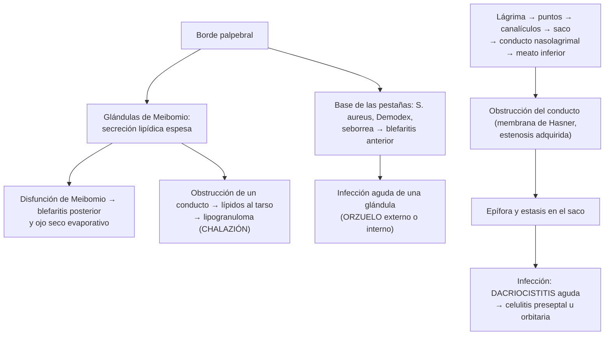

---
tags:
  - Oftalmología
  - Frecuente en sala
---

# Párpados y vía lagrimal: blefaritis, orzuelo, chalazión, dacriocistitis, obstrucción lagrimal y tumores de párpado

**Subespecialidad**
Oftalmología · Oculoplástica · Atención primaria · Pediatría

**Guías principales**
AAO 2023: *Preferred Practice Pattern* de blefaritis (*Ophthalmology* 2024) · Revisión Cochrane de intervenciones no quirúrgicas en el orzuelo interno agudo (2017)

**Otras fuentes**
Resolución de la obstrucción congénita del conducto nasolagrimal sin cirugía (PEDIG, *Arch Ophthalmol* 2012) · Metaanálisis de incisión y curetaje frente a triamcinolona en el chalazión (*Ophthalmic Plast Reconstr Surg* 2016) · Ensayos de lotilaner en la blefaritis por *Demodex* (*Ophthalmology* 2023) · Ver [conjuntivitis y ojo seco](conjuntivitis-ojo-seco-y-pterigion.md), [acné y rosácea](../dermatologia/acne-y-rosacea.md), [dermatitis seborreica](../dermatologia/dermatitis-atopica-contacto-seborreica-y-del-panal.md), [tumores cutáneos](../dermatologia/tumores-cutaneos-melanoma-carcinomas-y-lesiones-benignas.md) y [dislipidemia](../../endocrinologia/dislipidemia.md) (xantelasmas)

**GES**
No.

**EUNACOM**
6.02.1.002 Blefaritis (específico, completo, completo) · 6.02.1.019 Orzuelo no complicado (específico, completo, completo) · 6.02.1.004 Chalazión (específico, inicial, derivar) · 6.02.1.009 Dacriocistitis aguda (específico, inicial, derivar) · 6.02.1.018 Obstrucción completa de la vía lagrimal (específico, inicial, derivar) · 6.02.1.028 Tumores de párpado (sospecha, inicial, derivar)

**Revisado**
Octubre 2026

!!! abstract "Resumen en 60 segundos"
    - **Blefaritis**: inflamación **crónica** del borde palpebral: **anterior** (pestañas: estafilococo, seborreica, ***Demodex***) o **posterior** (**disfunción de las glándulas de Meibomio**, asociada a rosácea). Ardor, picazón, costras, ojo rojo leve. **Higiene palpebral** y **compresas tibias** diarias, de por vida; ungüento antibiótico o doxiciclina oral en los casos intensos.
    - **Orzuelo**: infección **aguda** y **dolorosa** de una glándula del párpado (*S. aureus*). **Compresas tibias**; se resuelve solo en 1–2 semanas.
    - **Chalazión**: nódulo **crónico**, **indoloro**, firme, por obstrucción de una glándula de **Meibomio** (lipogranuloma). Compresas tibias; si persiste, **incisión y curetaje** o **triamcinolona intralesional**. **Recurrente en el mismo lugar en un adulto: biopsia** (carcinoma sebáceo).
    - **Dacriocistitis aguda**: aumento de volumen **doloroso** y rojo del **canto interno** (debajo del tendón cantal medial), con pus por los puntos lagrimales. **Antibiótico oral** (amoxicilina con ácido clavulánico); IV si hay celulitis; luego **dacriocistorrinostomía**.
    - **Obstrucción congénita del conducto nasolagrimal**: lagrimeo y secreción desde las primeras semanas con **ojo blanco**. **Masaje** del saco; la mayoría se resuelve **antes del año**; **sondaje** si persiste. **Descartar el glaucoma congénito** (lagrimeo + **fotofobia** + córnea grande u opaca).
    - **Tumores de párpado**: el maligno más frecuente es el **carcinoma basocelular** (párpado **inferior**, canto interno). Signos de malignidad: **pérdida de pestañas**, ulceración, distorsión del borde, telangiectasias, crecimiento.

## Definición

- **Blefaritis**: inflamación crónica del **borde palpebral**. **Anterior**: base de las pestañas y folículos. **Posterior**: orificios de las **glándulas de Meibomio** (disfunción de las glándulas de Meibomio).
- **Orzuelo**: infección **aguda** supurativa de una glándula palpebral. **Externo**: glándulas de **Zeis** o **Moll** (borde, en la base de una pestaña). **Interno**: glándula de **Meibomio** (en el tarso).
- **Chalazión**: inflamación **granulomatosa crónica**, **no infecciosa**, de una glándula de **Meibomio** obstruida (lipogranuloma).
- **Dacriocistitis**: infección del **saco lagrimal**, generalmente secundaria a la **obstrucción** del conducto nasolagrimal.
- **Obstrucción de la vía lagrimal**: bloqueo del drenaje de la lágrima (puntos, canalículos, saco o **conducto nasolagrimal**) que produce **epífora** (lagrimeo). Puede ser **congénita** (persistencia de la membrana de **Hasner** en el extremo distal del conducto) o **adquirida**.

## Epidemiología

- **Mundial**:
    - La **blefaritis** es una de las causas más frecuentes de consulta oftalmológica; la **disfunción de las glándulas de Meibomio** es la causa más frecuente de **ojo seco evaporativo**.
    - El **orzuelo** y el **chalazión** son muy frecuentes en todas las edades; el chalazión es más frecuente en los adultos de 30–50 años y en las personas con **rosácea**, **dermatitis seborreica** o blefaritis.
    - La **obstrucción congénita del conducto nasolagrimal** afecta a una proporción importante de los recién nacidos (las cifras varían entre ~ 5 y 20 % según la definición); la mayoría se resuelve espontáneamente en el **primer año**. En el estudio PEDIG, más de la mitad de los lactantes de 6–10 meses se resolvió en 6 meses sin cirugía.
    - La **obstrucción adquirida** predomina en las **mujeres** mayores de 50 años.
    - **Tumores malignos del párpado**: el **carcinoma basocelular** representa ~ **80–90 %**; le siguen el espinocelular, el **sebáceo** (más frecuente en Asia) y el melanoma.
- **Chile**: no hay datos nacionales publicados de estas patologías; Chile tiene alta radiación UV, factor de riesgo de los carcinomas palpebrales.

!!! chile "Datos nacionales"
    - El orzuelo, la blefaritis y el chalazión se manejan en la **APS**; se derivan los chalaziones persistentes, los recurrentes y las lesiones sospechosas.
    - La **obstrucción congénita del conducto nasolagrimal** se pesquisa en el **control del niño sano**; se deriva a oftalmología infantil si persiste después de los **9–12 meses** o si hay dacriocistitis.
    - La **fotoprotección** de la región periocular (lentes de sol con filtro UV, sombrero) es parte de la prevención del carcinoma basocelular palpebral.

## Etiología y factores de riesgo

| Cuadro | Causas y factores de riesgo |
|---|---|
| **Blefaritis anterior** | ***S. aureus*** (estafilocócica), **dermatitis seborreica**, ***Demodex folliculorum*** (ácaro de los folículos de las pestañas) |
| **Blefaritis posterior** | **Disfunción de las glándulas de Meibomio**, **rosácea**, edad, uso de **pantallas**, lentes de contacto, isotretinoína, andrógenos bajos |
| **Orzuelo** | ***S. aureus*** (90–95 %); blefaritis, mala higiene, frotarse los ojos, maquillaje contaminado, diabetes |
| **Chalazión** | Obstrucción de la glándula de Meibomio; **blefaritis posterior**, **rosácea**, dermatitis seborreica, orzuelo previo |
| **Obstrucción congénita** | Persistencia de la **membrana de Hasner**; más frecuente en el **síndrome de Down** y en las anomalías craneofaciales |
| **Obstrucción adquirida** | **Primaria** (estenosis idiopática por inflamación crónica, mujeres mayores) o **secundaria**: trauma nasoorbitario, cirugía sinusal, sinusitis crónica, **tumores** (del saco o nasales), dacriolitos, granulomatosis con poliangeítis, sarcoidosis, radioterapia, quimioterapia (docetaxel, 5-FU), colirios |
| **Dacriocistitis aguda** | **Obstrucción del conducto nasolagrimal** con estasis e infección: *S. aureus*, *S. pneumoniae*, *S. epidermidis*, *H. influenzae* (niños), *Pseudomonas* |
| **Tumores de párpado** | **Radiación UV** acumulada, fototipo claro, edad, inmunosupresión, xeroderma pigmentoso, radioterapia previa; **síndrome de Muir-Torre** (carcinoma sebáceo con cáncer colorrectal) |

## Fisiopatología

*Figura 1. Fisiopatología de las afecciones del borde palpebral y de la vía lagrimal. Esquema propio basado en la guía de blefaritis de la AAO (2023) y en el estudio PEDIG (2012).*

## Clasificación

| Lesión | Inicio | Dolor | Localización | Contenido |
|---|---|---|---|---|
| **Orzuelo externo** | **Agudo** | **Sí** | **Borde** palpebral, en una pestaña | Pus (punto amarillo) |
| **Orzuelo interno** | **Agudo** | **Sí** | **Tarso** (se ve al evertir el párpado) | Pus |
| **Chalazión** | **Crónico** (semanas) | **No** (salvo si se inflama) | **Tarso**, alejado del borde | Lípidos (granuloma) |

| Obstrucción de la vía lagrimal | Rasgos |
|---|---|
| **Congénita** | Lagrimeo y secreción desde las **primeras semanas**, **ojo blanco**, reflujo de mucosidad al presionar el saco |
| **Adquirida** | Adulto (mujer mayor), **epífora** crónica, conjuntivitis recurrente, mucocele |
| **Dacriocistocele** (recién nacido) | Masa **azulada** en el canto interno desde el nacimiento; riesgo de dacriocistitis y de obstrucción nasal |

## Clínica

- **Blefaritis**:
    - Síntomas **crónicos** y **bilaterales**: **ardor**, **picazón**, sensación de arenilla, ojo rojo leve, **párpados pegados** en la mañana, visión borrosa fluctuante (ojo seco asociado).
    - **Anterior**: bordes palpebrales **rojos** y engrosados, **costras** y **escamas** en las pestañas ("caspa"), **collaretes cilíndricos** en la base de las pestañas (***Demodex***), **madarosis** (pérdida de pestañas) y **triquiasis** en los casos crónicos.
    - **Posterior**: orificios de Meibomio **taponados**, secreción **espesa** como pasta al presionar el párpado, **telangiectasias** del borde, espuma en la lágrima; asociada a la **rosácea** (eritema facial, telangiectasias).
- **Orzuelo**: nódulo **agudo**, **rojo**, **caliente** y **doloroso** en el párpado, con un **punto amarillo** de pus; edema palpebral localizado. Drena solo en días.
- **Chalazión**: nódulo **firme**, **redondo**, **indoloro**, de crecimiento lento, en el tarso, **alejado del borde**; puede inflamarse (chalazión agudo) o, si es grande, producir **astigmatismo** o ptosis mecánica.
- **Dacriocistitis aguda**: aumento de volumen **rojo**, **doloroso** y **caliente** del **canto interno**, **por debajo** del tendón cantal medial; **epífora**; **pus** por los puntos lagrimales al presionar el saco; a veces **fiebre**. Puede progresar a **absceso**, fístula cutánea o **celulitis orbitaria**.
- **Dacriocistitis crónica**: epífora con secreción mucopurulenta crónica y conjuntivitis unilateral recurrente; mucocele (masa indolora en el saco).
- **Obstrucción congénita del conducto nasolagrimal**: **lagrimeo** y **secreción** mucosa o mucopurulenta **desde las primeras semanas**, uni o bilateral, con **pestañas pegadas**, **ojo blanco** (sin hiperemia conjuntival importante), reflujo de secreción al presionar el saco. Empeora con los resfríos.
- **Obstrucción adquirida**: **epífora** crónica (lágrimas que caen por la mejilla), que empeora con el frío y el viento.
- **Tumores de párpado**:
    - **Benignos**: papiloma escamoso, **queratosis seborreica**, **nevos**, **xantelasmas** (placas amarillas en el canto interno; pedir **perfil lipídico**), hidrocistomas (quistes translúcidos), molusco contagioso.
    - **Carcinoma basocelular**: nódulo **perlado** con **telangiectasias** o úlcera con borde enrollado, en el **párpado inferior** y el **canto interno**; crece lentamente; puede invadir la órbita.
    - **Carcinoma espinocelular**: placa queratósica o ulcerada; más agresivo, con riesgo de diseminación perineural y ganglionar.
    - **Carcinoma sebáceo**: **párpado superior**, mujeres mayores; **simula** un **chalazión recurrente** o una **blefaritis unilateral crónica** (blefaroconjuntivitis que no responde); agresivo.
    - **Melanoma**: lesión pigmentada que cambia.

!!! alarma "Signos de alarma"
    - **Celulitis orbitaria**: **proptosis**, **dolor con los movimientos oculares**, **oftalmoplejía**, **baja de visión**, defecto pupilar aferente, quemosis, fiebre → **urgencia** (hospitalizar, TC de órbitas, antibióticos IV).
    - **Celulitis preseptal** extensa en un niño pequeño o con compromiso sistémico.
    - **Dacriocistitis** con fiebre, absceso o celulitis.
    - **Lagrimeo + fotofobia + córnea grande u opaca** en un lactante: **glaucoma congénito** (no es una obstrucción lagrimal): derivación **urgente**.
    - **Chalazión recurrente** en el mismo sitio, **blefaritis unilateral** que no responde, **pérdida de pestañas**, **ulceración** o distorsión del borde palpebral: **tumor maligno** → biopsia.
    - **Dacriocistitis** con secreción **sanguinolenta** o masa dura por encima del tendón cantal: tumor del saco lagrimal.

## Diagnóstico

!!! guia "Puntos clave (AAO 2023, blefaritis)"
    - El diagnóstico de la blefaritis, el orzuelo y el chalazión es **clínico**: examen de los bordes palpebrales, las pestañas y las glándulas de Meibomio (lámpara de hendidura) y **eversión** del párpado.
    - Los **cultivos** del borde palpebral se reservan a la blefaritis anterior **recurrente** con inflamación intensa o que no responde.
    - Las **pestañas** depiladas al microscopio muestran ***Demodex***.
    - **Biopsia** en la blefaritis **unilateral** crónica que no responde, el chalazión **recurrente** en el mismo lugar o las lesiones con signos de malignidad (para descartar el **carcinoma sebáceo**, el basocelular o el espinocelular).
    - **Obstrucción lagrimal**: **prueba de desaparición de la fluoresceína** (retención de colorante a los 5 minutos), **irrigación** de la vía lagrimal (el líquido no pasa a la nariz y refluye) y sondaje diagnóstico (especialista).

## Laboratorio

- No se requieren exámenes en la blefaritis, el orzuelo o el chalazión típicos.
- **Perfil lipídico** si hay **xantelasmas** (la mitad tiene dislipidemia).
- **Glicemia** si hay orzuelos o infecciones recurrentes.
- **Cultivo** de la secreción en la dacriocistitis (antes del antibiótico).
- **Histopatología** de toda lesión palpebral sospechosa o chalazión recurrente.
- **ANCA**, ECA si se sospecha una causa inflamatoria de la obstrucción lagrimal adquirida (granulomatosis con poliangeítis, sarcoidosis).

## Imágenes

- **TC de órbitas y senos paranasales** con contraste ante la sospecha de **celulitis orbitaria**, **absceso** subperióstico o tumor.
- **Dacriocistografía** o dacrio-TC en las obstrucciones adquiridas complejas, el trauma o la sospecha de tumor.
- **TC o RM** en los tumores palpebrales con sospecha de **invasión orbitaria**.

## Diagnóstico diferencial

| Cuadro | Claves |
|---|---|
| **Orzuelo vs chalazión** | Orzuelo: agudo y doloroso. Chalazión: crónico e indoloro |
| **Celulitis preseptal** | Edema y eritema difuso del párpado, **sin** proptosis ni dolor con los movimientos oculares, motilidad y visión normales |
| **Celulitis orbitaria** | **Proptosis**, dolor con los movimientos oculares, **oftalmoplejía**, baja de visión; origen sinusal (etmoiditis) |
| **Dacriocistitis vs etmoiditis** | La etmoiditis puede producir edema del canto interno; TC |
| **Glaucoma congénito vs obstrucción lagrimal** | Glaucoma: **fotofobia**, blefaroespasmo, **córnea grande** (> 12 mm) u **opaca**, sin secreción purulenta |
| **Conjuntivitis neonatal** | Ojo **rojo** con secreción en los primeros días o semanas; cultivo |
| **Blefaritis vs carcinoma sebáceo** | El carcinoma sebáceo es **unilateral**, persistente, con pérdida de pestañas |
| **Chalazión vs carcinoma** | Recurrencia en el mismo lugar, ulceración, adulto mayor |
| **Alergia** y dermatitis de contacto palpebral | Prurito, edema, eccema; cosméticos o colirios |
| **Edema palpebral** por otras causas | Síndrome nefrótico, hipotiroidismo, angioedema, picaduras |

## Tratamiento

!!! dosis "Blefaritis (AAO 2023)"
    - **Compresas tibias** sobre los párpados cerrados por **5–10 minutos**, 1–2 veces al día, seguidas de **masaje** del borde palpebral (para expulsar la secreción de las glándulas de Meibomio).
    - **Higiene palpebral**: limpieza del borde y de la base de las pestañas con champú diluido para niños, toallitas o soluciones comerciales de limpieza palpebral, 1–2 veces al día.
    - **Lágrimas artificiales** para el ojo seco asociado.
    - **Ungüento antibiótico** en el borde palpebral (**eritromicina** o bacitracina) 1–2 veces al día por 2–8 semanas si hay blefaritis anterior estafilocócica intensa; **azitromicina 1 %** tópica en la blefaritis posterior.
    - **Doxiciclina oral** **40–100 mg/día** (dosis antiinflamatoria) por 1–3 meses o **azitromicina oral** en pulsos, en la disfunción de Meibomio moderada a grave o con **rosácea** (no en los niños pequeños ni en las embarazadas).
    - ***Demodex***: **lotilaner 0,25 %** colirio cada 12 horas por 6 semanas (aprobado por la FDA en 2023) o productos con **aceite del árbol de té** diluido.
    - **Corticoide tópico** suave en ciclos cortos en las exacerbaciones intensas (por el oftalmólogo).
    - Es una enfermedad **crónica**: la higiene debe mantenerse **indefinidamente**.

- **Orzuelo**:
    - **Compresas tibias** por **10–15 minutos**, **3–4 veces al día**; masaje suave; higiene palpebral; no exprimirlo; suspender el maquillaje y los lentes de contacto.
    - Los **antibióticos tópicos** no han demostrado beneficio claro en el orzuelo no complicado (Cochrane 2017).
    - Si **persiste** más de 1–2 semanas o hay un absceso: **incisión y drenaje** por el oftalmólogo.
    - Si hay **celulitis preseptal**: **antibiótico oral** con cobertura de *S. aureus* (**cefadroxilo 500 mg cada 12 horas** o flucloxacilina; si hay riesgo de SARM, cotrimoxazol o clindamicina) por 7–10 días.
- **Chalazión**:
    - **Compresas tibias** y **masaje** por **2–4 semanas**; tratar la blefaritis y la rosácea asociadas.
    - Si persiste más de **1 mes** o es grande: **incisión y curetaje** (transconjuntival) o **inyección intralesional de triamcinolona** (eficacia similar en el metaanálisis; la triamcinolona puede despigmentar la piel oscura).
    - **Biopsia** si es **recurrente** en el mismo lugar o atípico.
    - No hay que usar antibióticos (no es infeccioso).

!!! dosis "Vía lagrimal"
    | Cuadro | Tratamiento |
    |---|---|
    | **Obstrucción congénita** | **Masaje de Crigler**: presión firme con el dedo índice sobre el saco lagrimal (canto interno) **hacia abajo**, 5–10 veces, 2–4 veces al día; limpieza de la secreción con suero fisiológico; antibiótico tópico solo si hay conjuntivitis. **Sondaje** del conducto (con o sin intubación) si persiste después de los **9–12 meses** o antes si hay dacriocistitis recurrente. Si falla: intubación o dacriocistorrinostomía |
    | **Dacriocistocele** del recién nacido | Masaje; si se infecta o hay obstrucción nasal, sondaje precoz (oftalmología) |
    | **Dacriocistitis aguda** en el adulto | **Amoxicilina con ácido clavulánico 875/125 mg cada 12 horas** (o cefalosporina de 1.ª generación; clindamicina en los alérgicos) por **7–10 días**; **compresas tibias**; analgesia. **Hospitalizar** con **antibiótico IV** (ceftriaxona más clindamicina o ampicilina-sulbactam) si hay fiebre, celulitis extensa u orbitaria. **Drenaje** si hay un absceso. **No sondear** en la fase aguda. Tras la resolución: **dacriocistorrinostomía** electiva (evita las recurrencias) |
    | **Dacriocistitis aguda** en el niño | Hospitalizar con frecuencia, antibióticos IV (riesgo de celulitis orbitaria) |
    | **Obstrucción adquirida** | **Dacriocistorrinostomía** (externa o endoscópica) si hay epífora molesta o infecciones; estudio de la causa |

- **Tumores de párpado**:
    - **Benignos**: extirpación por **estética** o para confirmar el diagnóstico; los **xantelasmas** se extirpan o se tratan con láser (y se trata la dislipidemia).
    - **Malignos**: **extirpación** con control de márgenes (**cirugía de Mohs** o control histológico intraoperatorio) y **reconstrucción palpebral** (oculoplástica). Carcinoma sebáceo: márgenes amplios, mapeo conjuntival y estudio ganglionar. Inhibidores de Hedgehog en el carcinoma basocelular orbitario avanzado.

## Complicaciones

- **Blefaritis**: **ojo seco**, conjuntivitis crónica, **queratitis marginal** (infiltrados corneales periféricos estériles), **triquiasis**, madarosis, orzuelos y chalaziones recurrentes.
- **Orzuelo**: **celulitis preseptal**, rara vez orbitaria; evolución a chalazión.
- **Chalazión**: astigmatismo, ptosis mecánica, despigmentación o atrofia por la triamcinolona.
- **Dacriocistitis**: **absceso**, **fístula** cutánea, **celulitis orbitaria**, trombosis del seno cavernoso, meningitis (muy raras); **endoftalmitis** si se opera el ojo con una dacriocistitis activa (por eso se trata antes de una cirugía de catarata).
- **Obstrucción congénita**: conjuntivitis recurrente, dacriocistitis, ambliopía (asociada a anisometropía).
- **Tumores malignos**: **invasión orbitaria** (exenteración), recidiva, metástasis (carcinoma sebáceo, espinocelular y melanoma), pérdida de la función palpebral y exposición corneal.

## Pronóstico y seguimiento

- **Blefaritis**: crónica, con exacerbaciones; buen control con la higiene diaria.
- **Orzuelo**: resolución espontánea en **1–2 semanas** en la mayoría.
- **Chalazión**: muchos se resuelven con las compresas en semanas a meses; la incisión y curetaje tiene una alta tasa de éxito.
- **Obstrucción congénita**: la mayoría se resuelve **en el primer año**; el sondaje tiene un éxito alto si se hace antes de los 2–3 años.
- **Dacriocistitis**: recurrente si no se trata la obstrucción; la dacriocistorrinostomía tiene un éxito de ~ 90 %.
- **Carcinoma basocelular palpebral**: excelente pronóstico con la extirpación completa; control dermatológico y oftalmológico periódico.

## Perlas para el internado

!!! perla "Para recordar"
    - **Orzuelo**: agudo, rojo, **doloroso** → **compresas tibias**. **Chalazión**: crónico, **indoloro** → compresas; si persiste, incisión y curetaje o triamcinolona.
    - **Chalazión recurrente** o **blefaritis unilateral** que no responde en un adulto: **biopsia** (carcinoma sebáceo).
    - Blefaritis: **higiene palpebral de por vida**; doxiciclina si hay rosácea o disfunción de Meibomio grave.
    - **Dacriocistitis**: masa roja dolorosa **en el canto interno**, pus por los puntos. Amoxicilina-clavulánico; **no sondear** en la fase aguda; luego dacriocistorrinostomía.
    - Lactante con **lagrimeo y legañas** con **ojo blanco**: obstrucción del conducto nasolagrimal → **masaje**; sondaje si persiste después de los 9–12 meses.
    - Lactante con **lagrimeo + fotofobia + córnea grande u opaca**: **glaucoma congénito** → urgente.
    - **Párpado inferior** + nódulo perlado + **pérdida de pestañas**: **carcinoma basocelular**.
    - **Xantelasmas**: pedir **perfil lipídico**.
    - **Preseptal** (sin proptosis, motilidad normal) vs **orbitaria** (proptosis, dolor al mover el ojo, oftalmoplejía): la orbitaria es una **urgencia**.

## Preguntas de repaso

??? repaso "1. Mujer de 28 años con un nódulo rojo, caliente y doloroso en el borde del párpado superior derecho desde hace 2 días, con un punto amarillo en la base de una pestaña. Visión normal. ¿Diagnóstico y tratamiento?"
    **Orzuelo externo** (glándula de Zeis o Moll, *S. aureus*). Tratamiento: **compresas tibias** 10–15 minutos 3–4 veces al día, masaje suave, higiene palpebral, no exprimirlo y suspender el maquillaje. Se resuelve en 1–2 semanas. Antibiótico oral solo si aparece una **celulitis preseptal**; derivar si persiste para incisión y drenaje.

??? repaso "2. Hombre de 40 años con rosácea, que presenta un nódulo firme e indoloro de 6 mm en el tarso del párpado inferior desde hace 2 meses, sin signos inflamatorios. ¿Diagnóstico y manejo?"
    **Chalazión** (lipogranuloma de una glándula de Meibomio), favorecido por la **blefaritis posterior** de la rosácea. Manejo: **compresas tibias y masaje**, higiene palpebral y tratamiento de la rosácea (doxiciclina en dosis antiinflamatoria si hay disfunción de Meibomio). Como persiste más de 1 mes: derivar para **incisión y curetaje** o **triamcinolona intralesional**. Biopsiar si recurre en el mismo lugar.

??? repaso "3. Mujer de 75 años con ardor, picazón y párpados pegados en la mañana desde hace años, con bordes palpebrales rojos, costras en las pestañas y collaretes cilíndricos. ¿Diagnóstico y tratamiento?"
    **Blefaritis anterior crónica** con ***Demodex*** (collaretes cilíndricos). Tratamiento: **higiene palpebral** diaria y **compresas tibias**, de forma indefinida; lágrimas artificiales; **lotilaner 0,25 %** colirio por 6 semanas o productos con **aceite del árbol de té**; ungüento antibiótico si hay componente estafilocócico. Explicar que es crónica.

??? repaso "4. Mujer de 65 años con aumento de volumen rojo, caliente y doloroso en el canto interno del ojo izquierdo, epífora y salida de pus por el punto lagrimal al presionar. Afebril, motilidad ocular normal y sin proptosis. ¿Diagnóstico y tratamiento?"
    **Dacriocistitis aguda** (sobre una obstrucción del conducto nasolagrimal). Tratamiento: **amoxicilina con ácido clavulánico 875/125 mg cada 12 horas** por 7–10 días, **compresas tibias** y analgesia; **no sondear** en la fase aguda; cultivo de la secreción. Hospitalizar si aparece fiebre, celulitis extensa o signos orbitarios. Derivar a oftalmología para **dacriocistorrinostomía** electiva después de la resolución.

??? repaso "5. Lactante de 3 meses con lagrimeo y secreción mucosa en el ojo derecho desde las 2 semanas de vida; el ojo está blanco, la córnea es transparente y de tamaño normal, y al presionar el canto interno refluye mucosidad. ¿Diagnóstico y manejo? ¿Qué diagnóstico grave debe descartar?"
    **Obstrucción congénita del conducto nasolagrimal**. Manejo: **masaje de Crigler** 2–4 veces al día, limpieza de la secreción con suero, antibiótico tópico solo si hay conjuntivitis; la mayoría se resuelve antes del año. Derivar para **sondaje** si persiste después de los **9–12 meses** o si hay dacriocistitis. Debe descartarse el **glaucoma congénito** (lagrimeo con **fotofobia**, blefaroespasmo, **córnea grande u opaca**).

??? repaso "6. Hombre de 70 años, agricultor, con un nódulo perlado de 5 mm con telangiectasias y una pequeña úlcera central en el párpado inferior izquierdo, con pérdida de pestañas en esa zona. ¿Diagnóstico y conducta?"
    Sospecha de **carcinoma basocelular palpebral** (nódulo perlado, telangiectasias, ulceración y **madarosis**). Derivar a oftalmología (oculoplástica) para **biopsia** y **extirpación** con control de márgenes (cirugía de Mohs o control histológico) y **reconstrucción palpebral**. Fotoprotección y control dermatológico de otras lesiones.

## Referencias

1. Lin A, Ahmad S, Amescua G, et al. Blepharitis Preferred Practice Pattern®. *Ophthalmology.* 2024;131(4):P50–P86. doi:[10.1016/j.ophtha.2023.12.036](https://doi.org/10.1016/j.ophtha.2023.12.036)
2. Lindsley K, Nichols JJ, Dickersin K. Non-surgical interventions for acute internal hordeolum. *Cochrane Database Syst Rev.* 2017;1(1):CD007742. doi:[10.1002/14651858.CD007742.pub4](https://doi.org/10.1002/14651858.CD007742.pub4)
3. Pediatric Eye Disease Investigator Group. Resolution of congenital nasolacrimal duct obstruction with nonsurgical management. *Arch Ophthalmol.* 2012;130(6):730–734. doi:[10.1001/archophthalmol.2012.454](https://doi.org/10.1001/archophthalmol.2012.454)
4. Aycinena AR, Achiron A, Paul M, et al. Incision and curettage versus steroid injection for the treatment of chalazia: a meta-analysis. *Ophthalmic Plast Reconstr Surg.* 2016;32(3):220–224. doi:[10.1097/IOP.0000000000000483](https://doi.org/10.1097/IOP.0000000000000483)
5. Gaddie IB, Donnenfeld ED, Karpecki P, et al. Lotilaner ophthalmic solution 0.25% for *Demodex* blepharitis: randomized, vehicle-controlled, multicenter, phase 3 trial (Saturn-2). *Ophthalmology.* 2023;130(10):1015–1023. doi:[10.1016/j.ophtha.2023.05.030](https://doi.org/10.1016/j.ophtha.2023.05.030)
6. Błaszczyk K, Biedka K, Estreicher A, et al. Congenital nasolacrimal duct obstruction: natural course, diagnosis and therapeutic strategies. *J Clin Med.* 2025;14(11):3716. doi:[10.3390/jcm14113716](https://doi.org/10.3390/jcm14113716)
