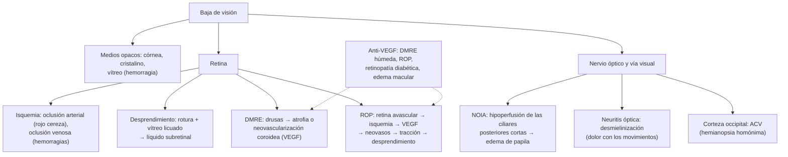

---
tags:
  - Oftalmología
  - Urgencia
  - GES
---

# Retina, nervio óptico y baja de visión: DMRE, desprendimiento de retina, hemorragia vítrea, neuropatía óptica isquémica y retinopatía del prematuro

**Subespecialidad**
Oftalmología · Retina · Neuroftalmología · Neonatología · Urgencia

**Guías principales**
AAO 2024: *Preferred Practice Patterns* de degeneración macular relacionada con la edad, de desprendimiento posterior del vítreo y roturas retinales, de oclusiones arteriales y de oclusiones venosas retinales (*Ophthalmology* 2025) · ICROP3 2021: clasificación internacional de la retinopatía del prematuro · AAP/AAO 2018: tamizaje de la retinopatía del prematuro (*Pediatrics*) · ACR/VF 2021: arteritis de células gigantes · MINSAL: GES N.° 32 (desprendimiento de retina) y N.° 57 (retinopatía del prematuro)

**Otras fuentes**
Ensayo AREDS2 (*JAMA* 2013) · EMA 2025: neuropatía óptica isquémica no arterítica y semaglutida · Ver [esclerosis múltiple](../../neurologia/esclerosis-multiple.md) (neuritis óptica), [complicaciones crónicas de la diabetes](../../endocrinologia/complicaciones-cronicas-de-la-diabetes.md) (retinopatía diabética), [hipertensión arterial](../../cardiologia/hipertension-arterial.md), [ACV](../../neurologia/accidente-cerebrovascular.md), [vasculitis](../../reumatologia/lupus-y-otras-mesenquimopatias.md), [glaucoma y catarata](glaucoma-y-catarata.md) y [ojo rojo grave](ojo-rojo-queratitis-uveitis-y-glaucoma-agudo.md)

**GES**
Sí: **N.° 32, desprendimiento de retina regmatógeno no traumático** · **N.° 57, retinopatía del prematuro** · N.° 31, retinopatía diabética.

**EUNACOM**
6.02.2.004 Disminución de la visión, lenta vs súbita (específico, inicial, derivar) · 6.02.1.010 Degeneración macular relacionada a la edad (sospecha, inicial, derivar) · 6.02.2.003 Desprendimiento de retina (sospecha, inicial, derivar) · 6.02.2.006 Hemorragia vítrea (sospecha, inicial, derivar) · 6.02.1.017 Neuropatía óptica isquémica (sospecha, inicial, derivar) · 6.02.1.022 Retinopatía del prematuro (sospecha, inicial, derivar)

**Revisado**
Octubre 2026

!!! abstract "Resumen en 60 segundos"
    - **Baja de visión**: lo primero es separar **súbita** (horas a días: **urgencia**) de **lenta** (meses a años) y **dolorosa** de **indolora**. Con ojo blanco e indolora y súbita: **vascular** (oclusión arterial o venosa), **desprendimiento de retina**, **hemorragia vítrea**, **neuropatía óptica isquémica**, DMRE neovascular o ACV occipital.
    - **Oclusión de la arteria central de la retina**: pérdida **súbita, indolora y profunda**, **mancha rojo cereza**. Es un **ACV**: derivar de inmediato a un centro de ACV; descartar **arteritis de células gigantes** en los > 50 años.
    - **Desprendimiento de retina regmatógeno**: **fotopsias** (destellos), **miodesopsias** ("moscas volantes" nuevas) y luego una **cortina** o sombra en el campo visual. Miopía, cirugía de catarata, trauma. **Cirugía urgente** (GES N.° 32: diagnóstico en 5 días y cirugía en 7).
    - **Hemorragia vítrea**: baja visual súbita con "lluvia" de manchas, **sin rojo pupilar**. Causa principal: **retinopatía diabética proliferativa**. **Ecografía** para descartar un desprendimiento.
    - **Neuropatía óptica isquémica anterior**: baja visual súbita indolora al despertar con **defecto altitudinal** y **edema de papila**. **Arterítica** (arteritis de células gigantes: cefalea, claudicación mandibular, VHS y PCR altas) → **corticoides de inmediato**. **No arterítica**: factores vasculares, papila pequeña, apnea del sueño; la **semaglutida** la tiene como efecto adverso muy raro (EMA 2025).
    - **DMRE**: > 50 años; pérdida de la visión **central**, **metamorfopsia** (líneas torcidas). **Seca** (atrofia, ~ 85–90 %) y **húmeda** (neovascular, la más grave): **anti-VEGF intravítreo**. Suplementos **AREDS2** en la intermedia; **dejar de fumar**.
    - **Retinopatía del prematuro**: tamizaje con fondo de ojo en los RN **< 1.500 g o < 32 semanas** (GES N.° 57: primer examen antes de las **6 semanas** de vida). Tratamiento con **láser** o **anti-VEGF**.

## Definición

- **Disminución de la agudeza visual**: pérdida de la capacidad de discriminar detalles. **Súbita**: en minutos a días. **Progresiva**: en semanas a años. **Transitoria** (amaurosis fugaz): recupera en < 24 horas (habitualmente minutos).
- **Degeneración macular relacionada con la edad (DMRE)**: enfermedad degenerativa de la **mácula** en las personas > 50 años, con **drusas** y alteraciones del epitelio pigmentario.
    - **Precoz e intermedia**: drusas medianas o grandes, cambios pigmentarios.
    - **Avanzada**: **atrofia geográfica** (forma "seca" avanzada) o **neovascularización coroidea** (forma "húmeda" o exudativa).
- **Desprendimiento de retina**: separación de la retina neurosensorial del epitelio pigmentario.
    - **Regmatógeno** (el más frecuente): por una **rotura** retinal que permite el paso del vítreo licuado.
    - **Traccional**: por membranas fibrovasculares (retinopatía diabética proliferativa, retinopatía del prematuro).
    - **Exudativo**: por líquido sin rotura (tumores, inflamación, hipertensión maligna, preeclampsia).
- **Hemorragia vítrea**: presencia de sangre en la cavidad vítrea.
- **Neuropatía óptica isquémica anterior (NOIA)**: infarto de la cabeza del nervio óptico por hipoperfusión de las arterias ciliares posteriores cortas. **Arterítica** (arteritis de células gigantes) o **no arterítica** (la más frecuente).
- **Retinopatía del prematuro (ROP)**: vasoproliferación retiniana anormal en los prematuros por una vascularización incompleta de la retina, que puede causar desprendimiento de retina y ceguera.

## Epidemiología

- **Mundial**:
    - La **DMRE** es la principal causa de **ceguera irreversible** en los adultos mayores de los países desarrollados; afecta a ~ **8–9 %** de la población mundial de 45–85 años en alguna forma.
    - El **desprendimiento de retina regmatógeno** tiene una incidencia de ~ **1 por 10.000** personas al año; los **miopes** altos, los **operados de catarata** y los que tuvieron un desprendimiento en el otro ojo tienen mayor riesgo.
    - La **NOIA no arterítica** es la neuropatía óptica aguda más frecuente después de los 50 años (~ 2–10 por 100.000 al año).
    - La **arteritis de células gigantes** ocurre en los > 50 años; la pérdida visual (por NOIA arterítica u oclusión arterial) ocurre en una proporción importante de los no tratados y suele ser **irreversible**.
    - La **ROP** es una causa principal de **ceguera infantil prevenible**; su riesgo aumenta cuanto menor es la edad gestacional y el peso de nacimiento.
- **Chile**: no hay datos nacionales publicados de incidencia de estas patologías; el desprendimiento de retina y la ROP tienen garantías GES.

!!! chile "Datos nacionales (Superintendencia de Salud)"
    - **GES N.° 32, desprendimiento de retina regmatógeno no traumático**: personas de cualquier edad. **Diagnóstico** dentro de **5 días** desde la sospecha; **cirugía** dentro de **7 días** desde la confirmación.
    - **GES N.° 57, retinopatía del prematuro**: recién nacidos **< 1.500 g** o **< 32 semanas** de gestación. **Primer fondo de ojo** por el oftalmólogo **dentro de las 6 semanas** de vida; **diagnóstico** dentro de **48 horas** desde la sospecha; **tratamiento** dentro de **24 horas** desde la confirmación; seguimiento dentro de 30 días.
    - **GES N.° 31, retinopatía diabética**: ver [complicaciones crónicas de la diabetes](../../endocrinologia/complicaciones-cronicas-de-la-diabetes.md).
    - La baja de visión **súbita** debe derivarse a la **urgencia oftalmológica** el mismo día.

## Etiología y factores de riesgo

| Cuadro | Factores de riesgo |
|---|---|
| **DMRE** | **Edad** (el principal), **tabaquismo** (el principal modificable), **antecedente familiar** y genética (*CFH*, *ARMS2*), raza blanca, obesidad, HTA, dieta pobre en antioxidantes |
| **Desprendimiento regmatógeno** | **Desprendimiento posterior del vítreo** (edad 50–70 años), **miopía** alta, **cirugía de catarata**, **trauma** ocular, degeneración en empalizada (*lattice*), desprendimiento en el otro ojo, antecedente familiar, síndrome de Stickler |
| **Hemorragia vítrea** | **Retinopatía diabética proliferativa** (la causa más frecuente), **desgarro retinal** con o sin desprendimiento, **desprendimiento posterior del vítreo**, **oclusión venosa** retinal, **trauma**, DMRE neovascular, síndrome de Terson (hemorragia subaracnoidea), anemia de células falciformes, ROP |
| **NOIA no arterítica** | **Edad > 50**, **HTA**, **diabetes**, dislipidemia, tabaco, **apnea obstructiva del sueño**, **hipotensión nocturna** (antihipertensivos en la noche), papila pequeña sin excavación ("**disco de riesgo**"), anemia grave, cirugía con hipotensión prolongada, **inhibidores de la PDE5** (sildenafil), amiodarona, **semaglutida** (muy raro) |
| **NOIA arterítica** | **Arteritis de células gigantes**: > 50 años (media ~ 70), **mujeres**, polimialgia reumática |
| **Oclusión arterial retinal** | **Émbolos** (placa carotídea, FA, valvulopatías, endocarditis), **arteritis de células gigantes**, trombofilias, vasculitis |
| **Oclusión venosa retinal** | **HTA**, **diabetes**, **glaucoma**, dislipidemia, edad, trombofilias, hiperviscosidad |
| **ROP** | **Prematurez** (< 32 semanas, < 1.500 g), **oxigenoterapia** con saturaciones elevadas o fluctuantes, sepsis, transfusiones, mal incremento de peso, hiperglicemia |

## Fisiopatología

*Figura 1. Mecanismos de la baja de visión según la estructura afectada. Esquema propio basado en las guías de la AAO (2024) y la clasificación ICROP3 (2021).*

## Clasificación

| Baja de visión | Indolora | Dolorosa |
|---|---|---|
| **Súbita** | **Oclusión de la arteria central** de la retina, **oclusión venosa**, **desprendimiento de retina**, **hemorragia vítrea**, **NOIA**, **DMRE neovascular**, ACV occipital, **amaurosis fugaz** (transitoria) | **Glaucoma agudo**, **uveítis**, **queratitis**, **neuritis óptica** (dolor con los movimientos), **endoftalmitis**, **arteritis de células gigantes** (cefalea), trauma |
| **Progresiva** | **Catarata**, **DMRE seca**, **glaucoma crónico**, **retinopatía diabética**, **vicios de refracción**, edema macular, compresión del nervio óptico (tumores), neuropatías tóxicas o nutricionales (alcohol, tabaco, etambutol, déficit de B12) | Escleritis, uveítis crónica, orbitopatía tiroidea |

| Retinopatía del prematuro (ICROP3) | Descripción |
|---|---|
| **Zona** | I (la más posterior y grave), II, III |
| **Estadio** | 1 (línea de demarcación), 2 (cresta), 3 (proliferación fibrovascular extrarretinal), 4 (desprendimiento parcial: 4A sin mácula, 4B con mácula), 5 (desprendimiento total) |
| **Enfermedad plus** | Dilatación y tortuosidad de los vasos del polo posterior: indica **actividad** y necesidad de tratamiento |
| **ROP agresiva** | Progresión rápida con enfermedad plus marcada |

## Clínica

- **Oclusión de la arteria central de la retina**: pérdida visual **súbita**, **indolora** y **profunda** (cuenta dedos o menos) en un ojo; **defecto pupilar aferente relativo**; fondo de ojo con retina **pálida** y edematosa y **mancha rojo cereza** en la fóvea; a veces un **émbolo** visible (placa de Hollenhorst). Puede ir precedida de **amaurosis fugaz**.
- **Oclusión de la vena central de la retina**: baja visual súbita o subaguda indolora; **hemorragias en llama** en los cuatro cuadrantes, venas dilatadas y tortuosas, manchas algodonosas y **edema de papila** ("fondo en salsa de tomate"). Riesgo de **glaucoma neovascular** (glaucoma "de los 100 días").
- **Desprendimiento posterior del vítreo** (agudo): **miodesopsias** (moscas, telarañas, un anillo flotante) y **fotopsias** (destellos de luz) de inicio súbito; en ~ 10–15 % se asocia a una **rotura retinal**.
- **Desprendimiento de retina regmatógeno**: fotopsias y miodesopsias seguidas de una **sombra** o **cortina** que avanza en el campo visual (desde la periferia), y baja de la visión central si se compromete la **mácula** ("mácula desprendida"). Indoloro.
- **Hemorragia vítrea**: baja visual **súbita** indolora, de "manchas" o "lluvia" negra o roja, hasta la pérdida casi total; **rojo pupilar** ausente o disminuido; el fondo de ojo no se ve.
- **NOIA no arterítica**: baja visual **súbita**, **indolora**, frecuentemente **al despertar**; **defecto altitudinal** del campo visual (mitad inferior o superior); **defecto pupilar aferente**; **edema de papila** sectorial con hemorragias en astilla; papila contralateral pequeña sin excavación.
- **NOIA arterítica** (arteritis de células gigantes): > 50 años con **cefalea** nueva temporal, **claudicación mandibular**, sensibilidad del cuero cabelludo, arteria temporal engrosada y sin pulso, **polimialgia reumática**, fiebre, baja de peso, **amaurosis fugaz** o diplopía previas; baja visual **grave**; papila con **edema pálido** ("blanco calcáreo"); **VHS y PCR elevadas**. Riesgo de compromiso del **otro ojo** en días.
- **Neuritis óptica**: baja visual subaguda **con dolor a los movimientos oculares**, alteración de los colores, defecto pupilar aferente; adulto joven; asociada a la **esclerosis múltiple** (ver [esclerosis múltiple](../../neurologia/esclerosis-multiple.md)).
- **DMRE**:
    - **Seca**: pérdida **progresiva** de la visión **central** (lectura, reconocimiento de caras), dificultad con poca luz; **drusas** amarillentas en la mácula; atrofia geográfica en las formas avanzadas.
    - **Húmeda (neovascular)**: **metamorfopsia** (líneas rectas que se ven **torcidas**), **escotoma central**, baja visual **rápida** (días a semanas); hemorragia o líquido macular.
    - Se conserva la visión **periférica** (no produce ceguera total).
- **ROP**: **asintomática** en las etapas tratables (por eso se hace **tamizaje**); en las avanzadas, **leucocoria**, estrabismo, nistagmo o ceguera.

!!! alarma "Signos de alarma (derivación urgente el mismo día)"
    - **Baja de visión súbita** de cualquier causa.
    - **Fotopsias** o **miodesopsias nuevas**, sobre todo con una **sombra** o cortina en el campo visual.
    - **Metamorfopsia** de inicio reciente en un adulto mayor (DMRE neovascular: el tratamiento precoz preserva la visión).
    - **Amaurosis fugaz** o **oclusión arterial**: evaluación como un **ACV** (neuroimagen, carótidas, ECG y ecocardiograma) en las primeras 24 horas.
    - **Baja visual** con **cefalea**, **claudicación mandibular** o **polimialgia** en un > 50 años: **arteritis de células gigantes** → **corticoides de inmediato** (no esperar la biopsia).
    - **Prematuro** < 1.500 g o < 32 semanas sin fondo de ojo programado.

## Diagnóstico

!!! guia "Puntos clave (AAO 2024; ICROP3 2021; AAP/AAO 2018; ACR/VF 2021)"
    - **Toda baja de visión**: agudeza visual de cada ojo (con estenopeico: si mejora, es un **vicio de refracción**), **pupilas** (**defecto pupilar aferente relativo**: retina extensa o nervio óptico), **rojo pupilar**, **campo visual por confrontación**, **rejilla de Amsler** (metamorfopsia) y **fondo de ojo** con dilatación.
    - **Síntomas de desprendimiento posterior del vítreo**: examen de la **retina periférica** con pupila dilatada (oftalmoscopía indirecta) **en forma precoz**, y control a las **2–6 semanas** si hay hemorragia vítrea o pigmento en el vítreo.
    - **Oclusión arterial**: es un **equivalente de ACV**: derivación inmediata a un centro de ACV para **neuroimagen**, **estudio carotídeo**, **ECG** y **ecocardiograma**. En los > 50 años, **VHS y PCR** urgentes.
    - **Sospecha de arteritis de células gigantes**: **VHS**, **PCR**, plaquetas; **ecografía Doppler de las arterias temporales** (signo del halo) o **biopsia** de la arteria temporal (dentro de 1–2 semanas de iniciados los corticoides).
    - **DMRE**: **OCT** macular y **angiografía** (fluoresceínica u OCT-angiografía) para confirmar la neovascularización.
    - **ROP**: tamizaje en los RN con **peso ≤ 1.500 g** o **≤ 30 semanas** (AAP/AAO) y en los de mayor peso con curso clínico inestable; en Chile, el GES cubre a los **< 1.500 g o < 32 semanas**. El primer examen a las **4 semanas** de vida o a las **31 semanas de edad posmenstrual** (lo que ocurra después), con controles según la zona y el estadio (ICROP3).

## Laboratorio

| Situación | Exámenes |
|---|---|
| **NOIA** u oclusión arterial en un **> 50 años** | **VHS**, **PCR**, hemograma (trombocitosis en la arteritis), glicemia, perfil lipídico |
| **Oclusión venosa** | Presión arterial, glicemia, perfil lipídico, hemograma; en los jóvenes: trombofilias, homocisteína, anticuerpos antifosfolípidos, electroforesis de proteínas |
| **NOIA no arterítica** | Factores de riesgo vascular; **polisomnografía** si se sospecha apnea del sueño |
| **Hemorragia vítrea** | Glicemia y HbA1c (diabetes), coagulación si hay anticoagulantes |
| **Neuritis óptica** | Ver [esclerosis múltiple](../../neurologia/esclerosis-multiple.md) (RM, anticuerpos anti-AQP4 y anti-MOG) |

## Imágenes

- **OCT macular**: DMRE, edema macular, membranas, agujero macular.
- **Angiografía fluoresceínica** u **OCT-angiografía**: neovascularización (DMRE), isquemia (oclusiones), retinopatía diabética.
- **Ecografía ocular modo B**: **obligatoria** si hay **hemorragia vítrea** o medios opacos, para descartar un **desprendimiento de retina** o un tumor.
- **Neuroimagen** (TC o RM) y **angio-TC** o **Doppler carotídeo**: oclusión arterial, amaurosis fugaz, hemianopsia, papiledema.
- **Ecografía Doppler de las arterias temporales** (halo) o **PET-TC**: arteritis de células gigantes.
- **Retinografía de campo amplio** o imágenes por telemedicina: tamizaje de la ROP.

## Diagnóstico diferencial

| Cuadro | Claves |
|---|---|
| **Amaurosis fugaz** vs **migraña con aura visual** | Amaurosis: **monocular**, minutos, "cortina negra" (embólica). Aura: **binocular** (homónima), espectro de fortificación centelleante que se desplaza en 5–60 minutos y cefalea posterior |
| **Desprendimiento de retina** vs **desprendimiento posterior del vítreo** | Este último no tiene cortina ni defecto del campo visual; ambos requieren fondo de ojo dilatado |
| **NOIA arterítica** vs **no arterítica** | Arterítica: > 70 años, síntomas sistémicos, VHS y PCR altas, edema **pálido**, baja visual **grave**. No arterítica: papila pequeña, edema hiperémico, VHS normal |
| **NOIA** vs **neuritis óptica** | NOIA: > 50 años, **indolora**, defecto altitudinal. Neuritis: joven, **dolor** con los movimientos, escotoma central, mejora en semanas |
| **NOIA** vs **papiledema** | El papiledema es **bilateral**, con **visión conservada** al inicio y signos de hipertensión endocraneana (cefalea, vómitos) |
| **DMRE** vs otras maculopatías | Edema macular diabético, coriorretinopatía serosa central (hombres jóvenes, estrés, corticoides), agujero macular, membrana epirretinal, maculopatía por hidroxicloroquina |
| **Baja visual "funcional"** | Examen normal con respuestas inconsistentes; diagnóstico de exclusión |

## Tratamiento

!!! dosis "Urgencias vasculares y del nervio óptico"
    | Cuadro | Manejo |
    |---|---|
    | **Oclusión de la arteria central** | **Derivación inmediata** a un centro de ACV (la ventana es de horas): evaluación de **trombólisis** en algunos centros dentro de las primeras 4,5 horas; las maniobras clásicas (masaje ocular, paracentesis) tienen beneficio no demostrado. **Prevención secundaria** como un ACV (antiagregación, estatina, control de la causa: endarterectomía si hay estenosis carotídea, anticoagulación si hay FA). VHS y PCR en los > 50 años |
    | **Oclusión venosa** | Control de los **factores de riesgo** (HTA, diabetes, glaucoma); **anti-VEGF** intravítreo si hay **edema macular**; **panfotocoagulación** láser si hay neovascularización |
    | **NOIA arterítica** (arteritis de células gigantes) | **Corticoides de inmediato** sin esperar la biopsia: si hay **pérdida visual**, **metilprednisolona 500–1.000 mg IV/día por 3 días**, luego **prednisona 1 mg/kg/día** (máximo 60–80 mg) con disminución lenta en meses; **tocilizumab** como ahorrador de corticoides (ACR/VF 2021). Protección gástrica y ósea |
    | **NOIA no arterítica** | Sin tratamiento de eficacia probada (los corticoides no se recomiendan de rutina). **Control de los factores de riesgo**, tratar la **apnea del sueño**, evitar la **hipotensión nocturna** (no dar antihipertensivos en la noche), suspender los inhibidores de la PDE5. Si se confirma con **semaglutida**, suspenderla (EMA 2025) |
    | **Neuritis óptica** | Ver [esclerosis múltiple](../../neurologia/esclerosis-multiple.md) (metilprednisolona IV en casos seleccionados) |

- **Desprendimiento de retina regmatógeno** (AAO 2024):
    - **Rotura retinal** sintomática sin desprendimiento: **láser** (fotocoagulación) o **crioterapia** para sellarla y prevenir el desprendimiento.
    - **Desprendimiento**: **cirugía urgente**, idealmente **antes de que se desprenda la mácula** ("mácula aplicada": urgencia en 24 horas): **vitrectomía**, **cerclaje escleral** o **retinopexia neumática** (gas intraocular, que exige un **posicionamiento** de la cabeza y **prohíbe viajar en avión** o subir a gran altura mientras haya gas).
    - Mientras se espera: **reposo** relativo, evitar los esfuerzos.
- **Hemorragia vítrea**:
    - **Ecografía modo B** para descartar un desprendimiento de retina (si hay desprendimiento o desgarro: cirugía).
    - **Reposo** con la **cabecera elevada** (la sangre decanta), evitar los esfuerzos; revisar los anticoagulantes con el tratante (no suspenderlos de rutina).
    - Tratamiento de la causa: **panfotocoagulación** o **anti-VEGF** en la retinopatía diabética proliferativa.
    - **Vitrectomía** si no se reabsorbe en semanas a meses, si hay desprendimiento o en los ojos únicos.
- **DMRE** (AAO 2024):
    - **Todos**: **dejar de fumar**, dieta rica en vegetales de hoja verde y pescado, control de la **rejilla de Amsler** en casa.
    - **Intermedia** (drusas grandes) o **avanzada en un ojo**: **suplementos AREDS2** (vitamina C 500 mg, vitamina E 400 UI, **luteína 10 mg**, **zeaxantina 2 mg**, **zinc 80 mg** y cobre 2 mg al día). La formulación original del estudio AREDS redujo ~ **25 %** la progresión a la forma avanzada; AREDS2 reemplazó el betacaroteno por luteína y zeaxantina. **No** usar betacaroteno en los fumadores (riesgo de cáncer de pulmón; por eso AREDS2 lo reemplazó por luteína y zeaxantina). **No** sirven en la DMRE precoz.
    - **Húmeda (neovascular)**: **inyecciones intravítreas de anti-VEGF** (**bevacizumab**, **ranibizumab**, **aflibercept**, **faricimab**), habitualmente mensuales al inicio y luego con intervalos individualizados; estabilizan o mejoran la visión en la mayoría.
    - **Atrofia geográfica**: inhibidores del complemento intravítreos (pegcetacoplan, avacincaptad pegol) enlentecen el crecimiento de la atrofia (aprobados por la FDA en 2023; acceso limitado).
    - **Rehabilitación de baja visión**: lupas, iluminación, ayudas tecnológicas; evaluar la **depresión** y el riesgo de **caídas**.
- **ROP**: tratamiento de la **ROP tipo 1** (zona I con cualquier estadio y plus, zona I estadio 3, o zona II estadio 2–3 con plus): **fotocoagulación láser** de la retina avascular o **anti-VEGF intravítreo** (bevacizumab, ranibizumab), por el oftalmólogo (GES: dentro de 24 horas). Prevención: **control estricto de la oxigenoterapia** (evitar la hiperoxia y las fluctuaciones), nutrición y control de las infecciones. Seguimiento a largo plazo (miopía, estrabismo, ambliopía, desprendimiento tardío).

## Complicaciones

- **Oclusión arterial**: ceguera permanente del ojo, **ACV** o infarto de miocardio posterior (comparten la causa), glaucoma neovascular.
- **Oclusión venosa**: **edema macular**, **neovascularización** y **glaucoma neovascular**, hemorragia vítrea.
- **Desprendimiento de retina**: pérdida visual permanente (sobre todo si se desprende la mácula), **vitreorretinopatía proliferativa** y redesprendimiento, catarata y aumento de la PIO posquirúrgicos.
- **Hemorragia vítrea**: desprendimiento de retina traccional, glaucoma por células fantasma, hemosiderosis.
- **NOIA**: defecto visual permanente; NOIA arterítica en el **otro ojo** (ceguera bilateral) si no se tratan los corticoides a tiempo; la no arterítica afecta el otro ojo en ~ 15–20 % en 5 años.
- **DMRE**: ceguera legal central, **alucinaciones visuales** (síndrome de **Charles Bonnet**), depresión, caídas; complicaciones de las inyecciones (**endoftalmitis**, desprendimiento de retina, aumento de la PIO).
- **ROP**: desprendimiento de retina, **ceguera**, miopía alta, estrabismo, ambliopía, glaucoma.

## Pronóstico y seguimiento

- **Oclusión arterial**: mal pronóstico visual; la mayoría no recupera visión útil.
- **Desprendimiento de retina**: la cirugía repone la retina en > **90 %**; la visión final depende de si la **mácula** estaba aplicada. Control del **ojo contralateral** y educación sobre los síntomas de alarma.
- **NOIA no arterítica**: la visión se estabiliza en semanas; una minoría mejora parcialmente.
- **NOIA arterítica**: la visión perdida rara vez se recupera; el tratamiento busca **proteger el otro ojo**.
- **DMRE húmeda**: con anti-VEGF, la mayoría estabiliza la visión, pero requiere **controles y tratamientos frecuentes de por vida**.
- **ROP**: con tamizaje y tratamiento oportunos, la ceguera se previene en la mayoría; control oftalmológico durante la infancia.

## Perlas para el internado

!!! perla "Para recordar"
    - Baja de visión **súbita** = **urgencia oftalmológica hoy**.
    - Si la visión **mejora con el estenopeico**, es un **vicio de refracción**.
    - **Defecto pupilar aferente**: retina extensa o **nervio óptico** (no catarata).
    - **Rojo cereza** = **oclusión de la arteria central** = **ACV**: centro de ACV y estudio embólico; VHS y PCR si tiene > 50 años.
    - **Fotopsias + moscas + cortina** = **desprendimiento de retina** → cirugía urgente (GES: 5 días diagnóstico, 7 días cirugía).
    - **Hemorragia vítrea**: **ecografía** para descartar desprendimiento; la causa más frecuente es la **diabetes**.
    - **> 50 años + cefalea + claudicación mandibular + baja visual**: **arteritis de células gigantes** → **corticoides ya**, biopsia después.
    - NOIA no arterítica: al despertar, **altitudinal**, papila pequeña; evitar la **hipotensión nocturna**; **semaglutida** como causa muy rara.
    - **Metamorfopsia** en un adulto mayor: **DMRE húmeda** → anti-VEGF precoz. AREDS2 en la intermedia; **dejar de fumar**.
    - **Prematuro < 1.500 g o < 32 semanas**: **fondo de ojo antes de las 6 semanas** (GES ROP).

## Preguntas de repaso

??? repaso "1. Hombre de 72 años, hipertenso y con fibrilación auricular sin anticoagulación, con pérdida súbita e indolora de la visión del ojo derecho hace 2 horas. Tiene un defecto pupilar aferente y una mancha rojo cereza en la fóvea. ¿Diagnóstico y conducta?"
    **Oclusión de la arteria central de la retina**, probablemente **embólica** (fibrilación auricular). Es un **equivalente de ACV**: derivación **inmediata** a un centro de ACV y oftalmología (evaluar trombólisis según el centro), **neuroimagen**, **estudio carotídeo**, ECG, ecocardiograma y **VHS y PCR** (descartar arteritis de células gigantes). Prevención secundaria: **anticoagulación** por la FA, estatina y control de la presión.

??? repaso "2. Mujer de 58 años, miope alta, con destellos de luz y muchas "moscas" nuevas en el ojo izquierdo desde ayer, y hoy nota una sombra que avanza desde la parte inferior del campo visual. ¿Diagnóstico y conducta?"
    **Desprendimiento de retina regmatógeno** (fotopsias, miodesopsias y cortina, en una miope alta). **Derivación urgente** a oftalmología para fondo de ojo con dilatación y **cirugía** (vitrectomía, cerclaje o retinopexia neumática), idealmente antes de que se desprenda la mácula. Es **GES N.° 32**: diagnóstico dentro de 5 días y cirugía dentro de 7 días desde la confirmación.

??? repaso "3. Mujer de 76 años con cefalea temporal nueva, dolor al masticar, rigidez de hombros y caderas, y pérdida súbita de la visión del ojo derecho. La papila está pálida y edematosa y la VHS es de 95 mm/h. ¿Diagnóstico y tratamiento?"
    **Neuropatía óptica isquémica anterior arterítica** por **arteritis de células gigantes** con polimialgia reumática. **Corticoides de inmediato** sin esperar la biopsia: **metilprednisolona 500–1.000 mg IV por 3 días** y luego **prednisona 1 mg/kg/día** con disminución lenta; considerar **tocilizumab**. Biopsia de la arteria temporal o ecografía Doppler (halo) en los días siguientes. El objetivo es **proteger el ojo izquierdo**.

??? repaso "4. Hombre de 60 años, con diabetes, HTA y apnea del sueño sin tratamiento, que al despertar nota pérdida de la mitad inferior del campo visual del ojo izquierdo, sin dolor. Hay edema de papila sectorial y la VHS es normal. ¿Diagnóstico y manejo?"
    **Neuropatía óptica isquémica anterior no arterítica** (al despertar, **defecto altitudinal**, edema de papila, VHS normal). No tiene un tratamiento de eficacia probada: **control de los factores de riesgo vascular**, **tratar la apnea del sueño** (CPAP), evitar la **hipotensión nocturna** (no indicar antihipertensivos en la noche), suspender los inhibidores de la PDE5 y revisar si usa **semaglutida** (efecto adverso muy raro reconocido por la EMA en 2025). Derivar a oftalmología.

??? repaso "5. Mujer de 78 años, fumadora, que nota que las líneas de las baldosas se ven torcidas en el ojo derecho y una mancha en el centro de la visión desde hace 1 semana. ¿Qué sospecha y qué tratamiento existe?"
    **DMRE neovascular (húmeda)** (metamorfopsia y escotoma central de inicio reciente). Derivación **preferente** a oftalmología para **OCT** y angiografía y tratamiento con **inyecciones intravítreas de anti-VEGF** (bevacizumab, ranibizumab, aflibercept o faricimab), que estabilizan o mejoran la visión. **Dejar de fumar** y suplementos **AREDS2** para el otro ojo si tiene DMRE intermedia; control con rejilla de Amsler.

??? repaso "6. Prematuro de 28 semanas y 1.050 g, hospitalizado en neonatología con oxigenoterapia. ¿Qué tamizaje ocular requiere y en qué plazo?"
    **Tamizaje de retinopatía del prematuro** (GES N.° 57: RN < 1.500 g o < 32 semanas). **Fondo de ojo** con dilatación por el oftalmólogo **dentro de las 6 semanas** de vida (idealmente a las 4 semanas de vida o a las 31 semanas de edad posmenstrual), con controles según la zona y el estadio. Si se confirma una ROP que requiere tratamiento (tipo 1), **láser** o **anti-VEGF** dentro de **24 horas**. Control estricto de la oxigenoterapia.

## Referencias

1. Vemulakonda GA, Bailey ST, Kim SJ, et al. Age-Related Macular Degeneration Preferred Practice Pattern®. *Ophthalmology.* 2025;132(4):P1–P74. doi:[10.1016/j.ophtha.2024.12.018](https://doi.org/10.1016/j.ophtha.2024.12.018)
2. Kim SJ, Bailey ST, Kovach JL, et al. Posterior Vitreous Detachment, Retinal Breaks, and Lattice Degeneration Preferred Practice Pattern®. *Ophthalmology.* 2025;132(4):P163–P196. doi:[10.1016/j.ophtha.2024.12.023](https://doi.org/10.1016/j.ophtha.2024.12.023)
3. Kovach JL, Bailey ST, Kim SJ, et al. Retinal and Ophthalmic Artery Occlusions Preferred Practice Pattern®. *Ophthalmology.* 2025;132(4):P270–P302. doi:[10.1016/j.ophtha.2024.12.024](https://doi.org/10.1016/j.ophtha.2024.12.024)
4. Kovach JL, Bailey ST, Kim SJ, et al. Retinal Vein Occlusions Preferred Practice Pattern®. *Ophthalmology.* 2025;132(4):P303–P343. doi:[10.1016/j.ophtha.2024.12.025](https://doi.org/10.1016/j.ophtha.2024.12.025)
5. Chiang MF, Quinn GE, Fielder AR, et al. International Classification of Retinopathy of Prematurity, Third Edition. *Ophthalmology.* 2021;128(10):e51–e68. doi:[10.1016/j.ophtha.2021.05.031](https://doi.org/10.1016/j.ophtha.2021.05.031)
6. Fierson WM; American Academy of Pediatrics Section on Ophthalmology; American Academy of Ophthalmology; American Association for Pediatric Ophthalmology and Strabismus; American Association of Certified Orthoptists. Screening examination of premature infants for retinopathy of prematurity. *Pediatrics.* 2018;142(6):e20183061. doi:[10.1542/peds.2018-3061](https://doi.org/10.1542/peds.2018-3061)
7. Age-Related Eye Disease Study 2 Research Group. Lutein + zeaxanthin and omega-3 fatty acids for age-related macular degeneration: the Age-Related Eye Disease Study 2 (AREDS2) randomized clinical trial. *JAMA.* 2013;309(19):2005–2015. doi:[10.1001/jama.2013.4997](https://doi.org/10.1001/jama.2013.4997)
8. Maz M, Chung SA, Abril A, et al. 2021 American College of Rheumatology/Vasculitis Foundation guideline for the management of giant cell arteritis and Takayasu arteritis. *Arthritis Rheumatol.* 2021;73(8):1349–1365. doi:[10.1002/art.41774](https://doi.org/10.1002/art.41774)
9. European Medicines Agency. PRAC concludes eye condition NAION is a very rare side effect of semaglutide medicines Ozempic, Rybelsus and Wegovy. Junio de 2025. [https://www.ema.europa.eu/en/news/prac-concludes-eye-condition-naion-very-rare-side-effect-semaglutide-medicines-ozempic-rybelsus-wegovy](https://www.ema.europa.eu/en/news/prac-concludes-eye-condition-naion-very-rare-side-effect-semaglutide-medicines-ozempic-rybelsus-wegovy)
10. Superintendencia de Salud. Problemas de salud GES N.° 32 (desprendimiento de retina regmatógeno no traumático) y N.° 57 (retinopatía del prematuro). [https://www.superdesalud.gob.cl/orientacion-en-salud/retinopatia-del-prematuro/](https://www.superdesalud.gob.cl/orientacion-en-salud/retinopatia-del-prematuro/)
