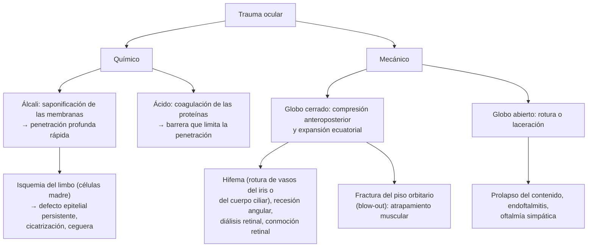

---
tags:
  - Oftalmología
  - Urgencia
  - GES
---

# Trauma ocular: causticaciones, contusión, hifema, heridas penetrantes y perforantes, y heridas de párpados

**Subespecialidad**
Oftalmología · Urgencia · Salud ocupacional · Cirugía maxilofacial

**Guías principales**
MINSAL: Guía GES N.° 50, trauma ocular grave (recomendaciones de 2017) · Clasificación estandarizada del trauma ocular, BETT (*Ophthalmology* 1996) · Clasificación de las quemaduras de la superficie ocular de Dua (*Br J Ophthalmol* 2001)

**Otras fuentes**
Puntaje de trauma ocular, OTS (*Ophthalmol Clin North Am* 2002) · Actualización del manejo del cuerpo extraño intraocular (*Asia Pac J Ophthalmol* 2025) · Superintendencia de Salud: garantías GES de trauma ocular grave · Ver [heridas de cara y trauma maxilofacial](../../cirugia/cabeza-cuello-tiroides-y-mama/heridas-de-cara-y-trauma-maxilofacial.md), [TEC](../../neurologia/tec-e-hipertension-endocraneana.md), [accidentes del trabajo](../../traumatologia/accidentes-del-trabajo-y-enfermedades-profesionales.md), [tétanos](../../infectologia/tetanos.md) y [ojo rojo grave](ojo-rojo-queratitis-uveitis-y-glaucoma-agudo.md)

**GES**
Sí: **N.° 50, trauma ocular grave** (diagnóstico en 12 horas y tratamiento por el especialista en 60 horas).

**EUNACOM**
6.02.2.001 Causticaciones oculares (sospecha, inicial, derivar) · 6.02.2.002 Contusión ocular (específico, inicial, derivar) · 6.02.1.014 Hifema (específico, inicial, derivar) · 6.02.2.007 Herida penetrante o perforante ocular (sospecha, inicial, derivar) · 6.02.2.008 Heridas de párpados (específico, inicial, derivar)

**Revisado**
Octubre 2026

!!! abstract "Resumen en 60 segundos"
    - **Causticación (quemadura química)**: la **urgencia oftalmológica más importante**. **Irrigar de inmediato** con suero fisiológico, Ringer lactato o agua (**3–4 litros** o hasta normalizar el **pH**, 7,0–7,5) **antes** de cualquier otra cosa, con anestesia tópica y eversión de los párpados. Los **álcalis** (cal, cemento, soda cáustica, amoníaco) son **más graves** que los ácidos.
    - **Herida penetrante o perforante** (globo abierto): baja de visión, **pupila irregular** o "en gota", cámara anterior plana o muy profunda, **hifema**, prolapso de tejido uveal, **Seidel positivo**. **No presionar** el ojo, **protector rígido**, ayuno, **antiemético**, analgesia, **antibiótico sistémico** (moxifloxacino), **profilaxis antitetánica** y **cirugía** urgente.
    - **Cuerpo extraño intraocular**: pensar siempre en el trauma con **martillo sobre metal**; **TC de órbitas** (la **RM está contraindicada** si es metálico).
    - **Contusión ocular**: hemorragia subconjuntival, **hifema**, iritis traumática, recesión angular (glaucoma tardío), conmoción retinal, desprendimiento de retina, **fractura de piso orbitario** (diplopía en la mirada hacia arriba, hipoestesia infraorbitaria, enoftalmo).
    - **Hifema**: sangre en la cámara anterior. **Reposo** con la cabecera a **30–45°**, protector, cicloplégico, corticoide tópico, **evitar AINE y aspirina**, controlar la **PIO**. Riesgo de **resangrado** (días 2–5) y de **tinción corneal**; cuidado en la **anemia de células falciformes**.
    - **Heridas de párpados**: derivar si comprometen el **borde libre**, el **canalículo** (tercio medial), el **elevador** (ptosis) o hay **grasa orbitaria** expuesta; **descartar siempre una lesión del globo**.
    - **GES N.° 50**: trauma ocular grave con diagnóstico en **12 horas** y tratamiento por el especialista en **60 horas**.

## Definición

- **Trauma ocular**: lesión del globo ocular o de sus anexos (párpados, vía lagrimal, órbita) por agentes **mecánicos**, **químicos**, **térmicos** o **por radiación**.
- **Clasificación BETT** (Birmingham Eye Trauma Terminology):
    - **Globo cerrado**: la pared ocular (córnea y esclera) **no** tiene una herida de espesor completo. Incluye la **contusión** y la **laceración lamelar** (de espesor parcial).
    - **Globo abierto**: herida de **espesor completo** de la pared ocular.
        - **Rotura**: por un objeto **romo** que aumenta la presión intraocular y rompe el ojo desde adentro hacia afuera (en el punto más débil, a menudo opuesto al impacto o en el limbo).
        - **Laceración**: por un objeto **cortante**: **penetrante** (una sola herida de entrada), **perforante** (entrada **y salida**) o con **cuerpo extraño intraocular**.
- **Causticación ocular**: quemadura química de la superficie ocular por **álcalis** o **ácidos**.
- **Hifema**: presencia de **sangre** en la **cámara anterior**.

## Epidemiología

- **Mundial**:
    - El trauma ocular es la principal causa de **ceguera monocular** no congénita y afecta sobre todo a los **hombres jóvenes** (hasta ~ 80 % de los casos).
    - Ocurre en el **trabajo** (construcción, industria, agricultura, minería), en el **hogar** (productos de aseo, herramientas), en los **deportes** (pelotas pequeñas, raquetas), por **agresiones**, **accidentes de tránsito** y **fuegos artificiales**.
    - Las **quemaduras químicas** representan ~ 10–20 % de los traumas oculares; las por **álcalis** son las más frecuentes y graves.
- **Chile**: no hay datos nacionales publicados de incidencia; el trauma ocular grave tiene garantía GES y los accidentes laborales se atienden por la Ley 16.744.

!!! chile "Datos nacionales"
    - **GES N.° 50, trauma ocular grave** (Superintendencia de Salud): personas de cualquier edad con un golpe o la penetración de un objeto que provoque un trauma ocular grave. **Diagnóstico** dentro de **12 horas** desde la sospecha; **tratamiento por el especialista** dentro de **60 horas** desde la confirmación.
    - **Guía GES de trauma ocular grave (MINSAL)**:
        - En las heridas penetrantes con compromiso del segmento posterior y en el **cuerpo extraño intraocular**, sugiere **antibióticos sistémicos**: **moxifloxacino 400 mg/día VO por 5 días**, además de los intravítreos.
        - En el cuerpo extraño intraocular de alto riesgo, sugiere **vancomicina más ceftazidima intravítreas** en la cirugía.
        - En las **causticaciones graves**, sugiere **Diphoterine** (solución anfótera) sobre la solución fisiológica; ambas hasta **neutralizar el pH** (habitualmente 500–1.000 mL de Diphoterine o **3.000–4.000 mL** de solución fisiológica). Recomienda que las empresas que trabajan con álcalis provean Diphoterine.
        - En las **fracturas de órbita** que comunican con los senos paranasales, sugiere **profilaxis antibiótica**.
        - En el cuerpo extraño intraocular, sugiere derivar al oftalmólogo **en las primeras 24 horas**.
    - El trauma ocular en el trabajo es un **accidente del trabajo**: atención por la mutualidad o el ISL; prevención con **lentes de seguridad**.

## Etiología y factores de riesgo

| Tipo | Agentes y mecanismos |
|---|---|
| **Álcalis** (más graves) | **Cal** viva y apagada, **cemento** y yeso, **soda cáustica** (hidróxido de sodio: destapadores de cañerías), **amoníaco** (productos de limpieza, fertilizantes), hidróxido de potasio, **airbags** |
| **Ácidos** | **Ácido sulfúrico** (baterías de auto), ácido clorhídrico (limpiadores), ácido fluorhídrico (vidrios, muy grave), ácido acético |
| **Contusión** | Puños, **pelotas** (squash, tenis, fútbol), **elásticos** (tensores, *bungee*), corchos de botellas, airbags, caídas, accidentes de tránsito |
| **Globo abierto** | Objetos **cortantes** (cuchillos, vidrios, alambres), **martillar metal sobre metal** (esquirlas a alta velocidad), **herramientas eléctricas** (esmeril), armas de fuego, perdigones, **fuegos artificiales**, mordeduras de perro |
| **Párpados** | Mordeduras de animales, agresiones, accidentes de tránsito, caídas, ganchos |
| **Factores de riesgo** | **Hombres jóvenes**, trabajo **sin protección ocular**, consumo de **alcohol**, deportes de riesgo, violencia, niños (juegos, fuegos artificiales), adultos mayores (caídas), **ojo operado** previamente (catarata, trasplante de córnea) |

## Fisiopatología

*Figura 1. Mecanismos del trauma ocular químico y mecánico. Esquema propio basado en la clasificación BETT (1996), la clasificación de Dua (2001) y la guía GES de trauma ocular grave.*

- El **álcali** penetra la córnea y la cámara anterior en **segundos a minutos**; por eso la **irrigación inmediata** es el factor pronóstico más importante.
- La **isquemia limbar** (blanqueamiento de los vasos del limbo) indica la pérdida de las **células madre** del epitelio corneal: peor pronóstico.
- **Oftalmía simpática**: uveítis granulomatosa **bilateral** de origen autoinmune que puede aparecer semanas a años después de un trauma penetrante (afecta al ojo sano).

## Clasificación

| Clasificación de Dua (quemadura química) | Compromiso limbar | Conjuntiva | Pronóstico |
|---|---|---|---|
| **I** | 0 horas de reloj | 0 % | Muy bueno |
| **II** | ≤ 3 horas | ≤ 30 % | Bueno |
| **III** | > 3–6 horas | > 30–50 % | Bueno |
| **IV** | > 6–9 horas | > 50–75 % | Bueno a reservado |
| **V** | > 9–< 12 horas | > 75–< 100 % | Reservado a malo |
| **VI** | 12 horas (todo el limbo) | 100 % | Muy malo |

| Hifema (grado) | Altura de la sangre en la cámara anterior |
|---|---|
| **Microhifema** | Glóbulos rojos en suspensión, sin nivel |
| **I** | < 1/3 |
| **II** | 1/3–1/2 |
| **III** | > 1/2, no total |
| **IV** | Total ("en bola de ocho", negra: peor pronóstico) |

- **Puntaje de trauma ocular (OTS)**: estima el pronóstico visual a los 6 meses según la **agudeza visual inicial**, la **rotura**, la **endoftalmitis**, la **herida perforante**, el **desprendimiento de retina** y el **defecto pupilar aferente**.

## Clínica

- **Causticación**: **dolor** intenso, **blefaroespasmo**, lagrimeo, fotofobia, **baja de visión**; hiperemia o, en las graves, **blanqueamiento** de la conjuntiva y del limbo (isquemia), **opacidad corneal** (córnea "en porcelana"), defecto epitelial (fluoresceína). Una conjuntiva **blanca** tras un álcali es un **mal** signo, no un buen signo.
- **Abrasión corneal** y **cuerpo extraño superficial**: dolor, sensación de cuerpo extraño, lagrimeo, fotofobia; defecto que tiñe con fluoresceína; **evertir el párpado superior** (cuerpo extraño subtarsal: abrasiones lineales verticales). El **anillo de óxido** de un cuerpo extraño metálico debe retirarse.
- **Contusión ocular** (globo cerrado):
    - **Hemorragia subconjuntival**: benigna si es aislada; extensa (360°) y con quemosis hemorrágica, sospechar una **rotura escleral oculta**.
    - **Hifema**: sangre en la cámara anterior (nivel en la parte inferior); visión borrosa, dolor, **aumento de la PIO**.
    - **Iritis traumática**: dolor, fotofobia y miosis 1–3 días después.
    - **Midriasis traumática** (rotura del esfínter del iris), iridodiálisis.
    - **Subluxación del cristalino**, catarata traumática.
    - **Recesión angular**: riesgo de **glaucoma** años después.
    - **Conmoción retinal** (edema de Berlin), **diálisis** o desgarro retinal, **desprendimiento de retina**, **hemorragia vítrea**, rotura coroidea, agujero macular.
    - **Neuropatía óptica traumática**: baja visual con **defecto pupilar aferente** sin lesión ocular visible.
    - **Fractura del piso orbitario** (*blow-out*): **diplopía** (sobre todo en la mirada **hacia arriba**, por atrapamiento del recto inferior), **enoftalmo**, **hipoestesia infraorbitaria** (nervio infraorbitario: mejilla, labio superior), enfisema palpebral al sonarse la nariz. En los **niños**, la fractura "en puerta trampa" con atrapamiento muscular puede producir **reflejo oculocardíaco** (bradicardia, náuseas, síncope) y ojo blanco: **cirugía urgente**.
- **Globo abierto** (penetrante o perforante):
    - Antecedente de trauma con objeto cortante, a alta velocidad o martilleo.
    - **Baja de visión** importante; **pupila irregular** ("en gota" o en lágrima, apuntando a la herida); **cámara anterior** plana o anormalmente profunda; **hifema**; **prolapso** de tejido uveal (material oscuro en la herida); **hipotonía**; hemorragia subconjuntival extensa; **signo de Seidel** positivo (la fluoresceína se diluye por la salida del humor acuoso).
    - Las heridas pequeñas (esquirlas metálicas) pueden ser **casi asintomáticas**: alto índice de sospecha.
- **Heridas de párpados**: laceraciones de espesor parcial o total. **Complejas** si comprometen el **borde libre**, el **canto interno** (canalículos lagrimales: epífora posterior), el **músculo elevador** (ptosis), el **septum** (grasa orbitaria expuesta: herida profunda que puede llegar a la órbita) o hay pérdida de tejido.

!!! alarma "Signos de alarma (derivación urgente a oftalmología)"
    - **Quemadura química**: irrigar **en el lugar** y derivar irrigando.
    - **Sospecha de globo abierto**: pupila irregular, cámara anterior plana, prolapso uveal, Seidel positivo, hemorragia subconjuntival de 360° con quemosis, baja visual grave.
    - **Mecanismo de alta velocidad** (martillo, esmeril): **cuerpo extraño intraocular** hasta que se demuestre lo contrario.
    - **Hifema**, sobre todo si ocupa > 1/2, la PIO está alta, hay **anemia de células falciformes** o **anticoagulación**.
    - **Defecto pupilar aferente**, baja visual grave.
    - **Diplopía**, **enoftalmo** o restricción de la mirada (fractura orbitaria); en un **niño**, con bradicardia y vómitos (atrapamiento muscular).
    - **Proptosis** tensa con dolor, baja visual y PIO alta tras un trauma: **hematoma retrobulbar** (síndrome compartimental orbitario) → **cantotomía lateral** urgente.
    - Herida palpebral con compromiso del **borde libre**, el **canalículo**, **grasa** expuesta o **ptosis**.

## Diagnóstico

!!! guia "Puntos clave (Guía GES de trauma ocular grave; BETT 1996)"
    - **Causticación**: **no** retrasar la irrigación por el examen. Primero irrigar, **luego** medir el **pH** (cinta reactiva en el fondo de saco a los 5–10 minutos de terminar) y examinar.
    - **Historia**: mecanismo (objeto, velocidad, material: metal, vegetal, vidrio), hora, protección ocular, uso de lentes de contacto, cirugías oculares previas, estado de la **vacuna antitetánica**.
    - **Examen**: **agudeza visual** de ambos ojos (es el principal factor pronóstico y tiene valor médico-legal), **pupilas** (forma y defecto aferente), motilidad ocular, **fluoresceína** (abrasión, **signo de Seidel**), cámara anterior (hifema, profundidad) y fondo de ojo si es posible.
    - Si se sospecha un **globo abierto**: **no** medir la PIO, **no** presionar el ojo, **no** evertir los párpados con fuerza, **no** retirar los objetos enclavados. Colocar un **protector rígido** (no un parche compresivo).
    - **Imágenes**: **TC de órbitas** sin contraste con cortes finos ante la sospecha de **cuerpo extraño intraocular**, **globo abierto** oculto o **fractura** orbitaria. **No hacer RM** si se sospecha un cuerpo extraño **metálico**. La **ecografía** ocular, solo con mucha precaución (sin presión) por el especialista.

## Laboratorio

- No se requieren exámenes para el diagnóstico.
- **pH** de la lágrima con cinta reactiva en las **quemaduras químicas**: irrigar hasta un **pH de 7,0–7,5** y volver a medir a los 30 minutos (los álcalis depositados siguen liberándose).
- **Hifema**: **electroforesis de hemoglobina** o test de falciformes en las personas de riesgo; **coagulación** y hemograma si hay anticoagulantes o sangrado desproporcionado.
- **Preoperatorios** en el globo abierto (ayuno, hemograma, coagulación según el caso).

## Imágenes

- **TC de órbitas** con cortes finos (1 mm): **cuerpo extraño intraocular** (metal, vidrio), **fracturas** orbitarias (piso y pared medial), **hematoma retrobulbar**, globo abierto oculto.
- **Radiografía de órbitas**: solo si no hay TC disponible (cuerpos extraños metálicos).
- **Ecografía ocular modo B**: desprendimiento de retina, hemorragia vítrea, cuerpo extraño, en los traumas cerrados con medios opacos (en el globo abierto, solo después de la reparación).
- **RM**: **contraindicada** si hay sospecha de un cuerpo extraño **metálico**; útil para los cuerpos extraños **orgánicos** (madera).

## Diagnóstico diferencial

| Cuadro | Claves |
|---|---|
| **Abrasión corneal** vs **globo abierto** | En la abrasión: pupila redonda, cámara anterior normal, Seidel negativo |
| **Hemorragia subconjuntival simple** vs **rotura escleral oculta** | Esta última: hemorragia de 360° con quemosis, baja visual, PIO baja, cámara anterior profunda |
| **Hifema traumático** vs **espontáneo** | El espontáneo sugiere neovascularización del iris (diabetes), tumores (xantogranuloma juvenil, retinoblastoma), coagulopatías, anticoagulantes o lente intraocular |
| **Fractura orbitaria** vs **parálisis de nervios oculomotores** | La fractura tiene restricción mecánica (prueba de ducción forzada positiva), enoftalmo e hipoestesia infraorbitaria |
| **Causticación** vs **queratitis actínica** | La actínica tiene antecedente de exposición UV y latencia de horas; ambas tiñen con fluoresceína |
| **Trauma ocular en un niño** | Considerar el **maltrato infantil** (hemorragias retinales en el **niño zamarreado**) |

## Tratamiento

!!! dosis "Causticación ocular: irrigación inmediata"
    1. **Irrigar de inmediato** (en el lugar del accidente con **agua de la llave** si no hay otra cosa; en la urgencia con **suero fisiológico**, **Ringer lactato** o **Diphoterine**), con **anestesia tópica** (proparacaína) para vencer el blefaroespasmo, un **blefaróstato** o separando los párpados con los dedos.
    2. **Volumen**: al menos **1–2 litros** en las leves y **3–4 litros** o más en las graves (o 500–1.000 mL de Diphoterine), por **30 minutos** o más, hasta que el **pH** sea **7,0–7,5**.
    3. **Evertir** los párpados (doble eversión del superior) y **barrer los fondos de saco** con una tórula húmeda para retirar partículas (cal, cemento).
    4. **Medir el pH** a los 5–10 minutos y otra vez a los 30 minutos; reiniciar la irrigación si vuelve a subir.
    5. **Derivar** a oftalmología (urgente en los grados II o más).
    - **Tratamiento posterior** (oftalmólogo): **cicloplégico**, **antibiótico tópico** (ungüento), **corticoide tópico** en la primera semana (controla la inflamación), **lubricantes sin conservantes**, **ascorbato** y **doxiciclina** oral (inhiben las colagenasas), analgesia, control de la **PIO**; membrana amniótica y trasplante de limbo en las graves.
    - **No** intentar "neutralizar" con ácidos o bases. **No** ocluir antes de irrigar.

!!! dosis "Globo abierto y cuerpo extraño intraocular (Guía GES de trauma ocular grave)"
    - **Protector rígido** (cubierta metálica o un vaso plástico) **sin presión**; **no** usar parches compresivos ni pomadas.
    - **No** retirar los objetos enclavados.
    - **Reposo** con la cabecera elevada, **ayuno** (para la cirugía).
    - **Antieméticos** (ondansetrón) y **analgesia** (el vómito y la maniobra de Valsalva aumentan la presión y favorecen la extrusión del contenido ocular).
    - **Antibiótico sistémico**: **moxifloxacino 400 mg/día VO por 5 días** (Guía GES: heridas con compromiso del segmento posterior y cuerpo extraño intraocular; buena penetración intravítrea). Alternativa IV: vancomicina más ceftazidima.
    - **Profilaxis antitetánica** según el estado de vacunación.
    - **TC de órbitas**.
    - **Cirugía** de reparación urgente (idealmente en las primeras **24 horas**: disminuye el riesgo de **endoftalmitis**). En el cuerpo extraño intraocular de alto riesgo, **vancomicina más ceftazidima intravítreas** intraoperatorias.

!!! dosis "Hifema"
    - **Reposo relativo** con la **cabecera elevada a 30–45°** (la sangre decanta y no tiñe la córnea ni tapa el eje visual).
    - **Protector** ocular rígido.
    - **Cicloplégico** (atropina 1 %) y **corticoide tópico** (prednisolona 1 %).
    - **Evitar AINE y aspirina** (aumentan el resangrado); analgesia con **paracetamol**.
    - **Control de la PIO** (diario los primeros días): si está alta, hipotensores tópicos (timolol, brimonidina) y acetazolamida; **evitar la acetazolamida en la anemia de células falciformes** (empeora la falciformación).
    - **Control** diario por oftalmología los primeros **5 días** (riesgo de **resangrado** entre los días 2 y 5).
    - **Lavado quirúrgico** de la cámara anterior si la PIO no se controla, hay **tinción corneal** o el hifema es total y no se reabsorbe.
    - **Gonioscopía** y fondo de ojo diferidos (recesión angular, lesiones retinales).

- **Abrasión corneal**: **ungüento antibiótico** (cloranfenicol o eritromicina) 3–4 veces al día por 3–5 días (en los usuarios de **lentes de contacto**, una **quinolona** y **no ocluir**), **cicloplégico** si hay mucho dolor, **analgesia oral**. **No** recetar anestésicos tópicos. Control a las 24–48 horas.
- **Cuerpo extraño corneal superficial**: retiro con una aguja o un hisopo bajo la lámpara de hendidura (anillo de óxido con fresa), luego manejo como una abrasión.
- **Fractura del piso orbitario**: **no sonarse la nariz**, frío local, **antibiótico profiláctico** si comunica con el seno maxilar (Guía GES), descongestionante nasal, corticoide oral en casos seleccionados; **cirugía** si hay **atrapamiento** muscular con diplopía persistente, **enoftalmo** > 2 mm o fractura grande (> 50 % del piso), habitualmente en 1–2 semanas; **urgente** en el niño con atrapamiento y reflejo oculocardíaco.
- **Hematoma retrobulbar** con compromiso visual: **cantotomía lateral y cantólisis** inmediatas.
- **Heridas de párpados**:
    - **Simples** (horizontales, superficiales, sin compromiso del borde): aseo y sutura con material fino (6-0) en la urgencia; profilaxis antitetánica; antibiótico si es una mordedura.
    - **Complejas** (borde libre, canalículo, elevador, grasa expuesta, pérdida de tejido): **derivar** a oftalmología (oculoplástica) para reparación por planos (el **canalículo** se repara con intubación en las primeras **24–48 horas**). **Descartar siempre una lesión del globo** antes de suturar.
- **Prevención**: **lentes de seguridad** en el trabajo y en los deportes de riesgo, **control de los fuegos artificiales**, almacenamiento seguro de los productos químicos, **cinturón de seguridad**.

## Complicaciones

- **Causticación**: **insuficiencia limbar** con vascularización y opacificación corneal, **simbléfaron** (adherencia entre la conjuntiva palpebral y la bulbar), **ojo seco** grave, glaucoma, catarata, **perforación corneal**, ceguera.
- **Hifema**: **resangrado**, **hipertensión ocular** y glaucoma, **tinción hemática de la córnea**, sinequias, atrofia óptica (más en la anemia de células falciformes).
- **Contusión**: **glaucoma por recesión angular** (años después), catarata, desprendimiento de retina, agujero macular.
- **Globo abierto**: **endoftalmitis** (sobre todo con cuerpos extraños y contaminación con tierra o vegetales: *Bacillus*), **desprendimiento de retina**, vitreorretinopatía proliferativa, **ptisis bulbi** (ojo atrófico), **oftalmía simpática**, **siderosis** (cuerpo extraño de hierro retenido), calcosis (cobre), pérdida del ojo.
- **Fractura orbitaria**: diplopía y enoftalmo persistentes, hipoestesia infraorbitaria.
- **Heridas de párpados**: **muesca** del borde, **ectropión** o entropión cicatricial, **ptosis**, **epífora** por lesión canalicular, exposición corneal.

## Pronóstico y seguimiento

- **Causticación**: depende de la **rapidez de la irrigación**, del agente (álcali peor) y del **grado de isquemia limbar** (Dua).
- **Hifema**: la mayoría se reabsorbe en **5–7 días** con buena visión; peor en los totales y con resangrado.
- **Globo abierto**: el pronóstico se estima con el **OTS**; la **agudeza visual inicial** es el principal predictor.
- **Seguimiento**: controles frecuentes hasta la estabilización y luego **gonioscopía** y control de la **PIO** periódico (glaucoma por recesión angular), fondo de ojo con dilatación (desgarros retinales), y vigilancia del **ojo contralateral** (oftalmía simpática) tras un trauma penetrante.

## Perlas para el internado

!!! perla "Para recordar"
    - **Químico en el ojo: irrigar primero, preguntar después**. 3–4 litros o hasta un pH de 7,0–7,5. **Álcali** peor que ácido. Ojo **blanco** tras un álcali = **isquemia** = grave.
    - Martillar **metal sobre metal** = **cuerpo extraño intraocular** → **TC** (nunca RM).
    - **Globo abierto**: pupila **en gota**, cámara plana, prolapso uveal, **Seidel +**. **Protector rígido**, no presionar, ayuno, antiemético, **moxifloxacino**, **antitetánica**, cirugía.
    - **Hifema**: cabecera a **30–45°**, protector, cicloplégico, corticoide tópico, **sin AINE ni aspirina**, control de la PIO; resangrado entre los días **2 y 5**.
    - **Diplopía al mirar hacia arriba + hipoestesia de la mejilla** = **fractura del piso orbitario**. No sonarse la nariz.
    - **Niño** con fractura orbitaria, **ojo blanco**, vómitos y **bradicardia**: atrapamiento muscular → cirugía urgente.
    - **Proptosis tensa + baja visual tras un trauma** = **hematoma retrobulbar** → **cantotomía lateral**.
    - Herida palpebral en el **tercio medial** = posible lesión del **canalículo** → oftalmólogo en 24–48 horas.
    - **Nunca** recetar anestésico tópico.

## Preguntas de repaso

??? repaso "1. Obrero de la construcción de 30 años al que le saltó cal en el ojo derecho hace 10 minutos. Llega con dolor intenso y blefaroespasmo. ¿Qué hace primero?"
    **Irrigación inmediata y abundante** del ojo con **suero fisiológico** o Ringer lactato (o Diphoterine si está disponible), con **anestesia tópica** y separación de los párpados, **antes** de cualquier examen: al menos **3–4 litros** o hasta un **pH de 7,0–7,5**, evirtiendo los párpados y **barriendo los fondos de saco** para retirar las partículas de cal. Luego medir el pH, evaluar la isquemia limbar y derivar a oftalmología. Es un accidente del trabajo (Ley 16.744) y un trauma ocular grave (GES).

??? repaso "2. Hombre de 35 años que martillaba un cincel de acero sintió que algo le golpeó el ojo izquierdo. Tiene leve molestia y visión 0,8. Hay una pequeña herida corneal con Seidel positivo y la pupila está ligeramente irregular. ¿Qué sospecha y qué hace?"
    **Globo abierto** con probable **cuerpo extraño intraocular metálico** (mecanismo de alta velocidad, Seidel positivo, pupila irregular), aunque los síntomas sean leves. Manejo: **protector rígido** sin presión, no presionar el ojo, **ayuno**, antieméticos y analgesia, **moxifloxacino 400 mg/día VO**, **profilaxis antitetánica**, **TC de órbitas** (no RM) y **derivación urgente** a oftalmología para la cirugía y la extracción del cuerpo extraño (con antibióticos intravítreos). Es GES N.° 50.

??? repaso "3. Adolescente de 15 años que recibió un pelotazo en el ojo derecho. Ve borroso y tiene un nivel de sangre que ocupa 1/3 de la cámara anterior. ¿Diagnóstico y manejo?"
    **Hifema traumático grado I**. Manejo: **reposo** con la **cabecera elevada a 30–45°**, **protector ocular**, **cicloplégico** (atropina) y **corticoide tópico**, **paracetamol** para el dolor (**evitar AINE y aspirina**), **control de la PIO** y controles **diarios** por oftalmología por el riesgo de **resangrado** entre los días 2 y 5. Preguntar por anemia de células falciformes. Posteriormente, gonioscopía y fondo de ojo (recesión angular, lesiones retinales).

??? repaso "4. Hombre de 25 años que recibió un puñetazo en el ojo izquierdo. Tiene equimosis palpebral, diplopía al mirar hacia arriba, hipoestesia de la mejilla y del labio superior izquierdos y el ojo un poco hundido. ¿Diagnóstico y manejo?"
    **Fractura del piso orbitario** (*blow-out*) con probable atrapamiento del recto inferior y compromiso del nervio infraorbitario. Manejo: descartar una lesión del globo (agudeza visual, fondo de ojo), **TC de órbitas**, **no sonarse la nariz**, frío local, **antibiótico profiláctico** (comunica con el seno maxilar), descongestionante nasal y derivar a oftalmología o cirugía maxilofacial; **cirugía** si persiste la diplopía por atrapamiento, hay enoftalmo > 2 mm o la fractura es grande.

??? repaso "5. Niño de 6 años mordido por un perro en la cara, con una laceración de espesor total del párpado inferior derecho cerca del canto interno. ¿Qué estructuras pueden estar comprometidas y qué hace?"
    Puede estar comprometido el **canalículo lagrimal inferior** (tercio medial), el **borde libre** y, potencialmente, el **globo** ocular. Manejo: examinar el globo (agudeza visual, fluoresceína), aseo de la herida, **antibiótico** (amoxicilina con ácido clavulánico por la mordedura), **profilaxis antitetánica** y evaluación de la **profilaxis antirrábica**, y **derivación a oftalmología** para la reparación por planos con **intubación del canalículo** dentro de las 24–48 horas. No suturarla en la urgencia general.

??? repaso "6. Mujer de 70 años, anticoagulada, que se cayó y golpeó el ojo derecho. A la hora tiene proptosis tensa, dolor intenso, baja visual grave, defecto pupilar aferente y el ojo duro. ¿Qué ocurre y qué hace?"
    **Hematoma retrobulbar** con **síndrome compartimental orbitario** (riesgo de neuropatía óptica isquémica en ~ 90–120 minutos). Requiere una **cantotomía lateral con cantólisis inferior** **inmediata** (por el médico de urgencia o el oftalmólogo) para descomprimir la órbita, más hipotensores oculares, revisión de la anticoagulación y TC de órbitas sin retrasar el procedimiento.

## Referencias

1. Ministerio de Salud de Chile. Guía de Práctica Clínica GES N.° 50: Trauma ocular grave. Recomendaciones (2017). [https://diprece.minsal.cl/le-informamos/auge/acceso-guias-clinicas/guias-clinicas-desarrolladas-utilizando-manual-metodologico/trauma-ocular-grave/recomendaciones/](https://diprece.minsal.cl/le-informamos/auge/acceso-guias-clinicas/guias-clinicas-desarrolladas-utilizando-manual-metodologico/trauma-ocular-grave/recomendaciones/)
2. Superintendencia de Salud. Problema de salud N.° 50: Trauma ocular grave. [https://www.superdesalud.gob.cl/orientacion-en-salud/trauma-ocular-grave/](https://www.superdesalud.gob.cl/orientacion-en-salud/trauma-ocular-grave/)
3. Kuhn F, Morris R, Witherspoon CD, et al. A standardized classification of ocular trauma. *Ophthalmology.* 1996;103(2):240–243. doi:[10.1016/S0161-6420(96)30710-0](https://doi.org/10.1016/S0161-6420(96)30710-0)
4. Kuhn F, Maisiak R, Mann L, et al. The Ocular Trauma Score (OTS). *Ophthalmol Clin North Am.* 2002;15(2):163–165. doi:[10.1016/S0896-1549(02)00007-X](https://doi.org/10.1016/S0896-1549(02)00007-X)
5. Dua HS, King AJ, Joseph A. A new classification of ocular surface burns. *Br J Ophthalmol.* 2001;85(11):1379–1383. doi:[10.1136/bjo.85.11.1379](https://doi.org/10.1136/bjo.85.11.1379)
6. Au ACK, Wong DHT, Li KKW. Updates on the clinical management of intraocular foreign body (IOFB). *Asia Pac J Ophthalmol (Phila).* 2025;14(3):100208. doi:[10.1016/j.apjo.2025.100208](https://doi.org/10.1016/j.apjo.2025.100208)
