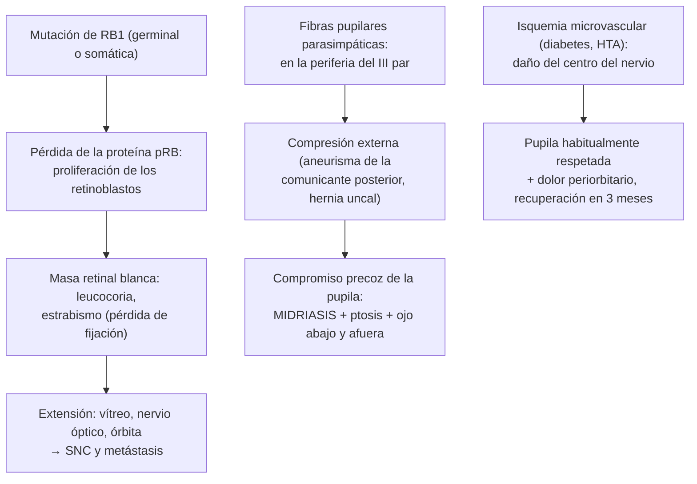

---
tags:
  - Oftalmología
  - Urgencia
---

# Tumores oculares y orbitarios, y parálisis del III par con midriasis

**Subespecialidad**
Oftalmología · Oncología ocular · Neuroftalmología · Oncología pediátrica · Neurocirugía

**Guías principales**
ESMO-EURACAN 2026: melanoma uveal (*ESMO Open*) · Recomendaciones sobre los gliomas de la vía óptica en la neurofibromatosis tipo 1 (*Ann Neurol* 2007; consenso inicial de 1997) · MINSAL: GES N.° 14, cáncer en personas menores de 15 años

**Otras fuentes**
Revisión del retinoblastoma (*Lancet* 2012) · Revisión sistemática del tamizaje del glioma de la vía óptica en la NF1 (*Can J Ophthalmol* 2026) · Incidencia y causas de la parálisis adquirida del III par (*JAMA Ophthalmol* 2017) · Ver [tumores del SNC](../../neurologia/tumores-del-snc.md), [hipófisis](../../endocrinologia/hipofisis-tumores-hipopituitarismo-e-hiperprolactinemia.md), [linfomas](../../hematologia/linfomas.md), [hipotiroidismo e hipertiroidismo](../../endocrinologia/hipotiroidismo-e-hipertiroidismo.md) (orbitopatía tiroidea), [tumores cutáneos](../dermatologia/tumores-cutaneos-melanoma-carcinomas-y-lesiones-benignas.md), [glaucoma y catarata](glaucoma-y-catarata.md) (leucocoria) y [vicios de refracción y estrabismo](vicios-de-refraccion-estrabismo-y-examen-visual.md)

**GES**
El **retinoblastoma** y los demás tumores sólidos infantiles están en el **GES N.° 14** (cáncer en personas menores de 15 años).

**EUNACOM**
6.02.1.029 Tumores endoculares: retinoblastoma y otros (sospecha, inicial, derivar) · 6.02.1.025 Tumores de conjuntiva (específico, inicial, derivar) · 6.02.1.027 Tumores de órbita (sospecha, inicial, derivar) · 6.02.1.026 Tumores de la vía óptica (sospecha, inicial, derivar) · 6.02.2.009 Parálisis del III par con midriasis (específico, inicial, derivar)

**Revisado**
Octubre 2026

!!! abstract "Resumen en 60 segundos"
    - **Retinoblastoma**: el tumor intraocular maligno **más frecuente de la infancia** (casi siempre antes de los **5 años**). Signo cardinal: **leucocoria** (pupila blanca, "ojo de gato" en las fotos con flash); luego **estrabismo**. Gen ***RB1***: ~ 40 % hereditario (bilateral, precoz, riesgo de segundos cánceres). **Derivación urgente**; GES N.° 14.
    - **Melanoma uveal**: el tumor intraocular primario **más frecuente del adulto** (coroides, cuerpo ciliar, iris). A menudo asintomático o con baja visual y fotopsias; metastatiza al **hígado**.
    - Los **tumores intraoculares más frecuentes del adulto** son en realidad las **metástasis coroideas** (mama y pulmón).
    - **Tumores de conjuntiva**: nevo (benigno, frecuente), **neoplasia escamosa de la superficie ocular** (limbo, gelatinosa o leucoplásica; UV, **VIH**), **melanoma** conjuntival y **linfoma** (masa "rosado salmón").
    - **Tumores de órbita**: **proptosis** unilateral progresiva, diplopía, baja visual. Niños: **rabdomiosarcoma** (proptosis rápida: urgencia), hemangioma capilar, quiste dermoide. Adultos: **malformación venosa** (cavernoma), **linfoma**, meningioma, metástasis. La **orbitopatía tiroidea** es la causa más frecuente de proptosis en el adulto.
    - **Glioma de la vía óptica**: niños con **neurofibromatosis tipo 1** (~ 15–20 %); baja visual, proptosis, pubertad precoz (quiasmático). Examen oftalmológico anual.
    - **Parálisis del III par con midriasis**: ptosis, ojo "**abajo y afuera**", diplopía y **pupila dilatada**: **aneurisma de la arteria comunicante posterior** hasta que se demuestre lo contrario → **angio-TC o angio-RM urgente**. La parálisis **microvascular** (diabetes, HTA) suele **respetar la pupila**.

## Definición

- **Tumores endoculares**: neoplasias del interior del globo ocular: **retinoblastoma** (retina, niños), **melanoma uveal** (iris, cuerpo ciliar o coroides, adultos), **metástasis** coroideas, linfoma vitreorretinal, hemangioma coroideo.
- **Tumores de la conjuntiva**: lesiones benignas (nevo, papiloma, pinguécula), premalignas o malignas (**neoplasia escamosa de la superficie ocular**, **melanosis adquirida primaria**, **melanoma**, **linfoma**).
- **Tumores de la órbita**: lesiones que ocupan el espacio orbitario y desplazan el globo (**proptosis**).
- **Tumores de la vía óptica**: lesiones que afectan el nervio óptico, el quiasma o las cintillas: **glioma de la vía óptica** (niños, NF1), **meningioma de la vaina del nervio óptico** (adultos, mujeres) y compresiones extrínsecas (**adenoma hipofisario**, craneofaringioma, meningioma).
- **Parálisis del III par** (nervio oculomotor): déficit de los músculos recto superior, recto inferior, recto medio y oblicuo inferior, del **elevador del párpado** y, si se comprometen las fibras **parasimpáticas** (superficiales), del **esfínter pupilar**.

## Epidemiología

- **Mundial**:
    - **Retinoblastoma**: ~ **1 por cada 15.000–20.000** nacidos vivos; ~ **8.000 casos nuevos** al año en el mundo; ~ 2/3 se diagnostican antes de los **2 años** y > 90 % antes de los **5 años**. La supervivencia es > **95 %** en los países de altos ingresos y mucho menor en los de bajos ingresos, por el diagnóstico tardío.
    - **Melanoma uveal**: ~ **5 por millón** al año; más frecuente en las personas de **piel y ojos claros**; edad media ~ **60 años**.
    - **Metástasis coroideas**: el tumor intraocular más frecuente en los adultos (mama y pulmón).
    - **Glioma de la vía óptica**: ~ **15–20 %** de los niños con **NF1**; la mayoría se presenta antes de los **6 años**.
    - **Parálisis adquirida del III par**: ~ **4 por 100.000** al año; en los adultos mayores predomina la causa **microvascular**; los **aneurismas** son una minoría, pero la causa más grave.
- **Chile**: no hay datos nacionales publicados de incidencia; el retinoblastoma se trata en los centros del Programa Infantil Nacional de Drogas Antineoplásicas (PINDA) dentro del GES.

!!! chile "Datos nacionales"
    - El **GES N.° 14 (cáncer en personas menores de 15 años)** incluye los tumores sólidos como el **retinoblastoma**: la sospecha (**leucocoria**, estrabismo de inicio reciente) se deriva de forma **urgente** a oftalmología infantil.
    - El **rojo pupilar** debe evaluarse en la **maternidad** y en los **controles del niño sano**.
    - La **neoplasia escamosa de la superficie ocular** debe sospecharse en las personas con **VIH** y con alta exposición UV (norte de Chile, trabajadores al aire libre).

## Etiología y factores de riesgo

| Tumor | Factores de riesgo |
|---|---|
| **Retinoblastoma** | Mutación del gen supresor tumoral ***RB1*** (13q14). **Hereditario** (~ 40 %: mutación germinal, autosómico dominante con alta penetrancia; **bilateral**, multifocal, diagnóstico más precoz) o **esporádico** (~ 60 %: dos mutaciones somáticas; unilateral). Antecedente familiar en ~ 10 % |
| **Melanoma uveal** | Piel clara, **iris claro**, **nevo coroideo**, **melanocitosis ocular** (nevo de Ota), síndrome de predisposición tumoral *BAP1* |
| **Neoplasia escamosa de la superficie ocular** | **Radiación UV**, **VIH**, VPH, tabaco, edad, inmunosupresión |
| **Melanoma conjuntival** | **Melanosis adquirida primaria** con atipia, nevo conjuntival, UV |
| **Linfoma ocular** (conjuntival, orbitario) | Linfomas B de la **zona marginal** (MALT; asociación con *Chlamydia psittaci* en algunas regiones), Sjögren, inmunosupresión |
| **Rabdomiosarcoma orbitario** | Niños (edad media ~ 7 años); el tumor orbitario maligno primario **más frecuente** de la infancia |
| **Glioma de la vía óptica** | **Neurofibromatosis tipo 1** (~ 1/3 de los gliomas de la vía óptica la tienen) |
| **Meningioma de la vaina del nervio óptico** | Mujeres de mediana edad, NF2 |
| **Parálisis del III par** | **Microvascular** (isquémica: **diabetes**, **HTA**, dislipidemia, edad), **aneurisma** de la arteria **comunicante posterior**, **trauma**, **tumores** (compresión), **herniación uncal** (HTE), apoplejía hipofisaria, arteritis de células gigantes, migraña oftalmopléjica, meningitis |

## Fisiopatología

*Figura 1. Fisiopatología del retinoblastoma y de la parálisis del III par: por qué la midriasis sugiere una compresión. Esquema propio basado en Dimaras (2012) y Fang (2017).*

- Las fibras **pupilomotoras** viajan en la **periferia** del III par: las lesiones **compresivas** (aneurisma, hernia uncal) las afectan precozmente (midriasis), mientras que la **isquemia microvascular** afecta el **centro** del nervio y suele respetar la pupila.

## Clasificación

| Tumor orbitario según la edad | Ejemplos |
|---|---|
| **Niños** | **Quiste dermoide** (el más frecuente; ángulo superotemporal), **hemangioma infantil** periocular, **malformación linfática** (linfangioma), **rabdomiosarcoma** (maligno, proptosis rápida), glioma del nervio óptico, neuroblastoma metastásico (equimosis periorbitaria "en ojos de mapache"), leucemia (cloroma) |
| **Adultos** | **Malformación venosa** (hemangioma cavernoso, el tumor benigno más frecuente), **linfoma**, **tumores de la glándula lagrimal** (adenoma pleomorfo, carcinoma adenoide quístico), meningioma, schwannoma, **metástasis** (mama, pulmón, próstata), inflamación orbitaria idiopática (pseudotumor) |

| Parálisis del III par | Rasgos |
|---|---|
| **Con compromiso pupilar** | **Midriasis** arreactiva: **compresiva** (aneurisma, tumor, hernia uncal) → **urgencia** |
| **Con pupila respetada** (completa en la motilidad) | Habitualmente **microvascular** (> 50 años con diabetes o HTA); dolor periorbitario; recuperación en 3–6 meses |
| **Parcial** (motilidad incompleta) con pupila respetada | Puede ser una compresión **precoz**: neuroimagen |
| **En un niño o un joven** | Congénita, trauma, migraña oftalmopléjica, tumores; siempre neuroimagen |

## Clínica

- **Retinoblastoma**:
    - **Leucocoria** (~ 60 %; a menudo descubierta por los padres en una **foto con flash**) y **estrabismo** (~ 20 %).
    - Ojo rojo y doloroso con **glaucoma** secundario, pseudohipopión, celulitis orbitaria aséptica, **proptosis** (enfermedad extraocular avanzada), baja visual, nistagmo (bilateral).
    - Antecedente familiar en los hereditarios; asociación con la deleción 13q (retraso del desarrollo, dismorfias); **retinoblastoma trilateral** (con un tumor pineal).
- **Melanoma uveal**: a menudo **asintomático** (hallazgo en el fondo de ojo); **baja visual**, **fotopsias**, miodesopsias o defecto del campo visual; masa coroidea pigmentada en forma de **cúpula** o de "**champiñón**" con desprendimiento de retina exudativo; los de **iris**: mancha que crece, pupila deformada, glaucoma. **Metástasis hepáticas** en ~ 50 % a lo largo de la evolución.
- **Metástasis coroideas**: baja visual, masa amarillenta plana, a menudo con antecedente de cáncer de **mama** o **pulmón**.
- **Tumores de conjuntiva**:
    - **Nevo conjuntival**: lesión pigmentada (o no) **bien delimitada**, con **quistes** intralesionales, estable; aparece en la infancia.
    - **Neoplasia escamosa de la superficie ocular**: lesión **gelatinosa**, **papilomatosa** o **leucoplásica** (blanca) en el **limbo** (zona interpalpebral), con **vasos nutricios**; adultos mayores o personas con VIH.
    - **Melanoma conjuntival**: lesión pigmentada que **crece**, con vasos nutricios, sobre una melanosis adquirida; puede metastatizar.
    - **Linfoma conjuntival**: masa **rosado-salmón** lisa en el fondo de saco.
- **Tumores de órbita**:
    - **Proptosis** unilateral (axial si es intraconal; desplazamiento del globo si es extraconal), **diplopía**, restricción de la motilidad, **baja visual** (compresión del nervio óptico), **dolor** (malignos, inflamación), masa palpable, ptosis o retracción palpebral, edema de papila o pliegues coroideos.
    - **Rabdomiosarcoma**: proptosis de **instalación rápida** (días a semanas) en un niño, a veces con eritema que simula una celulitis: **urgencia**.
- **Glioma de la vía óptica**: **baja visual** progresiva, **proptosis** axial indolora (glioma del nervio), **nistagmo**, estrabismo, **atrofia o edema de papila**; si compromete el quiasma o el hipotálamo: alteraciones del campo visual, **pubertad precoz**, alteraciones endocrinas e hidrocefalia. Muchos son **asintomáticos** (~ 60 %) y se detectan por el tamizaje en la NF1.
- **Meningioma de la vaina del nervio óptico**: mujer adulta con baja visual progresiva indolora, palidez o edema de papila y **vasos optociliares** de derivación.
- **Compresión del quiasma** (adenoma hipofisario): **hemianopsia bitemporal**, a menudo no percibida por el paciente; ver [hipófisis](../../endocrinologia/hipofisis-tumores-hipopituitarismo-e-hiperprolactinemia.md).
- **Parálisis del III par**:
    - **Ptosis** (a veces completa).
    - Ojo desviado **hacia abajo y afuera** (acción no contrarrestada del recto lateral, VI par, y del oblicuo superior, IV par).
    - **Diplopía** (si el párpado no la tapa).
    - Limitación de la aducción, la elevación y la depresión.
    - **Midriasis arreactiva** (si hay compromiso parasimpático).
    - **Aneurisma**: **cefalea** intensa o súbita ("la peor de su vida" si se rompe: **hemorragia subaracnoidea**).
    - **Microvascular**: dolor periorbitario en un diabético o hipertenso > 50 años, **pupila normal**.

!!! alarma "Signos de alarma"
    - **Leucocoria** o **rojo pupilar** ausente o asimétrico en un niño (también en las **fotos**): retinoblastoma → derivación **urgente** (no esperar).
    - **Estrabismo** de inicio reciente en un niño pequeño: examinar el **rojo pupilar** y el fondo de ojo.
    - **Proptosis de instalación rápida** en un niño: **rabdomiosarcoma** (o celulitis orbitaria) → urgencia.
    - **Proptosis** con **baja visual**, defecto pupilar aferente o edema de papila: compresión del nervio óptico.
    - **Parálisis del III par con midriasis** o con **cefalea**: **aneurisma** → **angio-TC o angio-RM** inmediata; si hay compromiso de conciencia, pensar en una **herniación uncal**.
    - **Parálisis del III par** en un **< 50 años**, sin factores de riesgo vascular, **parcial**, progresiva o con otros déficits neurológicos: **neuroimagen**.
    - Lesión conjuntival o intraocular **pigmentada que crece**.
    - Niño con **NF1** con baja visual, proptosis o **pubertad precoz**: glioma de la vía óptica.

## Diagnóstico

!!! guia "Puntos clave (ESMO-EURACAN 2026; recomendaciones de NF1 2007)"
    - **Leucocoria**: examen de **fondo de ojo con dilatación** por el oftalmólogo (bajo **anestesia** en los niños pequeños) y **ecografía ocular** (masa con **calcificaciones**) y **RM de órbitas y cerebro** (extensión al nervio óptico y tumor pineal). **No biopsiar** el retinoblastoma (riesgo de diseminación extraocular). **Estudio genético** de *RB1* y **tamizaje de los hermanos**.
    - **Melanoma uveal**: diagnóstico **clínico** (fondo de ojo, **ecografía** con baja reflectividad interna, angiografía, OCT); la biopsia se reserva a los casos dudosos o para el pronóstico molecular. **Estadificación** con imágenes **hepáticas** (RM o ecografía) y seguimiento hepático periódico.
    - **Tumores de conjuntiva**: **biomicroscopía**, fotografía seriada, **OCT del segmento anterior** y **biopsia** (escisional en las lesiones pequeñas).
    - **Tumores de órbita**: **TC** (hueso, calcificaciones) y **RM** con contraste (partes blandas); **biopsia** de las lesiones sospechosas de linfoma, rabdomiosarcoma o metástasis.
    - **Glioma de la vía óptica en la NF1**: **examen oftalmológico anual** (agudeza visual, campo visual, fondo de ojo) desde el diagnóstico hasta los **8 años** y luego cada 2 años hasta los 18; **RM** si hay alteraciones (no de rutina en los asintomáticos).
    - **Parálisis del III par**: **angio-TC o angio-RM urgente** si hay **compromiso pupilar**, es parcial, el paciente es **joven** o no tiene factores de riesgo vascular. En los > 50 años con diabetes o HTA y **pupila respetada**, se puede observar con control estrecho (neuroimagen si progresa, no mejora en 3 meses o aparecen otros signos), con **VHS y PCR** (arteritis).

## Laboratorio

| Situación | Exámenes |
|---|---|
| **Retinoblastoma** | **Estudio genético** de *RB1* (en sangre y en el tumor), punción lumbar y biopsia de médula ósea si hay enfermedad extraocular |
| **Melanoma uveal** | **Pruebas hepáticas** (seguimiento), perfil molecular del tumor (monosomía 3, *BAP1*) |
| **Neoplasia escamosa de la superficie ocular** | **VIH** |
| **Linfoma ocular** | Hemograma, LDH, estadificación sistémica |
| **Proptosis bilateral del adulto** | **TSH, T4 libre**, anticuerpos anti-receptor de TSH (orbitopatía tiroidea) |
| **Parálisis del III par** | **Glicemia** y **HbA1c**, presión arterial, perfil lipídico, **VHS y PCR** (> 50 años), anticuerpos anti-receptor de acetilcolina si hay **fatigabilidad** (la miastenia puede simularla, pero **nunca** compromete la pupila) |

## Imágenes

- **Ecografía ocular modo B**: retinoblastoma (masa con **calcificaciones**), melanoma uveal (masa en cúpula o champiñón, baja reflectividad interna), desprendimiento de retina asociado.
- **RM de órbitas y cerebro** con contraste: extensión del retinoblastoma (nervio óptico, pineal), **gliomas** y **meningiomas** de la vía óptica, tumores orbitarios. En el retinoblastoma se **evita la TC** (radiación en un niño con predisposición a segundos cánceres).
- **TC de órbitas**: lesiones óseas, calcificaciones, trauma.
- **Angio-TC o angio-RM** (y angiografía digital si es negativa y la sospecha es alta): **aneurisma** en la parálisis del III par.
- **RM o ecografía hepática**: estadificación y seguimiento del melanoma uveal.

## Diagnóstico diferencial

| Cuadro | Diferenciales |
|---|---|
| **Leucocoria** | **Retinoblastoma**, **catarata congénita**, **enfermedad de Coats** (exudación retinal, varones), **persistencia de la vasculatura fetal**, **toxocariasis** ocular, **retinopatía del prematuro** avanzada, coloboma coriorretinal, desprendimiento de retina |
| **Melanoma uveal** | **Nevo coroideo** (plano, < 2 mm, estable), metástasis, hemangioma coroideo, DMRE hemorrágica |
| **Lesión conjuntival** | **Pterigión** y **pinguécula** (benignos, interpalpebrales), nevo, papiloma, quiste, neoplasia escamosa, melanoma, linfoma |
| **Proptosis** | **Orbitopatía tiroidea** (la causa más frecuente en el adulto, a menudo bilateral, con retracción palpebral), **celulitis orbitaria** (fiebre, dolor), **inflamación orbitaria idiopática**, **fístula carotidocavernosa** (ojo rojo, soplo, proptosis pulsátil), tumores, miopía alta (pseudoproptosis) |
| **Parálisis del III par** | **Miastenia gravis** (ptosis y diplopía **fluctuantes**, **pupila normal**), **orbitopatía tiroidea** (restrictiva), oftalmoplejía internuclear (esclerosis múltiple), **síndrome de Horner** (ptosis **leve** con **miosis**, no midriasis), **pupila tónica de Adie**, **midriasis farmacológica** (no responde a la pilocarpina 1 %; antecedente de colirios, parches de escopolamina o ipratropio nebulizado) |

## Tratamiento

- **Retinoblastoma** (equipo de oncología ocular pediátrica; GES N.° 14): el objetivo es **salvar la vida**, luego el **ojo** y luego la **visión**.
    - Tumores pequeños: tratamientos focales (**láser**, **crioterapia**, termoterapia).
    - Tumores intraoculares avanzados: **quimioterapia** sistémica, **intraarterial** (oftálmica) o **intravítrea**, **braquiterapia**.
    - **Enucleación** en los ojos con enfermedad avanzada sin pronóstico visual o con riesgo de extensión.
    - Enfermedad extraocular o metastásica: quimioterapia intensiva y radioterapia.
    - **Seguimiento** de por vida: segundos cánceres (**osteosarcoma**, sarcomas de partes blandas, melanoma) en los hereditarios; evitar la radiación innecesaria; **consejo genético**.
- **Melanoma uveal** (ESMO-EURACAN 2026):
    - **Braquiterapia** con placa (tratamiento conservador de elección en la mayoría), **protonterapia**, resección local.
    - **Enucleación** en los tumores grandes.
    - **Metastásico** (hígado): **tebentafusp** (en los pacientes HLA-A*02:01 positivos), terapias dirigidas al hígado, inmunoterapia.
    - Seguimiento **hepático** periódico.
- **Metástasis coroideas**: tratamiento sistémico del cáncer primario y radioterapia ocular si amenazan la visión.
- **Tumores de conjuntiva**:
    - **Nevo**: observación con fotografías; extirpación si crece o por estética.
    - **Neoplasia escamosa de la superficie ocular**: **extirpación** con márgenes ("sin tocar") más **crioterapia**, o **quimioterapia tópica** (**5-fluorouracilo**, interferón α-2b, mitomicina C).
    - **Melanoma conjuntival**: extirpación amplia con crioterapia; ganglio centinela en casos seleccionados.
    - **Linfoma**: radioterapia en dosis bajas o tratamiento sistémico (rituximab), según la extensión.
- **Tumores de órbita**:
    - **Quiste dermoide**: extirpación completa.
    - **Malformación venosa** (cavernoma): observación o extirpación si compromete la visión.
    - **Rabdomiosarcoma**: **biopsia urgente** y **quimioterapia** con **radioterapia** (alta supervivencia en las formas orbitarias localizadas).
    - **Linfoma**: radioterapia o tratamiento sistémico.
    - **Inflamación orbitaria idiopática**: corticoides sistémicos (tras descartar un linfoma).
- **Glioma de la vía óptica**: **observación** en la mayoría (crecimiento lento, especialmente en la NF1); **quimioterapia** (carboplatino y vincristina) si hay **pérdida visual** progresiva o crecimiento; inhibidores de **MEK** (selumetinib) en los casos seleccionados; se evita la radioterapia en la NF1 (segundos tumores, vasculopatía).
- **Parálisis del III par**:
    - **Aneurisma**: **neurocirugía** o tratamiento **endovascular** (*coiling*) urgente; manejo de la hemorragia subaracnoidea si existe.
    - **Microvascular**: **control de los factores de riesgo** (glicemia, presión, lípidos), antiagregación según el riesgo cardiovascular, **oclusión** de un ojo o prismas para la diplopía; la mayoría **se recupera en 3–6 meses**. Si no mejora, reevaluar con neuroimagen.
    - **Compresión tumoral** o hernia uncal: tratamiento de la causa (neurocirugía, manejo de la HTE).
    - Secuelas permanentes: cirugía del estrabismo y de la ptosis después de 6–12 meses de estabilidad.

## Complicaciones

- **Retinoblastoma**: pérdida del ojo, **ceguera** bilateral, **metástasis** (SNC, hueso, médula ósea), **segundos cánceres** en los hereditarios, efectos tardíos de la quimioterapia y la radioterapia (deformidad orbitaria), impacto psicosocial.
- **Melanoma uveal**: **metástasis hepáticas** (principal causa de muerte), glaucoma neovascular, desprendimiento de retina, **retinopatía por radiación** tras la braquiterapia.
- **Tumores de conjuntiva**: invasión intraocular u orbitaria, recidiva, metástasis (melanoma).
- **Tumores de órbita**: **neuropatía óptica compresiva**, queratopatía por exposición (proptosis), diplopía permanente.
- **Glioma de la vía óptica**: pérdida visual, **disfunción hipotalámica** e hipofisaria (pubertad precoz, déficit de hormona de crecimiento), hidrocefalia.
- **Parálisis del III par**: **hemorragia subaracnoidea** por rotura del aneurisma (alta mortalidad), diplopía y ptosis permanentes, **regeneración aberrante** (tras trauma o compresión; nunca en la microvascular).

## Pronóstico y seguimiento

- **Retinoblastoma**: supervivencia > **95 %** en los países con diagnóstico precoz; la detección por **leucocoria** temprana es clave. Seguimiento oftalmológico frecuente (exámenes bajo anestesia) y de por vida por los segundos cánceres.
- **Melanoma uveal**: el control local es alto con la braquiterapia; el pronóstico depende del **tamaño** y del perfil molecular (monosomía 3); hasta la mitad desarrolla metástasis.
- **Neoplasia escamosa de la superficie ocular**: buen pronóstico con el tratamiento oportuno; recidivas frecuentes: seguimiento.
- **Glioma de la vía óptica en la NF1**: suele tener un curso indolente; algunos involucionan.
- **Parálisis microvascular del III par**: recuperación en **3–6 meses** en la gran mayoría.

## Perlas para el internado

!!! perla "Para recordar"
    - **Leucocoria** (también en una **foto con flash**) = **retinoblastoma** hasta que se demuestre lo contrario → **derivación urgente**. GES N.° 14.
    - **Estrabismo** de inicio reciente en un niño: revisar el **rojo pupilar**.
    - Retinoblastoma **bilateral** = **hereditario** (*RB1*): consejo genético, tamizaje de los hermanos y vigilancia de **osteosarcoma**.
    - **No biopsiar** un retinoblastoma; **RM** (no TC).
    - El tumor intraocular **primario** del adulto más frecuente es el **melanoma uveal** (metastatiza al **hígado**); el más frecuente en general son las **metástasis** (mama, pulmón).
    - Lesión **gelatinosa o blanca en el limbo** con vasos nutricios: neoplasia escamosa → pedir **VIH**.
    - **Proptosis rápida** en un niño: **rabdomiosarcoma** (o celulitis orbitaria). **Proptosis** en un adulto: primero, **orbitopatía tiroidea**.
    - **NF1**: examen oftalmológico **anual** hasta los 8 años (glioma de la vía óptica).
    - **III par + midriasis** = **aneurisma de la comunicante posterior** → angio-TC urgente. **III par con pupila normal** en un diabético > 50 años = **microvascular** (se recupera en 3 meses).
    - **Ptosis + miosis** = **Horner**, no III par. **Ptosis fluctuante** con pupila normal = **miastenia**.

## Preguntas de repaso

??? repaso "1. Madre de un niño de 18 meses que muestra una foto con flash en la que un ojo se ve rojo y el otro blanco ("ojo de gato"). En el examen, el rojo pupilar del ojo izquierdo está ausente y el niño desvía ese ojo hacia afuera. ¿Qué sospecha y qué hace?"
    **Retinoblastoma** (leucocoria y estrabismo). **Derivación urgente** a oftalmología infantil (GES N.° 14, cáncer en menores de 15 años): fondo de ojo bajo anestesia, **ecografía** ocular (masa con calcificaciones) y **RM** de órbitas y cerebro; **no biopsiar**. Estudio genético de *RB1*, evaluación del otro ojo y tamizaje de los hermanos. Diferenciales: catarata congénita, enfermedad de Coats, persistencia de la vasculatura fetal, toxocariasis.

??? repaso "2. Mujer de 62 años, de ojos azules, que en un control oftalmológico de rutina presenta una masa coroidea pigmentada elevada de 4 mm con forma de cúpula y líquido subretinal. ¿Qué sospecha y qué estudio de extensión requiere?"
    **Melanoma uveal (coroideo)**. Estudio: **ecografía** ocular (baja reflectividad interna), angiografía y OCT; **estadificación** con **imágenes hepáticas** (RM o ecografía) y pruebas hepáticas, porque metastatiza al **hígado**. Tratamiento en un centro de oncología ocular: **braquiterapia** con placa o protonterapia (enucleación en los grandes), con seguimiento hepático de por vida (ESMO-EURACAN 2026).

??? repaso "3. Hombre de 45 años con VIH, de Calama, con una lesión gelatinosa blanquecina en el limbo nasal del ojo derecho con vasos nutricios, que creció en 3 meses. ¿Qué sospecha y qué conducta?"
    **Neoplasia escamosa de la superficie ocular** (factores: **VIH** y **radiación UV**). Derivar a oftalmología para **biopsia** escisional con márgenes y **crioterapia**, o **quimioterapia tópica** (5-fluorouracilo, interferón o mitomicina C). Diferenciarla de un pterigión (no tiene esa morfología gelatinosa ni la leucoplasia) y controlar el VIH.

??? repaso "4. Niño de 7 años con proptosis del ojo izquierdo que apareció y progresó en 2 semanas, desplazando el ojo hacia abajo, sin fiebre. ¿Qué sospecha y qué hace?"
    **Rabdomiosarcoma orbitario** (proptosis de **instalación rápida** en un niño), el tumor orbitario maligno primario más frecuente de la infancia; diferencial con la celulitis orbitaria. **Urgencia**: **TC y RM** de órbitas y **biopsia** urgente; tratamiento con **quimioterapia y radioterapia** en un centro oncológico pediátrico (GES N.° 14). El pronóstico de las formas orbitarias localizadas es bueno.

??? repaso "5. Niña de 4 años con neurofibromatosis tipo 1 (manchas café con leche y nódulos de Lisch). ¿Qué seguimiento oftalmológico requiere y por qué?"
    **Examen oftalmológico anual** (agudeza visual, campo visual según la edad, fondo de ojo, evaluación del crecimiento y la pubertad) hasta los **8 años** y luego cada 2 años hasta los 18, por el riesgo de **glioma de la vía óptica** (~ 15–20 % de los niños con NF1, la mayoría antes de los 6 años). **RM** si hay baja visual, proptosis, alteraciones del fondo de ojo o **pubertad precoz**; no de rutina en los asintomáticos.

??? repaso "6. Mujer de 48 años con cefalea intensa de 2 días, ptosis completa del ojo derecho, ojo desviado hacia abajo y afuera, y pupila derecha de 7 mm que no reacciona a la luz. ¿Diagnóstico y conducta? ¿Cambiaría si la pupila fuera normal en un diabético de 70 años?"
    **Parálisis del III par con compromiso pupilar y cefalea**: **aneurisma de la arteria comunicante posterior** hasta que se demuestre lo contrario → **angio-TC o angio-RM urgente** y derivación a **neurocirugía** (tratamiento endovascular o quirúrgico) por el riesgo de **hemorragia subaracnoidea**. En un diabético de 70 años con una parálisis **completa** del III par y **pupila respetada**, lo más probable es una causa **microvascular**: control de los factores de riesgo, VHS y PCR (arteritis), oclusión para la diplopía y seguimiento estrecho; neuroimagen si progresa, no mejora en 3 meses o aparece compromiso pupilar.

## Referencias

1. Piperno-Neumann S, Angi M, Ascierto PA, et al. Uveal melanoma: ESMO-EURACAN Clinical Practice Guideline for diagnosis, treatment and follow-up. *ESMO Open.* 2026;11(4):106888. doi:[10.1016/j.esmoop.2026.106888](https://doi.org/10.1016/j.esmoop.2026.106888)
2. Dimaras H, Kimani K, Dimba EA, et al. Retinoblastoma. *Lancet.* 2012;379(9824):1436–1446. doi:[10.1016/S0140-6736(11)61137-9](https://doi.org/10.1016/S0140-6736(11)61137-9)
3. Listernick R, Ferner RE, Liu GT, et al. Optic pathway gliomas in neurofibromatosis-1: controversies and recommendations. *Ann Neurol.* 2007;61(3):189–198. doi:[10.1002/ana.21107](https://doi.org/10.1002/ana.21107)
4. Listernick R, Louis DN, Packer RJ, et al. Optic pathway gliomas in children with neurofibromatosis 1: consensus statement from the NF1 Optic Pathway Glioma Task Force. *Ann Neurol.* 1997;41(2):143–149. doi:[10.1002/ana.410410204](https://doi.org/10.1002/ana.410410204)
5. Alshehri A, Almutairi M, Alqahtani M, et al. Screening for neurofibromatosis type 1-related optic pathway gliomas: a systematic review. *Can J Ophthalmol.* 2026;61(5):1191–1199. doi:[10.1016/j.jcjo.2026.04.020](https://doi.org/10.1016/j.jcjo.2026.04.020)
6. Fang C, Leavitt JA, Hodge DO, et al. Incidence and etiologies of acquired third nerve palsy using a population-based method. *JAMA Ophthalmol.* 2017;135(1):23–28. doi:[10.1001/jamaophthalmol.2016.4456](https://doi.org/10.1001/jamaophthalmol.2016.4456)
7. Ministerio de Salud de Chile. Guía de Práctica Clínica GES N.° 14: Linfoma y tumores sólidos en personas menores de 15 años. [https://diprece.minsal.cl/guias-de-practica-clinicas/linfoma-y-tumores-solidos-pediatricos/](https://diprece.minsal.cl/guias-de-practica-clinicas/linfoma-y-tumores-solidos-pediatricos/)
