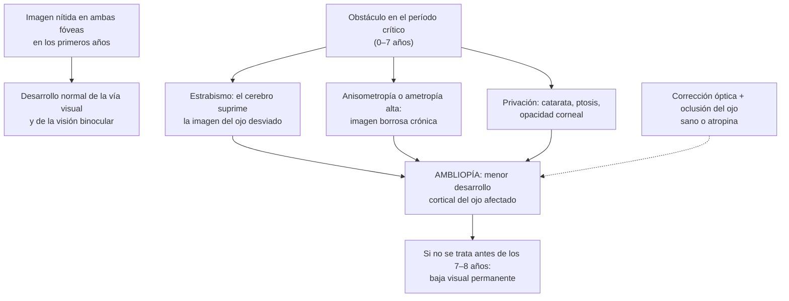

---
tags:
  - Oftalmología
  - GES
---

# Vicios de refracción, estrabismo, ambliopía y examen visual del niño y del adulto

**Subespecialidad**
Oftalmología · Oftalmología pediátrica · Atención primaria · Pediatría · Geriatría

**Guías principales**
AAO 2022: *Preferred Practice Patterns* de vicios de refracción, ambliopía, esotropía y exotropía, y evaluación ocular pediátrica (*Ophthalmology* 2023) · USPSTF 2017: tamizaje visual de los niños de 6 meses a 5 años (*JAMA*) · MINSAL: Guías GES N.° 29 (vicios de refracción en personas de 65 años y más) y N.° 30 (estrabismo en menores de 9 años)

**Otras fuentes**
Prevalencia global de miopía y proyección a 2050 (*Ophthalmology* 2016) · Estudio LAMP de atropina en dosis bajas (*Ophthalmology* 2019) · Superintendencia de Salud: garantías GES · Ver [glaucoma y catarata](glaucoma-y-catarata.md), [retina y baja de visión](retina-nervio-optico-y-baja-de-vision.md), [caídas](../../geriatria/caidas-hipotension-ortostatica-y-fractura-de-cadera.md) y [complicaciones crónicas de la diabetes](../../endocrinologia/complicaciones-cronicas-de-la-diabetes.md)

**GES**
Sí: **N.° 29, vicios de refracción en personas de 65 años y más** · **N.° 30, estrabismo en menores de 9 años**.

**EUNACOM**
6.02.1.001 Ametropía (sospecha, inicial, derivar) · 6.02.1.011 Estrabismo (sospecha, inicial, derivar) · 6.02.1.031 Vicios de refracción en personas de 65 años o más (específico, inicial, derivar) · 6.02.3.003 Examen visual en el adulto · 6.02.3.004 Examen visual preventivo en niños · 2.01.1.096 Estrabismo y 2.01.1.098 Vicios de refracción (pediatría)

**Revisado**
Octubre 2026

!!! abstract "Resumen en 60 segundos"
    - **Vicios de refracción (ametropías)**: la imagen no se enfoca en la retina. **Miopía** (ve mal de lejos), **hipermetropía** (ve mal de cerca y se fatiga), **astigmatismo** (visión borrosa a toda distancia) y **presbicia** (pérdida de la acomodación desde los ~ 40–45 años: necesita alejar el texto para leer). Son la **principal causa de discapacidad visual** en el mundo y se corrigen con **lentes**.
    - **Truco**: si la visión **mejora con el estenopeico**, el problema es **refractivo**.
    - **Miopía** en aumento mundial (~ 50 % de la población en 2050); **actividades al aire libre** (≥ 2 horas al día) la previenen; **atropina en dosis bajas** frena su progresión en los niños.
    - **Estrabismo**: desalineación de los ojos (**esotropía**: hacia adentro; **exotropía**: hacia afuera). Normal hasta los **4–6 meses** de forma intermitente; después siempre se estudia. **Descartar retinoblastoma y catarata** (rojo pupilar).
    - **Ambliopía** ("ojo flojo"): baja visual de un ojo sano por falta de estímulo en la infancia (estrabismo, anisometropía, catarata, ptosis). Se trata **antes de los 7–8 años**: **corrección óptica** y **oclusión** del ojo sano o **atropina**.
    - **Examen visual del niño**: **rojo pupilar** desde el nacimiento, **reflejo corneal** (Hirschberg) y **cover test**, y **agudeza visual** con optotipos desde los **3–4 años**.
    - **GES N.° 29**: lentes para la presbicia y otras ametropías en las personas **≥ 65 años**. **GES N.° 30**: estrabismo en **menores de 9 años**.

## Definición

- **Emetropía**: los rayos de luz paralelos se enfocan en la retina sin esfuerzo acomodativo.
- **Ametropía** (vicio de refracción): la imagen no se enfoca en la retina.
    - **Miopía**: el foco cae **por delante** de la retina (ojo largo o córnea muy curva). Ve mal **de lejos**. Se corrige con lentes **negativos** (divergentes). **Miopía alta**: ≥ 6 dioptrías.
    - **Hipermetropía**: el foco cae **por detrás** de la retina (ojo corto). En los jóvenes se compensa con la **acomodación** (fatiga, cefalea frontal, ojo rojo al leer); al avanzar la edad, ve mal de cerca y luego de lejos. Lentes **positivos** (convergentes).
    - **Astigmatismo**: la córnea o el cristalino tienen curvaturas distintas en diferentes meridianos; visión borrosa o distorsionada a toda distancia. Lentes **cilíndricos**.
    - **Anisometropía**: diferencia de refracción entre los dos ojos (≥ 1–1,5 dioptrías): factor de riesgo de ambliopía.
- **Presbicia**: pérdida **fisiológica** de la capacidad de **acomodación** por el endurecimiento del cristalino; aparece hacia los **40–45 años** y progresa hasta los ~ 60. Se corrige con lentes **positivos para cerca**.
- **Estrabismo**: desalineación de los ejes visuales. **Tropia**: manifiesta (constante o intermitente). **Foria**: latente (se controla con la fusión y aparece al tapar un ojo).
- **Ambliopía**: disminución de la agudeza visual **uni o bilateral** sin lesión orgánica que la explique, por una **experiencia visual anormal** durante el **período crítico** del desarrollo visual (primeros 7–8 años).

## Epidemiología

- **Mundial**:
    - Los **vicios de refracción no corregidos** son la **principal causa de discapacidad visual** en el mundo y la segunda de ceguera (después de la catarata).
    - **Miopía**: ~ **23 %** de la población mundial en 2000, con una proyección de ~ **50 %** (casi 5.000 millones de personas) en **2050**, y ~ **10 %** con miopía alta (Holden, 2016). Muy frecuente en el este de Asia.
    - **Presbicia**: afecta a prácticamente todas las personas > 50 años; > 1.000 millones de personas en el mundo.
    - **Estrabismo**: ~ **2–4 %** de los niños.
    - **Ambliopía**: ~ **1–4 %** de los niños; principal causa de baja visión **monocular** en los niños y adultos jóvenes.
- **Chile**: no hay datos nacionales publicados de prevalencia de vicios de refracción por grupos de edad; los vicios de refracción de los ≥ 65 años y el estrabismo infantil tienen garantías GES.

!!! chile "Datos nacionales (Superintendencia de Salud)"
    - **GES N.° 29, vicios de refracción en personas de 65 años y más** (presbicia, miopía, astigmatismo, hipermetropía): **diagnóstico** dentro de **180 días** desde la sospecha; **lentes** para la **presbicia** dentro de **30 días** desde la solicitud, y para la **miopía, el astigmatismo o la hipermetropía** dentro de **30 días** desde la confirmación diagnóstica.
    - **GES N.° 30, estrabismo en menores de 9 años**: **diagnóstico** dentro de **90 días** desde la sospecha; **tratamiento médico** dentro de **30 días** desde la confirmación; **cirugía** dentro de **90 días** desde la indicación; control dentro de 30 días desde el alta.
    - Las **UAPO** (Unidades de Atención Primaria Oftalmológica) resuelven los vicios de refracción en la APS.
    - El **programa de salud escolar** de la **JUNAEB** pesquisa los problemas visuales en los escolares y entrega lentes.
    - La guía GES de cataratas **recomienda el tamizaje visual en los menores de 5 años**.

## Etiología y factores de riesgo

| Cuadro | Causas y factores de riesgo |
|---|---|
| **Miopía** | **Genética** (padres miopes), **trabajo de cerca** prolongado (lectura, **pantallas**), **poco tiempo al aire libre** (la luz natural es protectora), urbanización, educación intensiva; secundaria: diabetes descompensada (hiperglicemia: miopización transitoria), catarata nuclear, fármacos (sulfonamidas, topiramato) |
| **Hipermetropía** | Ojo corto (frecuente y fisiológica en los niños pequeños; disminuye con el crecimiento) |
| **Presbicia** | **Edad** (endurecimiento del cristalino) |
| **Estrabismo** | **Esotropía infantil** (antes de los 6 meses), **esotropía acomodativa** (2–3 años, por **hipermetropía**), exotropía intermitente; **antecedente familiar**, **prematurez**, parálisis cerebral, síndrome de Down, hidrocefalia; **secundario a baja visión** de un ojo (**catarata**, **retinoblastoma**, cicatrices retinales); **parálisis de nervios craneales** (III, IV, VI: tumores, HTE, trauma, diabetes en los adultos); **orbitopatía tiroidea**, miastenia gravis |
| **Ambliopía** | **Estrabismo** (ambliopía estrábica), **anisometropía** (refractiva), **ametropía alta** bilateral, **privación** (**catarata congénita**, **ptosis** que tapa la pupila, opacidad corneal, hemorragia vítrea) |

## Fisiopatología

*Figura 1. Fisiopatología de la ambliopía y del estrabismo. Esquema propio basado en las guías de ambliopía y de esotropía y exotropía de la AAO (2022).*

- **Esotropía acomodativa**: el niño **hipermétrope** acomoda para ver nítido; la acomodación se acompaña de **convergencia** y los ojos se desvían hacia adentro. Se corrige con **lentes**.

## Clasificación

| Estrabismo | Rasgos |
|---|---|
| **Esotropía infantil** (congénita) | Antes de los **6 meses**, desviación **grande** y constante; requiere **cirugía** precoz |
| **Esotropía acomodativa** | **2–3 años**, **hipermetropía**; se corrige total o parcialmente con **lentes** |
| **Exotropía intermitente** | Desviación hacia afuera al mirar de lejos, con cansancio o fiebre, **cierra un ojo con el sol**; frecuente |
| **Pseudoestrabismo** (pseudoesotropía) | **Epicanto** y puente nasal ancho que simulan una esotropía; **reflejo corneal centrado** y cover test normal |
| **Estrabismo paralítico** | Parálisis del III, IV o VI par; **diplopía** en los niños mayores y los adultos; desviación que varía según la dirección de la mirada |
| **Estrabismo sensorial** | Secundario a **baja visión** de un ojo (catarata, **retinoblastoma**) |

## Clínica

- **Miopía**: visión borrosa **de lejos** (pizarra, televisión, letreros); **entrecierra los ojos**; se acerca a la pantalla; buena visión de cerca.
- **Hipermetropía**: en los niños, a menudo asintomática; **astenopía** (fatiga visual, **cefalea frontal** al final del día, ojo rojo, lagrimeo al leer), dificultad para la lectura; puede asociarse a **esotropía acomodativa**.
- **Astigmatismo**: visión borrosa o distorsionada a toda distancia, astenopía, cefalea.
- **Presbicia**: dificultad para **leer de cerca** (aleja el celular o el diario: "le faltan brazos"), sobre todo con poca luz, desde los **40–45 años**.
- **Estrabismo**:
    - Los padres notan que un ojo "**se va**" o "**se cruza**", sobre todo con el cansancio o la fiebre.
    - **Tortícolis** (inclinación compensatoria de la cabeza) en las paresias (IV par).
    - **Diplopía** en los niños mayores y los adultos con estrabismo de inicio reciente (en los niños pequeños, el cerebro suprime la imagen y aparece **ambliopía**).
    - Es **normal** una desviación **intermitente** hasta los **4–6 meses**; una desviación **constante** a cualquier edad o **cualquier** desviación después de los 6 meses requiere derivación.
- **Ambliopía**: habitualmente **asintomática** (el niño no se queja porque ve bien con el ojo sano); se descubre en el **tamizaje** o porque el niño rechaza la oclusión de un ojo.

!!! alarma "Signos de alarma"
    - **Leucocoria** o **rojo pupilar** ausente o asimétrico: **retinoblastoma** o **catarata congénita** → derivación **urgente**.
    - **Estrabismo de aparición brusca** en un niño o un adulto, sobre todo con **diplopía**, **cefalea**, vómitos, ptosis o **midriasis**: **parálisis de nervios craneales** (tumor, hipertensión endocraneana, aneurisma) → **neuroimagen** urgente.
    - **Estrabismo constante** a cualquier edad, o cualquier estrabismo después de los **6 meses**.
    - **Nistagmo** o falta de fijación y seguimiento en un lactante de **3 meses** o más.
    - **Ptosis** que cubre la pupila en un lactante (ambliopía por privación).
    - **Baja de visión súbita** en un adulto: no es un vicio de refracción.
    - **Miopía de progresión rápida** en un niño (riesgo de miopía alta y sus complicaciones).

## Diagnóstico

!!! guia "Puntos clave (AAO 2022; USPSTF 2017)"
    - **Examen visual del niño** (evaluación ocular pediátrica, AAO 2022):
        - **Recién nacido y lactante**: **rojo pupilar** (test de Bruckner, simultáneo en ambos ojos), inspección externa, reflejos pupilares, **fijación y seguimiento** (desde los ~ 3 meses).
        - **6–12 meses**: **reflejo corneal** de **Hirschberg** (el reflejo de una linterna debe caer en el **centro** de ambas pupilas) y **cover test** (al tapar un ojo, el otro no debe moverse para fijar).
        - **3–5 años**: **agudeza visual** con **optotipos** (LEA, HOTV, E de Snellen) monocular; son derivables una agudeza < **0,5** (20/40) a los 3 años o < **0,63** (20/32) a los 4–5 años, o una **diferencia de 2 líneas** entre ambos ojos. **Fotoscreeners** o autorrefractómetros como alternativa en los niños que no cooperan.
        - **Escolares**: agudeza visual periódica.
    - El **USPSTF (2017)** recomienda el **tamizaje visual al menos una vez** entre los **3 y 5 años** para detectar la ambliopía y sus factores de riesgo (recomendación B).
    - **Examen visual del adulto** (AAO 2022): agudeza visual de cada ojo con su corrección y con **estenopeico**; evaluación oftalmológica completa periódica desde los **40 años** (presbicia, glaucoma), con mayor frecuencia en los mayores de 65 años y en los **diabéticos** (fondo de ojo anual).
    - **Refracción**: en los niños, **bajo cicloplejía** (ciclopentolato) para revelar la hipermetropía latente.

## Laboratorio

- No se requieren exámenes de laboratorio.
- **Glicemia** si hay **miopización** brusca en un adulto (hiperglicemia).
- En el **estrabismo paralítico** del adulto: glicemia, presión arterial (parálisis microvascular del III, IV o VI par), VHS y PCR en los > 50 años (arteritis), anticuerpos antirreceptor de acetilcolina (miastenia) y función tiroidea según la clínica.

## Imágenes

- No se requieren imágenes en los vicios de refracción ni en el estrabismo concomitante típico.
- **Neuroimagen** (RM con contraste o angio-TC) en el **estrabismo paralítico agudo**, sobre todo en la **parálisis del III par con midriasis** (aneurisma de la arteria comunicante posterior), en los niños, o con otros signos neurológicos.
- **Biometría** (longitud axial) en el seguimiento de la miopía en los niños.

## Diagnóstico diferencial

| Cuadro | Claves |
|---|---|
| **Pseudoestrabismo** vs **esotropía** | Pseudoestrabismo: epicanto, **reflejo corneal centrado**, cover test normal |
| **Baja visual refractiva** vs **orgánica** | La refractiva **mejora con el estenopeico** |
| **Presbicia** vs **hipermetropía** | La presbicia aparece después de los 40 años; la hipermetropía, a cualquier edad |
| **Ambliopía** vs **patología orgánica** | En la ambliopía, el examen del ojo es normal; descartar siempre una causa orgánica (fondo de ojo) |
| **Estrabismo paralítico** vs **restrictivo** | Restrictivo: orbitopatía tiroidea, fractura del piso orbitario (ducción forzada positiva) |
| **Diplopía monocular** vs **binocular** | La **monocular** (persiste al tapar un ojo) es ocular (astigmatismo, catarata, alteración corneal); la **binocular** (desaparece al tapar un ojo) es por desalineación (estrabismo, parálisis) |

## Tratamiento

- **Vicios de refracción** (AAO 2022):
    - **Anteojos**: tratamiento de elección; seguros y económicos. Lentes **monofocales**, **bifocales** o **progresivos** (presbicia).
    - **Lentes de contacto**: higiene estricta; **no dormir** con ellos ni usarlos con agua de la llave, en la piscina o la ducha (riesgo de queratitis por *Pseudomonas* y *Acanthamoeba*).
    - **Cirugía refractiva** (LASIK, PRK, SMILE, lentes intraoculares fáquicos) en los adultos con refracción **estable**.
    - **Presbicia**: lentes para cerca (en Chile, GES en los ≥ 65 años); colirios de **pilocarpina** en dosis bajas como alternativa transitoria.
- **Control de la progresión de la miopía en los niños**:
    - **Actividades al aire libre**: al menos **2 horas al día** (previenen la aparición de la miopía) y **pausas** en el trabajo de cerca y las **pantallas**.
    - **Atropina en dosis bajas** (0,01–0,05 %) 1 gota en la noche: frena la progresión de forma dosis dependiente (estudio LAMP: la de 0,05 % fue la más eficaz).
    - **Lentes de desenfoque periférico** (anteojos o lentes de contacto especiales) y **ortoqueratología**.
- **Ambliopía** (AAO 2022):
    - **Tratar la causa**: **corrección óptica** completa (por sí sola mejora muchos casos de ambliopía refractiva), **cirugía** de la catarata o la ptosis.
    - **Penalización del ojo sano**: **oclusión** con parche (2–6 horas al día según la gravedad) o **atropina 1 %** en el ojo sano (alternativa con eficacia similar en la ambliopía moderada).
    - **Cuanto antes, mejor**: la respuesta es mucho mejor antes de los **7–8 años** (aunque hay algo de respuesta hasta la adolescencia).
- **Estrabismo** (AAO 2022):
    - **Corrección óptica** (la esotropía acomodativa se corrige con los **lentes** de la hipermetropía).
    - **Tratar la ambliopía** asociada antes o junto con la alineación.
    - **Cirugía** de los músculos extraoculares (retroceso o resección) en las desviaciones que no se corrigen con lentes; en la **esotropía infantil**, habitualmente **antes de los 2 años** para favorecer la visión binocular.
    - **Toxina botulínica** en casos seleccionados.
    - **Estrabismo paralítico del adulto**: tratar la causa, **prismas** u oclusión para la diplopía, cirugía si persiste más de 6–12 meses.

## Complicaciones

- **Vicios de refracción no corregidos**: bajo rendimiento escolar, accidentes, menor productividad, **caídas** y aislamiento en los adultos mayores.
- **Miopía alta**: **desprendimiento de retina**, **maculopatía miópica** (neovascularización, atrofia), **glaucoma** y **catarata** precoz.
- **Lentes de contacto**: queratitis infecciosa, conjuntivitis papilar gigante, neovascularización corneal.
- **Cirugía refractiva**: ojo seco, ectasia corneal, halos.
- **Ambliopía no tratada**: **baja visión permanente** de un ojo y mayor riesgo de ceguera si se pierde el ojo sano.
- **Estrabismo**: ambliopía, pérdida de la **visión binocular** (estereopsis), diplopía, impacto **psicosocial**.
- **Oclusión**: ambliopía del ojo ocluido (si es excesiva), dermatitis por el parche; **atropina**: fotofobia, efectos anticolinérgicos.

## Pronóstico y seguimiento

- **Vicios de refracción**: excelente pronóstico con la corrección; la miopía de los niños progresa hasta el final de la adolescencia: control **anual**.
- **Ambliopía**: el éxito depende de la **edad de inicio** del tratamiento, la causa y la **adherencia**; ~ 1/4 recae al suspender el tratamiento, por lo que se requiere un seguimiento hasta los 9–10 años.
- **Estrabismo**: la alineación quirúrgica es buena, pero puede requerir más de una cirugía; seguimiento por la ambliopía.
- **Adultos mayores**: control oftalmológico periódico (presbicia, catarata, glaucoma, DMRE); la corrección visual reduce las **caídas** y mejora la calidad de vida.

## Perlas para el internado

!!! perla "Para recordar"
    - **Estenopeico**: si mejora, es **refractivo**.
    - **Miopía**: mal de lejos (lente negativo). **Hipermetropía**: fatiga y cefalea al leer (lente positivo). **Presbicia**: > 40 años, aleja el texto.
    - **2 horas al aire libre al día** previenen la miopía; **atropina en dosis bajas** frena su progresión.
    - **Rojo pupilar** en todo control del niño sano: **leucocoria** = retinoblastoma o catarata → urgente.
    - Desviación intermitente **normal hasta los 4–6 meses**; después, **siempre derivar**.
    - **Hirschberg** y **cover test**: el epicanto da un **pseudoestrabismo** con reflejo centrado.
    - **Esotropía a los 2–3 años** en un niño hipermétrope: **acomodativa** → lentes.
    - **Ambliopía**: tratar **antes de los 7–8 años**: corrección óptica + **parche** o **atropina** en el ojo sano.
    - **Estrabismo brusco con diplopía** en un adulto: parálisis de un nervio craneal; **III par con midriasis** = aneurisma hasta que se demuestre lo contrario.
    - **GES**: lentes en los **≥ 65 años** (N.° 29) y estrabismo en los **< 9 años** (N.° 30).

## Preguntas de repaso

??? repaso "1. Escolar de 10 años al que le cuesta ver la pizarra y entrecierra los ojos; ve bien de cerca. Su agudeza visual es 0,4 en ambos ojos y mejora a 1,0 con el estenopeico. ¿Diagnóstico y manejo?"
    **Miopía** (visión lejana mala que **mejora con el estenopeico**: causa refractiva). Derivar a oftalmología o a la UAPO para refracción (bajo cicloplejía en los niños) y **lentes negativos**. Recomendar **≥ 2 horas al aire libre** al día y pausas en el trabajo de cerca y las pantallas; si progresa rápido, evaluar **atropina en dosis bajas** o lentes de control de miopía. Control anual.

??? repaso "2. Lactante de 3 meses cuya madre nota que a veces un ojo se va hacia adentro, sobre todo cuando está cansado. El rojo pupilar es normal y simétrico, y el reflejo corneal está centrado. ¿Qué hace?"
    Una desviación **intermitente** es **normal hasta los 4–6 meses**. Con **rojo pupilar** normal y **reflejo corneal centrado**, se puede **observar** y reevaluar; si la desviación persiste después de los **6 meses**, se vuelve **constante** o aparecen otros signos, derivar a oftalmología infantil. Diferenciar un **pseudoestrabismo** por epicanto.

??? repaso "3. Niño de 2 años y medio con desviación hacia adentro del ojo derecho de inicio reciente, más notoria al mirar objetos de cerca. ¿Qué sospecha y cuál es el tratamiento?"
    **Esotropía acomodativa** por **hipermetropía**. Derivar a oftalmología (es **GES N.° 30**, estrabismo en menores de 9 años): **refracción bajo cicloplejía** y **lentes** con la corrección total de la hipermetropía, que suelen alinear los ojos; tratar la **ambliopía** asociada (oclusión o atropina). Siempre revisar el **rojo pupilar** y el fondo de ojo para descartar una causa orgánica (retinoblastoma, catarata).

??? repaso "4. En el control de salud de una niña de 4 años, la agudeza visual es 1,0 en el ojo izquierdo y 0,3 en el derecho, sin estrabismo. El examen externo es normal. ¿Qué sospecha y qué hace?"
    Sospecha de **ambliopía** del ojo derecho (diferencia de más de 2 líneas), probablemente **refractiva por anisometropía**. Derivar a oftalmología: **refracción bajo cicloplejía**, fondo de ojo para descartar una causa orgánica, **corrección óptica** completa y **oclusión del ojo sano** (o atropina 1 %) por algunas horas al día. El pronóstico es bueno si se trata antes de los 7–8 años.

??? repaso "5. Mujer de 68 años que no puede leer el diario ni el celular sin alejarlos, con visión de lejos aceptable. ¿Qué tiene y qué garantía le corresponde?"
    **Presbicia** (pérdida de la acomodación por la edad, a veces junto a otra ametropía). Le corresponde el **GES N.° 29, vicios de refracción en personas de 65 años y más**: **diagnóstico** dentro de 180 días desde la sospecha y **lentes** para la presbicia dentro de **30 días** desde la solicitud. Aprovechar la evaluación para descartar **catarata**, **glaucoma** y **DMRE**.

??? repaso "6. Hombre de 55 años con diabetes e hipertensión que consulta por visión doble de inicio brusco, ptosis del ojo derecho, ojo desviado hacia abajo y afuera, y pupila derecha dilatada. ¿Qué sospecha y qué hace?"
    **Parálisis del III par con compromiso pupilar** (midriasis): hay que descartar un **aneurisma de la arteria comunicante posterior** aunque tenga factores de riesgo microvascular (en la parálisis diabética la pupila suele respetarse). **Neuroimagen urgente** (angio-TC o angio-RM) y derivación a neurología o neurocirugía; es una emergencia por el riesgo de rotura aneurismática.

## Referencias

1. Jacobs DS, Afshari NA, Bishop RJ, et al. Refractive Errors Preferred Practice Pattern®. *Ophthalmology.* 2023;130(3):P1–P60. doi:[10.1016/j.ophtha.2022.10.031](https://doi.org/10.1016/j.ophtha.2022.10.031)
2. Cruz OA, Repka MX, Hercinovic A, et al. Amblyopia Preferred Practice Pattern. *Ophthalmology.* 2023;130(3):P136–P178. doi:[10.1016/j.ophtha.2022.11.003](https://doi.org/10.1016/j.ophtha.2022.11.003)
3. Sprunger DT, Lambert SR, Hercinovic A, et al. Esotropia and Exotropia Preferred Practice Pattern®. *Ophthalmology.* 2023;130(3):P179–P221. doi:[10.1016/j.ophtha.2022.11.002](https://doi.org/10.1016/j.ophtha.2022.11.002)
4. Hutchinson AK, Morse CL, Hercinovic A, et al. Pediatric Eye Evaluations Preferred Practice Pattern. *Ophthalmology.* 2023;130(3):P222–P270. doi:[10.1016/j.ophtha.2022.10.030](https://doi.org/10.1016/j.ophtha.2022.10.030)
5. US Preventive Services Task Force, Grossman DC, Curry SJ, et al. Vision screening in children aged 6 months to 5 years: US Preventive Services Task Force recommendation statement. *JAMA.* 2017;318(9):836–844. doi:[10.1001/jama.2017.11260](https://doi.org/10.1001/jama.2017.11260)
6. Holden BA, Fricke TR, Wilson DA, et al. Global prevalence of myopia and high myopia and temporal trends from 2000 through 2050. *Ophthalmology.* 2016;123(5):1036–1042. doi:[10.1016/j.ophtha.2016.01.006](https://doi.org/10.1016/j.ophtha.2016.01.006)
7. Yam JC, Jiang Y, Tang SM, et al. Low-Concentration Atropine for Myopia Progression (LAMP) Study: a randomized, double-blinded, placebo-controlled trial of 0.05%, 0.025%, and 0.01% atropine eye drops in myopia control. *Ophthalmology.* 2019;126(1):113–124. doi:[10.1016/j.ophtha.2018.05.029](https://doi.org/10.1016/j.ophtha.2018.05.029)
8. Superintendencia de Salud. Problemas de salud GES N.° 29 (vicios de refracción en personas de 65 años y más) y N.° 30 (estrabismo en personas menores de 9 años). [https://www.superdesalud.gob.cl/orientacion-en-salud/vicios-de-refraccion-en-personas-de-65-anos-y-mas/](https://www.superdesalud.gob.cl/orientacion-en-salud/vicios-de-refraccion-en-personas-de-65-anos-y-mas/)
