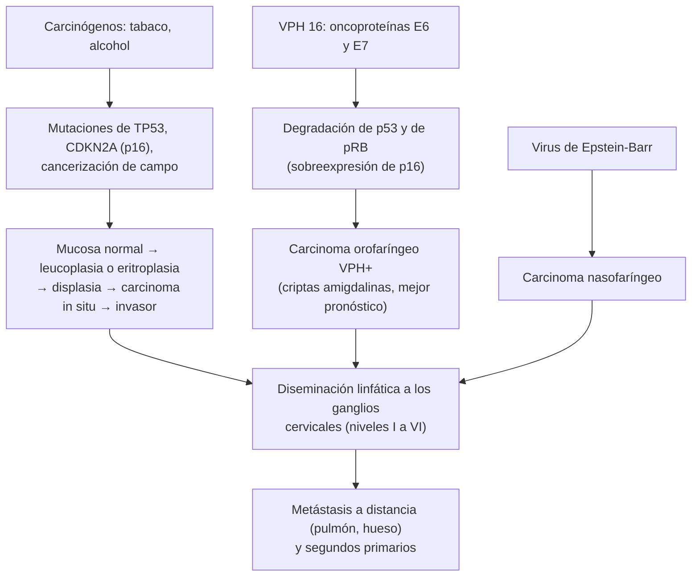

---
tags:
  - Otorrinolaringología
---

# Cáncer de cabeza y cuello: boca, labios, orofaringe, laringe, hipofaringe, rinofaringe y senos paranasales

**Subespecialidad**
Otorrinolaringología · Cirugía de cabeza y cuello · Oncología · Odontología · Atención primaria

**Guías principales**
EHNS-ESMO-ESTRO 2020: carcinoma escamoso de cavidad oral, laringe, orofaringe e hipofaringe (*Ann Oncol*) · Clasificación TNM de la AJCC, 8.ª edición

**Otras fuentes**
GLOBOCAN 2022 (*CA Cancer J Clin* 2024) · Revisión del carcinoma escamoso de cabeza y cuello (*Nat Rev Dis Primers* 2020) · Revisión del carcinoma nasofaríngeo (*Lancet* 2019) · Exposición laboral y cáncer nasosinusal, metaanálisis (*BMC Cancer* 2015) · Ver [faringe y laringe](faringe-y-laringe-disfonia-estridor-y-amigdalitis-cronica.md), [glándulas salivales y masa cervical](../../cirugia/cabeza-cuello-tiroides-y-mama/glandulas-salivales-y-masa-cervical.md), [bocio y cáncer de tiroides](../../endocrinologia/bocio-nodulo-y-cancer-de-tiroides.md), [síndrome mononucleósico y adenopatías](../../infectologia/sindrome-mononucleosico-y-adenitis.md), [linfomas](../../hematologia/linfomas.md), [consumo de alcohol y tabaco](../../psiquiatria/consumo-de-alcohol-tabaco-y-drogas.md) y [nariz](nariz-rinitis-sinusitis-cronica-y-obstruccion-nasal.md)

**GES**
No hay GES específico para el cáncer de cabeza y cuello. Las **garantías de salud oral** (GES N.° 23 a los 6 años y N.° 47 a los 60 años) incluyen el examen de la boca.

**EUNACOM**
6.03.1.004 Cáncer de boca, labios y orofaringe (sospecha, inicial, derivar) · 6.03.1.005 Cáncer laríngeo e hipofaríngeo (sospecha, inicial, derivar) · 6.03.1.006 Cáncer nasosinusal (sospecha, inicial, derivar) · 6.03.3.004 Prevención de cáncer laríngeo

**Revisado**
Octubre 2026

!!! abstract "Resumen en 60 segundos"
    - **~ 90 %** son **carcinomas escamosos**. Factores de riesgo: **tabaco** y **alcohol** (efecto **sinérgico**), **virus del papiloma humano** (VPH 16: **orofaringe**), **virus de Epstein-Barr** (**rinofaringe**), **radiación UV** (**labio inferior**), mala higiene oral, polvo de **madera** (senos paranasales).
    - **Lesiones precursoras** de la boca: **leucoplasia** (placa blanca que no se desprende) y **eritroplasia** (placa roja: la de mayor riesgo). **Biopsiar** toda úlcera o placa que no cicatriza en **2–3 semanas**.
    - **Laringe**: la **disfonía persistente** es un signo **precoz** del cáncer **glótico** (buen pronóstico). **Hipofaringe**: disfagia, odinofagia, **otalgia refleja**; diagnóstico tardío.
    - **Orofaringe por VPH**: adultos **más jóvenes**, a menudo **no fumadores**, con una **adenopatía cervical quística**; **mejor pronóstico** (p16 positivo).
    - **Rinofaringe**: **otitis media con efusión unilateral** en un adulto, obstrucción nasal, epistaxis, adenopatía cervical, pares craneales.
    - **Senos paranasales**: síntomas **unilaterales** (obstrucción, epistaxis, rinorrea), dolor o hipoestesia facial, epífora, diplopía, proptosis, dientes flojos.
    - **Masa cervical en un adulto** > 2–3 semanas: **cáncer** hasta que se demuestre lo contrario. **Punción con aguja fina** y **examen completo de la vía aerodigestiva** (nasofibrolaringoscopía); **no** hacer una biopsia quirúrgica de la adenopatía antes de buscar el primario.
    - **Tratamiento** multidisciplinario: **cirugía** y/o **radioterapia** (± quimioterapia con cisplatino); inmunoterapia en la enfermedad recurrente o metastásica.
    - **Prevención**: **no fumar**, moderar el **alcohol**, **vacuna contra el VPH**, fotoprotección del labio, higiene oral y controles dentales.

## Definición

- **Cáncer de cabeza y cuello**: neoplasias malignas de la **vía aerodigestiva superior**: **cavidad oral** (labios, lengua móvil, piso de boca, encía, mucosa yugal, paladar duro, trígono retromolar), **orofaringe** (base de la lengua, amígdalas, paladar blando, pared posterior), **hipofaringe** (senos piriformes, región retrocricoidea, pared posterior), **laringe** (supraglotis, **glotis**, subglotis), **rinofaringe** (nasofaringe), **cavidad nasal** y **senos paranasales**. Las glándulas salivales y la tiroides se tratan por separado.
- **Leucoplasia**: placa **blanca** de la mucosa oral que **no se desprende** al raspado y no corresponde a otra lesión definida; lesión **potencialmente maligna**.
- **Eritroplasia**: placa **roja** aterciopelada; alto porcentaje de displasia o carcinoma.
- **Cancerización de campo**: la exposición de toda la mucosa a los carcinógenos explica la aparición de **segundos primarios** (cabeza y cuello, pulmón, esófago).

## Epidemiología

- **Mundial** (GLOBOCAN 2022):
    - El cáncer de **labio y cavidad oral** suma ~ **390.000** casos nuevos al año en el mundo, con alta incidencia en el sur de Asia (masticación de betel).
    - El de **laringe** suma ~ 190.000 casos nuevos al año.
    - El cáncer de **orofaringe por VPH** ha **aumentado** en los países de altos ingresos, sobre todo en los **hombres** de 40–60 años.
    - El **carcinoma nasofaríngeo** es endémico en el **sur de China** y el sudeste asiático (virus de Epstein-Barr, dieta con pescado salado).
    - Predominan en los **hombres** (2–4:1) mayores de **50 años**.
    - El cáncer **nasosinusal** es raro; el **adenocarcinoma etmoidal** se asocia al **polvo de madera** (carpinteros, ebanistas) y del cuero.
- **Chile**: no hay datos nacionales publicados en las fuentes revisadas; el tabaquismo y el consumo de alcohol siguen siendo prevalentes, y la alta radiación UV favorece el cáncer de **labio**.

!!! chile "Datos nacionales"
    - El **Programa Nacional de Inmunizaciones** incluye la **vacuna contra el VPH** en los escolares de **4.º básico**, en las niñas y, desde **2019**, también en los niños (desde 2024 con la vacuna **nonavalente** en dosis única): es la principal medida de prevención primaria del cáncer de orofaringe por VPH.
    - Las garantías **GES de salud oral** (N.° 23 a los 6 años y N.° 47 a los 60 años) incluyen el **examen de la mucosa oral**: oportunidad para detectar lesiones precursoras.
    - La **Ley de tabaco** (Ley 20.660) prohíbe fumar en los espacios cerrados de uso público.
    - La exposición laboral al **polvo de madera** y a otros carcinógenos (níquel, cromo, formaldehído, asbesto) es relevante en la salud ocupacional.

## Etiología y factores de riesgo

| Factor | Sitios principales |
|---|---|
| **Tabaco** (cigarrillo, pipa, puros, mascado) | Todos; laringe, hipofaringe, cavidad oral |
| **Alcohol** (sinérgico con el tabaco: el riesgo se multiplica) | Cavidad oral, orofaringe, hipofaringe, supraglotis |
| **VPH de alto riesgo** (sobre todo el **16**; sexo oral, número de parejas) | **Orofaringe** (amígdalas, base de la lengua) |
| **Virus de Epstein-Barr** | **Rinofaringe** (carcinoma no queratinizante) |
| **Radiación UV** | **Labio inferior** (carcinoma espinocelular); queilitis actínica |
| **Mala higiene oral**, prótesis mal ajustadas, trauma crónico | Cavidad oral |
| **Betel** y tabaco de mascar | Mucosa yugal |
| **Polvo de madera**, cuero, níquel, cromo, formaldehído | **Senos paranasales** (adenocarcinoma etmoidal, carcinoma escamoso) |
| **Inmunosupresión** (trasplante, VIH) | Todos; labio |
| **Anemia de Fanconi**, disqueratosis congénita | Cavidad oral (jóvenes) |
| **Liquen plano oral erosivo**, fibrosis submucosa | Cavidad oral |
| **Reflujo gastroesofágico**, déficit nutricional (síndrome de Plummer-Vinson) | Laringe, hipofaringe (poscricoideo) |
| **Radiación ionizante** previa | Todos |

## Fisiopatología

*Figura 1. Carcinogénesis del cáncer de cabeza y cuello. Esquema propio basado en Johnson (2020) y en la guía EHNS-ESMO-ESTRO (2020).*

- La **glotis** tiene un drenaje linfático **escaso**: el cáncer glótico precoz rara vez da metástasis ganglionares y se manifiesta tempranamente por la disfonía. La **supraglotis**, la **hipofaringe** y la **base de la lengua** tienen drenaje linfático **rico** y **bilateral**: diagnóstico con ganglios positivos.

## Clasificación

| Sitio | Rasgos |
|---|---|
| **Labio** (inferior) | Espinocelular por **UV**; buen pronóstico |
| **Cavidad oral** | **Lengua** (borde lateral) y **piso de boca**: los más frecuentes; úlcera indurada |
| **Orofaringe** | **VPH+** (p16+, más jóvenes, mejor pronóstico) o **VPH−** (tabaco y alcohol) |
| **Laringe** | **Glótica** (la más frecuente; disfonía precoz, pocos ganglios), **supraglótica** (disfagia, otalgia, ganglios precoces), **subglótica** (rara, estridor) |
| **Hipofaringe** | **Seno piriforme** (el más frecuente); diagnóstico tardío, mal pronóstico |
| **Rinofaringe** | Virus de Epstein-Barr; muy radiosensible |
| **Senos paranasales** | **Maxilar** (el más frecuente) y etmoides; diagnóstico tardío |

- **Estadificación**: **TNM de la AJCC, 8.ª edición** (con una clasificación **distinta** para la orofaringe **p16 positiva**). En general, los **estadios I–II** (tumor pequeño sin ganglios) se tratan con una sola modalidad y los **III–IV** (localmente avanzados) con tratamiento **combinado**.

## Clínica

- **Cavidad oral**: **úlcera** que **no cicatriza** en 2–3 semanas, **indurada**, indolora al inicio y luego dolorosa; **placa blanca o roja** persistente; masa, **sangrado**, **dientes flojos** o prótesis que dejan de ajustar, **trismus**, **otalgia refleja**, dificultad para hablar o tragar, adenopatía submandibular o cervical.
- **Labio**: costra o úlcera persistente en el **labio inferior** sobre una queilitis actínica.
- **Orofaringe**: **odinofagia** unilateral persistente, **disfagia**, otalgia refleja, **amígdala asimétrica** o ulcerada, sensación de cuerpo extraño, voz de "papa caliente"; en el VPH+, a menudo **adenopatía cervical** (a veces **quística**) como **primera manifestación**.
- **Laringe glótica**: **disfonía persistente y progresiva** (precoz); luego estridor y disnea.
- **Laringe supraglótica e hipofaringe**: **odinofagia**, **disfagia**, **otalgia refleja**, sensación de cuerpo extraño, cambio de la voz, **hemoptisis**, **baja de peso**, adenopatía cervical, aspiración.
- **Rinofaringe**: **otitis media con efusión unilateral** (obstrucción de la trompa), hipoacusia, **obstrucción nasal**, **epistaxis**, rinorrea, **adenopatía cervical alta o posterior** (frecuentemente bilateral), **parálisis de pares craneales** (VI par: diplopía; V par: dolor o hipoestesia facial) por invasión de la base del cráneo.
- **Senos paranasales**: síntomas **unilaterales**: obstrucción nasal, **epistaxis**, rinorrea sanguinolenta; luego **dolor** o **hipoestesia** facial (nervio infraorbitario), **epífora**, **diplopía**, **proptosis**, aumento de volumen de la mejilla o el paladar, dientes flojos, trismus.
- **Masa cervical**: adenopatía **dura**, **indolora**, **fija**, que **crece**, en un adulto > 40 años con factores de riesgo; cualquier masa que persiste > **2–3 semanas** (tras un eventual tratamiento antibiótico) debe estudiarse.
- **Síntomas generales**: baja de peso, desnutrición, halitosis.

!!! alarma "Signos de alarma (derivación preferente a ORL o cirugía de cabeza y cuello)"
    - **Úlcera**, **placa blanca o roja** o masa en la **boca** que no se resuelve en **2–3 semanas**.
    - **Disfonía** de más de **4 semanas**, sobre todo en un **fumador**.
    - **Odinofagia** o **disfagia** persistentes, **otalgia** con **otoscopía normal**.
    - **Masa cervical** de más de **2–3 semanas** en un adulto.
    - **Otitis media con efusión unilateral** en un adulto.
    - Síntomas nasales **unilaterales** con **sangre**, dolor o hipoestesia facial, epífora, diplopía o proptosis.
    - **Estridor**, disnea, **hemoptisis**, **baja de peso**.
    - **Parálisis de pares craneales** con síntomas nasales u óticos.

## Diagnóstico

!!! guia "Puntos clave (EHNS-ESMO-ESTRO 2020)"
    - **Examen completo de la cabeza y el cuello**: inspección y **palpación** de la cavidad oral y la orofaringe (incluida la base de la lengua), **otoscopía**, **rinoscopía**, **palpación cervical** por niveles.
    - **Nasofibrolaringoscopía**: visualización de la rinofaringe, la orofaringe, la hipofaringe y la laringe.
    - **Biopsia** de la lesión primaria (en la consulta o bajo anestesia con **panendoscopía**, que además busca **segundos primarios**).
    - **Masa cervical**: **punción con aguja fina** (citología) o **biopsia con aguja gruesa** guiada por ecografía. **No** hacer una **biopsia escisional** de una adenopatía sospechosa de carcinoma antes de buscar el tumor primario (contamina el cuello y empeora el pronóstico).
    - **VPH** en el tumor de **orofaringe** (**p16** por inmunohistoquímica, con o sin PCR de VPH): cambia la estadificación y el pronóstico.
    - **Virus de Epstein-Barr** (ADN plasmático) en el carcinoma nasofaríngeo.
    - **Imágenes** de estadificación (ver abajo) y evaluación **dental**, **nutricional** y del **tabaquismo** antes del tratamiento.

## Laboratorio

- **Hemograma**, **función renal** (cisplatino), **pruebas hepáticas**, **albúmina** y estado nutricional.
- **TSH** basal (la radioterapia cervical produce **hipotiroidismo**).
- **VIH** según los factores de riesgo.
- **ADN del virus de Epstein-Barr** en el plasma (rinofaringe).
- **p16 / VPH** en la biopsia (orofaringe).

## Imágenes

- **TC con contraste** y/o **RM** de cabeza y cuello: extensión local (la **RM** es mejor para la cavidad oral, la orofaringe, la rinofaringe y la base del cráneo; la **TC** para la laringe y el hueso) y **ganglios**.
- **TC de tórax**: metástasis pulmonares y **segundo primario** de pulmón (siempre en los fumadores).
- **PET-TC**: estadios avanzados, búsqueda del **primario desconocido** (adenopatía metastásica sin tumor visible) y evaluación de la respuesta tras la radioquimioterapia.
- **Ecografía cervical** con punción: ganglios.
- **Ortopantomografía** dental antes de la radioterapia.

## Diagnóstico diferencial

| Cuadro | Claves |
|---|---|
| **Úlcera oral** | **Aftas** (dolorosas, se resuelven en 1–2 semanas), trauma por prótesis o dientes (cede al retirar la causa), herpes, sífilis, TBC, histoplasmosis, liquen plano erosivo, enfermedad de Behçet |
| **Placa blanca** | **Candidiasis** (se desprende), liquen plano (estrías reticulares bilaterales), leucoplasia vellosa (VIH, VEB; bordes laterales de la lengua), morsicatio |
| **Masa cervical** | **Adenopatía reactiva** (infecciosa, < 2–3 semanas, dolorosa), **mononucleosis**, TBC, **linfoma**, **quiste branquial** (adulto joven; cuidado: el carcinoma de orofaringe VPH+ puede simularlo), quiste tirogloso, **tiroides**, **glándulas salivales**, lipoma, paraganglioma |
| **Disfonía crónica** | Nódulos, pólipos, edema de Reinke, parálisis cordal, papilomatosis, reflujo |
| **Obstrucción nasal unilateral** | Pólipo, desviación septal, cuerpo extraño, papiloma invertido, angiofibroma juvenil |

## Tratamiento

- **Equipo multidisciplinario** (comité oncológico): cirugía de cabeza y cuello, radioterapia, oncología médica, odontología, fonoaudiología, nutrición, psicología, cuidados paliativos.
- **Estadios precoces (I–II)**: **una sola modalidad**:
    - **Cirugía** (resección con márgenes, con o sin disección cervical) **o** **radioterapia**, según el sitio y la función.
    - **Cáncer glótico precoz**: **cirugía endoscópica con láser** o **radioterapia**, con alta tasa de curación y conservación de la voz.
- **Estadios localmente avanzados (III–IVB)**:
    - **Cavidad oral**: **cirugía** con **disección cervical** y **reconstrucción** (colgajos), seguida de **radioterapia** (o **radioquimioterapia** con **cisplatino** si hay márgenes positivos o extensión extracapsular).
    - **Orofaringe, laringe e hipofaringe**: **radioquimioterapia** concomitante con **cisplatino** (preserva el órgano) o **cirugía** (incluida la **laringectomía total** en los tumores T4 con destrucción del cartílago o mala función) seguida de radioterapia adyuvante.
    - **Rinofaringe**: **radioterapia** (de intensidad modulada) con **quimioterapia** (la cirugía rara vez es útil).
    - **Senos paranasales**: **cirugía** (endoscópica o abierta) más radioterapia.
- **Enfermedad recurrente o metastásica**: **inmunoterapia** (**pembrolizumab** solo o con quimioterapia, según la expresión de PD-L1), **cetuximab**, quimioterapia con platino; cuidados paliativos.
- **Medidas de soporte**:
    - **Dejar de fumar** y de beber (mejora la respuesta y reduce los segundos primarios).
    - **Evaluación dental** antes de la radioterapia (extracciones para evitar la **osteorradionecrosis**), flúor.
    - **Nutrición** (gastrostomía en algunos casos), **fonoaudiología** (deglución y voz; prótesis fonatoria tras la laringectomía).
    - **Traqueostomía** si hay obstrucción de la vía aérea.
- **Leucoplasia y eritroplasia**: **biopsia**; extirpación (cirugía o láser) según la displasia; dejar de fumar; seguimiento.
- **Prevención**:
    - **Primaria**: **no fumar** (consejería breve, terapia de reemplazo nicotínico, vareniclina), moderar el **alcohol**, **vacuna contra el VPH**, **fotoprotección** del labio (bálsamo con FPS, sombrero), higiene oral, protección laboral frente al polvo de madera y otros carcinógenos.
    - **Secundaria**: examen de la boca en los controles de salud y dentales, sobre todo en los fumadores y bebedores; derivación precoz de las lesiones sospechosas y de la **disfonía** > 4 semanas.

## Complicaciones

- **De la enfermedad**: **obstrucción de la vía aérea**, **disfagia** y **aspiración**, **desnutrición**, **hemorragia** (rotura carotídea: *blowout*), **dolor**, fístulas, metástasis a distancia, **segundos primarios**.
- **De la radioterapia**: **mucositis**, **xerostomía** (sequedad de boca permanente), **caries** por radiación, **osteorradionecrosis** mandibular, **disfagia** y fibrosis, **hipotiroidismo**, estenosis carotídea, radiodermitis, trismus, pérdida del gusto.
- **De la cirugía**: alteración de la deglución, del habla y de la estética, **pérdida de la voz** (laringectomía total con traqueostoma definitivo), linfedema, lesión del nervio espinal accesorio (hombro caído tras la disección cervical).
- **De la quimioterapia**: nefrotoxicidad, **ototoxicidad** y neuropatía por **cisplatino**.

## Pronóstico y seguimiento

- **Supervivencia a 5 años**: depende del sitio y el estadio. **Labio** y **glotis** precoces: > **80–90 %**. **Hipofaringe**: la peor (~ 30–40 %). **Orofaringe VPH+**: mucho mejor que la VPH−.
- El **tabaquismo activo** empeora el pronóstico (incluso en el VPH+).
- **Seguimiento**: examen de cabeza y cuello cada **1–3 meses** el primer año, cada 2–6 meses el segundo y luego cada 4–12 meses hasta los 5 años; imágenes según el caso; **TSH** periódica (radioterapia); **TC de tórax** en los fumadores (segundos primarios y tamizaje del cáncer de pulmón); rehabilitación de la deglución y la voz.

## Perlas para el internado

!!! perla "Para recordar"
    - **Tabaco + alcohol** = riesgo **multiplicado**. **VPH 16** = orofaringe. **Epstein-Barr** = rinofaringe. **UV** = labio inferior. **Madera** = etmoides.
    - Úlcera o placa en la boca que no se cura en **2–3 semanas** = **biopsia**. **Eritroplasia** más peligrosa que leucoplasia.
    - **Disfonía > 4 semanas en un fumador** = **laringoscopía**. El cáncer glótico da síntomas precoces (buen pronóstico).
    - **Otalgia con oído normal** en un fumador = cáncer de orofaringe, hipofaringe o laringe.
    - **Masa cervical en un adulto > 2–3 semanas** = punción con aguja fina y **nasofibrolaringoscopía**; **no** sacar el ganglio antes de buscar el primario.
    - **Adulto joven no fumador con una adenopatía quística** = posible **orofaringe VPH+** (no asumir un quiste branquial).
    - **Otitis media con efusión unilateral** en un adulto = **rinofaringe**.
    - Síntomas nasales **unilaterales** con sangre, dolor facial o diplopía = **tumor nasosinusal**.
    - Antes de la radioterapia: **dentista**. Después: **TSH** y vigilancia de la **osteorradionecrosis**.
    - **Prevención**: dejar de fumar, **vacuna VPH** (niñas y niños), fotoprotección del labio.

## Preguntas de repaso

??? repaso "1. Hombre de 62 años, fumador y bebedor, con una úlcera indurada de 1,5 cm en el borde lateral de la lengua desde hace 6 semanas, que no mejoró al cambiar su prótesis. ¿Qué hace?"
    Sospecha de **carcinoma escamoso de la cavidad oral** (úlcera indurada que no cicatriza en > 2–3 semanas, en el borde lateral de la lengua, con tabaco y alcohol). Derivar con **prioridad** a ORL o cirugía de cabeza y cuello para **biopsia**, examen completo de la vía aerodigestiva (nasofibrolaringoscopía), **palpación cervical**, **TC o RM** de cabeza y cuello y **TC de tórax**. El tratamiento suele ser quirúrgico (con disección cervical) más radioterapia según el estadio. Consejería para dejar de fumar y beber.

??? repaso "2. Hombre de 45 años, no fumador, con una masa cervical derecha indolora de 3 cm, de consistencia quística, que apareció hace 2 meses. ¿Qué sospecha y cómo lo estudia?"
    Aunque podría parecer un quiste branquial, en un adulto de esta edad una masa cervical quística persistente sugiere una **metástasis de un carcinoma de orofaringe VPH positivo** (amígdala o base de la lengua). Estudio: **punción con aguja fina** guiada por ecografía (con **p16/VPH** en la muestra), **nasofibrolaringoscopía** y examen de la orofaringe, **TC o RM con contraste** y eventualmente **PET-TC** y panendoscopía con biopsias para buscar el primario. No extirpar la masa antes de completar el estudio.

??? repaso "3. ¿Qué factores de riesgo y medidas de prevención del cáncer de laringe debe educar en la APS?"
    Factores: **tabaco** (el principal), **alcohol** (sinérgico), reflujo laringofaríngeo, exposición laboral (asbesto, vapores ácidos), VPH. Prevención: **dejar de fumar** (consejería, reemplazo nicotínico, vareniclina) y **moderar el alcohol**; protección laboral; **detección precoz**: derivar para **laringoscopía** toda **disfonía de más de 4 semanas** (antes si hay estridor, disfagia, otalgia, hemoptisis o masa cervical), sobre todo en los fumadores.

??? repaso "4. Hombre de 50 años con oído derecho tapado e hipoacusia de 2 meses, obstrucción nasal y epistaxis ocasional, y una adenopatía cervical posterior derecha. ¿Qué sospecha?"
    **Carcinoma nasofaríngeo** (otitis media con efusión **unilateral** en un adulto por obstrucción de la trompa de Eustaquio, síntomas nasales y adenopatía cervical posterior). Derivar a ORL para **nasofibroscopía** con **biopsia** de la rinofaringe, **RM** de la base del cráneo y el cuello, ADN plasmático del virus de Epstein-Barr y estadificación. El tratamiento es con **radioterapia** más quimioterapia.

??? repaso "5. Carpintero de 60 años con obstrucción nasal izquierda progresiva, epistaxis izquierda recurrente y, en las últimas semanas, epífora izquierda e hipoestesia de la mejilla. ¿Qué sospecha y qué hace?"
    **Cáncer nasosinusal** (probable **adenocarcinoma etmoidal** por la exposición al **polvo de madera**, o carcinoma escamoso del seno maxilar), con extensión a la vía lagrimal y al nervio infraorbitario. Derivar con prioridad a ORL para **nasofibroscopía** con **biopsia**, **TC y RM** de senos paranasales, órbita y base del cráneo. Considerar el origen **laboral** (notificación como enfermedad profesional).

??? repaso "6. ¿Por qué no se debe hacer una biopsia escisional de una adenopatía cervical sospechosa de carcinoma escamoso antes de buscar el tumor primario?"
    Porque la biopsia abierta de una metástasis de carcinoma escamoso **contamina** los planos del cuello, dificulta el tratamiento posterior (disección cervical y radioterapia) y **empeora el control regional** y el pronóstico. Lo correcto es la **punción con aguja fina** o la biopsia con aguja gruesa guiada por ecografía, junto con el **examen completo de la vía aerodigestiva** (nasofibrolaringoscopía, panendoscopía) e imágenes para encontrar el primario; la biopsia escisional se reserva para la sospecha de **linfoma** cuando la punción no es diagnóstica.

## Referencias

1. Machiels JP, René Leemans C, Golusinski W, et al. Squamous cell carcinoma of the oral cavity, larynx, oropharynx and hypopharynx: EHNS-ESMO-ESTRO Clinical Practice Guidelines for diagnosis, treatment and follow-up. *Ann Oncol.* 2020;31(11):1462–1475. doi:[10.1016/j.annonc.2020.07.011](https://doi.org/10.1016/j.annonc.2020.07.011)
2. Bray F, Laversanne M, Sung H, et al. Global cancer statistics 2022: GLOBOCAN estimates of incidence and mortality worldwide for 36 cancers in 185 countries. *CA Cancer J Clin.* 2024;74(3):229–263. doi:[10.3322/caac.21834](https://doi.org/10.3322/caac.21834)
3. Johnson DE, Burtness B, Leemans CR, et al. Head and neck squamous cell carcinoma. *Nat Rev Dis Primers.* 2020;6(1):92. doi:[10.1038/s41572-020-00224-3](https://doi.org/10.1038/s41572-020-00224-3)
4. Chen YP, Chan ATC, Le QT, et al. Nasopharyngeal carcinoma. *Lancet.* 2019;394(10192):64–80. doi:[10.1016/S0140-6736(19)30956-0](https://doi.org/10.1016/S0140-6736(19)30956-0)
5. Binazzi A, Ferrante P, Marinaccio A. Occupational exposure and sinonasal cancer: a systematic review and meta-analysis. *BMC Cancer.* 2015;15:49. doi:[10.1186/s12885-015-1042-2](https://doi.org/10.1186/s12885-015-1042-2)
