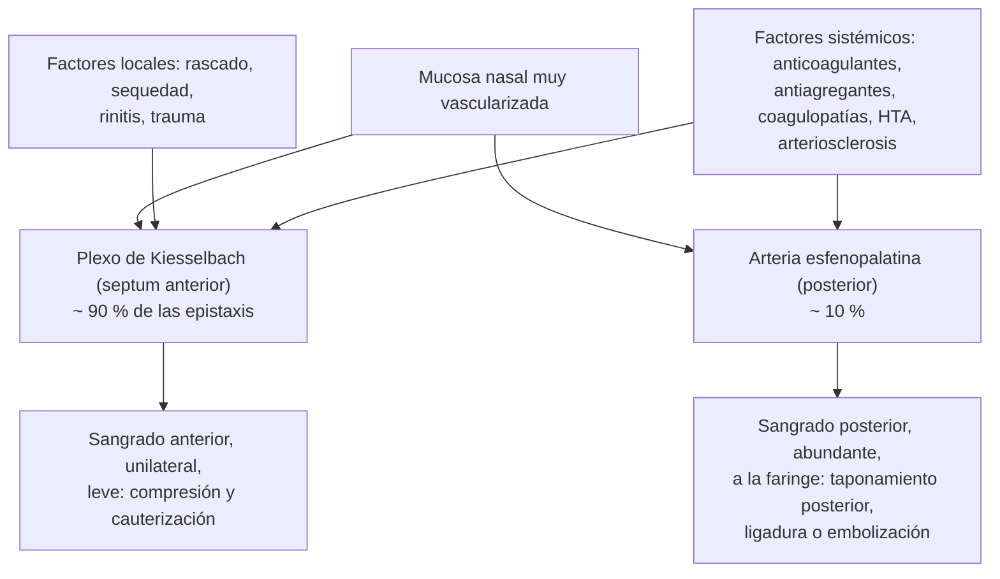

---
tags:
  - Otorrinolaringología
  - Urgencia
  - Frecuente en sala
---

# Epistaxis: leve, a repetición y masiva

**Subespecialidad**
Otorrinolaringología · Urgencia · Pediatría · Hematología

**Guías principales**
AAO-HNS 2020: epistaxis (*Otolaryngol Head Neck Surg*) · Segundas guías internacionales de telangiectasia hemorrágica hereditaria (*Ann Intern Med* 2020)

**Otras fuentes**
Ensayo NoPAC de ácido tranexámico tópico (*Ann Emerg Med* 2021) · Ver [coagulopatías y reversión de anticoagulantes](../../hematologia/coagulopatias-cid-y-reversion-de-anticoagulantes.md), [trombocitopenias](../../hematologia/trombocitopenias.md), [hipertensión arterial](../../cardiologia/hipertension-arterial.md), [crisis hipertensiva](../../cardiologia/crisis-hipertensiva.md), [nariz](nariz-rinitis-sinusitis-cronica-y-obstruccion-nasal.md) y [trauma maxilofacial](../../cirugia/cabeza-cuello-tiroides-y-mama/heridas-de-cara-y-trauma-maxilofacial.md)

**GES**
No.

**EUNACOM**
6.03.1.012 Epistaxis leve (específico, completo, completo) · 6.03.1.011 Epistaxis a repetición (específico, completo, derivar) · 6.03.2.011 Epistaxis masiva (específico, completo, derivar) · 2.01.1.099 y 2.01.2.008 Epistaxis (pediatría)

**Revisado**
Octubre 2026

!!! abstract "Resumen en 60 segundos"
    - **Epistaxis anterior** (~ 90 %): del **plexo de Kiesselbach** (área de Little, septum anterior). Niños y adultos jóvenes; por **trauma digital**, sequedad, rinitis. Suele ceder con **compresión**.
    - **Epistaxis posterior** (~ 10 %): de ramas de la **arteria esfenopalatina**; adultos mayores, **HTA**, **anticoagulados**; sangrado abundante, a ambos lados o hacia la faringe; puede ser **masiva**.
    - **Primer paso**: **ABC**, sentar al paciente **inclinado hacia adelante**, **compresión bidigital firme** de las alas nasales contra el septum por **10–15 minutos sin soltar**, sin mirar hacia arriba. Agregar **vasoconstrictor tópico** (oximetazolina).
    - Si persiste: identificar el punto (rinoscopía), **cauterización** con nitrato de plata (solo del punto, un lado del septum) o **taponamiento anterior** (material reabsorbible si hay coagulopatía); **taponamiento posterior** (balón o sonda de Foley) si es posterior.
    - **Masiva**: vía aérea, **dos vías venosas**, hemograma y pruebas de coagulación, grupo y Rh, **reposición**, **revertir la anticoagulación** si hay riesgo vital, **taponamiento** y **ORL de urgencia**: **ligadura endoscópica de la arteria esfenopalatina** o **embolización**.
    - **No bajar la presión arterial bruscamente** solo por la epistaxis; controlarla si está muy elevada.
    - **A repetición**: buscar **coagulopatías** (von Willebrand en las mujeres con menstruaciones abundantes), **telangiectasia hemorrágica hereditaria**, **tumores** (**angiofibroma juvenil** en el adolescente varón, carcinoma en el adulto con epistaxis unilateral).

## Definición

- **Epistaxis**: hemorragia de origen nasal, que sale por las narinas (anterior) o hacia la rinofaringe y la boca (posterior).
- **Epistaxis anterior**: originada en la parte anterior de las fosas nasales, sobre todo en el **plexo de Kiesselbach** (anastomosis de las arterias etmoidal anterior, esfenopalatina, palatina mayor y labial superior).
- **Epistaxis posterior**: originada en la parte posterior de las fosas nasales (ramas de la **arteria esfenopalatina**), más abundante y difícil de controlar.
- **Epistaxis a repetición** (recurrente): episodios repetidos, habitualmente de origen anterior.
- **Epistaxis masiva** (grave): sangrado abundante con **compromiso hemodinámico**, necesidad de transfusión o que no se controla con las medidas iniciales.

## Epidemiología

- **Mundial**:
    - Hasta el **60 %** de la población tiene al menos un episodio en la vida; ~ **6 %** consulta por ella.
    - Distribución **bimodal**: niños de **2–10 años** y adultos de **50–80 años**.
    - Más frecuente en **invierno** (aire seco, calefacción, infecciones respiratorias).
    - La mayoría es **anterior** y autolimitada; las **posteriores** predominan en los adultos mayores y son las que requieren hospitalización.
    - **Telangiectasia hemorrágica hereditaria**: ~ **1 por cada 5.000** personas; > 90 % tiene epistaxis recurrente.
- **Chile**: no hay datos nacionales publicados de incidencia; es una consulta frecuente en la APS y en los servicios de urgencia, sobre todo en invierno.

!!! chile "Datos nacionales"
    - La mayoría de las epistaxis se resuelven en la **APS** o el **SAPU** con compresión, vasoconstrictor y cauterización.
    - En la **calefacción a leña** y los ambientes secos de invierno, **humidificar** el ambiente y lubricar la mucosa nasal reduce las recurrencias.
    - Los pacientes **anticoagulados** (programa de tratamiento anticoagulante oral con acenocumarol o warfarina, y anticoagulantes directos) requieren control del **INR** ante una epistaxis significativa.

## Etiología y factores de riesgo

| Tipo | Causas |
|---|---|
| **Locales** | **Trauma digital** (rascado: la causa más frecuente en los niños), **sequedad** de la mucosa (aire frío y seco, calefacción, oxígeno nasal sin humidificar, CPAP), **rinitis** alérgica e infecciosa, **trauma** nasal (fractura), **cuerpo extraño**, **desviación septal** (espolones), **perforación septal**, uso de **corticoides intranasales** (mala técnica), **cocaína**, cirugía nasal, **tumores** (**angiofibroma juvenil nasofaríngeo**, carcinoma nasosinusal o de rinofaringe, papiloma invertido, granuloma piogénico) |
| **Sistémicas** | **Anticoagulantes** (warfarina, acenocumarol, anticoagulantes directos), **antiagregantes** (aspirina, clopidogrel), **AINE**, **coagulopatías** (**enfermedad de von Willebrand**, hemofilias), **trombocitopenias** (PTI, leucemias), **insuficiencia hepática** o **renal**, **telangiectasia hemorrágica hereditaria** (Rendu-Osler-Weber), **alcohol**, granulomatosis con poliangeítis |
| **Hipertensión arterial** | Se asocia a la epistaxis (sobre todo posterior) y a su persistencia, pero su papel causal es discutido; a menudo la HTA es **reactiva** a la ansiedad y el dolor |

## Fisiopatología

*Figura 1. Origen vascular de la epistaxis anterior y posterior. Esquema propio basado en la guía de epistaxis de la AAO-HNS (2020).*

- En los adultos mayores, la **arteriosclerosis** impide la vasoconstricción y retracción normal de las arterias, lo que prolonga el sangrado.

## Clasificación

| Rasgo | Anterior | Posterior |
|---|---|---|
| **Frecuencia** | ~ 90 % | ~ 10 % |
| **Edad** | Niños y adultos jóvenes | Adultos mayores |
| **Origen** | Plexo de **Kiesselbach** | Ramas de la **arteria esfenopalatina** |
| **Sangrado** | Por la narina, **unilateral**, leve a moderado | **Abundante**, a menudo **bilateral**, hacia la **faringe** (el paciente traga o vomita sangre) |
| **Punto sangrante** | **Visible** en la rinoscopía anterior | No visible |
| **Causas** | Locales (rascado, sequedad) | Sistémicas (HTA, anticoagulación, arteriosclerosis) |
| **Manejo** | Compresión, vasoconstrictor, cauterización, taponamiento anterior | Taponamiento **posterior**, hospitalización, ligadura o embolización |

## Clínica

- **Epistaxis anterior**: sangrado por una narina, habitualmente leve, que cede espontáneamente o con compresión; en los niños, a menudo **nocturno** y recurrente, con costras en el septum anterior.
- **Epistaxis posterior**: sangrado **abundante**, por ambas narinas o hacia la **faringe** (se ve sangre en la pared posterior de la orofaringe a pesar de la compresión anterior), **hematemesis** o melena por la sangre deglutida; en los adultos mayores con HTA o anticoagulación.
- **Signos de gravedad**: **taquicardia**, **hipotensión**, **palidez**, sudoración, síncope, alteración de conciencia, sangrado que no cede.
- **Telangiectasia hemorrágica hereditaria**: **epistaxis recurrentes** espontáneas desde la infancia o la adolescencia, **telangiectasias** en los labios, la lengua, las yemas de los dedos y la mucosa nasal, **antecedente familiar** (autosómico dominante), **anemia ferropénica**; malformaciones arteriovenosas **pulmonares** (hipoxemia, ACV o abscesos cerebrales por embolias paradójicas), **cerebrales** y **hepáticas**, sangrado digestivo.
- **Angiofibroma juvenil nasofaríngeo**: **adolescente varón** con **epistaxis unilateral recurrente** y **obstrucción nasal unilateral** progresiva.
- **Tumor nasosinusal**: adulto con epistaxis **unilateral** recurrente, obstrucción, rinorrea sanguinolenta, dolor facial, epífora o diplopía.

!!! alarma "Signos de alarma"
    - **Compromiso hemodinámico**: taquicardia, hipotensión, síncope.
    - Sangrado que **no cede** con 15–20 minutos de compresión y vasoconstrictor.
    - **Sangrado posterior** (hacia la faringe) o **bilateral**.
    - **Anticoagulación** con INR alto, **coagulopatía** o **trombocitopenia** conocida.
    - Epistaxis tras un **trauma facial** (fractura, **hematoma septal**) o con salida de **líquido claro** (fístula de LCR).
    - **Adolescente varón** con epistaxis y obstrucción **unilateral**: **angiofibroma juvenil** (no biopsiar).
    - Epistaxis **unilateral recurrente** en un adulto, con obstrucción o rinorrea: **tumor**.
    - Epistaxis recurrentes con **telangiectasias** y antecedente familiar: **telangiectasia hemorrágica hereditaria**.
    - Epistaxis con **hematomas**, **petequias**, sangrado de encías o menstruaciones abundantes: **trastorno de la hemostasia**.

## Diagnóstico

!!! guia "Puntos clave (AAO-HNS 2020)"
    - **Diferenciar** al paciente con **sangrado activo grave** (que requiere manejo inmediato) del paciente con sangrado leve o ya detenido.
    - **Historia**: lateralidad, duración, cantidad, episodios previos, **fármacos** (anticoagulantes, antiagregantes, AINE, corticoides intranasales), enfermedades (HTA, hepatopatía, nefropatía, coagulopatías), antecedentes familiares de sangrado o de telangiectasias, cirugía o trauma nasal, consumo de cocaína.
    - **Rinoscopía anterior** (tras retirar los coágulos con aspiración o sonándose, y aplicar vasoconstrictor) para identificar el **punto sangrante**.
    - **Nasofibroscopía** por el especialista en las epistaxis **recurrentes**, **unilaterales**, posteriores o difíciles de controlar (para descartar tumores y localizar el punto).
    - Medir la **presión arterial**; tratarla si está muy elevada, sin bajarla bruscamente.
    - **Exámenes** solo si están indicados (ver Laboratorio): no se piden de rutina en la epistaxis leve.
    - **Documentar** el estado de la anticoagulación y coordinar con el tratante antes de suspenderla.

## Laboratorio

| Situación | Exámenes |
|---|---|
| Epistaxis leve, sin factores de riesgo | **Ninguno** |
| **Epistaxis grave**, recurrente o que requiere taponamiento | **Hemograma** (hemoglobina y plaquetas), **grupo y Rh** (y pruebas cruzadas si hay compromiso) |
| **Anticoagulados** | **INR** (warfarina o acenocumarol), TTPA; con anticoagulantes directos, función renal y hora de la última dosis |
| **Sospecha de coagulopatía** (epistaxis recurrentes con otros sangrados, antecedente familiar) | TP, TTPA, **factor von Willebrand** (antígeno y actividad), factor VIII, recuento y función plaquetaria |
| **Hepatopatía** o **nefropatía** | Pruebas hepáticas, creatinina |
| **Telangiectasia hemorrágica hereditaria** | **Hemograma** y **ferritina** (anemia ferropénica), estudio genético (*ENG*, *ACVRL1*) |

## Imágenes

- No se requieren en la epistaxis leve.
- **TC** o **RM** de senos paranasales y rinofaringe si se sospecha un **tumor** (unilateral recurrente, adolescente varón, masa en la nasofibroscopía); en el **angiofibroma juvenil**, la RM y la angiografía evalúan la extensión (**no biopsiar** por el riesgo de hemorragia masiva).
- **Angiografía** con **embolización** en la epistaxis posterior refractaria.
- **Telangiectasia hemorrágica hereditaria**: **ecocardiograma con burbujas** (malformaciones arteriovenosas pulmonares) y RM cerebral.

## Diagnóstico diferencial

| Cuadro | Claves |
|---|---|
| **Hemoptisis** | Sangre espumosa con tos, pH alcalino; antecedente pulmonar |
| **Hematemesis** | Sangre oscura o en "borra de café" con vómitos; antecedente digestivo (la sangre deglutida de una epistaxis posterior puede simularla: examinar la faringe) |
| **Sangrado de la cavidad oral** o de las encías | Examen de la boca |
| **Fístula de LCR** con sangre | Líquido claro con un halo en la gasa tras un trauma |

## Tratamiento

!!! dosis "Epistaxis anterior (AAO-HNS 2020)"
    1. **Posición**: **sentado**, con la cabeza **inclinada hacia adelante** (no hacia atrás: la sangre se traga y produce vómitos o aspiración); escupir la sangre.
    2. **Compresión bidigital firme** de las **alas nasales** (parte blanda de la nariz) contra el septum por **10–15 minutos continuos**, sin soltar para revisar.
    3. **Vasoconstrictor tópico**: **oximetazolina 0,05 %** (2–3 aplicaciones) o algodones embebidos en oximetazolina o en lidocaína con epinefrina, antes de la compresión o si persiste.
    4. **Rinoscopía**: identificar el punto sangrante.
    5. **Cauterización química** con **nitrato de plata** (con anestesia tópica) del punto sangrante identificado, **solo en un lado del septum** (riesgo de perforación si se cauterizan ambos lados en la misma sesión).
    6. **Taponamiento anterior** si no cede: esponjas expansibles (Merocel), gasa con vaselina o un balón; **material reabsorbible** si el paciente está **anticoagulado**, tiene una coagulopatía o toma antiagregantes. Educar sobre el tipo de taponamiento y cuándo retirarlo (en general a las **48–72 horas**).
    - **Ácido tranexámico tópico**: opción en algunos centros (en el ensayo NoPAC no redujo la necesidad de taponamiento en la urgencia).
    - **Antibióticos** profilácticos con el taponamiento: **no** se recomiendan de rutina (AAO-HNS 2020).
    - **Anticoagulados**: en la epistaxis **sin riesgo vital**, **no suspender** el anticoagulante de entrada; controlar localmente y coordinar con el tratante. **Revertir** solo si el sangrado pone en riesgo la vida.

!!! dosis "Epistaxis posterior y masiva"
    - **ABC**: proteger la **vía aérea** (riesgo de aspiración), oxígeno, **dos vías venosas** gruesas, monitorización, **cristaloides** y **transfusión** según la hemoglobina y la hemodinamia.
    - **Laboratorio**: hemograma, grupo y Rh, coagulación.
    - **Revertir la anticoagulación** si hay **riesgo vital** (vitamina K y concentrado de complejo protrombínico para los antagonistas de la vitamina K; idarucizumab para el dabigatrán; andexanet o complejo protrombínico para los inhibidores del factor Xa; ver [reversión de anticoagulantes](../../hematologia/coagulopatias-cid-y-reversion-de-anticoagulantes.md)); **transfusión de plaquetas** si están muy bajas.
    - **Taponamiento posterior**: **balón de doble cámara** (epistat) o **sonda de Foley** (n.° 12–14) introducida por la fosa hasta la rinofaringe, inflada con 10–15 mL de agua o suero, traccionada hacia la coana y fija, más un taponamiento anterior. Requiere **hospitalización**, monitorización (riesgo de **hipoxemia**, **bradicardia** por reflejo nasovagal y aspiración), analgesia y, en general, **antibiótico** (cobertura de *S. aureus* por el riesgo de síndrome de shock tóxico con taponamientos prolongados).
    - **Tratamiento definitivo** si persiste o recurre: **ligadura endoscópica de la arteria esfenopalatina** (alta eficacia) o **embolización** por angiografía (arterias maxilar interna y facial).
    - **Presión arterial**: tratar la HTA grave con antihipertensivos orales y analgesia o ansiolisis, **sin descensos bruscos** (riesgo de isquemia, sobre todo en los adultos mayores).

- **Epistaxis a repetición**:
    - **Humidificar** la mucosa: **lubricación** con vaselina o ungüentos (antibiótico o petrolato) en el septum anterior 2 veces al día por 1–2 semanas, **suero fisiológico** en spray o gel, **humidificador** en el dormitorio, evitar la calefacción excesiva.
    - **No rascarse** ni sonarse con fuerza; **cortar las uñas** (niños).
    - **Cauterización** con nitrato de plata del vaso visible.
    - **Tratar la rinitis** y revisar la técnica de los **corticoides intranasales**.
    - Revisar los **fármacos** (antiagregantes, AINE, anticoagulantes) con el tratante.
    - **Estudio de la hemostasia** si hay sangrados en otros sitios o antecedentes familiares.
    - **Nasofibroscopía** por ORL para descartar tumores o lesiones.
    - **Telangiectasia hemorrágica hereditaria** (guías 2020): **humidificación** y lubricantes, **ácido tranexámico oral**, **tratamientos ablativos** (láser, radiofrecuencia, escleroterapia), **bevacizumab** sistémico en las epistaxis graves refractarias, septodermoplastia o cierre de las narinas (Young) en los casos extremos; **hierro** (oral o IV) y transfusiones según la anemia; **tamizaje** de malformaciones arteriovenosas pulmonares y cerebrales.
    - **Angiofibroma juvenil**: **cirugía** (endoscópica) con **embolización** preoperatoria.

## Complicaciones

- **De la epistaxis**: **anemia**, **shock hipovolémico** (raro), **aspiración**, **síndrome coronario** o isquemia en los pacientes con cardiopatía.
- **Del taponamiento**: **sinusitis**, **otitis media**, **síndrome de shock tóxico** (taponamientos prolongados), **necrosis** del ala nasal o del septum, **hipoxemia** y apnea (taponamiento posterior, sobre todo en los EPOC y los que tienen apnea del sueño), reflejo nasovagal (**bradicardia**), desplazamiento del taponamiento hacia la vía aérea.
- **De la cauterización**: **perforación septal** (si se cauterizan ambos lados), sinequias.
- **De la embolización**: ACV, ceguera, parálisis facial, necrosis cutánea (raras).

## Pronóstico y seguimiento

- La gran mayoría de las epistaxis **anteriores** se controla con medidas simples y tiene excelente pronóstico.
- Las **posteriores** y las de los **adultos mayores anticoagulados** tienen mayor riesgo de recurrencia, hospitalización y mortalidad (por las comorbilidades).
- **Control** a las **48–72 horas** para retirar el taponamiento no reabsorbible; educar sobre cómo actuar si recurre.
- **Seguimiento por ORL** en las epistaxis recurrentes, unilaterales o con sospecha de lesión, y en la telangiectasia hemorrágica hereditaria.

## Perlas para el internado

!!! perla "Para recordar"
    - **Cabeza hacia adelante**, no hacia atrás.
    - **Compresión bidigital de las alas nasales por 10–15 minutos sin soltar** + **oximetazolina**: resuelve la mayoría.
    - **Kiesselbach** = anterior (90 %), niños, rascado. **Esfenopalatina** = posterior, adulto mayor, HTA, anticoagulado.
    - Cauterizar con **nitrato de plata** solo el punto y **un lado del septum**.
    - **Anticoagulado** con epistaxis sin riesgo vital: **no suspender** el anticoagulante de entrada; taponamiento **reabsorbible**.
    - **Sangre en la faringe** a pesar de la compresión = **posterior** → taponamiento posterior (Foley) y hospitalizar.
    - **No bajar bruscamente** la presión arterial.
    - **Adolescente varón** con epistaxis y obstrucción unilateral = **angiofibroma juvenil** → **no biopsiar**.
    - Epistaxis recurrentes + **telangiectasias** + familiar = **Rendu-Osler-Weber** → buscar malformaciones arteriovenosas pulmonares.
    - Mujer con epistaxis y **menstruaciones abundantes**: **von Willebrand**.

## Preguntas de repaso

??? repaso "1. Niño de 7 años con episodios de epistaxis por la fosa derecha, varias veces al mes, que ceden solos. Se rasca la nariz y hay costras en el septum anterior derecho. ¿Manejo?"
    **Epistaxis anterior recurrente** (plexo de Kiesselbach) por **trauma digital** y sequedad. En el episodio agudo: sentado e inclinado hacia adelante, **compresión bidigital** por 10–15 minutos. Prevención: **lubricar** el septum con vaselina o un ungüento 2 veces al día por 1–2 semanas, suero fisiológico nasal, **humidificar** el dormitorio, **cortar las uñas** y evitar rascarse; tratar la rinitis si existe. Si persiste: **cauterización** con nitrato de plata del vaso visible. Estudio de la hemostasia solo si hay otros sangrados o antecedentes familiares.

??? repaso "2. Hombre de 72 años, hipertenso y anticoagulado con warfarina por fibrilación auricular, con epistaxis abundante por ambas narinas y sangre que cae por la faringe a pesar de la compresión. PA 180/100 mmHg, FC 105 lpm. ¿Manejo?"
    **Epistaxis posterior** en un anticoagulado. **ABC**: sentado, vía aérea, **dos vías venosas**, hemograma, grupo y Rh, **INR**; vasoconstrictor y **taponamiento anterior y posterior** (balón de doble cámara o **sonda de Foley**), **hospitalización** con monitorización. Si el INR está alto y el sangrado es grave o no se controla, **revertir** (vitamina K y concentrado de complejo protrombínico) coordinando con el tratante. Analgesia y control gradual de la presión (sin descensos bruscos). Si persiste: **ligadura endoscópica de la arteria esfenopalatina** o **embolización** por ORL.

??? repaso "3. Mujer de 35 años con epistaxis anterior leve que cedió en la urgencia con compresión. Usa anticoagulante directo por una trombosis venosa. ¿Suspende el anticoagulante?"
    **No**. En la epistaxis **sin riesgo vital**, la recomendación es **no suspender** el anticoagulante de entrada: control local (compresión, vasoconstrictor, cauterización del punto o taponamiento **reabsorbible** si fuera necesario), lubricación nasal y humidificación. Coordinar con el tratante si las epistaxis se repiten; la reversión se reserva para los sangrados que amenazan la vida.

??? repaso "4. Adolescente de 15 años, varón, con epistaxis recurrentes por la fosa izquierda y obstrucción nasal izquierda progresiva de 6 meses. ¿Qué sospecha y qué no debe hacer?"
    **Angiofibroma juvenil nasofaríngeo** (tumor vascular benigno pero localmente agresivo, típico de los adolescentes varones). Derivar a ORL para **nasofibroscopía**, **TC y RM**; el tratamiento es **quirúrgico** (endoscópico) con **embolización** preoperatoria. **No biopsiar** en la consulta por el riesgo de **hemorragia masiva**.

??? repaso "5. Mujer de 40 años con epistaxis frecuentes desde la adolescencia, anemia ferropénica y pequeñas manchas rojas en los labios y la lengua. Su madre tiene lo mismo. ¿Diagnóstico y qué estudio adicional requiere?"
    **Telangiectasia hemorrágica hereditaria** (Rendu-Osler-Weber): epistaxis recurrentes, **telangiectasias** mucocutáneas y antecedente familiar. Estudio: **hemograma** y **ferritina**, estudio genético, y **tamizaje de malformaciones arteriovenosas pulmonares** (**ecocardiograma con burbujas**; si son significativas, embolización por el riesgo de ACV y abscesos cerebrales) y **cerebrales** (RM). Manejo de las epistaxis: humidificación, ácido tranexámico oral, tratamientos ablativos y bevacizumab en los casos graves; hierro.

??? repaso "6. ¿Por qué no se debe inclinar la cabeza hacia atrás en una epistaxis y por qué no se cauterizan ambos lados del septum?"
    La cabeza **hacia atrás** hace que la sangre se **trague** (náuseas, vómitos, hematemesis aparente) o se **aspire**, y oculta la magnitud del sangrado; la posición correcta es **sentado e inclinado hacia adelante** con compresión de las alas nasales. Cauterizar **ambos lados** del septum en la misma sesión puede comprometer la irrigación del cartílago y producir una **perforación septal**.

## Referencias

1. Tunkel DE, Anne S, Payne SC, et al. Clinical practice guideline: nosebleed (epistaxis). *Otolaryngol Head Neck Surg.* 2020;162(1 Suppl):S1–S38. doi:[10.1177/0194599819890327](https://doi.org/10.1177/0194599819890327)
2. Faughnan ME, Mager JJ, Hetts SW, et al. Second international guidelines for the diagnosis and management of hereditary hemorrhagic telangiectasia. *Ann Intern Med.* 2020;173(12):989–1001. doi:[10.7326/M20-1443](https://doi.org/10.7326/M20-1443)
3. Reuben A, Appelboam A, Stevens KN, et al. The use of tranexamic acid to reduce the need for nasal packing in epistaxis (NoPAC): randomized controlled trial. *Ann Emerg Med.* 2021;77(6):631–640. doi:[10.1016/j.annemergmed.2020.12.013](https://doi.org/10.1016/j.annemergmed.2020.12.013)
