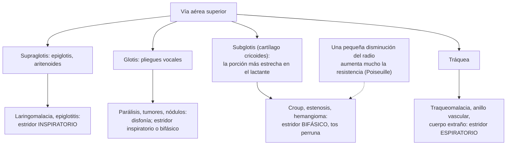

---
tags:
  - Otorrinolaringología
  - Urgencia
---

# Faringe y laringe: amigdalitis crónica, odinofagia crónica, disfonías, estridor laríngeo y absceso retrofaríngeo

**Subespecialidad**
Otorrinolaringología · Pediatría · Urgencia · Atención primaria

**Guías principales**
AAO-HNS 2018: disfonía, actualización · AAO-HNS 2019: amigdalectomía en niños, actualización (*Otolaryngol Head Neck Surg*)

**Otras fuentes**
Revisión de la laringomalacia congénita (*Otolaryngol Clin North Am* 2026) · Revisión de las infecciones profundas del cuello en los niños (*Am J Otolaryngol* 2026) · Ver [infecciones de vías aéreas superiores](../../respiratorio/infecciones-de-vias-aereas-superiores.md) (faringoamigdalitis aguda, laringitis, epiglotitis y absceso periamigdalino), [flegmón cervical](../../infectologia/flegmon-cervical-absceso-pulmonar-y-cerebral.md), cáncer de cabeza y cuello, [reflujo gastroesofágico](../../gastroenterologia/reflujo-gastroesofagico.md), [apnea del sueño](../../respiratorio/apnea-del-sueno-y-trastornos-del-sueno.md), [cuerpo extraño en la vía aérea](../../respiratorio/intoxicacion-por-co-ahogamiento-y-cuerpo-extrano.md) y [bocio y tiroides](../../endocrinologia/bocio-nodulo-y-cancer-de-tiroides.md)

**GES**
No.

**EUNACOM**
6.03.1.003 Amigdalitis crónica (específico, inicial, derivar) · 6.03.1.018 Odinofagias crónicas (sospecha, inicial, derivar) · 6.03.1.009 Disfonías agudas (específico, completo, completo) · 6.03.1.010 Disfonías crónicas (sospecha, inicial, derivar) · 6.03.1.013 Estridor laríngeo (específico, inicial, derivar) · 6.03.2.004 Absceso retrofaríngeo (específico, inicial, derivar)

**Revisado**
Octubre 2026

!!! abstract "Resumen en 60 segundos"
    - **Amigdalitis recurrente**: indicación de **amigdalectomía** según los **criterios de Paradise**: **≥ 7 episodios en 1 año**, **≥ 5 por año en 2 años** o **≥ 3 por año en 3 años**, documentados (fiebre > 38,3 °C, adenopatías cervicales, exudado o estreptococo positivo). Otras indicaciones: **apnea obstructiva del sueño** por hipertrofia, absceso periamigdalino recurrente, sospecha de tumor.
    - **Odinofagia crónica** (> 2–3 semanas): en un **adulto fumador o bebedor**, descartar un **cáncer** de orofaringe, hipofaringe o laringe (con **otalgia referida**, disfagia, baja de peso, adenopatía). Otras: reflujo, candidiasis, aftas, cuerpo extraño, tiroiditis subaguda.
    - **Disfonía aguda** (< 4 semanas): casi siempre **laringitis viral** o abuso vocal; reposo de la voz e hidratación. **No** antibióticos ni corticoides de rutina; **no** inhibidores de la bomba de protones sin síntomas de reflujo.
    - **Disfonía crónica** (> 4 semanas) o con signos de alarma: **laringoscopía**. Pensar en **cáncer de laringe** (fumador), **nódulos** (profesionales de la voz), **parálisis cordal** (cirugía de tiroides o tórax, **cáncer de pulmón**, aneurisma).
    - **Estridor**: ruido por obstrucción de la vía aérea. **Inspiratorio** = supraglótico o glótico; **espiratorio** = traqueal o bronquial; **bifásico** = glótico o subglótico. En el lactante, la causa más frecuente es la **laringomalacia** (peor en decúbito supino, con el llanto y la alimentación; mejora en prono; cede hacia los 12–24 meses).
    - **Absceso retrofaríngeo**: niño **< 5 años** con fiebre, odinofagia, **tortícolis** o **rechazo a extender el cuello**, **babeo**, voz apagada, estridor. **Radiografía lateral de cuello** (espacio prevertebral ensanchado) y **TC con contraste**; **antibióticos IV** y **drenaje** si hay absceso. Riesgo de **mediastinitis**.

## Definición

- **Amigdalitis crónica**: inflamación **persistente** de las amígdalas palatinas (molestias faríngeas, halitosis, adenopatías, caseum) o **recurrente** (episodios repetidos de faringoamigdalitis aguda).
- **Hipertrofia amigdalina**: aumento del tamaño de las amígdalas; se gradúa de 0 a 4 según el porcentaje del espacio orofaríngeo que ocupan (grado 4: > 75 %, "amígdalas que se besan").
- **Odinofagia**: dolor al tragar. **Crónica**: > 2–3 semanas.
- **Disfonía**: alteración de la calidad, el tono, la intensidad o el esfuerzo vocal que dificulta la comunicación. **Aguda**: < 4 semanas; **crónica**: > 4 semanas.
- **Estridor**: ruido respiratorio agudo, de tono alto, producido por el flujo turbulento a través de una vía aérea **superior** estrechada (laringe, tráquea).
- **Laringomalacia**: colapso de las estructuras **supraglóticas** (epiglotis, aritenoides, pliegues aritenoepiglóticos) durante la **inspiración**; la causa más frecuente de estridor en los lactantes.
- **Absceso retrofaríngeo**: colección purulenta en el **espacio retrofaríngeo** (entre la fascia bucofaríngea y la prevertebral), por la supuración de los **ganglios retrofaríngeos** (de Rouvière), que involucionan hacia los 5 años.

## Epidemiología

- **Mundial**:
    - La **amigdalectomía** es una de las cirugías más frecuentes en los niños; en la actualidad, la principal indicación es la **apnea obstructiva del sueño** más que las infecciones.
    - La **disfonía** afecta a ~ **1/3 de las personas** en algún momento de la vida; es más frecuente en los **profesionales de la voz** (profesores, cantantes, operadores telefónicos) y en los adultos mayores.
    - El **cáncer de laringe** se asocia fuertemente al **tabaco** y al **alcohol**; predomina en los hombres de 50–70 años.
    - La **laringomalacia** representa ~ **45–75 %** de las causas de estridor congénito.
    - El **absceso retrofaríngeo** predomina entre los **2 y 4 años**; en los adultos se asocia a trauma (cuerpos extraños, instrumentación) o inmunosupresión.
- **Chile**: no hay datos nacionales publicados de prevalencia; la amigdalectomía y la adenoidectomía son cirugías frecuentes en la red pública.

!!! chile "Datos nacionales"
    - Los **profesores** tienen una alta prevalencia de disfonía; los **nódulos vocales** pueden ser **enfermedad profesional** (Ley 16.744) en los profesionales de la voz.
    - El **tabaquismo** y el consumo de **alcohol** siguen siendo prevalentes en el país: toda disfonía crónica en un fumador debe estudiarse con laringoscopía.
    - La **cirugía de tiroides** es una causa frecuente de parálisis cordal: evaluar la voz antes y después de la operación.

## Etiología y factores de riesgo

| Cuadro | Causas |
|---|---|
| **Amigdalitis recurrente o crónica** | *Streptococcus pyogenes*, virus, biofilm bacteriano; portación crónica de estreptococo |
| **Hipertrofia adenoamigdalina** | Fisiológica en la infancia (máxima entre los 3 y 7 años), infecciones recurrentes, alergia |
| **Odinofagia crónica** | **Cáncer** de orofaringe (**VPH** 16, tabaco, alcohol), hipofaringe o laringe; **reflujo** laringofaríngeo; **candidiasis** orofaríngea o esofágica (inmunosuprimidos, corticoides inhalados); aftas recurrentes, Behçet; **cuerpo extraño** (espina); **tiroiditis subaguda** (dolor cervical anterior); síndrome de Eagle (apófisis estiloides larga); esofagitis; amigdalitis crónica; TBC; sífilis |
| **Disfonía aguda** | **Laringitis viral**, **abuso vocal** agudo (gritos), tos intensa, trauma laríngeo, inhalación de irritantes, edema angioneurótico |
| **Disfonía crónica** | **Lesiones benignas** de los pliegues vocales: **nódulos** (abuso vocal crónico, bilaterales, profesores y cantantes), **pólipos** (unilaterales, tabaco, abuso), **quistes**, **edema de Reinke** (tabaco, mujeres), papilomatosis respiratoria (**VPH** 6 y 11); **cáncer de laringe** (tabaco, alcohol); **parálisis** del pliegue vocal (**nervio laríngeo recurrente**: **cirugía de tiroides**, cirugía cardiotorácica o cervical, **cáncer de pulmón** o de tiroides, aneurisma aórtico, idiopática); **reflujo** laringofaríngeo; **corticoides inhalados** (candidiasis laríngea); **hipotiroidismo**; presbifonía; enfermedades neurológicas (**Parkinson**, ELA, miastenia, distonía laríngea espasmódica); disfonía funcional (tensión muscular) |
| **Estridor en el niño** | **Congénito**: **laringomalacia**, parálisis de los pliegues vocales, **estenosis subglótica**, **hemangioma subglótico** (asociado al hemangioma cutáneo "en barba"), traqueomalacia, anillos vasculares, quistes. **Adquirido agudo**: **laringotraqueítis** (*croup*), **epiglotitis**, **traqueítis bacteriana**, **cuerpo extraño**, **absceso retrofaríngeo** o periamigdalino, **anafilaxia** y angioedema, quemaduras de la vía aérea |
| **Estridor en el adulto** | **Tumores** de laringe o tráquea, **estenosis** postintubación o traqueostomía, **parálisis bilateral** de los pliegues vocales, **bocio** retroesternal, angioedema, anafilaxia, cuerpo extraño, epiglotitis |
| **Absceso retrofaríngeo** | Infección de las vías aéreas superiores en los **niños < 5 años** (supuración de los ganglios retrofaríngeos); en los adultos: **trauma** de la pared faríngea (espinas, intubación, endoscopía), infecciones dentales, TBC (absceso de Pott). Agentes: *S. pyogenes*, *S. aureus* (incluido SARM), anaerobios orales, *H. influenzae* |

## Fisiopatología

*Figura 1. Topografía del estridor y de la disfonía en la vía aérea superior. Esquema propio basado en la guía de disfonía de la AAO-HNS (2018) y en Hazkani (2026).*

- **Ley de Poiseuille**: la resistencia al flujo es inversamente proporcional a la **cuarta potencia** del radio; 1 mm de edema en la subglotis de un lactante (diámetro de ~ 4–5 mm) reduce el área en ~ 60 % y multiplica la resistencia.
- **Parálisis recurrencial**: el nervio laríngeo recurrente **izquierdo** tiene un trayecto más largo (alrededor del **arco aórtico**), por lo que se afecta más en los tumores torácicos y los aneurismas.

## Clasificación

| Tipo de estridor | Nivel de la obstrucción | Ejemplos |
|---|---|---|
| **Inspiratorio** | **Supraglótico** o glótico (extratorácico) | Laringomalacia, epiglotitis, parálisis de pliegues vocales |
| **Bifásico** | **Glótico** o **subglótico** | Laringotraqueítis (croup), estenosis subglótica, hemangioma subglótico, cuerpo extraño laríngeo |
| **Espiratorio** | **Traqueal** o bronquial (intratorácico) | Traqueomalacia, anillo vascular, compresión mediastínica, cuerpo extraño traqueal |

| Criterios de Paradise (amigdalectomía por infecciones) | |
|---|---|
| **Frecuencia** | **≥ 7** episodios en el último año, **≥ 5 por año** en los últimos 2 años o **≥ 3 por año** en los últimos 3 años |
| **Cada episodio** documentado con al menos uno | Fiebre > 38,3 °C, adenopatías cervicales > 2 cm o sensibles, **exudado** amigdalino o **cultivo** o test positivo para estreptococo grupo A |

## Clínica

- **Amigdalitis recurrente**: episodios repetidos de odinofagia, fiebre y exudado; entre los episodios, el paciente está bien.
- **Amigdalitis crónica**: molestia faríngea persistente, **halitosis**, **caseum** (concreciones blancas malolientes en las criptas), adenopatías submandibulares, sensación de cuerpo extraño.
- **Hipertrofia adenoamigdalina obstructiva**: **ronquido**, **pausas respiratorias** observadas, respiración bucal, sueño intranquilo, **enuresis**, somnolencia o hiperactividad diurna, voz "de papa caliente" (amigdalina) o hiponasal (adenoidea), dificultad para comer (amígdalas muy grandes).
- **Odinofagia crónica con signos de cáncer**: adulto **fumador** o **bebedor** con **odinofagia unilateral persistente**, **otalgia refleja** con otoscopía normal, disfagia, **disfonía**, **baja de peso**, **halitosis**, hemoptisis, **adenopatía cervical** dura e indolora, úlcera o masa en la amígdala o la base de la lengua (cáncer de orofaringe por **VPH**: a menudo un adulto joven no fumador con una adenopatía quística).
- **Disfonía aguda**: ronquera de inicio reciente con un cuadro viral (tos, rinorrea, odinofagia) o tras un abuso vocal; mejora en 1–2 semanas.
- **Disfonía crónica**:
    - **Nódulos**: disfonía fluctuante que empeora con el uso de la voz, en los profesionales de la voz y los niños gritones.
    - **Cáncer de laringe glótico**: **disfonía progresiva** en un fumador (signo **precoz**); luego disnea, estridor, odinofagia, otalgia, hemoptisis.
    - **Parálisis unilateral** del pliegue vocal: voz **soplada**, débil, **fatiga vocal**, **aspiración** de líquidos (tos al beber).
    - **Parálisis bilateral**: voz casi normal pero **estridor** y disnea (urgencia de la vía aérea).
    - **Reflujo laringofaríngeo**: carraspera, sensación de globo, tos crónica, disfonía matinal.
- **Laringomalacia**: estridor **inspiratorio** que comienza en las **primeras semanas** de vida, **empeora** con el **llanto**, la **alimentación**, la agitación y el **decúbito supino**, y **mejora en prono**; llanto normal; generalmente buen incremento de peso. Signos de gravedad: **retracciones** importantes, **apneas**, **cianosis**, dificultad para alimentarse, **mal incremento ponderal**.
- **Absceso retrofaríngeo**:
    - Niño **< 5 años** con un cuadro respiratorio previo, **fiebre** alta, **odinofagia**, **disfagia** y rechazo alimentario.
    - **Babeo**, **voz apagada** ("de papa caliente"), **tortícolis** o **limitación de la extensión del cuello** (dolor al extenderlo).
    - **Estridor** y dificultad respiratoria en las formas avanzadas.
    - **Abombamiento** de la pared faríngea posterior (puede no verse).
    - Adenopatías cervicales.

!!! alarma "Signos de alarma"
    - **Disfonía** con: tabaquismo o alcohol, **estridor**, **disnea**, **hemoptisis**, **disfagia**, **odinofagia**, **otalgia** refleja, **masa** cervical, **baja de peso**, antecedente de cirugía cervical o torácica o de intubación reciente, **profesional de la voz**, o duración > 4 semanas → **laringoscopía** sin demora.
    - **Odinofagia unilateral persistente** con otalgia y adenopatía en un adulto: **cáncer** → derivación preferente.
    - **Estridor** de **reposo**, **retracciones**, **cianosis**, **apneas**, **babeo**, posición en trípode, rechazo a tragar o alteración de conciencia: **urgencia de la vía aérea**.
    - **Lactante con estridor** y **mal incremento de peso**, apneas, cianosis o dificultad para alimentarse: laringomalacia grave u otra causa → ORL.
    - **Estridor en un lactante con hemangioma cutáneo "en barba"**: **hemangioma subglótico** → urgente (propranolol).
    - Niño con **fiebre**, **tortícolis** o rechazo a extender el cuello y **babeo**: **absceso retrofaríngeo**.
    - **Dolor torácico**, disnea o fiebre persistente con un absceso cervical: **mediastinitis**.
    - **Estridor súbito** con antecedente de atoro: **cuerpo extraño**.

## Diagnóstico

!!! guia "Puntos clave (AAO-HNS 2018 y 2019)"
    - **Disfonía** (AAO-HNS 2018):
        - Historia y examen cervical en todos.
        - **Laringoscopía** (visualización de la laringe) si la disfonía **no se resuelve en 4 semanas** o **antes** si hay **sospecha de una causa grave** (signos de alarma).
        - **No** pedir imágenes (TC o RM) **antes** de la laringoscopía.
        - **No** indicar **antibióticos**, **corticoides** ni **inhibidores de la bomba de protones** de forma empírica sin visualizar la laringe (estos últimos solo si hay síntomas de ERGE o signos de laringitis por reflujo).
        - **Videoestroboscopía** en las disfonías con laringoscopía no concluyente.
    - **Amigdalectomía en los niños** (AAO-HNS 2019):
        - **Observación** en las infecciones recurrentes que **no** cumplen los criterios de Paradise.
        - **Amigdalectomía** como opción si los cumplen.
        - En la **sospecha de apnea del sueño**, **polisomnografía** antes de la cirugía en los niños con obesidad, síndrome de Down, anomalías craneofaciales, trastornos neuromusculares o mucopolisacaridosis, o si hay discordancia entre el examen y los síntomas.
    - **Estridor**: evaluar la **gravedad** primero; **nasofibrolaringoscopía flexible** en la laringomalacia (colapso supraglótico inspiratorio); **broncoscopía** si se sospechan lesiones subglóticas o traqueales, o hay más de una lesión (lesiones sincrónicas en ~ 15–20 %).
    - **Absceso retrofaríngeo**: **radiografía lateral de cuello** en extensión e inspiración (**espacio prevertebral** > **7 mm** a nivel de C2 o > **14 mm** a nivel de C6 en los niños, o mayor que el cuerpo vertebral) y **TC de cuello con contraste** (colección con realce periférico; diferencia la celulitis del absceso y muestra la extensión al mediastino).

## Laboratorio

| Situación | Exámenes |
|---|---|
| Amigdalitis recurrente | **Test rápido** o **cultivo** para estreptococo grupo A en los episodios (documentar) |
| Odinofagia crónica | Según la clínica: VIH (candidiasis), TSH y VHS (tiroiditis subaguda), biopsia de las lesiones |
| Disfonía crónica | **TSH** si hay sospecha de hipotiroidismo; biopsia de las lesiones laríngeas sospechosas (en el pabellón) |
| **Absceso retrofaríngeo** | **Hemograma**, **PCR**, hemocultivos, **cultivo** del pus |
| Estridor neonatal | Gases si hay dificultad respiratoria; estudio de la deglución (videofluoroscopía) si hay aspiración |

## Imágenes

- **Radiografía lateral de cuello**: absceso retrofaríngeo (espacio prevertebral ensanchado, a veces con aire), epiglotitis (**signo del pulgar**), cuerpo extraño radiopaco.
- **Radiografía anteroposterior de cuello**: croup (**signo del campanario**: estrechamiento subglótico).
- **TC de cuello con contraste**: abscesos profundos, tumores, extensión al mediastino.
- **TC de tórax** con contraste: **parálisis del recurrente** sin causa aparente (desde la base del cráneo hasta el arco aórtico: tumores pulmonares, mediastínicos o tiroideos, aneurismas).
- **Ecografía de tiroides** en la parálisis recurrencial con un bocio o un nódulo.

## Diagnóstico diferencial

| Cuadro | Claves |
|---|---|
| **Laringomalacia** vs **croup** | Laringomalacia: lactante, desde las primeras semanas, afebril, **inspiratorio**, mejora en prono. Croup: 6 meses a 3 años, **tos perruna**, **disfonía**, fiebre leve, inicio agudo nocturno |
| **Epiglotitis** vs **croup** | Epiglotitis: fiebre alta, toxemia, **babeo**, **posición en trípode**, voz apagada, **sin tos perruna** (no examinar la faringe ni agitar al niño) |
| **Absceso retrofaríngeo** vs **meningitis** | Ambos con rigidez o dolor cervical y fiebre; en el absceso, la limitación es a la **extensión** y hay odinofagia y babeo |
| **Absceso retrofaríngeo** vs **absceso periamigdalino** | Periamigdalino: adolescentes y adultos, **trismus**, desplazamiento de la úvula, abombamiento del pilar anterior |
| **Nódulos vocales** vs **cáncer** | Los nódulos son bilaterales, simétricos, en la unión del tercio anterior y medio, en usuarios intensos de la voz; el cáncer es unilateral, irregular, en fumadores |
| **Disfonía funcional** vs orgánica | Laringoscopía normal con hipercontracción muscular |

## Tratamiento

- **Amigdalitis recurrente**:
    - Tratar cada episodio bacteriano (penicilina o amoxicilina; ver [faringoamigdalitis](../../respiratorio/infecciones-de-vias-aereas-superiores.md)).
    - **Amigdalectomía** si se cumplen los **criterios de Paradise**, o si hay **absceso periamigdalino recurrente**, **PFAPA** (fiebre periódica, aftas, faringitis y adenitis) que no responde, amigdalitis con complicaciones o sospecha de neoplasia (amígdala asimétrica que crece).
    - **Hipertrofia adenoamigdalina con apnea obstructiva del sueño**: **adenoamigdalectomía** (primera línea en los niños).
    - **Posoperatorio**: **paracetamol** e **ibuprofeno** (los AINE son seguros en la amigdalectomía infantil); **no** usar **codeína** ni **tramadol** en los menores de 12 años (riesgo de depresión respiratoria en los metabolizadores ultrarrápidos); **dexametasona** intraoperatoria en dosis única; **no** antibióticos de rutina. Vigilar la **hemorragia posamigdalectomía** (primaria en 24 horas o secundaria a los 5–10 días: urgencia).
- **Odinofagia crónica**: tratar la causa (antifúngicos en la candidiasis, IBP en el reflujo, AINE o corticoides en la tiroiditis subaguda); **biopsia** y estudio oncológico ante la sospecha de cáncer.

!!! dosis "Disfonía (AAO-HNS 2018)"
    - **Disfonía aguda** por laringitis viral o abuso vocal: **reposo vocal relativo** (hablar poco y suave, **no susurrar**, que fuerza la laringe), **hidratación**, humidificación, evitar el tabaco, el alcohol y los irritantes; analgesia si hay dolor. **No** antibióticos ni corticoides de rutina. Si persiste más de 4 semanas: laringoscopía.
    - **Terapia vocal** con fonoaudiología: tratamiento de **primera línea** de los **nódulos**, la disfonía por tensión muscular y como complemento de la cirugía.
    - **Cirugía** (microcirugía laríngea): pólipos, quistes, nódulos que no responden a la terapia vocal, papilomatosis, **lesiones sospechosas** (biopsia).
    - **Cáncer de laringe**: radioterapia o cirugía según el estadio (ver cáncer de cabeza y cuello).
    - **Parálisis unilateral**: estudio de la causa (TC de cuello y tórax), **terapia vocal**, **inyección** de medialización o tiroplastia si no se recupera; la recuperación espontánea es posible hasta los 12 meses.
    - **Reflujo laringofaríngeo**: IBP solo si hay síntomas de ERGE o signos en la laringoscopía, junto con las medidas higiénico-dietéticas.
    - **Corticoides inhalados**: enjuagar la boca después de cada uso y usar aerocámara (candidiasis laríngea).
    - **Prevención**: higiene vocal en los profesionales de la voz (hidratación, micrófono, pausas, no gritar), dejar de fumar.

- **Estridor**:
    - **Laringomalacia leve** (la mayoría): **observación** y tranquilizar a los padres (se resuelve en la mayoría hacia los **12–24 meses**); tratar el **reflujo** si es significativo; alimentación en posición vertical.
    - **Laringomalacia grave** (apneas, cianosis, mal incremento ponderal, cor pulmonale): **supraglotoplastia** endoscópica.
    - **Hemangioma subglótico**: **propranolol** (ver [hemangiomas](../dermatologia/hemangiomas-y-malformaciones-vasculares.md)).
    - **Croup**: **dexametasona** oral 0,15–0,6 mg/kg y adrenalina nebulizada si es moderado a grave (ver [IVAS](../../respiratorio/infecciones-de-vias-aereas-superiores.md)).
    - **Obstrucción grave de la vía aérea**: oxígeno, posición cómoda, **no** agitar ni examinar la faringe al niño con sospecha de epiglotitis, preparar la vía aérea avanzada (intubación por el más experto en pabellón, cricotirotomía o traqueostomía de emergencia).
    - **Parálisis bilateral** de los pliegues vocales con estridor: intubación o **traqueostomía**.
- **Absceso retrofaríngeo**:
    - **Hospitalizar** y vigilar la vía aérea.
    - **Antibióticos IV**: **ampicilina-sulbactam** (150–200 mg/kg/día de ampicilina en los niños) o **clindamicina** (con o sin ceftriaxona); agregar **vancomicina** si hay riesgo de SARM o mala respuesta. Pasar a oral (amoxicilina con ácido clavulánico) cuando mejore, para completar 10–14 días.
    - **Drenaje quirúrgico** (habitualmente **transoral**) si hay un absceso **grande** (> 2 cm), **compromiso de la vía aérea** o falta de respuesta en **24–48 horas**; las celulitis y los abscesos pequeños pueden responder solo a los antibióticos.
    - **Hidratación** y analgesia.

## Complicaciones

- **Amigdalectomía**: **hemorragia** (primaria o secundaria), deshidratación, dolor, complicaciones de la anestesia, insuficiencia velofaríngea, edema pulmonar postobstructivo.
- **Disfonía**: retraso del diagnóstico del **cáncer de laringe**, discapacidad laboral (profesionales de la voz), **aspiración** en la parálisis cordal.
- **Estridor**: hipoxemia, insuficiencia respiratoria, **mal incremento ponderal**, cor pulmonale, muerte por obstrucción.
- **Absceso retrofaríngeo**: **obstrucción de la vía aérea**, **rotura** del absceso con **aspiración**, **mediastinitis** (extensión por el "espacio peligroso"), **trombosis de la vena yugular interna** (síndrome de Lemierre), erosión de la **arteria carótida**, osteomielitis vertebral, sepsis.

## Pronóstico y seguimiento

- **Amigdalitis recurrente**: la frecuencia de los episodios disminuye con el tiempo incluso sin cirugía; la amigdalectomía reduce los episodios en el corto plazo.
- **Disfonía aguda**: resolución en 1–2 semanas en la mayoría.
- **Nódulos vocales**: buena respuesta a la terapia vocal.
- **Cáncer de laringe glótico precoz**: excelente pronóstico (> 80–90 % de curación) porque la disfonía es precoz; de ahí la importancia de la laringoscopía.
- **Laringomalacia**: resolución espontánea en la mayoría hacia los 12–24 meses; ~ 10–20 % requiere cirugía.
- **Absceso retrofaríngeo**: excelente pronóstico con tratamiento oportuno; las complicaciones son graves pero poco frecuentes.

## Perlas para el internado

!!! perla "Para recordar"
    - **Paradise**: **7 en 1 año, 5 por año en 2 años, 3 por año en 3 años** (documentados). Hoy la principal indicación de amigdalectomía es la **apnea del sueño**.
    - Tras la amigdalectomía infantil: **paracetamol + ibuprofeno**; **nunca codeína** en los menores de 12 años.
    - **Disfonía > 4 semanas** o **fumador** = **laringoscopía**. Sin antibióticos, corticoides ni IBP empíricos.
    - **No susurrar** en el reposo vocal.
    - **Voz soplada + aspiración** de líquidos tras una tiroidectomía = **parálisis recurrencial**. Sin causa: **TC desde la base del cráneo hasta el arco aórtico** (cáncer de pulmón).
    - **Odinofagia + otalgia refleja** con oído normal en un fumador = **cáncer** de orofaringe, hipofaringe o laringe.
    - **Estridor inspiratorio** = supraglotis o glotis; **bifásico** = subglotis; **espiratorio** = tráquea.
    - **Laringomalacia**: lactante, peor en supino y con el llanto, mejor en prono; **observación** salvo signos de gravedad.
    - Lactante con **estridor** y **hemangioma en barba** = **hemangioma subglótico** → propranolol.
    - Niño **< 5 años** con **fiebre + tortícolis + babeo** = **absceso retrofaríngeo** → radiografía lateral, **TC con contraste**, antibióticos IV y drenaje.

## Preguntas de repaso

??? repaso "1. Niña de 7 años con 6 episodios de faringoamigdalitis estreptocócica documentada (cultivo positivo, fiebre > 38,3 °C y exudado) en cada uno de los últimos 2 años. ¿Tiene indicación de amigdalectomía?"
    **Sí**: cumple los **criterios de Paradise** (**≥ 5 episodios por año en 2 años**, documentados con fiebre, exudado y cultivo positivo). La amigdalectomía es una **opción** que se discute con la familia (AAO-HNS 2019). Posoperatorio con paracetamol e ibuprofeno (sin codeína), dexametasona intraoperatoria, sin antibióticos de rutina y vigilancia de la hemorragia.

??? repaso "2. Hombre de 62 años, fumador de 40 paquetes-año, con disfonía progresiva de 2 meses. ¿Qué hace?"
    Disfonía **crónica** (> 4 semanas) en un **fumador**: alta sospecha de **cáncer de laringe**. Derivar a ORL para **laringoscopía** sin demora (con biopsia si hay una lesión); no indicar antibióticos, corticoides ni IBP empíricos ni pedir imágenes antes de la laringoscopía. Examen cervical (adenopatías) y consejería para dejar de fumar.

??? repaso "3. Mujer de 48 años, operada de tiroides hace 1 semana, con voz débil y soplada, fatiga al hablar y tos al beber líquidos. ¿Qué sospecha y qué hace?"
    **Parálisis unilateral del pliegue vocal** por lesión del **nervio laríngeo recurrente** durante la tiroidectomía (voz soplada y **aspiración** de líquidos). Derivar a ORL para **laringoscopía**; manejo con **terapia vocal** y fonoaudiológica (técnicas de deglución segura, espesar los líquidos si hay aspiración); la recuperación espontánea es posible hasta los 12 meses; si no se recupera, inyección de medialización o tiroplastia.

??? repaso "4. Lactante de 6 semanas con estridor inspiratorio desde las 2 semanas de vida, que empeora al llorar, al alimentarse y acostado de espalda, y mejora boca abajo. Come bien y sube de peso. ¿Diagnóstico y manejo?"
    **Laringomalacia** (la causa más frecuente de estridor en el lactante). Con buen incremento ponderal y sin apneas ni cianosis, es **leve**: **observación**, tranquilizar a los padres (se resuelve en la mayoría hacia los 12–24 meses), alimentación en posición vertical y tratar el reflujo si es significativo. Derivar a ORL para nasofibrolaringoscopía de confirmación. Supraglotoplastia si aparecen signos de gravedad (apneas, cianosis, mal incremento de peso).

??? repaso "5. Niño de 3 años con fiebre de 39 °C, odinofagia, rechazo alimentario, babeo y dolor al extender el cuello desde hace 2 días, tras un resfrío. ¿Qué sospecha y cómo lo confirma y trata?"
    **Absceso retrofaríngeo**. Confirmar con **radiografía lateral de cuello** (espacio prevertebral ensanchado) y **TC de cuello con contraste** (colección con realce periférico, extensión al mediastino). **Hospitalizar**, vigilar la vía aérea, **antibióticos IV** (**ampicilina-sulbactam** o clindamicina, con vancomicina si hay riesgo de SARM), hidratación y **drenaje quirúrgico** si el absceso es grande, compromete la vía aérea o no responde en 24–48 horas. Vigilar la mediastinitis.

??? repaso "6. Hombre de 58 años, bebedor y fumador, con odinofagia derecha de 5 semanas, otalgia derecha con otoscopía normal y una adenopatía cervical derecha dura e indolora de 3 cm. ¿Qué sospecha y qué hace?"
    **Cáncer de orofaringe o hipofaringe** (odinofagia unilateral persistente, **otalgia refleja** con oído normal y **adenopatía metastásica**). Derivar **con prioridad** a ORL para **nasofibrolaringoscopía**, **biopsia** de la lesión primaria (y punción con aguja fina de la adenopatía; **no** biopsiar quirúrgicamente la adenopatía antes de buscar el primario), **TC o RM** de cuello y estadificación; estudio de **VPH** (p16) en el tumor. Ver cáncer de cabeza y cuello.

## Referencias

1. Stachler RJ, Francis DO, Schwartz SR, et al. Clinical practice guideline: hoarseness (dysphonia) (update). *Otolaryngol Head Neck Surg.* 2018;158(1 Suppl):S1–S42. doi:[10.1177/0194599817751030](https://doi.org/10.1177/0194599817751030)
2. Mitchell RB, Archer SM, Ishman SL, et al. Clinical practice guideline: tonsillectomy in children (update). *Otolaryngol Head Neck Surg.* 2019;160(1 Suppl):S1–S42. doi:[10.1177/0194599818801757](https://doi.org/10.1177/0194599818801757)
3. Hazkani I, Valika T, Thompson DM. Congenital laryngomalacia: pathophysiology, clinical spectrum, and holistic management. *Otolaryngol Clin North Am.* 2026;59(5):927–944. doi:[10.1016/j.otc.2026.03.008](https://doi.org/10.1016/j.otc.2026.03.008)
4. Darawish SM, Shahid MA, Aziz N, et al. Deep neck space infections in children: peritonsillar, retropharyngeal, parapharyngeal, and Ludwig's angina emergencies in the pediatric emergency department. *Am J Otolaryngol.* 2026;47(4):104864. doi:[10.1016/j.amjoto.2026.104864](https://doi.org/10.1016/j.amjoto.2026.104864)
