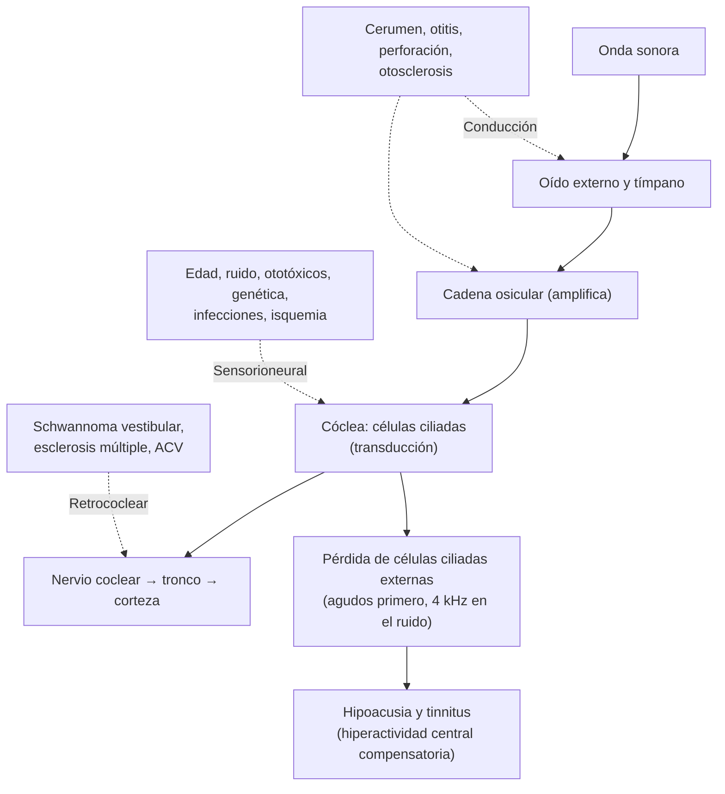

---
tags:
  - Otorrinolaringología
  - GES
---

# Hipoacusias, sordera súbita, barotrauma, trauma acústico y tinnitus

**Subespecialidad**
Otorrinolaringología · Audiología · Atención primaria · Pediatría · Salud ocupacional · Geriatría

**Guías principales**
AAO-HNS 2019: sordera súbita, actualización (*Otolaryngol Head Neck Surg*) · AAO-HNS 2014: tinnitus · MINSAL: GES N.° 56 (hipoacusia bilateral en personas de 65 años y más que requieren audífono), N.° 59 (hipoacusia neurosensorial bilateral del prematuro) y N.° 77 (hipoacusia moderada, severa y profunda en menores de 4 años) · MINSAL: protocolo PREXOR de exposición ocupacional a ruido

**Otras fuentes**
Comisión *Lancet* 2024 de prevención de la demencia · Ensayo ACHIEVE de audífonos y deterioro cognitivo (*Lancet* 2023) · Superintendencia de Salud: garantías GES · Ver [vértigo](../../neurologia/vertigo.md), [demencia](../../neurologia/demencia-y-deterioro-cognitivo.md), [meningitis](../../infectologia/meningitis-y-encefalitis.md), [accidentes del trabajo](../../traumatologia/accidentes-del-trabajo-y-enfermedades-profesionales.md), [infecciones de vías aéreas superiores](../../respiratorio/infecciones-de-vias-aereas-superiores.md) (otitis) y [tumores del SNC](../../neurologia/tumores-del-snc.md) (schwannoma vestibular)

**GES**
Sí: **N.° 56** (hipoacusia bilateral de los ≥ 65 años que requiere audífono), **N.° 59** (hipoacusia del prematuro) y **N.° 77** (hipoacusia moderada a profunda en los menores de 4 años).

**EUNACOM**
6.03.1.007 Diagnóstico diferencial de hipoacusias de transmisión · 6.03.1.008 Diagnóstico diferencial de hipoacusias sensorioneurales · 6.03.1.014 Hipoacusia neonatal · 6.03.1.031 Tinitus (sospecha, inicial, derivar) · 6.03.2.018 Sordera súbita (específico, inicial, derivar) · 6.03.2.006 Barotrauma ótico y trauma acústico agudo (específico, inicial, derivar) · 6.03.3.001 Detección de hipoacusia y sordera en niños · 6.03.3.007 Prevención de trauma acústico y daño por exposición a ruidos · 2.01.1.101 Hipoacusia (pediatría)

**Revisado**
Octubre 2026

!!! abstract "Resumen en 60 segundos"
    - **Hipoacusia de conducción (transmisión)**: problema del **oído externo o medio** (tapón de cerumen, otitis media con efusión, perforación, **otosclerosis**). **Rinne negativo** en el oído afectado y **Weber lateralizado hacia el oído enfermo**.
    - **Hipoacusia sensorioneural**: problema de la **cóclea** o del **nervio** (presbiacusia, ruido, ototóxicos, genética, infecciones, schwannoma vestibular). **Rinne positivo** y **Weber hacia el oído sano**.
    - **Sordera súbita**: hipoacusia sensorioneural de **≥ 30 dB en ≥ 3 frecuencias en < 72 horas**. **Urgencia**: audiometría y **corticoides** (orales o intratimpánicos) **dentro de las 2 semanas**; **RM** para descartar un **schwannoma vestibular**.
    - **Presbiacusia**: bilateral, simétrica, de **agudos**, progresiva; dificultad para entender en ambientes ruidosos. Es el principal **factor de riesgo modificable de demencia**: indicar **audífonos** (GES N.° 56 en los ≥ 65 años).
    - **Niños**: **tamizaje auditivo neonatal** (emisiones otoacústicas o potenciales evocados automatizados) en el primer mes, diagnóstico a los 3 meses e intervención a los 6 meses (regla **1-3-6**). Sospechar ante un **retraso del lenguaje**.
    - **Ruido**: daño acumulativo por exposición > **85 dB(A)** en 8 horas (protocolo **PREXOR**); **trauma acústico agudo** por explosiones. Prevención con protectores auditivos.
    - **Barotrauma**: dolor y hipoacusia al **descender** en un avión o al bucear; maniobras de Valsalva, descongestionantes.
    - **Tinnitus**: síntoma; estudiar con audiometría. **Pulsátil** o **unilateral** con hipoacusia: imágenes.

## Definición

- **Hipoacusia**: disminución de la audición. Según el umbral audiométrico promedio (adultos, OMS): **leve** (20–35 dB), **moderada** (35–50 dB), **moderadamente severa** (50–65 dB), **severa** (65–80 dB), **profunda** (80–95 dB) y **completa** (≥ 95 dB).
- **De conducción** (transmisión): el sonido no llega bien al oído interno (conducto auditivo externo, membrana timpánica, cadena osicular).
- **Sensorioneural**: daño de la **cóclea** (células ciliadas) o de la **vía auditiva** (nervio coclear, tronco cerebral).
- **Mixta**: componentes de ambas.
- **Sordera súbita** (AAO-HNS 2019): hipoacusia sensorioneural de **≥ 30 dB** en **≥ 3 frecuencias consecutivas**, instalada en **< 72 horas**. La mayoría es **idiopática**.
- **Barotrauma ótico**: lesión del oído medio (o interno) por cambios bruscos de la presión ambiental que la trompa de Eustaquio no logra igualar.
- **Trauma acústico agudo**: daño coclear por un ruido **impulsivo** muy intenso (> 140 dB: disparos, explosiones, fuegos artificiales).
- **Hipoacusia inducida por ruido**: daño coclear **crónico** por la exposición prolongada a ruido > 85 dB(A).
- **Tinnitus** (acúfeno): percepción de un sonido sin estímulo externo. **Subjetivo** (solo lo oye el paciente; el más frecuente) u **objetivo** (audible por el examinador: vascular, muscular). **Pulsátil**: sincrónico con el pulso.

## Epidemiología

- **Mundial**:
    - Según la OMS (Informe Mundial sobre la Audición, 2021), > **1.500 millones** de personas tienen algún grado de pérdida auditiva y ~ **430 millones** una pérdida discapacitante; se proyectan ~ 2.500 millones en 2050.
    - **Presbiacusia**: afecta a ~ 1/3 de los > 65 años y a más de la mitad de los > 75 años.
    - La **pérdida auditiva de la edad media** es el principal factor de riesgo **modificable** de demencia (Comisión *Lancet* 2024: ~ 7 % de los casos de demencia atribuibles).
    - **Hipoacusia congénita**: ~ **1–3 por cada 1.000** recién nacidos (hasta 2–4 % en los egresados de las UCI neonatales).
    - **Sordera súbita**: ~ **5–27 por 100.000** al año; edad media de 40–50 años.
    - **Tinnitus**: ~ **10–15 %** de los adultos; una minoría tiene un tinnitus molesto.
- **Chile**: la hipoacusia del prematuro, la hipoacusia de los menores de 4 años y la hipoacusia de los ≥ 65 años que requieren audífono tienen garantías GES; la hipoacusia por ruido es una de las enfermedades profesionales más frecuentes.

!!! chile "Datos nacionales (Superintendencia de Salud)"
    - **GES N.° 56, hipoacusia bilateral en personas de 65 años y más que requieren audífono**: **audífono** dentro de **45 días** desde la confirmación diagnóstica o la indicación de recambio; **rehabilitación** dentro de 30 días desde la entrega.
    - **GES N.° 59, hipoacusia neurosensorial bilateral del prematuro**: recién nacidos **< 1.500 g** o **< 32 semanas**; **tamizaje auditivo antes del alta** de neonatología; tratamiento dentro de **30 días** desde la confirmación.
    - **GES N.° 77, hipoacusia moderada, severa y profunda en menores de 4 años**: **diagnóstico** dentro de **90 días** desde la sospecha; **audífono** dentro de 90 días desde la confirmación; **implante coclear** dentro de 180 días desde la indicación.
    - **Ruido laboral**: el **D.S. N.° 594** fija el límite de exposición en **85 dB(A)** para 8 horas diarias; el **protocolo PREXOR** del MINSAL establece la vigilancia audiométrica de los trabajadores expuestos. La hipoacusia por ruido laboral es una **enfermedad profesional** (Ley 16.744).

## Etiología y factores de riesgo

| Tipo | Causas |
|---|---|
| **Conducción: oído externo** | **Tapón de cerumen** (la más frecuente), **otitis externa**, cuerpo extraño, exostosis (nadadores en agua fría), atresia del conducto |
| **Conducción: oído medio** | **Otitis media con efusión** (la causa más frecuente en los niños), otitis media aguda y crónica, **perforación timpánica**, **colesteatoma**, **otosclerosis** (fijación del estribo; adultos jóvenes, mujeres, familiar, empeora con el embarazo), disfunción tubaria, **barotrauma**, hemotímpano, discontinuidad osicular (trauma), tumores (glomus) |
| **Sensorioneural congénita** | **Genética** (~ 50–60 %; la mayoría no sindrómica, **conexina 26**/GJB2; sindrómicas: Pendred, Usher, Waardenburg, Alport), **CMV congénito** (la principal causa no genética), **rubéola**, toxoplasmosis, sífilis; **prematurez**, **hiperbilirrubinemia** grave, hipoxia perinatal, **ototóxicos** (aminoglicósidos), ventilación mecánica prolongada, malformaciones craneofaciales |
| **Sensorioneural adquirida** | **Presbiacusia**, **ruido** (laboral, recreativo, trauma acústico), **ototóxicos** (**aminoglicósidos**, **cisplatino**, diuréticos de asa en dosis altas IV, **salicilatos** en dosis altas, quinina, hidroxicloroquina, vancomicina), **meningitis bacteriana** (sobre todo neumocócica; puede producir osificación coclear), **paperas**, sarampión, **sífilis**, **enfermedad de Ménière**, **schwannoma vestibular** (unilateral progresiva), **trauma** (fractura del temporal), autoinmune, diabetes |
| **Sordera súbita** | **Idiopática** (~ 90 %; hipótesis viral, vascular o autoinmune); identificables: **schwannoma vestibular** (~ 1–5 %), ACV (arteria cerebelosa anteroinferior), esclerosis múltiple, fístula perilinfática, ototóxicos, Ménière, sífilis, Lyme |
| **Barotrauma** | **Descenso** en avión, **buceo**, cámara hiperbárica, con **disfunción tubaria** (resfrío, rinitis, desviación septal) |
| **Tinnitus** | Hipoacusia de cualquier causa (la más frecuente), ruido, ototóxicos, Ménière, schwannoma, trastornos temporomandibulares, ansiedad y depresión; **pulsátil**: tumores vasculares (**glomus**), malformaciones arteriovenosas, fístula dural, estenosis carotídea, **hipertensión endocraneana idiopática**, anemia, hipertiroidismo |

## Fisiopatología

*Figura 1. Vía auditiva y sitios de lesión en las hipoacusias de conducción y sensorioneurales. Esquema propio basado en las guías de la AAO-HNS (2014, 2019).*

- La **hipoacusia por ruido** produce una **muesca audiométrica en 4 kHz** (3–6 kHz) con recuperación en 8 kHz; la **presbiacusia**, una caída progresiva en los **agudos**.
- En el **barotrauma**, al **descender** aumenta la presión externa, el tímpano se retrae y, si la trompa no se abre, se produce un trasudado o hemorragia en el oído medio (y, raramente, una rotura de la ventana redonda u oval con fístula perilinfática).

## Clasificación

| Prueba (diapasón de 512 Hz) | Normal | Conducción (oído derecho) | Sensorioneural (oído derecho) |
|---|---|---|---|
| **Rinne** (conducción aérea vs ósea) | Positivo (aérea > ósea) en ambos | **Negativo** en el derecho (ósea > aérea) | Positivo en ambos |
| **Weber** (vértice del cráneo) | Central | Lateraliza al **derecho** (enfermo) | Lateraliza al **izquierdo** (sano) |

| Audiometría | Conducción | Sensorioneural |
|---|---|---|
| **Vía aérea** | Alterada | Alterada |
| **Vía ósea** | **Normal** | **Alterada** (igual a la aérea) |
| **Brecha aéreo-ósea** | **Presente** (> 10 dB) | Ausente |
| **Timpanometría** | Alterada (curva B: líquido; C: presión negativa) en el oído medio | Normal |

## Clínica

- **Tapón de cerumen**: hipoacusia **súbita** tras el baño o al usar cotonitos, sensación de oído tapado, a veces tinnitus o mareo.
- **Otitis media con efusión**: niño con hipoacusia leve a moderada, **retraso del lenguaje**, desatención; tímpano opaco y retraído con nivel o burbujas, sin signos de infección aguda.
- **Otosclerosis**: adulto joven (20–40 años), **mujer**, hipoacusia de conducción **progresiva** bilateral, tinnitus, antecedente familiar; el paciente oye mejor en ambientes ruidosos (paracusia de Willis); tímpano normal.
- **Presbiacusia**: hipoacusia **bilateral**, **simétrica**, **progresiva**, de **agudos**; dificultad para **entender** las palabras (más que para oír), sobre todo en **ambientes ruidosos** y con voces agudas (niños, mujeres); tinnitus; aislamiento social, depresión.
- **Hipoacusia por ruido**: bilateral, simétrica, con **tinnitus**; antecedente de exposición laboral o recreativa.
- **Trauma acústico agudo**: hipoacusia súbita, **tinnitus** intenso y sensación de oído tapado tras una explosión o disparo; puede haber **perforación timpánica**.
- **Schwannoma vestibular**: hipoacusia sensorioneural **unilateral progresiva** (o súbita), **tinnitus unilateral**, inestabilidad; en etapas avanzadas, hipoestesia facial (V par), paresia facial, ataxia e hidrocefalia.
- **Sordera súbita**: hipoacusia **unilateral** de instalación brusca (a menudo al despertar), sensación de **oído tapado**, **tinnitus** y, en ~ 30–40 %, **vértigo**. El otoscopio es **normal** (si hay un tapón o una otitis, no es una sordera súbita sensorioneural).
- **Barotrauma ótico**: **otalgia** intensa, sensación de oído tapado e hipoacusia de conducción durante o tras el **descenso** de un vuelo o una inmersión; tímpano **retraído**, hiperémico, con **hemotímpano** o líquido, a veces perforado. **Vértigo**, tinnitus e hipoacusia sensorioneural sugieren un **barotrauma de oído interno** (fístula perilinfática): urgencia.
- **Hipoacusia en el niño**:
    - **Recién nacido y lactante**: no se sobresalta con los ruidos, no gira la cabeza hacia los sonidos, no balbucea (6–9 meses).
    - **Preescolar**: **retraso del lenguaje** (no dice palabras a los 12–18 meses ni frases a los 24 meses), mala pronunciación, sube el volumen de la televisión, problemas de conducta o de atención.
    - **Escolar**: bajo rendimiento escolar.
- **Tinnitus**: zumbido, pitido o "ruido de mar", continuo o intermitente; en la mayoría asociado a una hipoacusia. El **pulsátil** sugiere una causa **vascular**.

!!! alarma "Signos de alarma"
    - **Hipoacusia súbita** con otoscopía normal: **sordera súbita** → evaluación (audiometría) y tratamiento **dentro de días**; derivación **urgente** a otorrinolaringología.
    - Hipoacusia súbita con **síntomas neurológicos** (diplopía, disartria, ataxia, hemiparesia, vértigo con nistagmo central): **ACV** de fosa posterior → urgencia neurológica.
    - Hipoacusia o **tinnitus unilateral** progresivos: descartar un **schwannoma vestibular** (RM).
    - **Tinnitus pulsátil**: tumor vascular, fístula dural o hipertensión endocraneana → imágenes.
    - **Barotrauma** con **vértigo**, nistagmo o hipoacusia sensorioneural: posible **fístula perilinfática**.
    - **Niño** con retraso del lenguaje o que no responde a los sonidos: evaluación auditiva **sin demora** (no esperar "que hable más tarde").
    - **Meningitis bacteriana**: evaluación auditiva precoz (riesgo de osificación coclear que limita el implante coclear).

## Diagnóstico

!!! guia "Puntos clave (AAO-HNS 2019 y 2014; GES N.° 56, 59 y 77)"
    - **Historia**: inicio (súbito o progresivo), uni o bilateral, tinnitus, vértigo, otalgia, otorrea, ruido, ototóxicos, trauma, antecedentes familiares, síntomas neurológicos.
    - **Otoscopía** (descartar tapón, otitis, perforación) y **pruebas con diapasón** (Rinne y Weber).
    - **Sordera súbita** (AAO-HNS 2019): distinguir la **conductiva** de la **sensorioneural** en la **primera consulta** (otoscopía y diapasón); **audiometría** lo antes posible (dentro de 14 días); **RM** con gadolinio de los conductos auditivos internos (o PEAT si no se puede) para descartar una **patología retrococlear**; **no** pedir de rutina laboratorio ni **TC** de cerebro (salvo si hay déficit neurológico).
    - **Audiometría tonal y vocal** e **impedanciometría** (timpanometría y reflejos estapediales) en toda hipoacusia persistente.
    - **Tamizaje neonatal**: **emisiones otoacústicas** (EOA) o **potenciales evocados auditivos de tronco automatizados** (PEATa; de elección en los egresados de UCI neonatal, porque las EOA no detectan la **neuropatía auditiva**). Meta **1-3-6**: tamizaje antes del **1.er mes**, diagnóstico antes de los **3 meses** e intervención antes de los **6 meses** (Joint Committee on Infant Hearing).
    - **Tinnitus** (AAO-HNS 2014): historia y examen dirigidos, **audiometría** si es unilateral, persistente (≥ 6 meses) o con hipoacusia; **imágenes** solo si es **unilateral**, **pulsátil** o con signos neurológicos o asimetría auditiva.

## Laboratorio

| Situación | Exámenes |
|---|---|
| **Sordera súbita** | **No** se recomienda laboratorio de rutina; según la clínica: **VDRL o RPR y prueba treponémica** (sífilis), glicemia, VHS, perfil autoinmune, serología de Lyme (zonas endémicas) |
| **Hipoacusia congénita** | **PCR de CMV** en saliva u orina en las **primeras 3 semanas** de vida (CMV congénito: tratable con valganciclovir), estudio genético (GJB2), serologías TORCH, ECG (síndrome de QT largo de Jervell y Lange-Nielsen), orina (Alport) |
| **Hipoacusia bilateral rápidamente progresiva** | Perfil autoinmune, VHS, PCR, sífilis |
| **Uso de ototóxicos** | **Audiometría basal** y seriada (cisplatino, aminoglicósidos por tiempo prolongado); niveles plasmáticos de aminoglicósidos |

## Imágenes

- **RM con gadolinio** de los conductos auditivos internos y del ángulo pontocerebeloso: hipoacusia sensorioneural **asimétrica** o **súbita**, tinnitus **unilateral** (schwannoma vestibular, esclerosis múltiple, ACV).
- **TC de hueso temporal**: hipoacusia de conducción con sospecha de **colesteatoma**, malformaciones, **otosclerosis**, **fractura** del temporal, osificación coclear posmeningitis (antes del implante).
- **Angio-TC o angio-RM**: **tinnitus pulsátil**.

## Diagnóstico diferencial

| Cuadro | Claves |
|---|---|
| **Sordera súbita** vs **tapón de cerumen** u **otitis media con efusión** | Otoscopía: en la sordera súbita es **normal** |
| **Sordera súbita** vs **Ménière** | Ménière: crisis **recurrentes** de vértigo (20 minutos a 12 horas), hipoacusia **fluctuante** de graves, tinnitus y plenitud ótica |
| **Sordera súbita** vs **ACV** (arteria cerebelosa anteroinferior) | Signos neurológicos de fosa posterior, factores de riesgo vascular |
| **Presbiacusia** vs **hipoacusia por ruido** | El ruido produce la muesca en 4 kHz; el antecedente de exposición orienta |
| **Hipoacusia** vs **deterioro cognitivo** | Ambos pueden coexistir; evaluar la audición en todo adulto mayor con quejas cognitivas |
| **Retraso del lenguaje**: hipoacusia vs **trastorno del espectro autista** o retraso global | Siempre descartar la **hipoacusia** con una evaluación objetiva |

## Tratamiento

!!! dosis "Sordera súbita (AAO-HNS 2019)"
    - **Corticoides** (opción, idealmente **dentro de las 2 semanas** del inicio; el beneficio disminuye después de 4–6 semanas):
        - **Oral**: **prednisona 1 mg/kg/día** (máximo **60 mg/día**) por **7–14 días** y luego disminución gradual.
        - **Intratimpánicos** (dexametasona o metilprednisolona): como **tratamiento inicial** si los corticoides sistémicos están contraindicados (diabetes descompensada) o como **rescate** si la recuperación es incompleta a las 2–6 semanas.
    - **Oxigenoterapia hiperbárica**: opción dentro de los 3 meses, combinada con corticoides.
    - **No** usar de rutina antivirales, trombolíticos, vasodilatadores ni antioxidantes.
    - **Audiometría de control** dentro de los 6 meses; **audífono** o implante si queda una hipoacusia residual.

- **Tapón de cerumen**: **lavado** ótico con agua tibia (si el tímpano está íntegro y no hay cirugía previa), **gotas ceruminolíticas** (agua oxigenada, aceite, bicarbonato) por algunos días o **extracción** con instrumental o aspiración; **no** usar cotonitos.
- **Otosclerosis**: **audífono** o **estapedotomía**.
- **Presbiacusia y otras hipoacusias sensorioneurales permanentes**:
    - **Audífonos** (en Chile, **GES N.° 56** en los ≥ 65 años con hipoacusia bilateral que lo requiere), con **rehabilitación** auditiva; dispositivos de asistencia (amplificadores, subtítulos).
    - **Implante coclear** en las hipoacusias severas a profundas que no se benefician con audífonos (niños y adultos).
    - Los audífonos mejoran la comunicación, la calidad de vida y la depresión; en el ensayo **ACHIEVE**, la intervención auditiva redujo el deterioro cognitivo en los adultos mayores con **mayor riesgo** de demencia.
    - **Estrategias de comunicación**: hablar de frente, despacio y claro, sin gritar, en un ambiente sin ruido.
- **Hipoacusia en el niño** (GES N.° 59 y 77): **audífonos** precoces (desde los primeros meses), **implante coclear** en la hipoacusia severa a profunda (idealmente antes de los **12–18 meses**), **rehabilitación fonoaudiológica**, apoyo escolar; **valganciclovir** en el CMV congénito sintomático (inicio en el primer mes).
- **Trauma acústico agudo**: alejarse del ruido, **corticoides orales** (como en la sordera súbita) si hay hipoacusia sensorioneural, control audiométrico; tratar la perforación si existe.
- **Barotrauma ótico**:
    - **Prevención**: no volar ni bucear con resfrío o rinitis no controlada; **descongestionante** tópico (oximetazolina) 30–60 minutos antes del descenso; **maniobras de Valsalva**, tragar o mascar chicle en el descenso; en los lactantes, alimentar durante el descenso.
    - **Tratamiento**: analgesia, descongestionantes tópicos u orales por pocos días, maniobras de autoinsuflación; antibiótico solo si hay infección o perforación contaminada. Contraindicado bucear o volar hasta la resolución. **Vértigo o hipoacusia sensorioneural**: derivación **urgente** (fístula perilinfática).
- **Hipoacusia inducida por ruido** (prevención y manejo):
    - **Reducir la exposición**: medidas de ingeniería (aislar las fuentes), administrativas (rotación, pausas) y **protectores auditivos** (tapones o fonos) cuando el ruido supera los **85 dB(A)**.
    - **Vigilancia audiométrica** periódica de los trabajadores expuestos (**PREXOR**) y notificación como enfermedad profesional.
    - Educación sobre el ruido **recreativo**: audífonos personales a < 60 % del volumen por < 60 minutos, conciertos, discotecas.
    - El daño es **irreversible**: audífonos si corresponde.
- **Tinnitus** (AAO-HNS 2014):
    - **Educación** y tranquilización (la mayoría se adapta).
    - **Audífonos** si hay hipoacusia (mejoran el tinnitus).
    - **Terapia cognitivo-conductual** (la intervención con mejor evidencia para el malestar).
    - **Terapia sonora** (ruido de fondo, generadores de sonido).
    - Tratar la **ansiedad**, la **depresión** y el **insomnio** asociados.
    - **No** recomienda de rutina antidepresivos, anticonvulsivantes, ansiolíticos ni suplementos (ginkgo, melatonina, zinc) para el tinnitus en sí; tampoco la estimulación magnética transcraneal.
    - **Tinnitus pulsátil**: tratar la causa vascular.

## Complicaciones

- **Hipoacusia no tratada**: **aislamiento social**, **depresión**, **deterioro cognitivo** y **demencia**, caídas, accidentes, menor desempeño laboral y escolar.
- **Niños**: **retraso del lenguaje**, dificultades de aprendizaje y de integración social; el daño es irreversible si no se interviene en el **período crítico** (primeros años).
- **Sordera súbita**: hipoacusia permanente, tinnitus crónico, vértigo.
- **Barotrauma**: perforación timpánica, fístula perilinfática con hipoacusia sensorioneural y vértigo permanentes.
- **Tinnitus**: insomnio, ansiedad, depresión y, en los casos graves, ideación suicida.

## Pronóstico y seguimiento

- **Sordera súbita**: ~ **1/3 a 2/3** recupera la audición de forma espontánea, sobre todo en las primeras 2 semanas; peor pronóstico con hipoacusia **profunda**, **vértigo**, **edad avanzada**, curva descendente y tratamiento tardío.
- **Presbiacusia**: progresiva; el audífono mejora la función y la calidad de vida.
- **Hipoacusia congénita**: con diagnóstico e intervención antes de los 6 meses, el desarrollo del lenguaje puede ser similar al de los niños oyentes.
- **Barotrauma**: la mayoría se resuelve en días a semanas.
- **Tinnitus**: habitualmente crónico, pero el malestar disminuye con el tiempo y la terapia.
- **Seguimiento**: audiometría periódica en los expuestos a ruido o a ototóxicos y en los adultos mayores; reevaluar los audífonos.

## Perlas para el internado

!!! perla "Para recordar"
    - **Rinne negativo + Weber al oído enfermo** = **conducción**. **Rinne positivo + Weber al oído sano** = **sensorioneural**.
    - **Hipoacusia súbita con otoscopía normal** = sordera súbita → **corticoides en las primeras 2 semanas** y **RM** (schwannoma).
    - Hipoacusia o tinnitus **unilateral progresivo**: **RM** (schwannoma vestibular).
    - **Tinnitus pulsátil**: imágenes vasculares.
    - **Presbiacusia**: agudos, bilateral, "oye pero no entiende". **Audífonos**: también protegen la cognición. **GES N.° 56** en los ≥ 65 años.
    - **Muesca en 4 kHz** = ruido. Límite laboral de **85 dB(A)** en 8 horas; **PREXOR**.
    - **Regla 1-3-6** en los recién nacidos; **PEATa** en los egresados de UCI neonatal. **CMV** congénito: la principal causa no genética.
    - Todo niño con **retraso del lenguaje**: evaluar la audición.
    - **Barotrauma** al **descender**: descongestionante antes del vuelo y Valsalva; **vértigo** = fístula perilinfática.
    - **Aminoglicósidos** y **cisplatino**: audiometría basal y seriada.

## Preguntas de repaso

??? repaso "1. Mujer de 45 años que despertó con hipoacusia del oído derecho, sensación de oído tapado y tinnitus. La otoscopía es normal; el Weber lateraliza a la izquierda y el Rinne es positivo en ambos oídos. ¿Diagnóstico y manejo?"
    **Sordera súbita sensorioneural** derecha (otoscopía normal, Weber al oído sano, Rinne positivo). **Derivación urgente** a otorrinolaringología para **audiometría** y **corticoides** precoces: **prednisona 1 mg/kg/día** (máximo 60 mg) por 7–14 días con disminución gradual, o **intratimpánicos** si hay contraindicación (rescate si la respuesta es incompleta). **RM** con gadolinio de los conductos auditivos internos para descartar un schwannoma vestibular. No pedir laboratorio ni TC de rutina.

??? repaso "2. Hombre de 74 años al que su familia nota que sube el volumen de la televisión y no entiende las conversaciones en las reuniones familiares; está más aislado y olvidadizo. ¿Qué sospecha, cómo lo confirma y qué ofrece?"
    **Presbiacusia** (hipoacusia sensorioneural bilateral, simétrica, de agudos). Confirmar con **otoscopía** (descartar tapón), **diapasones** y **audiometría**. Ofrecer **audífonos** con rehabilitación auditiva (**GES N.° 56**: audífono dentro de 45 días desde la confirmación) y estrategias de comunicación; evaluar el **deterioro cognitivo** y la **depresión**, porque la hipoacusia es un factor de riesgo modificable de demencia.

??? repaso "3. Trabajador de 50 años de una fundición con 25 años de exposición a ruido intenso, con tinnitus bilateral y dificultad para oír. La audiometría muestra una muesca bilateral en 4 kHz. ¿Diagnóstico y qué corresponde?"
    **Hipoacusia sensorioneural inducida por ruido** (muesca en 4 kHz). Es una **enfermedad profesional** (Ley 16.744): derivar a la mutualidad o al ISL, **notificar**, incorporar al trabajador al programa de **vigilancia audiométrica** (PREXOR), reducir la exposición (medidas de ingeniería, rotación) y asegurar el uso de **protectores auditivos** (el límite es 85 dB(A) en 8 horas según el D.S. N.° 594). El daño es irreversible: audífonos si corresponde.

??? repaso "4. Lactante de 2 meses, prematuro de 29 semanas que estuvo en ventilación mecánica y recibió aminoglicósidos, sin tamizaje auditivo registrado. ¿Qué examen corresponde y qué plazos se buscan?"
    Tiene varios factores de riesgo de hipoacusia (prematurez, UCI neonatal, ototóxicos) y está en el **GES N.° 59** (< 32 semanas). Corresponde el tamizaje con **potenciales evocados auditivos de tronco automatizados** (preferibles a las emisiones otoacústicas en los egresados de UCI neonatal, porque detectan la **neuropatía auditiva**), que debió hacerse antes del alta. Se busca la regla **1-3-6**: tamizaje antes de 1 mes, **diagnóstico antes de los 3 meses** e **intervención antes de los 6 meses** (audífonos, implante coclear y rehabilitación).

??? repaso "5. Mujer de 30 años que, tras un vuelo con resfrío, presenta otalgia intensa y oído tapado en el izquierdo; el tímpano está retraído con líquido de aspecto hemático. No tiene vértigo. ¿Diagnóstico y manejo? ¿Qué le recomienda para el próximo vuelo?"
    **Barotrauma ótico** del oído medio (hemotímpano tras el descenso con disfunción tubaria por el resfrío). Manejo: **analgesia**, **descongestionantes** tópicos u orales por pocos días, **maniobras de Valsalva** y no volar ni bucear hasta la resolución; derivar si aparece vértigo o hipoacusia sensorioneural (fístula perilinfática). Para el próximo vuelo: evitar volar resfriada si es posible, **oximetazolina** nasal 30–60 minutos antes del descenso, tragar, mascar chicle y hacer Valsalva durante el descenso.

??? repaso "6. Hombre de 52 años con tinnitus en el oído derecho desde hace 1 año, que en el último tiempo se acompaña de hipoacusia del mismo lado e inestabilidad. ¿Qué debe descartar y con qué examen? ¿Y si el tinnitus fuera pulsátil?"
    Tinnitus **unilateral** con hipoacusia **asimétrica** e inestabilidad: descartar un **schwannoma vestibular** con **audiometría** y **RM con gadolinio** de los conductos auditivos internos y el ángulo pontocerebeloso. Si el tinnitus fuera **pulsátil**, se buscaría una causa **vascular** (glomus, fístula dural, malformación arteriovenosa, estenosis carotídea) o una hipertensión endocraneana idiopática con **angio-TC o angio-RM**.

## Referencias

1. Chandrasekhar SS, Tsai Do BS, Schwartz SR, et al. Clinical practice guideline: sudden hearing loss (update). *Otolaryngol Head Neck Surg.* 2019;161(1 Suppl):S1–S45. doi:[10.1177/0194599819859885](https://doi.org/10.1177/0194599819859885)
2. Tunkel DE, Bauer CA, Sun GH, et al. Clinical practice guideline: tinnitus. *Otolaryngol Head Neck Surg.* 2014;151(2 Suppl):S1–S40. doi:[10.1177/0194599814545325](https://doi.org/10.1177/0194599814545325)
3. Livingston G, Huntley J, Liu KY, et al. Dementia prevention, intervention, and care: 2024 report of the Lancet standing Commission. *Lancet.* 2024;404(10452):572–628. doi:[10.1016/S0140-6736(24)01296-0](https://doi.org/10.1016/S0140-6736(24)01296-0)
4. Lin FR, Pike JR, Albert MS, et al. Hearing intervention versus health education control to reduce cognitive decline in older adults with hearing loss in the USA (ACHIEVE): a multicentre, randomised controlled trial. *Lancet.* 2023;402(10404):786–797. doi:[10.1016/S0140-6736(23)01406-X](https://doi.org/10.1016/S0140-6736(23)01406-X)
5. Organización Mundial de la Salud. Informe mundial sobre la audición. Ginebra: OMS; 2021. [https://www.who.int/publications/i/item/9789240020481](https://www.who.int/publications/i/item/9789240020481)
6. Ministerio de Salud de Chile. Guía Clínica GES: Hipoacusia bilateral en personas de 65 años y más que requieren uso de audífono. [https://diprece.minsal.cl/wrdprss_minsal/wp-content/uploads/2016/03/Hipoacusia-bilateral-mayores-65-a%C3%B1os.pdf](https://diprece.minsal.cl/wrdprss_minsal/wp-content/uploads/2016/03/Hipoacusia-bilateral-mayores-65-a%C3%B1os.pdf)
7. Ministerio de Salud de Chile. Guía de Práctica Clínica GES: Hipoacusia en menores de 4 años. Recomendaciones. [https://diprece.minsal.cl/le-informamos/auge/acceso-guias-clinicas/guias-clinicas-desarrolladas-utilizando-manual-metodologico/hipoacusia-en-menores-de-4-anos/recomendaciones/](https://diprece.minsal.cl/le-informamos/auge/acceso-guias-clinicas/guias-clinicas-desarrolladas-utilizando-manual-metodologico/hipoacusia-en-menores-de-4-anos/recomendaciones/)
8. Superintendencia de Salud. Problemas de salud GES N.° 56, 59 y 77. [https://www.superdesalud.gob.cl/orientacion-en-salud/hipoacusia-moderada-severa-y-profunda-en-personas-menores-de-4-anos/](https://www.superdesalud.gob.cl/orientacion-en-salud/hipoacusia-moderada-severa-y-profunda-en-personas-menores-de-4-anos/)
