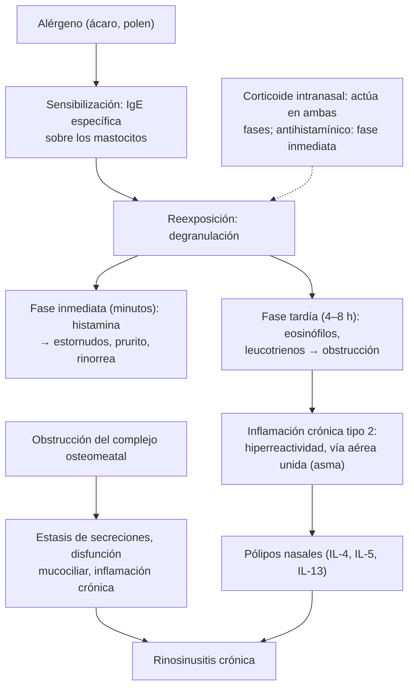

---
tags:
  - Otorrinolaringología
  - Frecuente en sala
---

# Nariz: rinitis alérgica, rinorrea y obstrucción nasal crónica, rinosinusitis crónica, poliposis, respirador bucal, atresia de coanas y cuerpo extraño nasal

**Subespecialidad**
Otorrinolaringología · Inmunología y alergia · Pediatría · Atención primaria

**Guías principales**
ARIA-EAACI 2024–2025: tratamientos intranasales (parte I) y orales y oculares (parte II) de la rinitis alérgica (*Allergy* 2026) · AAO-HNS 2015: rinitis alérgica · EPOS 2020: posición europea sobre rinosinusitis y pólipos nasales (*Rhinology*) · AAO-HNS 2025: sinusitis del adulto, actualización

**Otras fuentes**
Revisión de las lesiones por pila de botón (*Otolaryngol Clin North Am* 2026) · Ver [infecciones de vías aéreas superiores](../../respiratorio/infecciones-de-vias-aereas-superiores.md) (rinosinusitis aguda), [asma](../../respiratorio/asma.md), [apnea del sueño](../../respiratorio/apnea-del-sueno-y-trastornos-del-sueno.md), [conjuntivitis alérgica](../oftalmologia/conjuntivitis-ojo-seco-y-pterigion.md), [dermatitis atópica](../dermatologia/dermatitis-atopica-contacto-seborreica-y-del-panal.md), [oído](oido-otitis-media-cronica-y-urgencias-oticas.md) (otitis media con efusión)

**GES**
No (el **asma** moderada y grave sí tiene GES).

**EUNACOM**
6.03.1.001 Alergia nasosinusal (específico, completo, completo) · 6.03.3.003 Prevención de alergias nasosinusales · 6.03.1.016 Obstrucción nasal crónica (específico, inicial, derivar) · 6.03.1.024 Poliposis nasal (sospecha, inicial, derivar) · 6.03.1.025 Rinorrea crónica (sospecha, inicial, derivar) · 6.03.1.030 Sinusopatías crónicas (específico, inicial, derivar) · 6.03.1.028 Síndrome respirador bucal (específico, inicial, completo) · 6.03.2.005 Atresia coanal congénita (específico, inicial, derivar) · 6.03.2.010 Cuerpo extraño nasal (específico, inicial, derivar) · 6.03.3.005 Prevención de cuerpo extraño en niños · 2.01.1.103 Rinitis alérgica y 2.01.1.100 Hipertrofia adenoidea y amigdalina (pediatría)

**Revisado**
Octubre 2026

!!! abstract "Resumen en 60 segundos"
    - **Rinitis alérgica**: **estornudos** en salvas, **rinorrea acuosa**, **prurito** nasal y ocular, **obstrucción**; estacional (pólenes) o perenne (ácaros, epitelios). Se asocia al **asma** (preguntar siempre) y a la conjuntivitis alérgica. Tratamiento: **corticoide intranasal** (el más eficaz, uso diario) o **combinación corticoide más antihistamínico intranasal** en las moderadas a graves; **antihistamínico oral de segunda generación** en las leves o con síntomas oculares; **inmunoterapia** con alérgenos en casos seleccionados.
    - **Rinorrea crónica no alérgica**: vasomotora (cambios de temperatura, olores), **medicamentosa** (uso prolongado de **descongestionantes tópicos**: efecto rebote), hormonal (embarazo), gustativa (al comer), del adulto mayor. **Unilateral** acuosa: descartar una **fístula de LCR**; **unilateral fétida o sanguinolenta**: **cuerpo extraño** (niños) o **tumor** (adultos).
    - **Rinosinusitis crónica** (EPOS 2020): ≥ 2 síntomas por **≥ 12 semanas** (obstrucción o rinorrea, más dolor facial o **hiposmia**), confirmados con **endoscopía** o **TC**. **Sin pólipos** o **con pólipos** (tipo 2, eosinofílica, asociada al asma). **Lavados nasales con suero** y **corticoide intranasal**; corticoide oral en ciclos cortos; **cirugía endoscópica**; **biológicos** (dupilumab) en la poliposis grave.
    - **Pólipo unilateral** en un adulto: **biopsia** (papiloma invertido, cáncer). Pólipos en un **niño**: descartar **fibrosis quística**.
    - **Respirador bucal**: niño con boca abierta, **ronquido**, apneas, facies adenoidea, mala oclusión; causa principal: **hipertrofia adenoidea y amigdalina** y rinitis alérgica.
    - **Atresia de coanas bilateral**: **urgencia neonatal** (el RN respira por la nariz): **cianosis que mejora con el llanto**; no pasa la sonda por la nariz; **cánula de Mayo** y cirugía. Buscar **síndrome CHARGE**.
    - **Cuerpo extraño nasal**: niño con **rinorrea unilateral fétida**; **pila de botón** = urgencia.

## Definición

- **Rinitis**: inflamación de la mucosa nasal con ≥ 2 de: obstrucción, rinorrea, estornudos y prurito, por ≥ 1 hora al día en la mayoría de los días.
    - **Alérgica**: mediada por **IgE** contra alérgenos inhalados. **Intermitente** (< 4 días por semana o < 4 semanas seguidas) o **persistente**; **leve** o **moderada a grave** (si altera el sueño, las actividades o el trabajo, o los síntomas son molestos) (clasificación ARIA).
    - **No alérgica**: vasomotora, medicamentosa, hormonal, ocupacional, del adulto mayor, eosinofílica no alérgica (NARES), atrófica.
- **Rinosinusitis crónica** (EPOS 2020): inflamación de la nariz y los senos paranasales con **≥ 2 síntomas** por **≥ 12 semanas**, uno de los cuales debe ser la **obstrucción nasal** o la **rinorrea** (anterior o posterior), más **dolor o presión facial** o **reducción del olfato**, con evidencia **endoscópica** (pólipos, secreción mucopurulenta, edema) o **tomográfica** (alteraciones de la mucosa).
- **Poliposis nasal**: lesiones edematosas, pálidas, translúcidas, móviles e indoloras que protruyen de los meatos (sobre todo del medio), en el contexto de una rinosinusitis crónica.
- **Síndrome del respirador bucal**: respiración predominantemente oral por obstrucción de la vía aérea superior, con alteraciones del desarrollo craneofacial, del sueño y del comportamiento.
- **Atresia de coanas**: obliteración congénita (ósea o mixta) de la abertura posterior de las fosas nasales hacia la rinofaringe; **unilateral** (la más frecuente) o **bilateral**.

## Epidemiología

- **Mundial**:
    - La **rinitis alérgica** afecta a ~ **10–30 %** de los adultos y hasta ~ **40 %** de los niños en algunos países; ~ **40 %** de las personas con rinitis alérgica tiene **asma** y la mayoría de los asmáticos tiene rinitis.
    - **Rinosinusitis crónica**: ~ **5–12 %** de la población adulta; ~ 20–30 % con **pólipos**.
    - **Atresia de coanas**: ~ **1 por cada 5.000–8.000** nacidos vivos; más en las mujeres; ~ 50 % asociada a otras anomalías (**CHARGE**: coloboma, cardiopatía, atresia de coanas, retraso del crecimiento y del desarrollo, anomalías genitales y del oído).
    - **Cuerpos extraños nasales**: frecuentes entre los **2 y 5 años**.
- **Chile**:
    - La rinitis alérgica es una de las enfermedades crónicas más frecuentes en los niños y los adultos jóvenes.
    - En **Santiago** y la zona central, el **polen del plátano oriental** (*Platanus*) en primavera y los **pastos** en primavera y verano son alérgenos estacionales importantes; los **ácaros** del polvo doméstico son la principal causa de la rinitis perenne.

!!! chile "Datos nacionales"
    - La rinitis alérgica se maneja en la **APS** (corticoide intranasal y antihistamínico oral disponibles); se derivan las rinitis que no responden, las con sospecha de complicaciones y los candidatos a **inmunoterapia**.
    - El **asma bronquial moderada y grave** tiene garantía GES (en menores de 15 años y en personas de 15 años y más): toda rinitis alérgica debe preguntarse por síntomas de asma.
    - La **calidad del aire** (contaminación, episodios críticos en invierno, leña) empeora los síntomas nasales en las ciudades del centro y sur del país.

## Etiología y factores de riesgo

| Cuadro | Causas y factores de riesgo |
|---|---|
| **Rinitis alérgica** | **Atopia** (antecedente familiar, dermatitis atópica, asma, alergia alimentaria), **ácaros** del polvo, **pólenes** (árboles, pastos, malezas), **epitelios** de animales (gato, perro), **hongos**, cucarachas; contaminación, tabaco |
| **Rinitis no alérgica** | **Vasomotora** (cambios de temperatura, olores fuertes, alcohol), **medicamentosa** (**descongestionantes tópicos** > 5–7 días, **cocaína**, **antihipertensivos**: IECA, betabloqueadores, α-bloqueadores; inhibidores de la PDE5, AINE en la enfermedad respiratoria exacerbada por aspirina), **hormonal** (**embarazo**, hipotiroidismo, anticonceptivos), **ocupacional** (harinas, látex, químicos), **gustativa**, **del adulto mayor** (rinorrea acuosa colinérgica), **atrófica** (ocena) |
| **Obstrucción nasal crónica** | **Rinitis** (alérgica y no alérgica), **desviación septal**, **hipertrofia de cornetes**, **pólipos**, **hipertrofia adenoidea** (niños), cuerpo extraño, **tumores** (papiloma invertido, cáncer, angiofibroma juvenil), colapso valvular, granulomatosis con poliangeítis, sarcoidosis |
| **Rinosinusitis crónica sin pólipos** | Disfunción mucociliar, alteraciones anatómicas del complejo osteomeatal, infecciones recurrentes, **origen dental** (unilateral maxilar), fibrosis quística, discinesia ciliar, inmunodeficiencias |
| **Rinosinusitis crónica con pólipos** | Inflamación **tipo 2** (eosinofílica, IL-4, IL-5, IL-13), **asma**, **enfermedad respiratoria exacerbada por aspirina** (tríada de Samter: asma, pólipos e intolerancia a los AINE), **fibrosis quística** (niños), sinusitis fúngica alérgica |
| **Respirador bucal** | **Hipertrofia adenoidea** y **amigdalina**, **rinitis alérgica**, desviación septal, malformaciones craneofaciales, hábito |
| **Cuerpo extraño nasal** | **Niños pequeños** (juguetes, cuentas, semillas, papel, **pilas de botón**, imanes), adultos con discapacidad intelectual o trastornos psiquiátricos |

## Fisiopatología

*Figura 1. Fisiopatología de la rinitis alérgica y de la rinosinusitis crónica. Esquema propio basado en las guías ARIA-EAACI (2024–2025) y EPOS (2020).*

- Concepto de **vía aérea unida**: la nariz y los bronquios comparten la inflamación; el mal control de la rinitis empeora el asma.
- La **rinitis medicamentosa** se debe a la **taquifilaxia** y la vasodilatación de rebote por el uso prolongado de descongestionantes α-adrenérgicos tópicos (oximetazolina, nafazolina).

## Clasificación

| Rinitis alérgica (ARIA) | Criterio |
|---|---|
| **Intermitente** | Síntomas < 4 días por semana **o** < 4 semanas consecutivas |
| **Persistente** | Síntomas ≥ 4 días por semana **y** ≥ 4 semanas consecutivas |
| **Leve** | Sueño normal, sin alteración de las actividades, el trabajo o el colegio, síntomas no molestos |
| **Moderada a grave** | Uno o más: alteración del **sueño**, de las **actividades** diarias o deportivas, del **trabajo** o el colegio, o síntomas **molestos** |

| Rinosinusitis crónica (EPOS 2020) | Rasgos |
|---|---|
| **Primaria localizada** | Unilateral: sinusitis fúngica alérgica, sinusitis aislada (por ejemplo, de origen dental) |
| **Primaria difusa tipo 2** | Con **pólipos**, eosinofílica, asociada al asma y a la enfermedad respiratoria exacerbada por aspirina |
| **Primaria difusa no tipo 2** | Habitualmente sin pólipos, neutrofílica |
| **Secundaria** | Fibrosis quística, discinesia ciliar primaria, inmunodeficiencias, granulomatosis con poliangeítis, origen dental, tumores |

## Clínica

- **Rinitis alérgica**:
    - **Estornudos** en salvas, **rinorrea acuosa** abundante, **prurito** nasal, palatino, ótico y ocular, **obstrucción** nasal (a veces alternante), **hiposmia**.
    - **Conjuntivitis alérgica** asociada (prurito ocular, lagrimeo).
    - **Estacional** (primavera) o **perenne** (peor en la mañana, con el aseo o la cama: ácaros).
    - **Signos**: **ojeras alérgicas**, **pliegue nasal transverso** y "**saludo alérgico**" (frotarse la nariz hacia arriba) en los niños; mucosa nasal **pálida**, **edematosa**, azulada, con secreción acuosa; cornetes hipertróficos.
    - **Síntomas del asma** (tos, sibilancias, disnea con el ejercicio) y de la **dermatitis atópica**.
- **Rinitis vasomotora**: rinorrea acuosa y obstrucción con los cambios de temperatura, el aire frío, los olores, el alcohol; sin prurito ni estornudos importantes.
- **Rinitis medicamentosa**: **obstrucción** nasal intensa en alguien que usa **descongestionantes tópicos** a diario por semanas; mucosa roja y edematosa.
- **Rinosinusitis crónica**: **obstrucción** y **congestión** nasal, **rinorrea** anterior o **posterior** (descarga posterior: tos crónica, carraspera), **presión o dolor facial** (menos que en la aguda), **hiposmia o anosmia** (típica de la poliposis), halitosis, fatiga.
- **Poliposis nasal**: obstrucción nasal **bilateral** progresiva, **anosmia**, rinorrea; pólipos pálidos, grises, translúcidos, **indoloros** y móviles; ensanchamiento de la pirámide nasal en las formas masivas.
- **Pólipo unilateral** o masa nasal **sangrante**, obstrucción **unilateral** progresiva, epistaxis, dolor o hipoestesia facial, epífora, diplopía: **tumor** (papiloma invertido, carcinoma; en el **adolescente varón** con epistaxis, **angiofibroma juvenil nasofaríngeo**).
- **Respirador bucal** (niño):
    - Duerme con la **boca abierta**, **ronca**, tiene **pausas respiratorias**, sueño intranquilo, **enuresis**.
    - **Somnolencia** o **hiperactividad** diurna, bajo rendimiento escolar.
    - **Facies adenoidea**: cara larga y estrecha, labio superior corto, ojeras, paladar ojival.
    - **Mala oclusión** dental, babeo nocturno, halitosis.
    - **Otitis** media con efusión recurrente (adenoides); voz hiponasal.
- **Atresia de coanas**:
    - **Bilateral**: recién nacido con **dificultad respiratoria** y **cianosis** que **empeoran al alimentarse** o al cerrar la boca y **mejoran con el llanto** ("cianosis paradójica"), porque el recién nacido es un respirador nasal obligado.
    - **Unilateral**: diagnóstico más tardío por **rinorrea unilateral** persistente y obstrucción unilateral.
    - **No se puede pasar una sonda** de alimentación por la nariz hacia la faringe (más de 3–4 cm).
- **Cuerpo extraño nasal**: niño con **rinorrea unilateral purulenta y fétida**, a veces sanguinolenta, obstrucción unilateral, **halitosis**; a menudo no se refiere el antecedente.

!!! alarma "Signos de alarma"
    - **Síntomas unilaterales**: obstrucción, rinorrea sanguinolenta, **epistaxis recurrente**, pólipo unilateral, dolor facial: **tumor** → nasofibroscopía y TC.
    - **Rinorrea acuosa unilateral** que aumenta al inclinarse, tras un **TEC** o una cirugía: **fístula de LCR** (riesgo de **meningitis**).
    - **Complicaciones de la sinusitis**: **edema periorbitario**, **proptosis**, **diplopía**, baja de visión (complicación **orbitaria**); **cefalea intensa**, vómitos, alteración de conciencia, signos meníngeos (complicación **intracraneana**) → urgencia.
    - **Recién nacido** con **cianosis que mejora con el llanto**: **atresia de coanas bilateral** → cánula orofaríngea (Mayo) y derivación.
    - **Pila de botón** en la nariz: **extracción urgente** (necrosis y perforación septal en horas).
    - **Niño** con pólipos nasales: descartar **fibrosis quística** (test del sudor).
    - Rinitis con **costras**, **epistaxis**, perforación septal, nariz en silla de montar, otitis o síntomas sistémicos: **granulomatosis con poliangeítis** (ANCA) o consumo de **cocaína**.
    - **Apneas** observadas en un niño que ronca: **apnea obstructiva del sueño** → derivación.

## Diagnóstico

!!! guia "Puntos clave (ARIA-EAACI 2024–2025; AAO-HNS 2015; EPOS 2020; AAO-HNS 2025)"
    - **Rinitis alérgica**: diagnóstico **clínico** (historia y examen). Las **pruebas de alergia** (**prick test** cutáneo o **IgE específica** en sangre) se piden si hay duda diagnóstica, mala respuesta al tratamiento empírico o para planificar la **inmunoterapia** o las medidas de evitación. **No** pedir imágenes de rutina. Evaluar el **asma** (síntomas y espirometría).
    - **Rinosinusitis crónica**: **nasofibroscopía** (pólipos, secreción en el meato medio, edema) o **TC de senos paranasales** (engrosamiento mucoso, opacificación del complejo osteomeatal) para confirmar; la **TC** se pide **después del tratamiento médico** o antes de la cirugía (no en la consulta inicial ni en la sinusitis aguda no complicada).
    - **Rinoscopía anterior** con otoscopio en la APS (pólipos, cuerpo extraño, desviación septal, mucosa) y **nasofibroscopía** por el especialista.
    - **Respirador bucal**: examen de la orofaringe (amígdalas), **nasofibroscopía** o **radiografía lateral de cavum** (adenoides), evaluación del sueño (polisomnografía según el caso).
    - **Atresia de coanas**: imposibilidad de pasar una sonda, **nasofibroscopía** y **TC** (ósea o mixta); buscar anomalías asociadas (**CHARGE**: ecocardiograma, evaluación ocular y auditiva).

## Laboratorio

| Situación | Exámenes |
|---|---|
| **Rinitis alérgica** con duda diagnóstica o candidata a inmunoterapia | **Prick test** o **IgE específica**; la **IgE total** y el recuento de eosinófilos son poco útiles por sí solos |
| **Rinosinusitis crónica con pólipos** | **Eosinófilos** en sangre e **IgE total** (fenotipo tipo 2, decisión de biológicos) |
| **Pólipos en un niño** | **Test del sudor** (fibrosis quística) |
| **Rinosinusitis recurrente o refractaria** | Inmunoglobulinas (IgG, IgA, IgM), respuesta a las vacunas; estudio de discinesia ciliar (óxido nítrico nasal) |
| **Sospecha de vasculitis** | **ANCA**, orina completa, creatinina |
| **Rinorrea acuosa unilateral** | **Beta-2 transferrina** en la secreción (fístula de LCR) |

## Imágenes

- **TC de senos paranasales** sin contraste: rinosinusitis crónica (tras el tratamiento médico o antes de la cirugía), sospecha de complicaciones (con contraste), tumores (con RM), atresia de coanas.
- **RM**: tumores (extensión a la órbita o el cráneo), complicaciones intracraneanas, sinusitis fúngica invasora.
- **Radiografía lateral de cavum**: tamaño de las adenoides en los niños (cuando no se dispone de nasofibroscopía).
- La **radiografía de senos** tiene poca utilidad.

## Diagnóstico diferencial

| Cuadro | Claves |
|---|---|
| **Rinitis alérgica** vs **resfrío común** | El resfrío dura < 10 días, con fiebre, odinofagia, secreción que se espesa; contagio |
| **Rinitis alérgica** vs **rinosinusitis crónica** | En la sinusitis predominan la obstrucción, la secreción espesa, el dolor facial y la hiposmia, con duración ≥ 12 semanas |
| **Pólipo nasal** vs **cornete hipertrófico** | El pólipo es pálido, translúcido, móvil e **indoloro** al tocarlo; el cornete es rosado, sensible y se retrae con descongestionante |
| **Pólipo bilateral** vs **unilateral** | El bilateral sugiere una rinosinusitis crónica; el **unilateral** obliga a descartar un tumor (papiloma invertido, carcinoma, meningoencefalocele) |
| **Respirador bucal**: adenoides vs rinitis | Nasofibroscopía; ambas coexisten con frecuencia |
| **Atresia de coanas** vs otras causas de obstrucción neonatal | Rinitis neonatal, estenosis de la apertura piriforme, dacriocistocele, encefalocele, masas |
| **Cuerpo extraño** vs **sinusitis unilateral** | Examen con rinoscopía; en los niños, la rinorrea unilateral fétida es un cuerpo extraño hasta que se demuestre lo contrario |

## Tratamiento

!!! dosis "Rinitis alérgica (ARIA-EAACI 2024–2025; AAO-HNS 2015)"
    | Tratamiento | Indicación y esquema |
    |---|---|
    | **Evitación de alérgenos** | Ácaros: fundas antiácaros, lavar la ropa de cama a > 60 °C, reducir alfombras y peluches, ventilar y disminuir la humedad. Pólenes: ventanas cerradas en la temporada, ducharse al llegar a casa. Mascotas: fuera del dormitorio. Evitar el humo de tabaco |
    | **Lavados nasales con suero fisiológico** | Coadyuvante en todos (adultos y niños) |
    | **Antihistamínico H1 oral de segunda generación** | Formas **leves** o intermitentes, o con predominio de síntomas oculares: **cetirizina 10 mg**, **loratadina 10 mg**, **desloratadina 5 mg**, **levocetirizina 5 mg**, **bilastina 20 mg**, **fexofenadina 180 mg** al día (dosis pediátricas según el peso). **Evitar** los de primera generación (clorfenamina: sedación) |
    | **Corticoide intranasal** | El tratamiento **más eficaz**, de elección en las **persistentes** o **moderadas a graves**, especialmente con **obstrucción**: **mometasona** 2 aplicaciones (100 µg) en cada fosa una vez al día, **fluticasona** o **budesonida**. Uso **diario y continuo** (efecto en días); dirigir el aerosol hacia la pared lateral (no al tabique) |
    | **Corticoide más antihistamínico intranasal** (azelastina con fluticasona) | Formas **moderadas a graves** o que no se controlan con un fármaco: más eficaz y de acción más rápida que cada componente por separado |
    | **Antihistamínico intranasal** (azelastina, olopatadina) | Acción rápida; alternativa o combinación |
    | **Montelukast** | No es de primera línea (menor eficacia; advertencia por efectos **neuropsiquiátricos**); considerar si hay asma concomitante y otros tratamientos fallan |
    | **Descongestionantes** | Tópicos solo **< 5 días** (rinitis medicamentosa); orales (pseudoefedrina) con precaución (HTA, cardiopatía, glaucoma, prostatismo) |
    | **Corticoides orales** | No de rutina; ciclo corto excepcional en los síntomas muy intensos |
    | **Inmunoterapia con alérgenos** (subcutánea o sublingual) | Rinitis alérgica moderada a grave con sensibilización demostrada que no se controla con fármacos o no los tolera; **modifica la enfermedad** y puede prevenir el asma (especialista, por 3–5 años) |
    | **Antihistamínico o estabilizador de mastocitos ocular** | Síntomas oculares |

!!! dosis "Rinosinusitis crónica y poliposis (EPOS 2020; AAO-HNS 2025)"
    - **Lavados nasales con suero fisiológico** de alto volumen, 1–2 veces al día.
    - **Corticoide intranasal** diario de forma prolongada (también en gotas o irrigaciones en los pólipos).
    - **Corticoide oral** en ciclos **cortos** (por ejemplo, prednisona 0,5 mg/kg/día por 5–7 días, 1–2 veces al año) en la poliposis con síntomas intensos.
    - **Antibióticos**: solo en las exacerbaciones agudas bacterianas; los macrólidos prolongados en dosis bajas, en casos seleccionados sin pólipos (especialista).
    - **Cirugía endoscópica nasosinusal** si falla el tratamiento médico adecuado.
    - **Biológicos** en la **poliposis grave tipo 2** que no responde a los corticoides o que recidiva tras la cirugía (especialmente con asma): **dupilumab**, **omalizumab**, **mepolizumab**, **tezepelumab** (especialista).
    - **Enfermedad respiratoria exacerbada por aspirina**: evitar los AINE (paracetamol y celecoxib suelen tolerarse); desensibilización con aspirina en casos seleccionados.
    - Tratar el **asma** asociada y el **foco dental** en la sinusitis maxilar unilateral.

- **Rinitis medicamentosa**: **suspender el descongestionante tópico** (gradualmente o de una vez), con **corticoide intranasal** diario (y a veces un ciclo corto de corticoide oral) para tolerar la suspensión.
- **Rinitis vasomotora**: **ipratropio intranasal** (si predomina la rinorrea), azelastina o corticoide intranasal; evitar los gatillantes.
- **Rinitis del embarazo**: lavados con suero, elevar la cabecera; corticoide intranasal (budesonida) si es necesario; evitar los descongestionantes.
- **Obstrucción nasal crónica por desviación septal o cornetes**: **septoplastia** y reducción de los cornetes (turbinoplastia) si hay síntomas significativos que no responden al tratamiento médico.
- **Respirador bucal**:
    - Tratar la **rinitis alérgica** (corticoide intranasal).
    - **Adenoidectomía** (con o sin **amigdalectomía**) si hay **hipertrofia adenoamigdalina** obstructiva con apnea del sueño, otitis media con efusión recurrente o sinusitis recurrentes.
    - **Ortodoncia** y **fonoaudiología** (reeducación de la respiración y la deglución).
- **Atresia de coanas**:
    - **Bilateral**: **urgencia**: asegurar la vía aérea con una **cánula orofaríngea (Mayo)** o un chupete de McGovern; alimentación por sonda orogástrica; intubación si es necesario; **cirugía endoscópica** (transnasal) en los primeros días o semanas.
    - **Unilateral**: cirugía electiva (habitualmente en la infancia).
- **Cuerpo extraño nasal**:
    - **Pila de botón**: **extracción inmediata** por el especialista (no usar gotas ni lavados).
    - **Técnica del "beso de la madre"**: con la narina sana ocluida, la madre sopla en la boca del niño (presión positiva) para expulsar el objeto.
    - **Extracción** con un gancho romo, una pinza o aspiración, con buena luz, anestesia tópica y vasoconstrictor, y el niño inmovilizado; **derivar** si no se logra al primer intento, si el objeto es posterior, o es una pila o un imán.
    - Revisar la **otra fosa** y los **oídos**.
    - Riesgo de **aspiración** al manipular: tener aspiración disponible.
- **Prevención de los cuerpos extraños en los niños**: mantener fuera del alcance de los menores de 5 años los **objetos pequeños**, las **pilas de botón** y los **imanes**, juguetes adecuados a la edad (sin piezas pequeñas), supervisar el juego, no dar frutos secos enteros a los menores de 5 años, educar a los padres sobre la urgencia de las pilas.
- **Prevención de las alergias nasosinusales**: **lactancia materna**, **evitar el humo de tabaco** (en el embarazo y en el hogar), control de los **ácaros** y la humedad en la vivienda en las personas sensibilizadas, tratamiento precoz de la rinitis para prevenir el asma y la **inmunoterapia** en los candidatos.

## Complicaciones

- **Rinitis alérgica**: mal control del **asma**, **otitis media con efusión**, **rinosinusitis**, alteración del **sueño** y del rendimiento escolar o laboral, mala oclusión dental.
- **Rinosinusitis**: complicaciones **orbitarias** (celulitis preseptal y orbitaria, absceso subperióstico), **intracraneanas** (meningitis, absceso epidural o cerebral, trombosis del seno cavernoso), **óseas** (osteomielitis frontal: tumor de Pott), mucocele.
- **Poliposis**: anosmia permanente, recidiva tras la cirugía, deformidad nasal.
- **Respirador bucal**: **apnea obstructiva del sueño**, alteraciones del crecimiento facial y dental, cor pulmonale (en los casos graves), dificultades de aprendizaje.
- **Atresia de coanas bilateral no reconocida**: hipoxemia, aspiración, muerte.
- **Cuerpo extraño**: infección, sinusitis, epistaxis, **perforación septal** (pilas), **aspiración** a la vía aérea, rinolito.
- **Corticoides intranasales**: epistaxis leve, sequedad, perforación septal (muy rara, por mala técnica).

## Pronóstico y seguimiento

- **Rinitis alérgica**: crónica, con buen control con el tratamiento; la inmunoterapia puede modificar su curso. Reevaluar el control y el asma en cada consulta.
- **Rinosinusitis crónica con pólipos**: recidivas frecuentes (mejor control con los biológicos en los tipo 2).
- **Respirador bucal**: la adenoamigdalectomía resuelve la apnea del sueño en la mayoría de los niños sin otros factores.
- **Atresia de coanas**: buen pronóstico tras la cirugía, con riesgo de **reestenosis**.
- **Cuerpo extraño**: excelente pronóstico con la extracción oportuna.

## Perlas para el internado

!!! perla "Para recordar"
    - **Estornudos + prurito + rinorrea acuosa** = rinitis alérgica. Siempre **preguntar por asma**.
    - **Corticoide intranasal diario** = el tratamiento más eficaz (sobre todo con obstrucción). Moderada a grave: **corticoide + antihistamínico intranasal**.
    - **Descongestionante tópico máximo 5 días** (rinitis medicamentosa).
    - Rinosinusitis crónica: **≥ 12 semanas**, **obstrucción o rinorrea** + **dolor facial o hiposmia**. **Lavados + corticoide intranasal**. TC después del tratamiento médico.
    - **Anosmia + pólipos + asma + intolerancia a la aspirina** = tríada de **Samter**.
    - **Pólipo unilateral** en un adulto: **biopsia**. **Pólipos en un niño**: **test del sudor**.
    - **Adolescente varón con epistaxis y obstrucción unilateral**: **angiofibroma juvenil** (no biopsiar en la consulta).
    - **Rinorrea acuosa unilateral** tras un TEC: **fístula de LCR** (beta-2 transferrina).
    - **Recién nacido con cianosis que mejora con el llanto**: **atresia de coanas bilateral** → **cánula de Mayo**.
    - **Niño con rinorrea unilateral fétida** = **cuerpo extraño**. **Pila de botón** = extracción urgente.
    - **Respirador bucal + ronquido + apneas**: adenoamigdalectomía.

## Preguntas de repaso

??? repaso "1. Mujer de 24 años con estornudos en salvas, rinorrea acuosa, prurito nasal y ocular cada primavera desde hace años, que ahora le alteran el sueño y el trabajo. Tiene sibilancias ocasionales con el ejercicio. ¿Diagnóstico, clasificación y tratamiento?"
    **Rinitis alérgica** estacional (probablemente por **pólenes**), **intermitente o persistente** según la duración y **moderada a grave** (altera el sueño y el trabajo), con probable **asma** asociada. Tratamiento: **corticoide intranasal** diario (mometasona 200 µg/día) o la combinación **corticoide más antihistamínico intranasal** (azelastina con fluticasona), **antihistamínico ocular** o oral para los ojos, **lavados nasales** y evitación de pólenes; iniciar unas semanas antes de la temporada. Evaluar el asma con **espirometría** y tratarla. Derivar a inmunoterapia si no se controla.

??? repaso "2. Hombre de 45 años con obstrucción nasal intensa desde hace 3 meses que usa oximetazolina nasal varias veces al día porque si no, no puede respirar. ¿Diagnóstico y tratamiento?"
    **Rinitis medicamentosa** (efecto rebote por el uso prolongado de descongestionante tópico). Tratamiento: **suspender la oximetazolina** (gradualmente o de una vez, por ejemplo una fosa primero) con **corticoide intranasal diario** y, si es necesario, un ciclo corto de corticoide oral para tolerar la suspensión; buscar la causa original de la obstrucción (rinitis alérgica, desviación septal). Educar sobre el uso máximo de 5 días.

??? repaso "3. Mujer de 50 años con asma de difícil control, obstrucción nasal bilateral, anosmia y crisis de asma al tomar ibuprofeno. En la rinoscopía se ven masas pálidas, translúcidas e indoloras en ambas fosas. ¿Diagnóstico y manejo?"
    **Rinosinusitis crónica con pólipos nasales** en el contexto de una **enfermedad respiratoria exacerbada por aspirina** (tríada de Samter: asma, pólipos e intolerancia a los AINE). Manejo: **evitar los AINE**, **lavados nasales**, **corticoide intranasal** diario, ciclos cortos de corticoide oral, **TC de senos** y derivación a ORL para **cirugía endoscópica** si no responde; **biológicos** (dupilumab, omalizumab, mepolizumab) en la forma grave tipo 2, coordinados con el manejo del asma. Considerar la desensibilización con aspirina.

??? repaso "4. Niño de 5 años que duerme con la boca abierta, ronca todas las noches con pausas respiratorias, está hiperactivo y tiene otitis media con efusión recurrente. Las amígdalas están grado 3–4. ¿Diagnóstico y manejo?"
    **Síndrome del respirador bucal** por **hipertrofia adenoamigdalina** con probable **apnea obstructiva del sueño** y otitis media con efusión. Derivar a ORL: **nasofibroscopía** o radiografía de cavum (adenoides), evaluación del sueño según el caso y **adenoamigdalectomía** (con tubos de ventilación si persiste la efusión). Tratar la rinitis alérgica si coexiste (corticoide intranasal) y derivar a ortodoncia y fonoaudiología.

??? repaso "5. Recién nacido de 6 horas con episodios de cianosis y dificultad respiratoria al alimentarse, que mejoran cuando llora. No se logra pasar una sonda por ninguna de las fosas nasales. ¿Diagnóstico y manejo inmediato?"
    **Atresia de coanas bilateral** (el recién nacido es un respirador nasal obligado; la cianosis mejora con el llanto porque respira por la boca). Manejo inmediato: asegurar la vía aérea oral con una **cánula orofaríngea (Mayo)** o un chupete de McGovern, **alimentación por sonda orogástrica**, intubación si es necesario y derivación a ORL para **TC** y **cirugía endoscópica** precoz. Buscar el **síndrome CHARGE** (coloboma, cardiopatía, retraso del crecimiento, anomalías genitales y del oído).

??? repaso "6. Niña de 3 años con rinorrea purulenta y fétida por la fosa derecha desde hace 10 días, sin fiebre, que no mejoró con antibiótico. ¿Qué sospecha y qué hace?"
    **Cuerpo extraño nasal** (rinorrea **unilateral fétida** en un niño pequeño). Rinoscopía anterior con buena luz; si es visible y accesible: técnica del "**beso de la madre**" o extracción con un gancho romo con el niño inmovilizado; si no se logra, es posterior o se sospecha una **pila de botón** o un imán, **derivación urgente** a ORL. Revisar la otra fosa y los oídos, y educar a los padres en la prevención.

## Referencias

1. Sousa-Pinto B, Bousquet J, Vieira RJ, et al. Allergic Rhinitis and Its Impact on Asthma (ARIA)-EAACI guidelines, 2024–2025 revision. Part I: guidelines on intranasal treatments. *Allergy.* 2026;81(4):954–976. doi:[10.1111/all.70131](https://doi.org/10.1111/all.70131)
2. Vieira RJ, Sousa-Pinto B, Bousquet J, et al. Allergic Rhinitis and Its Impact on Asthma (ARIA)-EAACI guidelines, 2024–2025 revision. Part II: guidelines on oral and ocular treatments. *Allergy.* 2026;81(6):1947–1970. doi:[10.1111/all.70305](https://doi.org/10.1111/all.70305)
3. Seidman MD, Gurgel RK, Lin SY, et al. Clinical practice guideline: allergic rhinitis. *Otolaryngol Head Neck Surg.* 2015;152(1 Suppl):S1–S43. doi:[10.1177/0194599814561600](https://doi.org/10.1177/0194599814561600)
4. Fokkens WJ, Lund VJ, Hopkins C, et al. European Position Paper on Rhinosinusitis and Nasal Polyps 2020. *Rhinology.* 2020;58(Suppl S29):1–464. doi:[10.4193/Rhin20.600](https://doi.org/10.4193/Rhin20.600)
5. Payne SC, McKenna M, Buckley J, et al. Clinical practice guideline: adult sinusitis update. *Otolaryngol Head Neck Surg.* 2025;173(Suppl 1):S1–S56. doi:[10.1002/ohn.1344](https://doi.org/10.1002/ohn.1344)
6. Craft A, Sethia R, Jatana KR. Current state of button battery ingestion injuries. *Otolaryngol Clin North Am.* 2026;59(5):911–925. doi:[10.1016/j.otc.2026.03.005](https://doi.org/10.1016/j.otc.2026.03.005)
