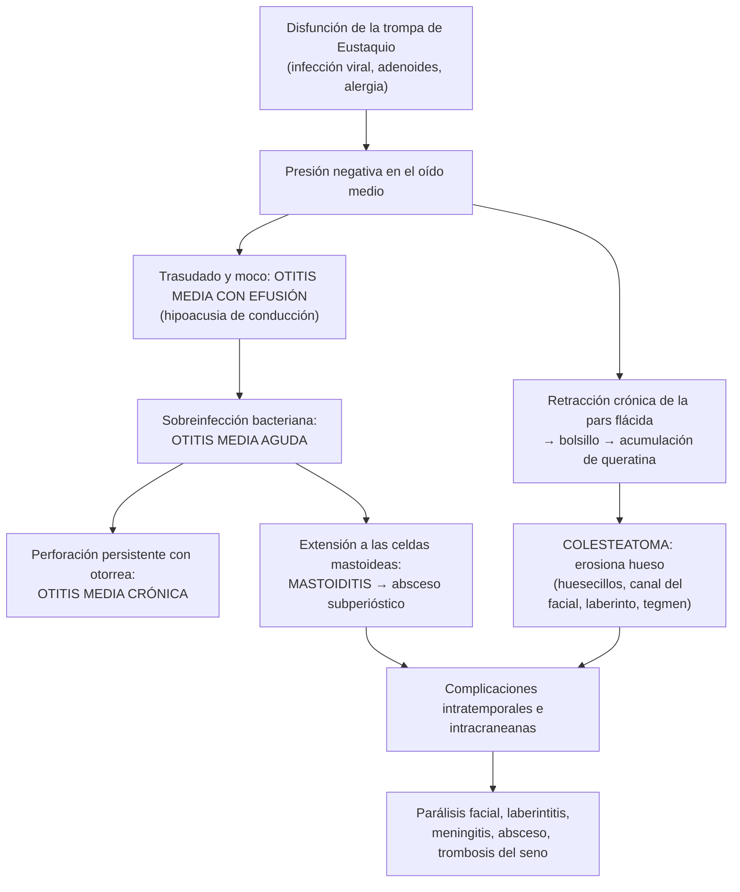

---
tags:
  - Otorrinolaringología
  - Frecuente en sala
---

# Oído: otitis media con efusión, otitis media recurrente y crónica, mastoiditis, colesteatoma y urgencias del oído

**Subespecialidad**
Otorrinolaringología · Pediatría · Atención primaria · Urgencia

**Guías principales**
AAO-HNS 2016: otitis media con efusión, actualización · AAO-HNS 2022: tubos de ventilación en niños, actualización · AAP 2013: diagnóstico y manejo de la otitis media aguda · AAO-HNS 2014: otitis externa aguda (*Otolaryngol Head Neck Surg*) · Consenso EAONO/JOS 2017: definiciones y estadificación del colesteatoma

**Otras fuentes**
Revisión Cochrane de antibióticos tópicos en la otitis media crónica supurada (2020) · Revisión del manejo del otohematoma (*Aesthetic Plast Surg* 2026) · Ver [infecciones de vías aéreas superiores](../../respiratorio/infecciones-de-vias-aereas-superiores.md) (otitis media aguda y otitis externa), [hipoacusias](hipoacusias-sordera-subita-y-tinnitus.md), [parálisis facial](../../neurologia/paralisis-facial-periferica.md), [meningitis](../../infectologia/meningitis-y-encefalitis.md), [absceso cerebral](../../infectologia/flegmon-cervical-absceso-pulmonar-y-cerebral.md) y [TEC](../../neurologia/tec-e-hipertension-endocraneana.md) (otorragia)

**GES**
No (la hipoacusia de los menores de 4 años con indicación de audífono o implante tiene GES N.° 77).

**EUNACOM**
6.03.1.021 Otitis media con efusión (específico, inicial, derivar) · 6.03.1.022 Otitis media crónica y complicaciones (específico, inicial, derivar) · 6.03.2.001 Absceso mastoídeo de otitis media aguda y crónica (sospecha, inicial, derivar) · 6.03.2.014 Otohematoma (específico, completo, derivar) · 6.03.2.015 Otorragia (específico, inicial, derivar) · 6.03.2.016 Perforación timpánica traumática (específico, inicial, derivar) · 6.03.2.007 Cuerpo extraño en el oído (específico, inicial, derivar) · 6.03.3.006 Prevención de otitis externa · 2.01.1.102 Otitis media recurrente (pediatría)

**Revisado**
Octubre 2026

!!! abstract "Resumen en 60 segundos"
    - **Otitis media con efusión (OME)**: líquido en el oído medio **sin signos de infección aguda**. Muy frecuente en los niños tras una otitis media aguda o un resfrío. **Observación por 3 meses** (la mayoría se resuelve); **audiometría** si persiste; **tubos de ventilación** si dura **≥ 3 meses** bilateral con hipoacusia o en los niños de riesgo. **No** usar antibióticos, corticoides, antihistamínicos ni descongestionantes. En el **adulto con efusión unilateral**: descartar un **cáncer de rinofaringe**.
    - **Otitis media aguda recurrente**: **≥ 3 episodios en 6 meses** o **≥ 4 en 12 meses** (con 1 en los últimos 6): considerar **tubos de ventilación**; vacunar (neumococo, influenza).
    - **Otitis media crónica**: perforación timpánica con **otorrea** intermitente o persistente (> 2–6 semanas) e hipoacusia de conducción. **Simple** (perforación central): gotas de **quinolona** y aseo; luego **timpanoplastia**. **Colesteatoma** (perforación marginal o de la pars flácida, otorrea **fétida**, escamas): **cirugía** (destruye hueso: complicaciones).
    - **Mastoiditis aguda**: otitis media con **dolor**, **eritema** y **edema retroauricular** y **pabellón despegado** hacia adelante y abajo. **Hospitalizar**, **antibióticos IV**, TC y drenaje. Complicaciones intracraneanas: **meningitis**, **absceso cerebral**, **trombosis del seno sigmoideo**, parálisis facial.
    - **Perforación timpánica traumática**: la mayoría **cierra sola** en semanas; **mantener el oído seco**; derivar si hay vértigo, hipoacusia sensorioneural o parálisis facial.
    - **Otohematoma**: **drenar** pronto (aspiración o incisión) y **vendaje compresivo** para evitar la **oreja en coliflor**.
    - **Otorragia** tras un TEC: **fractura del temporal** (signo de Battle, líquido cefalorraquídeo); no taponar ni lavar.
    - **Cuerpo extraño**: **pilas de botón** = urgencia; **insectos vivos**: inmovilizar con aceite o lidocaína antes de extraer.

## Definición

- **Otitis media con efusión** (OME, otitis media serosa o secretora): presencia de **líquido en el oído medio** sin signos ni síntomas de **infección aguda**.
- **Otitis media aguda** (OMA): inflamación aguda del oído medio de inicio rápido con **abombamiento** del tímpano, otalgia y fiebre (ver [infecciones de vías aéreas superiores](../../respiratorio/infecciones-de-vias-aereas-superiores.md)).
- **Otitis media aguda recurrente**: **≥ 3 episodios en 6 meses**, o **≥ 4 episodios en 12 meses** con al menos 1 en los últimos 6 meses.
- **Otitis media crónica**: inflamación persistente del oído medio con **perforación timpánica**, con o sin **otorrea** (supurativa si hay otorrea > 2–6 semanas).
    - **Simple** (no colesteatomatosa, mucosa): perforación **central**.
    - **Colesteatomatosa**: crecimiento de **epitelio escamoso queratinizado** en el oído medio o la mastoides, que erosiona el hueso.
- **Mastoiditis aguda**: extensión de la infección del oído medio a las celdas mastoideas con **osteítis**; puede formar un **absceso subperióstico**.
- **Otohematoma**: colección de sangre entre el **pericondrio** y el **cartílago** del pabellón auricular tras un trauma.
- **Otorragia**: salida de sangre por el conducto auditivo externo.
- **Perforación timpánica traumática**: solución de continuidad de la membrana timpánica por un trauma directo o por presión.

## Epidemiología

- **Mundial**:
    - La **OME** es muy frecuente: ~ **90 %** de los niños tiene al menos un episodio antes de la edad escolar, sobre todo entre los **6 meses y los 4 años**; ~ 75–90 % se resuelve en **3 meses**.
    - La OMA es la infección por la que más se recetan antibióticos en los niños; el **20–30 %** de los niños tiene episodios recurrentes.
    - La **otitis media crónica supurada** afecta a decenas a cientos de millones de personas en el mundo, sobre todo en los países de bajos ingresos, y es una causa importante de **hipoacusia** adquirida.
    - La **mastoiditis aguda** es una complicación poco frecuente de la OMA (más en los lactantes y niños pequeños).
    - Las **perforaciones traumáticas** se producen por **cotonitos**, golpes con la mano abierta (**bofetadas**), explosiones, buceo y lesiones deportivas.
- **Chile**: no hay datos nacionales publicados de prevalencia; las otitis son una de las principales consultas pediátricas en la APS.

!!! chile "Datos nacionales"
    - La vacuna **neumocócica conjugada** (programa nacional de inmunizaciones, a los 2, 4 y 12 meses) y la vacuna de la **influenza** disminuyen la otitis media aguda.
    - La **hipoacusia** persistente por OME en los niños pequeños puede requerir audífonos o tubos; la hipoacusia moderada a profunda de los menores de 4 años tiene **GES N.° 77**.
    - Las heridas y los traumas en el **trabajo** (explosiones, soldadura) son accidentes laborales (Ley 16.744).

## Etiología y factores de riesgo

| Cuadro | Causas y factores de riesgo |
|---|---|
| **OME y OMA recurrente** | **Disfunción de la trompa de Eustaquio** (más corta y horizontal en los niños), **infecciones respiratorias virales**, **sala cuna** o jardín infantil, **exposición al humo de tabaco**, **uso de chupete**, **alimentación con biberón en decúbito**, ausencia de lactancia materna, **hipertrofia adenoidea**, **rinitis alérgica**, **fisura palatina**, **síndrome de Down**, inmunodeficiencias, invierno. En el **adulto con OME unilateral**: **tumor de rinofaringe** |
| **Otitis media crónica supurada** | OMA recurrente no tratada o mal tratada, perforación persistente, disfunción tubaria, pobreza, hacinamiento. Agentes: ***Pseudomonas aeruginosa***, ***S. aureus*** (incluido SARM), *Proteus*, anaerobios |
| **Colesteatoma** | **Adquirido** (bolsillo de retracción de la pars flácida por disfunción tubaria crónica, o migración de epitelio por una perforación marginal) o **congénito** (masa blanca detrás de un tímpano íntegro en un niño) |
| **Mastoiditis aguda** | OMA (sobre todo en los < 2 años), colesteatoma, OMA con tratamiento antibiótico inadecuado. Agentes: ***S. pneumoniae***, *S. pyogenes*, *S. aureus*, *H. influenzae*; *Pseudomonas* en las crónicas |
| **Otohematoma** | **Trauma** contuso del pabellón: deportes de contacto (**lucha**, rugby, boxeo, artes marciales), agresiones |
| **Otorragia** | **Trauma** del conducto (cotonitos, rascado), perforación timpánica, **fractura del hueso temporal** (TEC), OMA perforada, otitis externa, tumores (glomus, carcinoma), barotrauma |
| **Perforación traumática** | **Cotonitos** y objetos introducidos, **bofetada**, explosiones (onda expansiva), buceo, barotrauma, chispas de soldadura, lavado ótico intempestivo |
| **Cuerpo extraño** | **Niños** (cuentas, semillas, juguetes, **pilas de botón**), adultos (algodón de cotonitos), insectos |
| **Otitis externa** (prevención) | **Humedad** (natación: "oído de nadador"), **trauma** del conducto (cotonitos, audífonos), dermatitis, falta de cerumen protector |

## Fisiopatología

*Figura 1. Continuo de la enfermedad del oído medio y sus complicaciones. Esquema propio basado en las guías de la AAO-HNS (2016, 2022) y el consenso EAONO/JOS (2017).*

## Clasificación

| Complicaciones de la otitis media | Ejemplos |
|---|---|
| **Intratemporales (extracraneanas)** | **Mastoiditis** aguda y **absceso subperióstico** (retroauricular, de Bezold en el cuello, cigomático), **parálisis facial**, **laberintitis** (vértigo e hipoacusia sensorioneural), **fístula laberíntica**, petrositis (síndrome de Gradenigo: otorrea, dolor retroorbitario y parálisis del VI par) |
| **Intracraneanas** | **Meningitis**, **absceso cerebral** (temporal o cerebeloso), **absceso epidural o subdural**, **trombosis del seno sigmoideo** (lateral), hidrocefalia otítica |

| Otitis media crónica | Perforación | Otorrea | Riesgo |
|---|---|---|---|
| **Simple** (mucosa) | **Central** (rodeada de tímpano) | Mucopurulenta, **intermitente**, no fétida, con los resfríos o al mojarse | Bajo ("segura") |
| **Colesteatomatosa** | **Marginal** o **ática** (pars flácida) | **Escasa**, **fétida**, persistente; escamas blancas | **Alto** ("insegura"): erosión ósea y complicaciones |

## Clínica

- **OME**:
    - A menudo **asintomática** o con **hipoacusia** leve a moderada (el niño no responde, sube el volumen, se distrae, **retraso del lenguaje**), sensación de oído tapado, problemas de equilibrio o de conducta.
    - Otoscopía: tímpano **opaco**, **retraído**, de color ámbar o grisáceo, con **nivel hidroaéreo** o **burbujas**, **movilidad disminuida** (otoscopía neumática), **sin abombamiento** ni signos inflamatorios agudos.
- **OMA recurrente**: episodios repetidos de otalgia, fiebre y tímpano abombado.
- **Otitis media crónica simple**: **otorrea** mucopurulenta **intermitente** e indolora, **hipoacusia de conducción**; perforación central.
- **Colesteatoma**: **otorrea** escasa, **fétida** y persistente que no responde al tratamiento, **hipoacusia** progresiva; otoscopía con **perforación marginal o ática**, **escamas blancas** de queratina, pólipo o tejido de granulación. Puede debutar con una **complicación** (vértigo, parálisis facial, meningitis).
- **Mastoiditis aguda**:
    - Antecedente de **OMA** (a veces ya en tratamiento).
    - **Otalgia** y **fiebre** persistentes.
    - **Dolor**, **eritema** y **edema retroauricular** con **fluctuación** (absceso).
    - **Desplazamiento del pabellón** hacia **adelante y abajo** (pérdida del surco retroauricular).
    - Tímpano abombado o con otorrea; caída de la pared posterosuperior del conducto.
- **Trombosis del seno sigmoideo**: fiebre en "agujas", cefalea, **edema y dolor sobre la mastoides** (signo de Griesinger), papiledema.
- **Otohematoma**: aumento de volumen **fluctuante**, violáceo, **doloroso**, en la cara **anterior** del pabellón (borra los relieves), tras un trauma.
- **Perforación timpánica traumática**: **dolor** súbito, **otorragia** escasa, **hipoacusia** de conducción, tinnitus; perforación de bordes irregulares (a menudo en el cuadrante **anteroinferior**). **Vértigo**, nistagmo o hipoacusia **sensorioneural** indican una lesión del **oído interno** (luxación del estribo, fístula perilinfática).
- **Otorragia por fractura del temporal**: TEC con **otorragia**, **hemotímpano**, **equimosis mastoidea** (**signo de Battle**, tardío), **otolicuorrea** (líquido claro que forma un "halo" en la gasa), **hipoacusia**, **vértigo** y **parálisis facial**.
- **Cuerpo extraño**: asintomático o con otalgia, hipoacusia, otorrea (si está infectado); los **insectos vivos** producen dolor y ruido intensos.

!!! alarma "Signos de alarma"
    - **Edema retroauricular** con pabellón despegado: **mastoiditis** → hospitalizar.
    - **Cefalea** intensa, **vómitos**, **rigidez de nuca**, compromiso de conciencia, convulsiones o déficit focal en un paciente con otitis: **complicación intracraneana** → TC o RM urgente.
    - **Parálisis facial** con otitis media aguda o crónica.
    - **Vértigo** o **hipoacusia sensorioneural** con otitis o tras un trauma: laberintitis o fístula.
    - **Otorrea fétida** persistente o escamas blancas: **colesteatoma**.
    - **Otorragia con líquido claro** tras un TEC: **otolicuorrea** (fractura de la base del cráneo).
    - **Pila de botón** en el oído o la nariz: **extracción urgente** (necrosis por corriente eléctrica y álcali en horas).
    - **Efusión unilateral persistente en un adulto**: descartar un **tumor de rinofaringe** (nasofibroscopía).
    - **Otitis externa** en un **diabético** con dolor intenso y tejido de granulación: **otitis externa maligna**.

## Diagnóstico

!!! guia "Puntos clave (AAO-HNS 2016 y 2022; AAP 2013)"
    - **OME**: **otoscopía neumática** (tímpano con movilidad disminuida) o **timpanometría** (curva **B** plana) si hay dudas; **audiometría** si la OME persiste **≥ 3 meses**, si hay sospecha de hipoacusia o retraso del lenguaje, o en los **niños de riesgo** (síndrome de Down, fisura palatina, trastornos del desarrollo o del lenguaje, hipoacusia previa).
    - **Niños de riesgo**: evaluar la OME **al diagnóstico** de su condición de base y a los 12–18 meses.
    - **OMA recurrente**: confirmar los episodios con otoscopía; examinar si hay **efusión persistente** entre ellos.
    - **Otitis media crónica**: otoscopía o microscopía (perforación central o marginal, colesteatoma), **cultivo** de la otorrea si es refractaria, **audiometría**, **TC de hueso temporal** si se sospecha un colesteatoma o una complicación.
    - **Mastoiditis**: diagnóstico **clínico**; **TC de hueso temporal y cerebro con contraste** para definir el absceso subperióstico y las complicaciones intracraneanas (RM y angio-RM venosa si se sospecha trombosis del seno).
    - **Perforación traumática**: otoscopía, **audiometría** (hipoacusia de conducción esperable; la sensorioneural es de alarma), evaluación del nervio facial y del vértigo.
    - **Otorragia con TEC**: evaluación neurológica y **TC de cerebro y del hueso temporal**.

## Laboratorio

| Situación | Exámenes |
|---|---|
| OME, OMA recurrente | No se requieren; en las recurrencias muy frecuentes o atípicas, evaluar una **inmunodeficiencia** (inmunoglobulinas) |
| **Otitis media crónica supurada** refractaria | **Cultivo** de la secreción (*Pseudomonas*, *S. aureus*, hongos) |
| **Mastoiditis** y complicaciones | **Hemograma**, **PCR**, **hemocultivos**, cultivo del pus; **punción lumbar** si se sospecha meningitis (tras la neuroimagen) |
| **Otolicuorrea** | **Beta-2 transferrina** en el líquido (confirma LCR) |

## Imágenes

- **TC de hueso temporal** (sin contraste, cortes finos): **colesteatoma** (erosión ósea), **mastoiditis** (opacificación y erosión de los septos), **fractura** del temporal, cuerpo extraño profundo.
- **TC de cerebro con contraste** o **RM**: absceso subperióstico, absceso cerebral, empiema, **trombosis del seno sigmoideo** (angio-RM venosa).
- **RM con secuencias de difusión**: detección de un colesteatoma residual o recidivado tras la cirugía.

## Diagnóstico diferencial

| Cuadro | Claves |
|---|---|
| **OME** vs **OMA** | OMA: **abombamiento** del tímpano, otalgia, fiebre; OME: tímpano retraído con nivel, sin inflamación aguda |
| **Otitis media crónica** vs **otitis externa** | En la otitis externa, el tímpano está íntegro (si se ve), con dolor a la **tracción del pabellón** y edema del conducto |
| **Colesteatoma** vs **otitis media crónica simple** | Otorrea **fétida**, perforación **marginal o ática**, escamas |
| **Mastoiditis** vs **adenitis retroauricular** u **otitis externa con celulitis** | En la adenitis, el surco retroauricular se conserva y el tímpano es normal |
| **Otohematoma** vs **pericondritis** | La pericondritis es una **infección** del pericondrio (tras piercings altos o quemaduras; *Pseudomonas*), con eritema caliente que **respeta el lóbulo**; antibiótico con cobertura antipseudomónica |
| **Otalgia referida** | Dientes (molares), **articulación temporomandibular**, faringe y amígdalas, **cáncer de laringe o hipofaringe** (adulto fumador con otalgia y oído normal) |

## Tratamiento

!!! dosis "Otitis media con efusión y OMA recurrente (AAO-HNS 2016 y 2022)"
    - **OME**: **observación activa** (**"espera vigilante"**) por **3 meses** desde el inicio o el diagnóstico en los niños sin riesgo; reevaluar cada 3–6 meses mientras persista.
    - **No** usar **antibióticos**, **corticoides** (orales o nasales), **antihistamínicos** ni **descongestionantes** para la OME (sin beneficio y con efectos adversos).
    - **Autoinsuflación** (globos nasales) en los niños mayores que cooperan: opción.
    - **Tubos de ventilación** (timpanostomía; AAO-HNS 2022):
        - OME **bilateral** por **≥ 3 meses** con **hipoacusia** documentada.
        - OME crónica con síntomas (problemas de equilibrio, rendimiento escolar, conducta, malestar ótico) o en los **niños de riesgo**.
        - **OMA recurrente** con **efusión** persistente en el momento de la evaluación.
    - **Adenoidectomía**: en los niños de ≥ 4 años con OME (junto a los tubos), o si hay obstrucción nasal o adenoiditis crónica.
    - **Audífonos** como alternativa a los tubos en algunos casos.
    - **OMA recurrente sin efusión**: **no** se recomiendan los tubos; profilaxis antibiótica continua no recomendada; **vacunas** (neumococo e influenza), lactancia materna, evitar el humo de tabaco, el biberón en decúbito y el chupete después de los 6 meses.
    - **Otorrea por el tubo**: **gotas óticas** de **ciprofloxacino** (con o sin corticoide) por 7 días y aseo, **sin** antibióticos orales en la mayoría.

- **Otitis media crónica simple**:
    - **Aseo** del conducto (aspiración por el especialista), **mantener el oído seco** (tapón de algodón con vaselina al ducharse, no nadar).
    - **Gotas óticas de quinolona** (**ciprofloxacino 0,3 %**, 3–5 gotas cada 12 horas por **7–14 días**; más eficaces que los antibióticos orales, Cochrane 2020). **Evitar los aminoglicósidos tópicos** si hay perforación (ototoxicidad).
    - **Timpanoplastia** (cierre de la perforación) una vez seco el oído.
- **Colesteatoma**: **cirugía** (timpanomastoidectomía) para erradicarlo y prevenir las complicaciones; seguimiento con RM de difusión por las recidivas.

!!! dosis "Mastoiditis aguda y complicaciones"
    - **Hospitalizar**.
    - **Antibióticos IV**: **ceftriaxona** (100 mg/kg/día en los niños, máximo 2–4 g/día; adultos 2 g/día) con o sin **clindamicina** o **vancomicina** según el riesgo de *S. aureus*; en la otitis crónica o el colesteatoma, cobertura de ***Pseudomonas*** (**cefepime** o **piperacilina-tazobactam**).
    - **Miringotomía** con o sin tubo de ventilación y cultivo.
    - **Drenaje** del absceso subperióstico y **mastoidectomía** si no responde en 48 horas, hay absceso o complicación.
    - **Complicaciones intracraneanas**: neurocirugía; **anticoagulación** en la trombosis del seno sigmoideo (decisión individual); manejo de la meningitis.
    - Pasar a antibiótico oral cuando haya mejoría (completar 2–4 semanas según el caso).

- **Otohematoma**:
    - **Drenaje precoz** (idealmente en las primeras **24–72 horas**): **aspiración** con aguja o **incisión** paralela al relieve del hélix, con evacuación del coágulo.
    - **Vendaje compresivo** o **puntos de colchonero** (*quilting*) o **bolster** para evitar la reacumulación; control a las 24–48 horas.
    - **Antibiótico profiláctico** con cobertura antipseudomónica (ciprofloxacino) en algunos protocolos, sobre todo tras la incisión.
    - Sin tratamiento: fibrosis y **oreja en coliflor**, pericondritis.
    - Prevención: **protectores auriculares** en los deportes de contacto.
- **Perforación timpánica traumática**:
    - La mayoría (~ 80–90 %) **cierra espontáneamente** en **4–8 semanas**.
    - **Mantener el oído seco** (no nadar, proteger al ducharse), **no** usar gotas salvo infección (si hay contaminación con agua, gotas de **quinolona** sin aminoglicósidos), analgesia.
    - **Audiometría** de control; **timpanoplastia** si no cierra en 2–3 meses.
    - **Derivación urgente** si hay **vértigo**, **nistagmo**, **hipoacusia sensorioneural** o **parálisis facial**.
- **Otorragia**:
    - **No taponar**, **no lavar** ni aspirar, **no instilar gotas** si se sospecha una fractura o una perforación.
    - En la **fractura del temporal**: manejo del TEC, posición con la cabecera elevada, evaluación del **nervio facial** (una parálisis **inmediata** y completa puede requerir descompresión), antibióticos solo según el caso, derivación a ORL y neurocirugía; la otolicuorrea suele cerrar sola en 1–2 semanas.
- **Cuerpo extraño en el oído**:
    - **Pila de botón**: **extracción urgente** por el especialista; **no** usar gotas ni lavado.
    - **Insecto vivo**: inmovilizarlo con **aceite mineral** o **lidocaína** (si el tímpano está íntegro) y luego extraerlo.
    - **Objetos inertes**: extracción con instrumental (gancho, pinza) bajo visión directa, **lavado** con agua tibia si el tímpano está íntegro y el objeto **no** es vegetal (las semillas se hinchan con el agua); derivar a ORL si es difícil, el niño no coopera o hay lesión del conducto o del tímpano.
    - Revisar **el otro oído y la nariz** en los niños.
- **Prevención de la otitis externa** (AAO-HNS 2014):
    - **No usar cotonitos** ni introducir objetos en el conducto (el cerumen es protector).
    - **Secar** los oídos después de nadar o bañarse (inclinar la cabeza, secador de pelo a temperatura baja y a distancia).
    - **Tapones** para nadar en las personas propensas; gotas **acidificantes** o de alcohol después de nadar (si el tímpano está íntegro).
    - Tratar las **dermatitis** del conducto y retirar los audífonos por algunas horas al día.

## Complicaciones

- **OME persistente**: **hipoacusia** de conducción, **retraso del lenguaje** y problemas escolares, **atelectasia** timpánica, bolsillos de retracción y **colesteatoma**.
- **Tubos de ventilación**: otorrea, obstrucción, extrusión precoz, **perforación** persistente al salir el tubo, miringoesclerosis.
- **Otitis media crónica y colesteatoma**: **hipoacusia** progresiva (erosión de los huesecillos), **parálisis facial**, **laberintitis** y **fístula laberíntica**, **mastoiditis**, **meningitis**, **absceso cerebral**, **trombosis del seno**.
- **Mastoiditis**: absceso subperióstico, de Bezold o intracraneano, trombosis venosa, sepsis.
- **Otohematoma**: **oreja en coliflor**, pericondritis, necrosis del cartílago.
- **Perforación traumática**: perforación persistente, otitis media crónica, colesteatoma secundario.

## Pronóstico y seguimiento

- **OME**: ~ **75–90 %** se resuelve en 3 meses; la recurrencia es frecuente en los niños pequeños.
- **Tubos de ventilación**: se expulsan solos en 6–18 meses; controlar la audición y el tímpano.
- **Otitis media crónica simple**: buen pronóstico con la timpanoplastia (cierre en ~ 80–90 %).
- **Colesteatoma**: requiere **seguimiento prolongado** (recidiva o residuo en ~ 10–30 %).
- **Mastoiditis**: buen pronóstico con tratamiento oportuno; las complicaciones intracraneanas tienen morbimortalidad relevante.
- **Perforación traumática**: cierre espontáneo en la mayoría.

## Perlas para el internado

!!! perla "Para recordar"
    - **OME**: líquido sin infección. **Esperar 3 meses**; **sin antibióticos, corticoides ni antihistamínicos**. **Tubos** si es bilateral ≥ 3 meses con hipoacusia.
    - **Adulto con OME unilateral**: **nasofibroscopía** (cáncer de rinofaringe).
    - **OMA recurrente**: ≥ 3 en 6 meses o ≥ 4 en 12 meses. Tubos solo si hay **efusión** persistente.
    - **Otorrea fétida** + perforación **marginal o ática** = **colesteatoma** → cirugía.
    - **Gotas de quinolona** en la perforación; **nunca aminoglicósidos** tópicos con perforación.
    - **Pabellón despegado + edema retroauricular** = **mastoiditis** → hospitalizar, ceftriaxona IV y TC.
    - Otitis + **cefalea, vómitos, rigidez de nuca o parálisis facial** = complicación → imágenes urgentes.
    - **Otohematoma**: **drenar y comprimir** pronto (oreja en coliflor).
    - **Perforación traumática**: **oído seco** y esperar; **vértigo o hipoacusia sensorioneural** = urgencia.
    - **TEC + otorragia + Battle + líquido claro** = fractura del temporal: **no taponar ni lavar**.
    - **Pila de botón** = urgencia; **insecto vivo**: aceite primero; **semilla**: no lavar.
    - **No usar cotonitos**.

## Preguntas de repaso

??? repaso "1. Niño de 3 años que tuvo una otitis media aguda hace 6 semanas; ahora está afebril y sin dolor, pero su madre nota que no la escucha bien. El tímpano está opaco, retraído y con un nivel hidroaéreo. ¿Diagnóstico y manejo?"
    **Otitis media con efusión** post-OMA. Manejo: **observación activa por 3 meses** (la mayoría se resuelve), reevaluación con otoscopía y **timpanometría**; **no** indicar antibióticos, corticoides, antihistamínicos ni descongestionantes. Si persiste **≥ 3 meses**, **audiometría**; si es bilateral con hipoacusia o hay retraso del lenguaje, **tubos de ventilación** (y adenoidectomía si tiene ≥ 4 años o hay obstrucción nasal). Evitar el humo de tabaco.

??? repaso "2. Hombre de 52 años, de origen asiático, con oído derecho tapado e hipoacusia de 2 meses, sin infección previa; el tímpano tiene un nivel líquido. Tiene una adenopatía cervical alta derecha. ¿Qué debe descartar?"
    Una **otitis media con efusión unilateral en un adulto** obliga a descartar un **carcinoma de rinofaringe** (que obstruye la trompa de Eustaquio), más aún con una **adenopatía cervical** y un posible origen en una población de mayor riesgo. Derivar a ORL para **nasofibroscopía** con biopsia de la rinofaringe y estudio de la adenopatía (y serología o carga viral de virus de Epstein-Barr según el caso).

??? repaso "3. Mujer de 35 años con otorrea fétida escasa y persistente del oído izquierdo y una hipoacusia progresiva, que no mejora con varias gotas antibióticas. En la otoscopía hay una perforación en la pars flácida con escamas blancas. ¿Diagnóstico y conducta?"
    **Colesteatoma** (otitis media crónica colesteatomatosa: perforación ática con escamas de queratina y otorrea fétida). Es una otitis "insegura" por la **erosión ósea** y el riesgo de complicaciones (parálisis facial, laberintitis, meningitis, absceso). Derivar a ORL: **audiometría**, **TC de hueso temporal** y **cirugía** (timpanomastoidectomía), con seguimiento por las recidivas.

??? repaso "4. Niño de 18 meses con otitis media aguda en tratamiento con amoxicilina hace 3 días, que persiste febril e irritable, con eritema y edema retroauricular derecho fluctuante y el pabellón desplazado hacia adelante. ¿Diagnóstico y manejo?"
    **Mastoiditis aguda con absceso subperióstico**. **Hospitalizar**: hemograma, PCR, hemocultivos, **TC de hueso temporal y cerebro con contraste**, **ceftriaxona IV** (con o sin clindamicina), **miringotomía** con cultivo y **drenaje** del absceso (con mastoidectomía si no responde o hay complicación). Vigilar los signos de complicación intracraneana (meningitis, trombosis del seno sigmoideo).

??? repaso "5. Luchador de 20 años con un aumento de volumen fluctuante, violáceo y doloroso en la cara anterior del pabellón auricular tras un entrenamiento de ayer. ¿Diagnóstico y tratamiento?"
    **Otohematoma**. Tratamiento: **drenaje precoz** (aspiración con aguja o incisión paralela al hélix) con evacuación del coágulo y **vendaje compresivo**, bolster o puntos de colchonero para evitar la reacumulación; control en 24–48 horas; considerar un antibiótico profiláctico con cobertura antipseudomónica. Sin tratamiento evoluciona a la **oreja en coliflor**. Prevención con protectores auriculares.

??? repaso "6. Hombre de 28 años que recibió una bofetada en el oído izquierdo; presenta dolor, otorragia escasa e hipoacusia. Hay una perforación timpánica en el cuadrante anteroinferior. No tiene vértigo y el Weber lateraliza al oído izquierdo. ¿Manejo?"
    **Perforación timpánica traumática** con hipoacusia de **conducción** (Weber al oído afectado). Manejo: **mantener el oído seco** (no nadar, proteger al ducharse), **no** instilar gotas salvo contaminación (en ese caso, quinolona sin aminoglicósidos), analgesia y **audiometría** de control; la mayoría **cierra sola en 4–8 semanas**. Derivar a ORL si no cierra en 2–3 meses (timpanoplastia) y de urgencia si aparecen **vértigo**, **hipoacusia sensorioneural** o **parálisis facial**.

## Referencias

1. Rosenfeld RM, Shin JJ, Schwartz SR, et al. Clinical practice guideline: otitis media with effusion (update). *Otolaryngol Head Neck Surg.* 2016;154(1 Suppl):S1–S41. doi:[10.1177/0194599815623467](https://doi.org/10.1177/0194599815623467)
2. Rosenfeld RM, Tunkel DE, Schwartz SR, et al. Clinical practice guideline: tympanostomy tubes in children (update). *Otolaryngol Head Neck Surg.* 2022;166(1 Suppl):S1–S55. doi:[10.1177/01945998211065662](https://doi.org/10.1177/01945998211065662)
3. Lieberthal AS, Carroll AE, Chonmaitree T, et al. The diagnosis and management of acute otitis media. *Pediatrics.* 2013;131(3):e964–e999. doi:[10.1542/peds.2012-3488](https://doi.org/10.1542/peds.2012-3488)
4. Rosenfeld RM, Schwartz SR, Cannon CR, et al. Clinical practice guideline: acute otitis externa. *Otolaryngol Head Neck Surg.* 2014;150(1 Suppl):S1–S24. doi:[10.1177/0194599813517083](https://doi.org/10.1177/0194599813517083)
5. Yung M, Tono T, Olszewska E, et al. EAONO/JOS joint consensus statements on the definitions, classification and staging of middle ear cholesteatoma. *J Int Adv Otol.* 2017;13(1):1–8. doi:[10.5152/iao.2017.3363](https://doi.org/10.5152/iao.2017.3363)
6. Brennan-Jones CG, Head K, Chong LY, et al. Topical antibiotics for chronic suppurative otitis media. *Cochrane Database Syst Rev.* 2020;1(1):CD013051. doi:[10.1002/14651858.CD013051.pub2](https://doi.org/10.1002/14651858.CD013051.pub2)
7. Saad C, Asmar C, Ishak R, et al. Prevention and surgical management of auricular hematoma and cauliflower ear. *Aesthetic Plast Surg.* 2026;50(11):4218–4229. doi:[10.1007/s00266-025-05589-y](https://doi.org/10.1007/s00266-025-05589-y)
