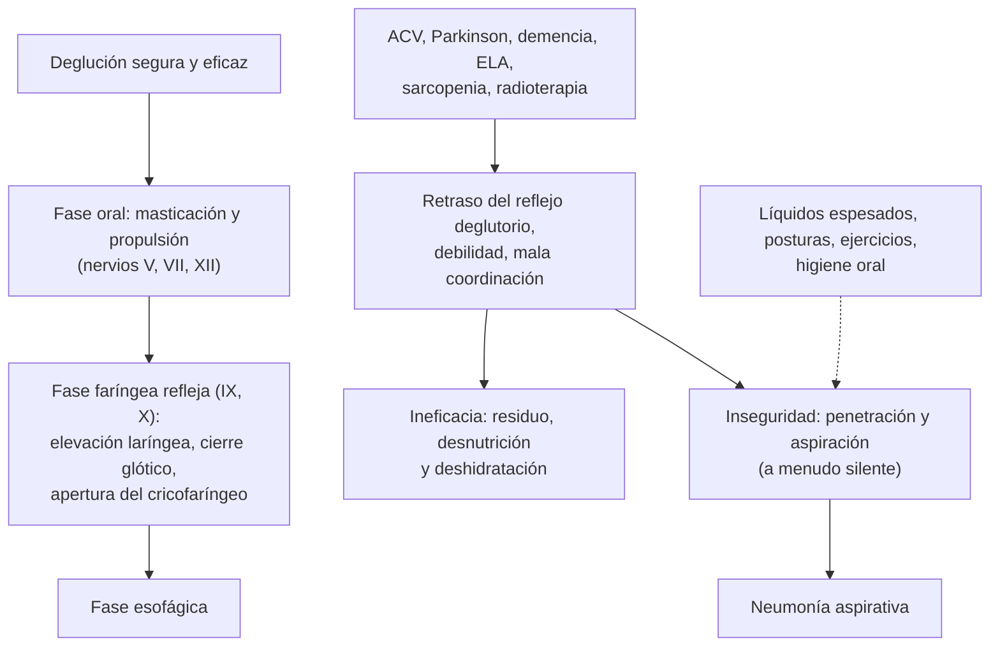

---
tags:
  - Otorrinolaringología
---

# Trastornos de la deglución, del habla y del lenguaje

**Subespecialidad**
Otorrinolaringología · Fonoaudiología · Neurología · Pediatría · Geriatría · Atención primaria

**Guías principales**
Documento ESSD-EUGMS 2016: la disfagia orofaríngea como síndrome geriátrico (*Clin Interv Aging*) · Marco IDDSI de texturas de alimentos y líquidos espesados (*Dysphagia* 2017) · AHA/ASA 2026: manejo precoz del ACV isquémico (tamizaje de la deglución) · Consenso CATALISE 2017: trastornos del desarrollo del lenguaje (*J Child Psychol Psychiatry*)

**Otras fuentes**
Programa Lidcombe para la tartamudez (*Am J Speech Lang Pathol* 2025) · Ver [disfagia y afagia aguda](../../gastroenterologia/disfagia-y-afagia-aguda.md), [ACV](../../neurologia/accidente-cerebrovascular.md), [Parkinson](../../neurologia/parkinson-temblor-y-trastornos-de-la-marcha.md), [demencia](../../neurologia/demencia-y-deterioro-cognitivo.md), [desnutrición](../../endocrinologia/desnutricion-y-sindromes-carenciales.md), [trastornos del neurodesarrollo](../../psiquiatria/trastornos-del-neurodesarrollo.md), [hipoacusias](hipoacusias-sordera-subita-y-tinnitus.md), [faringe y laringe](faringe-y-laringe-disfonia-estridor-y-amigdalitis-cronica.md) y [cáncer de cabeza y cuello](cancer-de-cabeza-y-cuello.md)

**GES**
No hay GES específico (sí el **ACV**, principal causa de disfagia orofaríngea, y la **hipoacusia** de los menores de 4 años, causa de retraso del lenguaje).

**EUNACOM**
6.03.1.032 Trastorno de deglución (sospecha, inicial, derivar) · 6.03.1.033 Trastornos del habla y del lenguaje (sospecha, inicial, derivar) · 6.03.3.002 Pesquisa de trastornos del lenguaje · 2.01.1.086 Trastornos del lenguaje (pediatría)

**Revisado**
Octubre 2026

!!! abstract "Resumen en 60 segundos"
    - **Disfagia orofaríngea**: dificultad para **iniciar** la deglución y pasar el bolo de la boca al esófago: **tos** o **atoro** al comer, **voz húmeda**, regurgitación nasal, comidas prolongadas, **baja de peso**, **neumonías aspirativas**. Causas: **ACV**, **Parkinson**, **demencia**, ELA, miastenia, cáncer de cabeza y cuello y su tratamiento, **presbifagia**.
    - **Tamizaje**: **EAT-10** y **test de volumen-viscosidad** en los adultos mayores; **tamizaje de la deglución antes de dar nada por boca** en todo ACV. Confirmación con **videofluoroscopía** o **evaluación endoscópica de la deglución (FEES)**. La **aspiración silente** (sin tos) es frecuente.
    - **Manejo**: **fonoaudiología** (técnicas compensatorias, posturas, ejercicios), **adaptación de texturas y espesamiento de líquidos** (marco **IDDSI**), **higiene oral** (reduce la neumonía), nutrición; **gastrostomía** si la vía oral es insegura o insuficiente por tiempo prolongado. **Divertículo de Zenker**: cirugía o endoscopía.
    - **Lenguaje** (comprensión y expresión) ≠ **habla** (articulación, fluidez, voz). **Señales de alerta** en los niños: sin balbuceo a los 12 meses, **sin palabras a los 16 meses**, **sin frases de 2 palabras a los 24 meses**, **pérdida del lenguaje** a cualquier edad, lenguaje ininteligible a los 3–4 años.
    - Ante un **retraso del lenguaje**: **evaluación auditiva siempre** y descartar **TEA** y discapacidad intelectual. **Trastorno del desarrollo del lenguaje** (antes TEL): ~ 7 % de los niños; **fonoaudiología** precoz.
    - **Tartamudez**: frecuente y transitoria entre los 2 y 5 años; derivar si persiste > 6–12 meses, después de los 5 años, con tensión o ansiedad o antecedente familiar.
    - **Adultos**: **afasia** (lenguaje: ACV, demencia) vs **disartria** (articulación: ACV, Parkinson, ELA, miastenia, cerebelo) vs **disfonía** (voz).

## Definición

- **Deglución**: proceso que transporta el bolo de la boca al estómago, con una fase **oral** (voluntaria), una **faríngea** (refleja: cierre de la vía aérea) y una **esofágica**.
- **Disfagia orofaríngea**: alteración de las fases oral o faríngea, con dificultad o inseguridad para formar y transferir el bolo (ver también [disfagia y afagia aguda](../../gastroenterologia/disfagia-y-afagia-aguda.md)).
    - **Penetración**: el bolo entra al vestíbulo laríngeo sobre los pliegues vocales.
    - **Aspiración**: el bolo pasa por debajo de los pliegues vocales. **Silente**: sin tos.
- **Presbifagia**: cambios de la deglución propios del envejecimiento, que reducen la reserva funcional sin ser necesariamente patológicos.
- **Lenguaje**: sistema de símbolos para comprender (**receptivo**) y expresar (**expresivo**) ideas; incluye la fonología, el vocabulario, la gramática y la pragmática (uso social).
- **Habla**: producción motora de los sonidos: **articulación** (dislalias), **fluidez** (tartamudez o disfemia) y **voz** (disfonía).
- **Trastorno del desarrollo del lenguaje** (TDL, consenso CATALISE 2017; antes "trastorno específico del lenguaje", TEL): dificultades del lenguaje **persistentes**, que afectan la comunicación o el aprendizaje, **sin** una condición biomédica que las explique (hipoacusia, TEA, discapacidad intelectual, síndromes genéticos, daño neurológico).
- **Afasia**: alteración **adquirida** del lenguaje por una lesión cerebral (comprensión, expresión, denominación, repetición, lectura, escritura).
- **Disartria**: alteración **motora** del habla (articulación, resonancia, voz, prosodia) por una lesión del sistema nervioso o de los músculos.
- **Tartamudez** (disfemia o trastorno de la fluidez de inicio en la infancia): repeticiones de sonidos o sílabas, prolongaciones y bloqueos que interrumpen el flujo del habla.

## Epidemiología

- **Mundial**:
    - **Disfagia orofaríngea**: ~ **30–40 %** de los adultos mayores que viven en la comunidad, ~ **50–60 %** de los institucionalizados, ~ **50 %** de los pacientes con **ACV** agudo, ~ 50–80 % en el Parkinson y la demencia avanzados, y la mayoría de los tratados por **cáncer de cabeza y cuello** (ESSD-EUGMS 2016).
    - La **neumonía aspirativa** es una de las principales causas de muerte en los pacientes con disfagia neurológica.
    - **Retraso del lenguaje**: ~ **5–10 %** de los preescolares; **TDL** ~ **7 %** de los niños en edad escolar.
    - **Tartamudez**: ~ **5–8 %** de los niños presenta un período de tartamudez (mayoría entre los 2 y 5 años); ~ **75–80 %** se recupera espontáneamente; ~ 1 % de los adultos persiste con tartamudez (más en los hombres).
    - **Afasia**: ~ 1/3 de los ACV.
- **Chile**: no hay datos nacionales publicados de prevalencia en las fuentes revisadas; el envejecimiento de la población aumenta la carga de la disfagia.

!!! chile "Datos nacionales"
    - El programa **Chile Crece Contigo** evalúa el desarrollo psicomotor en los controles de salud infantil con la **EEDP** (0–2 años) y el **TEPSI** (2–5 años), que incluyen un área de **lenguaje**: un rendimiento alterado debe derivarse a fonoaudiología y descartar la hipoacusia.
    - Los niños con **trastorno del lenguaje** reciben apoyo en las **escuelas especiales de lenguaje** y en el **Programa de Integración Escolar** del Ministerio de Educación.
    - En los hospitales, el **tamizaje de la deglución** por enfermería o fonoaudiología antes de iniciar la alimentación oral es parte del manejo del **ACV** (GES).
    - Las **garantías GES de hipoacusia** (N.° 59 en los prematuros y N.° 77 en los menores de 4 años) permiten el diagnóstico y el tratamiento precoz de la hipoacusia, causa tratable de retraso del lenguaje.

## Etiología y factores de riesgo

| Cuadro | Causas |
|---|---|
| **Disfagia orofaríngea neurológica** | **ACV** (la más frecuente), **Parkinson**, **demencia**, **ELA**, **miastenia gravis**, esclerosis múltiple, Guillain-Barré, TEC, parálisis cerebral, tumores del tronco |
| **Disfagia orofaríngea muscular** | Miopatías inflamatorias (**polimiositis**, **miositis por cuerpos de inclusión**), distrofia miotónica, distrofia oculofaríngea |
| **Disfagia orofaríngea estructural** | **Cáncer** de cabeza y cuello y sus **tratamientos** (cirugía, **radioterapia**: fibrosis, xerostomía), **divertículo de Zenker** (adultos mayores: regurgitación de alimentos no digeridos, halitosis, ruido cervical), barra del cricofaríngeo, osteofitos cervicales, bocio, estenosis posintubación |
| **Fármacos y otras** | **Sedantes**, antipsicóticos (disquinesia, parkinsonismo), anticolinérgicos (xerostomía), **sonda nasogástrica** y traqueostomía prolongadas, **desnutrición** y **sarcopenia**, **presbifagia**, deshidratación |
| **Retraso del lenguaje en el niño** | **Hipoacusia** (siempre descartar), **TEA**, **discapacidad intelectual**, **TDL**, deprivación de estímulos, **síndromes genéticos** (Down, X frágil), parálisis cerebral, mutismo selectivo; factores de riesgo de TDL: antecedente familiar, sexo masculino, prematurez |
| **Trastornos del habla en el niño** | **Dislalias** (errores de articulación: fonológicos o fonéticos), **fisura palatina** (voz hipernasal), frenillo lingual corto (rara vez la causa), **hipoacusia**, tartamudez, apraxia del habla |
| **Afasia** (adulto) | **ACV** de la arteria cerebral media izquierda, **demencia** (afasia progresiva primaria), tumores, TEC, encefalitis |
| **Disartria** (adulto) | **ACV**, **Parkinson** (hipofónica), **ELA** (mixta), **esclerosis múltiple**, **ataxia cerebelosa** (escándida), **miastenia** (fatigable), alcohol y fármacos |

## Fisiopatología

*Figura 1. Fisiopatología de la disfagia orofaríngea y sus consecuencias. Esquema propio basado en el documento ESSD-EUGMS (2016) y el marco IDDSI (2017).*

- Los **líquidos finos** (agua) son los más difíciles de controlar en la disfagia neurológica (pasan rápido, antes de que se cierre la vía aérea); **espesarlos** aumenta la **seguridad** de la deglución.
- La neumonía aspirativa depende no solo de la aspiración, sino también de la **carga bacteriana oral** (mala higiene oral), la **inmunidad** y la capacidad de **toser**.

## Clasificación

| Hitos del lenguaje (orientativos) | Edad |
|---|---|
| Sonrisa social, gorjeos | 2–3 meses |
| Balbuceo (sílabas repetidas "ba-ba", "ma-ma") | 6–9 meses |
| Primeras palabras con significado, entiende órdenes simples con gestos | ~ 12 meses |
| ~ 10–20 palabras, señala lo que quiere | 18 meses |
| **≥ 50 palabras**, **frases de 2 palabras** | **24 meses** |
| Frases de 3–4 palabras, lo entienden los extraños en ~ 75 % | 3 años |
| Habla inteligible, cuenta historias simples | 4 años |

| Afasia | Fluencia | Comprensión | Repetición | Lesión |
|---|---|---|---|---|
| **Broca** (motora, expresiva) | **No fluente** | Conservada | Alterada | Frontal inferior izquierda |
| **Wernicke** (sensitiva, receptiva) | **Fluente**, sin sentido (parafasias) | **Alterada** | Alterada | Temporal superior posterior izquierda |
| **Global** | No fluente | Alterada | Alterada | Extensa (arteria cerebral media) |
| **Conducción** | Fluente | Conservada | **Muy alterada** | Fascículo arqueado |

## Clínica

- **Disfagia orofaríngea**:
    - **Tos** o **atoro** durante o después de comer o beber, **voz húmeda** o "gorgoteante" después de tragar, **regurgitación nasal**, babeo, **residuos** en la boca, necesidad de tragar varias veces, **comidas prolongadas**, rechazo a ciertos alimentos o a los líquidos.
    - **Baja de peso**, **deshidratación**, **neumonías** a repetición, fiebre de origen no claro en un adulto mayor.
    - **Aspiración silente**: sin tos (frecuente después de un ACV y en la demencia): sospechar ante las neumonías recurrentes.
- **Divertículo de Zenker**: adulto mayor con disfagia alta, **regurgitación** de alimentos no digeridos horas después, **halitosis**, ruidos de gorgoteo en el cuello, tos nocturna, aspiración.
- **Retraso del lenguaje** en el niño: no alcanza los hitos (ver la tabla); hay que separar el **retraso aislado del lenguaje expresivo** (comprensión normal, buen pronóstico; los "hablantes tardíos") del **trastorno receptivo-expresivo** (peor pronóstico) y del retraso **global** del desarrollo.
- **TEA**: retraso del lenguaje con **alteración de la comunicación social** (contacto visual, señalar, juego simbólico), conductas **repetitivas** (ver [trastornos del neurodesarrollo](../../psiquiatria/trastornos-del-neurodesarrollo.md)).
- **Hipoacusia**: no responde a los sonidos ni a su nombre, retraso del lenguaje con buena comunicación no verbal, habla poco clara (ver [hipoacusias](hipoacusias-sordera-subita-y-tinnitus.md)).
- **TDL**: dificultad persistente para comprender o expresarse (vocabulario pobre, frases cortas y con errores gramaticales, dificultad para contar historias), con desarrollo social y audición normales; riesgo de **dificultades de lectura** y escritura.
- **Dislalias**: errores de pronunciación de ciertos sonidos (la /r/ es la última en adquirirse, hacia los 5–6 años).
- **Tartamudez**: repeticiones de sonidos o sílabas ("ca-ca-casa"), prolongaciones ("ssssol"), **bloqueos**, con **tensión** facial, parpadeo, evitación de palabras o situaciones, ansiedad.
- **Afasia**: dificultad para encontrar las palabras (anomia), errores (parafasias), habla no fluente o sin sentido, dificultad de comprensión, según el tipo.
- **Disartria**: habla arrastrada, lenta, nasal o con volumen bajo (Parkinson), con comprensión y contenido del lenguaje normales.

!!! alarma "Signos de alarma"
    - **Disfagia con signos de aspiración** (tos, voz húmeda, neumonías), **baja de peso** o **deshidratación**.
    - **Disfagia progresiva** con **disfonía**, **otalgia**, **odinofagia**, **masa cervical** o baja de peso: **cáncer** de cabeza y cuello o esófago.
    - **Disfagia, disartria o afasia de inicio súbito**: **ACV** → urgencia (código ACV).
    - **Disfagia y disartria fatigables** con ptosis o diplopía: **miastenia gravis**.
    - **Disfagia** con **fasciculaciones**, debilidad y atrofia de la lengua: **ELA**.
    - **Niño**: **pérdida** del lenguaje o de habilidades sociales a cualquier edad (TEA, síndrome de **Landau-Kleffner**, enfermedades neurodegenerativas), sin palabras a los **16 meses**, sin frases a los **24 meses**, no responde a su nombre, sospecha de **hipoacusia**.
    - **Voz hipernasal** o regurgitación nasal en un niño: **fisura palatina submucosa** o insuficiencia velofaríngea.

## Diagnóstico

!!! guia "Puntos clave (ESSD-EUGMS 2016; AHA/ASA 2026; CATALISE 2017)"
    - **Disfagia orofaríngea**:
        - **Tamizaje** en los adultos mayores y en los pacientes con enfermedades neurológicas: cuestionario **EAT-10** (≥ 3 puntos: riesgo) y **test de volumen-viscosidad** (signos de alteración de la seguridad y la eficacia con distintos volúmenes y viscosidades).
        - **ACV**: **tamizaje formal de la deglución** (por ejemplo, prueba con agua) **antes** de dar alimentos, líquidos o medicamentos por boca (AHA/ASA 2026).
        - **Evaluación instrumental**: **videofluoroscopía** (estudio dinámico con bario de las fases oral y faríngea; muestra la **aspiración**) o **evaluación endoscópica de la deglución con fibra óptica** (FEES, en la cama del paciente; ve los residuos y la penetración).
        - Evaluar el **estado nutricional**, la **hidratación**, la **higiene oral** y la **fragilidad**.
    - **Lenguaje en el niño**:
        - **Vigilancia** del desarrollo en todos los controles (EEDP, TEPSI).
        - Ante un retraso: **evaluación auditiva objetiva** (audiometría u otoemisiones o PEAT según la edad) **siempre**, tamizaje de **TEA** (M-CHAT-R/F a los 18–24 meses) y evaluación del desarrollo global.
        - **Evaluación fonoaudiológica** (comprensión, expresión, articulación, pragmática).
        - **TDL** (CATALISE): diagnóstico cuando las dificultades **persisten** (habitualmente después de los 4–5 años) y afectan la vida diaria, sin otra causa biomédica.
    - **Adulto con alteración del habla o el lenguaje**: examen neurológico, distinguir afasia, disartria y disfonía, **neuroimagen** si es de inicio reciente o progresivo, evaluación cognitiva.

## Laboratorio

- No hay exámenes de laboratorio para el diagnóstico.
- **Disfagia**: evaluación nutricional (albúmina, prealbúmina con cautela), electrolitos y función renal (deshidratación), hemograma; anticuerpos antirreceptor de acetilcolina (miastenia), **CK** (miopatías), TSH.
- **Retraso del lenguaje**: estudio **genético** (cariotipo, microarreglo, X frágil) si hay discapacidad intelectual, TEA o dismorfias; plomo en zonas de riesgo.

## Imágenes

- **Videofluoroscopía** de la deglución: estándar para evaluar la fisiología y la aspiración.
- **Esofagograma** con bario: **divertículo de Zenker**, estenosis, membranas.
- **Nasofibrolaringoscopía** y **FEES**: anatomía de la faringe y la laringe, movilidad de los pliegues vocales, residuos y aspiración.
- **TC o RM** de cuello o cerebro según la sospecha (tumores, ACV, enfermedades neurológicas).
- **RM cerebral** en el niño con **regresión** del lenguaje o signos neurológicos; **electroencefalograma** (Landau-Kleffner: afasia epiléptica adquirida).

## Diagnóstico diferencial

| Cuadro | Claves |
|---|---|
| **Disfagia orofaríngea** vs **esofágica** | Orofaríngea: problema para **iniciar** la deglución, tos y atoro inmediatos. Esofágica: sensación de que el bolo se **detiene** en el pecho segundos después (ver [disfagia](../../gastroenterologia/disfagia-y-afagia-aguda.md)) |
| **Disfagia** vs **globo faríngeo** | El globo es una sensación de nudo **sin** dificultad real para tragar, que mejora al comer; descartar el reflujo y lesiones |
| **Retraso del lenguaje**: TDL vs **hipoacusia** vs **TEA** vs **discapacidad intelectual** | Audición, comunicación social y desarrollo global |
| **Hablante tardío** vs **TDL** | El hablante tardío con buena comprensión suele alcanzar a sus pares hacia los 3–4 años |
| **Tartamudez del desarrollo** vs **neurogénica** o **psicógena** | La neurogénica aparece en el adulto tras un ACV o un TEC; la psicógena, de forma súbita tras un estrés |
| **Afasia** vs **disartria** vs **confusión** (delirium) | La afasia afecta el contenido del lenguaje; la disartria, la articulación; el delirium, la atención y la conciencia |

## Tratamiento

!!! dosis "Disfagia orofaríngea (ESSD-EUGMS 2016; IDDSI 2017)"
    - **Equipo multidisciplinario**: fonoaudiología, medicina, enfermería, nutrición, kinesiología, odontología.
    - **Estrategias compensatorias**:
        - **Adaptación de las texturas** de los alimentos y **espesamiento de los líquidos** según el marco **IDDSI** (niveles 0 a 7: líquido fino, levemente espeso, medianamente espeso, extremadamente espeso; purés, picado y húmedo, blando, normal), con el nivel indicado por fonoaudiología.
        - **Posturas**: comer **sentado a 90°**, **flexión del cuello** (mentón al pecho) al tragar, rotación de la cabeza hacia el lado débil.
        - **Volúmenes pequeños**, comer **despacio**, sin distracciones, evitar los **sorbetes** y las jeringas si no están indicados, supervisión de la alimentación.
    - **Estrategias rehabilitadoras**: ejercicios de fortalecimiento (lengua, Shaker, Masako), estimulación sensorial, electroestimulación en casos seleccionados.
    - **Higiene oral** minuciosa (cepillado después de cada comida, prótesis limpias): **reduce las neumonías**.
    - **Revisar los fármacos** (sedantes, antipsicóticos); medicamentos en formas adecuadas (no triturar los de liberación prolongada).
    - **Nutrición e hidratación**: suplementos orales; **sonda nasogástrica** transitoria si la vía oral es insegura (por ejemplo, en el ACV agudo) y **gastrostomía** si se prevé más de 4–6 semanas.
    - En la **demencia avanzada**, la sonda **no** ha demostrado prolongar la vida ni prevenir la neumonía: preferir la **alimentación de confort** por boca, con decisiones compartidas.
    - **Divertículo de Zenker**: **diverticulotomía endoscópica** o cirugía (miotomía del cricofaríngeo).

- **Retraso y trastornos del lenguaje en el niño**:
    - **Tratar la causa**: audífonos o implante coclear en la hipoacusia; intervención en el TEA.
    - **Fonoaudiología precoz** (terapia directa y entrenamiento a los padres).
    - **Estimulación** en el hogar: hablarle, **leerle** cuentos a diario, nombrar los objetos, ampliar sus frases, **limitar las pantallas** (desaconsejadas antes de los 2 años), jugar y cantar.
    - **Apoyo escolar**: escuelas de lenguaje, Programa de Integración Escolar.
- **Dislalias**: fonoaudiología si los errores persisten después de la edad esperada o afectan la inteligibilidad.
- **Tartamudez**:
    - **Observación** con orientación a los padres en los primeros meses (la mayoría remite).
    - **Derivar** a fonoaudiología si persiste **más de 6–12 meses**, comienza o sigue **después de los 5 años**, hay **tensión**, evitación o ansiedad, **antecedente familiar** de tartamudez persistente, o preocupación de los padres.
    - **Programa Lidcombe** (intervención conductual guiada por los padres) en los preescolares; terapias de fluidez y cognitivo-conductuales en los mayores y adultos.
    - Consejos a los padres: hablar despacio, escuchar con paciencia, no terminar las frases del niño ni pedirle que "respire y lo diga de nuevo".
- **Afasia**: **rehabilitación** fonoaudiológica intensiva y precoz tras el ACV; comunicación aumentativa; apoyo a la familia.
- **Disartria**: fonoaudiología (en el Parkinson, terapias de intensidad vocal como LSVT LOUD), tratamiento de la enfermedad de base, dispositivos de comunicación.

## Complicaciones

- **Disfagia**: **neumonía aspirativa**, **desnutrición**, **deshidratación**, sarcopenia, deterioro de la calidad de vida, aislamiento social, **mayor mortalidad**, obstrucción de la vía aérea por atoro.
- **Retraso y trastornos del lenguaje**: dificultades de **aprendizaje** (lectura y escritura), **rendimiento escolar** bajo, problemas de **conducta** y de autoestima, aislamiento, ansiedad.
- **Tartamudez persistente**: ansiedad social, evitación, impacto educativo y laboral.
- **Afasia**: depresión, aislamiento, discapacidad.

## Pronóstico y seguimiento

- **Disfagia tras un ACV**: la mayoría mejora en las primeras semanas; una minoría queda con disfagia persistente. En las enfermedades **neurodegenerativas**, es progresiva.
- **Hablantes tardíos** con buena comprensión: la mayoría alcanza a sus pares; el **TDL** persiste en la edad escolar y requiere apoyo prolongado.
- **Tartamudez**: ~ 75–80 % remite espontáneamente (más en las niñas y cuando comienza antes de los 3 años); la intervención precoz mejora el pronóstico de los que persisten.
- **Afasia**: la mayor recuperación ocurre en los primeros **3–6 meses**, pero puede seguir mejorando por años con rehabilitación.
- **Seguimiento**: reevaluar la deglución, el peso y las neumonías; controles del desarrollo y fonoaudiológicos en los niños.

## Perlas para el internado

!!! perla "Para recordar"
    - **Tos + voz húmeda + neumonías + baja de peso** en un adulto mayor = **disfagia orofaríngea**. Tamizar con **EAT-10** y **volumen-viscosidad**.
    - En todo **ACV**: **nada por boca** hasta el **tamizaje de la deglución**.
    - La **aspiración silente** no da tos: sospecharla ante las neumonías recurrentes.
    - **Espesar los líquidos** (IDDSI), **sentado a 90°**, **mentón al pecho**, bocados pequeños e **higiene oral**.
    - **Demencia avanzada**: la sonda no previene la neumonía ni prolonga la vida; alimentación de confort.
    - **Regurgitación de comida no digerida + halitosis** en un adulto mayor = **Zenker**.
    - Niño **sin palabras a los 16 meses** o **sin frases a los 24 meses**: **evaluar la audición** y descartar el **TEA**.
    - **Pérdida del lenguaje** a cualquier edad = **alarma** (TEA, Landau-Kleffner, neurodegeneración).
    - **Tartamudez** entre los 2 y 5 años: frecuente y transitoria; derivar si dura > 6–12 meses o sigue después de los 5 años.
    - **Afasia** (lenguaje) ≠ **disartria** (articulación) ≠ **disfonía** (voz).

## Preguntas de repaso

??? repaso "1. Mujer de 82 años con demencia moderada, con tos al tomar líquidos, comidas de más de 1 hora, baja de 5 kg en 6 meses y dos neumonías este año. ¿Qué sospecha, cómo lo evalúa y qué medidas indica?"
    **Disfagia orofaríngea** con aspiración (probablemente silente) e ineficacia (baja de peso). Evaluación: **EAT-10**, **test de volumen-viscosidad** y evaluación fonoaudiológica, con **videofluoroscopía** o **FEES** si cambia la conducta; evaluar la nutrición, la hidratación y los fármacos (sedantes, antipsicóticos). Medidas: **espesar los líquidos** y adaptar las **texturas** (IDDSI), **posición sentada a 90°** con **flexión del cuello**, bocados pequeños y supervisión, **higiene oral** minuciosa, **suplementos nutricionales** y, según los objetivos de cuidado, conversar sobre la alimentación de confort (la sonda no ha demostrado beneficio en la demencia avanzada).

??? repaso "2. Hombre de 68 años con un ACV isquémico de hace 6 horas, con disartria y hemiparesia derecha. La familia quiere darle agua y su almuerzo. ¿Qué indica?"
    **Nada por boca** (alimentos, líquidos ni medicamentos orales) hasta realizar un **tamizaje formal de la deglución** (por ejemplo, prueba con agua por enfermería o fonoaudiología), por el alto riesgo de **aspiración** y neumonía después de un ACV (AHA/ASA 2026). Si el tamizaje es alterado: evaluación fonoaudiológica, **hidratación IV** y, si la vía oral sigue insegura, **sonda nasogástrica** transitoria para la nutrición y los medicamentos; higiene oral.

??? repaso "3. Niño de 2 años que dice solo 4 palabras, no une 2 palabras, entiende órdenes simples, señala lo que quiere y juega con otros niños. ¿Qué hace?"
    **Retraso del lenguaje expresivo** con comprensión y comunicación social aparentemente conservadas (posible **hablante tardío**). Siempre: **evaluación auditiva objetiva** (descartar hipoacusia), tamizaje de **TEA** (M-CHAT-R/F) y evaluación del desarrollo global (TEPSI o EEDP según la edad). Derivar a **fonoaudiología**, indicar **estimulación del lenguaje** en el hogar (leer cuentos, hablarle, ampliar sus frases, limitar las pantallas) y controlar; la mayoría de los hablantes tardíos con buena comprensión se pone al día, pero hay que vigilar un posible trastorno del desarrollo del lenguaje.

??? repaso "4. Niño de 3 años y medio que desde hace 2 meses repite las primeras sílabas de las palabras y a veces se queda trabado, sin tensión ni ansiedad aparente. Sus padres están preocupados. ¿Qué les aconseja?"
    Es probable una **tartamudez del desarrollo** (disfluencia frecuente y transitoria entre los 2 y 5 años; ~ 75–80 % remite). Orientar a los padres: hablar despacio y con calma, **escuchar con paciencia**, no terminar sus frases ni pedirle que repita, reducir la presión al hablar. **Derivar a fonoaudiología** si persiste **más de 6–12 meses**, aparece tensión, evitación o ansiedad, hay antecedente familiar de tartamudez persistente o continúa después de los 5 años (programa Lidcombe).

??? repaso "5. Mujer de 72 años con regurgitación de alimentos no digeridos varias horas después de comer, halitosis, ruidos de gorgoteo en el cuello y tos nocturna. ¿Qué sospecha y cómo lo confirma?"
    **Divertículo de Zenker** (faringoesofágico), con riesgo de **aspiración**. Confirmar con un **esofagograma con bario** (o videofluoroscopía); evitar la endoscopía a ciegas (riesgo de perforación). Tratamiento: **diverticulotomía endoscópica** o cirugía con miotomía del cricofaríngeo si es sintomático.

??? repaso "6. Hombre de 65 años con dificultad súbita para hablar: entiende lo que se le dice, pero habla con esfuerzo, con pocas palabras y sin poder repetir frases; tiene debilidad de la mano derecha. ¿Qué tipo de alteración tiene y qué hace?"
    **Afasia de Broca** (no fluente, con comprensión conservada y repetición alterada), por una lesión **frontal inferior izquierda**: un **ACV** hasta que se demuestre lo contrario. Activar el **código ACV**: neuroimagen urgente y evaluación de trombólisis o trombectomía, **nada por boca** hasta el tamizaje de la deglución y, después, **rehabilitación fonoaudiológica** precoz e intensiva.

## Referencias

1. Baijens LW, Clavé P, Cras P, et al. European Society for Swallowing Disorders–European Union Geriatric Medicine Society white paper: oropharyngeal dysphagia as a geriatric syndrome. *Clin Interv Aging.* 2016;11:1403–1428. doi:[10.2147/CIA.S107750](https://doi.org/10.2147/CIA.S107750)
2. Cichero JAY, Lam P, Steele CM, et al. Development of international terminology and definitions for texture-modified foods and thickened fluids used in dysphagia management: the IDDSI framework. *Dysphagia.* 2017;32(2):293–314. doi:[10.1007/s00455-016-9758-y](https://doi.org/10.1007/s00455-016-9758-y)
3. Prabhakaran S, Gonzalez NR, Zachrison KS, et al. 2026 Guideline for the early management of patients with acute ischemic stroke: a guideline from the American Heart Association/American Stroke Association. *Stroke.* 2026;57(8):e316–e436.
4. Bishop DVM, Snowling MJ, Thompson PA, et al. Phase 2 of CATALISE: a multinational and multidisciplinary Delphi consensus study of problems with language development: terminology. *J Child Psychol Psychiatry.* 2017;58(10):1068–1080. doi:[10.1111/jcpp.12721](https://doi.org/10.1111/jcpp.12721)
5. Onslow M, Arnott S, Carey B, et al. The Lidcombe Program after 35 years: empirical, theoretical, and social contexts. *Am J Speech Lang Pathol.* 2025;34(5):3017–3024. doi:[10.1044/2025_AJSLP-24-00423](https://doi.org/10.1044/2025_AJSLP-24-00423)
