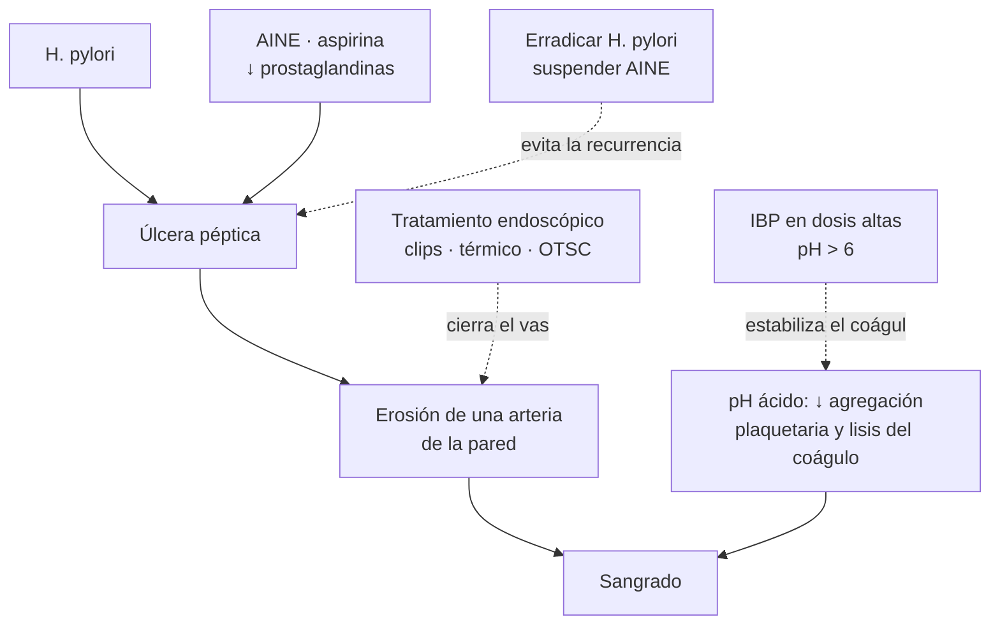
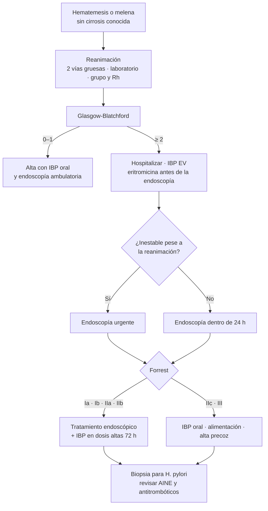

---
tags:
  - Gastroenterología
  - Urgencia
  - Frecuente en sala
---

# Hemorragia digestiva alta no variceal

**Subespecialidad**
Gastroenterología

**Guías principales**
ESGE 2026 (hemorragia por úlcera péptica) · ACG 2021 (HDA y úlcera) · ACG-CAG 2022 (antitrombóticos en la hemorragia digestiva)

**Otras fuentes**
ESGE 2021 · Consenso internacional 2019 · CAG 2025 (hemorragia no péptica) · Guía japonesa 2025 · Estudios HALT-IT, Lau 2020 y Villanueva 2013

**GES relacionados**
Erradicación de *Helicobacter pylori* en la úlcera péptica · Cáncer gástrico

**Revisado**
Noviembre 2026

!!! abstract "Resumen en 60 segundos"
    - Es la HDA **sin várices**: ~ **70–80 %** de las HDA. La causa principal es la **úlcera péptica** (***H. pylori*** y **AINE o aspirina**).
    - **Reanimar primero**: 2 vías gruesas, cristaloides y **transfusión restrictiva (Hb < 7 g/dL**; < 8 si hay enfermedad cardiovascular).
    - **Glasgow-Blatchford 0–1**: alta con endoscopía ambulatoria.
    - Antes de la endoscopía: **IBP EV en dosis altas** (sin retrasar la endoscopía) y **eritromicina 250 mg EV**.
    - **Endoscopía dentro de 24 horas**. Antes (≤ 12 h) solo si sigue inestable pese a la reanimación.
    - **Forrest Ia, Ib y IIa** (y IIb tras remover el coágulo): **tratamiento endoscópico**. Nunca adrenalina sola. El **clip sobre el endoscopio (OTSC)** pasó a ser una opción de primera línea (ESGE 2026).
    - Después: **IBP en dosis altas por 72 horas**, luego oral c/12 h hasta el día 14. **Erradicar *H. pylori***, revisar los AINE y **no suspender la aspirina** de prevención secundaria.
    - **Resangrado**: nueva endoscopía (OTSC); si falla, **embolización**; cirugía como último recurso. **Ácido tranexámico: no**.

!!! info "Página relacionada"
    Esta página profundiza la HDA **no variceal**. El enfoque general de la HDA y el manejo de la **HDA variceal** están en [Hemorragia digestiva alta](hemorragia-digestiva-alta.md).

## Definición

La **hemorragia digestiva alta no variceal** es el sangrado del tubo digestivo **proximal al ángulo de Treitz** (esófago, estómago y duodeno) que **no** se origina en várices por hipertensión portal.

- Se manifiesta con **hematemesis** (sangre roja o "borra de café"), **melena** o, si es masiva, **hematoquecia**.
- Un paciente con cirrosis también puede sangrar por una úlcera: en él, se maneja como **variceal** hasta la endoscopía.

## Epidemiología

### Mundial

- La HDA tiene una incidencia de **50–150 por 100.000 habitantes al año**, que aumenta con la edad.
- La **úlcera péptica** es la causa más frecuente de HDA no variceal.
- **Mortalidad** de la HDA no variceal: **2–10 %**. La mayoría de las muertes se deben a la **descompensación de comorbilidades**, no al sangrado en sí.
- La úlcera sangrante por *H. pylori* ha disminuido, pero aumentó la proporción asociada a **AINE, aspirina y anticoagulantes** en adultos mayores.

### Chile

!!! chile "Datos nacionales"
    - En **249 pacientes** hospitalizados por HDA en el Hospital Clínico de la Universidad de Chile (2015–2017), el **72 %** fue **no variceal**, y la **úlcera péptica** explicó el **44 %**. La **mortalidad hospitalaria** fue **4 %** en la no variceal y 13 % en la variceal. Se asociaron a mayor mortalidad la **transfusión de glóbulos rojos**, la **creatinina elevada** al ingreso y el origen variceal (Pinto y cols., *Rev Med Chile* 2020).
    - ***H. pylori*** es muy prevalente en adultos chilenos (ver [Dispepsia, úlcera péptica y cáncer gástrico](dispepsia-ulcera-peptica-y-cancer-gastrico.md)).
    - Chile tiene una de las **tasas de cáncer gástrico más altas de América**: toda **úlcera gástrica** se biopsia.
    - **GES**: tratamiento de **erradicación de *H. pylori*** en la úlcera péptica y **cáncer gástrico**.

## Etiología y factores de riesgo

| Causa | Claves |
|---|---|
| **Úlcera péptica** (duodenal o gástrica) | La causa principal. ***H. pylori***, **AINE y aspirina**. Sangran más las de **cara posterior del bulbo duodenal** (arteria gastroduodenal) y las de **curvatura menor** (arteria gástrica izquierda) |
| **Esofagitis, gastritis y duodenitis erosivas** | AINE, alcohol, reflujo; paciente crítico (úlceras de estrés). Suelen sangrar poco |
| **Síndrome de Mallory-Weiss** | Desgarro de la unión gastroesofágica tras **vómitos intensos**; la mayoría se detiene solo |
| **Neoplasias** | **Cáncer gástrico**, linfoma, GIST; sangrado difuso, difícil de controlar |
| **Lesión de Dieulafoy** | Arteria submucosa anómala, casi siempre en el estómago proximal: **sangrado masivo e intermitente** con mucosa casi normal |
| **Ectasia vascular antral** (GAVE, "estómago en sandía") | Sangrado crónico y anemia; cirrosis, ERC, esclerosis sistémica |
| **Angiodisplasias** | ERC, estenosis aórtica, adulto mayor |
| **Lesiones de Cameron** | Erosiones en una **hernia hiatal grande** |
| **Causas raras** | **Fístula aortoentérica** (cirugía aórtica previa), **hemobilia**, *hemosuccus pancreaticus* |

**Factores de riesgo de sangrado por úlcera**

- **AINE** (incluida la aspirina en dosis bajas), sobre todo en **> 65 años**, con **úlcera previa** o en **dosis altas**.
- **Combinaciones de riesgo**: AINE + corticoides, AINE + **ISRS**, AINE + anticoagulante, **doble antiagregación**.
- **Anticoagulantes** (warfarina y anticoagulantes directos).
- Infección por ***H. pylori***.
- Enfermedad grave (UCI, ventilación mecánica, coagulopatía) y ERC.

## Fisiopatología

La úlcera se produce por el desequilibrio entre los factores **agresivos** (ácido, pepsina, ***H. pylori***, **AINE** que bloquean la COX-1 y las prostaglandinas protectoras) y los **defensivos** (moco, bicarbonato, flujo sanguíneo de la mucosa). Cuando la úlcera **erosiona una arteria** de la pared, sangra.

El **ácido inhibe la agregación plaquetaria** y favorece la **lisis del coágulo**. Por eso los **IBP en dosis altas**, que llevan el pH gástrico sobre 6, ayudan a **estabilizar el coágulo** después del tratamiento endoscópico.

*Figura 1. Mecanismo del sangrado por úlcera péptica y punto de acción de cada tratamiento. Esquema propio.*

## Clasificación

### Riesgo antes de la endoscopía

=== "Glasgow-Blatchford"

    Predice la necesidad de **intervención** (transfusión, tratamiento endoscópico, cirugía) o la muerte. Es la escala recomendada para decidir el **alta precoz** (ACG 2021, ESGE 2021). Puedes calcularla en [Calculadoras](../calculadoras.md#gastroenterologia-y-cirugia).

    | Parámetro | Valor | Puntos |
    |---|---|---|
    | **BUN** (mg/dL) | 18,2–22,3 · 22,4–27,9 · 28–69,9 · ≥ 70 | 2 · 3 · 4 · 6 |
    | **Hemoglobina, hombres** (g/dL) | 12–12,9 · 10–11,9 · < 10 | 1 · 3 · 6 |
    | **Hemoglobina, mujeres** (g/dL) | 10–11,9 · < 10 | 1 · 6 |
    | **PA sistólica** (mmHg) | 100–109 · 90–99 · < 90 | 1 · 2 · 3 |
    | **Otros** | FC ≥ 100 · melena · síncope · enfermedad hepática · insuficiencia cardíaca | 1 · 1 · 2 · 2 · 2 |

    **0–1 punto**: riesgo muy bajo. Se puede dar de **alta** con **endoscopía ambulatoria**.

=== "Rockall y AIMS65"

    - **Rockall**: versión **preendoscópica** (edad, shock, comorbilidades) y **completa** (agrega el diagnóstico y los estigmas endoscópicos). Predice **mortalidad** y resangrado.
    - **AIMS65** (1 punto cada uno): **A**lbúmina < 3 g/dL, **I**NR > 1,5, alteración de conciencia (**M**ental status), PA sistólica ≤ 90 mmHg (**S**ystolic), edad ≥ **65** años. Predice **mortalidad hospitalaria**.
    - Para decidir el alta, Glasgow-Blatchford fue la escala más útil en un estudio internacional de más de 3.000 pacientes (Stanley, *BMJ* 2017).

### Forrest: estigmas endoscópicos

<figure markdown>
{ loading=lazy }
<figcaption>Figura 2. Clasificación de Forrest. Los estigmas de alto riesgo (Ia, Ib, IIa) requieren tratamiento endoscópico; en el IIb se remueve el coágulo y se trata la lesión subyacente. Riesgos de resangrado sin tratamiento según Laine y Peterson (NEJM 1994). Esquema propio.</figcaption>
</figure>

| Forrest | Hallazgo | Resangrado sin tratamiento | Conducta |
|---|---|---|---|
| **Ia** | Sangrado activo **en jet** | ~ 55 % (Ia + Ib) | **Tratamiento endoscópico** + IBP en dosis altas |
| **Ib** | Sangrado activo **en napa** | ~ 55 % (Ia + Ib) | **Tratamiento endoscópico** + IBP en dosis altas |
| **IIa** | **Vaso visible** no sangrante | ~ 43 % | **Tratamiento endoscópico** + IBP en dosis altas |
| **IIb** | **Coágulo adherido** | ~ 22 % | Remover el coágulo y tratar lo que haya debajo (ESGE 2026); IBP en dosis altas |
| **IIc** | Mancha plana pigmentada | ~ 10 % | IBP oral, sin tratamiento endoscópico |
| **III** | Base limpia | ~ 5 % | IBP oral y **alta precoz** |

## Clínica

- **Hematemesis** y/o **melena**; **hematoquecia** si el sangrado es masivo (tránsito rápido).
- **Hipovolemia**: mareo, **síncope**, palidez, sudoración, taquicardia, hipotensión; **angina** en coronarios.
- **Orientan a la causa**:
    - Epigastralgia, dispepsia, consumo de **AINE o aspirina** → úlcera péptica.
    - **Vómitos intensos** antes del sangrado (alcohol) → Mallory-Weiss.
    - **Baja de peso**, saciedad precoz, anemia crónica → **cáncer gástrico**.
    - **Cirugía de aorta** previa → fístula aortoentérica (sangrado "centinela").
- **Examen**: signos vitales, **índice de shock** (FC/PAS > 1 sugiere sangrado grave), llene capilar, conciencia, estigmas de **daño hepático crónico** (cambian el manejo a variceal) y **tacto rectal** (confirma la melena).

## Diagnóstico

*Figura 3. Enfoque de la HDA no variceal. Esquema propio basado en ACG 2021 y ESGE 2021–2026.*

- La **endoscopía digestiva alta** confirma el origen, clasifica el riesgo (Forrest) y permite tratar.
- Una razón **BUN/creatinina > 30** apoya el origen alto.
- **No** se recomiendan de rutina la **cápsula endoscópica** ni las cápsulas que detectan sangre para el diagnóstico de la HDA (ESGE 2026).
- Si la endoscopía no encuentra la causa y el sangrado es importante: **angioTC** y, según el hallazgo, angiografía.

## Laboratorio

- **Hemograma** seriado: la **Hb inicial puede ser normal** (aún no hay hemodilución); repetirla cada 6–12 horas según la gravedad. Un **VCM bajo** sugiere pérdida crónica.
- **Grupo sanguíneo, Rh y pruebas cruzadas**.
- **BUN y creatinina**: el BUN sube por la sangre digerida. La **creatinina elevada** al ingreso se asoció a mayor mortalidad en la serie chilena.
- **TP/INR, TTPA y plaquetas**, sobre todo si usa anticoagulantes.
- **Electrolitos, pruebas hepáticas y albúmina** (AIMS65; descartar cirrosis).
- **Lactato y gases** si hay shock. **Troponina y ECG** si es coronario o tiene síntomas.
- ***H. pylori***: **biopsia** durante la endoscopía en toda úlcera. Con sangrado activo y uso de IBP hay **falsos negativos**: si es negativa, **repetir** el estudio después.
- **Ferritina** y saturación de transferrina: guían el **hierro** al alta.

## Imágenes

- **Endoscopía digestiva alta**: examen de elección, diagnóstico y terapéutico.
- **AngioTC abdominal**: sangrado activo con endoscopía no diagnóstica o imposible, o para planificar la **embolización**.
- **Angiografía con embolización transcatéter (TAE)**: sangrado que no se controla con endoscopía.
- **Radiografía de tórax de pie o TC**: si se sospecha **perforación** (aire libre).

## Diagnóstico diferencial

- **HDA variceal**: cirrosis, estigmas de daño hepático crónico o várices conocidas (ver [Hemorragia digestiva alta](hemorragia-digestiva-alta.md)).
- **Hemorragia digestiva baja** con hematoquecia (ver [Hemorragia digestiva baja](hemorragia-digestiva-baja.md)).
- **Epistaxis o hemoptisis** deglutidas.
- **Deposiciones negras sin sangrado**: **hierro oral**, **bismuto**, carbón activado, betarraga o morcilla.

## Tratamiento

### 1. Reanimación

- **Vía aérea**: evaluar **intubación** antes de la endoscopía si hay hematemesis masiva o compromiso de conciencia.
- **Dos vías venosas gruesas** y **cristaloides** hasta recuperar la perfusión.
- **Régimen cero** hasta la endoscopía; monitorización de signos vitales, diuresis y conciencia.

!!! guia "Transfusión restrictiva"
    - Transfundir glóbulos rojos con **Hb < 7 g/dL** (ACG 2021), con meta de **7–9 g/dL** (ESGE 2021).
    - Con **enfermedad cardiovascular**: umbral de **8 g/dL** y meta más alta (ESGE 2021).
    - En la HDA, la transfusión restrictiva redujo la mortalidad y el resangrado frente a la liberal (Villanueva, *NEJM* 2013).
    - **Shock hemorrágico masivo**: transfundir sin esperar la Hb (protocolo de transfusión masiva).

**Antitrombóticos al ingreso** (ACG-CAG 2022)

- **Aspirina en prevención secundaria**: **no suspenderla**. Si se suspendió, reiniciarla **el mismo día en que se confirma la hemostasia** en la endoscopía.
- **Antiagregantes**: **no** transfundir plaquetas de rutina.
- **Warfarina**: **no** dar plasma ni vitamina K de rutina; si se necesita revertir, preferir el **concentrado de complejo protrombínico** al plasma.
- **Anticoagulantes directos**: **no** se sugiere revertir de rutina (complejo protrombínico, idarucizumab ni andexanet).
- Estas sugerencias son para la hemorragia digestiva en general. Con un **sangrado que amenaza la vida** y no se controla, la reversión se decide caso a caso (ver [Coagulopatías y reversión de anticoagulantes](../hematologia/coagulopatias-cid-y-reversion-de-anticoagulantes.md)).
- **No postergar la endoscopía** para corregir la coagulación.

!!! alarma "No indicar"
    - **Ácido tranexámico**: en el estudio **HALT-IT** (*Lancet* 2020, > 12.000 pacientes) no redujo la mortalidad y aumentó los eventos tromboembólicos venosos.
    - **Adrenalina sola** como tratamiento endoscópico.
    - **Segunda endoscopía programada** ("second look") de rutina.

### 2. Antes de la endoscopía

!!! dosis "Preparación"
    - **IBP EV en dosis altas**: **omeprazol o esomeprazol 80 mg EV en bolo**, luego 40 mg c/12 h EV (o infusión de 8 mg/h). Reduce los estigmas de alto riesgo, pero **no** la mortalidad ni el resangrado: **no debe retrasar la endoscopía** (ESGE 2026).
    - **Eritromicina 250 mg EV en 30 minutos**, **30–120 minutos antes** de la endoscopía: vacía el estómago de sangre y mejora la visión (ACG 2021). Ojo con el **QT largo**.
    - Si no hay eritromicina, la ESGE 2026 sugiere **metoclopramida EV** en pacientes seleccionados con sangrado grave o activo.

**Momento de la endoscopía**

- **Dentro de 24 horas** del ingreso, tras la reanimación (ACG 2021, ESGE 2021).
- **No** se recomienda hacerla de forma **emergente (≤ 6 h)** ni **urgente (≤ 12 h)**, salvo que el paciente siga **inestable pese a una reanimación adecuada** (ESGE 2026). En pacientes de alto riesgo, la endoscopía dentro de 6 horas no redujo la mortalidad frente a la hecha entre 6 y 24 horas (Lau, *NEJM* 2020).

### 3. Tratamiento endoscópico de la úlcera

| Estigma | Opciones (ESGE 2026) |
|---|---|
| **Sangrado activo (Ia, Ib)** | **Terapia combinada**: adrenalina diluida + **térmico** (bipolar, *heater probe*) o **mecánico** (clips). **Alternativa de primera línea**: **clip sobre el endoscopio (OTSC)** como monoterapia, con menos resangrado que la terapia estándar. También **pinza hemostática con coagulación suave** como monoterapia |
| **Vaso visible (IIa)** | Térmico, **clips** (a través del endoscopio u OTSC) o inyección de un esclerosante, solos o con adrenalina. Pinza hemostática con coagulación suave como alternativa |
| **Coágulo adherido (IIb)** | **Remover el coágulo** y tratar el estigma de debajo, si el endoscopista tiene la experiencia para hacerlo con seguridad |
| **Mancha plana (IIc) y base limpia (III)** | Sin tratamiento endoscópico |

- La **adrenalina sola no** se usa: resangra más.
- **Polvo hemostático** (TC-325): **no como monoterapia de primera línea** en la úlcera de alto riesgo (ESGE 2026). Sirve como **rescate** cuando falla la hemostasia estándar. La ACG 2021 lo sugiere en úlceras con sangrado activo; la ESGE 2026, más reciente, lo deja para el rescate.
- El **OTSC** tiene buena evidencia en el **resangrado** (Schmidt, *Gastroenterology* 2018) y como tratamiento inicial (Jensen 2021; estudio TOP, Soriani 2024).
- **Sangrado que no se controla** con ningún método endoscópico: **embolización transcatéter (TAE)**; **cirugía** si no hay TAE o si fracasa.

<figure markdown>
{ loading=lazy width="640" }
<figcaption>Figura 4. Úlcera péptica con sangrado persistente en napa (Forrest Ib, izquierda) tratada con inyección de adrenalina y clips, y luego polvo hemostático (derecha). Fuente: Orpen-Palmer J, Stanley AJ. Update on the management of upper gastrointestinal bleeding. <em>BMJ Med</em>. 2022;1:e000202. doi:<a href="https://doi.org/10.1136/bmjmed-2022-000202">10.1136/bmjmed-2022-000202</a>. Licencia <a href="https://creativecommons.org/licenses/by-nc/4.0/">CC BY-NC 4.0</a>.</figcaption>
</figure>

### 4. Otras causas no variceales (CAG 2025)

| Causa | Tratamiento endoscópico sugerido |
|---|---|
| **Tumor con sangrado activo** | **Polvo hemostático** sobre la terapia convencional; luego **tratamiento oncológico** |
| **Mallory-Weiss con sangrado activo** | **Ligadura con banda** o **clip**, mejor que adrenalina sola. **Sin sangrado activo**: no tratar endoscópicamente |
| **Lesión de Dieulafoy** | Métodos **mecánicos** (ligadura o clip), **térmicos** o esclerosantes, mejor que adrenalina sola |
| **Ectasia vascular antral (GAVE)** | **Ligadura con banda** mejor que la coagulación con argón plasma |

### 5. Después de la endoscopía

!!! dosis "IBP después del tratamiento endoscópico"
    - **Estigmas de alto riesgo tratados** (o IIb no tratado): **IBP en dosis altas por 72 horas**: **80 mg EV en bolo + infusión de 8 mg/h**, o **bolos de 40 mg EV c/12 h** (igual de eficaces; Sachar 2014, ACG 2021).
    - Luego **IBP oral c/12 h hasta el día 14** y después **1 vez al día** (ACG 2021). Duración total: **8 semanas** en la úlcera; **indefinido** si debe seguir con AINE, aspirina o anticoagulantes.
    - **Estigmas de bajo riesgo** (IIc, III): **IBP oral** y alta precoz.
    - Los **bloqueadores ácidos competitivos de potasio** (vonoprazán) no tienen aún un lugar definido: la ESGE 2026 no llegó a consenso.

- **Alimentación oral precoz**: dentro de **24 horas** tras una hemostasia endoscópica estable (ESGE 2026).
- **Hierro**: iniciarlo **antes del alta** si hay déficit de hierro o anemia (ESGE 2026).
- **Embolización profiláctica**: considerarla en casos seleccionados de alto riesgo, como **inestabilidad al ingreso**, úlcera en la **cara posterior del duodeno**, úlcera **> 2 cm** o hemostasia de duración incierta (ESGE 2026).

**Resangrado**

1. **Nueva endoscopía**, idealmente con **OTSC** (ESGE 2026).
2. Si falla: **embolización transcatéter**.
3. **Cirugía** si no hay embolización o si fracasa.

**Antes del alta**

- **Erradicar *H. pylori*** si es positivo (esquemas en [Dispepsia, úlcera péptica y cáncer gástrico](dispepsia-ulcera-peptica-y-cancer-gastrico.md)) y **confirmar la erradicación** al menos 4 semanas después, sin IBP por 2 semanas.
- **Suspender los AINE**. Si son imprescindibles, usar un inhibidor de COX-2 + IBP.
- **Aspirina en prevención primaria**: suspenderla y reevaluar la indicación.
- **Doble antiagregación** (stent reciente): mantener la aspirina y reiniciar el segundo antiagregante lo antes posible, junto con cardiología.
- **Anticoagulantes**: reiniciarlos **apenas esté indicado según el riesgo trombótico** (ESGE 2026); la guía de 2021 proponía hacerlo dentro de **~ 7 días** del sangrado.
- **Úlcera gástrica**: **biopsia** y **endoscopía de control a las 8–12 semanas** para confirmar la cicatrización y descartar un **cáncer**.

## Complicaciones

- **Resangrado**: el principal determinante de la mortalidad.
- **Shock hipovolémico**, isquemia miocárdica o cerebral, **lesión renal aguda**.
- **Aspiración** y neumonía.
- Complicaciones de la úlcera: **perforación** y **obstrucción pilórica**.
- Complicaciones del tratamiento: **perforación** endoscópica, **isquemia** tras la embolización.
- **Eventos trombóticos** al suspender antitrombóticos.

## Pronóstico y seguimiento

- Mortalidad de **2–10 %** (4 % en la serie chilena); mayor con edad avanzada, comorbilidades, shock, resangrado y sangrado iniciado durante una hospitalización.
- **Seguimiento**:
    - Confirmar la **erradicación de *H. pylori***.
    - **Endoscopía de control** en las úlceras gástricas.
    - Revisar **AINE, aspirina y anticoagulantes**; IBP de mantención si deben continuar.
    - Control de la **anemia** y del tratamiento con hierro.

## Perlas para el internado

!!! perla "Para la sala y el turno"
    - La **Hb inicial engaña**: mira el pulso, la PA, el **índice de shock** y la conciencia.
    - Paciente con melena, Glasgow-Blatchford **0–1**: puede irse con IBP y endoscopía ambulatoria.
    - Pide la **eritromicina** con tiempo: debe pasar 30–120 minutos antes de la endoscopía.
    - El IBP antes de la endoscopía **no reemplaza** a la endoscopía ni debe retrasarla.
    - **No suspendas la aspirina** de un coronario o de un paciente con ACV previo: el riesgo de un evento cardiovascular es mayor que el de resangrar.
    - Una **úlcera en la cara posterior del bulbo** puede comprometer la **arteria gastroduodenal**: resangra más.
    - Toda **úlcera gástrica** se biopsia y se controla: en Chile, el **cáncer gástrico** es frecuente.
    - **Ácido tranexámico no**.

## Preguntas de repaso

??? repaso "1. Hombre de 52 años con 2 episodios de melena, sin comorbilidades, FC 78, PA 132/84, Hb 13,6 g/dL y BUN 15 mg/dL. ¿Cómo lo manejas?"
    **Glasgow-Blatchford = 1** (solo la melena): riesgo **muy bajo**. Se puede dar de **alta** con **IBP oral** y **endoscopía ambulatoria** precoz, con indicaciones claras de consultar si vuelve a sangrar.

??? repaso "2. Mujer de 74 años usuaria de ibuprofeno por artrosis, con hematemesis, FC 112 y PA 96/60. ¿Qué indicas antes de la endoscopía y cuándo la haces?"
    **Reanimación** con 2 vías gruesas y cristaloides, laboratorio con grupo y Rh, **transfusión si Hb < 7 g/dL**, **omeprazol 80 mg EV en bolo** y luego 40 mg c/12 h EV, y **eritromicina 250 mg EV** 30–120 minutos antes. **Endoscopía dentro de 24 horas**; urgente solo si sigue inestable pese a la reanimación. Suspender el ibuprofeno.

??? repaso "3. En la endoscopía se ve una úlcera duodenal con sangrado en jet. ¿Qué opciones de tratamiento endoscópico hay según la ESGE 2026?"
    Es **Forrest Ia**. Opciones: **terapia combinada** (adrenalina diluida + clips o tratamiento térmico), **clip sobre el endoscopio (OTSC)** como monoterapia de primera línea o **pinza hemostática con coagulación suave**. **No** adrenalina sola ni polvo hemostático solo como primera línea. Luego, **IBP en dosis altas por 72 horas**.

??? repaso "4. Al día siguiente de tratar una úlcera Forrest IIa, el paciente presenta nueva melena con caída de la Hb y taquicardia. ¿Qué haces?"
    Es un **resangrado**: reanimar y repetir la **endoscopía**, idealmente con **OTSC** (ESGE 2026). Si fracasa, **embolización transcatéter**; **cirugía** si no hay embolización o si falla.

??? repaso "5. Hombre de 68 años con stent coronario hace 3 años, en aspirina, hospitalizado por una úlcera sangrante ya tratada. ¿Qué haces con la aspirina?"
    Es **prevención secundaria**: **no suspenderla**. Si se suspendió, reiniciarla **el día en que se confirma la hemostasia** (ACG-CAG 2022), junto con **IBP**. Suspenderla aumenta los eventos cardiovasculares.

??? repaso "6. Mujer de 60 años con úlcera gástrica sangrante tratada. La biopsia para *H. pylori* sale negativa. ¿Qué falta antes de dar por cerrado el caso?"
    **Repetir el estudio de *H. pylori*** (falsos negativos con sangrado e IBP) y erradicarlo si es positivo, confirmando la erradicación después. Además, la **biopsia de la úlcera** y una **endoscopía de control a las 8–12 semanas**, porque en Chile el **cáncer gástrico** es frecuente. Iniciar **hierro** si hay déficit.

## Referencias

1. Gralnek IM, Morris J, Laursen SB, et al. Endoscopic diagnosis and management of peptic ulcer bleeding: European Society of Gastrointestinal Endoscopy (ESGE) Guideline – Update 2026. *Endoscopy.* 2026;58(8):899–924. doi:[10.1055/a-2863-8314](https://doi.org/10.1055/a-2863-8314)
2. Laine L, Barkun AN, Saltzman JR, et al. ACG Clinical Guideline: Upper Gastrointestinal and Ulcer Bleeding. *Am J Gastroenterol.* 2021;116(5):899–917. doi:[10.14309/ajg.0000000000001245](https://doi.org/10.14309/ajg.0000000000001245)
3. Abraham NS, Barkun AN, Sauer BG, et al. American College of Gastroenterology-Canadian Association of Gastroenterology Clinical Practice Guideline: Management of Anticoagulants and Antiplatelets During Acute Gastrointestinal Bleeding and the Periendoscopic Period. *Am J Gastroenterol.* 2022;117(4):542–558. doi:[10.14309/ajg.0000000000001627](https://doi.org/10.14309/ajg.0000000000001627)
4. Gralnek IM, Stanley AJ, Morris AJ, et al. Endoscopic diagnosis and management of nonvariceal upper gastrointestinal hemorrhage (NVUGIH): European Society of Gastrointestinal Endoscopy (ESGE) Guideline – Update 2021. *Endoscopy.* 2021;53(3):300–332. doi:[10.1055/a-1369-5274](https://doi.org/10.1055/a-1369-5274)
5. Barkun AN, Almadi M, Kuipers EJ, et al. Management of Nonvariceal Upper Gastrointestinal Bleeding: Guideline Recommendations From the International Consensus Group. *Ann Intern Med.* 2019;171(11):805–822. doi:[10.7326/M19-1795](https://doi.org/10.7326/M19-1795)
6. Barkun AN, Laine L, Leontiadis GI, et al. Canadian Association of Gastroenterology Clinical Practice Guideline for the Endoscopic Management of Nonvariceal Nonpeptic Ulcer Upper Gastrointestinal Bleeding. *Gastroenterology.* 2025;169(5):863–891. doi:[10.1053/j.gastro.2025.04.041](https://doi.org/10.1053/j.gastro.2025.04.041)
7. Fujishiro M, Iguchi M, Ono S, et al. Guidelines for endoscopic management of nonvariceal upper gastrointestinal bleeding (second edition). *Dig Endosc.* 2025;37(5):447–469. doi:[10.1111/den.15019](https://doi.org/10.1111/den.15019)
8. Pinto C, Parra P, Magna J, et al. Hemorragia digestiva alta variceal y no variceal: análisis de 249 pacientes hospitalizados. *Rev Med Chil.* 2020;148(3):288–294. doi:[10.4067/S0034-98872020000300288](https://doi.org/10.4067/S0034-98872020000300288)
9. Lau JYW, Yu Y, Tang RSY, et al. Timing of Endoscopy for Acute Upper Gastrointestinal Bleeding. *N Engl J Med.* 2020;382(14):1299–1308. doi:[10.1056/NEJMoa1912484](https://doi.org/10.1056/NEJMoa1912484)
10. Villanueva C, Colomo A, Bosch A, et al. Transfusion strategies for acute upper gastrointestinal bleeding. *N Engl J Med.* 2013;368(1):11–21. doi:[10.1056/NEJMoa1211801](https://doi.org/10.1056/NEJMoa1211801)
11. HALT-IT Trial Collaborators. Effects of a high-dose 24-h infusion of tranexamic acid on death and thromboembolic events in patients with acute gastrointestinal bleeding (HALT-IT). *Lancet.* 2020;395(10241):1927–1936. doi:[10.1016/S0140-6736(20)30848-5](https://doi.org/10.1016/S0140-6736(20)30848-5)
12. Sachar H, Vaidya K, Laine L. Intermittent vs continuous proton pump inhibitor therapy for high-risk bleeding ulcers: a systematic review and meta-analysis. *JAMA Intern Med.* 2014;174(11):1755–1762. doi:[10.1001/jamainternmed.2014.4056](https://doi.org/10.1001/jamainternmed.2014.4056)
13. Schmidt A, Gölder S, Goetz M, et al. Over-the-Scope Clips Are More Effective Than Standard Endoscopic Therapy for Patients With Recurrent Bleeding of Peptic Ulcers. *Gastroenterology.* 2018;155(3):674–686.e6. doi:[10.1053/j.gastro.2018.05.037](https://doi.org/10.1053/j.gastro.2018.05.037)
14. Jensen DM, Kovacs T, Ghassemi KA, et al. Randomized Controlled Trial of Over-the-Scope Clip as Initial Treatment of Severe Nonvariceal Upper Gastrointestinal Bleeding. *Clin Gastroenterol Hepatol.* 2021;19(11):2315–2323.e2. doi:[10.1016/j.cgh.2020.08.046](https://doi.org/10.1016/j.cgh.2020.08.046)
15. Soriani P, Biancheri P, Bonura GF, et al. Over-the-scope clip as first-line treatment of peptic ulcer bleeding: a multicenter randomized controlled trial (TOP Study). *Endoscopy.* 2024;56(9):665–673. doi:[10.1055/a-2303-4824](https://doi.org/10.1055/a-2303-4824)
16. Stanley AJ, Laine L, Dalton HR, et al. Comparison of risk scoring systems for patients presenting with upper gastrointestinal bleeding: international multicentre prospective study. *BMJ.* 2017;356:i6432. doi:[10.1136/bmj.i6432](https://doi.org/10.1136/bmj.i6432)
17. Blatchford O, Murray WR, Blatchford M. A risk score to predict need for treatment for upper-gastrointestinal haemorrhage. *Lancet.* 2000;356(9238):1318–1321. doi:[10.1016/S0140-6736(00)02816-6](https://doi.org/10.1016/S0140-6736(00)02816-6)
18. Laine L, Peterson WL. Bleeding peptic ulcer. *N Engl J Med.* 1994;331(11):717–727. doi:[10.1056/NEJM199409153311107](https://doi.org/10.1056/NEJM199409153311107)
19. Chey WD, Howden CW, Moss SF, et al. ACG Clinical Guideline: Treatment of Helicobacter pylori Infection. *Am J Gastroenterol.* 2024;119(9):1730–1753. doi:[10.14309/ajg.0000000000002968](https://doi.org/10.14309/ajg.0000000000002968)
20. Orpen-Palmer J, Stanley AJ. Update on the management of upper gastrointestinal bleeding. *BMJ Med.* 2022;1:e000202. doi:[10.1136/bmjmed-2022-000202](https://doi.org/10.1136/bmjmed-2022-000202)
