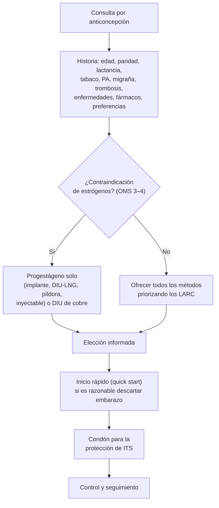

---
tags:
  - Ginecología y obstetricia
  - Frecuente en sala
---

# Anticoncepción y métodos naturales de regulación de la fertilidad

**Subespecialidad**
Ginecología · Salud sexual y reproductiva

**Guías principales**
MINSAL 2018: Normas Nacionales sobre Regulación de la Fertilidad · OMS 2015: criterios médicos de elegibilidad para el uso de anticonceptivos (5.ª edición) · CDC 2024: criterios médicos de elegibilidad (US MEC) y recomendaciones de práctica (US SPR)

**Otras fuentes**
Ley 20.418 (2010) y Decreto Supremo N.° 62 de 2015 (anticoncepción de emergencia sin receta) · Ver [puerperio y lactancia](puerperio-hemorragia-posparto-endometritis-mastitis-y-lactancia.md), [sangrado uterino anormal](sangrado-uterino-anormal-miomas-y-patologia-endometrial.md), [trombofilias](../hematologia/trombofilias.md), [cefalea y migraña](../neurologia/cefalea.md) e [ITS](../infectologia/infecciones-de-transmision-sexual-y-sifilis.md)

**GES**
No como problemas propios. Los métodos anticonceptivos se entregan **gratis** en la APS.

**EUNACOM**
3.01.3.008 Anticoncepción · 3.01.3.006 Métodos naturales para la regulación de la fecundidad

**Revisado**
Octubre 2026

!!! abstract "Resumen en 60 segundos"
    - **Derecho**: la **Ley 20.418** garantiza a toda persona la información y el **acceso libre** a los métodos de regulación de la fertilidad, incluida la **anticoncepción de emergencia** (sin receta, a cualquier edad).
    - **Elección**: según la **eficacia**, las preferencias, la salud (**criterios de elegibilidad de la OMS**, categorías 1–4) y la **doble protección** (condón para las ITS).
    - **Más eficaces** (< 1 embarazo por 100 mujeres al año): **implante**, **DIU con levonorgestrel**, **DIU de cobre**, **esterilización** y **vasectomía** (los **LARC** no dependen de la usuaria). Con **uso típico**, la píldora falla en **6–8 %** y el condón en **15 %**.
    - **Contraindicaciones de los estrógenos** (categoría 4): **migraña con aura**, **> 35 años y fumadora de ≥ 15 cigarrillos/día**, **HTA ≥ 160/100**, **trombosis venosa** previa o **trombofilia**, **cardiopatía isquémica o ACV**, **cáncer de mama** actual, **posparto < 21 días**, **LES con anticuerpos antifosfolípidos**, hepatopatía grave.
    - **Progestágeno solo** (píldora, inyectable trimestral, implante, DIU-LNG): alternativa cuando los estrógenos están contraindicados y en la **lactancia**.
    - **Anticoncepción de emergencia**: **levonorgestrel 1,5 mg** dosis única dentro de **5 días** (mejor cuanto antes) o **DIU de cobre** (el más eficaz).
    - **Métodos naturales** (abstinencia periódica): moco cervical, temperatura basal, sintotérmico, calendario, días estándar. Eficaces con **uso perfecto** (1–9 %), pero **~ 25 %** de falla con **uso típico**. **MELA**: eficaz (~ 2 %) los primeros **6 meses** posparto con **lactancia exclusiva** y **amenorrea**.

## Definición

- **Anticoncepción**: uso de métodos para **prevenir el embarazo**.
- **Regulación de la fertilidad**: concepto más amplio que incluye la anticoncepción, la planificación del momento y número de hijos y el tratamiento de la infertilidad.
- **Eficacia**: tasa de embarazos por 100 mujeres en el primer año de uso (**índice de Pearl**), con **uso perfecto** (correcto y consistente) y **uso típico** (real).
- **LARC** (*long-acting reversible contraception*): anticonceptivos reversibles de **larga duración**: **implantes** y **DIU**.
- **Criterios médicos de elegibilidad (OMS)**:
    - **Categoría 1**: sin restricción.
    - **Categoría 2**: los beneficios superan los riesgos.
    - **Categoría 3**: los riesgos superan los beneficios (usar solo si no hay alternativa, con seguimiento).
    - **Categoría 4**: **riesgo inaceptable**; no usar.
- **Métodos naturales** o de **abstinencia periódica**: se basan en reconocer el **período fértil** del ciclo y evitar el coito (o usar barrera) en esos días.

## Epidemiología

### Mundial

- Cerca de la mitad de los embarazos en el mundo **no son planificados**.
- Los **LARC** reducen los embarazos no planificados, sobre todo en **adolescentes**, porque no dependen del uso diario.

!!! chile "Datos nacionales y normativa"
    - **Ley 20.418** (2010): toda persona tiene derecho a recibir **educación, información y orientación** sobre la regulación de la fertilidad, y a **elegir libremente** y acceder a los métodos. Garantiza la **anticoncepción de emergencia** a todas las personas, **independiente de la edad**; en las **menores de 14 años**, se entrega y luego se informa al padre, la madre o el adulto responsable que ella indique.
    - **Decreto Supremo N.° 62 de 2015**: las píldoras de levonorgestrel de emergencia (0,75 y 1,5 mg) son de **venta libre** en farmacias.
    - El **sistema público** entrega los métodos **sin costo** (Programa de Salud de la Mujer en la APS): anticonceptivos orales combinados y de progestágeno solo, inyectables, **implante**, **DIU de cobre** y **DIU-LNG**, condones, y esterilización femenina y vasectomía.
    - La **esterilización** es voluntaria y requiere el **consentimiento** de la persona; no requiere el de la pareja.

## Etiología

No aplica como enfermedad. Se describen los **métodos** y su **mecanismo de acción**.

### Eficacia de los métodos (Normas MINSAL 2018; embarazos por 100 mujeres en el primer año)

| Método | Uso perfecto | Uso típico |
|---|---|---|
| **Implante de progestágeno** | **0,05** | **0,05** |
| **Vasectomía** | 0,1 | 0,1 |
| **DIU con levonorgestrel** | 0,2 | 0,2 |
| **Esterilización femenina** | 0,5 | 0,5 |
| **DIU de cobre (T Cu 380A)** | 0,6 | 0,8 |
| **Inyectable de progestágeno (AMPD)** | 0,3 | 3 |
| **Inyectable combinado** | 0,1 | 3 |
| **Píldora de progestágeno solo en la lactancia** | 0,5 | 1 |
| **MELA** (primeros 6 meses) | 0,5 | 2 |
| **Anticonceptivos orales combinados**, anillo y parche | 0,1–0,5 | **6–8** |
| **Píldora de progestágeno solo** (sin lactancia) | 0,5 | 6–8 |
| **Condón masculino** | 2 | **15** |
| **Coito interrumpido** | 4 | 19 |
| **Abstinencia periódica** | 1–9 | **25** |
| **Sin método** | 85 | 85 |

## Fisiopatología

| Método | Mecanismo de acción principal |
|---|---|
| **Combinados** (estrógeno + progestágeno: píldora, anillo, parche, inyectable mensual) | **Inhiben la ovulación** (suprimen el pico de LH); espesan el moco cervical |
| **Progestágeno solo** | **Espesan el moco cervical**; el **implante** y el **desogestrel** **inhiben la ovulación**; el AMPD inhibe la ovulación |
| **DIU de cobre** | Efecto **espermicida** y reacción inflamatoria local que impide la fecundación |
| **DIU con levonorgestrel** | Moco cervical espeso, **atrofia endometrial**, inhibición parcial de la ovulación |
| **Barrera** (condón) | Impide el paso de los espermatozoides; **protege de las ITS** |
| **Anticoncepción de emergencia con levonorgestrel** | **Retrasa o impide la ovulación**; **no** es abortiva (no actúa si ya hubo fecundación) |
| **Abstinencia periódica** | Barrera **temporal**: evitar el coito en el período fértil |
| **MELA** | La succión eleva la prolactina y suprime la ovulación |

- **Ventana fértil**: el óvulo vive **< 24 h** y los espermatozoides **~ 5 días**; el embarazo es posible con coitos desde **5 días antes** hasta el día de la ovulación (Normas MINSAL 2018).

## Clasificación

### Métodos disponibles

| Grupo | Métodos |
|---|---|
| **Hormonales combinados** | Píldora (etinilestradiol 20–35 µg o estradiol + progestágeno), **anillo vaginal** mensual, **parche** semanal, **inyectable mensual** |
| **Hormonales de progestágeno solo** | Píldora (desogestrel 75 µg, levonorgestrel 30 µg en la lactancia, drospirenona), **inyectable trimestral** (AMPD 150 mg IM), **implante** subdérmico (etonogestrel 3 años; levonorgestrel 5 años), **DIU-LNG** (52 mg, 5–8 años) |
| **Intrauterinos** | **DIU de cobre** T Cu 380A (10–12 años), DIU-LNG |
| **Barrera** | **Condón masculino** y femenino, diafragma, espermicidas |
| **Permanentes** | **Esterilización femenina** (salpingectomía o ligadura tubaria) y **vasectomía** |
| **Naturales** | **Moco cervical** (Billings), **temperatura basal**, **sintotérmico**, **calendario** (ritmo), **días estándar** (collar), método de los 2 días; **MELA** |
| **Emergencia** | **Levonorgestrel 1,5 mg**, régimen combinado (Yuzpe), **DIU de cobre**, ulipristal (donde esté disponible) |

### Contraindicaciones de los anticonceptivos con estrógenos (OMS categoría 4)

- **Lactancia** < 6 semanas posparto; **posparto < 21 días** sin lactancia.
- **≥ 35 años** y fumadora de **≥ 15 cigarrillos al día**.
- **HTA** con PA **≥ 160/100** mmHg o con **enfermedad vascular**.
- **Trombosis venosa profunda o TEP** actual o previa; **trombofilia** conocida; **cirugía mayor** con inmovilización prolongada.
- **Cardiopatía isquémica**, **ACV**, **valvulopatía complicada** (HTP, FA, endocarditis).
- **Migraña con aura** (a cualquier edad).
- **Cáncer de mama** actual.
- **Diabetes con vasculopatía** (nefropatía, retinopatía, neuropatía) o > 20 años de evolución.
- **Cirrosis descompensada**, **tumores hepáticos** (adenoma, hepatocarcinoma), hepatitis aguda grave.
- **LES** con **anticuerpos antifosfolípidos** positivos.
- **Múltiples factores de riesgo cardiovascular**.

## Clínica

La consulta anticonceptiva es una **consejería**, no solo una receta:

- **Anamnesis**: edad, paridad, **lactancia**, fecha de la última menstruación, **tabaco**, **migraña** (con o sin aura), **antecedente de trombosis** personal y familiar, HTA, diabetes, cáncer, enfermedad hepática, **fármacos** (anticonvulsivantes inductores, rifampicina), deseo de embarazo futuro, actividad sexual y **riesgo de ITS**, **violencia**.
- **Examen**: **presión arterial** e **IMC** (los únicos imprescindibles antes de los hormonales combinados). El examen pélvico, la mamografía y los exámenes de laboratorio **no son necesarios** para iniciar un método hormonal en una mujer sana (sí el examen pélvico para insertar un DIU).
- **Descartar embarazo** con razonable certeza (OMS): sin coito desde la última menstruación, uso correcto de un método confiable, dentro de los 7 días del inicio de la menstruación, dentro de los 7 días posaborto, posparto < 4 semanas, o MELA. Si no se cumple, **β-hCG**.

!!! alarma "Signos de alarma en usuarias de anticonceptivos (ACHES)"
    - **A**bdomen: dolor abdominal intenso (trombosis mesentérica, hepática, embarazo ectópico con progestágeno solo o DIU).
    - **C**hest: **dolor torácico**, disnea (TEP, infarto).
    - **H**eadache: **cefalea intensa** nueva, migraña con aura (ACV).
    - **E**yes: alteraciones visuales (trombosis retiniana, ACV).
    - **S**evere leg pain: dolor o edema de una pierna (**TVP**).
    - Con un **DIU**: fiebre y dolor pélvico (PIP), hilos no visibles o sangrado con atraso menstrual (embarazo, expulsión, perforación).

## Diagnóstico

!!! guia "Puntos clave (Normas MINSAL 2018; OMS 2015; CDC 2024)"
    - Usar los **criterios médicos de elegibilidad** (OMS o CDC 2024) para cada condición de salud.
    - **Inicio rápido** (*quick start*): se puede iniciar un método **cualquier día del ciclo** si es razonablemente seguro que no hay embarazo; usar **condón por 7 días** (combinados, inyectables, implante, DIU-LNG) o **2 días** (píldora de progestágeno solo). El DIU de cobre protege de inmediato.
    - Los **LARC** son de **primera línea** también en **adolescentes** y **nulíparas**.
    - **Doble protección**: método eficaz + **condón** para las ITS.
    - **Interacciones**: los **inductores enzimáticos** (carbamazepina, fenitoína, topiramato, **rifampicina**, algunos antirretrovirales) reducen la eficacia de los hormonales orales e implantes → preferir DIU o AMPD.

## Laboratorio

- **No** se requieren exámenes de rutina para iniciar un método.
- **β-hCG** si no se puede descartar razonablemente el embarazo.
- **Tamizaje de ITS** (clamidia, gonococo, VIH, sífilis) según el riesgo, **sin retrasar** la inserción del DIU.
- Estudio de **trombofilia**: **no** de rutina; solo con antecedente personal o familiar de primer grado de trombosis.

## Imágenes

- **Ecografía** no es necesaria antes de insertar un DIU; útil si no se ven los **hilos** (ubicación, expulsión, perforación) o hay dolor.
- **Radiografía de abdomen** si el DIU no está en el útero por ecografía (perforación hacia la cavidad abdominal).

## Diagnóstico diferencial

Situaciones frecuentes en las usuarias:

| Situación | Considerar |
|---|---|
| **Sangrado irregular** con progestágeno solo | Efecto esperado (implante, AMPD, píldora); descartar embarazo, ITS y patología cervical |
| **Amenorrea** con hormonales | Efecto esperado (DIU-LNG, AMPD, uso continuo); descartar embarazo |
| **Atraso menstrual con DIU** | **Embarazo** (incluido el **ectópico**) |
| **Dolor pélvico con DIU** | PIP, perforación, expulsión parcial, embarazo |
| **Cefalea nueva** con combinados | Migraña con aura (suspender), HTA, ACV |

## Tratamiento

### Anticonceptivos hormonales combinados

- **Uso**: 21 días de píldora activa + 7 de descanso o placebo (sangrado por deprivación), o esquemas **24/4** o **continuos** (menos síntomas).
- **Beneficios no anticonceptivos**: ciclos regulares, menos **dismenorrea** y **sangrado**, menos **anemia**, mejoría del **acné** y el **hirsutismo** (SOP), menor riesgo de **cáncer de ovario y endometrio**.
- **Riesgos**: **tromboembolismo venoso** (riesgo ~ 3–9 por 10 000 mujeres al año, menor que en el embarazo y el posparto), HTA, ACV en las de alto riesgo.
- **Olvido de píldoras** (OMS):
    - **1–2 píldoras** olvidadas (o atraso < 48 h): tomar la olvidada **lo antes posible** y seguir; no se necesita protección adicional.
    - **≥ 3 píldoras** (o ≥ 48 h): tomar la última olvidada, seguir con el resto y usar **condón 7 días**; si fue en la **3.ª semana**, **saltar la semana de descanso**; si fue en la **1.ª semana** con coito sin protección, considerar la **anticoncepción de emergencia**.

### Progestágeno solo

- **Píldora** (desogestrel 75 µg): diaria y continua, sin descanso; **ideal en la lactancia** y si hay contraindicación de estrógenos.
- **AMPD 150 mg IM** cada **3 meses** (12–13 semanas, hasta 4 semanas de gracia): amenorrea frecuente, **aumento de peso**, **pérdida de densidad mineral ósea** reversible, retraso del retorno de la fertilidad (hasta 10 meses).
- **Implante** (etonogestrel, 3 años): el **más eficaz**; sangrado irregular (la causa principal de retiro).
- **DIU-LNG**: además trata el **sangrado menstrual abundante** y protege el endometrio.

### DIU de cobre

- **10–12 años** de duración; **no hormonal**; protección inmediata; puede usarse como **anticoncepción de emergencia**.
- Efectos: **más sangrado y dismenorrea**.
- **Contraindicaciones**: **embarazo**, **PIP o cervicitis purulenta actual**, sangrado genital no explicado, cáncer cervical o endometrial, cavidad deformada (miomas, malformaciones), sepsis puerperal.
- **Riesgos**: **expulsión** (2–10 %), **perforación** (~ 1 por 1000), **PIP** solo en las **primeras 3 semanas** tras la inserción. Si hay un embarazo con DIU: **descartar ectópico** y retirar el DIU si los hilos son visibles.

### Posparto, lactancia y posaborto

- **Lactancia**: **MELA**, progestágeno solo (desde el posparto inmediato), **DIU** (posplacentario o desde las 4 semanas), implante. **Evitar los combinados** antes de las **6 semanas** (y mejor hasta los 6 meses).
- **Sin lactancia**: los combinados desde los **21 días** (42 si hay otros factores de riesgo de trombosis).
- **Posaborto**: cualquier método de inmediato (DIU si no hay infección).

### Métodos permanentes

- **Esterilización femenina** (salpingectomía bilateral, que además reduce el cáncer de ovario, o ligadura tubaria) y **vasectomía** (más simple y segura; requiere **espermiograma** de control a los ~ 3 meses que confirme la azoospermia).
- **Consejería**: deben considerarse **irreversibles**; mayor arrepentimiento en las personas jóvenes.

### Anticoncepción de emergencia

- Indicada tras un **coito sin protección**, **falla** del método (rotura del condón, olvido de píldoras, atraso del inyectable) o **violación**.
- **Levonorgestrel 1,5 mg** VO en **dosis única** lo antes posible, **hasta 5 días** (120 h); más eficaz en las primeras 72 h. **Venta libre** en Chile.
- **DIU de cobre** dentro de **5 días**: el método **más eficaz** (> 99 %) y deja anticoncepción a largo plazo.
- **Ulipristal 30 mg** dentro de 5 días (más eficaz que el levonorgestrel en los días 3–5, donde esté disponible).
- **Régimen de Yuzpe** (combinado): menos eficaz y con más náuseas; solo si no hay levonorgestrel.
- **No** es abortiva y **no** daña un embarazo ya establecido. Iniciar o reanudar un método regular (inicio rápido) y hacer una **prueba de embarazo** si no llega la menstruación en **3 semanas**.

### Métodos naturales (abstinencia periódica)

| Método | Cómo identifica el período fértil | Eficacia con uso perfecto (Normas MINSAL 2018) |
|---|---|---|
| **Moco cervical** (Billings) | Moco **abundante, claro, elástico y lubricante** ("clara de huevo") = fértil; abstinencia desde que aparece hasta **4 días después del día cúspide** | ~ 3 % |
| **Temperatura basal** | **Alza de 0,2–0,5 °C** tras la ovulación (progesterona); coito solo desde el **3.er día de temperatura alta** | ~ 1 % (solo fase posovulatoria) |
| **Sintotérmico** | Combina el **moco**, la **temperatura** y otros signos | ~ 2 % |
| **Calendario (ritmo, Ogino-Knaus)** | Registro de 6–12 ciclos: primer día fértil = ciclo más corto − 18; último = ciclo más largo − 11 | ~ 9 % |
| **Días estándar** (collar de cuentas) | Días **8 a 19** del ciclo fértiles; solo para ciclos de **26–32 días** | ~ 5 % |
| **Método de los 2 días** | Presencia de secreción hoy o ayer = fértil | ~ 4 % |

- **Ventajas**: sin efectos adversos, aceptables por motivos religiosos o personales, responsabilidad compartida, sirven también para **buscar embarazo**.
- **Desventajas**: **25 %** de embarazos con **uso típico**; requieren **10–15 días de abstinencia** por ciclo (18–20 con la temperatura basal), **motivación** y aprendizaje de 1–4 meses; poco útiles con **ciclos irregulares** (adolescencia, perimenopausia, posparto, SOP); **no protegen de las ITS**.
- **MELA** (método de la amenorrea de lactancia): eficaz (~ **2 %**) si se cumplen **las tres** condiciones: **lactancia exclusiva** o casi exclusiva (día y noche), **amenorrea** y **< 6 meses posparto**. Si falla una, iniciar otro método.
- **Coito interrumpido**: falla ~ **19 %** con uso típico.

!!! dosis "Fármacos habituales"
    | Método | Esquema | Comentarios |
    |---|---|---|
    | **Anticonceptivo oral combinado** (etinilestradiol 30 µg + levonorgestrel 150 µg) | 1 diaria; 21/7 o continuo | Primera opción combinada por su menor riesgo trombótico |
    | **Desogestrel** | **75 µg diario continuo** | Lactancia, contraindicación de estrógenos |
    | **AMPD** | **150 mg IM cada 3 meses** | Densidad ósea; retraso del retorno de la fertilidad |
    | **Implante de etonogestrel** | 68 mg subdérmico, **3 años** | El más eficaz; sangrado irregular |
    | **DIU-LNG** | 52 mg, **5–8 años** | Trata el sangrado abundante |
    | **DIU de cobre T Cu 380A** | **10–12 años** | Emergencia hasta 5 días |
    | **Levonorgestrel de emergencia** | **1,5 mg VO dosis única**, hasta 5 días | Venta libre |

## Complicaciones

- **Combinados**: **tromboembolismo venoso**, **ACV** e infarto (en mujeres de riesgo), **HTA**, adenoma hepático (raro), náuseas, mastalgia, cefalea.
- **Progestágeno solo**: **sangrado irregular**, quistes funcionales, acné; **AMPD**: aumento de peso y pérdida ósea.
- **DIU**: **expulsión**, **perforación**, sangrado y dismenorrea (cobre), **PIP** en las primeras semanas, **embarazo ectópico** si falla.
- **Esterilización**: complicaciones quirúrgicas, arrepentimiento, embarazo ectópico si falla.
- **Métodos naturales**: **embarazo no planificado** por la alta falla con uso típico.

## Pronóstico y seguimiento

- **Control** a los 1–3 meses del inicio (adherencia, efectos adversos, **presión arterial** con los combinados) y luego **anual**.
- **Retorno de la fertilidad**: inmediato tras retirar el implante, los DIU y suspender las píldoras; **hasta 10 meses** tras el **AMPD**.
- Reevaluar el método ante **cambios** de la salud (migraña con aura nueva, HTA, trombosis, tabaco después de los 35 años).

## Perlas para el internado

!!! perla "Para recordar en la sala"
    - **LARC** (implante y DIU) = los más eficaces; aptos para **adolescentes y nulíparas**.
    - **Migraña con aura**, **> 35 años fumadora**, **HTA ≥ 160/100**, **trombosis**, **posparto < 21 días** = **no estrógenos**.
    - Para iniciar un método hormonal basta con **PA**, **IMC** y una buena historia; **no** se necesita examen pélvico ni laboratorio.
    - **Inicio rápido** cualquier día + condón por 7 días.
    - **Emergencia**: **levonorgestrel 1,5 mg** hasta **5 días** (sin receta, cualquier edad) o **DIU de cobre** (el más eficaz). **No** es abortiva.
    - **Métodos naturales**: buenos con uso perfecto, **25 %** de falla con uso típico. **MELA**: lactancia exclusiva + amenorrea + < 6 meses.
    - **Rifampicina, carbamazepina, fenitoína** → bajan la eficacia de los hormonales orales.
    - **Siempre** ofrecer **condón** para la prevención de ITS.

## Preguntas de repaso

??? repaso "1. Mujer de 37 años, fumadora de 20 cigarrillos al día, pide anticonceptivos orales. ¿Qué le ofrece?"
    - Los **combinados** están **contraindicados** (OMS categoría 4: ≥ 35 años y ≥ 15 cigarrillos/día).
    - Ofrecer **DIU de cobre**, **DIU-LNG**, **implante** o **progestágeno solo**; y consejería para **dejar de fumar**.

??? repaso "2. Puérpera de 3 semanas con lactancia exclusiva pide un método. ¿Qué opciones tiene?"
    - **MELA** (si cumple lactancia exclusiva, amenorrea y < 6 meses).
    - **Progestágeno solo**: desogestrel, implante, AMPD.
    - **DIU** (de cobre o LNG) desde las **4 semanas** posparto (o posplacentario).
    - **No** combinados antes de las 6 semanas (lactancia; riesgo trombótico).

??? repaso "3. Adolescente de 16 años consulta 2 días después de un coito con rotura del condón. ¿Qué indica?"
    - **Anticoncepción de emergencia**: **levonorgestrel 1,5 mg** dosis única de inmediato (venta libre; garantizada por la **Ley 20.418** a cualquier edad), o **DIU de cobre** (el más eficaz).
    - Iniciar un método regular (idealmente un **LARC**), **condón** para las ITS, tamizaje de ITS y prueba de embarazo si no menstrúa en 3 semanas.

??? repaso "4. Usuaria de anticonceptivos combinados olvidó 3 píldoras en la tercera semana. ¿Qué le indica?"
    - Tomar la última olvidada, continuar con las demás y usar **condón por 7 días**.
    - **Saltarse la semana de descanso** (empezar el siguiente envase sin pausa).
    - Si hubo coito sin protección en la **1.ª semana** tras un olvido así, considerar la anticoncepción de emergencia.

??? repaso "5. Pareja que por motivos religiosos desea usar un método natural. ¿Qué le explica?"
    - Opciones: **moco cervical** (Billings), **sintotérmico**, **temperatura basal**, días estándar.
    - Con **uso perfecto** son eficaces (1–9 % de falla), pero con **uso típico** la falla es ~ **25 %**; requieren 1–4 meses de aprendizaje, registro diario, 10–15 días de abstinencia por ciclo y **ciclos regulares**; no protegen de ITS.

??? repaso "6. Mujer de 25 años con migraña con aura pide la píldora. ¿Qué responde?"
    - **Contraindicados** los métodos con **estrógenos** a cualquier edad (riesgo de **ACV**).
    - Opciones: **DIU** (cobre o LNG), **implante**, **progestágeno solo**.

## Referencias

1. Ministerio de Salud de Chile. Normas Nacionales sobre Regulación de la Fertilidad. Santiago: MINSAL; 2018. [minsal.cl](https://www.minsal.cl/wp-content/uploads/2015/09/2018.01.30_NORMAS-REGULACION-DE-LA-FERTILIDAD.pdf)
2. World Health Organization. Medical eligibility criteria for contraceptive use. 5.ª ed. Ginebra: OMS; 2015. [who.int](https://www.who.int/publications/i/item/9789241549158)
3. Nguyen AT, Curtis KM, Tepper NK, et al. U.S. Medical Eligibility Criteria for Contraceptive Use, 2024. *MMWR Recomm Rep.* 2024;73(4):1–126. doi:[10.15585/mmwr.rr7304a1](https://doi.org/10.15585/mmwr.rr7304a1)
4. Curtis KM, Nguyen AT, Tepper NK, et al. U.S. Selected Practice Recommendations for Contraceptive Use, 2024. *MMWR Recomm Rep.* 2024;73(3):1–77. doi:[10.15585/mmwr.rr7303a1](https://doi.org/10.15585/mmwr.rr7303a1)
5. Ley N.° 20.418. Fija normas sobre información, orientación y prestaciones en materia de regulación de la fertilidad. *Diario Oficial*; 2010. [bcn.cl](https://www.bcn.cl/leychile/)
