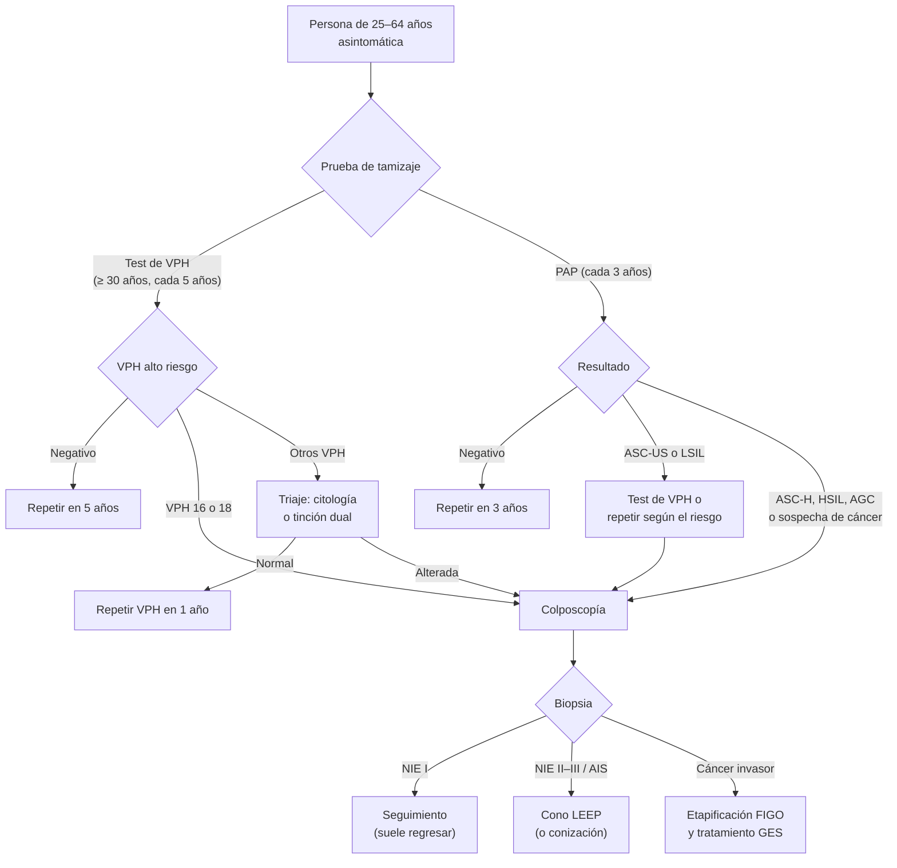

---
tags:
  - Ginecología y obstetricia
  - GES
---

# Cáncer cervicouterino, lesiones preinvasoras (VPH) y tamizaje ginecológico (PAP, test de VPH y mamografía)

**Subespecialidad**
Ginecología · Oncología ginecológica · Prevención

**Guías principales**
MINSAL: guía GES de cáncer cervicouterino (recomendaciones GRADE vigentes, octubre 2026) · OMS 2021: tamizaje y tratamiento de las lesiones precancerosas del cuello uterino · ASCCP 2019: manejo basado en el riesgo de las pruebas de tamizaje alteradas · FIGO 2018: etapificación del cáncer del cuello uterino · USPSTF 2024: tamizaje del cáncer de mama

**Otras fuentes**
GLOBOCAN (Chile) · Ver [cáncer de mama](../cirugia/cabeza-cuello-tiroides-y-mama/cancer-de-mama.md), [epidemiología del cáncer](../cirugia/anestesia-y-perioperatorio/epidemiologia-del-cancer.md), [ITS y sífilis](../infectologia/infecciones-de-transmision-sexual-y-sifilis.md) y [VIH](../infectologia/infeccion-por-vih.md)

**GES**
Sí: problema N.° 3, cáncer cervicouterino en personas de 15 años y más (incluye las lesiones preinvasoras). El cáncer de mama es el N.° 8.

**EUNACOM**
3.01.1.013 Cáncer cervicouterino (sospecha, inicial, derivar) · 3.01.1.016 Enfermedad preinvasora del cuello uterino, lesiones intraepiteliales (NIE-VPH) (sospecha, inicial, derivar) · 3.01.3.013 Screening ginecológico: Papanicolau, mamografía

**Revisado**
Octubre 2026

!!! abstract "Resumen en 60 segundos"
    - El **cáncer cervicouterino** es causado casi siempre por la **infección persistente por VPH de alto riesgo** (**16 y 18** causan ~ 70 %). Es **prevenible**: **vacuna** (prevención primaria) y **tamizaje** con tratamiento de las lesiones preinvasoras (secundaria).
    - En Chile es el **3.er cáncer más frecuente** en las mujeres (GLOBOCAN: ~ **1900 casos** y ~ **840 muertes** al año).
    - **Historia natural**: infección por VPH (la mayoría se elimina en 1–2 años) → **lesión intraepitelial de bajo grado** (NIE I, suele regresar) → **alto grado** (NIE II–III, precursora) → **cáncer invasor** en **10–20 años**.
    - **Tamizaje**:
        - **PAP** (citología) cada **3 años** entre los **25 y 64 años**: estrategia histórica del programa nacional.
        - **Test de VPH** como **tamizaje primario** desde los **30 años**, cada **5 años**: lo sugiere la guía GES vigente y la OMS; se está implementando en Chile.
    - **Resultado alterado** → **colposcopía** y **biopsia** (alto grado, ASC-H, AGC, VPH 16/18) o seguimiento (bajo grado según el riesgo). **NIE II–III** → **cono LEEP**.
    - **Clínica del cáncer**: **sinusorragia** (sangrado poscoital), metrorragia, flujo fétido; en etapas avanzadas, dolor pélvico, edema e **hidronefrosis**. **Toda lesión visible del cuello se biopsia** (el PAP es para asintomáticas).
    - **Tratamiento** según la etapa **FIGO 2018**: cono o histerectomía en las etapas iniciales; **histerectomía radical** en IB1–IB2; **quimiorradioterapia** con cisplatino y braquiterapia en las localmente avanzadas (IB3–IVA).
    - **Mamografía**: en Chile, el EMP la garantiza **cada 3 años** entre los **50 y 59 años**; el USPSTF 2024 recomienda **cada 2 años** entre los **40 y 74**.

## Definición

- **Cáncer cervicouterino**: neoplasia maligna del cuello uterino. **Escamoso** (~ 75–80 %), **adenocarcinoma** (~ 20 %, en aumento; más difícil de detectar con el PAP) y adenoescamoso.
- **Lesión intraepitelial escamosa** (terminología LAST, OMS):
    - **De bajo grado (LSIL)** = **NIE I** (CIN 1): efecto citopático del VPH (coilocitos), atipia en el tercio inferior del epitelio.
    - **De alto grado (HSIL)** = **NIE II** y **NIE III** (incluye el carcinoma *in situ*): atipia en dos tercios o todo el espesor, sin invasión de la membrana basal.
- **Adenocarcinoma *in situ* (AIS)**: lesión precursora glandular.
- **Zona de transformación**: zona de **metaplasia escamosa** entre el epitelio columnar del endocérvix y el escamoso del exocérvix. Ahí se originan casi todas las lesiones; el PAP debe tomarla.
- **Tamizaje**: estudio de personas **asintomáticas** para detectar lesiones precursoras o un cáncer precoz.

## Epidemiología

### Mundial

- **Cuarto cáncer** más frecuente y cuarta causa de muerte por cáncer en las mujeres; ~ 90 % de las muertes ocurren en países de ingresos bajos y medios.
- **Estrategia de eliminación de la OMS** (meta **90-70-90** para 2030): **90 %** de las niñas vacunadas antes de los 15 años, **70 %** de las mujeres tamizadas con una prueba de alto rendimiento a los 35 y 45 años, **90 %** de las lesiones tratadas.
- Pico de incidencia de las lesiones de alto grado a los **25–35 años** y del cáncer a los **40–50 años**.

!!! chile "Datos nacionales"
    - **GLOBOCAN**: el cuello uterino es el **3.er cáncer** de las mujeres chilenas, con ~ **1905 casos** y ~ **843 muertes** anuales.
    - La mortalidad por cáncer cervicouterino ha **descendido** de forma importante desde la implementación del **Programa Nacional de Pesquisa y Control** con PAP (1987).
    - **PAP**: gratuito en la APS **cada 3 años** entre los **25 y 64 años**; la meta histórica del programa es una cobertura del **80 %**.
    - **Test de VPH**: la guía GES vigente sugiere el **tamizaje primario con VPH** desde los **30 años** (con genotipificación extendida), por sobre el co-test; su implementación en la red pública es **progresiva**.
    - **Vacuna VPH**: incluida en el **Programa Nacional de Inmunizaciones** desde **2014** para las niñas y desde **2019** para los niños, en la vacunación escolar desde **4.° básico**.
    - **GES N.° 3**: cubre la **sospecha, confirmación diagnóstica, tratamiento y seguimiento** de las **lesiones preinvasoras** y del **cáncer** cervicouterino.
    - **Mamografía**: el **examen de medicina preventiva** garantiza una mamografía **cada 3 años** a las mujeres de **50 a 59 años** (cáncer de mama, GES N.° 8).

## Etiología

- **VPH de alto riesgo** (oncogénicos): **16, 18**, 31, 33, 45, 52, 58 y otros. Se transmite por **contacto sexual**; ~ 80 % de las personas sexualmente activas se infecta alguna vez.
- **VPH de bajo riesgo** (6, 11): **condilomas** y lesiones de bajo grado; no causan cáncer.
- **Cofactores** de persistencia y progresión:
    - **Tabaco**.
    - **Inmunosupresión**: **VIH**, trasplante, corticoides.
    - **Inicio sexual precoz**, **múltiples parejas**, otras **ITS** (*Chlamydia*, herpes).
    - **Multiparidad**, **anticonceptivos orales** por más de 5 años.
    - **Falta de tamizaje** (el factor más importante en la práctica).

## Fisiopatología

- El VPH infecta las **células basales** de la zona de transformación a través de microlesiones.
- Las oncoproteínas **E6** y **E7** inactivan **p53** y **Rb**, respectivamente: la célula pierde el control del ciclo y la apoptosis. La **integración** del ADN viral al genoma favorece la transformación maligna.
- La **p16** se sobreexpresa en las lesiones por VPH de alto riesgo (marcador inmunohistoquímico y base de la **tinción dual p16/Ki-67**).

## Clasificación

### Citología: sistema Bethesda (2014)

| Categoría | Significado | Conducta habitual |
|---|---|---|
| **Negativo** para lesión intraepitelial o malignidad | Normal (puede informar inflamación, *Candida*, *Trichomonas*, vaginosis) | Tamizaje de rutina |
| **ASC-US** (atipia escamosa de significado indeterminado) | La alteración más frecuente; casi siempre benigna | **Test de VPH** (si es positivo, colposcopía) o repetir la citología |
| **ASC-H** (atipia que no descarta una lesión de alto grado) | Riesgo intermedio-alto | **Colposcopía** |
| **LSIL** (lesión de bajo grado) | Infección por VPH, NIE I | Colposcopía o VPH según la edad y el riesgo |
| **HSIL** (lesión de alto grado) | NIE II–III | **Colposcopía** (y biopsia); a veces tratamiento directo |
| **AGC** (atipia de células glandulares) | Puede ser una lesión glandular cervical o **endometrial** | **Colposcopía + muestra endocervical**; **biopsia de endometrio** si tiene ≥ 35 años o factores de riesgo |
| **Carcinoma** escamoso o adenocarcinoma | Sospecha de cáncer | **Colposcopía y biopsia**, derivación GES |

### Histología

| Lesión | Equivalencia | Evolución |
|---|---|---|
| **NIE I** (LSIL) | Infección productiva por VPH | Regresa en **~ 60–90 %**; progresa a alto grado en ~ 10 % |
| **NIE II** | HSIL | Puede regresar (sobre todo en < 25 años) |
| **NIE III** (HSIL, incluye carcinoma *in situ*) | Precursor verdadero | Progresa a cáncer invasor en ~ 30 % en 30 años sin tratamiento |

### Etapificación FIGO 2018 del cáncer cervicouterino

| Etapa | Extensión |
|---|---|
| **I** | Confinado al **cuello** |
| IA1 / IA2 | Microscópico, invasión **< 3 mm** / **3–5 mm** de profundidad |
| IB1 / IB2 / IB3 | Invasión > 5 mm; tumor **≤ 2 cm** / **2–4 cm** / **> 4 cm** |
| **II** | Fuera del útero, sin llegar al **tercio inferior de la vagina** ni a la **pared pélvica** |
| IIA (IIA1 ≤ 4 cm, IIA2 > 4 cm) / IIB | **Dos tercios superiores de la vagina** / **parametrios** |
| **III** | **Tercio inferior de la vagina**, **pared pélvica**, **hidronefrosis** o riñón no funcionante, o **ganglios** |
| IIIA / IIIB / IIIC1 / IIIC2 | Tercio inferior de la vagina / pared pélvica o hidronefrosis / ganglios **pélvicos** / ganglios **paraaórticos** |
| **IV** | Fuera de la pelvis verdadera |
| IVA / IVB | Mucosa de la **vejiga** o del **recto** / **metástasis a distancia** |

- La FIGO 2018 permite usar las **imágenes** (RM, TC, PET-TC) y la **patología** para asignar la etapa.

## Clínica

- **Lesiones preinvasoras**: **asintomáticas**; se encuentran solo con el tamizaje.
- **Cáncer precoz**: a menudo asintomático o con **sinusorragia** (sangrado poscoital), **metrorragia** intermenstrual o posmenopáusica, **flujo** acuoso, sanguinolento o **fétido**.
- **Cáncer avanzado**: **dolor pélvico** o lumbar irradiado a la pierna (compromiso del plexo y de la pared pélvica), **edema** de las extremidades inferiores, **hidronefrosis** y **uremia** (causa frecuente de muerte), **fístulas** vesicovaginales o rectovaginales, hematuria, rectorragia, baja de peso, anemia.
- **Especuloscopía**: lesión **exofítica** (friable, sangra al contacto), **ulcerada** o **endofítica** (cuello aumentado de tamaño, "**en barril**", sobre todo el adenocarcinoma). **Tacto rectovaginal**: compromiso de los **parametrios**.

!!! alarma "Signos de alarma"
    - **Sinusorragia** o **metrorragia** posmenopáusica → especuloscopía; si hay una **lesión visible**, **biopsia** directa (no esperar un PAP).
    - **Hemorragia genital masiva** por un tumor de cuello → taponamiento vaginal, reanimación y radioterapia hemostática.
    - **Anuria o uremia** en una paciente con cáncer cervicouterino → **obstrucción ureteral bilateral** (nefrostomía).

## Diagnóstico

!!! guia "Puntos clave (guía GES vigente; OMS 2021; ASCCP 2019; FIGO 2018)"
    - **Tamizaje** solo en **asintomáticas**. Ante **síntomas** o una **lesión visible**, ir directo a la **colposcopía y biopsia**.
    - **Test de VPH primario** (≥ 30 años): más **sensible** que el PAP para las lesiones de alto grado y con un valor predictivo negativo tan alto que permite **intervalos de 5 años**. La guía GES sugiere la **genotipificación extendida** y el **VPH solo** por sobre el **co-test** (VPH + PAP).
    - **PAP**: muestra de la **zona de transformación** con espátula de Ayre (exocérvix) y **cepillo** (endocérvix). No tomarlo durante la menstruación ni tras duchas vaginales o relaciones en las 48 h previas.
    - **Colposcopía**: magnifica el cuello tras aplicar **ácido acético** (lesiones **acetoblancas**, mosaico, punteado, vasos atípicos) y **lugol** (zonas **yodo negativas**). Guía la **biopsia** de las zonas más alteradas. **Insatisfactoria** si no se ve la unión escamocolumnar completa.
    - **Confirmación**: siempre **histológica** (biopsia o cono).
    - **Etapificación del cáncer**: **examen pélvico** (idealmente bajo anestesia), **RM de pelvis** (extensión local; la guía GES la sugiere por sobre la TC), **TC** o **PET-TC** (ganglios y metástasis, desde IB2 o según la etapa), cistoscopía y rectoscopía si se sospecha compromiso.

### Tamizaje de rutina: resumen

| Prueba | Edad | Intervalo | Comentarios |
|---|---|---|---|
| **PAP** (programa nacional) | **25–64 años** | **Cada 3 años** | Estrategia histórica del programa nacional |
| **Test de VPH** (guía GES, OMS) | **Desde los 30 años** (OMS: desde los 30 en la población general, desde los 25 en mujeres con VIH) | **Cada 5 años** (OMS: 5–10 años) | Con genotipificación; triaje con citología o tinción dual si es positivo para otros tipos |
| **Mamografía** (EMP Chile) | **50–59 años** | **Cada 3 años** | USPSTF 2024: **cada 2 años** entre los **40 y 74 años** |

- **Situaciones especiales**:
    - **VIH**: tamizaje más frecuente (citología anual o VPH cada 3 años según la guía) e inicio al diagnóstico de la infección.
    - **Histerectomía total por causa benigna**: **suspender** el tamizaje cervical.
    - **Mayores de 64–65 años** con tamizaje previo adecuado y negativo: se puede **suspender**.
    - **Vacunadas**: **mantener** el tamizaje (la vacuna no cubre todos los tipos oncogénicos).
    - **Embarazo**: el PAP se puede tomar; la colposcopía es segura, pero se evita la biopsia endocervical y el cono (salvo sospecha de cáncer invasor).

## Laboratorio

- **Test de VPH** (PCR para los tipos de alto riesgo, con genotipificación de 16 y 18 o extendida).
- **Tinción dual p16/Ki-67** (triaje de los VPH positivos).
- **Serología de VIH y sífilis** (ITS asociadas).
- **Cáncer**: hemograma (anemia), **creatinina** (uropatía obstructiva), pruebas hepáticas; **SCC** (antígeno de células escamosas) en algunos centros para el seguimiento.

## Imágenes

- **RM de pelvis**: tamaño tumoral, compromiso **parametrial** y vaginal, ganglios.
- **PET-TC con FDG**: etapificación **ganglionar y a distancia** (la guía GES la sugiere desde IA2 o IB2 según la recomendación).
- **TC de tórax, abdomen y pelvis**: alternativa si no hay PET-TC; **hidronefrosis**.
- **Mamografía** (y ecografía mamaria complementaria): tamizaje del cáncer de mama; informe **BI-RADS**.

## Diagnóstico diferencial

| Cuadro | Claves |
|---|---|
| **Ectropión** (ectopia) | Zona roja periorificial, lisa, frecuente en jóvenes y con anticonceptivos; PAP normal |
| **Cervicitis** (*Chlamydia*, gonococo, herpes) | Flujo mucopurulento, cuello friable; PCR de ITS |
| **Pólipo endocervical** | Lesión pediculada que protruye por el orificio; extirpar y estudiar |
| **Quistes de Naboth** | Quistes de retención amarillentos, benignos |
| **Condiloma acuminado** | Lesión papilomatosa por VPH 6 y 11 |
| **Cáncer de endometrio** con extensión al cuello | Metrorragia posmenopáusica, AGC; biopsia de endometrio |
| **Metrorragia de otras causas** | Sangrado uterino anormal (pólipos, miomas, endometrio), causas del embarazo; descartar el embarazo con β-hCG |

## Tratamiento

### Prevención primaria: vacuna contra el VPH

- Vacunas **bivalente** (16, 18), **tetravalente** (6, 11, 16, 18) y **nonavalente** (+ 31, 33, 45, 52, 58).
- Máxima eficacia **antes del inicio de la vida sexual**: vacunación escolar de **niñas y niños** (PNI).
- La guía GES sugiere además **vacunar** a las personas con **NIE II–III** tratadas (menor recurrencia).
- **Condón**: reduce pero no elimina el contagio. **Dejar de fumar**.

### Lesiones preinvasoras

| Diagnóstico | Conducta (ASCCP 2019; OMS 2021) |
|---|---|
| **NIE I** (LSIL) | **Observación**: VPH o citología al año. Tratar solo si persiste ≥ 2 años |
| **NIE II** | **Tratamiento escisional** (LEEP). En **< 25 años** o con deseo de fertilidad puede **observarse** con colposcopía y citología cada 6 meses (si la colposcopía es satisfactoria) |
| **NIE III** | **Tratamiento escisional**: **cono LEEP** (asa electroquirúrgica) o **conización** con bisturí frío |
| **AIS** (adenocarcinoma *in situ*) | **Conización** (márgenes libres) e **histerectomía** si no desea fertilidad |
| **Países de recursos limitados** | "**Ver y tratar**": test de VPH → ablación (**crioterapia** o termoablación) en la misma visita (OMS) |

- **Seguimiento posterior** al tratamiento: **test de VPH** (± citología) a los 6 meses y luego anual hasta tener resultados negativos repetidos; después, tamizaje por al menos **25 años**.
- **Embarazo**: diferir el tratamiento de las lesiones preinvasoras hasta el **posparto**.
- **Complicaciones del cono**: hemorragia, **estenosis cervical**, **insuficiencia cervical** con **parto prematuro** en embarazos futuros (por eso no se trata la NIE I).

### Cáncer invasor (manejo por el equipo de oncología ginecológica, GES)

| Etapa | Tratamiento (guía GES; FIGO) |
|---|---|
| **IA1** | **Cono** con márgenes negativos (si desea fertilidad) o **histerectomía simple** |
| **IA2–IB1** | **Histerectomía radical** con evaluación ganglionar (**ganglio centinela** o linfadenectomía pélvica). Con deseo de fertilidad y tumor ≤ 2 cm: **traquelectomía radical**. Tumor < 2 cm con cono de márgenes negativos: la guía GES sugiere **histerectomía simple** con evaluación ganglionar |
| **IB2–IIA1** | **Histerectomía radical** + linfadenectomía (la guía GES la sugiere en IB2) o quimiorradioterapia |
| **IB3, IIA2–IVA** (localmente avanzado) | **Quimiorradioterapia** (radioterapia externa con **cisplatino semanal**) + **braquiterapia** (idealmente guiada por **RM**). La guía GES vigente sugiere agregar **inmunoterapia anti-PD-1/PD-L1** en las etapas III–IVA y considerar quimioterapia de inducción con platino y taxano |
| **IVB**, recurrente o persistente | **Quimioterapia** con **platino** y paclitaxel ± **bevacizumab**, con **inmunoterapia anti-PD-1** (pembrolizumab) en primera línea; radioterapia paliativa; exenteración pélvica en la recidiva central irradiada seleccionada |

!!! dosis "Fármacos y procedimientos habituales"
    | Intervención | Esquema | Comentarios |
    |---|---|---|
    | **Vacuna VPH** | Según el PNI (vacunación escolar); en adultas, 3 dosis (0, 1–2 y 6 meses) | Ideal antes del inicio sexual |
    | **Cono LEEP** | Escisión con asa electroquirúrgica bajo anestesia local, guiada por colposcopía | Tratamiento de la NIE II–III; diagnóstico y terapéutico |
    | **Cisplatino** (con radioterapia) | **40 mg/m² EV semanal** durante la radioterapia (5–6 ciclos) | Radiosensibilizante. Nefrotoxicidad, náuseas, ototoxicidad |
    | **Pembrolizumab** | Según el protocolo oncológico | Enfermedad avanzada (anti-PD-1) |

!!! alarma "Urgencia"
    - **Hemorragia masiva** por un tumor de cuello: **taponamiento vaginal** con compresas (con o sin agentes hemostáticos), reanimación, transfusión y **radioterapia hemostática** o embolización.
    - **Uremia obstructiva**: nefrostomía percutánea o catéter doble J.

## Complicaciones

- **De la enfermedad**: hemorragia, **uropatía obstructiva** e insuficiencia renal, **fístulas**, dolor pélvico neuropático, linfedema, trombosis venosa, caquexia.
- **Del tratamiento**:
    - **Cirugía radical**: lesión ureteral o vesical, **disfunción vesical** (denervación), linfedema, linfoquistes.
    - **Radioterapia**: **cistitis** y **proctitis actínica**, estenosis vaginal, **menopausia precoz**, fístulas, fracturas por insuficiencia pélvica.
    - **Cono**: **parto prematuro** en embarazos posteriores.

## Pronóstico y seguimiento

- **Sobrevida a 5 años** según la etapa: **> 90 %** en la etapa IA, ~ **80–90 %** en IB1, **60–70 %** en II, **30–40 %** en III y **< 20 %** en IVB (cifras aproximadas de las series FIGO).
- Los **ganglios** comprometidos son el principal factor pronóstico.
- **Seguimiento** del cáncer: examen clínico y pélvico cada **3–6 meses** los primeros 2 años, luego cada 6–12 meses hasta los 5 años; imágenes según los síntomas. La citología vaginal tiene un valor limitado tras la radioterapia.
- **Lesiones preinvasoras tratadas**: riesgo de cáncer mayor que la población general por **décadas**; mantener el **tamizaje**.

## Perlas para el internado

!!! perla "Para recordar en la sala"
    - **El PAP es para asintomáticas**: si hay una **lesión visible** o **sinusorragia**, se hace **colposcopía y biopsia**.
    - **VPH 16 y 18** causan ~ 70 % de los cánceres; la **persistencia** es la clave, no la infección.
    - **NIE I = observar**; **NIE II–III = cono LEEP**. No tratar de más: el cono aumenta el **parto prematuro**.
    - **ASC-H, HSIL, AGC** → colposcopía directa. **AGC** en ≥ 35 años → **también biopsia de endometrio**.
    - **Cáncer avanzado** (IB3–IVA) = **quimiorradioterapia** con cisplatino, no cirugía.
    - **Hidronefrosis** = etapa **IIIB** (aunque el tumor sea pequeño).
    - **Mamografía en Chile**: EMP **cada 3 años** entre los **50 y 59 años**.
    - Mujer con **VIH**: tamizaje cervical **más frecuente** y desde el diagnóstico.

## Preguntas de repaso

??? repaso "1. Mujer de 34 años, asintomática. Test de VPH de tamizaje positivo para VPH 16. ¿Qué indica?"
    - **VPH 16 o 18 positivo** → **colposcopía** directa (alto riesgo de lesión de alto grado), con biopsia de las zonas alteradas.
    - Si fuera positivo para otros tipos: **triaje** con citología o tinción dual.

??? repaso "2. PAP de una mujer de 28 años informa HSIL. ¿Qué hace?"
    - **Colposcopía** con **biopsia** dirigida (derivación a la unidad de patología cervical, GES).
    - Si la biopsia confirma **NIE II–III**: **cono LEEP**; en NIE II con deseo de fertilidad puede considerarse la observación estricta.

??? repaso "3. Mujer de 45 años con sangrado después de las relaciones sexuales. A la especuloscopía, lesión exofítica friable de 3 cm en el cuello. ¿Qué hace?"
    - **Sospecha de cáncer cervicouterino**: **biopsia directa** de la lesión (no PAP) y derivación **GES**.
    - Etapificación: examen pélvico, **RM de pelvis** y **PET-TC** o TC; función renal.

??? repaso "4. Cáncer escamoso de cuello de 5 cm con compromiso de los parametrios e hidronefrosis derecha. ¿Etapa y tratamiento?"
    - **FIGO IIIB** (la **hidronefrosis** la define).
    - **Quimiorradioterapia** (cisplatino semanal + radioterapia externa) + **braquiterapia**; la guía GES sugiere sumar **inmunoterapia** en las etapas III–IVA. Manejar la obstrucción urinaria si deteriora la función renal.

??? repaso "5. Mujer de 52 años pregunta qué exámenes preventivos ginecológicos le corresponden. ¿Qué le indica?"
    - **Tamizaje cervicouterino**: PAP cada 3 años (hasta los 64) o **test de VPH** cada 5 años, según la oferta local.
    - **Mamografía** cada **3 años** entre los **50 y 59 años** (EMP; GES de cáncer de mama).

??? repaso "6. ¿Cuándo se puede suspender el tamizaje cervicouterino?"
    - Después de los **64–65 años** con tamizajes previos **negativos** y sin antecedente de lesiones de alto grado.
    - Tras una **histerectomía total por causa benigna** (sin antecedente de NIE II–III).
    - **No** se suspende por estar **vacunada** ni por no tener pareja actual.

## Referencias

1. Ministerio de Salud de Chile. Guía de práctica clínica GES: cáncer cervicouterino. Recomendaciones GRADE (consultado en octubre de 2026). [diprece.minsal.cl](https://diprece.minsal.cl/garantias-explicitas-en-salud-auge-o-ges/cancer-cervico-uterino/recomendaciones-grade/)
2. World Health Organization. WHO guideline for screening and treatment of cervical pre-cancer lesions for cervical cancer prevention. 2.ª ed. Ginebra: OMS; 2021. [who.int](https://www.who.int/publications/i/item/9789240030824)
3. Perkins RB, Guido RS, Castle PE, et al. 2019 ASCCP risk-based management consensus guidelines for abnormal cervical cancer screening tests and cancer precursors. *J Low Genit Tract Dis.* 2020;24(2):102–131. doi:[10.1097/LGT.0000000000000525](https://doi.org/10.1097/LGT.0000000000000525)
4. Bhatla N, Berek JS, Cuello Fredes M, et al. Revised FIGO staging for carcinoma of the cervix uteri. *Int J Gynaecol Obstet.* 2019;145(1):129–135. doi:[10.1002/ijgo.12749](https://doi.org/10.1002/ijgo.12749)
5. US Preventive Services Task Force. Screening for breast cancer: US Preventive Services Task Force recommendation statement. *JAMA.* 2024;331(22):1918–1930. doi:[10.1001/jama.2024.5534](https://doi.org/10.1001/jama.2024.5534)
6. International Agency for Research on Cancer. Global Cancer Observatory: Chile fact sheet. [gco.iarc.who.int](https://gco.iarc.who.int/today)
