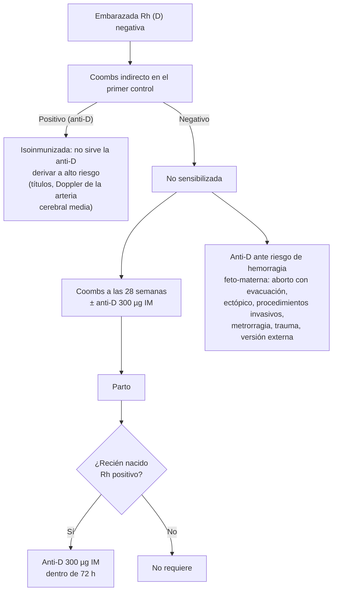

---
tags:
  - Ginecología y obstetricia
  - Frecuente en sala
---

# Control prenatal, edad gestacional, prevención de la isoinmunización Rh y derechos de la embarazada

**Subespecialidad**
Obstetricia · Atención primaria

**Guías principales**
MINSAL 2015: Guía Perinatal · ACOG 2017: métodos para estimar la fecha probable de parto (Committee Opinion N.° 700) y prevención de la aloinmunización Rh D (Practice Bulletin N.° 181)

**Otras fuentes**
Chile Crece Contigo (Ley 20.379) · Código del Trabajo (protección de la maternidad) · Ver [diabetes y embarazo](../endocrinologia/diabetes-y-embarazo.md), [síndrome hipertensivo del embarazo](../nefrologia/preeclampsia-y-sindrome-hipertensivo-del-embarazo.md), [anemias](../hematologia/anemias.md) y [VIH](../infectologia/infeccion-por-vih.md)

**GES**
Salud oral integral de la persona gestante (N.° 66) · Prevención del parto prematuro (N.° 24) · Analgesia del parto (N.° 54) · Garantías de enfermedades que se pesquisan en el control: diabetes, hipertensión, VIH, entre otras.

**EUNACOM**
3.01.3.001 Control prenatal · 3.01.3.003 Determinación de edad gestacional · 3.01.1.005 Embarazo con edad gestacional dudosa (específico, inicial, derivar) · 3.01.3.009 Prevención de enfermedad hemolítica perinatal · 3.01.3.002 Derechos y aspectos legales de la embarazada y su pareja

**Revisado**
Octubre 2026

!!! abstract "Resumen en 60 segundos"
    - **Objetivo del control prenatal**: un embarazo dentro de márgenes de normalidad física, psíquica, familiar y social, que termine con una madre y un recién nacido sanos (Guía Perinatal 2015).
        - Ingreso **precoz**, idealmente **antes de las 14 semanas**.
    - **Periodicidad** (Chile):
        - **Cada 4 semanas** hasta las 28 semanas.
        - **Cada 2 semanas** hasta las 36.
        - **Semanal** hasta el parto.
        - El alto riesgo se controla en el nivel secundario.
    - **Exámenes del primer control**:
        - Hemograma, grupo y Rh con **Coombs indirecto**, **VDRL o RPR**, **VIH**, **glicemia en ayunas**, **urocultivo** y orina completa.
        - **PAP** si no está vigente; Chagas en las zonas endémicas.
    - **Ecografías** (tres en el embarazo):
        - **11–13+6 semanas**: edad gestacional por la longitud céfalo-nalgas (LCN) y riesgo de aneuploidía (translucencia nucal).
        - **20–24 semanas**: anatomía y Doppler de las arterias uterinas.
        - **32–38 semanas**: crecimiento.
    - **Otros exámenes**:
        - **24–28 semanas**: PTGO.
        - **28 semanas**: Coombs indirecto e **inmunoglobulina anti-D** en las Rh negativas no sensibilizadas.
        - **35–37 semanas**: **cultivo de estreptococo grupo B**.
        - VDRL repetido a las 20–24 y 32–34 semanas.
    - **Ácido fólico**: **1 mg/día** desde 3 meses antes hasta las 12 semanas; **4–5 mg/día** si hay antecedente de defecto del tubo neural.
    - **Edad gestacional**:
        - La **LCN del primer trimestre** es el método más exacto.
        - Una **FUR confiable** se corrige por la ecografía si la diferencia supera los **5–7 días** (según la semana).
        - La edad gestacional es **dudosa** sin FUR confiable ni ecografía precoz.
    - **Anti-D 300 µg IM** dentro de **72 h posparto** si el recién nacido es Rh positivo, y en toda situación con riesgo de hemorragia feto-materna.
    - **Derechos**:
        - **Prenatal de 6 semanas** y **postnatal de 12 semanas**, más el **permiso postnatal parental**.
        - **Fuero maternal**.
        - Acompañamiento en el parto.
        - **Chile Crece Contigo**.

## Definición

- **Control prenatal (cuidado antenatal)**: conjunto de acciones que promueven la salud, determinan el riesgo obstétrico y perinatal, y agregan intervenciones para prevenir esos riesgos. Comienza **antes de la concepción** (control preconcepcional) y continúa hasta el inicio del trabajo de parto (Guía Perinatal 2015).
- **Duración normal del embarazo**: **~ 280 días** (40 semanas) desde la fecha de la última menstruación (FUR).
    - **Embarazo de término**: 37 a 41+6 semanas.
    - **Prematuro**: < 37 semanas.
    - **Postérmino**: ≥ 42 semanas.
- **Fecha probable de parto** (regla de Naegele): FUR + 7 días − 3 meses (+ 1 año).
- **Edad gestacional dudosa**: no se puede establecer con seguridad porque la **FUR no es confiable** (ciclos irregulares, uso reciente de anticonceptivos, lactancia, sangrado en el primer trimestre, no la recuerda) y **no hay una ecografía precoz**.
- **Enfermedad hemolítica perinatal**: destrucción de los glóbulos rojos fetales por **anticuerpos maternos** (IgG) que atraviesan la placenta, sobre todo **anti-D** en las madres Rh negativas sensibilizadas por un feto Rh positivo.

## Epidemiología

### Mundial

- El control prenatal adecuado reduce la mortalidad materna y perinatal al detectar a tiempo la preeclampsia, la diabetes, las infecciones (sífilis, VIH) y las alteraciones del crecimiento fetal.
- La **profilaxis con inmunoglobulina anti-D** redujo la isoinmunización Rh. Su prevalencia hoy es de **1 a 6,8 por 1000 recién nacidos vivos** y la mortalidad perinatal por esta causa bajó de 46 a cerca de 1,6 por 100 000 nacimientos (Guía Perinatal 2015).

### Chile

!!! chile "Datos nacionales"
    - El control prenatal se hace en la **APS** (matrona y médico), con derivación al **nivel secundario** del embarazo de alto riesgo (Guía Perinatal 2015).
    - **Chile Crece Contigo** (Ley 20.379, 2009) acompaña a la gestante desde el primer control: talleres prenatales, visitas domiciliarias en las situaciones de riesgo psicosocial y apoyo a la crianza.
    - En el ingreso se aplica la **Evaluación Psicosocial Abreviada** y la **Escala de Edimburgo** (depresión) en el ingreso o el segundo control.
    - **GES N.° 66**: salud oral integral de la persona gestante; se promueve la atención entre las **14 y 20 semanas**.
    - Los exámenes de **sífilis** y **VIH** se hacen según la norma conjunta de prevención de la transmisión vertical.

## Etiología y factores de riesgo

**Criterios para considerar un embarazo de alto riesgo** (Guía Perinatal 2015)

| Grupo | Ejemplos |
|---|---|
| **Enfermedades maternas** | Hipertensión, diabetes, nefropatía, cardiopatía, epilepsia, consumo de sustancias |
| **Mala historia obstétrica** | **Aborto a repetición**, bajo peso o macrosomía previos, RCIU, **parto prematuro**, **preeclampsia**, muerte fetal o neonatal, anomalía congénita mayor, **cirugía uterina previa** |
| **Embarazo actual** | **Embarazo múltiple**, edad **≤ 15 o > 40 años**, isoinmunización Rh, sangrado vaginal, **PA ≥ 90 mmHg** de diastólica |
| **Riesgo psicosocial** | Embarazo adolescente o no aceptado, escolaridad < 6.º básico, falta de apoyo, abuso sexual, violencia intrafamiliar, depresión, consumo de sustancias |

- Los antecedentes de parto prematuro, RCIU y preeclampsia **se repiten hasta en 40 %** de los casos en el embarazo siguiente (Guía Perinatal 2015).

## Fisiopatología

- **Cambios fisiológicos del embarazo** que se deben conocer para interpretar el control:
    - **Volemia +40–50 %**, con **anemia dilucional**.
    - Gasto cardíaco +30–50 %.
    - **PA baja en el segundo trimestre**.
    - Filtración glomerular +50 % (creatinina más baja).
    - Hipercoagulabilidad.
    - Resistencia a la insulina en la segunda mitad.
    - Alcalosis respiratoria leve.
- **Isoinmunización Rh**:
    1. Una madre **Rh (D) negativa** se expone a glóbulos rojos fetales **Rh positivos** (hemorragia feto-materna: parto, aborto, procedimientos, trauma, sangrado).
    2. Produce **anticuerpos anti-D** (primero IgM, luego **IgG**).
    3. En un **embarazo siguiente** con un feto Rh positivo, los IgG cruzan la placenta y causan **hemólisis fetal**: anemia, hidrops, muerte.
    - La **inmunoglobulina anti-D** neutraliza los glóbulos rojos fetales antes de que la madre se sensibilice. **No sirve** en una madre ya sensibilizada.

*Figura 1. Prevención de la isoinmunización Rh. Esquema propio basado en la Guía Perinatal 2015.*

## Clasificación

**Programa de cuidados prenatales en Chile** (Guía Perinatal 2015, tabla 2)

| Momento | Exámenes y acciones |
|---|---|
| **Primer control** (idealmente < 14 semanas) | **Hemograma**, **orina completa y urocultivo**, **grupo-Rh y Coombs indirecto**, **VDRL o RPR**, **VIH** (con consejería), **glicemia en ayunas**, **PAP** si no está vigente, Chagas (Arica a O'Higgins, incluida la RM), ecografía por indicación |
| **11–13+6 semanas** | **Ecografía**: LCN (edad gestacional), translucencia nucal y riesgo de aneuploidía |
| **20–24 semanas** | **Ecografía morfológica**, Doppler de las arterias uterinas, cérvix según la disponibilidad; **VDRL o RPR** |
| **24–28 semanas** | **PTGO** (o glicemia posprandial) para la diabetes gestacional |
| **28 semanas** | **Coombs indirecto** en las Rh negativas no sensibilizadas; **inmunoglobulina anti-D** según la disponibilidad |
| **32–34 semanas** | **VDRL o RPR**; VIH en las de mayor riesgo |
| **32–38 semanas** | **Ecografía** (crecimiento); hematocrito y hemoglobina |
| **35–37 semanas** | **Cultivo perianal de estreptococo grupo B** (salvo si tuvo un urocultivo positivo para ese germen) |

**Métodos para estimar la edad gestacional** (ACOG 2017)

| Método | Exactitud | Cuándo cambiar la FUR por la ecografía |
|---|---|---|
| **LCN < 14 semanas** | El más exacto | Diferencia **> 5 días** antes de las 9 semanas; **> 7 días** entre las 9 y 13+6 semanas |
| **Biometría 14–21+6 semanas** (DBP, circunferencia craneana) | Buena | Diferencia **> 7–10 días** |
| **Biometría 22–27+6 semanas** | Moderada | Diferencia **> 10 días** |
| **Biometría ≥ 28 semanas** | **La menos exacta** (± 3 semanas) | Diferencia **> 21 días** |
| **FUR confiable** | Útil si los ciclos son regulares | — |
| **Altura uterina** | Orientativa: entre las **18 y 32 semanas** equivale a las semanas de gestación en cm | No se usa para fijar la edad gestacional |

- Una vez establecida, la edad gestacional **no se cambia** con ecografías posteriores. Una discrepancia tardía sugiere una **alteración del crecimiento**, no un error de fecha.

## Clínica

**En cada control** (Guía Perinatal 2015):

- **Anamnesis**: síntomas de alarma; movimientos fetales (desde ~ 18–20 semanas).
- **Examen**:
    - Peso e IMC (incremento de peso según el estado nutricional), **presión arterial**, edema.
    - **Altura uterina** (entre el percentil 10 y 90 de la curva).
    - **Latidos cardiofetales**: Doppler desde las 11–12 semanas; estetoscopio de Pinard desde las ~ 18 semanas.
    - Presentación fetal (maniobras de Leopold en el tercer trimestre).
- **Buscar**:
    - **Hipertensión** (cefalea, fotopsias, tinnitus).
    - **ITU** (disuria).
    - **Parto prematuro** (contracciones).
    - **Colestasia** (prurito palmoplantar nocturno).
    - ITS.

**Signos de alarma que la embarazada debe conocer**:

- **Primer trimestre**: sangrado vaginal.
- **Segundo y tercer trimestre**: **pérdida de líquido**, **sangrado**, **contracciones** frecuentes o dolor abdominal, **disminución de los movimientos fetales**, cefalea intensa, alteraciones visuales, edema súbito, fiebre.

## Diagnóstico

!!! guia "Puntos clave (Guía Perinatal 2015; ACOG 2017)"
    - La **LCN entre las 11 y 13+6 semanas** es el parámetro más exacto para establecer la edad gestacional. Desde las 14 semanas, lo son la circunferencia craneana y el DBP.
    - **Coombs indirecto a todas** las embarazadas en el primer control, aunque sean Rh positivas (detecta otros anticuerpos irregulares).
    - **Embarazo con edad gestacional dudosa**:
        - Ecografía lo antes posible.
        - Si es tardía (> 24 semanas), estimar con la biometría, el cerebelo y la evolución en controles seriados (crecimiento cada 2–3 semanas), y derivar al nivel secundario.
        - Planificar la interrupción con los parámetros de madurez y bienestar fetal.

## Laboratorio

| Examen | Para qué |
|---|---|
| **Hemograma** | **Anemia**: Hb < 11 g/dL en el primer y tercer trimestre, < 10,5 en el segundo (ver [anemias](../hematologia/anemias.md)) |
| **Grupo, Rh y Coombs indirecto** | Isoinmunización Rh y por otros anticuerpos |
| **VDRL o RPR** | **Sífilis** (primer control, 20–24 y 32–34 semanas): tratar precozmente evita la **sífilis congénita** |
| **VIH** | La terapia antirretroviral reduce la transmisión vertical de **~ 35 % a ~ 1 %** (Guía Perinatal 2015) |
| **Glicemia en ayunas y PTGO 24–28 semanas** | Diabetes pregestacional y **gestacional** (ver [diabetes y embarazo](../endocrinologia/diabetes-y-embarazo.md)) |
| **Urocultivo** | **Bacteriuria asintomática**: hasta **50 %** progresa a una pielonefritis si no se trata |
| **Cultivo perianal de SGB** | Profilaxis antibiótica intraparto si es positivo |
| **TSH** | Según los factores de riesgo |

## Imágenes

- **Tres ecografías** en el embarazo de bajo riesgo:
    - **11–13+6 semanas**: viabilidad, número de fetos y **corionicidad**, **edad gestacional** (LCN), **translucencia nucal** (> p95 = mayor riesgo de aneuploidía y de malformaciones; p99 = 3,5 mm).
    - **20–24 semanas**: anatomía fetal, placenta, líquido amniótico, **Doppler de las arterias uterinas** (riesgo de preeclampsia y RCIU), cérvix (riesgo de parto prematuro).
    - **32–38 semanas**: crecimiento fetal, presentación, líquido amniótico, placenta.
- Con la ecografía rutinaria, la detección de malformaciones mayores en los centros terciarios chilenos es de **~ 50 %** (Guía Perinatal 2015).

## Diagnóstico diferencial

| Situación | Interpretación |
|---|---|
| Altura uterina **mayor** que la esperada | Error de fecha, **embarazo múltiple**, **macrosomía**, **polihidroamnios**, mioma, mola |
| Altura uterina **menor** que la esperada | Error de fecha, **RCIU**, **oligohidroamnios**, muerte fetal |
| Biometría tardía discordante con una LCN precoz | **Alteración del crecimiento** (no corregir la edad gestacional) |
| Coombs indirecto positivo en una Rh positiva | Otros anticuerpos irregulares (Kell, c, E): derivar |

## Tratamiento

**Suplementos y medidas generales** (Guía Perinatal 2015)

- **Ácido fólico**: desde **3 meses antes** hasta las **12 semanas** después de la concepción.
- **Hierro** según el hemograma (anemia) o profiláctico según la norma local.
- **Alimentación saludable**, salud oral (GES N.° 66), actividad física moderada sin restricciones en el embarazo normal.
- **Evitar** el tabaco, el alcohol (no hay una dosis segura) y las drogas; cafeína < 200 mg/día.
- **Actividad sexual** sin restricción en el embarazo normal; suspender si hay sangrado, amenaza de parto prematuro o rotura de membranas.
- **Viajes**: sin aumento del riesgo en la primera mitad. En el tercer trimestre, estar a menos de 2 h de un centro de salud.
- **Vacunas** según el calendario del PNI vigente: influenza, dTpa y COVID-19, entre otras.

**Derechos y aspectos legales de la embarazada y su pareja (Chile)**

| Derecho | Contenido |
|---|---|
| **Descanso prenatal** | **6 semanas** antes del parto (Código del Trabajo) |
| **Descanso postnatal** | **12 semanas** después del parto |
| **Permiso postnatal parental** | **12 semanas** a jornada completa (o 18 a media jornada) a continuación del postnatal; parte se puede traspasar al padre (Ley 20.545, 2011) |
| **Fuero maternal** | Desde el embarazo hasta **1 año después del postnatal**: no puede ser despedida sin autorización judicial |
| **Cambio de funciones** | Si el trabajo es perjudicial para el embarazo (cargas, turnos nocturnos, horas extraordinarias) |
| **Derecho a alimentar** | **1 hora al día** para alimentar a hijos menores de 2 años; **sala cuna** en empresas con 20 o más trabajadoras |
| **Permiso del padre** | Días pagados por el nacimiento del hijo |
| **Acompañamiento** | Derecho a estar acompañada en el control, el trabajo de parto y el parto (Ley 20.584 de derechos y deberes de los pacientes; Chile Crece Contigo) |
| **Protección de la lactancia** | Ley 21.155 (2019): protección del derecho a amamantar |
| **Muerte gestacional o perinatal** | **Ley 21.371 (2021, "Ley Dominga")**: protocolos de acompañamiento del duelo y separación de las madres de los recién nacidos sanos |
| **Interrupción voluntaria del embarazo** | **Ley 21.030** en tres causales (ver [hemorragia del primer trimestre](hemorragia-del-primer-trimestre-aborto-ectopico-y-mola.md)) |

!!! dosis "Suplementos y profilaxis"
    | Fármaco | Dosis | Indicación |
    |---|---|---|
    | **Ácido fólico** | **1 mg/día VO** | Desde 3 meses antes hasta las 12 semanas |
    | **Ácido fólico (dosis alta)** | **4–5 mg/día VO** | Antecedente de defecto del tubo neural, antiepilépticos, diabetes según el caso |
    | **Inmunoglobulina anti-D** | **300 µg IM** | Rh negativa no sensibilizada: **28 semanas** (según la disponibilidad), **dentro de 72 h posparto** si el recién nacido es Rh positivo, y ante cualquier riesgo de hemorragia feto-materna. Una segunda dosis a las 40 semanas si la primera fue hace más de 12 semanas |
    | **Sulfato ferroso** | 60 mg de hierro elemental al día o más según la anemia | Anemia ferropénica del embarazo |

!!! alarma "Derivar al nivel secundario o a la urgencia"
    - **Factores de alto riesgo** (ver la tabla de etiología).
    - **PA ≥ 140/90 mmHg**, proteinuria o síntomas de preeclampsia.
    - **Metrorragia**, **pérdida de líquido**, **contracciones** antes de las 37 semanas.
    - **Disminución de los movimientos fetales**.
    - **Coombs indirecto positivo** (isoinmunización).
    - **Edad gestacional dudosa** con una ecografía tardía.

## Complicaciones

- **Sin control prenatal**: preeclampsia y diabetes no diagnosticadas, **sífilis congénita**, transmisión vertical del VIH, parto prematuro no prevenido, muerte fetal.
- **Edad gestacional mal establecida**: inducciones innecesarias o **embarazos de postérmino**, prematurez iatrogénica, error en el diagnóstico del RCIU.
- **Isoinmunización Rh**: anemia fetal, **hidrops fetal**, muerte fetal, ictericia neonatal grave (kernicterus).

## Pronóstico y seguimiento

- El control prenatal de calidad, iniciado precozmente, permite clasificar el riesgo y derivar a tiempo.
- La **isoinmunización Rh** se previene casi por completo con la profilaxis anti-D. En la mujer ya sensibilizada se requiere un seguimiento en el nivel terciario (títulos de anticuerpos, **Doppler de la arteria cerebral media** para detectar la anemia fetal, transfusión intrauterina).

## Perlas para el internado

!!! perla "Para recordar en la sala"
    - Controles: **cada 4 semanas hasta las 28**, **cada 2 hasta las 36**, luego **semanal**.
    - **Coombs indirecto a todas** en el primer control (no solo a las Rh negativas).
    - **VDRL: primer control, 20–24 y 32–34 semanas**. **PTGO: 24–28**. **SGB: 35–37**.
    - **LCN del primer trimestre = la mejor edad gestacional**. Una vez fijada, **no se cambia**.
    - **Altura uterina en cm ≈ semanas** entre las 18 y 32 semanas.
    - **Anti-D 300 µg IM** dentro de **72 h** del parto si el recién nacido es Rh positivo; no sirve si la madre ya está sensibilizada.
    - **Ácido fólico 1 mg** (4–5 mg si hubo un defecto del tubo neural).
    - **Prenatal 6 semanas, postnatal 12 + 12 parental**, fuero hasta 1 año después del postnatal.

## Preguntas de repaso

??? repaso "1. Primigesta de 25 años que ingresa a control a las 9 semanas. ¿Qué exámenes solicita?"
    - **Hemograma**, **grupo, Rh y Coombs indirecto**, **VDRL o RPR**, **VIH** (con consejería), **glicemia en ayunas**, **orina completa y urocultivo**, **PAP** si no está vigente, y Chagas si vive en una zona endémica.
    - Una **ecografía entre las 11 y 13+6 semanas** (edad gestacional y translucencia nucal).
    - **Ácido fólico 1 mg/día** hasta las 12 semanas; derivación a salud oral (GES N.° 66).

??? repaso "2. Embarazada con una FUR que corresponde a 10+2 semanas y una ecografía con una LCN de 8+3 semanas. ¿Qué edad gestacional usa?"
    - La diferencia es de **13 días**, mayor que el límite de **7 días** entre las 9 y 13+6 semanas.
    - Se usa la **edad gestacional por la ecografía** (LCN), que es la más exacta, y se recalcula la fecha probable de parto.

??? repaso "3. Embarazada que consulta por primera vez a las 30 semanas, sin FUR confiable y sin ecografías previas. ¿Cómo maneja la edad gestacional?"
    - **Embarazo con edad gestacional dudosa**: la biometría del tercer trimestre tiene un error de hasta ± 3 semanas.
    - Hacer una **ecografía** (biometría, cerebelo) y **controles seriados del crecimiento**, y **derivar al nivel secundario**.
    - Planificar la interrupción con los parámetros de bienestar y madurez fetal.

??? repaso "4. Puérpera Rh negativa, Coombs indirecto negativo, cuyo recién nacido es Rh positivo. ¿Qué indica?"
    - **Inmunoglobulina anti-D 300 µg IM** dentro de las **72 horas** posparto, para prevenir la sensibilización en un próximo embarazo.

??? repaso "5. Embarazada Rh negativa con un Coombs indirecto positivo (anti-D) en el primer control. ¿Le sirve la inmunoglobulina anti-D?"
    - **No**: ya está **sensibilizada**. La profilaxis solo sirve en las mujeres no sensibilizadas.
    - Derivar al **alto riesgo** para el seguimiento con títulos de anticuerpos y **Doppler de la arteria cerebral media** fetal (anemia fetal).

??? repaso "6. Trabajadora embarazada pregunta por sus derechos laborales. ¿Qué le informa?"
    - **Prenatal de 6 semanas**, **postnatal de 12 semanas** y **permiso postnatal parental de 12 semanas** (o 18 a media jornada).
    - **Fuero maternal** hasta 1 año después del término del postnatal.
    - Derecho a cambiar de funciones si su trabajo es perjudicial para el embarazo, **1 hora diaria para alimentar** al hijo menor de 2 años y sala cuna si la empresa tiene 20 o más trabajadoras.

## Referencias

1. Ministerio de Salud de Chile. Guía Perinatal 2015. Santiago: MINSAL; 2015. [minsal.cl](https://www.minsal.cl/salud-de-la-mujer/)
2. Committee Opinion No 700: methods for estimating the due date. *Obstet Gynecol.* 2017;129(5):e150–e154. doi:[10.1097/AOG.0000000000002046](https://doi.org/10.1097/AOG.0000000000002046)
3. Practice Bulletin No. 181: prevention of Rh D alloimmunization. *Obstet Gynecol.* 2017;130(2):e57–e70. doi:[10.1097/AOG.0000000000002232](https://doi.org/10.1097/AOG.0000000000002232)
4. Ley 20.545. Modifica las normas sobre protección a la maternidad e incorpora el permiso postnatal parental. *Diario Oficial*, 2011. [bcn.cl](https://www.bcn.cl/leychile/)
5. Ley 21.371. Establece medidas especiales en caso de muerte gestacional o perinatal (Ley Dominga). *Diario Oficial*, 2021. [bcn.cl](https://www.bcn.cl/leychile/)
6. Chile Crece Contigo: sistema de protección integral a la infancia (Ley 20.379). [crececontigo.gob.cl](https://www.crececontigo.gob.cl/)
