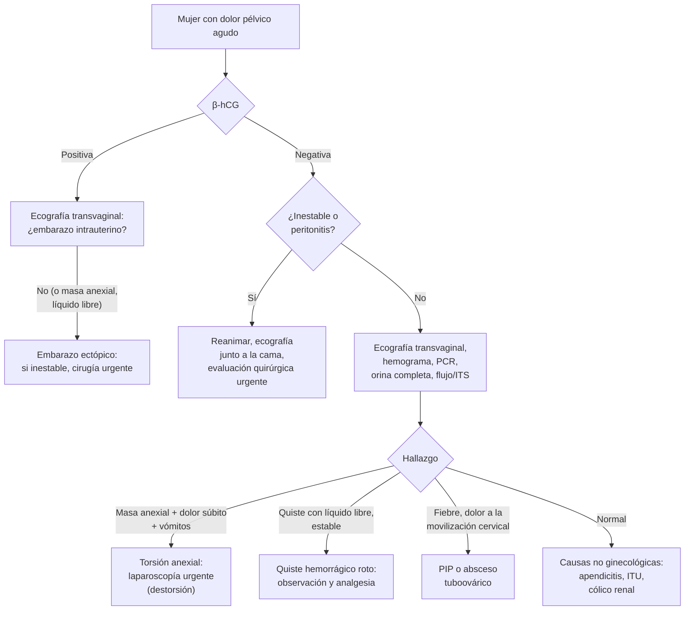

---
tags:
  - Ginecología y obstetricia
  - Urgencia
---

# Dolor pélvico, dismenorrea, endometriosis y torsión anexial

**Subespecialidad**
Ginecología · Urgencia ginecológica

**Guías principales**
ESHRE 2022: endometriosis · ACOG 2018: dismenorrea y endometriosis en la adolescente (CO 760) · ACOG 2019: torsión anexial en adolescentes (CO 783) · ACOG 2020: dolor pélvico crónico (PB 218)

**Otras fuentes**
Ver [hemorragia del primer trimestre y embarazo ectópico](hemorragia-del-primer-trimestre-aborto-ectopico-y-mola.md), [abdomen agudo](../gastroenterologia/abdomen-agudo.md), [sangrado uterino anormal y miomas](sangrado-uterino-anormal-miomas-y-patologia-endometrial.md) e [infección urinaria](../nefrologia/infeccion-urinaria.md)

**GES**
No como problemas propios.

**EUNACOM**
3.01.1.014 Dolor pelviano y dismenorrea (sospecha, inicial, derivar) · 3.01.1.015 Endometriosis (sospecha, inicial, derivar) · 3.01.2.016 Dolor pélvico agudo (sospecha, inicial, derivar) · 3.01.2.019 Quiste ovárico torcido (sospecha, inicial, completo)

**Revisado**
Octubre 2026

!!! abstract "Resumen en 60 segundos"
    - **Dolor pélvico agudo** en una mujer: lo primero es la **β-hCG** (descartar un **embarazo ectópico**) y la **estabilidad hemodinámica**. Luego **ecografía transvaginal**.
        - Causas ginecológicas urgentes: **ectópico roto**, **torsión anexial**, **quiste hemorrágico roto**, **PIP o absceso tuboovárico**.
        - Causas no ginecológicas: **apendicitis**, ITU o pielonefritis, cólico renal, diverticulitis.
    - **Torsión anexial**: dolor **súbito**, unilateral, intenso, con **náuseas y vómitos**, en general con una **masa anexial** (quiste dermoide, quiste funcional > 5 cm). El Doppler **puede ser normal**: la sospecha clínica manda. Tratamiento: **laparoscopía urgente** con **destorsión** y conservación del ovario.
    - **Dismenorrea primaria**: dolor menstrual sin patología pélvica, desde **1–2 años después de la menarquia**, por **prostaglandinas**. Tratamiento: **AINE** (desde el inicio del dolor) y/o **anticonceptivos hormonales**.
    - **Dismenorrea secundaria**: por patología pélvica, sobre todo **endometriosis** y **adenomiosis**. Sospechar si empieza más tarde, empeora o no responde a AINE y anticonceptivos.
    - **Endometriosis**: tejido endometrial **fuera del útero** (ovarios, peritoneo, ligamentos uterosacros). Afecta al **~ 10 %** de las mujeres en edad fértil.
        - Clínica: **dismenorrea progresiva**, **dispareunia profunda**, dolor pélvico crónico, disquecia, **infertilidad**. **Endometrioma** ("quiste de chocolate").
        - Diagnóstico: **clínico + imágenes** (ecografía o RM); la laparoscopía ya no es obligatoria (ESHRE 2022).
        - Tratamiento: **AINE**, **progestágenos** (dienogest, DIU-LNG) o **anticonceptivos combinados** continuos; agonistas o antagonistas de GnRH; **cirugía** si falla o por infertilidad.

## Definición

- **Dolor pélvico agudo**: dolor en el hemiabdomen inferior o la pelvis de **menos de ~ 3 meses** (en general horas a días).
- **Dolor pélvico crónico**: dolor pélvico **no cíclico o cíclico** de **≥ 6 meses**, que afecta la calidad de vida.
- **Dismenorrea**: dolor pélvico **durante la menstruación**.
    - **Primaria**: sin patología pélvica.
    - **Secundaria**: asociada a una patología (endometriosis, adenomiosis, miomas, PIP, malformaciones obstructivas, DIU de cobre).
- **Endometriosis**: presencia de **tejido similar al endometrio fuera del útero**, que causa una reacción inflamatoria crónica.
    - **Peritoneal superficial**, **ovárica** (**endometrioma**) y **profunda** (infiltra > 5 mm: uterosacros, tabique rectovaginal, vejiga, intestino).
- **Adenomiosis**: endometrio dentro del **miometrio**.
- **Torsión anexial**: rotación del ovario, la trompa o ambos sobre su pedículo vascular, que compromete el flujo (primero venoso y linfático, luego arterial) y puede llevar a la **necrosis**.

## Epidemiología

### Mundial

- **Dismenorrea**: **50–90 %** de las adolescentes y mujeres jóvenes; **causa importante de ausentismo** escolar y laboral.
- **Endometriosis**: **~ 10 %** de las mujeres en edad reproductiva; **30–50 %** de las mujeres con **infertilidad** y hasta el **70 %** de las adolescentes con dolor pélvico crónico refractario. **Retraso diagnóstico** de **7–10 años** en promedio.
- **Torsión anexial**: ~ **3 %** de las urgencias ginecológicas; más frecuente en edad reproductiva, en el **embarazo** y en **niñas** (ovarios con pedículo largo). Se asocia a una **masa anexial** benigna en la mayoría (quiste dermoide, quistes funcionales, quistes por estimulación ovárica).

!!! chile "Datos nacionales"
    - La **endometriosis** no tiene GES propio; el estudio y el tratamiento se hacen en la red de ginecología.
    - El **dienogest** y el **DIU con levonorgestrel** están disponibles en Chile para el tratamiento de la endometriosis.
    - **Dolor pélvico agudo en urgencia**: la **β-hCG** cuantitativa y la **ecografía transvaginal** son los exámenes iniciales en la red pública.

## Etiología

### Dolor pélvico agudo

| Origen | Causas |
|---|---|
| **Embarazo** | **Embarazo ectópico** (roto o no), aborto, degeneración de un mioma |
| **Anexial** | **Torsión anexial**, **quiste hemorrágico o roto** (cuerpo lúteo), **PIP y absceso tuboovárico**, **dolor ovulatorio** (*mittelschmerz*), síndrome de hiperestimulación ovárica |
| **Uterino** | Dismenorrea, **degeneración o torsión de un mioma**, endometritis, perforación por DIU, hematometra |
| **Gastrointestinal** | **Apendicitis**, diverticulitis, gastroenteritis, obstrucción intestinal, enfermedad inflamatoria intestinal |
| **Urinario** | **ITU y pielonefritis**, **cólico renal** |
| **Otros** | Hernias, trombosis de la vena ovárica, porfiria, dolor musculoesquelético |

### Dolor pélvico crónico

- Ginecológico: **endometriosis**, **adenomiosis**, adherencias, PIP crónica, congestión pélvica, miomas.
- No ginecológico: **síndrome de intestino irritable**, **cistitis intersticial** (síndrome de vejiga dolorosa), dolor miofascial del piso pélvico, neuropatías (pudendo), depresión, antecedente de **violencia sexual**.

### Endometriosis: teorías

- **Menstruación retrógrada** (Sampson): implantación de endometrio que refluye por las trompas.
- **Metaplasia celómica**, diseminación linfática o vascular, células madre.
- Factores: **menarquia precoz**, ciclos cortos, menstruaciones abundantes, **nuliparidad**, malformaciones müllerianas obstructivas, antecedente familiar (riesgo ~ 7 veces en familiares de primer grado). **Protectores**: multiparidad, lactancia prolongada.

### Torsión anexial

- **Masa anexial benigna** de **5–10 cm** (el riesgo es bajo en las masas pequeñas y en las malignas, que se adhieren): **teratoma maduro** (quiste dermoide), **quistes funcionales**, cistoadenomas, **ovarios estimulados** (fertilización asistida), quistes paraováricos.
- **Embarazo** (cuerpo lúteo grande), **ovarios normales** en niñas.

## Fisiopatología

- **Dismenorrea primaria**: al caer la progesterona antes de la menstruación, el endometrio libera **prostaglandinas** (PGF2α y PGE2) que causan **contracciones uterinas** intensas, **isquemia** y sensibilización de las fibras del dolor. Por eso los **AINE** son tan eficaces y los anticonceptivos (que adelgazan el endometrio) también.
- **Endometriosis**: los implantes responden a las hormonas del ciclo, **sangran** y producen **inflamación crónica**, **adherencias**, fibrosis y **sensibilización central** del dolor. La infertilidad se explica por alteraciones anatómicas (adherencias, obstrucción tubaria), inflamatorias (peritoneales) y de la reserva ovárica (endometriomas y su cirugía).
- **Torsión**: la oclusión venosa produce **edema** y aumento del tamaño del ovario, que perpetúa la isquemia; la oclusión arterial final lleva a la **necrosis** e infarto hemorrágico.

## Clasificación

### Dismenorrea

| Característica | Primaria | Secundaria |
|---|---|---|
| **Inicio** | 6–24 meses después de la **menarquia** (al establecerse los ciclos ovulatorios) | Más tarde, o cambio de patrón |
| **Dolor** | Cólico, desde horas antes hasta **48–72 h** de la menstruación | Más prolongado, **progresivo**; puede ser premenstrual o no cíclico |
| **Síntomas asociados** | Náuseas, diarrea, cefalea, lumbago | **Dispareunia**, SUA, infertilidad, disquecia, disuria |
| **Examen pélvico** | **Normal** | **Anormal** (nódulos, útero fijo o aumentado, masa anexial) |
| **Respuesta a AINE y anticonceptivos** | **Buena** | Parcial o nula |

### Endometriosis (ASRM revisada; #Enzian para la profunda)

- **Estadios ASRM I–IV** (mínima, leve, moderada, severa) según la extensión de los implantes, los endometriomas y las adherencias. **No se correlacionan bien con el dolor**.
- Tipos: **superficial peritoneal**, **endometrioma ovárico**, **profunda** (infiltrante).

## Clínica

- **Endometriosis**:
    - **Dismenorrea** **progresiva** (el síntoma más frecuente).
    - **Dispareunia profunda**.
    - **Dolor pélvico crónico**, **disquecia** y **disuria** cíclicas (compromiso intestinal o vesical), rectorragia o hematuria cíclicas.
    - **Infertilidad**.
    - Examen: **nódulos** dolorosos en los **ligamentos uterosacros** o el fondo de saco de Douglas, útero en **retroversión fija**, **masa anexial** (endometrioma). A menudo el examen es **normal**.
    - **Endometriosis extrapélvica** (rara): **catamenial** (neumotórax, hemoptisis), en cicatrices de cesárea o en el ombligo.
- **Adenomiosis**: dismenorrea intensa, sangrado menstrual abundante, útero **globuloso, simétrico y blando**, en multíparas de 40–50 años.
- **Torsión anexial**: dolor **súbito**, **unilateral**, intenso, a veces **intermitente** (torsiones parciales), con **náuseas y vómitos** (~ 70 %), a veces fiebre baja; **masa anexial** dolorosa; signos peritoneales tardíos.
- **Quiste hemorrágico roto**: dolor súbito, a menudo tras el coito o el ejercicio, en la **segunda mitad del ciclo** (cuerpo lúteo); puede haber **hemoperitoneo** e inestabilidad (sobre todo con anticoagulantes o coagulopatías).
- **Dolor ovulatorio** (*mittelschmerz*): dolor leve a moderado a **mitad del ciclo**, unilateral, de horas de duración.

!!! alarma "Signos de alarma"
    - **β-hCG positiva** + dolor + **líquido libre** o inestabilidad → **embarazo ectópico roto**: cirugía urgente.
    - **Dolor súbito con vómitos y una masa anexial** → **torsión**: el tiempo determina si se salva el ovario.
    - **Hipotensión** y **hemoperitoneo** → quiste roto con hemorragia o ectópico: cirugía.
    - **Fiebre**, dolor a la movilización cervical y **masa anexial** → **absceso tuboovárico** (riesgo de rotura y sepsis).
    - **Dolor pélvico en una niña** con masa abdominal → torsión (ovarios normales también pueden torcerse).

## Diagnóstico

!!! guia "Puntos clave (ESHRE 2022; ACOG 2018, 2019 y 2020)"
    - **Dolor pélvico agudo**: **β-hCG**, signos vitales, examen abdominal y **pélvico** (dolor a la movilización cervical, masas), **ecografía transvaginal** (o abdominal en niñas y vírgenes).
    - **Torsión anexial**: diagnóstico **clínico** con apoyo ecográfico (ovario **aumentado de tamaño** y **edematoso**, folículos desplazados a la periferia, **signo del remolino** del pedículo, masa). Un **Doppler con flujo normal no la descarta**. Si la sospecha es alta: **laparoscopía diagnóstica**.
    - **Endometriosis** (ESHRE 2022): sospecharla por los **síntomas**; la **ecografía transvaginal** y la **RM** permiten diagnosticar los **endometriomas** y la **enfermedad profunda**. Una imagen normal **no descarta** la endometriosis superficial. Se puede iniciar el **tratamiento empírico** sin laparoscopía. La **laparoscopía** con biopsia queda para los casos con imágenes negativas y falla del tratamiento empírico, o cuando se planea cirugía.
    - **Dismenorrea primaria**: diagnóstico **clínico**; en una adolescente con historia típica y sin factores de riesgo no se necesita examen pélvico ni ecografía. Estudiar si no responde a 3–6 meses de tratamiento.

## Laboratorio

- **β-hCG** (cuantitativa si es positiva).
- **Hemograma**, **PCR** (infección, torsión con necrosis), **orina completa y urocultivo**.
- **PCR para *Chlamydia* y gonococo** si se sospecha una PIP.
- **CA-125**: puede estar **elevado en la endometriosis**, la PIP y la menstruación; **no** sirve para diagnosticar la endometriosis (ESHRE 2022).
- Grupo y Rh si hay hemoperitoneo.

## Imágenes

- **Ecografía transvaginal** (primera línea):
    - **Endometrioma**: quiste unilocular con contenido en "**vidrio esmerilado**" homogéneo.
    - **Adenomiosis**: útero globuloso, miometrio asimétrico y heterogéneo, quistes miometriales.
    - **Torsión**: ovario aumentado y edematoso, masa, remolino del pedículo, líquido libre.
    - **Quiste hemorrágico**: contenido en "telaraña" o retículo, coágulo, líquido libre.
- **RM de pelvis**: endometriosis **profunda**, adenomiosis, masas complejas.
- **TC de abdomen y pelvis**: dolor abdominal con sospecha de causa no ginecológica (apendicitis, diverticulitis, cólico renal).

## Diagnóstico diferencial

| Cuadro | Claves |
|---|---|
| **Embarazo ectópico** | **β-hCG positiva**, útero vacío, masa anexial, líquido libre |
| **Torsión anexial** | Dolor **súbito** con vómitos y **masa anexial** |
| **Quiste hemorrágico roto** | Segunda mitad del ciclo, líquido libre, β-hCG negativa |
| **PIP** | Fiebre, flujo, **dolor a la movilización cervical**, bilateral |
| **Apendicitis** | Dolor periumbilical que migra a la fosa ilíaca derecha, anorexia, fiebre; ecografía o TC |
| **ITU y pielonefritis** | Disuria, puño percusión, sedimento |
| **Cólico renal** | Dolor lumbar irradiado a los genitales, hematuria |
| **Dismenorrea primaria** vs. **endometriosis** | Inicio, progresión, dispareunia, respuesta a AINE y anticonceptivos |
| **Síndrome de intestino irritable** | Dolor que mejora con la defecación, cambios del hábito |
| **Cistitis intersticial** | Dolor con la vejiga llena, urgencia, urocultivo negativo |

## Tratamiento

### Dismenorrea primaria

1. **AINE** desde el **inicio** del dolor o 1–2 días antes de la menstruación (si es predecible), por 2–3 días: **ibuprofeno**, **naproxeno**, **ácido mefenámico**.
2. **Anticonceptivos hormonales** (combinados, cíclicos o continuos; DIU-LNG; implante; progestágeno solo): cuando además desea anticoncepción o los AINE no bastan.
3. **Calor local**, ejercicio.
4. **Sin respuesta a 3–6 meses** de AINE + anticonceptivos → sospechar una **dismenorrea secundaria** (endometriosis): derivar a ginecología.

### Endometriosis (ESHRE 2022)

| Objetivo | Opciones |
|---|---|
| **Dolor (primera línea)** | **AINE** + **anticonceptivos combinados** (de preferencia **continuos**) o **progestágenos**: **dienogest 2 mg/día**, noretisterona, desogestrel, **DIU-LNG**, implante |
| **Dolor (segunda línea)** | **Agonistas de GnRH** (leuprolide) con terapia *add-back* (estrógeno-progestágeno) para evitar la pérdida ósea; **antagonistas orales de GnRH** (relugolix combinado, elagolix) |
| **Cirugía** | **Laparoscopía** con escisión o ablación de los implantes y **quistectomía** de los endometriomas: falla del tratamiento médico, endometrioma grande, compromiso intestinal o urinario, sospecha de malignidad. Después de la cirugía, **tratamiento hormonal** para reducir la recurrencia |
| **Infertilidad** | Cirugía en casos seleccionados; **técnicas de reproducción asistida** (FIV). El tratamiento hormonal **no** mejora la fertilidad y la retrasa |
| **Definitivo** | **Histerectomía** ± anexectomía con escisión de los focos (paridad cumplida, dolor refractario) |

- La **cirugía del endometrioma** puede reducir la **reserva ovárica** (AMH): evaluarla antes en mujeres que desean fertilidad.

### Adenomiosis

- **DIU-LNG**, progestágenos, anticonceptivos, AINE; **histerectomía** como tratamiento definitivo.

### Torsión anexial

- **Laparoscopía urgente** (laparotomía si no está disponible o en embarazos avanzados).
- **Destorsión** y **conservación del ovario**, **aunque se vea oscuro o necrótico**: la mayoría recupera su función (ACOG 2019). La ooforectomía se reserva para la necrosis franca con desintegración o la sospecha de malignidad.
- **Quistectomía** de la masa causal (en el mismo acto o diferida); **ooforopexia** en casos recurrentes o con ovario normal torcido.
- En el **embarazo**, la laparoscopía es segura en cualquier trimestre (de preferencia en el segundo).

### Quiste hemorrágico roto

- **Estable**: manejo **expectante**, analgesia y control de hematocrito y ecografía.
- **Inestable** o con hemoperitoneo progresivo: **laparoscopía** (hemostasia, quistectomía).

### Dolor pélvico crónico

- Enfoque **multidisciplinario**: tratar la causa (endometriosis, SII, cistitis intersticial), **fisioterapia del piso pélvico**, **antidepresivos tricíclicos** o **IRSN** y **gabapentinoides** para el dolor neuropático, **psicoterapia** (terapia cognitivo-conductual), y pesquisa de **violencia** y depresión.
- Evitar los **opioides** a largo plazo.

!!! dosis "Fármacos habituales"
    | Fármaco | Dosis | Comentarios |
    |---|---|---|
    | **Ibuprofeno** | **400–600 mg VO cada 6–8 h** por 2–3 días | Desde el inicio del dolor |
    | **Naproxeno** | **550 mg** de carga, luego **275 mg cada 6–8 h** | Dismenorrea |
    | **Ácido mefenámico** | **500 mg** de carga, luego **250 mg cada 6 h** | Dismenorrea |
    | **Anticonceptivo oral combinado** | 1 comprimido al día (cíclico o **continuo**) | Dismenorrea, endometriosis |
    | **Dienogest** | **2 mg VO al día** continuo | Endometriosis; sangrado irregular al inicio |
    | **DIU-LNG 52 mg** | Inserción | Dismenorrea, endometriosis, adenomiosis |
    | **Leuprolide** | **3,75 mg IM mensual** o 11,25 mg trimestral + *add-back* | Segunda línea; hipoestrogenismo |

!!! alarma "Urgencia"
    - **Torsión anexial**: laparoscopía **sin demora**; no esperar el Doppler si la clínica es clara.
    - **Ectópico roto**: reanimación y cirugía (ver la página del primer trimestre).
    - **Absceso tuboovárico roto**: sepsis, peritonitis → cirugía y antibióticos de amplio espectro.

## Complicaciones

- **Endometriosis**: **infertilidad**, dolor crónico con **sensibilización central**, adherencias, obstrucción intestinal o ureteral (endometriosis profunda), rotura de un endometrioma; mayor riesgo de **cáncer de ovario** de células claras y endometrioide (riesgo absoluto bajo).
- **Torsión**: **necrosis** y pérdida del ovario, infección, peritonitis; recurrencia.
- **Quiste hemorrágico**: hemoperitoneo y shock.
- **Dismenorrea**: ausentismo, deterioro de la calidad de vida.

## Pronóstico y seguimiento

- **Dismenorrea primaria**: mejora con la edad y después de los partos.
- **Endometriosis**: enfermedad **crónica** y **recurrente** (~ 20–50 % a 5 años tras la cirugía sin tratamiento hormonal); mejora en el **embarazo** y desaparece en la **menopausia**. Requiere un plan de manejo a largo plazo.
- **Torsión**: buen pronóstico con cirugía precoz y conservación del ovario.

## Perlas para el internado

!!! perla "Para recordar en la sala"
    - **Dolor pélvico en edad fértil = β-hCG** antes que todo.
    - **Torsión**: dolor súbito + vómitos + masa anexial. **Doppler normal no la descarta**. Se **destuerce y se conserva** el ovario.
    - **Dismenorrea primaria**: AINE desde el inicio del dolor; si no responde a AINE y anticonceptivos, pensar en **endometriosis**.
    - **Endometriosis**: dismenorrea progresiva + **dispareunia profunda** + infertilidad. El diagnóstico puede ser **clínico e imagenológico**; se trata empíricamente sin laparoscopía.
    - **CA-125** no sirve para diagnosticar endometriosis.
    - **Endometrioma** = quiste en "vidrio esmerilado".
    - **Adenomiosis**: útero globuloso, blando y doloroso en una multípara de 40–50 años con dismenorrea y sangrado abundante.

## Preguntas de repaso

??? repaso "1. Mujer de 24 años con dolor súbito en la fosa ilíaca derecha hace 3 horas, vómitos y una masa anexial derecha de 7 cm en la ecografía, con flujo Doppler presente. β-hCG negativa. ¿Qué hace?"
    - Sospecha de **torsión anexial** (el **Doppler normal no la descarta**).
    - **Laparoscopía urgente**: **destorsión** y conservación del ovario, quistectomía de la masa (probable quiste dermoide).

??? repaso "2. Adolescente de 15 años con dolor menstrual cólico el primer día de la regla, con náuseas, desde hace un año. Examen abdominal normal. ¿Qué indica?"
    - **Dismenorrea primaria** (no requiere examen pélvico ni ecografía si la historia es típica).
    - **AINE** desde el inicio del dolor (o 1–2 días antes); si no basta o desea anticoncepción, **anticonceptivos hormonales**.
    - Reevaluar en 3–6 meses; si no responde, sospechar una **endometriosis**.

??? repaso "3. Mujer de 30 años con dismenorrea cada vez peor, dispareunia profunda y 2 años sin lograr embarazo. Ecografía: quiste ovárico de 4 cm con contenido en vidrio esmerilado. ¿Diagnóstico y manejo?"
    - **Endometriosis** con **endometrioma**.
    - Como el objetivo principal es la **fertilidad**: derivar a **medicina reproductiva** (evaluar reserva ovárica, permeabilidad tubaria, espermiograma); considerar cirugía en casos seleccionados o **FIV**. El tratamiento hormonal no mejora la fertilidad.
    - Si solo buscara alivio del dolor: **dienogest** o anticonceptivos continuos + AINE.

??? repaso "4. Mujer de 26 años con dolor súbito en la fosa ilíaca izquierda después del coito, en el día 24 del ciclo. Estable, β-hCG negativa. Ecografía: quiste de 3 cm con contenido reticular y líquido libre escaso. ¿Qué hace?"
    - **Quiste hemorrágico (cuerpo lúteo) roto** con hemoperitoneo escaso.
    - **Manejo expectante**: analgesia, hematocrito seriado, control ecográfico. **Laparoscopía** si se inestabiliza o aumenta el hemoperitoneo.

??? repaso "5. ¿Qué datos de la historia orientan a una dismenorrea secundaria?"
    - Inicio **años después** de la menarquia o cambio del patrón, dolor **progresivo** o fuera de la menstruación.
    - **Dispareunia**, SUA, **infertilidad**, disquecia o disuria cíclicas.
    - **Falta de respuesta** a AINE y anticonceptivos; examen pélvico **anormal**.

??? repaso "6. Mujer de 32 años con dolor pélvico agudo, β-hCG de 1800 mUI/mL, útero vacío y líquido libre abundante en la ecografía. PA 85/50 mmHg. ¿Qué hace?"
    - **Embarazo ectópico roto** con shock.
    - Reanimación (dos vías gruesas, cristaloides, hemoderivados), grupo y Rh, y **cirugía urgente** (laparoscopía o laparotomía según la estabilidad). **Anti-D** si es Rh negativa.

## Referencias

1. Becker CM, Bokor A, Heikinheimo O, et al. ESHRE guideline: endometriosis. *Hum Reprod Open.* 2022;2022(2):hoac009. doi:[10.1093/hropen/hoac009](https://doi.org/10.1093/hropen/hoac009)
2. American College of Obstetricians and Gynecologists. ACOG Committee Opinion No. 760: Dysmenorrhea and endometriosis in the adolescent. *Obstet Gynecol.* 2018;132(6):e249–e258. doi:[10.1097/AOG.0000000000002978](https://doi.org/10.1097/AOG.0000000000002978)
3. American College of Obstetricians and Gynecologists. Adnexal torsion in adolescents: ACOG Committee Opinion No. 783. *Obstet Gynecol.* 2019;134(2):e56–e63. doi:[10.1097/AOG.0000000000003373](https://doi.org/10.1097/AOG.0000000000003373)
4. American College of Obstetricians and Gynecologists. Chronic pelvic pain: ACOG Practice Bulletin No. 218. *Obstet Gynecol.* 2020;135(3):e98–e109. doi:[10.1097/AOG.0000000000003716](https://doi.org/10.1097/AOG.0000000000003716)
