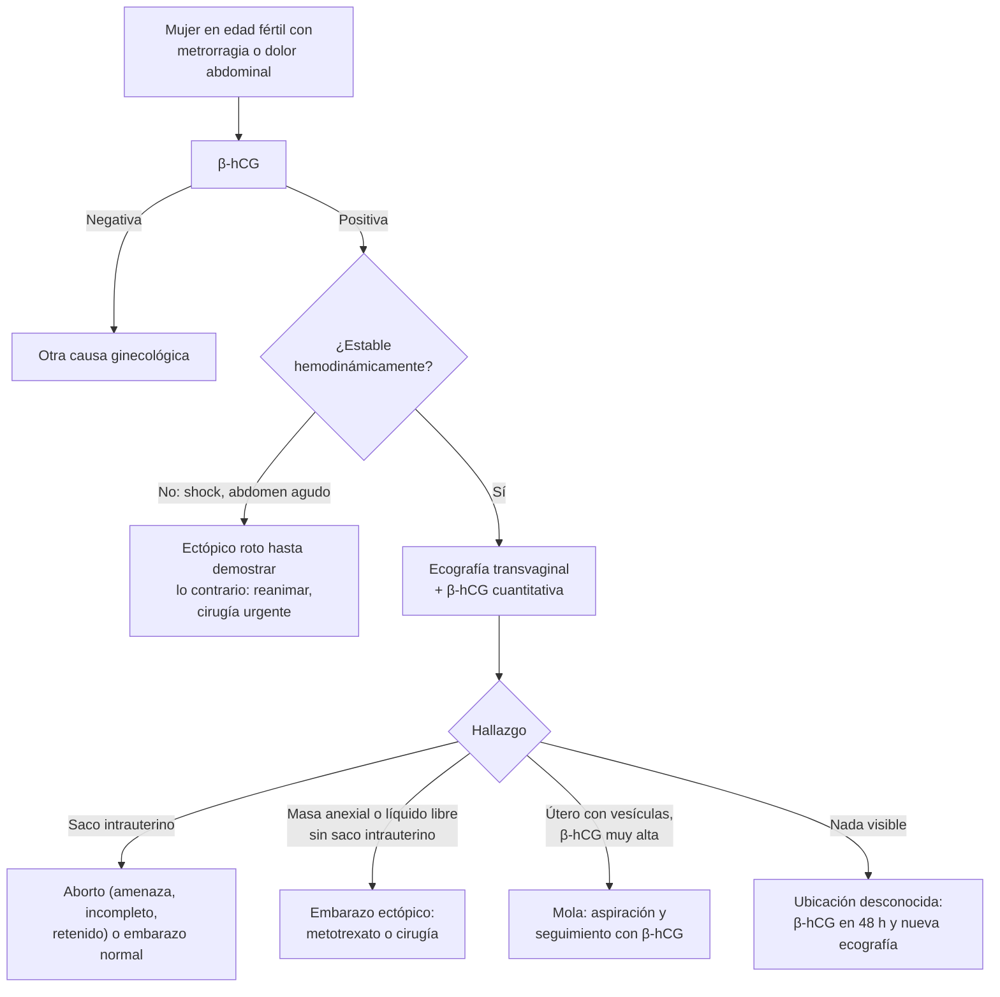

---
tags:
  - Ginecología y obstetricia
  - Urgencia
  - Frecuente en sala
---

# Hemorragia del primer trimestre: aborto, embarazo ectópico y enfermedad trofoblástica gestacional

**Subespecialidad**
Obstetricia · Urgencia ginecológica

**Guías principales**
ACOG 2018: pérdida temprana del embarazo (Practice Bulletin N.° 200) y embarazo ectópico tubario (N.° 193) · FIGO 2021: enfermedad trofoblástica gestacional (*Int J Gynaecol Obstet*)

**Otras fuentes**
Ley 21.030 (2017): interrupción voluntaria del embarazo en tres causales · Ver [anemias](../hematologia/anemias.md) y [sepsis](../infectologia/sepsis-y-shock-septico.md)

**GES**
No. La interrupción del embarazo en tres causales está regulada por la **Ley 21.030**.

**EUNACOM**
3.01.1.001 Aborto espontáneo (específico, inicial, derivar) · 3.01.2.001 Aborto provocado (específico, inicial, derivar) · 3.01.1.006 Embarazo ectópico no complicado (sospecha, inicial, derivar) · 3.01.2.005 Embarazo ectópico complicado (sospecha, inicial, no requiere) · 3.01.1.008 Enfermedad del trofoblasto (sospecha, inicial, derivar)

**Revisado**
Octubre 2026

!!! abstract "Resumen en 60 segundos"
    - **Toda mujer en edad fértil con metrorragia o dolor abdominal**: β-hCG. Si es positiva, hay tres diagnósticos principales:
        - **Aborto**: el más frecuente.
        - **Embarazo ectópico**: el más peligroso.
        - **Enfermedad trofoblástica**: β-hCG muy alta y útero grande.
    - **Herramientas**: **ecografía transvaginal** + **β-hCG cuantitativa** (seriada si hay dudas).
        - Sin saco intrauterino con β-hCG sobre la **zona discriminatoria** (~ 1500–3500 UI/L) = sospechar un **ectópico**.
    - **Aborto espontáneo**: ~ **10 %** de los embarazos clínicamente reconocidos (ACOG 2018); la mitad por anomalías cromosómicas.
        - Diagnóstico de embarazo no viable: **embrión ≥ 7 mm sin latido** o **saco ≥ 25 mm sin embrión**.
        - Manejo **expectante**, **médico** (misoprostol 800 µg vaginal, ± mifepristona 200 mg 24 h antes) o **aspiración**.
        - **Inmunoglobulina anti-D** si es Rh negativo y se interviene.
    - **Aborto séptico**: fiebre, dolor, flujo de mal olor tras un aborto. Es una **urgencia**: antibióticos de amplio espectro + **evacuación uterina**.
    - **Embarazo ectópico**: ~ **2 %** de los embarazos; 95 % en la trompa.
        - **Complicado (roto)**: **shock**, abdomen agudo, hemoperitoneo → **cirugía urgente**.
        - **No complicado y estable**: **metotrexato** (β-hCG < 5000, sin latido, sin rotura) o cirugía.
    - **Mola hidatiforme**: β-hCG muy alta, útero grande, hiperemesis, preeclampsia antes de las 20 semanas.
        - Ecografía en "**tormenta de nieve**".
        - **Aspiración** y **seguimiento con β-hCG** hasta negativizarse, con **anticoncepción**.
    - **Chile**: la **Ley 21.030** permite la interrupción voluntaria en tres causales: **riesgo vital**, **inviabilidad fetal** y **violación** (hasta las 12 semanas; 14 en las menores de 14 años).

## Definición

- **Aborto**: interrupción del embarazo antes de las **22 semanas** de gestación o con un feto de menos de **500 g**.
    - **Espontáneo**: sin intervención.
    - **Provocado**: inducido.
- **Formas clínicas del aborto espontáneo**:

| Forma | Clínica | Cuello | Ecografía |
|---|---|---|---|
| **Amenaza de aborto** | Metrorragia escasa ± dolor leve | **Cerrado** | Embrión vivo |
| **Aborto inevitable (en evolución)** | Metrorragia y dolor que aumentan | **Abierto** | Embrión en descenso |
| **Aborto incompleto** | Expulsión parcial; sangrado persistente | Abierto | Restos ovulares |
| **Aborto completo** | Expulsión total; cede el sangrado y el dolor | Cerrado | Útero vacío, endometrio fino |
| **Aborto retenido (huevo anembrionado, embrión sin latido)** | Asintomático o con pérdida de los síntomas de embarazo | Cerrado | Saco sin embrión o embrión sin latido |
| **Aborto séptico** | Fiebre, dolor, flujo de mal olor | Abierto | Restos |

- **Aborto recurrente**: **≥ 2–3 pérdidas** consecutivas.
- **Embarazo ectópico**: implantación fuera de la cavidad uterina. **Trompa (~ 95 %)**: ampolla > istmo > fimbria; también ovario, cuello, cicatriz de cesárea, abdomen.
- **Embarazo de ubicación desconocida**: β-hCG positiva sin saco intrauterino ni extrauterino en la ecografía transvaginal.
- **Enfermedad trofoblástica gestacional (ETG)**: espectro de proliferaciones anormales del trofoblasto.
    - **Mola hidatiforme completa o parcial** (premaligna).
    - **Neoplasia trofoblástica gestacional (NTG)**: mola invasora, **coriocarcinoma**, tumor del sitio placentario, tumor trofoblástico epitelioide (FIGO 2021).

## Epidemiología

### Mundial

- La **pérdida temprana del embarazo** ocurre en **~ 10 %** de los embarazos clínicamente reconocidos. **~ 50 %** se deben a **anomalías cromosómicas** (ACOG 2018). El riesgo aumenta mucho con la **edad materna**.
- El **embarazo ectópico** ocurre en **~ 2 %** de los embarazos y es la **principal causa de muerte materna del primer trimestre** (ACOG 2018).
- La **mola hidatiforme** es más frecuente en los extremos de la vida reproductiva (< 20 y > 40 años) y en Asia (FIGO 2021).
- El **aborto inseguro** es una causa importante de mortalidad materna en los países donde está restringido.

### Chile

!!! chile "Datos nacionales"
    - La **Ley 21.030** (2017) despenaliza la interrupción voluntaria del embarazo en **tres causales**:
        1. **Riesgo vital** de la mujer (sin plazo).
        2. **Inviabilidad fetal** de carácter letal (sin plazo).
        3. **Violación**: hasta las **12 semanas**; hasta las **14 semanas** en las niñas **menores de 14 años**.
    - En el primer reporte del MINSAL (fines de 2017 a diciembre de 2018) se constituyeron **769 casos**: **343** por riesgo vital, **311** por inviabilidad y **115** por violación.
    - Existe la **objeción de conciencia** individual e institucional. El establecimiento debe asegurar la derivación oportuna.

## Etiología y factores de riesgo

| Cuadro | Factores de riesgo |
|---|---|
| **Aborto espontáneo** | **Edad materna** avanzada, **anomalías cromosómicas** (trisomías, la más frecuente), aborto previo, malformaciones uterinas, síndrome antifosfolípidos, diabetes e hipotiroidismo no controlados, tabaco, alcohol, cocaína, infecciones |
| **Embarazo ectópico** | **Ectópico previo**, **cirugía tubaria** (incluida la esterilización), **PIP** y ***Chlamydia***, **DIU** (pocos embarazos, pero si ocurren, una proporción alta es ectópica), **técnicas de reproducción asistida**, tabaquismo, edad > 35 años |
| **Mola hidatiforme** | Edad materna **< 20 o > 40 años**, **mola previa**, aborto previo |
| **Aborto séptico** | Aborto inseguro o retención de restos |

## Fisiopatología

- **Aborto**: la mayoría se debe a un **embrión genéticamente anormal** que no se desarrolla. Los sangrados ocurren por el desprendimiento del trofoblasto de la decidua.
- **Embarazo ectópico**: el daño de la mucosa tubaria (infección, cirugía) retrasa el transporte del embrión, que se implanta en la trompa. La trompa no se distiende: el trofoblasto la erosiona y se produce un **aborto tubario** o una **rotura** con **hemoperitoneo**.
- **Mola**:
    - **Completa**: un óvulo **sin material genético materno** fecundado por un espermatozoide que se duplica (**46,XX** de origen paterno). No hay feto.
    - **Parcial**: un óvulo normal fecundado por **dos espermatozoides** (**triploide**, 69,XXY). Puede haber tejido fetal.
    - El trofoblasto prolifera y produce **mucha β-hCG**. Esto explica la hiperemesis, el hipertiroidismo (la β-hCG estimula el receptor de TSH) y los quistes tecaluteínicos.

*Figura 1. Enfoque de la metrorragia del primer trimestre. Esquema propio basado en ACOG 2018.*

## Clasificación

**Criterios ecográficos de embarazo no viable** (ecografía transvaginal; ACOG 2018)

| Criterio diagnóstico | Hallazgo |
|---|---|
| Embrión **≥ 7 mm** de longitud céfalo-nalgas | **Sin latido** cardíaco |
| Saco gestacional con diámetro medio **≥ 25 mm** | **Sin embrión** |
| Saco sin saco vitelino | Sin embrión con latido **≥ 2 semanas** después |
| Saco con saco vitelino | Sin embrión con latido **≥ 11 días** después |

**Mola completa vs. parcial**

| Rasgo | Completa | Parcial |
|---|---|---|
| Cariotipo | **46,XX** (o 46,XY), solo paterno | **Triploide** (69) |
| Feto | **Ausente** | Puede haber tejido fetal |
| β-hCG | **Muy alta** | Moderadamente alta |
| Útero | Grande para la edad gestacional | Normal o pequeño |
| Riesgo de NTG | **15–20 %** | **0,5–5 %** |

**Criterios FIGO de neoplasia trofoblástica tras una mola** (FIGO 2021)

- **Meseta** de la β-hCG en 4 mediciones durante 3 semanas.
- **Aumento** de la β-hCG ≥ 10 % en 3 mediciones durante 2 semanas.
- Diagnóstico histológico de **coriocarcinoma**.

## Clínica

| Cuadro | Clínica |
|---|---|
| **Aborto** | Amenorrea, **metrorragia**, **dolor tipo cólico** hipogástrico; expulsión de restos. El cuello abierto indica un aborto en curso |
| **Aborto séptico** | **Fiebre**, dolor abdominal, **flujo purulento o de mal olor**, útero sensible; puede evolucionar a **shock séptico**, CID, insuficiencia renal |
| **Ectópico no complicado** | **Amenorrea + metrorragia escasa + dolor abdominal** (la tríada clásica); masa anexial dolorosa; dolor a la movilización cervical |
| **Ectópico complicado (roto)** | **Dolor abdominal intenso**, **signos peritoneales**, **dolor en el hombro** (irritación diafragmática por el hemoperitoneo), **taquicardia, hipotensión, shock**, fondo de saco de Douglas abombado y doloroso |
| **Mola** | **Metrorragia** del primer trimestre (la forma más frecuente), **útero más grande** que la edad gestacional, **hiperemesis**, **preeclampsia antes de las 20 semanas**, **hipertiroidismo**, expulsión de vesículas ("racimo de uvas"), quistes tecaluteínicos |

## Diagnóstico

!!! guia "Puntos clave (ACOG 2018)"
    - **β-hCG en toda mujer en edad fértil** con metrorragia o dolor abdominal.
    - **Ecografía transvaginal**: confirma la **ubicación** y la **viabilidad**.
    - **Zona discriminatoria**: nivel de β-hCG sobre el que debería verse un saco intrauterino. Hoy se considera un valor de hasta **~ 3500 UI/L**. Si no se ve un saco con una β-hCG sobre ese valor, sospechar un **ectópico** o un aborto completo.
    - En un embarazo intrauterino viable precoz, la β-hCG **sube al menos ~ 35–50 % en 48 h**. Un aumento menor o una caída sugieren un embarazo no viable o un ectópico.
    - **No interrumpir** un embarazo que podría ser viable con un solo examen dudoso: repetir la ecografía y la β-hCG.

## Laboratorio

| Examen | Uso |
|---|---|
| **β-hCG cuantitativa** (seriada cada 48 h) | Ubicación desconocida, ectópico, seguimiento de la mola |
| **Grupo y Rh** | **Inmunoglobulina anti-D** en las Rh negativas (aborto con intervención, ectópico, mola) |
| **Hemograma** | Anemia, sangrado; leucocitosis en el aborto séptico |
| **Pruebas de coagulación** | Aborto séptico (CID), sangrado importante |
| **Hemocultivos, lactato, función renal** | Aborto séptico |
| **TSH y T4 libre** | Mola (hipertiroidismo) |
| **Radiografía de tórax** | Mola (metástasis pulmonares en la NTG) |
| **Anatomía patológica** de los restos | Confirmar la mola |

## Imágenes

| Hallazgo en la ecografía transvaginal | Interpretación |
|---|---|
| Saco intrauterino con saco vitelino o embrión | Embarazo intrauterino (descarta casi siempre el ectópico, salvo en el heterotópico) |
| Masa anexial separada del ovario, "**anillo tubario**" | Embarazo ectópico |
| **Líquido libre** ecogénico en el Douglas o en Morrison | **Hemoperitoneo**: ectópico roto |
| Contenido heterogéneo intrauterino con flujo | Restos ovulares (aborto incompleto) |
| Patrón en "**tormenta de nieve**" o "**panal de abejas**", sin feto, quistes tecaluteínicos | **Mola completa** |

## Diagnóstico diferencial

| Cuadro | Claves |
|---|---|
| **Implantación normal** | Sangrado escaso, saco intrauterino normal |
| **Lesiones cervicales** (pólipo, ectropión, cáncer) | Especuloscopía: sangrado desde el cuello, no desde la cavidad |
| **Quiste de cuerpo lúteo hemorrágico** o roto | Dolor agudo, líquido libre; puede coexistir con un embarazo intrauterino |
| **Torsión ovárica** | Dolor súbito, náuseas, masa anexial sin flujo Doppler |
| **Apendicitis**, **PIP**, **ITU** | β-hCG negativa (o embarazo intrauterino), fiebre, clínica específica |

## Tratamiento

**Aborto espontáneo** (ACOG 2018)

| Opción | Indicación | Comentario |
|---|---|---|
| **Expectante** | Paciente estable, sin infección, que lo prefiere | Puede tardar semanas; éxito menor en el aborto retenido |
| **Médico** | Estable, sin infección | **Misoprostol 800 µg vaginal** (repetir si es necesario). Con **mifepristona 200 mg VO** 24 h antes, el éxito es mayor en el aborto retenido |
| **Aspiración** (manual o eléctrica) o legrado | Sangrado abundante, inestabilidad, **infección**, preferencia de la paciente | Más rápida y predecible |
| **Amenaza de aborto** | Reposo relativo; no hay un tratamiento que demuestre prevenir el aborto | Control ecográfico |

- **Inmunoglobulina anti-D** a las Rh negativas no sensibilizadas en los abortos con evacuación o tratamiento médico, el ectópico y la mola.

**Aborto séptico** (urgencia)

1. **Reanimación** según el paquete de la sepsis (ver [sepsis](../infectologia/sepsis-y-shock-septico.md)).
2. **Antibióticos IV** de amplio espectro, **antes** de la evacuación.
3. **Evacuación uterina** precoz, una vez iniciados los antibióticos.
4. Considerar la **histerectomía** si no hay respuesta (necrosis, perforación, *Clostridium*).

**Embarazo ectópico** (ACOG 2018)

| Opción | Criterios | Comentario |
|---|---|---|
| **Cirugía urgente** (laparoscopía o laparotomía) | **Inestable**, rotura, hemoperitoneo, dolor intenso | **Salpingectomía** (o salpingostomía si la trompa contralateral está dañada y se desea fertilidad) |
| **Metotrexato** | **Estable**, sin rotura, **β-hCG baja** (idealmente **< 5000 UI/L**), **sin latido** embrionario, masa pequeña, dispuesta al **seguimiento** | Contraindicado en la lactancia, la inmunodeficiencia, las alteraciones hepáticas, renales o hematológicas y la enfermedad pulmonar activa |
| **Expectante** | Asintomática, β-hCG baja y en descenso | Seguimiento estricto |

**Mola**: **evacuación por aspiración** (con oxitocina después de la evacuación), anti-D si es Rh negativa, anatomía patológica. **Seguimiento con β-hCG semanal** hasta negativizarse y luego mensual por un tiempo según el tipo (FIGO 2021), con **anticoncepción hormonal** durante el seguimiento. La NTG de bajo riesgo se trata con **quimioterapia con un solo agente** (metotrexato o actinomicina D).

!!! dosis "Fármacos habituales (adultas)"
    | Fármaco | Dosis | Uso |
    |---|---|---|
    | **Misoprostol** | **800 µg** vía vaginal (se puede repetir en 24 h si no hay expulsión) | Aborto retenido o incompleto |
    | **Mifepristona** | **200 mg VO**, 24 h antes del misoprostol | Mejora el éxito en el aborto retenido |
    | **Metotrexato** (ectópico, dosis única) | **50 mg/m² IM** | β-hCG los días 4 y 7: debe **bajar ≥ 15 %** entre ellos; si no, segunda dosis o cirugía |
    | **Inmunoglobulina anti-D** | Habitualmente **300 µg IM** (antes de las 12 semanas basta una dosis menor, 50–120 µg, según el preparado disponible) | Rh negativa no sensibilizada, dentro de 72 h |
    | **Aborto séptico** | **Clindamicina 900 mg IV cada 8 h + gentamicina 5 mg/kg IV al día** (± ampicilina), o **ceftriaxona 2 g IV al día + metronidazol 500 mg IV cada 8 h** | Antes y después de la evacuación |

!!! alarma "Urgencia"
    - **Metrorragia o dolor abdominal con β-hCG positiva e inestabilidad hemodinámica**: **ectópico roto** hasta demostrar lo contrario. Dos vías gruesas, grupo y Rh, reanimación y **pabellón**.
    - **Fiebre y dolor tras un aborto**: **aborto séptico**. Antibióticos y evacuación.
    - **Metrorragia abundante con un aborto incompleto**: evacuación urgente.

## Complicaciones

- **Aborto**: hemorragia, **infección** (aborto séptico, sepsis, CID), **perforación uterina** y **sinequias** (síndrome de Asherman) tras la instrumentación, isoinmunización Rh, impacto emocional (duelo).
- **Ectópico**: **rotura**, **shock hemorrágico**, muerte; infertilidad; recurrencia.
- **Mola**: hemorragia, **NTG** (mola invasora, coriocarcinoma con metástasis pulmonares), **hipertiroidismo**, preeclampsia precoz, embolia trofoblástica tras la evacuación.

## Pronóstico y seguimiento

- **Aborto espontáneo aislado**: la mayoría de las mujeres tendrá un embarazo siguiente normal. Estudiar el **aborto recurrente** (cariotipo de los padres, síndrome antifosfolípidos, malformaciones uterinas, TSH, glicemia).
- **Ectópico tratado con metotrexato**: seguimiento con β-hCG semanal hasta negativizarse. Riesgo de recurrencia de ~ 10 %.
- **Mola**: el seguimiento con β-hCG permite detectar precozmente una NTG, que tiene **tasas de curación muy altas** con quimioterapia, incluso con metástasis (FIGO 2021).

## Perlas para el internado

!!! perla "Para recordar en la sala"
    - **β-hCG en toda mujer en edad fértil** con dolor abdominal o metrorragia.
    - **Shock + β-hCG positiva = ectópico roto** hasta demostrar lo contrario: al pabellón.
    - **Sin saco intrauterino con β-hCG > ~ 3500**: sospechar un ectópico.
    - **Embrión ≥ 7 mm sin latido o saco ≥ 25 mm sin embrión** = embarazo no viable.
    - **Metotrexato** solo en la paciente **estable**, con β-hCG baja, sin latido y que pueda hacer el seguimiento.
    - **Mola**: útero grande, β-hCG muy alta, hiperemesis, **preeclampsia antes de las 20 semanas**, hipertiroidismo, "tormenta de nieve".
    - **Anti-D** a las Rh negativas.
    - **Ley 21.030**: riesgo vital, inviabilidad y violación (12 semanas; 14 en menores de 14 años).

## Preguntas de repaso

??? repaso "1. Mujer de 28 años con 7 semanas de amenorrea, metrorragia escasa y dolor en la fosa ilíaca derecha. PA 80/50 mmHg, FC 125 lpm, abdomen con signos peritoneales. ¿Qué hace?"
    - Sospechar un **embarazo ectópico roto** con **shock hemorrágico**.
    - **Dos vías venosas gruesas**, reanimación, **grupo y Rh**, β-hCG y hemograma, y la ecografía si no retrasa (líquido libre).
    - **Cirugía urgente** (salpingectomía). Inmunoglobulina **anti-D** si es Rh negativa.

??? repaso "2. Mujer de 32 años, estable, con β-hCG de 2800 UI/L, sin saco intrauterino y una masa anexial de 2,5 cm sin latido. ¿Cuál es el tratamiento?"
    - **Embarazo ectópico no complicado** con criterios para **metotrexato**: estable, β-hCG < 5000, sin latido, masa pequeña.
    - **Metotrexato 50 mg/m² IM** en dosis única, con β-hCG los días 4 y 7 (debe bajar ≥ 15 %) y luego semanal hasta negativizarse. Exámenes previos: hemograma y función renal y hepática.

??? repaso "3. Ecografía a las 9 semanas por amenorrea: saco gestacional de 27 mm de diámetro medio sin embrión. ¿Qué diagnóstico tiene y qué opciones le ofrece?"
    - **Aborto retenido (huevo anembrionado)**: saco ≥ 25 mm sin embrión es diagnóstico de **embarazo no viable**.
    - Opciones: **expectante**, **médico** (mifepristona 200 mg + misoprostol 800 µg vaginal 24 h después) o **aspiración**. Anti-D si es Rh negativa.

??? repaso "4. Mujer de 19 años con 10 semanas de amenorrea, metrorragia, vómitos intensos, útero del tamaño de 16 semanas y β-hCG de 250 000 UI/L. ¿Qué sospecha?"
    - **Mola hidatiforme completa** (útero grande, β-hCG muy alta, hiperemesis).
    - Ecografía (tormenta de nieve), TSH, radiografía de tórax, grupo y Rh.
    - **Evacuación por aspiración** y **seguimiento con β-hCG** semanal hasta negativizarse, con **anticoncepción**. Derivar si la β-hCG hace meseta o sube (NTG).

??? repaso "5. Mujer de 24 años que consulta por fiebre de 39 °C, dolor abdominal y flujo de mal olor, 3 días después de un aborto. ¿Cómo la maneja?"
    - **Aborto séptico**.
    - Reanimación según el paquete de la sepsis, hemocultivos, lactato, hemograma, coagulación y función renal.
    - **Antibióticos IV** de amplio espectro (clindamicina + gentamicina, o ceftriaxona + metronidazol) y luego la **evacuación uterina** precoz.
    - Considerar la histerectomía si no responde.

??? repaso "6. ¿Cuáles son las tres causales de la Ley 21.030 y sus plazos?"
    - **Riesgo vital** de la mujer: sin plazo.
    - **Inviabilidad fetal** de carácter letal: sin plazo.
    - **Violación**: hasta las **12 semanas**; hasta las **14 semanas** en las niñas menores de 14 años.

## Referencias

1. American College of Obstetricians and Gynecologists. ACOG Practice Bulletin No. 200: early pregnancy loss. *Obstet Gynecol.* 2018;132(5):e197–e207. doi:[10.1097/AOG.0000000000002899](https://doi.org/10.1097/AOG.0000000000002899)
2. American College of Obstetricians and Gynecologists. ACOG Practice Bulletin No. 193: tubal ectopic pregnancy. *Obstet Gynecol.* 2018;131(3):e91–e103. doi:[10.1097/AOG.0000000000002560](https://doi.org/10.1097/AOG.0000000000002560)
3. Ngan HYS, Seckl MJ, Berkowitz RS, et al. Diagnosis and management of gestational trophoblastic disease: 2021 update. *Int J Gynaecol Obstet.* 2021;155(Suppl 1):86–93. doi:[10.1002/ijgo.13877](https://doi.org/10.1002/ijgo.13877)
4. Ley 21.030. Regula la despenalización de la interrupción voluntaria del embarazo en tres causales. *Diario Oficial*, 2017. [bcn.cl](https://www.bcn.cl/leychile/)
5. Ministerio de Salud de Chile. Reporte de la Ley de interrupción voluntaria del embarazo (IVE). [minsal.cl](https://www.minsal.cl/ive-reporte-actualizado/)
