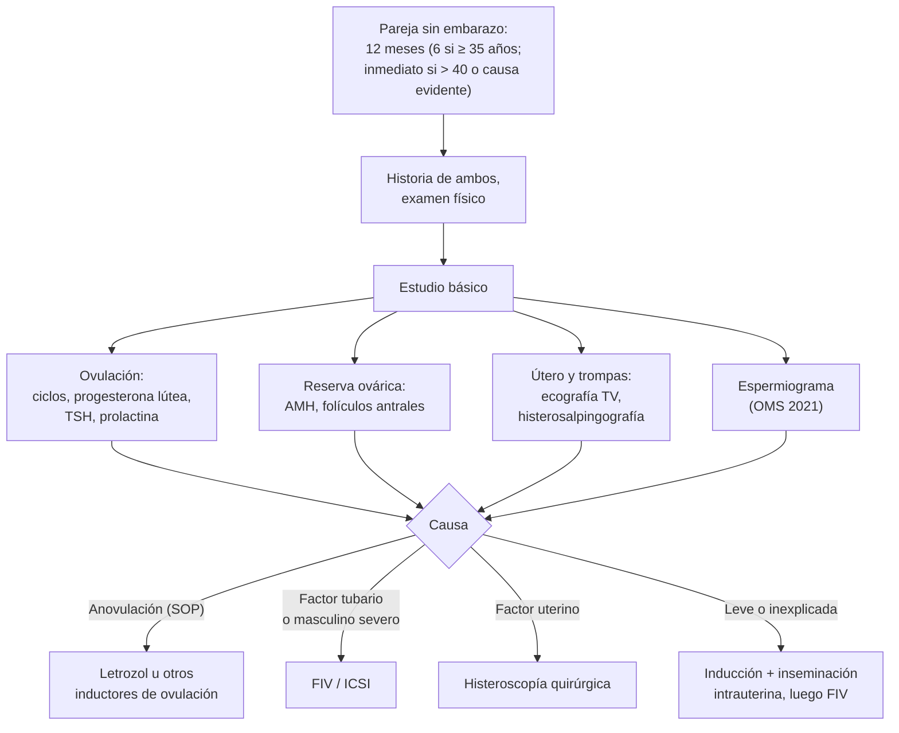

---
tags:
  - Ginecología y obstetricia
---

# Infertilidad conyugal

**Subespecialidad**
Ginecología · Medicina reproductiva

**Guías principales**
ASRM 2023: definición de infertilidad · ASRM 2021: evaluación de la mujer infértil · OMS 2021: manual de laboratorio para el examen del semen (6.ª edición)

**Otras fuentes**
Ver [SOP, hirsutismo y amenorrea](../endocrinologia/hirsutismo-amenorrea-y-ovario-poliquistico.md), [endometriosis](dolor-pelvico-dismenorrea-endometriosis-y-torsion-anexial.md), [PIP](proceso-inflamatorio-pelviano-pelviperitonitis-y-bartolinitis.md), [miomas](sangrado-uterino-anormal-miomas-y-patologia-endometrial.md), [hipogonadismo masculino](../endocrinologia/hipogonadismo-masculino-y-ginecomastia.md), [hipófisis y prolactina](../endocrinologia/hipofisis-tumores-hipopituitarismo-e-hiperprolactinemia.md) y [tiroides](../endocrinologia/hipotiroidismo-e-hipertiroidismo.md)

**GES**
No como problema propio.

**EUNACOM**
3.01.1.020 Infertilidad conyugal (sospecha, inicial, derivar)

**Revisado**
Octubre 2026

!!! abstract "Resumen en 60 segundos"
    - **Infertilidad**: no lograr un embarazo tras **12 meses** de relaciones sexuales regulares sin protección. Estudiar a los **6 meses** si la mujer tiene **≥ 35 años**, y **de inmediato** si tiene **> 40 años** o una causa evidente (amenorrea, oligomenorrea, endometriosis, PIP previa, factor masculino conocido).
    - Afecta a ~ **1 de cada 6** personas en edad reproductiva (OMS 2023).
    - **Es de la pareja**: se estudia a **ambos** desde el inicio. Factor **femenino** (~ 35–40 %), **masculino** (~ 30–40 %), **mixto** (~ 20 %), **sin causa** (~ 15–30 %).
    - **Estudio básico** (3 pilares + reserva):
        - **Ovulación**: ciclos regulares; **progesterona** de mitad de la fase lútea; TSH y prolactina.
        - **Trompas y útero**: **histerosalpingografía** (o histerosonografía con contraste) y **ecografía transvaginal**.
        - **Espermiograma** (OMS 2021).
        - **Reserva ovárica**: **AMH** y recuento de folículos antrales.
    - **Causas más frecuentes**: **anovulación** (sobre todo **SOP**), **factor tubario** (PIP por clamidia, cirugía), **endometriosis**, **edad materna** (la fertilidad cae claramente desde los **35 años**), factor masculino.
    - **Tratamiento**: estilo de vida (peso, tabaco), tratar la causa; **inducción de la ovulación** (**letrozol** en el SOP), **inseminación intrauterina**, **fertilización in vitro** (FIV) o **ICSI** según la causa y la edad.
    - **Derivar** a medicina reproductiva tras el estudio básico (o antes según la edad).

## Definición

- **Infertilidad** (ASRM 2023): enfermedad definida por la **incapacidad de lograr un embarazo** tras **12 meses** de relaciones sexuales regulares sin protección, o tras **6 meses** si la mujer tiene **35 años o más**; o por la necesidad de intervención médica para concebir (por ejemplo, parejas del mismo sexo o personas sin pareja).
- **Primaria**: sin embarazos previos. **Secundaria**: con al menos un embarazo previo.
- **Esterilidad** (término clásico): incapacidad de concebir. **Infertilidad** en sentido estricto, en la literatura hispana clásica: incapacidad de llevar un embarazo a término (**pérdida reproductiva recurrente**). Hoy ambos términos se usan como sinónimos.
- **Fecundabilidad**: probabilidad de embarazo en un ciclo: ~ **20–25 %** en parejas jóvenes sanas; **~ 85 %** se embaraza en 12 meses.

## Epidemiología

### Mundial

- La OMS (2023) estima que ~ **17,5 %** de los adultos (**1 de cada 6**) ha tenido infertilidad en su vida.
- La fertilidad femenina disminuye desde los **30–32 años**, y más rápido desde los **35–37 años**, por la caída de la **cantidad y calidad de los ovocitos** (aneuploidías).
- La **postergación de la maternidad** es la principal causa del aumento de la consulta por infertilidad.

!!! chile "Datos nacionales"
    - Chile tiene una de las **tasas de fecundidad más bajas** de América Latina, con un aumento sostenido de la **edad materna** al primer hijo (INE).
    - **FONASA** cuenta con programas de **reproducción asistida** de **baja complejidad** (inducción de ovulación e inseminación) y de **alta complejidad** (FIV/ICSI) en centros en convenio; las ISAPRE tienen coberturas variables.
    - La infertilidad **no** es GES.
    - Prevención: **pesquisa y tratamiento de la clamidia** (factor tubario), control del peso y del tabaco, y **consejería** sobre la edad y la fertilidad.

## Etiología

### Factor femenino

| Factor | Frecuencia aproximada | Causas |
|---|---|---|
| **Ovulatorio** | ~ 25 % de las parejas | **SOP** (el más frecuente), **hipotálamo** (ejercicio, baja de peso, estrés, TCA), **hiperprolactinemia**, **hipotiroidismo**, **insuficiencia ovárica prematura**, obesidad |
| **Tubario y peritoneal** | ~ 20–30 % | **PIP** (*Chlamydia*, gonococo), cirugía pélvica, **embarazo ectópico** previo, **endometriosis**, adherencias, tuberculosis genital |
| **Uterino** | ~ 5–10 % | **Miomas submucosos**, pólipos, **síndrome de Asherman** (sinequias), malformaciones müllerianas (tabique) |
| **Cervical** | < 5 % | Conizaciones, estenosis |
| **Edad y reserva ovárica** | Variable | **≥ 35 años**, cirugía ovárica, quimioterapia o radioterapia, tabaco |
| **Endometriosis** | ~ 30–50 % de las infértiles la tienen | Anatómica, inflamatoria y de reserva ovárica |

### Factor masculino

- **Pretesticular**: **hipogonadismo hipogonadotrópico** (Kallmann, hiperprolactinemia, **anabolizantes** y **testosterona exógena**).
- **Testicular**: **varicocele** (el más frecuente corregible), **criptorquidia**, orquitis (paperas), **Klinefelter**, microdeleciones del cromosoma Y, quimioterapia y radioterapia, calor, **tabaco**, alcohol, drogas.
- **Postesticular**: **obstrucción** (vasectomía, infección, **ausencia congénita de los conductos deferentes** en la **fibrosis quística**), disfunción eyaculatoria o eréctil, eyaculación retrógrada (diabetes, cirugía prostática).

### Otros

- **Factor coital**: frecuencia baja o mal momento, dispareunia, disfunción sexual.
- **Infertilidad sin causa aparente** (inexplicada): estudio básico normal.

## Fisiopatología

Para un embarazo se necesitan: un **ovocito** de buena calidad que se libere (**ovulación**), **espermatozoides** suficientes y móviles, **trompas permeables** donde ocurra la fecundación, un **útero** receptivo para la implantación, y coitos en la **ventana fértil** (los 5 días previos y el día de la ovulación). La falla de cualquiera de estos pasos causa infertilidad.

## Clasificación

### Espermiograma: límites de referencia inferiores (OMS 2021, percentil 5)

| Parámetro | Valor de referencia inferior |
|---|---|
| **Volumen** | **1,4 mL** |
| **Concentración** | **16 millones/mL** |
| **Número total** | **39 millones** por eyaculado |
| **Motilidad progresiva** | **30 %** |
| **Motilidad total** | 42 % |
| **Morfología normal** | **4 %** |
| **Vitalidad** | 54 % |

- **Oligozoospermia**: concentración baja. **Astenozoospermia**: motilidad baja. **Teratozoospermia**: morfología alterada. **Azoospermia**: sin espermatozoides (obstructiva o secretora).
- Un espermiograma alterado se **repite** en **2–3 meses** (la espermatogénesis dura ~ 74 días).

## Clínica

- **Anamnesis de la mujer**: edad, **ciclos menstruales** (regularidad: los ciclos regulares de 21–35 días sugieren ovulación), hirsutismo y acné (SOP), galactorrea, síntomas tiroideos, **dismenorrea y dispareunia** (endometriosis), **PIP** o ITS previas, cirugías pélvicas, embarazos y abortos previos, tabaco y alcohol, peso, fármacos.
- **Anamnesis del hombre**: paternidad previa, **criptorquidia**, **orquitis**, ITS, cirugías inguinales o escrotales, **anabolizantes o testosterona**, tabaco, alcohol, drogas, calor, función sexual, quimioterapia.
- **Coito**: frecuencia (ideal cada **1–2 días** en la ventana fértil), uso de lubricantes espermicidas.
- **Examen de la mujer**: IMC, hirsutismo, acné, acantosis, tiroides, galactorrea, examen pélvico (nódulos, útero fijo, masas).
- **Examen del hombre**: caracteres sexuales, **volumen testicular**, **varicocele** (de pie y con Valsalva), presencia de los **conductos deferentes**.

!!! alarma "Situaciones que adelantan el estudio o la derivación"
    - Mujer de **35 años o más** (estudiar a los 6 meses) o de **más de 40** (de inmediato).
    - **Oligomenorrea o amenorrea**.
    - **Endometriosis** conocida o sospechada, **PIP** previa, cirugía pélvica.
    - **Factor masculino** conocido (azoospermia, cirugía testicular, quimioterapia).
    - Pacientes que recibirán **quimioterapia o radioterapia** → **preservación de la fertilidad** (criopreservación de ovocitos, embriones o semen) **antes** del tratamiento.

## Diagnóstico

!!! guia "Puntos clave (ASRM 2021 y 2023; OMS 2021)"
    - Estudiar a la **pareja** en forma **simultánea**; el espermiograma es barato y no invasivo y se pide desde el inicio.
    - **Ovulación**: la historia de ciclos regulares es muy sugerente. Confirmar con la **progesterona sérica** a mitad de la fase lútea (~ 7 días antes de la menstruación esperada; **> 3 ng/mL** indica ovulación), test de LH urinario o seguimiento folicular ecográfico.
    - **Reserva ovárica**: **AMH** y **recuento de folículos antrales** (ecografía); **FSH y estradiol** del día 2–4. Predicen la **respuesta a la estimulación**, no la posibilidad de embarazo espontáneo.
    - **Permeabilidad tubaria**: **histerosalpingografía** (HSG) o **histerosonografía con contraste** (HyCoSy); **laparoscopía** si hay sospecha de endometriosis o adherencias.
    - **Cavidad uterina**: **ecografía transvaginal** (idealmente 3D), histerosonografía o **histeroscopía**.
    - **Espermiograma** según la OMS 2021 (abstinencia de 2–7 días). Si está alterado: repetir y derivar a **urología o andrología** (hormonas, ecografía testicular, cariotipo y microdeleciones del Y en la oligozoospermia severa o azoospermia, estudio de fibrosis quística si faltan los deferentes).

## Laboratorio

- **Mujer**:
    - **TSH** y **prolactina**.
    - **Progesterona** lútea.
    - **AMH**; **FSH**, **LH** y **estradiol** del día 2–4.
    - **Andrógenos** (testosterona total) si hay signos de SOP.
    - **Serologías preconcepcionales**: rubéola, VIH, sífilis, hepatitis B y C; **PAP** al día; **grupo y Rh**.
    - **Ácido fólico** preconcepcional.
- **Hombre**:
    - **Espermiograma**.
    - Si está alterado: **FSH, LH, testosterona**, prolactina; **cariotipo** y **microdeleciones del cromosoma Y** (concentración < 5 millones/mL o azoospermia); **CFTR** si faltan los conductos deferentes.

## Imágenes

- **Ecografía transvaginal**: miomas, pólipos, malformaciones, ovarios poliquísticos, **endometriomas**, **hidrosálpinx**, **recuento de folículos antrales**.
- **Histerosalpingografía**: **permeabilidad tubaria** y contorno de la cavidad. Hacerla en la fase **folicular** (días 6–11), sin embarazo y sin infección activa. Profilaxis antibiótica (doxiciclina) si hay hidrosálpinx o antecedente de PIP.
- **Histeroscopía**: diagnóstico y tratamiento de las lesiones intracavitarias.
- **Laparoscopía**: endometriosis, adherencias, cromotubación.
- **Ecografía testicular y Doppler**: varicocele, masas, volumen.

## Diagnóstico diferencial

| Situación | Considerar |
|---|---|
| **Amenorrea u oligomenorrea** | SOP, hiperprolactinemia, hipotiroidismo, amenorrea hipotalámica, **insuficiencia ovárica prematura**, **embarazo** |
| **Pérdidas reproductivas recurrentes** (≥ 2–3 abortos) | Síndrome antifosfolípido, malformaciones uterinas, alteraciones cromosómicas parentales, factores endocrinos (es una entidad distinta de la infertilidad) |
| **Infertilidad con dismenorrea y dispareunia** | **Endometriosis** |
| **Infertilidad con PIP previa** | **Factor tubario**, hidrosálpinx |
| **Azoospermia** | Obstructiva (vasectomía, ausencia de deferentes) vs. secretora (Klinefelter, microdeleciones, falla testicular) |

## Tratamiento

### Medidas generales (para ambos)

- **Peso saludable** (IMC 19–30): bajar un **5–10 %** del peso restaura la ovulación en muchas mujeres con SOP.
- **Dejar de fumar**, limitar el **alcohol**, evitar **drogas** y **anabolizantes**.
- **Coito** cada 1–2 días, sobre todo en la **ventana fértil**; evitar lubricantes espermicidas.
- **Ácido fólico** 0,4 mg/día (preconcepcional).
- **Apoyo psicológico**: la infertilidad genera estrés y afecta a la pareja.

### Según la causa

| Causa | Tratamiento |
|---|---|
| **Anovulación por SOP** | **Letrozol** (primera línea; 2,5–7,5 mg/día por 5 días desde el día 3–5 del ciclo); **clomifeno** como alternativa; **metformina** como coadyuvante (sobre todo con resistencia a la insulina); **gonadotrofinas** o *drilling* ovárico si fallan |
| **Hiperprolactinemia** | **Cabergolina** |
| **Hipotiroidismo** | **Levotiroxina** (TSH < 2,5 mUI/L antes del embarazo) |
| **Amenorrea hipotalámica** | Recuperar peso y reducir el ejercicio; **GnRH pulsátil** o gonadotrofinas |
| **Insuficiencia ovárica prematura** | **Ovodonación** |
| **Factor tubario** | **FIV** (de elección); **salpingectomía** del **hidrosálpinx** antes de la FIV (mejora la implantación); cirugía tubaria en casos seleccionados |
| **Factor uterino** | **Histeroscopía quirúrgica** (miomas submucosos, pólipos, sinequias, tabique) |
| **Endometriosis** | Cirugía en casos seleccionados; **FIV**; el tratamiento hormonal **no** mejora la fertilidad |
| **Factor masculino leve** | **Inseminación intrauterina** (IIU) |
| **Factor masculino severo** | **ICSI** (inyección intracitoplasmática); **varicocelectomía** si hay varicocele clínico con espermiograma alterado; extracción testicular de espermatozoides en la azoospermia |
| **Infertilidad inexplicada** | Estimulación ovárica + **IIU** (3–4 ciclos), luego **FIV** |
| **Edad materna avanzada** | Pasar pronto a **FIV**; considerar la **ovodonación** |

### Técnicas de reproducción asistida

- **Baja complejidad**: **coito programado** e **inseminación intrauterina** (IIU) con o sin estimulación ovárica; requiere **al menos una trompa permeable** y un semen razonable.
- **Alta complejidad**: **FIV** (fertilización in vitro) e **ICSI**; criopreservación de embriones; **test genético preimplantacional** en casos seleccionados; ovodonación.
- **Preservación de la fertilidad**: vitrificación de ovocitos (por motivos médicos u "oncofertilidad", o sociales), criopreservación de semen.

!!! dosis "Fármacos habituales"
    | Fármaco | Dosis | Comentarios |
    |---|---|---|
    | **Letrozol** | **2,5 mg/día** por 5 días (días 3–7), aumentar a 5–7,5 mg si no ovula | Primera línea en el SOP; más nacidos vivos que el clomifeno |
    | **Citrato de clomifeno** | **50 mg/día** por 5 días (días 3–7), hasta 150 mg | Máximo ~ 6 ciclos; embarazo múltiple ~ 8 %; efecto antiestrogénico en el endometrio |
    | **Metformina** | 500 mg cada 8–12 h | SOP con resistencia a la insulina; coadyuvante |
    | **Cabergolina** | **0,25–0,5 mg** 1–2 veces por semana | Hiperprolactinemia |
    | **Gonadotrofinas** (FSH recombinante o urinaria) | Según el protocolo | Riesgo de **hiperestimulación ovárica** y embarazo múltiple |
    | **Ácido fólico** | **0,4 mg/día** (4–5 mg con alto riesgo de defectos del tubo neural) | Desde 1–3 meses antes de la concepción |

!!! alarma "Complicación aguda"
    - **Síndrome de hiperestimulación ovárica** (tras gonadotrofinas o hCG): ovarios aumentados de tamaño, **ascitis**, hemoconcentración, **trombosis**, oliguria, derrame pleural. En las formas graves: hospitalizar, hidratación, tromboprofilaxis, paracentesis.

## Complicaciones

- **De los tratamientos**: **embarazo múltiple** (prematurez y complicaciones maternas), **síndrome de hiperestimulación ovárica**, **embarazo ectópico** (más frecuente en la FIV y con factor tubario), torsión ovárica, complicaciones de la punción ovárica.
- **Psicológicas**: ansiedad, depresión, conflicto de pareja.
- **Embarazos por técnicas de reproducción asistida**: más riesgo de **preeclampsia**, placenta previa y parto prematuro.

## Pronóstico y seguimiento

- La **edad de la mujer** es el principal factor pronóstico: la tasa de nacido vivo por ciclo de FIV cae de ~ 40 % antes de los 35 años a < 10 % después de los 42 (con ovocitos propios).
- La mayoría de las parejas con **anovulación** logran embarazo con inducción de la ovulación.
- Las parejas con infertilidad inexplicada tienen una probabilidad de embarazo espontáneo no despreciable que disminuye con la duración de la infertilidad.

## Perlas para el internado

!!! perla "Para recordar en la sala"
    - **12 meses** (6 si ≥ 35 años; inmediato si > 40 o causa evidente).
    - **Estudiar a los dos**: el **espermiograma** se pide desde el inicio.
    - **Tres preguntas**: ¿ovula?, ¿están permeables las trompas y normal el útero?, ¿hay espermatozoides suficientes?
    - **Ciclos regulares** sugieren ovulación; **progesterona lútea > 3 ng/mL** la confirma.
    - **SOP** = la causa ovulatoria más frecuente → **letrozol**.
    - **PIP previa** → factor **tubario** → **HSG** → **FIV**.
    - **AMH** mide la **reserva ovárica** (respuesta a la estimulación), no la fertilidad espontánea.
    - **Quimioterapia o radioterapia próximas** → ofrecer **preservación de la fertilidad**.

## Preguntas de repaso

??? repaso "1. Pareja: ella de 29 años, él de 31; 14 meses sin lograr embarazo. Ella tiene ciclos de 45–60 días, acné e IMC 32. ¿Cómo la estudia y qué sospecha?"
    - **Infertilidad** (> 12 meses) con **oligomenorrea**: sospecha de **anovulación por SOP**.
    - TSH, prolactina, andrógenos, ecografía transvaginal, **histerosalpingografía** y **espermiograma** de la pareja.
    - Tratamiento: **bajar de peso** y **letrozol**; derivar a ginecología o medicina reproductiva.

??? repaso "2. Mujer de 38 años, ciclos regulares, 7 meses sin lograr embarazo. Antecedente de PIP a los 22 años. ¿Qué hace?"
    - Estudiar **ya** (≥ 35 años, 6 meses).
    - Sospecha de **factor tubario**: **histerosalpingografía**; además AMH, folículos antrales, progesterona lútea, TSH, prolactina y **espermiograma**.
    - Si hay obstrucción tubaria bilateral: **FIV** (y salpingectomía si hay hidrosálpinx).

??? repaso "3. Espermiograma con 3 millones/mL y motilidad progresiva del 10 %, repetido con resultado similar. ¿Qué estudio y qué tratamiento?"
    - **Oligoastenozoospermia severa**: derivar a **andrología/urología**.
    - **FSH, LH, testosterona**, prolactina, **cariotipo** y **microdeleciones del cromosoma Y**, ecografía testicular (varicocele).
    - Tratamiento reproductivo: **ICSI**.

??? repaso "4. Hombre de 34 años con azoospermia; al examen no se palpan los conductos deferentes. ¿Qué sospecha?"
    - **Ausencia congénita bilateral de los conductos deferentes**, asociada a mutaciones del gen **CFTR** (fibrosis quística).
    - Estudio genético de **CFTR** en él y en su pareja; obtención de espermatozoides del epidídimo o testículo para **ICSI**.

??? repaso "5. Mujer de 26 años con linfoma de Hodgkin que iniciará quimioterapia. ¿Qué debe ofrecerle antes?"
    - **Consejería de preservación de la fertilidad** (oncofertilidad): **vitrificación de ovocitos** o de embriones antes de la quimioterapia, si los tiempos lo permiten.
    - Considerar análogos de GnRH durante la quimioterapia como medida complementaria.

??? repaso "6. ¿Cuál es el principal factor pronóstico de éxito en el tratamiento de la infertilidad?"
    - La **edad de la mujer** (calidad y cantidad de los ovocitos).
    - Por eso a las mujeres de 35 años o más se las estudia a los 6 meses y se pasa antes a técnicas de alta complejidad.

## Referencias

1. Practice Committee of the American Society for Reproductive Medicine. Definition of infertility: a committee opinion. *Fertil Steril.* 2023;120(6):1170. doi:[10.1016/S0015-0282(23)01971-4](https://doi.org/10.1016/S0015-0282(23)01971-4)
2. Practice Committee of the American Society for Reproductive Medicine. Fertility evaluation of infertile women: a committee opinion. *Fertil Steril.* 2021;116(5):1255–1265. doi:[10.1016/j.fertnstert.2021.08.038](https://doi.org/10.1016/j.fertnstert.2021.08.038)
3. World Health Organization. WHO laboratory manual for the examination and processing of human semen. 6.ª ed. Ginebra: OMS; 2021. [who.int](https://www.who.int/publications/i/item/9789240030787)
4. World Health Organization. Infertility prevalence estimates, 1990–2021. Ginebra: OMS; 2023. [who.int](https://www.who.int/publications/i/item/978920068315)
