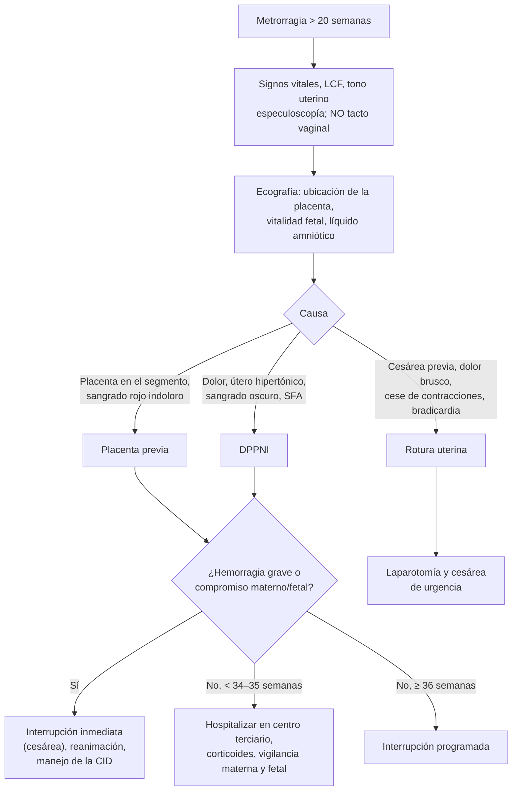

---
tags:
  - Ginecología y obstetricia
  - Urgencia
---

# Metrorragia de la segunda mitad del embarazo: placenta previa, desprendimiento prematuro de placenta y rotura uterina

**Subespecialidad**
Obstetricia · Urgencia obstétrica

**Guías principales**
MINSAL 2015: Guía Perinatal (capítulo de metrorragias de la segunda mitad de la gestación) · RCOG 2018: placenta previa y acretismo placentario (*BJOG* 2019)

**Otras fuentes**
Ver [coagulopatías y CID](../hematologia/coagulopatias-cid-y-reversion-de-anticoagulantes.md), [síndrome hipertensivo del embarazo](../nefrologia/preeclampsia-y-sindrome-hipertensivo-del-embarazo.md) y [control prenatal e isoinmunización Rh](control-prenatal-edad-gestacional-e-isoinmunizacion-rh.md)

**GES**
No como problema propio.

**EUNACOM**
3.01.2.010 Metrorragia: desprendimiento prematuro de placenta normoinserta (sospecha, inicial, no requiere) · 3.01.2.011 Metrorragia: placenta previa (sospecha, inicial, derivar) · 3.01.2.015 Rotura uterina (sospecha, inicial, derivar)

**Revisado**
Octubre 2026

!!! abstract "Resumen en 60 segundos"
    - **2–5 %** de las embarazadas sangra en la segunda mitad del embarazo. En Chile es una de las primeras causas de **mortalidad materna**, después de la hipertensión y el aborto (Guía Perinatal 2015).
    - **Regla de oro**: **no hacer tacto vaginal** hasta descartar una placenta previa con **ecografía**. Hacer una **especuloscopía** (causas ginecológicas) y evaluar a la madre y al feto.
    - **Placenta previa** (~ 0,5 % de los partos): **sangrado rojo brillante, indoloro**, recurrente, útero **relajado**, feto bien.
        - Factores: **cesárea previa**, edad > 35, multiparidad, legrados, embarazo gemelar, tabaco.
        - Con cesárea previa y placenta anterior: sospechar un **acretismo**.
    - **DPPNI** (~ 1–2 %): **sangrado oscuro con dolor**, **útero hipertónico** ("leñoso"), **sufrimiento fetal**, shock desproporcionado al sangrado externo, **CID**.
        - Factores: **preeclampsia**, **trauma**, cocaína, tabaco, descompresión brusca.
    - **Rotura uterina**: **cesárea previa** + trabajo de parto.
        - Clínica: dolor brusco, **alteración del registro fetal** (el signo más frecuente), cese de las contracciones, partes fetales palpables, shock.
    - **Manejo inicial común**: vía venosa, hematocrito, grupo y Rh, pruebas de coagulación, monitorización fetal, ecografía.
        - **Hemorragia grave o compromiso materno o fetal** → **interrupción inmediata** (cesárea), sin importar la edad gestacional.
        - **Estable y < 34–35 semanas** (placenta previa, DPPNI leve) → manejo **expectante** en un centro terciario con **corticoides**.
    - **Anti-D** a las Rh negativas no sensibilizadas.

## Definición

- **Metrorragia de la segunda mitad del embarazo**: sangrado genital después de las **20–22 semanas**. Su manejo depende sobre todo de la **viabilidad fetal** (> 24 semanas).
- **Placenta previa**: placenta insertada en el **segmento inferior** del útero, sobre o muy cerca del orificio cervical interno (OCI).
- **Desprendimiento prematuro de placenta normoinserta (DPPNI)**: separación de la placenta de su inserción uterina **después de las 20 semanas** y **antes del nacimiento** del feto (Guía Perinatal 2015).
- **Rotura uterina**: solución de continuidad de la pared uterina.
    - **Completa**: incluye el peritoneo visceral, a menudo con extrusión fetal.
    - **Incompleta**: solo el miometrio.
- **Vasa previa**: vasos fetales que cruzan las membranas sobre el OCI. Su rotura produce un **sangrado fetal** con una mortalidad fetal muy alta.
- **Acretismo placentario**: invasión anormal de la placenta en el miometrio (acreta, increta, percreta).

## Epidemiología

### Mundial

- La **placenta previa** complica ~ **0,5 %** de los partos. En la ecografía del segundo trimestre, la placenta se relaciona con el OCI hasta en **6 %** de las mujeres, pero **~ 90 %** de las diagnosticadas antes de las 20–24 semanas están **normoinsertas al término** (migración placentaria) (Guía Perinatal 2015).
- El **DPPNI** ocurre en ~ **1–2 %** de los embarazos.
- El **acretismo** aumenta con el número de **cesáreas previas**, sobre todo si hay una placenta previa (RCOG 2018).

### Chile

!!! chile "Datos nacionales (Guía Perinatal 2015)"
    - La metrorragia de la segunda mitad del embarazo es una de las primeras causas de **mortalidad materna** en el país, después de la hipertensión y el aborto, y una causa importante de ingreso a la UCI obstétrica.
    - El aumento de las **cesáreas** y la postergación de la maternidad (**edad materna avanzada**) aumentan la placenta previa y el **acretismo**.
    - La mortalidad perinatal se debe sobre todo a la **prematurez** y la **hipoxia**.

## Etiología y factores de riesgo

| Cuadro | Factores de riesgo (Guía Perinatal 2015) |
|---|---|
| **Placenta previa** | **Cicatrices uterinas** (cesárea), **edad > 35 años**, multiparidad, **legrados**, embarazo gemelar, tabaquismo, residencia en altura, miomas |
| **DPPNI** | **Síndrome hipertensivo del embarazo** (preeclampsia, hipertensión crónica grave), **traumatismo abdominal**, **tabaco**, **cocaína** y alcohol, **descompresión uterina brusca** (rotura de membranas con polihidroamnios, parto del primer gemelo), DPPNI previo, cordón corto, malformación uterina |
| **Rotura uterina** | **Cicatriz uterina** (cesárea, miomectomía), trabajo de parto **prolongado** o abandonado con desproporción, **maniobra de Kristeller**, versión, **oxitocina** o prostaglandinas, traumatismos |
| **Causas ginecológicas** | Cervicitis, ectropión, **pólipos**, **cáncer cervicouterino**, vaginitis, várices, laceraciones, cuerpos extraños |

## Fisiopatología

- **Placenta previa**: el segmento inferior se forma y estira en el tercer trimestre y con las contracciones. La placenta insertada allí se despega parcialmente: **sangrado materno** indoloro. El feto no se compromete hasta que hay una hemorragia materna importante.
- **DPPNI**:
    1. Una hemorragia en la decidua basal forma un **hematoma retroplacentario** que separa la placenta.
    2. Se pierde la superficie de intercambio: **hipoxia fetal**.
    3. La sangre infiltra el miometrio (**útero de Couvelaire**) y lo irrita: **hipertonía** y polisistolía.
    4. La liberación de **tromboplastina** desde el coágulo consume el fibrinógeno: **CID**.
    - El sangrado puede quedar **oculto** (retroplacentario), por eso el shock puede ser desproporcionado al sangrado visible.
- **Rotura uterina**: la cicatriz cede con las contracciones. El feto sale a la cavidad abdominal: **bradicardia fetal**, hemoperitoneo y shock.

*Figura 1. Enfoque de la metrorragia de la segunda mitad del embarazo. Esquema propio basado en la Guía Perinatal 2015.*

## Clasificación

**Placenta previa (clasificación ecográfica; Guía Perinatal 2015)**

| Tipo | Descripción |
|---|---|
| **Oclusiva total** | Cubre completamente el OCI y se extiende a la pared opuesta |
| **Marginal** | El borde placentario llega al OCI sin sobrepasarlo |
| **De inserción baja** | El borde no llega al OCI, pero está a **< 30 mm** de él |

**DPPNI (Guía Perinatal 2015)**

| Tipo | Descripción |
|---|---|
| **Moderado** | Hemorragia escasa o moderada, útero relajado o irritable, **sin** compromiso hemodinámico, CID ni compromiso fetal. Puede tener un curso crónico |
| **Severo** | Hemorragia grave (externa o retroplacentaria), **hipertonía uterina**, **descompensación hemodinámica** con o sin **CID**, **compromiso fetal** (sufrimiento o muerte) |

## Clínica

**Diagnóstico diferencial clínico** (Guía Perinatal 2015)

| Rasgo | DPPNI | Placenta previa | Rotura uterina |
|---|---|---|---|
| Incidencia | 0,5–1 % | 0,2–0,5 % | Infrecuente |
| Inicio | **Brusco** | **Insidioso** | **Brusco** |
| Hemorragia | Interna o mixta | **Externa** | Interna o mixta |
| Sangre | **Roja oscura** | **Roja brillante** | Roja |
| Hipertensión | **Frecuente** | No | No |
| Shock | Frecuente | Ocasional | Frecuente |
| **Dolor** | **Sí** | **No** | **Sí** |
| **Útero** | **Hipertónico** | **Relajado** | Partes fetales palpables bajo la piel |
| Palpación fetal | Difícil | Normal | Muy superficial |
| Cicatriz uterina | No | Eventualmente | **Habitual** |
| Dinámica uterina | Sí | Generalmente no | **Cesa** |
| Sufrimiento fetal | **Frecuente** | Infrecuente | **Frecuente** |

- **Placenta previa**: **pérdida indolora de sangre fresca**, de magnitud variable y **recurrente**. Habitualmente sin compromiso fetal salvo que haya un compromiso materno importante. Cuanto más precoz el primer episodio, mayor el riesgo perinatal. Puede haber una presentación anómala (podálica, transversa).
- **DPPNI**: sangrado oscuro y **dolor abdominal** de inicio brusco, **contracciones con hipertonía**, sufrimiento o **muerte fetal**, shock y CID en las formas graves.
- **Rotura uterina**: **dolor abdominal brusco**, **sufrimiento fetal agudo** (la **alteración del registro** de la frecuencia cardíaca fetal es el signo más frecuente), sangrado genital, **shock**, **detención del trabajo de parto** (la presentación sube al tacto), **partes fetales palpables** en el abdomen, muerte fetal.
- **Vasa previa**: sangrado al romperse las membranas con **bradicardia fetal** inmediata.

## Diagnóstico

!!! guia "Puntos clave (Guía Perinatal 2015; RCOG 2018)"
    - **No hacer tacto vaginal** sin haber verificado que la placenta está normoinserta.
    - La **ecografía** (transabdominal y/o **transvaginal**) diagnostica la placenta previa. La transvaginal es **segura** (el transductor no toca el cuello) y es preferible en las obesas y en las placentas posteriores.
    - El **DPPNI es un diagnóstico clínico**: la ecografía puede mostrar un hematoma retroplacentario, pero una ecografía normal **no lo descarta**.
    - En una placenta previa con cesárea previa, buscar un **acretismo** (ecografía con Doppler, RM) y planificar el parto en un centro con experiencia (RCOG 2018).

## Laboratorio

| Examen | Uso |
|---|---|
| **Hematocrito y hemoglobina** | Magnitud del sangrado; mantener un hematocrito **> 28 %** |
| **Grupo, Rh y pruebas cruzadas** | Transfusión; **anti-D** en las Rh negativas |
| **Plaquetas, TP, TTPK, fibrinógeno, dímero D** | **CID** en el DPPNI o en un sangrado masivo |
| **Test de observación del coágulo** | Si no hay laboratorio disponible: es anormal si no se forma un coágulo en **6 minutos**; si tarda más de 30 minutos, se asocia a un **fibrinógeno < 100 mg/dL** |
| **Test de Kleihauer-Betke** | Hemorragia feto-materna (trauma, DPPNI) para ajustar la dosis de anti-D |
| **Pruebas de toxicología** | Sospecha de cocaína en el DPPNI |

## Imágenes

| Examen | Hallazgo |
|---|---|
| **Ecografía obstétrica** | **Ubicación placentaria**, vitalidad, perfil biofísico, peso fetal, líquido amniótico, presentación |
| **Ecografía transvaginal** | Distancia del borde placentario al OCI (placenta previa) |
| **Doppler y RM** | **Acretismo** (pérdida de la interfase, lagunas vasculares) |
| **Monitorización fetal (registro basal no estresante)** | Compromiso fetal (DPPNI, rotura uterina) en las gestaciones viables |

## Diagnóstico diferencial

| Cuadro | Claves |
|---|---|
| **Causas ginecológicas** (pólipo, ectropión, cáncer cervicouterino) | Sangrado desde el cuello en la especuloscopía; placenta normal |
| **Rotura prematura de membranas** | Pérdida de líquido con sangre; la metrorragia puede ser su primera manifestación |
| **Trabajo de parto** ("tapón mucoso") | Sangrado escaso mezclado con moco, contracciones regulares, modificaciones cervicales |
| **Metrorragia idiopática** | Sin causa identificable tras el estudio |
| **Vasa previa** | Sangrado al romper las membranas con bradicardia fetal |

## Tratamiento

**Manejo inicial de toda metrorragia de la segunda mitad** (Guía Perinatal 2015)

1. **Vía venosa** permeable (dos si el sangrado es importante).
2. **Hospitalizar** en el preparto: pulso, PA, cuantía del sangrado, diuresis.
3. **Monitorización fetal** si la gestación es viable (> 26 semanas).
4. **Hematocrito**, grupo y Rh, pruebas cruzadas; **coagulación** si hay un DPPNI o un sangrado importante.
5. **Ecografía**.
6. **Inmunoglobulina anti-D** a las Rh negativas no sensibilizadas.

**Placenta previa** (Guía Perinatal 2015)

| Situación | Manejo |
|---|---|
| **Hemorragia grave o compromiso hemodinámico** | **Cesárea inmediata**, sin importar la edad gestacional, la condición fetal ni el tipo de placenta |
| **Hemorragia moderada y ≥ 36 semanas** | **Interrupción** |
| **Hemorragia moderada y < 36 semanas** | **Hospitalizar** en un centro terciario; **corticoides** si es < 35 semanas; tocolisis si hay contracciones; mantener el hematocrito **> 28 %**, hierro |
| **Hemorragia leve o intermitente** | Hospitalización; manejo ambulatorio si no sangra por **48 h**; interrupción a las **36–37 semanas** |
| **Asintomática** | **Cesárea electiva a las 37 semanas** si es **oclusiva**; en las marginales o de inserción baja se puede esperar el trabajo de parto y decidir la vía según la evolución |

**DPPNI** (Guía Perinatal 2015)

| Situación | Manejo |
|---|---|
| **Severo** (hemorragia masiva, inestabilidad, CID, hipertonía o sufrimiento fetal, > 25 semanas) | **Interrupción inmediata por la vía más expedita**. Reanimación con cristaloides y transfusión: **1 unidad de plasma por cada 4 de glóbulos rojos**; mantener el hematocrito > 28 % y la diuresis > 30 mL/h. Corregir la **CID** (crioprecipitado). Si el feto murió, favorecer el parto vaginal (desprendimiento masivo, riesgo de CID) |
| **Moderado y ≥ 35–36 semanas** | **Interrupción** (inducción o cesárea según las condiciones), con rotura precoz de membranas y monitorización continua |
| **Moderado y < 35–36 semanas** | **Manejo expectante** en un centro terciario: **corticoides**, monitorización fetal y perfil biofísico, Doppler umbilical cada 48–72 h |
| **Útero de Couvelaire con hemorragia** | Masaje, uterotónicos; **histerectomía** precoz si no hay retracción, sobre todo con coagulopatía |

**Rotura uterina**: **cesárea (laparotomía) de urgencia** con reanimación. Reparar el útero o hacer una **histerectomía** según la integridad del órgano y la estabilidad.

!!! dosis "Fármacos habituales"
    | Fármaco | Dosis | Indicación |
    |---|---|---|
    | **Betametasona** | **12 mg IM cada 24 h × 2 dosis** | Maduración pulmonar entre las 24 y 34 semanas (manejo expectante) |
    | **Nifedipino** (tocolisis) | **20 mg VO**, luego 10–20 mg cada 6–8 h | Contracciones en una placenta previa o en un DPPNI leve < 32 semanas (Guía Perinatal 2015) |
    | **Inmunoglobulina anti-D** | **300 µg IM** | Rh negativa no sensibilizada (ajustar con el Kleihauer si la hemorragia feto-materna es extensa) |
    | **Hemoderivados** | Glóbulos rojos; **1 plasma por cada 4 glóbulos rojos**; crioprecipitado si el fibrinógeno es bajo | DPPNI grave, CID |
    | **Ácido tranexámico** | **1 g IV** | Hemorragia posparto (ver la página de parto y puerperio) |

!!! alarma "Urgencia"
    - **Sangrado con shock**, **útero leñoso** o **sufrimiento fetal**: DPPNI severo → **interrupción inmediata**.
    - **Cesárea previa con dolor brusco**, **cese de las contracciones** y **bradicardia fetal**: **rotura uterina** → laparotomía.
    - **Nunca hacer tacto vaginal** en una metrorragia del tercer trimestre sin ecografía previa.

## Complicaciones

- **Maternas**: **shock hemorrágico**, **CID**, transfusión masiva, **insuficiencia renal**, histerectomía, **acretismo** (hemorragia masiva en la cesárea), muerte.
- **Fetales**: **prematurez** (interrupción precoz), **hipoxia**, **muerte fetal** (DPPNI, rotura uterina, vasa previa), restricción del crecimiento (DPPNI crónico).
- **Útero de Couvelaire**: atonía y hemorragia posparto.

## Pronóstico y seguimiento

- La **placenta previa** rara vez causa la muerte materna si se maneja en un centro con banco de sangre. El riesgo perinatal se relaciona con la prematurez.
- El **DPPNI** tiene una mortalidad perinatal que depende de su gravedad y de la edad gestacional, y tiene **riesgo de recurrencia** en el embarazo siguiente.
- Tras una **rotura uterina** con conservación del útero, el riesgo de recurrencia es alto: cesárea electiva en un próximo embarazo.

## Perlas para el internado

!!! perla "Para recordar en la sala"
    - **Metrorragia del tercer trimestre = nada de tacto vaginal** hasta tener una ecografía.
    - **Placenta previa**: **roja, indolora, útero blando, feto bien**.
    - **DPPNI**: **oscura, con dolor, útero leñoso, feto mal**, hipertensión, CID. El sangrado visible **subestima** la pérdida.
    - **Rotura uterina**: **cesárea previa + trabajo de parto + bradicardia fetal + cese de las contracciones**.
    - **Placenta previa + cesárea previa = buscar un acretismo**.
    - **90 %** de las placentas "previas" del segundo trimestre migran: no alarmar si son asintomáticas.
    - Reanimación: **1 plasma por cada 4 glóbulos rojos**, hematocrito > 28 %, diuresis > 30 mL/h.

## Preguntas de repaso

??? repaso "1. Multípara de 34 semanas con dos cesáreas previas que consulta por un sangrado rojo brillante, indoloro, moderado. Está estable, con el útero relajado y el feto con un registro normal. ¿Qué sospecha y qué hace?"
    - **Placenta previa** (y, por las cesáreas previas, riesgo de **acretismo**).
    - **No hacer tacto vaginal**. Hacer una ecografía (transvaginal) y buscar el acretismo.
    - **Hospitalizar** en un centro terciario, vía venosa, hematocrito, grupo y Rh, **betametasona** (< 35 semanas), anti-D si es Rh negativa.
    - Interrupción programada hacia las 36–37 semanas o antes si sangra de nuevo de forma importante.

??? repaso "2. Embarazada de 32 semanas con preeclampsia que presenta un dolor abdominal intenso, sangrado oscuro escaso, útero hipertónico y bradicardia fetal. PA 90/60 mmHg. ¿Qué hace?"
    - **DPPNI severo** (hipertonía, compromiso fetal, inestabilidad, sangrado oculto).
    - Reanimación, hemoderivados, **pruebas de coagulación** (CID).
    - **Interrupción inmediata por la vía más expedita** (cesárea si el feto está vivo).

??? repaso "3. Mujer con una cesárea previa, en trabajo de parto con oxitocina, que presenta un dolor abdominal súbito, cese de las contracciones, bradicardia fetal y partes fetales palpables bajo la piel. ¿Qué ocurrió?"
    - **Rotura uterina**.
    - **Laparotomía y cesárea de urgencia**, reanimación con hemoderivados; reparar el útero o hacer una histerectomía según el caso.

??? repaso "4. Ecografía de rutina a las 22 semanas: placenta marginal al OCI en una mujer asintomática. ¿Qué le dice?"
    - La mayoría (**~ 90 %**) de las placentas que se relacionan con el OCI antes de las 20–24 semanas están **normoinsertas al término**.
    - **Control ecográfico** en el tercer trimestre y consultar si sangra. No requiere hospitalización ni restricciones especiales si está asintomática.

??? repaso "5. ¿Por qué el shock puede ser desproporcionado al sangrado externo en el DPPNI?"
    - Porque la hemorragia puede quedar **oculta** en el **hematoma retroplacentario** (y en el miometrio: útero de Couvelaire), sin salir por los genitales.
    - Además, la **CID** por la liberación de tromboplastina empeora el sangrado.

??? repaso "6. ¿Qué exámenes solicita al ingreso de una embarazada con una metrorragia de la segunda mitad?"
    - **Hematocrito y hemoglobina**, **grupo y Rh** con pruebas cruzadas.
    - **Plaquetas, TP, TTPK y fibrinógeno** (DPPNI o sangrado importante); test de observación del coágulo si no hay laboratorio.
    - **Ecografía obstétrica** y **monitorización fetal** si la gestación es viable.

## Referencias

1. Ministerio de Salud de Chile. Guía Perinatal 2015 (capítulo XI: metrorragias de la segunda mitad de la gestación). Santiago: MINSAL; 2015. [minsal.cl](https://www.minsal.cl/salud-de-la-mujer/)
2. Jauniaux ERM, Alfirevic Z, Bhide AG, et al. Placenta praevia and placenta accreta: diagnosis and management. Green-top Guideline No. 27a. *BJOG.* 2019;126(1):e1–e48. doi:[10.1111/1471-0528.15306](https://doi.org/10.1111/1471-0528.15306)
