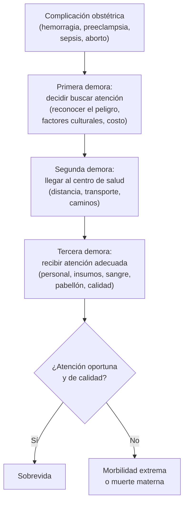

---
tags:
  - Ginecología y obstetricia
---

# Mortalidad materna y perinatal; salud pública perinatal

**Subespecialidad**
Obstetricia · Salud pública

**Guías principales**
MINSAL 2015: Guía Perinatal (antecedentes epidemiológicos) · OMS 2025: tendencias de la mortalidad materna 2000–2023 · CIE-10 y CIE-11: definiciones de muerte materna

**Otras fuentes**
Modelo de las tres demoras (Thaddeus y Maine 1994) · Ver [control prenatal](control-prenatal-edad-gestacional-e-isoinmunizacion-rh.md), [síndrome hipertensivo del embarazo](../nefrologia/preeclampsia-y-sindrome-hipertensivo-del-embarazo.md), [puerperio y hemorragia posparto](puerperio-hemorragia-posparto-endometritis-mastitis-y-lactancia.md), [parto prematuro](parto-prematuro-y-rotura-prematura-de-membranas.md), [aborto](hemorragia-del-primer-trimestre-aborto-ectopico-y-mola.md) y [anticoncepción](anticoncepcion-y-metodos-naturales.md)

**GES**
Varios problemas GES protegen la salud perinatal: prevención del parto prematuro (N.° 24), analgesia del parto (N.° 54), síndrome de dificultad respiratoria del recién nacido, cardiopatías congénitas operables, retinopatía del prematuro, displasia broncopulmonar e hipoacusia del prematuro, entre otros ([ver Patologías GES](../ges/index.md)).

**EUNACOM**
3.01.3.007 Mortalidad perinatal y materna · 3.01.3.012 Salud pública perinatal

**Revisado**
Octubre 2026

!!! abstract "Resumen en 60 segundos"
    - **Muerte materna**: muerte de una mujer **durante el embarazo o dentro de los 42 días** siguientes a su término, por cualquier causa **relacionada con o agravada por** el embarazo o su atención, **no** por causas accidentales o incidentales.
        - **Directa** (complicaciones obstétricas: hipertensión, hemorragia, aborto, sepsis) o **indirecta** (enfermedad previa agravada por el embarazo).
        - **Tardía**: entre los 42 días y 1 año.
    - **Razón de mortalidad materna (RMM)**: muertes maternas por **100 000 nacidos vivos**. Es un **indicador de desarrollo** y de calidad del sistema de salud.
    - **Mundo** (OMS 2025): **~ 260 000** muertes maternas en 2023 (**> 700 al día**); **~ 92 %** en países de ingresos bajos y medios bajos; la mayoría **evitables**. Meta ODS: RMM **< 70** al 2030.
    - **Chile**: RMM entre las **más bajas de América Latina** (~ 17–22 por 100 000 en 2012, Guía Perinatal 2015), con **parto institucional > 99 %**. Principales causas: **indirectas** (enfermedades crónicas), **hipertensión** del embarazo, complicaciones obstétricas y **aborto**.
    - **Mortalidad perinatal**: muertes **fetales tardías** (≥ 22 semanas o ≥ 500 g) + **neonatales precoces** (< 7 días). Chile 2012: **9,4 por 1000** nacidos. Principales causas: **prematurez**, **malformaciones congénitas**, asfixia, RCF.
    - **Estrategias** de salud pública perinatal: **control preconcepcional y prenatal** precoz, **parto institucional** por personal calificado, **regionalización** de la atención (derivación oportuna del alto riesgo), **auditoría** de las muertes maternas y perinatales, **anticoncepción** y prevención del aborto inseguro, GES perinatales, **Chile Crece Contigo**.

## Definición

### Mortalidad materna (CIE-10 y CIE-11)

- **Muerte materna**: muerte de una mujer mientras está **embarazada** o dentro de los **42 días** siguientes a la terminación del embarazo, independiente de la duración y el sitio del embarazo, por cualquier causa **relacionada con o agravada por** el embarazo o su atención, pero **no** por causas **accidentales o incidentales**.
    - **Obstétrica directa**: por **complicaciones obstétricas** del embarazo, el parto o el puerperio, por intervenciones, omisiones o tratamiento incorrecto (preeclampsia, hemorragia, aborto, sepsis, embolia).
    - **Obstétrica indirecta**: por una **enfermedad previa** o que apareció durante el embarazo, **agravada** por sus efectos fisiológicos (cardiopatía, diabetes, VIH, COVID-19, suicidio según algunas clasificaciones).
- **Muerte materna tardía**: por causas obstétricas directas o indirectas **después de 42 días** pero **antes de 1 año** del término del embarazo.
- **Muerte relacionada con el embarazo**: durante el embarazo o dentro de los 42 días, **cualquiera** sea la causa (incluye las incidentales).

### Indicadores maternos (Guía Perinatal 2015)

| Indicador | Definición |
|---|---|
| **Razón de mortalidad materna (RMM)** | Muertes maternas / **100 000 nacidos vivos** en el mismo período (el indicador más usado) |
| **Tasa de mortalidad materna** | Muertes maternas / 100 000 **mujeres en edad fértil** (en Chile, por convención, de 10 a 54 años) |
| **Riesgo de muerte materna a lo largo de la vida** | Probabilidad de que una mujer muera por una causa materna durante su vida reproductiva |
| **Morbilidad materna extrema** (*near miss*) | Mujer que casi muere pero sobrevive a una complicación grave del embarazo, el parto o el puerperio |

### Indicadores perinatales

| Indicador | Definición |
|---|---|
| **Muerte fetal** | Muerte antes de la expulsión completa del producto. **Tardía**: ≥ **22 semanas** o ≥ **500 g** (OMS) |
| **Mortalidad neonatal precoz** | Muertes en los primeros **7 días** de vida / 1000 nacidos vivos |
| **Mortalidad neonatal** | Muertes en los primeros **28 días** / 1000 nacidos vivos |
| **Mortalidad perinatal** | Muertes **fetales tardías + neonatales precoces** / 1000 nacimientos (nacidos vivos + mortinatos) |
| **Mortalidad infantil** | Muertes en el **primer año** / 1000 nacidos vivos |
| **Tasa de natalidad** | Nacidos vivos / 1000 habitantes |
| **Tasa global de fecundidad** | Promedio de hijos por mujer; **reemplazo**: 2,1 |
| **Bajo peso al nacer** | < 2500 g; **muy bajo peso**: < 1500 g |

## Epidemiología

### Mundial

- **OMS 2025**: ~ **260 000** mujeres murieron por causas maternas en **2023**; una muerte **cada 2 minutos**; la RMM bajó **~ 40 %** entre 2000 y 2023.
- **~ 92 %** de las muertes ocurre en países de ingresos **bajos y medios bajos** (África subsahariana ~ 70 %). La RMM en los países de ingresos bajos fue **346** por 100 000 nacidos vivos versus **10** en los de ingresos altos.
- **Causas directas principales** (en el mundo): **hemorragia** (sobre todo posparto), **trastornos hipertensivos**, **sepsis**, complicaciones del **aborto inseguro** y del parto.
- **Objetivo de Desarrollo Sostenible 3.1**: RMM mundial **< 70 por 100 000** nacidos vivos al **2030**.
- **Mortalidad neonatal**: ~ **tres cuartos** de las muertes neonatales ocurren en la **primera semana** y la mitad en las primeras 24 h (Guía Perinatal 2015).

!!! chile "Datos nacionales (Guía Perinatal 2015, datos DEIS 2012)"
    - **Atención profesional del parto**: **99,8 %** (2012).
    - **RMM** (hasta los 42 días): **22,3** por 100 000 nacidos vivos en 1997 (61 muertes) y **17,2** en 2012 (42 muertes): un descenso de 22,8 %. Incluyendo las muertes tardías, la RMM de 2012 fue **22,1** (54 muertes).
    - **Causas** (2000–2012), en orden: **muertes obstétricas indirectas**, **trastornos hipertensivos** del embarazo, **complicaciones** relacionadas con el embarazo y el parto, y **aborto**.
    - **Edad**: más de la mitad de las muertes maternas de 2012 ocurrió en mujeres de **30 a 39 años**; la **edad materna avanzada** y las **enfermedades crónicas** pesan cada vez más.
    - **Mortalidad fetal** (2012): **8,4 por 1000** nacidos; mayor en La Araucanía (12,6) y Arica (11,4).
    - **Mortalidad perinatal** (2012): **9,4 por 1000**; **infantil** 7,4; **neonatal** 5,4; **neonatal precoz** 4,2 por 1000 nacidos vivos.
    - Las **neonatales precoces** son ~ **57 %** de las muertes infantiles. Primeras causas de muerte en el menor de 1 año: **prematurez extrema**, **cardiopatías congénitas**, síndrome de dificultad respiratoria y malformaciones del SNC.
    - Solo ~ **46 %** de los embarazos en el sistema público son **planificados**.
    - Los datos actualizados se publican en el **DEIS** (Departamento de Estadísticas e Información de Salud) del MINSAL.

## Etiología

### Causas de muerte materna

| Tipo | Causas |
|---|---|
| **Directas** | **Trastornos hipertensivos** (preeclampsia, eclampsia, HELLP), **hemorragia** (posparto, DPPNI, placenta previa, rotura uterina, ectópico), **aborto** (sobre todo inseguro), **sepsis** puerperal, **embolia** (TEP, líquido amniótico), complicaciones anestésicas |
| **Indirectas** | **Enfermedades cardiovasculares**, **diabetes**, enfermedades autoinmunes, cáncer, infecciones (VIH, influenza, **COVID-19**), **salud mental** (suicidio), epilepsia |

### Factores de riesgo de muerte materna y perinatal

- **Biológicos**: **edad** < 15 o **≥ 35 años**, **multiparidad**, enfermedades crónicas (HTA, diabetes, obesidad), embarazo múltiple, antecedente de cesáreas (acretismo).
- **Sociales**: **pobreza**, **ruralidad** y distancia, **baja escolaridad**, migración, pertenencia a pueblos originarios, violencia, embarazo **no planificado** y **adolescente**.
- **Del sistema de salud**: falta de acceso, **control prenatal tardío o ausente**, retraso en la derivación, falta de personal calificado, de banco de sangre o de UCI, **calidad** de la atención.

## Fisiopatología

**Modelo de las tres demoras** (Thaddeus y Maine 1994): la mayoría de las muertes maternas ocurre por un retraso en alguno de estos pasos.

- En los países con **alta cobertura de parto institucional** (como Chile), la **tercera demora** (calidad de la atención) y las **causas indirectas** (enfermedades crónicas) son las que más pesan.

## Clasificación

### Mortalidad perinatal según el momento (útil para orientar las intervenciones)

| Momento | Causas principales | Intervenciones clave |
|---|---|---|
| **Anteparto** (muerte fetal) | Insuficiencia placentaria, **RCF**, preeclampsia, diabetes, infecciones (sífilis), malformaciones, causa desconocida | **Control prenatal**, detección de RCF, control de la diabetes y la HTA, **tamizaje de sífilis** |
| **Intraparto** | **Asfixia**, DPPNI, prolapso de cordón, distocias | **Parto institucional**, monitorización, cesárea oportuna |
| **Neonatal precoz** | **Prematurez**, **malformaciones congénitas** (cardiopatías), asfixia, infecciones | **Corticoides antenatales**, **regionalización** (traslado *in utero*), UCI neonatal, GES de cardiopatías |

## Clínica

No aplica como cuadro clínico. En la práctica, el interno participa en:

- **Detección del riesgo** en el control prenatal (edad, enfermedades crónicas, antecedentes obstétricos, factores sociales, **violencia**, **salud mental**).
- **Reconocimiento precoz** de las emergencias obstétricas: hipertensión grave, hemorragia, sepsis, disminución de los movimientos fetales.
- **Derivación oportuna** al nivel de complejidad adecuado.
- **Registro** correcto del **certificado de defunción** (causa básica) y del **certificado de nacido vivo** y de **defunción fetal**.

!!! alarma "Señales de alarma que la embarazada debe conocer"
    - **Sangrado** genital, **pérdida de líquido**, **contracciones** antes de las 37 semanas.
    - **Cefalea** intensa, alteraciones visuales, dolor epigástrico, **edema** súbito (preeclampsia).
    - **Fiebre**, flujo de mal olor.
    - **Disminución o ausencia de movimientos fetales**.
    - **Ideas de daño** a sí misma o al recién nacido (salud mental perinatal).

## Diagnóstico

!!! guia "Puntos clave (Guía Perinatal 2015; OMS)"
    - La **RMM** es un **indicador sensible** del desarrollo y del funcionamiento del sistema de salud; la **mortalidad infantil** y la **perinatal** también.
    - **Vigilancia epidemiológica**: notificación y **auditoría** de todas las **muertes maternas** (y de las perinatales) para identificar las **causas evitables** y corregir los procesos.
    - Las muertes maternas suelen **subregistrarse** (errores de certificación): la CIE introdujo la "muerte relacionada con el embarazo" para mejorar su identificación.
    - La **morbilidad materna extrema** (*near miss*) es un indicador complementario de la calidad de la atención.

## Laboratorio

No aplica. Los **tamizajes del control prenatal** que más reducen la mortalidad perinatal y materna son: **grupo y Rh**, **hemograma**, **glicemia** y **PTGO**, **VIH**, **sífilis** (VDRL o RPR), **urocultivo**, **Chagas** (en las regiones endémicas o según el riesgo), **hepatitis B**, **estreptococo grupo B** (35–37 semanas) y **ecografías** de las 11–14, 22–24 y 30–34 semanas.

## Imágenes

No aplica (ver la ecografía en el [control prenatal](control-prenatal-edad-gestacional-e-isoinmunizacion-rh.md)).

## Diagnóstico diferencial

| Concepto | Diferencia |
|---|---|
| **Muerte materna** vs. **muerte relacionada con el embarazo** | La primera excluye las causas accidentales o incidentales; la segunda las incluye |
| **Muerte materna** vs. **muerte materna tardía** | Dentro de los 42 días vs. entre 42 días y 1 año |
| **Razón** vs. **tasa** de mortalidad materna | Por 100 000 **nacidos vivos** vs. por 100 000 **mujeres en edad fértil** |
| **Mortalidad perinatal** vs. **neonatal** | Fetal tardía + neonatal precoz (< 7 días) vs. muertes de nacidos vivos < 28 días |

## Tratamiento

### Estrategias de salud pública perinatal en Chile

| Área | Estrategias |
|---|---|
| **Antes del embarazo** | **Control preconcepcional** (sobre todo en diabéticas, hipertensas, cardiópatas, epilépticas), **ácido fólico**, **anticoncepción** accesible (Ley 20.418) para reducir los embarazos no planificados y adolescentes, vacunación |
| **Embarazo** | **Control prenatal precoz** (antes de las 14 semanas) y periódico, **tamizajes** (VIH, sífilis, diabetes, Rh, SGB), ecografías, **aspirina** a las de alto riesgo de preeclampsia, **cervicometría** y progesterona (GES N.° 24), **vacunas** (influenza, dTpa, COVID-19), pesquisa de **depresión** (Edimburgo), violencia y consumo, **suplementación** (hierro, PNAC) |
| **Parto** | **Parto institucional** por personal calificado, **manejo activo del alumbramiento**, **analgesia** (GES N.° 54), acompañamiento, **corticoides antenatales** y **sulfato de magnesio** en el parto prematuro, **regionalización** y **traslado *in utero*** del alto riesgo |
| **Puerperio y recién nacido** | **Control de la díada** a los 7–10 días, lactancia, **apego** (Chile Crece Contigo), pesquisa neonatal (hipotiroidismo, fenilcetonuria y otros), GES neonatales, anticoncepción posparto |
| **Sistema** | **Auditoría** de las muertes maternas y perinatales, **Comisión Nacional de Obstetricia y Neonatología**, protocolos (hemorragia, preeclampsia, sepsis), **banco de sangre** en las maternidades, capacitación en emergencias obstétricas |

### Normativa relevante

- **Ley 20.418** (2010): regulación de la fertilidad y anticoncepción de emergencia.
- **Ley 21.030** (2017): interrupción voluntaria del embarazo en **tres causales** (riesgo vital materno, inviabilidad fetal letal y violación).
- **Ley 20.545** (2011): **posnatal parental** (hasta 24 semanas).
- **Ley 21.371** (2021, "**Ley Dominga**"): medidas especiales en caso de **muerte gestacional o perinatal** (acompañamiento del **duelo**, permisos, trato digno).
- **Chile Crece Contigo**: protección integral de la infancia desde la gestación.

!!! dosis "Intervenciones de alto impacto"
    | Intervención | Efecto |
    |---|---|
    | **Atención profesional del parto** | Reduce la mortalidad materna y neonatal intraparto |
    | **Manejo activo del alumbramiento** (oxitocina) | Previene la hemorragia posparto |
    | **Sulfato de magnesio** en la preeclampsia grave | Previene la eclampsia |
    | **Aspirina** en las de alto riesgo | Reduce la preeclampsia y el parto prematuro por indicación médica |
    | **Corticoides antenatales** (24–34 semanas) | Reducen la mortalidad neonatal y el distrés respiratorio |
    | **Tamizaje y tratamiento de la sífilis** | Previene la sífilis congénita y la muerte fetal |
    | **Ácido fólico** preconcepcional | Previene los defectos del tubo neural |
    | **Anticoncepción** | Reduce los embarazos no planificados, adolescentes y el aborto inseguro |

## Complicaciones

- **Consecuencias de la muerte materna**: orfandad, mayor mortalidad de los hijos, empobrecimiento familiar.
- **Morbilidad materna extrema**: secuelas (histerectomía, insuficiencia renal, daño neurológico).
- **Muerte perinatal**: **duelo** perinatal, depresión, ansiedad; riesgo en el siguiente embarazo según la causa.

## Pronóstico y seguimiento

- Chile tiene indicadores maternos y perinatales entre los **mejores de América Latina**, pero con **desigualdades regionales** (mayor mortalidad fetal en La Araucanía y Arica en 2012) y por nivel socioeconómico.
- Los **desafíos** actuales: el aumento de la **edad materna**, de las **enfermedades crónicas** (obesidad, diabetes, HTA) y de la **cesárea**, la **salud mental perinatal**, la población **migrante** y la **baja natalidad**.
- **Seguimiento**: estadísticas vitales del **DEIS** y reportes de auditoría.

## Perlas para el internado

!!! perla "Para recordar en la sala"
    - **Muerte materna** = embarazo o **42 días** posparto, por causa **relacionada** (no accidental). **Tardía**: 42 días a 1 año.
    - **RMM** por **100 000 nacidos vivos**; mortalidad perinatal, neonatal e infantil por **1000**.
    - **Perinatal** = fetal tardía (≥ 22 semanas o ≥ 500 g) + neonatal precoz (< 7 días).
    - En **Chile**: primeras causas de muerte materna = **indirectas** y **hipertensión**; en el **mundo** = **hemorragia** e hipertensión.
    - Causas de muerte perinatal: **prematurez** y **malformaciones** (sobre todo cardiopatías).
    - **Tres demoras**: decidir, llegar, recibir atención adecuada.
    - **Auditar** toda muerte materna y perinatal; certificar bien la **causa básica**.

## Preguntas de repaso

??? repaso "1. Mujer que muere a los 30 días posparto por un TEP. ¿Es una muerte materna? ¿De qué tipo?"
    - **Sí**: ocurre dentro de los **42 días** y la causa está relacionada con el embarazo y el puerperio.
    - Es una muerte **obstétrica directa** (embolia obstétrica).

??? repaso "2. Embarazada de 28 semanas que muere en un accidente de tránsito. ¿Se cuenta como muerte materna?"
    - **No**: es una causa **accidental o incidental**. Sí es una "**muerte relacionada con el embarazo**" (definición que incluye cualquier causa).

??? repaso "3. ¿Cómo se calcula la razón de mortalidad materna?"
    - **Número de muertes maternas** en un período / **número de nacidos vivos** en el mismo período × **100 000**.

??? repaso "4. ¿Qué incluye la mortalidad perinatal y cuáles son sus principales causas en Chile?"
    - **Muertes fetales tardías** (≥ 22 semanas o ≥ 500 g) + **neonatales precoces** (< 7 días), por 1000 nacimientos.
    - Causas: **prematurez**, **malformaciones congénitas** (cardiopatías), asfixia, RCF e insuficiencia placentaria, infecciones.

??? repaso "5. ¿Qué es el modelo de las tres demoras?"
    - Explica la muerte materna por retrasos en: **1)** decidir buscar atención, **2)** llegar al centro de salud y **3)** recibir una atención adecuada una vez allí.
    - En Chile, con parto institucional > 99 %, pesa sobre todo la **tercera demora** (calidad) y las **causas indirectas**.

??? repaso "6. Nombre cuatro intervenciones de salud pública que reducen la mortalidad materna y perinatal."
    - **Control prenatal** precoz con **tamizajes** (sífilis, VIH, diabetes).
    - **Parto institucional** con **manejo activo del alumbramiento**.
    - **Corticoides antenatales** y **sulfato de magnesio**; regionalización y traslado *in utero*.
    - **Anticoncepción** accesible y **auditoría** de las muertes maternas y perinatales.

## Referencias

1. Ministerio de Salud de Chile. Guía Perinatal 2015 (capítulo II: antecedentes epidemiológicos). Santiago: MINSAL; 2015. [minsal.cl](https://www.minsal.cl/salud-de-la-mujer/)
2. World Health Organization, UNICEF, UNFPA, World Bank Group, UNDESA/Population Division. Trends in maternal mortality 2000 to 2023: estimates by WHO, UNICEF, UNFPA, World Bank Group and UNDESA/Population Division. Ginebra: OMS; 2025. [who.int](https://www.who.int/publications/i/item/9789240108462)
3. World Health Organization. Maternal mortality: fact sheet. Ginebra: OMS; 2025. [who.int](https://www.who.int/news-room/fact-sheets/detail/maternal-mortality)
4. Thaddeus S, Maine D. Too far to walk: maternal mortality in context. *Soc Sci Med.* 1994;38(8):1091–1110. doi:[10.1016/0277-9536(94)90226-7](https://doi.org/10.1016/0277-9536(94)90226-7)
