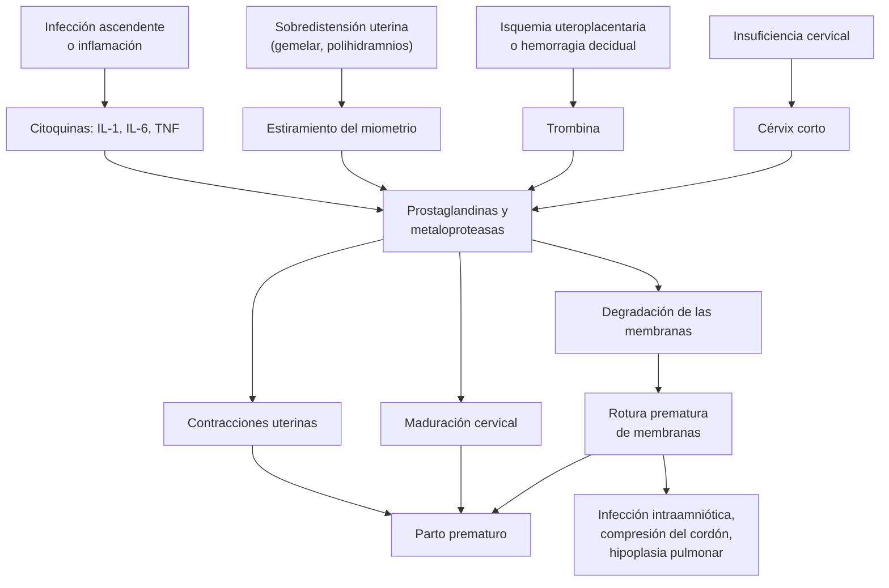

---
tags:
  - Ginecología y obstetricia
  - GES
  - Urgencia
---

# Parto prematuro y rotura prematura de membranas

**Subespecialidad**
Obstetricia · Alto riesgo obstétrico

**Guías principales**
MINSAL 2015: Guía Perinatal (capítulos de parto prematuro y de rotura prematura de membranas) · MINSAL 2018: guía GES de prevención del parto prematuro · ACOG 2016: manejo del parto prematuro (PB 171) · ACOG 2020: rotura prematura de membranas (PB 217) · ACOG 2021: predicción y prevención del parto prematuro espontáneo (PB 234) · ACOG 2026: cerclaje obstétrico (CPG 12)

**Otras fuentes**
Ver [control prenatal](control-prenatal-edad-gestacional-e-isoinmunizacion-rh.md), [metrorragia de la segunda mitad del embarazo](metrorragia-de-la-segunda-mitad-del-embarazo.md), [infección urinaria](../nefrologia/infeccion-urinaria.md) y [síndrome hipertensivo del embarazo](../nefrologia/preeclampsia-y-sindrome-hipertensivo-del-embarazo.md)

**GES**
Sí: problema N.° 24, prevención de parto prematuro.

**EUNACOM**
3.01.2.012 Parto prematuro (específico, inicial, derivar) · 3.01.2.014 Rotura prematura de membranas (específico, inicial, derivar)

**Revisado**
Octubre 2026

!!! abstract "Resumen en 60 segundos"
    - **Parto prematuro**: parto antes de las **37 semanas**. En Chile es **~ 7 %** de los partos y **~ 3 %** antes de las 34 semanas, el grupo que concentra la morbimortalidad (Guía Perinatal 2015). Es la **primera causa de morbimortalidad perinatal**.
    - **Prevención** (GES):
        - **Cervicometría** transvaginal a las **20–24 semanas**: cérvix **< 25 mm** → **progesterona vaginal**.
        - **Antecedente de parto prematuro** → progesterona vaginal **desde las 16 semanas**; **cerclaje** si además el cérvix mide < 25 mm.
    - **Amenaza de parto prematuro (APP)**: contracciones con modificaciones cervicales entre las 22 y 37 semanas. El diagnóstico clínico tiene **~ 90 % de falsos positivos**: el **cérvix** ecográfico decide (**< 15 mm** alto riesgo, **≥ 30 mm** bajo riesgo).
    - **Entre 24 y 34 semanas con riesgo real**:
        - **Corticoides**: betametasona **12 mg IM cada 24 h × 2**. Es la intervención **más eficaz**.
        - **Tocolisis por 48 h** solo para que alcancen a actuar: **nifedipino** de primera línea.
        - **Sulfato de magnesio < 32 semanas** como **neuroprotector** (reduce la parálisis cerebral).
        - **Sin antibióticos** con membranas íntegras.
    - **RPM**: salida de líquido amniótico **antes del inicio del trabajo de parto**. Diagnóstico con **especuloscopía** (líquido por el OCE) y test de cristalización. **No hacer tacto vaginal**.
        - **≥ 34 semanas** → **interrupción**.
        - **24–34 semanas** sin infección → **manejo expectante**: **antibióticos** (ampicilina + eritromicina), **corticoides**, **sin tocolisis**, e interrupción a las **34 semanas**.
        - **Corioamnionitis** a cualquier edad gestacional → antibióticos e **interrupción**.

## Definición

- **Parto prematuro**: el que ocurre entre las **22+0** y las **36+6 semanas**, espontáneo o por indicación médica.
    - **Prematuro extremo**: < 28 semanas.
    - **Muy prematuro**: 28–31+6 semanas.
    - **Prematuro moderado y tardío**: 32–36+6 semanas (tardío: 34–36+6).
- **Amenaza de parto prematuro (APP)**: **contracciones uterinas regulares** (en general ≥ 4 en 20 minutos u 8 en una hora) con **modificaciones cervicales** (borramiento o dilatación) o un **cérvix corto**, antes de las 37 semanas.
- **Trabajo de parto prematuro**: contracciones con **dilatación ≥ 3 cm** (o progresiva), con un parto muy probable.
- **Rotura prematura de membranas (RPM)**: solución de continuidad **espontánea** de las membranas **antes del inicio del trabajo de parto** (Guía Perinatal 2015).
    - **RPM de término**: ≥ 37 semanas.
    - **RPM de pretérmino**: < 37 semanas.
    - **RPM previable**: antes del límite de la viabilidad (~ 24 semanas).
    - **Período de latencia**: tiempo entre la rotura y el inicio del trabajo de parto.
- **Cérvix corto**: longitud cervical **< 25 mm** por ecografía transvaginal en el segundo trimestre.

## Epidemiología

### Mundial

- Cerca de **1 de cada 10** nacidos vivos es prematuro. Es la **primera causa de muerte** en los menores de 5 años.
- La RPM complica el **8–10 %** de los embarazos: **80 %** de término y **20 %** de pretérmino (Guía Perinatal 2015).
- La RPM causa **un tercio** de los partos prematuros. Los espontáneos (con membranas íntegras o rotas) son **dos tercios** del total; el tercio restante es por indicación médica (preeclampsia, RCF, etc.).

!!! chile "Datos nacionales (Guía Perinatal 2015)"
    - Parto prematuro: **~ 7 %** de los partos; **~ 3 %** antes de las 34 semanas. En los grandes centros llega al **10 %** y **5 %**, respectivamente.
    - Los partos de menos de 34 semanas concentran el **60–70 %** de la morbimortalidad perinatal.
    - La RPM explica el **27 %** de los partos prematuros.
    - **GES N.° 24**: prevención del parto prematuro. La guía GES (MINSAL 2018) recomienda **aspirina** antes de las 16 semanas en las embarazadas con riesgo de parto prematuro por indicación médica (por ejemplo, riesgo de preeclampsia), **cervicometría a las 20–24 semanas**, **progesterona vaginal** con cérvix < 25 mm o con antecedente de parto prematuro, e **interrupción** en la RPM de 34–36+6 semanas.

## Etiología y factores de riesgo

El parto prematuro es un **síndrome** con varias causas que convergen en la activación del parto.

| Mecanismo | Ejemplos |
|---|---|
| **Infección e inflamación** (la causa más frecuente de los partos < 30 semanas) | Infección ascendente intraamniótica, vaginosis bacteriana, bacteriuria asintomática, pielonefritis, enfermedad periodontal |
| **Sobredistensión uterina** | Embarazo múltiple, polihidramnios, malformaciones uterinas |
| **Insuficiencia cervical** | Conizaciones, cirugía cervical, malformaciones, antecedente de pérdidas indoloras del segundo trimestre |
| **Isquemia uteroplacentaria** | Preeclampsia, RCF, DPPNI, metrorragia del segundo y tercer trimestre |
| **Estrés materno y fetal** | Activación del eje hipotálamo-hipófisis-suprarrenal |

**Factores de riesgo de parto prematuro:**

- **Antecedente de parto prematuro espontáneo**: el factor clínico más importante.
- **Cérvix corto** en el segundo trimestre.
- Embarazo múltiple, metrorragia, infección urinaria o genital, malformaciones uterinas.
- Edad materna extrema, IMC bajo, **tabaco**, drogas (cocaína), período intergenésico corto, nivel socioeconómico bajo.

**Factores de riesgo de RPM** (Guía Perinatal 2015): los mismos, más **RPM de pretérmino previa**, **vaginosis bacteriana**, *N. gonorrhoeae* y *C. trachomatis*, **metrorragia**, **tabaco**, polihidramnios y procedimientos (amniocentesis 1–2 %, fetoscopía 6–10 %, cerclaje de urgencia ~ 65 %).

## Fisiopatología

La vía final común es la **activación de las membranas, la decidua y el miometrio**: prostaglandinas, metaloproteasas y receptores de oxitocina que producen **contracciones**, **maduración cervical** y **rotura de membranas**.

- La **inflamación fetal** (síndrome de respuesta inflamatoria fetal, FIRS) se asocia a **parálisis cerebral** y **leucomalacia periventricular**: el pronóstico no depende solo de la edad gestacional.
- En la **RPM** el oligoamnios causa **compresión del cordón** y, si ocurre antes de las ~ 22 semanas, **hipoplasia pulmonar** y deformaciones (secuencia de Potter).

## Clasificación

| Según | Categorías |
|---|---|
| **Edad gestacional** | Extremo (< 28 semanas) · muy prematuro (28–31+6) · moderado (32–33+6) · tardío (34–36+6) |
| **Origen** | Espontáneo con membranas íntegras · espontáneo con RPM · por indicación médica (iatrogénico) |
| **RPM** | Previable (< 24 semanas) · lejos del término (24–33+6) · cerca del término (34–36+6) · de término (≥ 37) |
| **Riesgo en la APP según el cérvix** (Guía Perinatal 2015) | **< 15 mm**: ~ 50 % de parto en 7 días · **15–29 mm**: riesgo intermedio · **≥ 30 mm**: ~ 1 % de parto en 7 días |

## Clínica

**Amenaza de parto prematuro:**

- **Contracciones** dolorosas y regulares, dolor lumbar o hipogástrico, sensación de presión pélvica.
- Flujo mucoso o sanguinolento ("tapón mucoso").
- Al examen: dinámica uterina, **borramiento** o **dilatación** cervical.

**Rotura prematura de membranas:**

- **Pérdida de líquido claro**, súbita, abundante e incontenible por los genitales. La historia típica tiene una sensibilidad de **~ 90 %**.
- Puede ser escasa e intermitente (rotura alta).
- **Corioamnionitis clínica**: **fiebre** ≥ 38 °C más ≥ 2 de: **taquicardia materna** (> 100/min), **taquicardia fetal** (> 160/min), **útero sensible**, **líquido amniótico purulento o de mal olor**, leucocitosis > 15 000/mm³.

!!! alarma "Signos de alarma"
    - **Fiebre**, taquicardia materna o fetal, útero sensible, líquido de mal olor → **corioamnionitis**: interrupción.
    - **Metrorragia** con dolor → pensar en un **DPPNI** (complica el 4–12 % de las RPM).
    - **Prolapso de cordón**: cordón visible o palpable → urgencia (posición genupectoral, elevar la presentación, cesárea inmediata).
    - **Alteración del registro fetal** (desaceleraciones variables por compresión del cordón).

## Diagnóstico

!!! guia "Puntos clave (Guía Perinatal 2015; MINSAL 2018; ACOG 2016, 2020 y 2021)"
    - **APP**: confirmar la **edad gestacional** (FUR y ecografía precoz), registrar la **dinámica uterina** y medir el **cérvix por ecografía transvaginal**. Reevaluar en **~ 2 horas** de reposo e hidratación.
    - El diagnóstico clínico de APP predice solo **~ 10 %** de los partos en los 7 días siguientes. La **cervicometría** evita tocolisis y corticoides innecesarios.
    - **RPM**: el diagnóstico es **clínico** con la **especuloscopía estéril** (líquido que sale por el OCE, espontáneamente o con Valsalva). Si hay duda: **test de cristalización** (helecho), nitrazina (pH > 6) o PAMG-1 (Amnisure).
    - **No hacer tacto vaginal** en la RPM de pretérmino si no está en trabajo de parto: aumenta la infección y acorta la latencia.
    - **Amniocentesis** para descartar infección intraamniótica: en la RPM de 24–34 semanas, en la APP con cérvix < 15 mm, refractaria a la tocolisis o recurrente.

| Test para RPM | Fundamento | Falsos positivos |
|---|---|---|
| **Especuloscopía** | Líquido por el OCE | Diagnóstico en la mitad de los casos con la historia |
| **Cristalización** (helecho) | Sales del líquido amniótico | Semen, moco cervical |
| **Nitrazina** | pH del líquido amniótico 7–7,5 (vagina 4–5,5) | Sangre, semen, orina alcalina, vaginosis, antisépticos (~ 20 %) |
| **PAMG-1** (Amnisure) | Proteína placentaria en el flujo | Sensibilidad y especificidad > 95 %; alto costo |
| **Ecografía** | Líquido amniótico disminuido | Apoya, **no confirma** por sí sola |
| **Índigo carmín intraamniótico** | Colorante en un tampón vaginal | *Gold standard*; excepcional. **No usar azul de metileno** |

## Laboratorio

- **Hemograma** y **PCR** (seriados en el manejo expectante de la RPM, 1–2 veces por semana).
- **Sedimento de orina y urocultivo**: la infección urinaria desencadena contracciones.
- **Cultivo de estreptococo grupo B** (si no lo tiene) y flujo vaginal (vaginosis).
- **Amniocentesis** (estudio de infección intraamniótica): **Gram**, **glucosa < 14 mg/dL**, **leucocitos > 50/mm³**, **LDH > 400 U/L**, cultivos aerobios, anaerobios, *Mycoplasma* y *Ureaplasma*.
- **Registro basal no estresante** para el bienestar fetal.

## Imágenes

- **Ecografía transvaginal del cérvix** (cervicometría): longitud del canal cervical cerrado.
    - **Tamizaje universal a las 20–24 semanas** (GES): < 25 mm = cérvix corto.
    - En la APP: < 15 mm alto riesgo; ≥ 30 mm bajo riesgo.
- **Ecografía obstétrica**: edad gestacional, biometría, presentación, **líquido amniótico**, placenta (descartar placenta previa antes de cualquier tacto), malformaciones.

## Diagnóstico diferencial

| Cuadro | Claves |
|---|---|
| **Contracciones de Braxton Hicks** (falso trabajo de parto) | Irregulares, poco dolorosas, ceden con reposo, **cérvix sin cambios** y largo |
| **DPPNI** | Dolor, útero hipertónico, metrorragia oscura, compromiso fetal |
| **Infección urinaria o pielonefritis** | Disuria, fiebre, puño percusión; puede gatillar contracciones |
| **Otras causas de dolor abdominal** | Apendicitis, colecistitis, torsión anexial, mioma en degeneración |
| **Leucorrea** (diferencial de RPM) | Flujo espeso, cristalización negativa |
| **Incontinencia urinaria** | Pérdida con esfuerzos, olor a orina, pH ácido |
| **Pérdida del tapón mucoso** | Moco con sangre, sin líquido por el OCE |
| **Hidrorrea decidual, quiste vaginal roto** | Raros; líquido escaso, sin pérdida por el OCE |

## Tratamiento

### Prevención (embarazadas asintomáticas)

| Situación | Conducta (Guía Perinatal 2015; guía GES 2018; ACOG 2021) |
|---|---|
| **Cérvix < 25 mm** a las 20–24 semanas, sin antecedentes | **Progesterona vaginal** diaria (200 mg óvulo o gel de 90 mg) **hasta las 34–36 semanas**. El cerclaje **no** ha demostrado beneficio |
| **Antecedente de parto prematuro espontáneo** | **Progesterona vaginal desde las 16 semanas** + cervicometrías seriadas (16–24 semanas) |
| Antecedente de parto prematuro **y** cérvix < 25 mm antes de las 24 semanas | **Cerclaje** (además de progesterona) |
| **Insuficiencia cervical** (pérdidas indoloras del segundo trimestre) | **Cerclaje electivo** a las 12–14 semanas |
| Antecedente de parto prematuro | **Pesquisa y tratamiento de vaginosis bacteriana** (solo en este grupo) |
| Riesgo de preeclampsia o de parto prematuro por indicación médica | **Aspirina 100–150 mg** de noche desde antes de las 16 semanas |
| Todas | Tratar la **bacteriuria asintomática**, dejar el tabaco, tratar la enfermedad periodontal |

- El **reposo en cama** y la **tocolisis profiláctica** no previenen el parto prematuro.
- Indicaciones del cerclaje: por **historia** (insuficiencia cervical), por **ecografía** (cérvix corto con antecedente de parto prematuro) y por **examen físico** (dilatación cervical indolora en el segundo trimestre). La guía **ACOG 2026 (CPG 12)** las revisa junto con la técnica quirúrgica y las alternativas.
- En los **embarazos gemelares** ni la progesterona ni el cerclaje de rutina reducen el parto prematuro (Guía Perinatal 2015).
- El caproato de 17-hidroxiprogesterona (17-OHPC) intramuscular **se retiró del mercado en EE. UU. en 2023** por falta de eficacia confirmada; la opción es la **progesterona vaginal**.

### Amenaza de parto prematuro (24–34 semanas)

1. **Hospitalizar**, reposo relativo, hidratación, buscar la causa (urocultivo, flujo, ecografía).
2. **Cervicometría**: si el cérvix es ≥ 30 mm y la dinámica cede → alta con control.
3. **Riesgo real** (cérvix < 30 mm, dinámica persistente, modificaciones cervicales):
    - **Corticoides antenatales**: un curso entre **24+0 y 33+6 semanas**. Reducen la **mortalidad perinatal**, el **síndrome de distrés respiratorio**, la **hemorragia intraventricular** y la **enterocolitis necrotizante** (McGoldrick 2020).
    - **Tocolisis** por **48 horas** para completar los corticoides (o trasladar a un centro con neonatología). Primera línea: **nifedipino** (o indometacina antes de las 32 semanas). Segunda línea: **fenoterol** o **atosiban**.
    - **Sulfato de magnesio** si el parto es inminente antes de las **32 semanas**: **neuroprotección** fetal.
    - **Profilaxis antibiótica del estreptococo grupo B** si el parto es inminente y el cultivo es positivo o desconocido.
    - **Sin antibióticos** para prolongar el embarazo con membranas íntegras: no prolongan la gestación y se asociaron a más mortalidad neonatal.
4. **Curso de rescate** de corticoides (una sola vez) si recibió el primero hace **≥ 7 días** y persiste el riesgo antes de las 34 semanas.
5. **Fracaso de la tocolisis o recidiva** → amniocentesis (infección intraamniótica), tocolisis de segunda línea o interrupción.

**Contraindicaciones de la tocolisis** (Guía Perinatal 2015):

| Absolutas | Relativas |
|---|---|
| Corioamnionitis clínica · metrorragia severa · malformación incompatible con la vida · óbito fetal · patología materna grave · deterioro grave del bienestar fetal · trabajo de parto avanzado (≥ 6 cm) | Dilatación de 3–6 cm · > 34 semanas · madurez pulmonar · metrorragia moderada · RCF · **RPM** · síndrome hipertensivo del embarazo |

### Rotura prematura de membranas

| Edad gestacional | Conducta (Guía Perinatal 2015; guía GES 2018; ACOG 2020) |
|---|---|
| **Cualquiera con corioamnionitis clínica, DPPNI, muerte fetal, compromiso fetal o trabajo de parto avanzado** | **Interrupción** (con antibióticos de amplio espectro si hay infección) |
| **≥ 37 semanas** | **Inducción** del parto (oxitocina) o esperar el inicio espontáneo por un plazo breve. Profilaxis de SGB según el cultivo |
| **34+0 a 36+6 semanas** | **Interrupción** (la guía GES lo sugiere; el manejo expectante hasta las 37 semanas es aceptable en un centro de alta complejidad). La Guía Perinatal 2015 no indica corticoides en este grupo |
| **24+0 a 33+6 semanas** | **Manejo expectante** hospitalizado: **antibióticos** de latencia + **corticoides** + vigilancia de infección. **Sin tocolisis**. **Sulfato de magnesio** si el parto es inminente antes de las 32 semanas. Interrupción a las **34 semanas** |
| **< 24 semanas** (previable) | Consejería sobre el pronóstico (mortalidad perinatal **45–80 %**, hipoplasia pulmonar ~ 20 %). Manejo expectante (hospitalizado o ambulatorio) o interrupción según la decisión informada. Hospitalizar al llegar a la viabilidad |

**Manejo expectante (24–34 semanas) paso a paso:**

1. Hospitalizar en **alto riesgo obstétrico**. Signos vitales y obstétricos cada 6 horas.
2. Hemograma, PCR, sedimento y urocultivo; **amniocentesis** si es posible.
3. **Corticoides** (betametasona 12 mg IM × 2).
4. **Antibióticos de latencia**: prolongan el embarazo, reducen la corioamnionitis y la morbilidad neonatal (infección, distrés, hemorragia intraventricular).
5. Si la amniocentesis muestra **infección intraamniótica**: antibióticos de amplio espectro e interrupción individualizada desde las 28 semanas.
6. **Parámetros inflamatorios** 1–2 veces por semana, registro fetal, ecografía.
7. **Interrumpir a las 34 semanas** (o antes ante corioamnionitis, DPPNI o compromiso fetal).

!!! dosis "Fármacos habituales"
    | Fármaco | Dosis | Comentarios |
    |---|---|---|
    | **Betametasona** | **12 mg IM cada 24 h × 2 dosis** | 24+0–33+6 semanas. Alternativa: **dexametasona 6 mg IM cada 12 h × 4**. Rescate: un curso único si el primero fue hace ≥ 7 días |
    | **Nifedipino** (tocolítico de primera línea) | Carga **20 mg VO**, luego **10–20 mg VO cada 6–8 h** por 48 h | Hipotensión, cefalea, taquicardia. Precaución si se combina con sulfato de magnesio |
    | **Indometacina** | 50–100 mg VO o rectal de carga, luego **25 mg cada 6 h** por **48 h** | Solo **< 32 semanas**: cierre del ductus y oligoamnios |
    | **Fenoterol** (segunda línea) | Infusión EV titulada según la dinámica y el pulso materno | Taquicardia, hiperglicemia, hipokalemia, edema pulmonar |
    | **Atosiban** (segunda línea) | 6,75 mg EV en bolo, luego infusión por hasta 48 h | Pocos efectos adversos; costo alto |
    | **Sulfato de magnesio** (neuroprotección) | **4 g EV de carga** y **1–2 g/h** (Guía Perinatal 2015: 2 g/h) hasta el parto | **< 32 semanas** con parto inminente. Vigilar reflejos, diuresis y respiración; antídoto **gluconato de calcio** 1 g EV |
    | **Antibióticos de latencia en la RPM** | **Ampicilina 2 g EV cada 6 h × 48 h**, luego **amoxicilina 500 mg VO cada 8 h × 5 días** + **eritromicina 500 mg VO cada 6 h × 7 días** | Guía Perinatal 2015. ACOG acepta azitromicina en lugar de eritromicina. Evitar amoxicilina-clavulánico (enterocolitis necrotizante) |
    | **Infección intraamniótica** | **Clindamicina 600 mg EV cada 8 h** + **gentamicina 240 mg/día** + eritromicina 500 mg VO cada 6 h | Más interrupción según la edad gestacional |
    | **Progesterona vaginal** (prevención) | **200 mg** (óvulo) o gel de **90 mg** cada noche | Desde el diagnóstico de cérvix corto (o desde las 16 semanas con antecedente) hasta las 34–36 semanas |

!!! alarma "Urgencia"
    - **Corioamnionitis**: antibióticos (ampicilina + gentamicina, o el esquema local) e **interrupción**; la vía de parto es la obstétrica (no es una indicación de cesárea por sí sola).
    - **Prolapso de cordón** tras una RPM: elevar la presentación con la mano por vía vaginal, posición genupectoral y **cesárea inmediata**.
    - Un **parto inminente < 34 semanas** en un centro sin neonatología: si no se alcanza a trasladar, es mejor **trasladar a la madre antes del parto** ("transporte in utero") que al recién nacido.

## Complicaciones

- **Neonatales del prematuro**: **síndrome de distrés respiratorio** (enfermedad de membrana hialina), **hemorragia intraventricular**, **enterocolitis necrotizante**, sepsis, **retinopatía del prematuro**, displasia broncopulmonar, **parálisis cerebral**, leucomalacia periventricular.
- **De la RPM**:
    - **Maternas**: **infección intraamniótica y corioamnionitis** (30–50 % en la RPM de pretérmino, 5–10 % en la de término), **endometritis** puerperal (2–13 %), **DPPNI** (4–12 %), sepsis.
    - **Fetales**: **FIRS** (~ 30 % con bacteremia fetal), **compresión y prolapso del cordón**, presentaciones distócicas, **hipoplasia pulmonar** y deformaciones (RPM precoz), **muerte fetal** (~ 33 % antes de las 24 semanas).
- **De los fármacos**: edema pulmonar (betamiméticos, sobrecarga de volumen), hipotensión (nifedipino), toxicidad por magnesio, cierre del ductus (indometacina).

## Pronóstico y seguimiento

- La **sobrevida** y las secuelas dependen sobre todo de la **edad gestacional** y del **peso al nacer**: mejoran mucho cada semana entre las 24 y las 32 semanas. Los **corticoides antenatales** y el **parto en un centro con neonatología** son los factores modificables más importantes.
- **Riesgo de recurrencia**: una mujer con un parto prematuro tiene un riesgo claramente mayor en el siguiente embarazo. **Control preconcepcional** y **derivación al alto riesgo obstétrico** desde el inicio del próximo embarazo (progesterona desde las 16 semanas, cervicometrías seriadas).
- **RPM previable**: latencia promedio de **~ 17 días**; ~ 25 % reacumula líquido.
- **Puerperio**: vigilar la **endometritis**. Seguimiento del prematuro en el **policlínico de seguimiento del prematuro** (programa nacional para los < 32 semanas o < 1500 g).

## Perlas para el internado

!!! perla "Para recordar en la sala"
    - Los **corticoides** son lo que más cambia el pronóstico; la **tocolisis** solo da tiempo (48 h) para que actúen o para trasladar.
    - **Nifedipino** es el tocolítico de primera línea en Chile. **Indometacina** solo antes de las 32 semanas.
    - **Sulfato de magnesio < 32 semanas** = neuroprotección (no tocolisis).
    - **Cervicometría**: < 15 mm, el parto en 7 días es probable (~ 50 %); ≥ 30 mm, muy improbable (~ 1 %).
    - En la **RPM de pretérmino**: **sin tacto vaginal**, **sin tocolisis**, **con antibióticos** (ampicilina + eritromicina) y **con corticoides**. Interrumpir a las **34 semanas**.
    - Con membranas **íntegras**, los antibióticos **no** prolongan el embarazo: solo la profilaxis de SGB si el parto es inminente.
    - **Fiebre en una RPM** = corioamnionitis hasta demostrar lo contrario → interrupción.
    - **Progesterona vaginal** previene; **no** sirve para detener una APP en curso.
    - Una APP nueva en una paciente con contracciones: buscar una **infección urinaria**.

## Preguntas de repaso

??? repaso "1. Primigesta de 30 semanas con contracciones dolorosas cada 5 minutos. Cérvix al tacto con 1 cm de dilatación. Cervicometría: 12 mm. Sin pérdida de líquido. ¿Qué hace?"
    - **APP con alto riesgo** (cérvix < 15 mm).
    - Hospitalizar, **betametasona 12 mg IM × 2**, **tocolisis con nifedipino** por 48 h.
    - **Sulfato de magnesio** si el parto se vuelve inminente (< 32 semanas).
    - Urocultivo, cultivo de SGB; considerar **amniocentesis** (cérvix < 15 mm) para descartar infección intraamniótica.
    - Si el hospital no tiene neonatología: trasladar a la madre.

??? repaso "2. Embarazada de 31 semanas consulta por pérdida de líquido claro hace 4 horas. Afebril. ¿Cómo confirma el diagnóstico y qué indica?"
    - **Especuloscopía estéril**: líquido por el OCE (con Valsalva); si hay duda, **test de cristalización**. **No tacto vaginal**.
    - Ecografía (líquido amniótico, presentación, biometría) y registro fetal.
    - **RPM de pretérmino 24–34 semanas** → manejo expectante: **ampicilina + eritromicina** (latencia), **betametasona**, **sin tocolisis**, sulfato de magnesio si el parto es inminente (< 32 semanas), hemograma y PCR seriados, interrupción a las **34 semanas**.

??? repaso "3. La misma paciente, al quinto día, presenta 38,5 °C, pulso de 112/min, útero sensible y LCF de 170/min. ¿Qué ocurre y qué hace?"
    - **Corioamnionitis clínica**.
    - **Antibióticos** de amplio espectro e **interrupción** del embarazo, sin importar la edad gestacional.
    - La tocolisis está **contraindicada**.

??? repaso "4. Ecografía de rutina a las 22 semanas en una mujer sin antecedentes: cérvix de 18 mm. Asintomática. ¿Qué indica?"
    - **Cérvix corto** (< 25 mm) → **progesterona vaginal** cada noche hasta las 34–36 semanas (GES).
    - **No** cerclaje (sin antecedente de parto prematuro, no ha demostrado beneficio).
    - Control en el alto riesgo obstétrico; consultar si tiene contracciones o pérdida de líquido.

??? repaso "5. Embarazada de 35 semanas con RPM confirmada, sin trabajo de parto ni signos de infección. ¿Qué hace?"
    - **RPM ≥ 34 semanas** → **interrupción** (inducción con oxitocina si no hay contraindicación).
    - Profilaxis de **SGB** si el cultivo es positivo o desconocido.
    - El manejo expectante hasta las 37 semanas es aceptable solo con vigilancia estrecha en un centro de alta complejidad (guía GES).

??? repaso "6. ¿Cuándo está contraindicada la tocolisis?"
    - **Absolutas**: corioamnionitis, metrorragia severa, malformación incompatible con la vida, óbito fetal, patología materna grave, deterioro grave del bienestar fetal, trabajo de parto avanzado (≥ 6 cm).
    - **Relativas**: RPM, > 34 semanas, síndrome hipertensivo, RCF, metrorragia moderada, dilatación de 3–6 cm.

## Referencias

1. Ministerio de Salud de Chile. Guía Perinatal 2015 (capítulos XXI: parto prematuro, y XXII: rotura prematura de membranas). Santiago: MINSAL; 2015. [minsal.cl](https://www.minsal.cl/salud-de-la-mujer/)
2. Ministerio de Salud de Chile. Guía de práctica clínica del problema de salud AUGE N.° 24: prevención del parto prematuro. Recomendaciones. Santiago: MINSAL; 2018. [diprece.minsal.cl](https://diprece.minsal.cl/le-informamos/auge/acceso-guias-clinicas/guias-clinicas-desarrolladas-utilizando-manual-metodologico/prevencion-del-parto-prematuro/recomendaciones/)
3. American College of Obstetricians and Gynecologists. Practice Bulletin No. 171: Management of preterm labor. *Obstet Gynecol.* 2016;128(4):e155–e164. doi:[10.1097/AOG.0000000000001711](https://doi.org/10.1097/AOG.0000000000001711)
4. American College of Obstetricians and Gynecologists. Prelabor rupture of membranes: ACOG Practice Bulletin No. 217. *Obstet Gynecol.* 2020;135(3):e80–e97. doi:[10.1097/AOG.0000000000003700](https://doi.org/10.1097/AOG.0000000000003700)
5. American College of Obstetricians and Gynecologists. Prediction and prevention of spontaneous preterm birth: ACOG Practice Bulletin No. 234. *Obstet Gynecol.* 2021;138(2):e65–e90. doi:[10.1097/AOG.0000000000004479](https://doi.org/10.1097/AOG.0000000000004479)
6. American College of Obstetricians and Gynecologists. Obstetric cerclage: ACOG Clinical Practice Guideline No. 12. *Obstet Gynecol.* 2026;148(3):e194–e212. doi:[10.1097/AOG.0000000000006379](https://doi.org/10.1097/AOG.0000000000006379)
7. American College of Obstetricians and Gynecologists. Committee Opinion No. 713: Antenatal corticosteroid therapy for fetal maturation. *Obstet Gynecol.* 2017;130(2):e102–e109. doi:[10.1097/AOG.0000000000002237](https://doi.org/10.1097/AOG.0000000000002237)
8. McGoldrick E, Stewart F, Parker R, et al. Antenatal corticosteroids for accelerating fetal lung maturation for women at risk of preterm birth. *Cochrane Database Syst Rev.* 2020;12(12):CD004454. doi:[10.1002/14651858.CD004454.pub4](https://doi.org/10.1002/14651858.CD004454.pub4)
9. Shepherd ES, Goldsmith S, Doyle LW, et al. Magnesium sulphate for women at risk of preterm birth for neuroprotection of the fetus. *Cochrane Database Syst Rev.* 2026;9(9):CD004661. doi:[10.1002/14651858.CD004661.pub5](https://doi.org/10.1002/14651858.CD004661.pub5)
