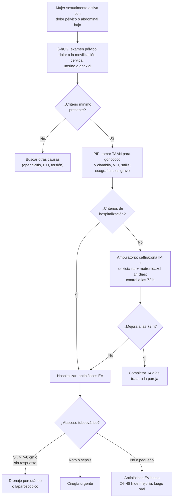

---
tags:
  - Ginecología y obstetricia
  - Urgencia
---

# Proceso inflamatorio pelviano, pelviperitonitis y absceso de la glándula de Bartolino

**Subespecialidad**
Ginecología · Infecciones ginecológicas

**Guías principales**
CDC 2021: guía de tratamiento de las ITS (enfermedad inflamatoria pélvica) · MINSAL 2016: Norma General Técnica N.° 187 de ITS

**Otras fuentes**
Revisión sistemática de tratamientos del quiste y absceso de Bartolino (Illingworth 2020) · Ver [ITS y sífilis](../infectologia/infecciones-de-transmision-sexual-y-sifilis.md), [dolor pélvico y torsión anexial](dolor-pelvico-dismenorrea-endometriosis-y-torsion-anexial.md), [abdomen agudo](../gastroenterologia/abdomen-agudo.md) y [sepsis](../infectologia/sepsis-y-shock-septico.md)

**GES**
No como problemas propios.

**EUNACOM**
3.01.1.025 Proceso inflamatorio pelviano (sospecha, inicial, derivar) · 3.01.2.018 Pelviperitonitis (sospecha, inicial, completo) · 3.01.2.002 Absceso de la glándula de Bartolino (específico, completo, completo)

**Revisado**
Octubre 2026

!!! abstract "Resumen en 60 segundos"
    - **Proceso inflamatorio pelviano (PIP)** o enfermedad inflamatoria pélvica (EIP): infección **ascendente** del tracto genital superior (**endometritis**, **salpingitis**, **absceso tuboovárico**, **pelviperitonitis**). Causas: ***C. trachomatis***, ***N. gonorrhoeae***, *M. genitalium* y flora **polimicrobiana** (anaerobios).
    - **Diagnóstico clínico** (CDC 2021): mujer sexualmente activa con dolor pélvico y **dolor a la movilización cervical**, **uterino** o **anexial** al tacto. **Umbral bajo**: tratar ante la sospecha. **β-hCG** siempre.
    - **Tratamiento ambulatorio**: **ceftriaxona 500 mg IM** + **doxiciclina 100 mg c/12 h** + **metronidazol 500 mg c/12 h** por **14 días**. Control a las **72 h**. Tratar a la(s) **pareja(s)**.
    - **Hospitalizar**: **absceso tuboovárico**, **embarazo**, compromiso general, vómitos, fiebre alta, **duda diagnóstica** quirúrgica (apendicitis, ectópico) o falla del tratamiento oral.
    - **Pelviperitonitis**: peritonitis limitada a la pelvis; **hospitalizar**, antibióticos EV y **cirugía** si hay absceso roto o no responde.
    - **Absceso tuboovárico**: antibióticos EV; **drenaje** (percutáneo guiado o laparoscópico) si mide **> 7–8 cm** o no responde en 48–72 h; **cirugía urgente si se rompe**.
    - **Secuelas**: **infertilidad** tubaria, **embarazo ectópico** y **dolor pélvico crónico**.
    - **Absceso de Bartolino**: masa **dolorosa, fluctuante**, en la parte **posterior del labio mayor** (a las 4 u 8). Tratamiento: **drenaje** con **catéter de Word** o **marsupialización** (no la incisión simple, que recurre). Biopsia en las mayores de **40 años**.

## Definición

- **PIP (EIP)**: síndrome clínico de **infección** del tracto genital **superior** femenino, por ascenso de microorganismos desde el cuello y la vagina. Incluye cualquier combinación de:
    - **Endometritis**.
    - **Salpingitis** (la lesión central).
    - **Absceso tuboovárico**.
    - **Pelviperitonitis**.
    - **Perihepatitis** (síndrome de **Fitz-Hugh-Curtis**).
- **Pelviperitonitis**: inflamación del **peritoneo pélvico**, en general secundaria a una PIP, a una complicación posaborto o puerperal, o a una apendicitis perforada.
- **Absceso tuboovárico**: colección purulenta que compromete la trompa y el ovario.
- **Bartolinitis**: infección de la **glándula de Bartolino** (glándulas vestibulares mayores, a ambos lados del introito, con su conducto a las 4 y 8 del reloj).
    - **Quiste de Bartolino**: obstrucción del conducto con acumulación de moco (no infectado).
    - **Absceso de Bartolino**: infección de la glándula o del quiste.

## Epidemiología

### Mundial

- La PIP afecta sobre todo a mujeres **jóvenes** (15–25 años) sexualmente activas.
- Tras **un episodio** de PIP: ~ **10–20 %** de infertilidad tubaria, mayor riesgo de **embarazo ectópico** (6–10 veces) y **dolor pélvico crónico** (~ 30 %). El riesgo de infertilidad sube con cada episodio.
- ~ **15–30 %** de las mujeres hospitalizadas por PIP tiene un **absceso tuboovárico**.
- **Bartolino**: el **2 %** de las mujeres desarrolla un quiste o absceso en su vida; más frecuente entre los **20 y 30 años**. El **carcinoma** de la glándula es raro (sobre todo después de los 40–50 años).

!!! chile "Datos nacionales"
    - La notificación de la **gonorrea** en Chile ha aumentado en los últimos años (informes anuales del MINSAL); la **clamidia** no es de notificación obligatoria y está subdiagnosticada (ver [ITS](../infectologia/infecciones-de-transmision-sexual-y-sifilis.md)).
    - La **Norma General Técnica N.° 187** (MINSAL 2016) regula la atención de las ITS en los **centros de ITS (UNACESS)** y la APS, con atención **gratuita** y **confidencial**, incluida la de los adolescentes.
    - La PIP no es GES, pero sus secuelas (infertilidad, ectópico) generan una carga importante; la **prevención** con condón y la **pesquisa de clamidia** en las jóvenes son medidas clave.

## Etiología

### PIP

| Agente | Comentarios |
|---|---|
| ***Chlamydia trachomatis*** | La causa más frecuente; a menudo **subclínica** ("PIP silente") y responsable de gran parte de la infertilidad |
| ***Neisseria gonorrhoeae*** | Cuadros más **agudos** y floridos |
| ***Mycoplasma genitalium*** | Causa creciente; resistencias a macrólidos |
| **Flora vaginal polimicrobiana** | **Anaerobios** (*Bacteroides*, *Prevotella*, *Peptostreptococcus*), *Gardnerella*, *E. coli*, estreptococos; asociada a la **vaginosis bacteriana**; predominan en el **absceso tuboovárico** |
| ***Actinomyces*** | Asociado al uso prolongado de **DIU** |
| **Tuberculosis genital** | Rara; infertilidad, en zonas endémicas |

**Factores de riesgo:**

- **Edad < 25 años**, **múltiples parejas** o pareja nueva, **pareja con ITS**, antecedente de **PIP** o de ITS, no uso de **condón**.
- **Instrumentación** del útero: **inserción de DIU** (riesgo solo en las **3 primeras semanas**), histerosalpingografía, legrado, aborto.
- Vaginosis bacteriana.
- **Protectores**: condón, anticonceptivos hormonales (moco cervical más espeso).

### Bartolinitis

- **Polimicrobiana**: *E. coli* y otras enterobacterias, *S. aureus*, estreptococos, **anaerobios**. Rara vez *N. gonorrhoeae* o *C. trachomatis*.

## Fisiopatología

- Los microorganismos **ascienden** desde el cuello por el endometrio hasta las **trompas** y el peritoneo, facilitados por la **menstruación** (pérdida del tapón mucoso, reflujo), la instrumentación y la vaginosis.
- La inflamación de las trompas produce **daño ciliar**, **adherencias**, **obstrucción** y **hidrosálpinx**: la base de la infertilidad y del ectópico.
- La extensión a la cápsula hepática da la **perihepatitis** (adherencias en "cuerdas de violín").
- **Bartolino**: la **obstrucción** del conducto (por inflamación, trauma, moco espeso) acumula secreción (**quiste**); la infección forma un **absceso**.

## Clasificación

### Gravedad de la PIP (clasificación clínica clásica, Monif)

| Grado | Características | Manejo |
|---|---|---|
| **I** (leve) | Sin masa anexial ni signos peritoneales | Ambulatorio |
| **II** (moderada) | **Masa anexial** o **pelviperitonitis**, sin peritonitis difusa | Hospitalizado |
| **III** (grave) | **Absceso tuboovárico roto** o **peritonitis difusa**, sepsis | Hospitalizado, cirugía |

## Clínica

- **PIP**:
    - **Dolor abdominal bajo** o pélvico, bilateral, de inicio a menudo **durante o después de la menstruación**.
    - **Flujo vaginal** anormal, **sangrado** intermenstrual o poscoital, dispareunia, disuria.
    - **Fiebre** (no siempre; < 50 %).
    - Examen: **dolor a la movilización cervical**, **dolor uterino o anexial**, **flujo mucopurulento** cervical, cuello friable. **Masa anexial** si hay absceso.
    - **Fitz-Hugh-Curtis**: dolor en el **hipocondrio derecho** pleurítico.
- **Pelviperitonitis**: dolor abdominal bajo intenso, **defensa** y **rebote** en el hipogastrio, fiebre, taquicardia, íleo, compromiso del estado general.
- **Absceso tuboovárico**: fiebre persistente, masa anexial dolorosa; si se **rompe**, **peritonitis difusa** y **shock séptico**.
- **Absceso de Bartolino**: aumento de volumen **doloroso**, **unilateral**, en el **tercio posterior del labio mayor**, con eritema, calor y **fluctuación**; dificultad para caminar o sentarse, dispareunia; a veces fiebre. El quiste es indoloro.

!!! alarma "Signos de alarma"
    - **Peritonitis difusa**, hipotensión, taquicardia → **absceso tuboovárico roto** o sepsis: cirugía urgente.
    - **β-hCG positiva** con dolor pélvico → descartar un **embarazo ectópico** antes de diagnosticar PIP.
    - **PIP con DIU** que no mejora → retirar el DIU; pensar en *Actinomyces*.
    - **Masa de Bartolino en una mujer de más de 40 años** o recurrente, sólida o indurada → **biopsia** (carcinoma).
    - **Celulitis extensa** o **fascitis necrosante** vulvar (diabéticas) → urgencia quirúrgica.

## Diagnóstico

!!! guia "Puntos clave (CDC 2021)"
    - **Criterio mínimo**: mujer sexualmente activa con dolor pélvico o abdominal bajo, sin otra causa evidente, y **uno o más** de: **dolor a la movilización cervical**, **dolor uterino** o **dolor anexial** al examen bimanual. Con eso se **trata empíricamente** (el retraso del tratamiento aumenta las secuelas).
    - **Criterios adicionales** (aumentan la especificidad): **fiebre > 38,3 °C**, **flujo mucopurulento** cervical o friabilidad, **abundantes leucocitos** en el examen al fresco del flujo, **VHS o PCR elevadas**, infección documentada por **gonococo o clamidia**.
    - **Criterios definitivos**: **biopsia endometrial** con endometritis, **ecografía o RM** con trompas engrosadas llenas de líquido o **absceso tuboovárico**, o **laparoscopía** con salpingitis.
    - **Siempre**: **β-hCG**, **TAAN (PCR)** para gonococo y clamidia (y *M. genitalium* si está disponible), **VIH** y **sífilis**.
    - **Bartolino**: diagnóstico **clínico**.

### Criterios de hospitalización (CDC 2021)

- No se puede descartar una **urgencia quirúrgica** (apendicitis, ectópico).
- **Absceso tuboovárico**.
- **Embarazo**.
- **Enfermedad grave**: náuseas y vómitos, **fiebre alta**, compromiso del estado general.
- **Intolerancia** o **falla** del tratamiento oral (sin mejoría a las 72 h).

## Laboratorio

- **β-hCG**.
- **Hemograma**, **PCR** y VHS.
- **TAAN** (PCR) de flujo endocervical o vaginal para ***N. gonorrhoeae*** y ***C. trachomatis***; cultivo del gonococo si se sospecha resistencia.
- **Examen al fresco** del flujo (leucocitos, vaginosis, tricomonas).
- **VIH**, **VDRL o RPR**, serología de hepatitis B.
- **Orina completa y urocultivo** (diferencial).
- **Hemocultivos** si hay sepsis.
- **Cultivo del pus** de Bartolino (opcional; útil en recurrencias o si se sospecha una ITS o SARM).

## Imágenes

- **Ecografía transvaginal**: **absceso tuboovárico** (masa compleja multilocular con detritus), **hidrosálpinx** o **piosálpinx** (trompa dilatada con contenido, signo de la "rueda dentada"), líquido libre. Indicada en la PIP **grave**, con masa palpable o **sin respuesta** al tratamiento.
- **TC de abdomen y pelvis**: duda diagnóstica (apendicitis, diverticulitis), extensión del absceso, guía del drenaje percutáneo.

## Diagnóstico diferencial

| Cuadro | Claves |
|---|---|
| **Embarazo ectópico** | **β-hCG positiva** |
| **Apendicitis** | Dolor que migra a la fosa ilíaca derecha, unilateral, anorexia; síntomas digestivos antes que la fiebre |
| **Torsión anexial** | Dolor súbito, unilateral, vómitos, masa |
| **Quiste ovárico roto o hemorrágico** | Dolor súbito, mitad o segunda mitad del ciclo, sin fiebre |
| **Endometriosis** | Dolor cíclico crónico, dispareunia |
| **ITU y pielonefritis** | Disuria, puño percusión, sedimento |
| **Diverticulitis** | Mayores, fosa ilíaca izquierda |
| **Quiste de Bartolino** vs. **absceso** | Indoloro vs. doloroso y fluctuante |
| **Otras masas vulvares** | Quiste de Skene (periuretral), quiste de inclusión, lipoma, hidradenitis, **carcinoma** de Bartolino o vulvar |

## Tratamiento

### PIP ambulatoria (CDC 2021)

- **Ceftriaxona 500 mg IM** dosis única (**1 g** si pesa ≥ 150 kg).
- **+ Doxiciclina 100 mg VO cada 12 h por 14 días**.
- **+ Metronidazol 500 mg VO cada 12 h por 14 días** (cubre los anaerobios y la vaginosis).
- **Control a las 72 h**: si no mejora (fiebre, dolor, sensibilidad), **hospitalizar** y reevaluar (ecografía, cirugía).
- **Abstinencia sexual** hasta completar el tratamiento y que la pareja esté tratada.
- **Parejas** de los últimos **60 días**: tratar empíricamente para **gonococo y clamidia**.
- **DIU**: **no es necesario retirarlo** si la paciente mejora a las 48–72 h; retirarlo si no hay mejoría.
- **Repetir el estudio** de gonococo y clamidia a los **3 meses** (reinfección).

### PIP hospitalizada (CDC 2021)

| Esquema | Dosis |
|---|---|
| **Ceftriaxona + doxiciclina + metronidazol** (preferido) | Ceftriaxona **1 g EV cada 24 h** + doxiciclina **100 mg VO o EV cada 12 h** + metronidazol **500 mg VO o EV cada 12 h** |
| **Cefoxitina o cefotetán + doxiciclina** | Cefoxitina 2 g EV cada 6 h + doxiciclina 100 mg cada 12 h |
| **Clindamicina + gentamicina** (alternativa, útil en alérgicas a la penicilina) | Clindamicina **900 mg EV cada 8 h** + gentamicina **5 mg/kg/día EV** |

- Pasar a la **vía oral** a las **24–48 h** de mejoría clínica y completar **14 días** (doxiciclina + metronidazol).
- En el **embarazo**: hospitalizar y tratar EV (sin doxiciclina; usar el esquema con betalactámico y azitromicina, o clindamicina-gentamicina según el especialista).

### Absceso tuboovárico

- **Hospitalizar**, **antibióticos EV** (el esquema con **metronidazol** o **clindamicina** por los anaerobios), observación estrecha **24–72 h**.
- **Drenaje** (percutáneo guiado por imágenes o laparoscópico) si mide **> 7–8 cm**, si **no responde** a las 48–72 h o en las **posmenopáusicas** (descartar una neoplasia).
- **Cirugía urgente** (laparoscopía o laparotomía, lavado, drenaje, anexectomía si es necesario) si se **rompe** o hay **sepsis**.

### Pelviperitonitis

- **Hospitalizar**, régimen cero, hidratación EV, **antibióticos EV** de amplio espectro (esquemas anteriores) y analgesia.
- **Cirugía** si hay **absceso** que no responde, **rotura**, **peritonitis difusa** o duda diagnóstica (apendicitis perforada).
- Buscar el origen: PIP, posaborto (restos), puerperal, apendicular.

### Absceso de la glándula de Bartolino

- **Quiste asintomático pequeño**: **observación**; baños de asiento.
- **Absceso**: **drenaje**.
    - **Catéter de Word** (sonda con balón que se deja **4–6 semanas** para epitelizar un nuevo conducto).
    - **Marsupialización** (suturar los bordes de la pared del quiste a la piel del vestíbulo): de elección en las **recurrencias**.
    - La **incisión y drenaje simple** tiene **alta recurrencia**; se acepta como medida temporal si no hay otra opción.
    - Ambos métodos tienen resultados similares (Illingworth 2020).
- **Antibióticos** solo si hay **celulitis** extensa, inmunosupresión, embarazo, recurrencia o sospecha de ITS (por ejemplo, amoxicilina-ácido clavulánico, o según el cultivo).
- **Analgesia** y **baños de asiento** tibios.
- **> 40 años**, masa sólida o recurrente: **biopsia** o **escisión** de la glándula (carcinoma).

!!! dosis "Fármacos habituales"
    | Fármaco | Dosis | Comentarios |
    |---|---|---|
    | **Ceftriaxona** | **500 mg IM** dosis única (ambulatorio); **1 g EV cada 24 h** (hospitalizado) | Cubre el gonococo |
    | **Doxiciclina** | **100 mg VO cada 12 h × 14 días** | Clamidia. Contraindicada en el embarazo. Fotosensibilidad, esofagitis (tomar con agua, de pie) |
    | **Metronidazol** | **500 mg VO cada 12 h × 14 días** | Anaerobios, vaginosis. Efecto antabus con el alcohol |
    | **Clindamicina + gentamicina** | **900 mg EV cada 8 h** + **5 mg/kg/día EV** | Alternativa hospitalizada |
    | **Amoxicilina-ácido clavulánico** | **875/125 mg VO cada 12 h × 7 días** | Bartolinitis con celulitis |
    | **Azitromicina** | **1 g VO** dosis única (pareja con clamidia si no puede usar doxiciclina; embarazo) | Alternativa a la doxiciclina en algunos casos |

!!! alarma "Urgencia"
    - **Absceso tuboovárico roto** o **peritonitis difusa**: reanimación, antibióticos EV en la primera hora y **cirugía urgente**.
    - Toda PIP que **no mejora en 72 h** de tratamiento oral: hospitalizar y buscar un absceso.

## Complicaciones

- **Agudas**: **absceso tuboovárico**, **pelviperitonitis**, **peritonitis difusa**, **sepsis**, perihepatitis (Fitz-Hugh-Curtis), trombosis de la vena ovárica.
- **Crónicas (secuelas)**:
    - **Infertilidad** por factor tubario (~ 10–20 % tras un episodio; mayor con cada recurrencia).
    - **Embarazo ectópico** (riesgo 6–10 veces mayor).
    - **Dolor pélvico crónico** (adherencias, hidrosálpinx).
    - **Recurrencia** de la PIP (~ 25 %).
- **Bartolino**: recurrencia, celulitis, fístula, dispareunia; rara vez fascitis necrosante.

## Pronóstico y seguimiento

- El pronóstico depende de la **precocidad** del tratamiento: tratar ante la sospecha reduce las secuelas.
- **Control** a las 72 h, y **reestudio** de gonococo y clamidia a los **3 meses**.
- **Consejería**: uso de **condón**, tamizaje de ITS, tratamiento de las parejas, vacunas (VPH, hepatitis B).
- **Futuro reproductivo**: ante la infertilidad tras una PIP, estudiar la **permeabilidad tubaria**; ante un embarazo, **ecografía precoz** (riesgo de ectópico).

## Perlas para el internado

!!! perla "Para recordar en la sala"
    - **Dolor pélvico + dolor a la movilización cervical** en una mujer sexualmente activa = **PIP** hasta demostrar lo contrario; **tratar empíricamente**.
    - **β-hCG siempre** antes de diagnosticar una PIP.
    - Esquema ambulatorio CDC 2021: **ceftriaxona 500 mg IM + doxiciclina + metronidazol × 14 días**.
    - **Control a las 72 h**; si no mejora, hospitalizar y buscar un **absceso**.
    - **Tratar a la pareja** (últimos 60 días).
    - **Absceso tuboovárico > 7–8 cm** o sin respuesta → **drenaje**; **roto** → cirugía.
    - **Absceso de Bartolino**: masa dolorosa en el **labio mayor posterior** → **catéter de Word** o **marsupialización**; biopsia si tiene **> 40 años**.

## Preguntas de repaso

??? repaso "1. Mujer de 20 años, con pareja nueva, consulta por dolor hipogástrico de 3 días, flujo y fiebre de 38 °C. Dolor a la movilización cervical y anexial bilateral. β-hCG negativa, sin masa en la ecografía, tolera la vía oral. ¿Manejo?"
    - **PIP** sin criterios de hospitalización.
    - **Ceftriaxona 500 mg IM** + **doxiciclina 100 mg c/12 h** + **metronidazol 500 mg c/12 h** por **14 días**.
    - TAAN para gonococo y clamidia, VIH y sífilis; **control a las 72 h**; tratar a la pareja; abstinencia hasta terminar.

??? repaso "2. La misma paciente vuelve a las 72 horas con más dolor y fiebre de 39 °C. La ecografía muestra una masa anexial compleja de 8 cm. ¿Qué hace?"
    - **Absceso tuboovárico** con falla del tratamiento ambulatorio.
    - **Hospitalizar**, **antibióticos EV** (ceftriaxona + doxiciclina + metronidazol, o clindamicina + gentamicina).
    - **Drenaje** (percutáneo guiado o laparoscópico) por el tamaño (> 7–8 cm); cirugía urgente si se rompe.

??? repaso "3. Mujer con PIP que presenta dolor en el hipocondrio derecho que aumenta con la respiración, con pruebas hepáticas normales. ¿Qué es?"
    - **Síndrome de Fitz-Hugh-Curtis** (perihepatitis por clamidia o gonococo).
    - Se trata igual que la PIP.

??? repaso "4. Mujer de 28 años con aumento de volumen muy doloroso en la parte posterior del labio mayor izquierdo hace 3 días, fluctuante. ¿Diagnóstico y tratamiento?"
    - **Absceso de la glándula de Bartolino**.
    - **Drenaje** con **catéter de Word** (o marsupialización), analgesia y baños de asiento. Antibióticos solo si hay celulitis importante o factores de riesgo.

??? repaso "5. Mujer de 56 años con una masa indurada y poco dolorosa en la zona de la glándula de Bartolino. ¿Qué hace?"
    - En mayores de **40 años** o con masa sólida, sospechar un **carcinoma** de la glándula de Bartolino.
    - **Biopsia** o **escisión** de la glándula; no basta con drenar.

??? repaso "6. Usuaria de DIU de cobre con diagnóstico de PIP leve. ¿Hay que retirar el DIU?"
    - **No es necesario** de entrada (CDC 2021): tratar y controlar.
    - Retirarlo si **no mejora** a las 48–72 h. El riesgo de PIP por el DIU se concentra en las primeras 3 semanas tras la inserción.

## Referencias

1. Workowski KA, Bachmann LH, Chan PA, et al. Sexually transmitted infections treatment guidelines, 2021. *MMWR Recomm Rep.* 2021;70(4):1–187. doi:[10.15585/mmwr.rr7004a1](https://doi.org/10.15585/mmwr.rr7004a1)
2. Ministerio de Salud de Chile. Norma General Técnica N.° 187 de profilaxis, diagnóstico y tratamiento de las infecciones de transmisión sexual (ITS). Santiago: MINSAL; 2016. [diprece.minsal.cl](https://diprece.minsal.cl/wrdprss_minsal/wp-content/uploads/2014/11/NORMA-GRAL.-TECNICA-N%C2%B0-187-DE-PROFILAXIS-DIAGNOSTICO-Y-TRATAMIENTO-DE-LAS-ITS.pdf)
3. Illingworth B, Stocking K, Showell M, et al. Evaluation of treatments for Bartholin's cyst or abscess: a systematic review. *BJOG.* 2020;127(6):671–678. doi:[10.1111/1471-0528.16079](https://doi.org/10.1111/1471-0528.16079)
