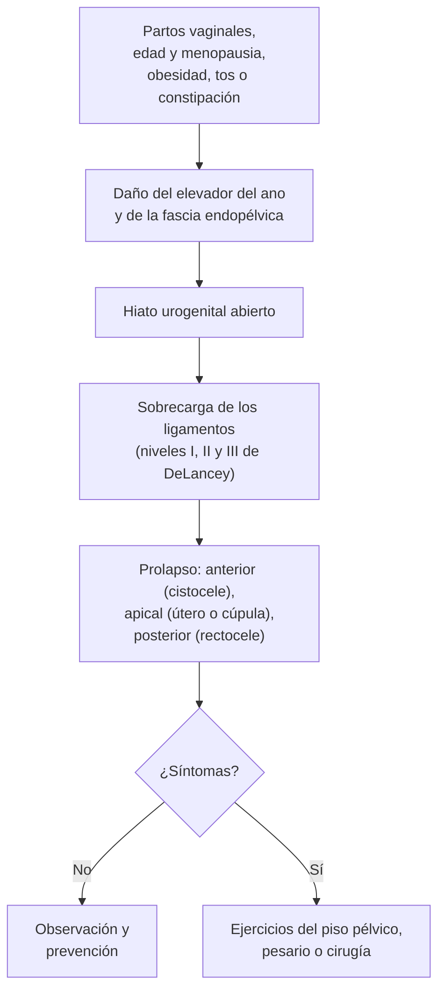

---
tags:
  - Ginecología y obstetricia
---

# Prolapso genital (prolapso de órganos pélvicos)

**Subespecialidad**
Ginecología · Uroginecología y piso pélvico

**Guías principales**
ACOG 2019: prolapso de órganos pélvicos (PB 214) · IUGA/ICS 2016: terminología del prolapso de órganos pélvicos · Sistema POP-Q (Bump 1996)

**Otras fuentes**
Ver [incontinencia urinaria](../geriatria/incontinencia-urinaria.md), [constipación](../gastroenterologia/constipacion-intestino-irritable-y-diarrea-cronica.md), [climaterio y menopausia](../endocrinologia/climaterio-y-menopausia.md) y [trabajo de parto](trabajo-de-parto-distocias-y-sufrimiento-fetal.md)

**GES**
No como problema propio.

**EUNACOM**
3.01.1.026 Prolapso genital (sospecha, inicial, derivar)

**Revisado**
Octubre 2026

!!! abstract "Resumen en 60 segundos"
    - **Prolapso genital**: descenso de la pared vaginal anterior (vejiga: **cistocele**), posterior (recto: **rectocele**), del **útero** (**histerocele**) o de la cúpula vaginal tras una histerectomía, por **falla del soporte** del piso pélvico.
    - **Muy frecuente**: hasta la mitad de las multíparas tiene algún grado al examen, pero solo **3–6 %** tiene **síntomas**. Riesgo de cirugía de por vida ~ **1 de cada 8–10** mujeres.
    - Factores: **partos vaginales** (el principal), **edad** y **menopausia**, **obesidad**, **aumento crónico de la presión abdominal** (tos, constipación, esfuerzos), alteraciones del colágeno, histerectomía previa.
    - **Síntoma clave**: **sensación de bulto** o peso vaginal ("algo que sale"), que empeora de pie y al final del día. Además, síntomas **urinarios** (incontinencia, vaciamiento incompleto, necesidad de **reducir** el prolapso para orinar), **defecatorios** y sexuales.
    - **Diagnóstico clínico**: examen en **posición de litotomía y de pie** con **Valsalva**; clasificación **POP-Q** (estadios 0–IV).
    - **Tratamiento** solo si hay **síntomas**:
        - **Conservador**: **ejercicios del piso pélvico** (Kegel), control del peso, de la tos y de la constipación, **estrógenos vaginales**.
        - **Pesario**: alternativa eficaz a cualquier edad.
        - **Cirugía**: **reconstructiva** (colporrafia, histerectomía vaginal, suspensión al ligamento sacroespinoso o uterosacro, **sacrocolpopexia**) u **obliterativa** (**colpocleisis**) en mujeres mayores sin actividad sexual.
    - **Derivar** a ginecología o uroginecología.

## Definición

- **Prolapso de órganos pélvicos (POP)**: **descenso** de una o más de: la **pared vaginal anterior**, la **pared vaginal posterior**, el **útero** (cuello) o la **cúpula vaginal** (tras una histerectomía), que se correlaciona con **síntomas** (IUGA/ICS 2016).
- Términos clásicos según el órgano que desciende:
    - **Cistocele**: vejiga (pared anterior). **Uretrocele**: uretra.
    - **Rectocele**: recto (pared posterior). **Enterocele**: asas intestinales en el fondo de saco de Douglas (pared posterior alta o cúpula).
    - **Histerocele** o **prolapso uterino**; **procidencia** o **prolapso total**: útero completamente fuera del introito.
    - **Prolapso de cúpula vaginal**: tras una histerectomía.
- **Prolapso sintomático**: el que causa molestias; el hallazgo anatómico **sin síntomas** no requiere tratamiento.

## Epidemiología

### Mundial

- Al **examen**, ~ **40–50 %** de las mujeres multíparas tiene algún grado de prolapso.
- **Sintomático**: **3–6 %** de las mujeres.
- **Riesgo de cirugía** por prolapso o incontinencia de por vida: ~ **11–20 %**; **~ 30 %** de las operadas requiere otra cirugía.
- Más frecuente con la **edad**: aumentará con el envejecimiento de la población.

!!! chile "Datos nacionales"
    - El prolapso genital es una de las indicaciones más frecuentes de **cirugía ginecológica** en la mujer mayor en Chile; no tiene GES propio y se resuelve en las listas de espera quirúrgica de ginecología.
    - El **envejecimiento** de la población chilena aumenta la demanda de atención de **piso pélvico** (prolapso e incontinencia).
    - El **pesario** y la **kinesiología de piso pélvico** son alternativas disponibles en la red pública y privada.

## Etiología

| Factor | Mecanismo |
|---|---|
| **Partos vaginales** (el principal; el riesgo aumenta con cada parto) | **Lesión** del músculo **elevador del ano** (avulsión), de la fascia y del nervio pudendo |
| **Parto instrumental**, **macrosomía**, expulsivo prolongado | Mayor daño del piso pélvico |
| **Edad** y **menopausia** | Pérdida de **estrógenos** y del colágeno, atrofia muscular |
| **Obesidad** | Aumento de la presión intraabdominal |
| **Aumento crónico de la presión abdominal** | **Tos crónica** (EPOC, tabaco), **constipación** y pujo, levantar peso |
| **Alteraciones del tejido conectivo** | Síndromes de **Marfan** y **Ehlers-Danlos**, hernias, várices |
| **Histerectomía** previa | Prolapso de cúpula (si no se fijó bien) |
| **Genética y raza** | Antecedente familiar; más en mujeres blancas e hispanas |

- La **cesárea** reduce pero **no elimina** el riesgo (el embarazo por sí mismo también influye).

## Fisiopatología

El soporte de los órganos pélvicos depende de dos sistemas que trabajan juntos:

1. **Muscular**: el **músculo elevador del ano** (pubococcígeo, iliococcígeo, puborrectal), con tono constante, mantiene **cerrado el hiato urogenital**.
2. **Conectivo**: **fascia endopélvica** y ligamentos (**uterosacros** y **cardinales**), organizados en **tres niveles de DeLancey**:
    - **Nivel I** (suspensión apical): uterosacros y cardinales → su falla produce **prolapso uterino o de cúpula**.
    - **Nivel II** (fijación lateral): a los arcos tendíneos → su falla produce **cistocele** y **rectocele**.
    - **Nivel III** (fusión distal): al cuerpo perineal y la membrana perineal → su falla produce **uretrocele** y defectos del periné.

Cuando el músculo se daña (parto), el hiato queda abierto y los ligamentos soportan toda la carga; con el tiempo se estiran y los órganos descienden.

## Clasificación

### POP-Q (*Pelvic Organ Prolapse Quantification*; ICS)

Se mide la posición de puntos de las paredes vaginales y del cuello en **centímetros respecto del himen** (negativo: por encima; positivo: por debajo), durante el **Valsalva** máximo.

| Estadio | Definición |
|---|---|
| **0** | Sin prolapso |
| **I** | La parte más distal está **> 1 cm por encima** del himen |
| **II** | La parte más distal está **entre 1 cm por encima y 1 cm por debajo** del himen |
| **III** | La parte más distal está **> 1 cm por debajo** del himen, pero sin eversión completa |
| **IV** | **Eversión completa** de la vagina (**procidencia**) |

- El síntoma de **bulto** se correlaciona mejor con el prolapso que llega **al himen o lo sobrepasa** (estadio ≥ II).
- La clasificación clásica de **Baden-Walker** (grados 0–4 según la relación con el himen) aún se usa en la práctica.

## Clínica

- **Síntomas vaginales**:
    - **Sensación de bulto**, peso o "**algo que sale**" por la vagina (el síntoma más específico).
    - Empeora **de pie**, con esfuerzos y al **final del día**; mejora acostada.
    - **Sangrado** o **flujo** por **úlceras** del cuello o la vagina expuestos (procidencia).
- **Síntomas urinarios**:
    - **Incontinencia de esfuerzo** (o **oculta**: aparece al reducir el prolapso).
    - Urgencia, polaquiuria.
    - **Dificultad para orinar**, chorro débil, **vaciamiento incompleto**, **necesidad de reducir el prolapso con los dedos para orinar**; **retención** e **infecciones urinarias** recurrentes.
- **Síntomas defecatorios**: **constipación**, **pujo** excesivo, sensación de evacuación incompleta, **digitación** (presionar la pared vaginal posterior o el periné para defecar), incontinencia fecal.
- **Síntomas sexuales**: dispareunia, sensación de laxitud, disminución de la satisfacción.
- **Examen**:
    - **Inspección** en reposo y con **Valsalva**, en **litotomía** y **de pie** si no se reproduce el síntoma.
    - **Espéculo de una valva** para separar y examinar cada pared.
    - Evaluar **atrofia**, úlceras, **contracción del piso pélvico** (escala de Oxford), **residuo posmiccional**.
    - **Prueba de esfuerzo** con el prolapso reducido (incontinencia oculta).

!!! alarma "Signos de alarma"
    - **Retención urinaria** o **hidronefrosis** (prolapsos grandes que acodan los uréteres) → derivación prioritaria.
    - **Úlcera** del cuello o la vagina que **no cicatriza** con estrógenos y pesario retirado → **biopsia** (descartar cáncer).
    - **Prolapso irreductible**, edematoso o con **necrosis** → urgencia.
    - **Evisceración** vaginal (asas intestinales por la cúpula tras una histerectomía) → urgencia quirúrgica.

## Diagnóstico

!!! guia "Puntos clave (ACOG 2019; IUGA/ICS 2016)"
    - El diagnóstico es **clínico**: síntomas + examen con **Valsalva**. Describir el compartimento y el estadio (**POP-Q**).
    - **Evaluar la vejiga**: **residuo posmiccional** (ecografía o sonda), **orina completa y urocultivo** si hay síntomas, **prueba de esfuerzo** con el prolapso reducido (incontinencia oculta antes de la cirugía).
    - **Estudio urodinámico**: no es rutinario; útil si se planea cirugía y hay incontinencia o disfunción de vaciamiento.
    - **Imágenes**: no son necesarias de rutina. **Ecografía renal** si el prolapso es grande (hidronefrosis). Ecografía o RM del piso pélvico y defecografía en casos complejos.
    - Antes de una cirugía con conservación del útero: descartar **patología endometrial y cervical** (PAP, ecografía).

## Laboratorio

- **Orina completa y urocultivo** (ITU recurrente, síntomas urinarios).
- **Creatinina** si hay hidronefrosis o retención.
- Exámenes **preoperatorios** según la edad y la comorbilidad.

## Imágenes

- **Ecografía** del **residuo posmiccional** y **renal** (hidronefrosis en los prolapsos avanzados).
- **Ecografía transperineal o RM dinámica** del piso pélvico: avulsión del elevador, casos complejos o recurrentes.
- **Defecografía**: disfunción defecatoria compleja.

## Diagnóstico diferencial

| Cuadro | Claves |
|---|---|
| **Quiste de Gartner o de la pared vaginal** | Masa quística fija de la pared, no cambia con el Valsalva |
| **Divertículo uretral** | Masa suburetral, goteo posmiccional, dispareunia, secreción por la uretra al comprimir |
| **Mioma parido** o pólipo cervical | Masa que sale por el cuello, sangrado |
| **Elongación del cuello** (hipertrofia cervical) | Cuello largo con fondo uterino en posición normal |
| **Prolapso rectal** | Mucosa rectal por el ano (no por la vagina) |
| **Tumores vaginales o vulvares** | Lesión sólida, sangrante: biopsia |
| **Inversión uterina crónica** | Rara; antecedente obstétrico |

## Tratamiento

**Indicado solo si hay síntomas** (o complicaciones como retención o hidronefrosis). La elección depende de la **gravedad de los síntomas**, la **edad**, la **comorbilidad**, el **deseo de fertilidad** y la **actividad sexual**.

### Conservador

- **Ejercicios del piso pélvico** (Kegel), idealmente supervisados por **kinesiología**: mejoran los síntomas y pueden evitar la progresión en los prolapsos leves (estadios I–II).
- **Medidas generales**: **bajar de peso**, tratar la **tos crónica** (dejar de fumar) y la **constipación**, evitar levantar peso.
- **Estrógenos vaginales** en las posmenopáusicas con **atrofia** (mejoran el trofismo, preparan para el pesario o la cirugía, cicatrizan las úlceras).

### Pesario

- Dispositivo de silicona que se introduce en la vagina para **sostener** los órganos. Útil a **cualquier edad** y en **cualquier estadio**, sobre todo si:
    - Desea **evitar** o **posponer** la cirugía.
    - Tiene **alto riesgo quirúrgico**.
    - **Desea embarazo** o está **embarazada**.
- Tipos: **de anillo** (con o sin soporte; los más usados, permiten el coito) y de **relleno** (Gellhorn, cubo; prolapsos avanzados).
- **Éxito** ~ 60–80 % en el ajuste.
- **Cuidados**: retirarlo y lavarlo periódicamente (la paciente o el equipo cada 3–6 meses), **estrógenos vaginales**.
- **Complicaciones**: **flujo**, **erosiones** y úlceras, sangrado, expulsión, **incontinencia** de novo; raras: fístulas o impactación si se olvida.

### Cirugía

| Tipo | Técnicas | Indicación |
|---|---|---|
| **Reconstructiva vaginal** | **Colporrafia anterior** (cistocele), **colporrafia posterior** y perineorrafia (rectocele), **histerectomía vaginal** con **suspensión apical** (fijación al **ligamento sacroespinoso** o a los **uterosacros**), **histeropexia** (conserva el útero) | La mayoría de los prolapsos sintomáticos |
| **Reconstructiva abdominal** | **Sacrocolpopexia** (laparoscópica o robótica) con malla fijada al promontorio | Prolapso **apical** o de **cúpula**, recurrencias; mejor resultado anatómico a largo plazo |
| **Obliterativa** | **Colpocleisis** (cierre de la vagina; operación de **LeFort** con útero) | Mujeres **mayores**, con **comorbilidad**, **sin actividad sexual** vaginal futura; muy eficaz y de bajo riesgo |

- **Mallas transvaginales**: se **abandonaron** para el prolapso de la pared anterior (la FDA ordenó retirarlas del mercado estadounidense en **2019**) por erosión, dolor y dispareunia; las mallas abdominales (sacrocolpopexia) siguen en uso.
- **Incontinencia de esfuerzo** asociada u oculta: discutir una **cinta suburetral** concomitante.
- **Apoyo apical**: corregir siempre el compartimento apical si está comprometido (reduce las recurrencias).

!!! dosis "Fármacos y medidas habituales"
    | Intervención | Esquema | Comentarios |
    |---|---|---|
    | **Estriol** o **estradiol vaginal** | Estriol crema 0,5–1 mg o estradiol 10 µg (óvulo) cada noche por 2 semanas, luego **2–3 veces por semana** | Atrofia, úlceras, uso de pesario, preoperatorio |
    | **Ejercicios del piso pélvico** | **3 series de 8–12 contracciones** sostenidas (6–10 s) al día, por **al menos 3–6 meses** | Mejor con kinesiología supervisada |
    | **Pesario** | Ajuste por el profesional; control a las 1–2 semanas y luego cada 3–6 meses | Retirarlo si hay úlcera |
    | **Laxantes** (fibra, polietilenglicol) | Según la necesidad | Evitar el pujo |

!!! alarma "Urgencia"
    - **Prolapso irreductible o estrangulado** con edema o necrosis: reducción bajo analgesia, frío, posición de Trendelenburg; cirugía si no se logra.
    - **Retención urinaria aguda**: sondeo y reducción del prolapso.

## Complicaciones

- **Urinarias**: **retención**, **ITU recurrentes**, **hidronefrosis** e insuficiencia renal (procidencia), incontinencia.
- **Vaginales**: **úlceras** de decúbito, sangrado, infección.
- **Defecatorias**: constipación obstructiva, incontinencia fecal.
- **Calidad de vida** y sexualidad.
- **Quirúrgicas**: **recurrencia** (~ 30 %), **incontinencia de novo**, dispareunia, lesión vesical o ureteral, **erosión de malla**.

## Pronóstico y seguimiento

- El prolapso **no es una enfermedad grave**: puede quedar **estable** años, progresar lentamente o incluso regresar en los estadios leves.
- **Control** de los síntomas y del pesario; reevaluar si aparecen síntomas urinarios o defecatorios.
- Tras la cirugía, **evitar esfuerzos** por 6–12 semanas y mantener los ejercicios y el control del peso, la tos y la constipación.

## Perlas para el internado

!!! perla "Para recordar en la sala"
    - El síntoma clave es el **bulto vaginal** que empeora de pie; se trata **solo si molesta**.
    - **Partos vaginales** + **menopausia** + **obesidad** + **tos o constipación crónica** = prolapso.
    - Examinar con **Valsalva**, en litotomía **y de pie** si no se ve.
    - **POP-Q**: estadio II = la parte más distal a ± 1 cm del himen.
    - **"Reduzco el bulto para orinar"** → disfunción de vaciamiento: medir el **residuo** y buscar **hidronefrosis**.
    - **Pesario**: alternativa eficaz a cualquier edad; acompañarlo de **estrógenos vaginales**.
    - **Colpocleisis**: excelente opción en la adulta mayor sin actividad sexual.
    - **Úlcera** vaginal o cervical que no cicatriza → **biopsia**.

## Preguntas de repaso

??? repaso "1. Mujer de 62 años, multípara de 4 partos vaginales, con sensación de bulto vaginal que empeora en la tarde. Al Valsalva el cuello llega al himen. ¿Cómo lo clasifica y qué le ofrece?"
    - **Prolapso apical (uterino) POP-Q estadio II** (a ± 1 cm del himen) sintomático.
    - Opciones: **ejercicios del piso pélvico** + medidas generales, **pesario** con estrógenos vaginales, o **cirugía** (histerectomía vaginal con suspensión apical) según su preferencia.
    - Derivar a ginecología.

??? repaso "2. Mujer de 80 años con procidencia uterina, úlcera en el cuello y dificultad para orinar. No tiene actividad sexual y tiene cardiopatía. ¿Qué estudia y qué propone?"
    - **Residuo posmiccional**, orina y urocultivo, **ecografía renal** (hidronefrosis), creatinina.
    - **Estrógenos vaginales** y cuidado de la úlcera (biopsia si no cicatriza); **pesario** si lo tolera.
    - Cirugía definitiva de bajo riesgo: **colpocleisis** (LeFort).

??? repaso "3. ¿Qué factores de riesgo de prolapso se pueden modificar?"
    - **Obesidad** (bajar de peso), **tos crónica** (dejar de fumar, tratar la EPOC), **constipación** y pujo, **levantar peso**.
    - **Atrofia** genital (estrógenos vaginales) y **debilidad muscular** (ejercicios del piso pélvico).

??? repaso "4. Mujer de 45 años con un rectocele y necesidad de presionar la pared vaginal posterior para defecar. ¿Qué tratamiento es más adecuado si el manejo conservador fracasa?"
    - **Colporrafia posterior** con perineorrafia (cirugía reconstructiva vaginal).
    - Antes: fibra, laxantes, ejercicios del piso pélvico y biofeedback.

??? repaso "5. Mujer de 68 años con prolapso estadio III que va a cirugía. Sin incontinencia. ¿Qué debe evaluar antes?"
    - La **incontinencia de esfuerzo oculta**: prueba de esfuerzo con el prolapso **reducido** (puede aparecer tras corregirlo).
    - **Residuo posmiccional**, urocultivo, estado del endometrio y del cuello (si conserva el útero), comorbilidad.

??? repaso "6. Mujer de 35 años con cistocele sintomático que aún desea tener hijos. ¿Qué le ofrece?"
    - Manejo **conservador**: **ejercicios del piso pélvico** supervisados y/o **pesario**.
    - Diferir la **cirugía** hasta completar la paridad (los partos posteriores aumentan la recurrencia).

## Referencias

1. American College of Obstetricians and Gynecologists; American Urogynecologic Society. Pelvic organ prolapse: ACOG Practice Bulletin No. 214. *Obstet Gynecol.* 2019;134(5):e126–e142. doi:[10.1097/AOG.0000000000003519](https://doi.org/10.1097/AOG.0000000000003519)
2. Haylen BT, Maher CF, Barber MD, et al. An International Urogynecological Association (IUGA)/International Continence Society (ICS) joint report on the terminology for female pelvic organ prolapse (POP). *Int Urogynecol J.* 2016;27(4):655–684. doi:[10.1007/s00192-016-3003-y](https://doi.org/10.1007/s00192-016-3003-y)
3. Bump RC, Mattiasson A, Bø K, et al. The standardization of terminology of female pelvic organ prolapse and pelvic floor dysfunction. *Am J Obstet Gynecol.* 1996;175(1):10–17. doi:[10.1016/s0002-9378(96)70243-0](https://doi.org/10.1016/s0002-9378(96)70243-0)
