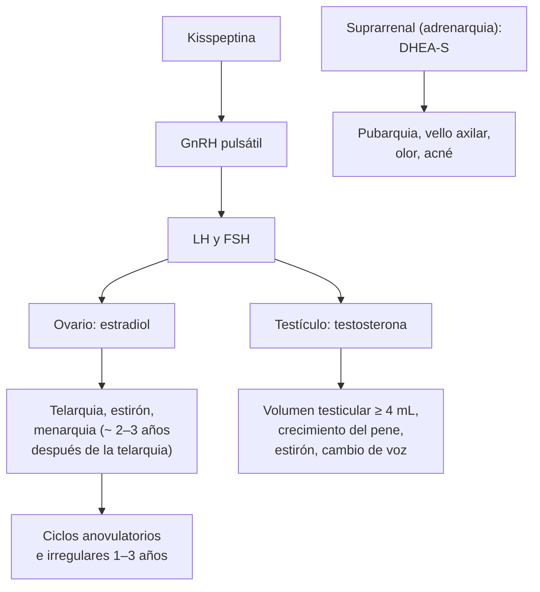

---
tags:
  - Ginecología y obstetricia
---

# Pubertad y adolescencia; sexualidad, género y diversidad

**Subespecialidad**
Ginecología infantojuvenil · Salud sexual y reproductiva

**Guías principales**
Estadios de Tanner (Marshall y Tanner 1969 y 1970) · Endocrine Society 2026: pubertad precoz central · ACOG 2015: el ciclo menstrual como signo vital en niñas y adolescentes (CO 651) · WPATH 2022: estándares de atención para personas trans y de género diverso (versión 8)

**Otras fuentes**
Ley 21.120 (identidad de género), Ley 20.609 (no discriminación), Ley 20.418 (regulación de la fertilidad) · Ver [amenorrea, hirsutismo y SOP](../endocrinologia/hirsutismo-amenorrea-y-ovario-poliquistico.md), [anticoncepción](anticoncepcion-y-metodos-naturales.md), [ITS](../infectologia/infecciones-de-transmision-sexual-y-sifilis.md), [dismenorrea](dolor-pelvico-dismenorrea-endometriosis-y-torsion-anexial.md), [sangrado uterino anormal](sangrado-uterino-anormal-miomas-y-patologia-endometrial.md), [trastornos de la conducta alimentaria](../endocrinologia/trastornos-de-la-conducta-alimentaria.md) y [depresión](../geriatria/depresion.md)

**GES**
No como problemas propios.

**EUNACOM**
3.01.3.011 Pubertad (adolescencia) · 3.01.3.014 Sexualidad, género y diversidad

**Revisado**
Octubre 2026

!!! abstract "Resumen en 60 segundos"
    - **Adolescencia** (OMS): de los **10 a los 19 años**. **Pubertad**: los cambios biológicos que llevan a la madurez sexual y la capacidad reproductiva.
    - **Secuencia en las niñas**: **telarquia** (8–13 años, primer signo) → pubarquia → **estirón** → **menarquia** (~ **2–3 años después** de la telarquia, edad media ~ 12 años).
    - **Secuencia en los niños**: **aumento del volumen testicular ≥ 4 mL** (9–14 años, primer signo) → pubarquia → crecimiento del pene → estirón (más tardío que en las niñas).
    - **Estadios de Tanner** (1–5) para mamas, vello púbico y genitales.
    - **Pubertad precoz**: antes de los **8 años** en niñas y de los **9** en niños. **Retrasada**: sin telarquia a los **13** o sin aumento testicular a los **14**. **Amenorrea primaria**: sin menarquia a los **15 años** (o 3 años después de la telarquia).
    - **Los primeros ciclos** suelen ser **anovulatorios e irregulares** (21–45 días); el **ciclo menstrual es un signo vital**.
    - **Control de salud integral del adolescente** en la APS (**HEADSSS**): hogar, educación, actividades, drogas, **sexualidad**, suicidio y ánimo, seguridad. **Confidencialidad**.
    - **Sexualidad**: dimensión integral (biológica, psicológica, social). Conceptos: **sexo asignado**, **identidad de género**, **expresión de género** y **orientación sexual** son **distintos**.
    - **Diversidad**: la orientación no heterosexual y las identidades trans **no son trastornos**. Las personas **LGBTIQ+** tienen más riesgo de **depresión, suicidio**, consumo y violencia por el **estigma** (estrés de minorías). Atención **respetuosa** (nombre y pronombres), **sin discriminación** (Ley 20.609) y reconocimiento legal de la identidad (Ley 21.120).

## Definición

- **Adolescencia** (OMS): período entre los **10 y 19 años**; **juventud**: 15–24 años.
    - **Temprana** (10–13), **media** (14–16) y **tardía** (17–19).
- **Pubertad**: proceso biológico de **maduración sexual** por la activación del eje **hipotálamo-hipófisis-gónada**.
    - **Gonadarquia**: activación gonadal (telarquia, aumento testicular).
    - **Adrenarquia**: activación de los andrógenos suprarrenales (pubarquia, olor axilar, acné).
- **Telarquia**: inicio del desarrollo mamario. **Pubarquia**: aparición del vello púbico. **Menarquia**: primera menstruación. **Espermarquia**: primera eyaculación.
- **Sexualidad** (OMS): aspecto central del ser humano que abarca el **sexo**, las **identidades y roles de género**, la **orientación sexual**, el erotismo, el placer, la intimidad y la reproducción.
- **Sexo asignado al nacer**: según los genitales externos.
- **Identidad de género**: vivencia interna del propio género (hombre, mujer, no binario u otra). **Cisgénero**: coincide con el sexo asignado; **trans**: no coincide.
- **Expresión de género**: cómo se manifiesta el género (vestimenta, conducta).
- **Orientación sexual**: atracción emocional, afectiva y sexual (heterosexual, homosexual, bisexual, asexual, otras).
- **Intersexualidad** (diferencias del desarrollo sexual): variaciones congénitas de las características sexuales.
- **Incongruencia de género** (CIE-11, en el capítulo de salud sexual, **no** en trastornos mentales); **disforia de género** (DSM-5-TR): malestar significativo por la incongruencia.

## Epidemiología

### Mundial

- La **edad de la menarquia** ha descendido en el último siglo (mejor nutrición, más obesidad) y hoy es de **~ 12–13 años** en la mayoría de los países.
- La **pubertad precoz** es **10 veces más frecuente en niñas** (en ellas suele ser **idiopática**; en los niños, más a menudo **orgánica**).
- Las **personas LGBTIQ+** tienen mayor prevalencia de **depresión, ansiedad, ideación suicida**, consumo de sustancias y **violencia**, explicada por el estigma y la discriminación.

!!! chile "Datos nacionales y normativa"
    - El **Programa Nacional de Salud Integral de Adolescentes y Jóvenes** del MINSAL incluye el **control de salud integral** en la APS (de **10 a 19 años**), con **ficha CLAP** y los **Espacios Amigables** para adolescentes.
    - **Ley 20.418** (2010): derecho a información y acceso a la **anticoncepción**, incluida la **de emergencia**, también para adolescentes.
    - **Ley 20.609** (2012, "Ley Zamudio"): establece medidas contra la **discriminación arbitraria**, incluida la basada en la **orientación sexual** y la **identidad de género**.
    - **Ley 21.120** (2018): reconoce el derecho a la **identidad de género** y permite **rectificar el nombre y el sexo registral**: las personas **mayores de 18 años** por vía administrativa, y las de **14 a 18 años** a través de los tribunales de familia con sus representantes legales.
    - **Ley 21.400** (2021): **matrimonio igualitario**.
    - **Edad de consentimiento sexual**: **14 años** en el Código Penal chileno; las relaciones sexuales con menores de 14 años son **delito** (violación de menor) y obligan a **denunciar**.

## Etiología

### Determinantes del inicio puberal

- **Genéticos** (~ 50–80 % de la variabilidad: edad de menarquia de la madre).
- **Nutricionales**: la **obesidad** adelanta la pubertad en las niñas; la **desnutrición**, el ejercicio intenso y las enfermedades crónicas la retrasan.
- **Ambientales**: disruptores endocrinos, estrés.

### Pubertad precoz

| Tipo | Mecanismo | Causas |
|---|---|---|
| **Central** (dependiente de gonadotrofinas) | Activación **precoz** del eje hipotálamo-hipófisis | **Idiopática** (> 80–90 % en niñas); **lesiones del SNC** (hamartoma hipotalámico, tumores, hidrocefalia, irradiación); genéticas (*MKRN3*, *KISS1*) |
| **Periférica** (independiente de gonadotrofinas) | Hormonas sexuales de origen gonadal, suprarrenal o exógeno | **Quistes o tumores ováricos** (granulosa), **tumores testiculares** (Leydig), **hiperplasia suprarrenal congénita**, tumores suprarrenales, **McCune-Albright**, **hormonas exógenas**, hipotiroidismo grave |
| **Variantes benignas** | Desarrollo aislado | **Telarquia precoz aislada** (lactantes), **pubarquia precoz aislada** (adrenarquia), menarquia precoz aislada |

### Pubertad retrasada

- **Retraso constitucional** del crecimiento y la pubertad (el más frecuente, sobre todo en varones; antecedente familiar).
- **Hipogonadismo hipogonadotrópico**: funcional (desnutrición, **TCA**, ejercicio intenso, enfermedad crónica, hipotiroidismo, hiperprolactinemia) u orgánico (Kallmann, tumores).
- **Hipogonadismo hipergonadotrópico**: **síndrome de Turner** (45,X), **Klinefelter** (47,XXY), falla gonadal por quimioterapia o radioterapia.

## Fisiopatología

- En la infancia el eje gonadal está **frenado**. Al inicio de la pubertad, la **kisspeptina** estimula la secreción **pulsátil de GnRH** (primero nocturna), que aumenta **LH y FSH** y, con ellas, el **estradiol** (ovario) o la **testosterona** (testículo).
- Los **primeros ciclos** son **anovulatorios** (falta la retroalimentación positiva del estradiol sobre la LH): de ahí los **ciclos irregulares** y los sangrados disfuncionales de la adolescencia. Se regularizan en **1–3 años**.
- El **estirón puberal** depende de los esteroides sexuales y la hormona de crecimiento; los **estrógenos** cierran las epífisis (también en los varones, por aromatización).

## Clasificación

### Estadios de Tanner

| Estadio | Mamas (niñas) | Vello púbico (ambos) | Genitales (niños) |
|---|---|---|---|
| **1** | Prepuberal | Sin vello | Prepuberal; volumen testicular < 4 mL |
| **2** | **Botón mamario** (telarquia) bajo la areola | Escaso, liso, en los labios mayores o la base del pene | **Aumento testicular (≥ 4 mL)** y enrojecimiento del escroto |
| **3** | Mama y areola crecen sin separación de contornos | Más oscuro y rizado, sobre el pubis | Crecimiento del pene en **longitud** |
| **4** | Areola y pezón forman una **elevación secundaria** | Tipo adulto, sin llegar a los muslos | Crecimiento del pene en **grosor**, glande |
| **5** | Mama adulta | Adulto, extendido a los muslos | Genitales adultos (testículos 15–25 mL) |

- **Menarquia**: en general en el **Tanner mamario 4**, ~ **2–3 años** después de la telarquia.
- **Estirón**: en las niñas **precoz** (Tanner 2–3); en los niños **tardío** (Tanner 3–4).

### Ciclo menstrual normal en la adolescencia (ACOG 2015)

| Parámetro | Normal |
|---|---|
| **Menarquia** | Edad media ~ **12–13 años**; **anormal** si es antes de los 9 o no ocurre a los **15** (o 3 años después de la telarquia) |
| **Intervalo** | **21–45 días** (los primeros años) |
| **Duración** | **≤ 7 días** |
| **Uso de toallas** | 3–6 al día |

## Clínica

### Control de salud integral del adolescente

- **Entrevista** con el adolescente **a solas** (después de una parte con el acompañante), explicando la **confidencialidad** y sus límites (riesgo vital, abuso).
- **HEADSSS**: **H**ogar, **E**ducación y empleo, **A**ctividades, **D**rogas (tabaco, alcohol, marihuana), **S**exualidad (inicio, parejas, anticoncepción, condón, ITS, **identidad y orientación**), **S**uicidio y salud mental (ánimo, autolesiones), **S**eguridad (violencia, *bullying*, abuso, redes sociales).
- **Examen**: peso, talla, **IMC**, **presión arterial**, **Tanner**, piel (acné), columna (escoliosis), **salud bucal**.
- **Prevención**: **vacunas** (VPH, dTpa), consejería en **alimentación y actividad física**, **anticoncepción** y **condón**, prevención del consumo y del suicidio.

### Problemas frecuentes en la adolescencia

- **Ginecológicos**: **ciclos irregulares**, **dismenorrea**, **sangrado uterino anormal** (anovulación; descartar **von Willebrand**), **amenorrea** (embarazo, SOP, TCA), **vulvovaginitis**, **ITS**, **embarazo adolescente**.
- **Mama**: asimetría, **fibroadenoma**; en varones, **ginecomastia puberal** (frecuente, transitoria).
- **Salud mental**: **depresión**, **ansiedad**, **autolesiones**, **suicidio**, **TCA**, consumo.
- **Violencia** sexual y en el pololeo.

### Sexualidad, género y diversidad en la consulta

- Preguntar con **lenguaje neutro e inclusivo** ("¿tienes pareja?", "¿con quién tienes relaciones?") sin asumir la heterosexualidad.
- Preguntar y usar el **nombre social** y los **pronombres** de la persona.
- La **orientación sexual** y la **identidad de género** son dimensiones **independientes**.
- En las personas **trans**: necesidades de **salud mental**, hormonización y cirugías de afirmación (por equipos especializados), **tamizaje** de cáncer según los órganos presentes (por ejemplo, PAP en hombres trans con cuello uterino), **anticoncepción** (la testosterona **no** es anticonceptiva).

!!! alarma "Signos de alarma"
    - **Pubertad precoz** (< 8 años en niñas, < 9 en niños), sobre todo en **niños** o con progresión rápida → derivar a endocrinología (descartar lesión del SNC o tumor).
    - **Ausencia de pubertad** a los 13 (niñas) o 14 (niños), o **amenorrea primaria** a los 15 años → estudio.
    - **Virilización** en una niña → tumor productor de andrógenos o hiperplasia suprarrenal.
    - **Ideación suicida**, autolesiones, consumo problemático → intervención y derivación de salud mental.
    - **Embarazo** o relaciones sexuales en una **menor de 14 años** → sospecha de **abuso sexual**: proteger y denunciar.
    - **Rechazo familiar, violencia o discriminación** en adolescentes LGBTIQ+ → mayor riesgo de suicidio; activar la red de apoyo.

## Diagnóstico

!!! guia "Puntos clave (Marshall y Tanner; Endocrine Society 2026; ACOG 2015; WPATH 2022)"
    - La pubertad se evalúa con los **estadios de Tanner** y la **curva de crecimiento** (velocidad de crecimiento).
    - **Pubertad precoz**: **edad ósea** (radiografía de mano izquierda; adelantada), **LH basal** como primer examen (la prueba de estimulación con análogo de GnRH ya no es de rutina), estradiol o testosterona, **ecografía pélvica** (útero y ovarios puberales) y **RM cerebral** en las formas centrales de las **niñas ≤ 6 años**, los **niños ≤ 7 años** o con **signos neurológicos** (Endocrine Society 2026).
    - **Endocrine Society 2026**: en las niñas con **telarquia entre los 7 y 8 años**, **observar** con examen físico cada **4–6 meses** antes de pedir exámenes. Si la telarquia aparece **antes de los 7 años**, observar también 4–6 meses para separar la pubertad lentamente progresiva (que suele llegar a una talla adulta normal sin tratamiento) de la rápidamente progresiva.
    - **Pubertad retrasada**: edad ósea (retrasada en el retraso constitucional), **LH, FSH**, estradiol o testosterona, **cariotipo** si las gonadotrofinas están altas (Turner, Klinefelter), TSH, prolactina, estudio de enfermedades crónicas y nutrición.
    - **Ciclo menstrual como signo vital**: preguntar siempre la edad de la menarquia y el patrón de los ciclos.
    - **Diversidad de género**: el diagnóstico **no es necesario** para la atención respetuosa; la evaluación para tratamientos de afirmación la hacen **equipos especializados** (WPATH 2022).

## Laboratorio

- **No** se piden exámenes de rutina en el adolescente sano.
- Según la situación: **β-hCG** (amenorrea, dolor pélvico), **hemograma y ferritina** (sangrado abundante), **estudio de von Willebrand**, **TSH**, **prolactina**, **andrógenos** (hirsutismo, acné grave), **LH, FSH, estradiol**.
- **Tamizaje de ITS** en adolescentes sexualmente activos: **clamidia** y gonococo (PCR en orina o flujo), **VIH**, **sífilis**.

## Imágenes

- **Edad ósea** (radiografía de mano y muñeca izquierda).
- **Ecografía pélvica** (abdominal en adolescentes vírgenes): útero, ovarios, malformaciones müllerianas (hematocolpos por **himen imperforado** en la amenorrea primaria con dolor cíclico).
- **RM cerebral** en la pubertad precoz central seleccionada y en el hipogonadismo hipogonadotrópico.

## Diagnóstico diferencial

| Situación | Considerar |
|---|---|
| **Telarquia antes de los 8 años** | Telarquia precoz aislada, pubertad precoz central o periférica, exposición a estrógenos |
| **Pubarquia precoz** | Adrenarquia prematura, **hiperplasia suprarrenal congénita** no clásica, tumor suprarrenal |
| **Amenorrea primaria con caracteres sexuales normales** | **Embarazo**, malformaciones müllerianas (**síndrome de Rokitansky**), **himen imperforado**, tabique vaginal, insensibilidad a los andrógenos |
| **Amenorrea primaria sin caracteres sexuales** | **Turner**, hipogonadismo hipogonadotrópico (TCA, Kallmann) |
| **Ciclos irregulares en la adolescente** | Anovulación fisiológica (1–3 años), **SOP**, TCA, hipotiroidismo, hiperprolactinemia, embarazo |
| **Malestar con el propio género** | Exploración de la identidad (normal en la adolescencia), **incongruencia de género**, trastornos psiquiátricos comórbidos (no la causan) |

## Tratamiento

### Adolescencia y pubertad

- **Pubertad precoz central**: **análogos de GnRH** de depósito (leuprolide, triptorelina) para frenar la progresión y preservar la talla final, por endocrinología pediátrica. Tratar la causa si es orgánica.
- **Pubertad precoz periférica**: tratar la causa (cirugía del tumor, corticoides en la hiperplasia suprarrenal).
- **Retraso constitucional**: **observación** y apoyo; dosis bajas de testosterona o estrógenos por un corto período si hay mucha angustia.
- **Hipogonadismo**: **terapia hormonal de reemplazo** para inducir la pubertad y proteger el hueso.
- **Ciclos irregulares fisiológicos**: **educación** y calendario menstrual; tratar si hay anemia o sangrado abundante (ver sangrado uterino anormal).
- **Dismenorrea**: AINE y anticonceptivos.
- **Anticoncepción**: **LARC** de primera línea, **condón** siempre (doble protección), anticoncepción de emergencia disponible (Ley 20.418).
- **Prevención**: vacuna **VPH**, consejería en sexualidad, prevención del consumo y la violencia.

### Sexualidad, género y diversidad

- **Atención afirmativa y sin discriminación**: usar el **nombre social** y los **pronombres**, confidencialidad, entorno seguro.
- **Educación sexual integral**: consentimiento, relaciones sanas, prevención de ITS y embarazo, diversidad.
- **Adolescentes trans o de género diverso**: acompañamiento psicosocial y familiar; derivación a **equipos especializados** para evaluar, según la edad y el desarrollo, el **bloqueo puberal** (análogos de GnRH) y la **hormonización** (WPATH 2022). Las cirugías genitales no se indican en menores de edad.
- **Personas trans adultas**: hormonización (estrógenos y antiandrógenos, o testosterona) con control de efectos adversos (trombosis con estrógenos, poliglobulia con testosterona), tamizajes según los órganos presentes, salud mental.
- **Salud mental**: pesquisar depresión, suicidio, consumo; **apoyo familiar** (el factor protector más potente).
- **Prevención combinada del VIH** en las poblaciones de mayor riesgo: condón, **PrEP**, tamizaje periódico.

!!! dosis "Fármacos habituales"
    | Fármaco | Uso | Comentarios |
    |---|---|---|
    | **Leuprolide de depósito** | Pubertad precoz central; bloqueo puberal en adolescentes trans (equipo especializado) | Reversible |
    | **Ibuprofeno** | Dismenorrea | 400 mg cada 6–8 h |
    | **Anticonceptivos** (implante, DIU, orales) | Anticoncepción en adolescentes | LARC de primera línea |
    | **Levonorgestrel 1,5 mg** | Anticoncepción de emergencia | Sin receta, cualquier edad |
    | **Vacuna VPH** | Prevención | Programa escolar (PNI) |

## Complicaciones

- **Pubertad precoz**: **talla baja final** (cierre epifisario precoz), problemas psicosociales, abuso.
- **Pubertad retrasada o hipogonadismo**: **osteoporosis**, talla, problemas psicosociales.
- **Adolescencia**: **embarazo adolescente** (más riesgo de parto prematuro, bajo peso, deserción escolar), **ITS**, **depresión y suicidio**, consumo, violencia.
- **Discriminación** de las personas LGBTIQ+: depresión, suicidio, abandono escolar, violencia, menor acceso a la atención de salud.

## Pronóstico y seguimiento

- La mayoría de las variaciones puberales son **normales** o benignas.
- **Control de salud integral** periódico del adolescente en la APS.
- Los adolescentes LGBTIQ+ con **apoyo familiar** y entornos seguros tienen resultados de salud mental similares a sus pares.

## Perlas para el internado

!!! perla "Para recordar en la sala"
    - **Primer signo puberal**: **telarquia** en las niñas; **volumen testicular ≥ 4 mL** en los niños.
    - **Menarquia** ~ **2–3 años** después de la telarquia (Tanner mamario 4).
    - **Precoz**: < 8 (niñas) / < 9 (niños). **Retrasada**: sin telarquia a los 13 / sin aumento testicular a los 14. **Amenorrea primaria**: 15 años.
    - Pubertad precoz en un **niño** = buscar una **causa orgánica** (RM).
    - Los **ciclos irregulares** los primeros 1–3 años son **normales** (anovulación).
    - **HEADSSS** y **confidencialidad** en la entrevista del adolescente.
    - **Sexo**, **identidad de género**, **expresión** y **orientación sexual** son cosas **distintas**.
    - Usar el **nombre social** y los **pronombres**; la diversidad **no** es un trastorno.
    - Relaciones sexuales con **menores de 14 años** = **delito**: proteger y denunciar.

## Preguntas de repaso

??? repaso "1. Niña de 7 años con botón mamario bilateral y aceleración del crecimiento en el último año. ¿Qué hace?"
    - **Pubertad precoz** (telarquia < 8 años con progresión).
    - **Edad ósea**, **LH basal** (± prueba con análogo de GnRH), estradiol, **ecografía pélvica**; **RM cerebral** según la edad y los signos.
    - Derivar a **endocrinología infantil**; si es central y progresiva: **análogos de GnRH**.

??? repaso "2. Adolescente de 15 años sin menarquia, con desarrollo mamario y vello púbico normales, y dolor pélvico cíclico mensual. ¿Qué sospecha?"
    - **Amenorrea primaria** con caracteres sexuales normales y dolor cíclico: **obstrucción del tracto de salida** (**himen imperforado** o tabique vaginal transverso) con **hematocolpos**.
    - Examen genital y **ecografía pélvica**; tratamiento quirúrgico (himenotomía).

??? repaso "3. Adolescente de 13 años con ciclos cada 25–45 días desde la menarquia hace un año, sin otros síntomas. ¿Qué le dice?"
    - Es **normal**: los primeros ciclos son **anovulatorios** e irregulares (intervalo de 21–45 días aceptado).
    - Educación, calendario menstrual; consultar si los ciclos son > 45 días, < 21, duran > 7 días o son muy abundantes.

??? repaso "4. En el control de salud integral, ¿qué áreas evalúa con el HEADSSS?"
    - **H**ogar, **E**ducación, **A**ctividades, **D**rogas, **S**exualidad, **S**uicidio y salud mental, **S**eguridad.
    - Entrevista a solas, con **confidencialidad** y sus límites explicados.

??? repaso "5. Adolescente de 16 años, asignado varón al nacer, se identifica como mujer y pide que la llamen por su nombre social. ¿Cómo procede?"
    - Usar su **nombre social** y **pronombres**; atención respetuosa y confidencial (Ley 20.609; Ley 21.120 permite la rectificación registral desde los 14 años con representantes legales).
    - Evaluar la **salud mental** (depresión, suicidio, violencia), el apoyo familiar y escolar.
    - Derivar a un **equipo especializado** si desea evaluación de bloqueo puberal u hormonización.

??? repaso "6. ¿Cuál es la diferencia entre identidad de género y orientación sexual?"
    - **Identidad de género**: cómo una persona se **vive** a sí misma (hombre, mujer, no binaria…).
    - **Orientación sexual**: hacia quién siente **atracción** (heterosexual, homosexual, bisexual…).
    - Son **independientes**: una persona trans puede tener cualquier orientación.

## Referencias

1. Marshall WA, Tanner JM. Variations in pattern of pubertal changes in girls. *Arch Dis Child.* 1969;44(235):291–303. doi:[10.1136/adc.44.235.291](https://doi.org/10.1136/adc.44.235.291)
2. Marshall WA, Tanner JM. Variations in the pattern of pubertal changes in boys. *Arch Dis Child.* 1970;45(239):13–23. doi:[10.1136/adc.45.239.13](https://doi.org/10.1136/adc.45.239.13)
3. Latronico AC, Roberts SA, Alonzo M, et al. Central precocious puberty: an Endocrine Society clinical practice guideline. *J Clin Endocrinol Metab.* 2026;111(8):2101–2144. doi:[10.1210/clinem/dgag168](https://doi.org/10.1210/clinem/dgag168)
4. American College of Obstetricians and Gynecologists. ACOG Committee Opinion No. 651: Menstruation in girls and adolescents: using the menstrual cycle as a vital sign. *Obstet Gynecol.* 2015;126(6):e143–e146. doi:[10.1097/AOG.0000000000001215](https://doi.org/10.1097/AOG.0000000000001215)
5. Coleman E, Radix AE, Bouman WP, et al. Standards of care for the health of transgender and gender diverse people, version 8. *Int J Transgend Health.* 2022;23(Suppl 1):S1–S259. doi:[10.1080/26895269.2022.2100644](https://doi.org/10.1080/26895269.2022.2100644)
6. Ley N.° 21.120. Reconoce y da protección al derecho a la identidad de género. *Diario Oficial*; 2018. [bcn.cl](https://www.bcn.cl/leychile/)
