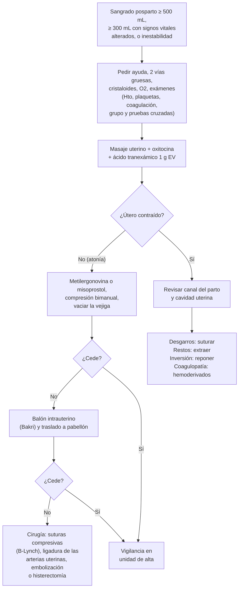

---
tags:
  - Ginecología y obstetricia
  - Urgencia
  - Frecuente en sala
---

# Puerperio: hemorragia posparto, endometritis, mastitis, lactancia y apego

**Subespecialidad**
Obstetricia · Puerperio

**Guías principales**
MINSAL 2015: Guía Perinatal (hemorragia posparto en el capítulo de urgencias obstétricas) · OMS/FIGO/ICM 2025: guía consolidada de prevención, diagnóstico y tratamiento de la hemorragia posparto · OMS 2017: ácido tranexámico en la hemorragia posparto · RCOG 2016: prevención y manejo de la hemorragia posparto (GTG 52, *BJOG* 2017) · ABM 2022: espectro de la mastitis (protocolo 36)

**Otras fuentes**
Ensayos WOMAN (2017) y E-MOTIVE (2023) · Ver [trabajo de parto y distocias](trabajo-de-parto-distocias-y-sufrimiento-fetal.md), [metrorragia de la segunda mitad del embarazo](metrorragia-de-la-segunda-mitad-del-embarazo.md), [coagulopatías y CID](../hematologia/coagulopatias-cid-y-reversion-de-anticoagulantes.md), [sepsis](../infectologia/sepsis-y-shock-septico.md), [depresión](../geriatria/depresion.md) y [VIH](../infectologia/infeccion-por-vih.md)

**GES**
No como problemas propios.

**EUNACOM**
3.01.2.006 Endometritis puerperal (sospecha, inicial, derivar) · 3.01.2.009 Mastitis puerperal (específico, inicial, no requiere) · 3.01.2.020 Mastitis abscedada (específico, completo, completo) · 3.01.3.004 Lactancia · 3.01.3.016 Vínculo y apego

**Revisado**
Octubre 2026

!!! abstract "Resumen en 60 segundos"
    - **Puerperio**: las **6 semanas** (42 días) que siguen al parto. **Inmediato** (24 h), **precoz** (hasta el día 7–10) y **tardío** (hasta el día 42).
    - **Hemorragia posparto (HPP)**: pérdida **≥ 500 mL** tras un parto vaginal o **≥ 1000 mL** tras una cesárea, o cualquier sangrado con **inestabilidad**. La guía **OMS/FIGO/ICM 2025** manda **actuar ya con ≥ 300 mL** si hay **signos vitales alterados**, midiendo la pérdida con **bolsa calibrada**. Es una de las **primeras causas de muerte materna** en el mundo.
        - Causas, las **4 T**: **Tono** (atonía, ~ 70 %), **Trauma** (desgarros), **Tejido** (restos, acretismo) y **Trombina** (coagulopatía).
        - **Prevención**: **manejo activo del alumbramiento** con **oxitocina** en todos los partos.
        - **Tratamiento**: pedir ayuda, **masaje uterino**, **oxitocina**, **ácido tranexámico 1 g EV** (dentro de 3 h), volumen, revisar el canal y la cavidad; luego **metilergonovina** o **misoprostol**, **balón**, cirugía (B-Lynch, ligaduras, **histerectomía**).
    - **Endometritis puerperal**: **fiebre** desde las 24 h posparto + **útero sensible** y subinvolucionado + **loquios de mal olor**. Más tras una **cesárea**. Polimicrobiana: **clindamicina + gentamicina EV** hasta 24–48 h afebril.
    - **Mastitis**: mama **roja, dolorosa** y caliente, en general unilateral, con **fiebre** y malestar, sobre todo las primeras semanas. ***S. aureus***.
        - **No suspender la lactancia**. AINE, frío, buena técnica de amamantamiento y, si no mejora en 12–24 h o es grave, **cloxacilina** o **cefadroxilo**.
        - **Absceso**: masa fluctuante → **ecografía** y **punción-aspiración** o **drenaje** + antibióticos.
    - **Lactancia materna exclusiva** hasta los **6 meses** y complementada hasta los **2 años** o más. Contraindicaciones absolutas en Chile: **VIH**, **HTLV-1**, **galactosemia** del recién nacido.
    - **Apego**: **contacto piel con piel** inmediato y **alojamiento conjunto** (Chile Crece Contigo).

## Definición

- **Puerperio**: período desde la salida de la placenta hasta las **6 semanas** posparto, en el que se revierten los cambios del embarazo.
- **Hemorragia posparto (HPP)**:
    - **Primaria** (precoz): en las primeras **24 horas**.
    - **Secundaria** (tardía): desde las 24 horas hasta las **6 semanas** (0,5–2 %; restos, infección, coagulopatía, malformación arteriovenosa).
    - **Cuantitativa**: **≥ 500 mL** (vaginal) o **≥ 1000 mL** (cesárea) (Guía Perinatal 2015). **Grave**: ≥ 1000 mL o con signos de shock.
    - **Criterio OMS/FIGO/ICM 2025** (para actuar precozmente): pérdida **≥ 500 mL**, **o ≥ 300 mL con signos vitales alterados** (taquicardia, hipotensión, índice de shock elevado), medida **objetivamente** con una bolsa calibrada.
- **Inercia o atonía uterina**: útero que no se contrae tras el alumbramiento.
- **Endometritis puerperal**: infección del **endometrio** (y a veces del miometrio y parametrio) tras el parto.
- **Mastitis**: inflamación de la mama, con o sin infección. Espectro (ABM 2022): congestión ductal, mastitis inflamatoria, **mastitis bacteriana**, flemón y **absceso**.
- **Lactancia materna exclusiva**: el lactante recibe solo leche materna (sin agua ni otros líquidos, salvo medicamentos y vitaminas).
- **Vínculo y apego**: relación afectiva entre la madre (o cuidador) y el recién nacido, que da seguridad al niño y se construye desde el nacimiento.

## Epidemiología

### Mundial

- La **HPP** complica el ~ **3 %** de los partos; causa ~ **150 000 muertes** maternas al año (Guía Perinatal 2015) y es la **primera causa** de muerte materna en el mundo.
- **Endometritis**: **1–3 %** tras un parto vaginal y hasta **5–10 veces** más tras una cesárea sin profilaxis antibiótica.
- **Mastitis**: **~ 10 %** de las mujeres que amamantan (más en las primeras **6 semanas**); el **absceso** complica el **3–11 %** de las mastitis.

!!! chile "Datos nacionales y normativa"
    - La **hemorragia posparto** está entre las principales causas **directas** de muerte materna en Chile, junto con el **síndrome hipertensivo** y el aborto (Guía Perinatal 2015).
    - La Guía Perinatal 2015 exige que los partos se atiendan donde haya **banco de sangre**, uterotónicos, protocolos y capacidad de derivación.
    - **Lactancia**: recomendación nacional de **lactancia exclusiva hasta los 6 meses**.
        - **Ley 20.545** (2011): **posnatal parental**, que extiende el descanso posnatal hasta las **24 semanas**.
        - **Ley 21.155** (2019): protege la lactancia materna y su ejercicio en cualquier lugar.
        - **Derecho a alimentar**: **1 hora diaria** para amamantar hasta que el hijo cumpla **2 años** (Código del Trabajo).
    - **Chile Crece Contigo**: **apego** precoz, contacto piel con piel, alojamiento conjunto y acompañamiento del parto.
    - En Chile la lactancia está **contraindicada** en las mujeres con **VIH** (con leche artificial gratuita) y con **HTLV-1**.

## Etiología

### Hemorragia posparto: las 4 T

| Causa | Frecuencia | Factores de riesgo |
|---|---|---|
| **Tono** (atonía uterina) | **~ 70 %** | **Sobredistensión** (gemelar, polihidramnios, **macrosomía**), **trabajo de parto prolongado** o precipitado, **uso prolongado de oxitocina**, **corioamnionitis**, multiparidad, anestesia general, miomas |
| **Trauma** | ~ 20 % | **Desgarros** del cuello, vagina o periné, **parto instrumental**, hematomas, **rotura uterina**, **inversión uterina** |
| **Tejido** | ~ 10 % | **Restos placentarios**, **acretismo** (cesárea previa con placenta previa), alumbramiento incompleto |
| **Trombina** | < 1 % | **Preeclampsia/HELLP**, **DPPNI**, **CID**, **embolía de líquido amniótico**, sepsis, enfermedad de von Willebrand, anticoagulantes |

### Endometritis

- **Polimicrobiana** (flora vaginal ascendente): estreptococos (incluido el **grupo B** y el **grupo A**, este último grave), *E. coli* y otras enterobacterias, **anaerobios** (*Bacteroides*, *Peptostreptococcus*), *Gardnerella*, micoplasmas.
- Factores: **cesárea** (el principal, sobre todo de urgencia), **RPM prolongada**, **corioamnionitis**, **trabajo de parto prolongado**, **muchos tactos vaginales** (> 5), extracción manual de la placenta, restos, anemia, obesidad.

### Mastitis

- **Estasis de leche** (mal acoplamiento, mamadas infrecuentes, horarios rígidos, sobreproducción) e **infección**, en general por ***Staphylococcus aureus*** (incluido SARM), menos por estreptococos.
- Factores: **grietas del pezón**, **congestión mamaria**, frenillo lingual corto del lactante, sostén apretado, estrés y cansancio, mastitis previa.

## Fisiopatología

- **Hemostasia uterina**: después del alumbramiento, el sangrado del lecho placentario se detiene sobre todo por la **contracción del miometrio**, cuyas fibras en forma de malla comprimen los vasos ("**ligaduras vivientes de Pinard**"). Por eso la atonía es la causa principal y los uterotónicos son el tratamiento base.
- **Involución uterina**: el fondo baja ~ **1 cm por día**; a las 2 semanas el útero ya no se palpa en el abdomen.
- **Loquios**: **rojos** (días 1–3), **serosos** (días 4–10) y **blancos** (hasta 3–6 semanas). Los loquios **fétidos** o purulentos sugieren una endometritis.
- **Lactancia**: la caída de la **progesterona** tras el alumbramiento permite la acción de la **prolactina** (producción); la succión libera **oxitocina** (eyección de la leche y contracción uterina). La producción depende de la **extracción frecuente** (oferta-demanda).

## Clasificación

### Gravedad de la hemorragia posparto (estimación clínica)

| Pérdida | % de la volemia | Signos | Índice de shock (FC / PAS) |
|---|---|---|---|
| 500–1000 mL | 10–15 % | Normales o palpitaciones, mareo | < 0,9 |
| 1000–1500 mL | 15–25 % | **Taquicardia**, sudoración, debilidad | ~ 1 |
| 1500–2000 mL | 25–35 % | **Hipotensión**, oliguria, agitación | > 1 |
| > 2000 mL | > 35 % | **Shock**, compromiso de conciencia | > 1,4 |

- La estimación visual **subestima** la pérdida: usar **bolsas colectoras calibradas** (E-MOTIVE 2023; recomendadas por la OMS/FIGO/ICM 2025) o pesar compresas y guiarse por los signos clínicos.
- El **índice de shock ≥ 1** es una señal de alarma útil.

### Espectro de la mastitis (ABM 2022)

| Cuadro | Clínica |
|---|---|
| **Congestión mamaria** | Ambas mamas llenas y duras, sin fiebre, días 2–5 |
| **Mastitis inflamatoria (estasis ductal)** | Zona roja y dolorosa, sin infección |
| **Mastitis bacteriana** | Zona roja, caliente y dolorosa, **fiebre > 38,5 °C**, malestar, síntomas que no ceden en 12–24 h |
| **Absceso** | Masa **fluctuante** y dolorosa, a veces sin fiebre |

## Clínica

- **HPP**: sangrado genital abundante, **útero blando** y por encima del ombligo (atonía), o **útero contraído** con sangrado persistente (desgarros, coagulopatía). **Hematoma** vulvar o vaginal: dolor perineal intenso. **Inversión uterina**: masa en la vagina, fondo uterino no palpable y **shock desproporcionado** (componente vagal).
- **Endometritis**: **fiebre ≥ 38 °C** desde las 24 h (en general días 2–5), **útero subinvolucionado, blando y doloroso**, **loquios fétidos** o purulentos, taquicardia. Tras una cesárea puede acompañarse de infección de la herida.
- **Mastitis**: **dolor**, **eritema** en cuña, calor e induración de una zona de la mama, **fiebre**, calofríos y malestar de tipo gripal. Absceso: masa fluctuante que persiste pese a los antibióticos.

!!! alarma "Signos de alarma"
    - **Hemorragia con taquicardia, hipotensión o índice de shock ≥ 1** → activar el protocolo de hemorragia obstétrica.
    - **Fiebre alta precoz (< 24 h) con dolor desproporcionado, hipotensión o eritrodermia** → **sepsis por estreptococo grupo A** o shock tóxico: urgencia.
    - **Fiebre puerperal que no cede con 48–72 h de antibióticos** → buscar **absceso pélvico**, **hematoma infectado**, **tromboflebitis pélvica séptica**, restos o infección de la herida.
    - **Cefalea, convulsiones o PA ≥ 160/110** en el puerperio → **preeclampsia posparto**.
    - **Disnea, dolor torácico o edema unilateral de la pierna** → **TEP o TVP** (el puerperio es el período de **mayor riesgo trombótico**).
    - **Ideas de autolesión o de dañar al hijo, confusión o alucinaciones** → **psicosis puerperal** o depresión grave: urgencia psiquiátrica.

## Diagnóstico

!!! guia "Puntos clave (Guía Perinatal 2015; RCOG 2016; OMS 2017; OMS/FIGO/ICM 2025; ABM 2022)"
    - **HPP**: diagnóstico **clínico**. Cuantificar la pérdida (bolsa graduada) y evaluar los signos vitales. Buscar la causa por las **4 T**: palpar el **útero** (tono), revisar el **canal del parto** (trauma), la **placenta** y la cavidad (tejido) y la **coagulación** (trombina).
    - **Endometritis**: diagnóstico **clínico**. Hemograma y PCR apoyan; **hemocultivos** si hay sepsis; **ecografía** si se sospechan restos o un absceso. Descartar otras fuentes (orina, mama, herida, pulmón, trombosis).
    - **Mastitis**: diagnóstico **clínico**. **Cultivo de leche** si no responde a 48 h de antibióticos, es recurrente, grave o adquirida en el hospital (SARM). **Ecografía** si se sospecha un absceso.
    - **Fiebre puerperal**: pensar en las **"5 W"**: *wind* (pulmón), *water* (orina), *wound* (herida, endometrio), *walking* (trombosis), *wonder drugs* (fármacos); y en la **mama**.

## Laboratorio

- **HPP**: **hematocrito y hemoglobina**, **plaquetas**, **TP, TTPK** y **fibrinógeno** (< 200 mg/dL predice una HPP grave), grupo y Rh con **pruebas cruzadas**; **test de observación del coágulo** junto a la cama si no hay laboratorio; gases y lactato en el shock.
- **Endometritis**: **hemograma** (la leucocitosis es normal en el posparto inmediato), **PCR**, **hemocultivos** si hay sepsis, sedimento y urocultivo.
- **Mastitis**: en general no se necesitan exámenes. **Cultivo de leche** en los casos indicados; cultivo del contenido del absceso.

## Imágenes

- **Ecografía transvaginal o abdominal**: **restos ovulares** (contenido ecogénico con flujo), hematomas, **abscesos** pélvicos o de la herida.
- **TC de abdomen y pelvis**: fiebre persistente pese a los antibióticos (absceso, **tromboflebitis pélvica séptica** de la vena ovárica).
- **Ecografía mamaria**: **absceso** (colección hipoecogénica) y guía para la punción.

## Diagnóstico diferencial

| Cuadro | Diferenciales |
|---|---|
| **Sangrado posparto** | Atonía · desgarros · hematoma · restos · acretismo · **inversión uterina** · **rotura uterina** · coagulopatía · loquios normales (rojos los primeros 3 días, sin repercusión) |
| **Fiebre puerperal** | **Endometritis** · **ITU y pielonefritis** · **mastitis** · infección de la **herida** · neumonía (anestesia general) · **TVP/TEP** · tromboflebitis pélvica séptica · **congestión mamaria** (febrícula los días 2–3) · fiebre por fármacos · reacción transfusional |
| **Mama dolorosa** | **Congestión** (bilateral, sin fiebre) · **ductus obstruido** · **mastitis** · **absceso** · galactocele · **carcinoma inflamatorio** (sin fiebre, piel de naranja, no responde a antibióticos: biopsia) |

## Tratamiento

### Prevención de la hemorragia posparto

- **Tratar la anemia** durante el embarazo y suplementar **hierro**. Conocer el **grupo y Rh**.
- **Manejo activo del alumbramiento** en **todos** los partos (reduce la HPP; Guía Perinatal 2015):
    - **Oxitocina 10 UI IM** tras la salida del hombro anterior (o 5–10 UI EV lenta, o 20–40 UI en infusión).
    - **Tracción controlada del cordón** con contratracción suprapúbica.
    - **Masaje** y vigilancia del tono uterino tras el alumbramiento.
- **Cesárea**: **carbetocina 100 µg EV** como alternativa a la infusión de oxitocina.
- Si no hay oxitocina: **misoprostol 600 µg VO** o **metilergonovina 0,2 mg IM** (no en hipertensas).
- Identificar a las mujeres de **alto riesgo** (placenta previa, acretismo, gemelar, preeclampsia, coagulopatía) y planificar su parto en un centro con banco de sangre.

### Tratamiento de la hemorragia posparto

**Medidas generales (simultáneas):**

1. **Pedir ayuda** (equipo de obstetricia, anestesia, matronería), activar el protocolo.
2. **Dos vías venosas** gruesas (14–16 G), **cristaloides** tibios, **oxígeno**, sonda Foley y monitorización.
3. **Exámenes** y **pruebas cruzadas**.
4. **Hemoderivados**: glóbulos rojos si la Hb es < 7–8 g/dL o hay sangrado activo con inestabilidad; en la hemorragia masiva, **proporción 1:1:1** o la de la Guía Perinatal 2015 (**4 glóbulos rojos : 2 plasmas : 1 aféresis de plaquetas**). Metas: **Hto > 21 %**, **plaquetas > 50 000/mm³**, **fibrinógeno > 100–200 mg/dL** (crioprecipitado), INR < 1,5.
5. **Ácido tranexámico 1 g EV** en 10 minutos **dentro de las 3 horas** del parto; repetir 1 g si sigue sangrando a los 30 minutos (ensayo **WOMAN**, OMS 2017). La Guía Perinatal 2015 no lo recomendaba de rutina; la evidencia posterior lo incorporó al tratamiento inicial.
6. **Paquete MOTIVE** (OMS/FIGO/ICM 2025, basado en el ensayo E-MOTIVE): apenas se diagnostica la HPP, en paralelo: **M**asaje uterino, **O**xitócicos, **T**ranexámico, **I**ntravenosos (fluidos), **V**aginal (examen del canal del parto) y **E**scalar si persiste el sangrado.
7. **Prevención** (OMS/FIGO/ICM 2025): uterotónico en todos los partos (**oxitocina** de elección; **carbetocina termoestable** como alternativa; **misoprostol** solo si no hay opciones EV ni cadena de frío). **Hierro EV** si se necesita corregir la anemia rápido (por ejemplo, tras una HPP).

**Según la causa:**

| Causa | Manejo |
|---|---|
| **Atonía** | **Masaje uterino** y **compresión bimanual**, **vaciar la vejiga**, uterotónicos escalonados: **oxitocina** → **metilergonovina** → **misoprostol** (→ carboprost donde exista). Si no cede: **balón intrauterino** (Bakri; éxito ~ 84 %, Guía Perinatal 2015) → **suturas compresivas** (B-Lynch), **ligadura de las arterias uterinas**, embolización (si está estable) → **histerectomía** |
| **Trauma** | **Sutura** de los desgarros con buena exposición y analgesia; drenaje de hematomas grandes; **inversión uterina**: reposición manual inmediata (sin extraer la placenta si sigue adherida), relajantes uterinos si es necesario y luego uterotónicos |
| **Tejido** | **Extracción manual** de la placenta retenida o de restos, **legrado** (curetaje romo); sospechar **acretismo** si no hay plano de clivaje (no forzar: histerectomía) |
| **Trombina** | **Hemoderivados** guiados por laboratorio, **crioprecipitado** o fibrinógeno, tratar la causa (HELLP, DPPNI, sepsis) |

- **Antibióticos** profilácticos en la HPP con maniobras intrauterinas (Guía Perinatal 2015: clindamicina 600 mg cada 8 h + ceftriaxona 1 g EV).
- La **histerectomía** debe decidirse **antes** de que aparezca una coagulopatía grave. Es **total** en el acretismo de placenta previa.
- **Anti-D** si es Rh negativa no sensibilizada y el recién nacido es Rh positivo.

### Endometritis puerperal

- **Hospitalizar**.
- **Clindamicina 900 mg EV cada 8 h + gentamicina 5 mg/kg/día EV** en una dosis diaria (cubre anaerobios y gramnegativos). Agregar **ampicilina** si no mejora en 48–72 h (enterococo) o si es portadora de SGB.
- **Hasta 24–48 h afebril** y asintomática; **no** es necesario completar con antibióticos orales.
- **Restos** → evacuación uterina (con antibióticos).
- **Sin respuesta en 72 h** → ecografía o TC: **absceso** (drenaje), **tromboflebitis pélvica séptica** (anticoagulación), hematoma o infección de la herida.
- **Prevención**: **cefazolina 2 g EV** antes de la incisión en **toda cesárea** (± azitromicina en la cesárea en trabajo de parto); evitar tactos vaginales innecesarios.
- La lactancia **se puede mantener** con estos antibióticos.

### Mastitis

1. **Continuar amamantando** (o extraer la leche) **del lado afectado**: la leche **no** es dañina para el lactante y vaciar la mama acelera la curación.
2. **Corregir la técnica**: acoplamiento, posiciones, libre demanda. Evitar la **sobreestimulación** (extracción excesiva) y el **masaje profundo**, que empeoran la inflamación (ABM 2022).
3. **Frío local** entre las tomas, **AINE** (ibuprofeno) y paracetamol, reposo e hidratación, sostén cómodo.
4. **Antibióticos** si los síntomas no mejoran en **12–24 h** o el cuadro es **grave** desde el inicio (fiebre alta, grietas infectadas, compromiso del estado general):
    - **Cloxacilina** o **flucloxacilina** 500 mg VO cada 6 h, o **cefadroxilo** 500 mg–1 g VO cada 12 h, por **10–14 días**.
    - **Alergia a la penicilina**: **clindamicina**. **SARM**: según el cultivo (cotrimoxazol, clindamicina).
5. **Hospitalizar** si hay sepsis o no tolera la vía oral (cloxacilina o cefazolina EV; vancomicina si se sospecha SARM).

### Mastitis abscedada

- **Ecografía** para confirmar.
- **Punción-aspiración con aguja** guiada por ecografía (repetible) como primera opción; **drenaje quirúrgico** (incisión radial, lejos de la areola) si el absceso es grande, multiloculado o no responde.
- **Antibióticos** antiestafilocócicos y **cultivo** del pus.
- **Seguir amamantando** del lado sano; del lado afectado también, si la boca del lactante no queda sobre la herida (si no, extraer la leche).
- Control hasta la resolución; si no se resuelve o es atípico, descartar un **carcinoma**.

### Lactancia materna

- **Inicio en la primera hora** de vida con **contacto piel con piel**, **alojamiento conjunto**, **libre demanda** (8–12 veces al día al inicio).
- **Lactancia exclusiva hasta los 6 meses**; desde los 6 meses, alimentación complementaria con lactancia **hasta los 2 años** o más.
- **Técnica correcta (acoplamiento)**: boca bien abierta, labios evertidos, **areola** dentro de la boca (más la inferior), mentón contra la mama, nariz libre, succión lenta y profunda con deglución audible, **sin dolor**.
- **Beneficios**:
    - **Para el niño**: menos **infecciones** (diarrea, otitis, neumonía), menos **muerte súbita**, enterocolitis necrotizante en el prematuro, obesidad y diabetes; mejor desarrollo.
    - **Para la madre**: **menos hemorragia** posparto (oxitocina), recuperación del peso, **amenorrea de la lactancia** (método MELA), menos **cáncer de mama y ovario**, diabetes y enfermedad cardiovascular.
- **Contraindicaciones**:

| Absolutas | Temporales o parciales |
|---|---|
| **VIH** (en Chile) · **HTLV-1** · **galactosemia clásica** del lactante · quimioterapia, isótopos radiactivos terapéuticos · consumo activo de drogas (cocaína, pasta base) | **TBC activa** no tratada (separar hasta 2 semanas de tratamiento; puede darse leche extraída) · **varicela** perinatal (separar; leche extraída) · **herpes** en el pezón (no amamantar de esa mama) · algunos fármacos (litio, amiodarona, metotrexato: consultar) · alcohol (esperar ~ 2 h por trago) |

- **No** contraindican la lactancia: **hepatitis B** (con vacuna e inmunoglobulina al recién nacido), **hepatitis C** (salvo grietas sangrantes), **mastitis**, fiebre materna común, la mayoría de los **antibióticos**, analgésicos y antidepresivos (sertralina), **anticoncepción con progestágeno solo**.
- **Problemas frecuentes**: **grietas** (corregir el acoplamiento, leche materna sobre el pezón), **congestión** (amamantar seguido, extracción breve, frío), **hipogalactia** percibida (aumentar la frecuencia; revisar el incremento de peso del lactante).

### Vínculo y apego

- **Apego**: lazo emocional del niño con su figura de cuidado; un **apego seguro** favorece el desarrollo emocional y social.
- **Prácticas que lo favorecen** (Chile Crece Contigo):
    - **Contacto piel con piel** inmediato y por al menos **1 hora** tras el parto (también tras la cesárea si la madre y el niño están estables); el **padre** o acompañante puede hacerlo si la madre no puede.
    - **Postergar** los procedimientos no urgentes del recién nacido (pesar, vacunas, profilaxis ocular) hasta después del contacto.
    - **Alojamiento conjunto** y lactancia a libre demanda.
    - **Acompañamiento** del parto por la persona que la mujer elija.
    - Respuesta **sensible** a las necesidades del niño (contacto, consuelo).
- **Factores de riesgo** de un vínculo alterado: **depresión posparto**, embarazo no deseado, adolescencia, violencia, consumo de sustancias, hospitalización prolongada del recién nacido, falta de redes.
- **Depresión posparto**: tamizaje con la **escala de Edimburgo** (EPDS) en el embarazo y el posparto (punto de corte ≥ 10 en el puerperio en Chile); tratar y derivar.

!!! dosis "Fármacos habituales"
    | Fármaco | Dosis | Comentarios |
    |---|---|---|
    | **Oxitocina** (prevención) | **10 UI IM** tras el hombro anterior, o 5–10 UI EV lenta | Manejo activo del alumbramiento |
    | **Oxitocina** (tratamiento) | **20–40 UI en 1000 mL** de suero, a 150–250 mL/h (o más rápido según la respuesta) | Evitar bolos rápidos grandes (hipotensión) |
    | **Carbetocina** | **100 µg EV** en dosis única | Cesárea |
    | **Metilergonovina** | **0,2 mg IM**; repetir cada 2–4 h | **Contraindicada en hipertensión** y preeclampsia, cardiopatía |
    | **Misoprostol** | **800 µg sublingual** (tratamiento); 600 µg VO (prevención) | Fiebre y calofríos |
    | **Ácido tranexámico** | **1 g EV en 10 min**, dentro de 3 h; repetir 1 g a los 30 min si persiste | No después de 3 h |
    | **Clindamicina + gentamicina** (endometritis) | **Clindamicina 900 mg EV cada 8 h + gentamicina 5 mg/kg/día EV** | Hasta 24–48 h afebril |
    | **Cefazolina** (profilaxis en cesárea) | **2 g EV** (3 g si pesa ≥ 120 kg) antes de la incisión | Previene la endometritis y la infección de la herida |
    | **Cloxacilina / flucloxacilina** (mastitis) | **500 mg VO cada 6 h** por 10–14 días | Compatible con la lactancia |
    | **Cefadroxilo** (mastitis) | **500 mg–1 g VO cada 12 h** por 10–14 días | Alternativa |
    | **Ibuprofeno** | **400 mg VO cada 6–8 h** | Dolor e inflamación en la mastitis |
    | **Cabergolina** (inhibición de la lactancia) | **1 mg VO** en dosis única (primer día posparto) | Solo si está contraindicada la lactancia (VIH, HTLV-1) o hay muerte fetal o neonatal |

!!! alarma "Urgencia"
    - **Hemorragia posparto**: el tiempo cuenta. Actuar en paralelo (reanimación, uterotónicos, ácido tranexámico y búsqueda de la causa). **No** retrasar la cirugía ni la histerectomía si la mujer se deteriora.
    - **Inversión uterina**: reponer el útero **de inmediato**; cuanto más se demora, más difícil y mayor el shock.
    - **Endometritis con sepsis**: hemocultivos, antibióticos en la primera hora, fluidos y UCI si hay shock; pensar en el **estreptococo grupo A**.

## Complicaciones

- **HPP**: **shock hipovolémico**, **CID**, lesión renal aguda, **síndrome de Sheehan** (necrosis hipofisaria: **agalactia**, amenorrea, hipotiroidismo, insuficiencia suprarrenal), SDRA, reacciones transfusionales, **histerectomía** (pérdida de la fertilidad), anemia, muerte.
- **Endometritis**: **absceso pélvico**, **peritonitis**, **tromboflebitis pélvica séptica**, **sepsis** y shock séptico, síndrome de Asherman, infertilidad.
- **Mastitis**: **absceso** (3–11 %), recurrencia, **destete precoz**, sepsis (rara).
- **Lactancia**: grietas, congestión, hipogalactia, destete precoz. **Ictericia** por lactancia en el recién nacido.

## Pronóstico y seguimiento

- **Control posparto**: a los **7–10 días** (díada madre-hijo en la APS) y a las **6 semanas** (puerperio tardío). Evaluar:
    - Involución uterina, loquios, herida o periné, mamas y lactancia.
    - **Presión arterial** (preeclampsia posparto), **anemia** (hierro), **ánimo** (escala de Edimburgo), **vínculo**.
    - **Anticoncepción** (métodos compatibles con la lactancia: progestágeno solo, DIU, MELA).
    - Diabetes gestacional: **PTGO** a las 6–12 semanas.
- **HPP** previa: riesgo de recurrencia; planificar el próximo parto en un centro con banco de sangre y manejo activo del alumbramiento.

## Perlas para el internado

!!! perla "Para recordar en la sala"
    - Las **4 T** de la HPP: **Tono** (70 %), **Trauma**, **Tejido**, **Trombina**. Lo primero es **palpar el útero**.
    - **Útero blando** = atonía: masaje + oxitocina. **Útero duro y sigue sangrando** = buscar desgarros o coagulopatía.
    - **Ácido tranexámico** dentro de las **3 horas**; después ya no sirve.
    - **Metilergonovina**: nunca en una **hipertensa**.
    - **Fiebre en el puerperio**: mamas, herida, orina, útero, piernas y pulmones (las "5 W" más la mama).
    - **Mastitis**: **no suspender la lactancia**; frío y AINE, sin masaje profundo; antibiótico si no mejora en 12–24 h.
    - **Masa fluctuante** en la mama que no cede = **absceso**: ecografía y **punción**.
    - **Piel con piel** en la primera hora: favorece el **apego**, la **lactancia** y la contracción uterina.

## Preguntas de repaso

??? repaso "1. Multípara, parto vaginal de un recién nacido de 4300 g tras un trabajo de parto prolongado con oxitocina. A los 15 minutos del alumbramiento sangra abundantemente; el útero está blando y sobre el ombligo. FC 118/min, PA 95/60 mmHg. ¿Qué hace?"
    - **HPP por atonía** con **índice de shock > 1**: activar el protocolo, pedir ayuda.
    - Dos vías gruesas, cristaloides, O2, exámenes y **pruebas cruzadas**; **masaje** y **compresión bimanual**, **oxitocina en infusión**, **ácido tranexámico 1 g EV**, vaciar la vejiga.
    - Si no cede: **metilergonovina** (si no es hipertensa) o **misoprostol**, revisar canal y cavidad, **balón** y escalar a cirugía.

??? repaso "2. Puérpera de cesárea de urgencia (día 3) con fiebre de 38,8 °C, útero doloroso a la palpación y loquios de mal olor. ¿Diagnóstico y tratamiento?"
    - **Endometritis puerperal** (la cesárea es el principal factor de riesgo).
    - Hospitalizar; **clindamicina 900 mg cada 8 h + gentamicina 5 mg/kg/día EV** hasta 24–48 h afebril.
    - Ecografía si se sospechan restos; si no responde en 72 h, buscar un absceso o una tromboflebitis pélvica séptica.

??? repaso "3. Puérpera de 3 semanas que amamanta, con dolor, eritema en cuña en la mama derecha, fiebre de 38,7 °C y malestar general desde hace 36 horas. ¿Qué indica?"
    - **Mastitis bacteriana** (no mejoró en > 24 h).
    - **Seguir amamantando** (también del lado afectado), corregir el acoplamiento, frío y **ibuprofeno**.
    - **Cloxacilina 500 mg cada 6 h** (o cefadroxilo) por **10–14 días**.

??? repaso "4. La misma paciente vuelve a los 5 días con una masa dolorosa y fluctuante de 3 cm en la zona afectada. ¿Qué hace?"
    - Sospecha de **mastitis abscedada**: **ecografía** mamaria.
    - **Punción-aspiración** guiada (o drenaje quirúrgico si es grande o multiloculado), **cultivo** y antibióticos.
    - Continuar la lactancia del lado sano (y del afectado si es posible).

??? repaso "5. Una madre con VIH en tratamiento y carga viral indetectable pregunta si puede amamantar. ¿Qué le responde según la norma chilena?"
    - En Chile la lactancia está **contraindicada** en las mujeres con **VIH** (también con HTLV-1).
    - Se indica la **inhibición de la lactancia** (cabergolina 1 mg) y **leche artificial** gratuita para el lactante.

??? repaso "6. ¿Qué medidas en la sala de partos favorecen el apego y la lactancia?"
    - **Contacto piel con piel** inmediato y por al menos 1 hora; **inicio de la lactancia en la primera hora**.
    - Postergar los procedimientos no urgentes del recién nacido; **alojamiento conjunto** y libre demanda.
    - **Acompañamiento** del parto y apoyo del padre o acompañante (piel con piel si la madre no puede).

## Referencias

1. Ministerio de Salud de Chile. Guía Perinatal 2015 (capítulo XXXII: urgencias obstétricas, hemorragia posparto). Santiago: MINSAL; 2015. [minsal.cl](https://www.minsal.cl/salud-de-la-mujer/)
2. WOMAN Trial Collaborators. Effect of early tranexamic acid administration on mortality, hysterectomy, and other morbidities in women with post-partum haemorrhage (WOMAN): an international, randomised, double-blind, placebo-controlled trial. *Lancet.* 2017;389(10084):2105–2116. doi:[10.1016/S0140-6736(17)30638-4](https://doi.org/10.1016/S0140-6736(17)30638-4)
3. Gallos I, Devall A, Martin J, et al. Randomized trial of early detection and treatment of postpartum hemorrhage. *N Engl J Med.* 2023;389(1):11–21. doi:[10.1056/NEJMoa2303966](https://doi.org/10.1056/NEJMoa2303966)
4. Prevention and management of postpartum haemorrhage: Green-top Guideline No. 52. *BJOG.* 2017;124(5):e106–e149. doi:[10.1111/1471-0528.14178](https://doi.org/10.1111/1471-0528.14178)
5. World Health Organization, FIGO, ICM. Consolidated guidelines for the prevention, diagnosis and treatment of postpartum haemorrhage. Ginebra: OMS; 2025. [who.int](https://www.who.int/publications/i/item/9789240115637)
6. World Health Organization. Updated WHO recommendation on tranexamic acid for the treatment of postpartum haemorrhage. Ginebra: OMS; 2017. [who.int](https://www.who.int/publications/i/item/WHO-RHR-17.21)
7. Mitchell KB, Johnson HM, Rodríguez JM, et al. Academy of Breastfeeding Medicine Clinical Protocol #36: The mastitis spectrum, revised 2022. *Breastfeed Med.* 2022;17(5):360–376. doi:[10.1089/bfm.2022.29207.kbm](https://doi.org/10.1089/bfm.2022.29207.kbm)
8. Ministerio de Salud de Chile. Chile Crece Contigo: sistema de protección integral a la infancia. [crececontigo.gob.cl](https://www.crececontigo.gob.cl/)
