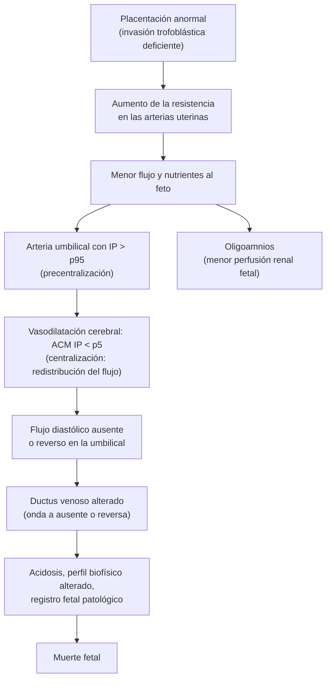

---
tags:
  - Ginecología y obstetricia
---

# Restricción de crecimiento fetal, colestasia intrahepática del embarazo e hiperemesis gravídica

**Subespecialidad**
Obstetricia · Medicina materno-fetal

**Guías principales**
MINSAL 2015: Guía Perinatal (capítulos de restricción de crecimiento intrauterino y de colestasia intrahepática del embarazo) · ACOG 2021: restricción de crecimiento fetal (PB 227) · ISUOG 2020: feto pequeño para la edad gestacional y RCF · RCOG 2022: colestasia intrahepática del embarazo (GTG 43) · RCOG 2024: náuseas, vómitos e hiperemesis gravídica (GTG 69) · ACOG 2018: náuseas y vómitos del embarazo (PB 189)

**Otras fuentes**
Ver [colestasia](../gastroenterologia/colestasia.md), [síndrome hipertensivo del embarazo](../nefrologia/preeclampsia-y-sindrome-hipertensivo-del-embarazo.md), [control prenatal](control-prenatal-edad-gestacional-e-isoinmunizacion-rh.md), [hemorragia del primer trimestre y mola](hemorragia-del-primer-trimestre-aborto-ectopico-y-mola.md), [hipertiroidismo](../endocrinologia/hipotiroidismo-e-hipertiroidismo.md) y [encefalopatía de Wernicke](../neurologia/abstinencia-alcoholica-y-wernicke.md)

**GES**
No como problemas propios.

**EUNACOM**
3.01.1.010 Restricción de crecimiento fetal (sospecha, inicial, derivar) · 3.01.1.003 Colestasia gravídica (específico, inicial, derivar) · 3.01.2.007 Hiperemesis gravídica (específico, inicial, derivar)

**Revisado**
Octubre 2026

!!! abstract "Resumen en 60 segundos"
    - **Restricción de crecimiento fetal (RCF)**: feto que no alcanza su potencial de crecimiento. Se sospecha con una **altura uterina** menor a la esperada y se confirma con **ecografía**: peso fetal estimado o circunferencia abdominal **< p10**, con **Doppler alterado** o **< p3**.
        - El **pequeño para la edad gestacional (PEG)** está entre p3 y p10 con Doppler normal: es constitucional y tiene buen pronóstico.
        - Causa principal: **insuficiencia placentaria** (preeclampsia, HTA, tabaco). Precoz (< 32 semanas): pensar también en **cromosomopatías** e **infecciones** (CMV).
        - Manejo: **derivar a alto riesgo**. El **Doppler de la arteria umbilical** define la vigilancia y el momento del parto. **Corticoides** y **sulfato de magnesio** si se interrumpe antes de las 34 y 32 semanas.
        - Prevención: **aspirina** desde las 12–16 semanas en las de alto riesgo.
    - **Colestasia intrahepática del embarazo**: **prurito palmoplantar nocturno** en el **tercer trimestre**, **sin lesiones de la piel**, que desaparece después del parto. Chile tiene una de las prevalencias más altas del mundo (**1–2 %**).
        - Diagnóstico **clínico y de exclusión**; **ácidos biliares** altos. Si son **≥ 100 µmol/L**, sube el riesgo de **muerte fetal**.
        - Manejo: **ácido ursodesoxicólico** para el prurito e **interrupción** a las **36–38 semanas** según la gravedad.
    - **Hiperemesis gravídica**: vómitos **intensos** del primer trimestre con **deshidratación**, **baja de peso > 5 %**, **cetonuria** y trastornos electrolíticos.
        - Descartar **mola**, **embarazo múltiple**, **hipertiroidismo**, ITU y causas digestivas.
        - Tratamiento: **hidratación EV** (**tiamina antes de la glucosa**), antieméticos escalonados (**doxilamina-piridoxina**, metoclopramida, **ondansetrón**) y corrección de **potasio**.

## Definición

- **Restricción de crecimiento fetal (RCF)**: incapacidad del feto de alcanzar su **potencial genético de crecimiento**.
    - **Guía Perinatal 2015**: peso fetal estimado (PFE) **< p10** con **signos de compromiso** (Doppler alterado, oligoamnios, pruebas de bienestar alteradas), o PFE **< p3**, o circunferencia abdominal < p2,5.
    - **ACOG 2021**: PFE o circunferencia abdominal **< p10**.
    - **RCF severa**: PFE **< p3**.
- **Feto pequeño para la edad gestacional (PEG)**: PFE entre **p3 y p10**, con anatomía, Doppler y bienestar fetal **normales** y crecimiento estable en su percentil.
- **Colestasia intrahepática del embarazo (CIE)**: enfermedad propia del embarazo con **prurito**, alza de los **ácidos biliares** y a veces de las transaminasas, que **desaparece después del parto**.
- **Hiperemesis gravídica**: forma **grave** de las náuseas y vómitos del embarazo, que impide la ingesta adecuada y causa **baja de peso** (en general **> 5 %**), **deshidratación**, **cetosis** y alteraciones electrolíticas (RCOG 2024).

## Epidemiología

### Mundial

- **RCF**: por definición ~ **10 %** de los fetos queda bajo el p10; la mayoría son PEG constitucionales. La RCF es una de las principales causas de **muerte fetal**: más de la mitad de los mortinatos sin anomalías se asocian a ella (Guía Perinatal 2015).
- **Colestasia**: 0,3–5,6 % según la región; más en **Chile, Bolivia y Escandinavia**, en el **embarazo múltiple** y en la fertilización asistida.
- **Náuseas y vómitos**: afectan al **50–80 %** de las embarazadas. La **hiperemesis** al **0,3–3 %**.

!!! chile "Datos nacionales (Guía Perinatal 2015)"
    - **Colestasia**: antes de 1985 llegaba al **15 %** de los embarazos en Chile; hoy es **1–2 %** de los partos. Más frecuente en las mujeres de origen **mapuche**.
    - Riesgo de **recurrencia** de la colestasia: **50–60 %** en los embarazos siguientes.
    - **RCF**: la recurrencia sin causa identificada es de **~ 20 %**. El **tabaco** aumenta el riesgo en **35 %** y un IMC pregestacional > 29 lo multiplica por **4**.
    - Las embarazadas con colestasia típica se controlan **semanalmente en la APS**; las atípicas o graves se derivan al nivel secundario.

## Etiología

### Restricción de crecimiento fetal

| Origen | Causas |
|---|---|
| **Materno** | **HTA crónica y preeclampsia**, diabetes con vasculopatía, enfermedad renal, LES y síndrome antifosfolípido, cardiopatía cianótica, desnutrición, peso < 50 kg o talla < 150 cm, **tabaco**, alcohol, cocaína, anomalías uterinas |
| **Placentario** (el más frecuente) | **Insuficiencia placentaria**, desprendimiento crónico, placenta previa, acretismo, inserción velamentosa, arteria umbilical única |
| **Fetal** | **Cromosomopatías** (trisomías 13, 18, triploidía), síndromes genéticos, malformaciones, **infecciones** (**CMV**, toxoplasma, rubéola, varicela, sífilis), **embarazo múltiple** |

### Colestasia intrahepática del embarazo

- **Predisposición genética** (variantes de transportadores biliares como ABCB4 y ABCB11) más el efecto de los **estrógenos** y la **progesterona** (sus metabolitos sulfatados) sobre la excreción biliar en el tercer trimestre.
- Factores: embarazo **múltiple**, fertilización asistida, antecedente personal o familiar, hepatitis C.

### Hiperemesis gravídica

- Relacionada con la **hCG** (picos a las 9–12 semanas): más en la **mola**, el **embarazo múltiple** y con feto femenino.
- Factores: hiperemesis previa, antecedente familiar, migraña, mareo por movimiento.
- La hCG estimula el receptor de TSH: **hipertiroidismo gestacional transitorio** (TSH baja, T4 libre alta) que se resuelve solo.

## Fisiopatología

La RCF por **insuficiencia placentaria** sigue una secuencia de **adaptación a la hipoxia** que se sigue con el Doppler. El Doppler define la etapa y el momento del parto.

- **Colestasia**: los **ácidos biliares** pasan al feto. Altos en el feto, se asocian a **arritmias**, **meconio** y **parto prematuro** (aumentan la sensibilidad del miometrio a la oxitocina). La muerte fetal es **súbita** y no la predicen las pruebas de bienestar.
- **Hiperemesis**: hCG y estrógenos altos, menor motilidad gástrica. Los vómitos causan **alcalosis metabólica hipoclorémica con hipokalemia**, cetosis y déficit de **tiamina** (riesgo de **Wernicke**).

## Clasificación

### RCF

| Según | Categorías |
|---|---|
| **Momento** | **Precoz** (< 32 semanas; la Guía Perinatal usa < 28): grave, placentaria, se asocia a preeclampsia; Doppler umbilical alterado · **Tardía** (≥ 32 semanas): más frecuente, sutil; Doppler umbilical normal y **ACM** alterada |
| **Proporción** | **Simétrica** (precoz: genética, infecciosa) · **Asimétrica** (cabeza preservada, abdomen pequeño: insuficiencia placentaria) |
| **Gravedad** | **Severa**: PFE < p3 |

### Colestasia (RCOG 2022, según los ácidos biliares máximos)

| Gravedad | Ácidos biliares | Riesgo de muerte fetal |
|---|---|---|
| Leve | **19–39 µmol/L** | Similar a la población general |
| Moderada | **40–99 µmol/L** | Similar a la población general |
| Severa | **≥ 100 µmol/L** | **Aumentado** (~ 3 % en Ovadia 2019) |

### Náuseas y vómitos del embarazo

- **Score PUQE** (*Pregnancy-Unique Quantification of Emesis*): leve ≤ 6, moderado 7–11, severo ≥ 12.
- **Hiperemesis**: vómitos con baja de peso, deshidratación o alteraciones electrolíticas.

## Clínica

**RCF:**

- Asintomática. La sospecha es por **altura uterina** bajo el p10 de la curva (o > 3 cm menos que la esperada) o en la **ecografía de rutina**.
- Puede acompañarse de **disminución de los movimientos fetales** y de signos de **preeclampsia**.

**Colestasia:**

- **Prurito** generalizado de predominio **palmoplantar** y **nocturno**, desde el **tercer trimestre** (rara vez antes).
- **Sin lesiones cutáneas primarias** (solo excoriaciones por rascado).
- **Ictericia** leve en el **10–12 %**, de predominio directo, rara vez con bilirrubina > 3 mg/dL.
- Puede haber **esteatorrea** y déficit de **vitamina K**.
- Desaparece en los **primeros días posparto** (en general < 10 días).

**Hiperemesis:**

- Inicio entre las **4 y 6 semanas**, máximo a las **9–12** y mejora hacia las **16–20 semanas**.
- Vómitos incoercibles, intolerancia oral, **baja de peso**, ptialismo.
- **Deshidratación**: taquicardia, hipotensión ortostática, mucosas secas, oliguria.

!!! alarma "Signos de alarma"
    - **RCF** con **flujo diastólico ausente o reverso**, ductus venoso alterado o **disminución de los movimientos fetales** → evaluación urgente.
    - **Prurito con dolor abdominal, vómitos, hipertensión o falla hepática** → no es una colestasia: descartar **preeclampsia/HELLP** e **hígado graso agudo del embarazo**.
    - **Colestasia con ácidos biliares ≥ 100 µmol/L** → alto riesgo de muerte fetal.
    - **Hiperemesis** con **confusión, nistagmo, oftalmoplejia o ataxia** → **encefalopatía de Wernicke** (tiamina EV inmediata).
    - **Vómitos que empiezan después de las 10 semanas**, con fiebre, dolor abdominal o cefalea → **otra causa**.

## Diagnóstico

!!! guia "Puntos clave (Guía Perinatal 2015; ACOG 2021; ISUOG 2020; RCOG 2022 y 2024)"
    - **RCF**: lo primero es una **edad gestacional confiable** (ecografía precoz). Una sola ecografía no distingue la RCF del PEG: se usan el **Doppler** y el **crecimiento seriado** (cada 2–3 semanas).
    - Con RCF **precoz o severa**, buscar la causa: **ecografía morfológica**, **cariotipo** o microarreglo, serologías (**CMV**, toxoplasma), síndrome antifosfolípido y signos de preeclampsia.
    - **Colestasia**: es **un diagnóstico de exclusión**. Prurito típico + **ácidos biliares ≥ 19 µmol/L** (RCOG) y/o transaminasas elevadas, descartadas otras causas. El diagnóstico se **confirma** cuando el cuadro **desaparece después del parto**.
    - **Hiperemesis**: diagnóstico **clínico**. Pedir una **ecografía** (descartar **mola** y **embarazo múltiple**) y laboratorio para medir la gravedad.

## Laboratorio

| Cuadro | Exámenes | Hallazgos |
|---|---|---|
| **RCF** | Serologías (CMV, toxoplasma, sífilis), anticuerpos antifosfolípidos, estudio de preeclampsia (proteinuria, plaquetas, función renal y hepática), cariotipo o microarreglo si es precoz | Orientan a la causa |
| **Colestasia** | **Ácidos biliares** (idealmente sin ayuno), **ALT/AST**, bilirrubina, fosfatasa alcalina (poco útil: también la produce la placenta), **TP** | Ácidos biliares **≥ 19 µmol/L**; ALT 2–10 veces lo normal |
| **Colestasia: exclusión** | Serología de **hepatitis** A, B y C, **ecografía hepatobiliar**, plaquetas, creatinina y proteinuria (HELLP), glicemia (hígado graso agudo) | Normales en la colestasia |
| **Hiperemesis** | **Electrolitos** (**K**, Na, Cl), creatinina, gases (alcalosis metabólica), **cetonuria**, orina completa y urocultivo, **TSH y T4 libre**, pruebas hepáticas, amilasa o lipasa, **β-hCG** | Hipokalemia, alcalosis, cetonuria; TSH baja con T4 libre alta en ~ 2/3 (transitoria); transaminasas levemente altas |

## Imágenes

- **RCF**:
    - **Biometría** y **PFE** con curvas locales o internacionales.
    - **Líquido amniótico** (oligoamnios).
    - **Doppler**: **arteria umbilical** (IP, flujo diastólico ausente o reverso), **arteria cerebral media** (IP), **índice cerebroplacentario** (ICP = IP de ACM / IP umbilical; bajo en la RCF tardía), **ductus venoso**, **arterias uterinas**.
    - **Registro basal no estresante** y **perfil biofísico**.
- **Colestasia**: **ecografía hepatobiliar** para descartar litiasis y obstrucción. Las pruebas de bienestar fetal **no predicen** la muerte fetal (Guía Perinatal 2015), pero se usan en la vigilancia.
- **Hiperemesis**: **ecografía obstétrica** (mola, gemelar, viabilidad).

## Diagnóstico diferencial

| Cuadro | Diferenciales |
|---|---|
| **RCF** | **PEG constitucional** (padres pequeños, Doppler normal, crecimiento estable) · **error de edad gestacional** (ecografía tardía) · error de medición |
| **Prurito en el embarazo** | **Colestasia** (sin lesiones) · **erupción polimorfa del embarazo** (pápulas en las estrías abdominales, respeta el ombligo, tercer trimestre) · **penfigoide gestacional** (vesículas periumbilicales, raro) · eccema atópico del embarazo · escabiosis · urticaria |
| **Alteración hepática en el tercer trimestre** | **Colestasia** · **preeclampsia/HELLP** (HTA, hemólisis, plaquetopenia) · **hígado graso agudo del embarazo** (vómitos, hipoglicemia, falla hepática, CID) · hepatitis viral · colelitiasis o coledocolitiasis · fármacos |
| **Vómitos en el embarazo** | **Hiperemesis** · **mola** · **gemelar** · gastroenteritis · **ITU o pielonefritis** · hepatitis · **pancreatitis** · **apendicitis** · colecistitis · úlcera péptica · **hipertiroidismo** (Graves: bocio, oftalmopatía, TRAb) · **cetoacidosis diabética** · insuficiencia suprarrenal · hipercalcemia · causas del SNC · fármacos (hierro, opioides) |

## Tratamiento

### Restricción de crecimiento fetal

- **Derivar** a alto riesgo obstétrico o medicina materno-fetal.
- **No hay tratamiento intrauterino eficaz**: el manejo es la **vigilancia** y el **momento del parto**. **Dejar de fumar**; el reposo y los suplementos no sirven.
- **Prevención**: **aspirina 100–150 mg/día** de noche desde las **12–16 semanas** hasta las 36 en las mujeres de alto riesgo (preeclampsia o RCF severa previa, HTA crónica, enfermedad renal, LES, SAF, diabetes pregestacional, Doppler uterino alterado).
- **Momento del parto** (Guía Perinatal 2015; ACOG 2021):

| Situación | Vigilancia | Interrupción |
|---|---|---|
| **PFE p3–p10 con Doppler normal** | Doppler y bienestar fetal cada 1–2 semanas | **38–39 semanas** (ACOG) |
| **PFE < p3** (RCF severa) con Doppler normal | Semanal | **37 semanas** |
| **Arteria umbilical IP > p95** (flujo diastólico presente) | Semanal | **37 semanas** |
| **Vasodilatación cerebral** (ACM < p5, centralización) | Cada 48–72 h | **≥ 34 semanas** (Guía Perinatal 2015) |
| **Flujo diastólico ausente** en la umbilical | Diaria, hospitalizada | **33–34 semanas** |
| **Flujo diastólico reverso** | Diaria, hospitalizada | **30–32 semanas** |
| **Ductus venoso con onda *a* reversa**, perfil biofísico ≤ 6 o registro patológico | — | **Interrupción** inmediata (tras corticoides si es posible) |

- **Corticoides** si se interrumpe antes de las **34 semanas** y **sulfato de magnesio** antes de las **32 semanas** (neuroprotección).
- **Vía de parto**: con Doppler normal o IP umbilical aumentado se puede inducir con **monitorización continua**. Con flujo diastólico ausente o reverso, en general **cesárea**.
- Posparto: **biopsia de la placenta** y, si la RCF fue severa y precoz, estudio materno (trombofilias, SAF).

### Colestasia intrahepática del embarazo

- **Control semanal** (APS si es típica): prurito, **movimientos fetales**, coluria, ictericia.
- **Ácido ursodesoxicólico (UDCA)**: mejora el **prurito** y las pruebas hepáticas.
    - La **Guía Perinatal 2015** lo recomienda (además reduciría la morbilidad perinatal).
    - El ensayo **PITCHES** (Chappell 2019) no mostró que reduzca los resultados perinatales adversos. La **RCOG 2022** lo deja para el **alivio del prurito**, no para mejorar el pronóstico fetal.
- **Antihistamínicos** (clorfenamina): solo para dormir; no son eficaces sobre la colestasia.
- **Vitamina K** si hay esteatorrea o un TP prolongado.
- **Momento del parto**:

| Situación | Guía Perinatal 2015 | RCOG 2022 |
|---|---|---|
| Colestasia **leve o moderada** | Desde las **38 semanas** | Ácidos biliares **< 40**: hasta las 40 semanas · **40–99**: **38–39 semanas** |
| Colestasia **severa o ictérica** | Desde las **36 semanas** (antes si hay meconio) | Ácidos biliares **≥ 100**: **35–36 semanas** |

- **Vía**: de preferencia la **inducción** con monitorización fetal. Cesárea por indicación obstétrica.
- **Posparto**: controlar las **pruebas hepáticas** a las 4–6 semanas (si persisten alteradas, estudiar otra hepatopatía). La anticoncepción hormonal **no** está contraindicada de forma absoluta si la función hepática es normal (Guía Perinatal 2015); preferir los métodos sin estrógenos si el prurito recurre.

### Hiperemesis gravídica

1. **Medidas generales**: comidas pequeñas y frecuentes, evitar los gatillantes, **jengibre**, suspender el **hierro** mientras duren los vómitos.
2. **Antieméticos escalonados** (RCOG 2024; ACOG 2018):
    - **Primera línea**: **doxilamina-piridoxina** (vitamina B6), antihistamínicos (**dimenhidrinato**, prometazina), fenotiazinas (clorpromazina, proclorperazina).
    - **Segunda línea**: **metoclopramida** (riesgo de **distonía**; no más de 5 días seguidos), **ondansetrón** (un pequeño aumento del riesgo de **fisura labiopalatina** en el primer trimestre: informar; no impide su uso).
    - **Refractaria**: **corticoides** (metilprednisolona o hidrocortisona EV, luego prednisolona oral en descenso).
3. **Hospitalizar** si no tolera la vía oral, hay **cetonuria** con deshidratación, alteraciones electrolíticas o baja de peso importante.
    - **Suero fisiológico** o **Ringer lactato** con **cloruro de potasio** según el potasio.
    - **Tiamina** (100 mg) **antes** de cualquier solución con glucosa: previene la **encefalopatía de Wernicke**.
    - Corregir el sodio **lentamente** (riesgo de mielinólisis).
    - **Tromboprofilaxis** con heparina de bajo peso molecular durante la hospitalización (salvo contraindicación).
4. **Nutrición enteral** (sonda nasoyeyunal) o parenteral si persiste la baja de peso pese al tratamiento.
5. El **hipertiroidismo gestacional transitorio** **no** se trata con antitiroideos.
6. **Apoyo psicológico**: la hiperemesis afecta mucho la calidad de vida y se asocia a depresión.

!!! dosis "Fármacos habituales"
    | Fármaco | Dosis | Comentarios |
    |---|---|---|
    | **Aspirina** (prevención de RCF y preeclampsia) | **100–150 mg/día** de noche desde las 12–16 hasta las 36 semanas | Solo en las de alto riesgo |
    | **Betametasona** | **12 mg IM cada 24 h × 2** | RCF con interrupción antes de las 34 semanas |
    | **Sulfato de magnesio** | **4 g EV** de carga, luego 1–2 g/h | Interrupción antes de las 32 semanas |
    | **Ácido ursodesoxicólico** | **10–15 mg/kg/día** (250–500 mg cada 8–12 h); hasta 2 g/día | Colestasia con prurito importante |
    | **Doxilamina-piridoxina** | **10 mg/10 mg**: 2 comprimidos al acostarse; hasta 4 al día | Primera línea en náuseas y vómitos |
    | **Metoclopramida** | **10 mg VO, IM o EV cada 8 h** | Máximo 5 días; distonía aguda |
    | **Ondansetrón** | **4–8 mg VO o EV cada 8 h** | QT largo; estreñimiento |
    | **Tiamina** | **100 mg EV o IM** antes de la glucosa y luego diaria | Siempre en la hiperemesis hospitalizada |
    | **Hidrocortisona / metilprednisolona** | Hidrocortisona **100 mg EV cada 12 h**, luego prednisolona **40–50 mg/día VO** en descenso | Hiperemesis refractaria (RCOG 2024) |

## Complicaciones

- **RCF**:
    - **Fetales**: **muerte fetal**, asfixia intraparto, prematurez iatrogénica.
    - **Neonatales**: hipoglicemia, hipotermia, policitemia, hipocalcemia, enterocolitis necrotizante.
    - **A largo plazo**: alteraciones del neurodesarrollo y mayor riesgo cardiometabólico en la adultez (HTA, diabetes, enfermedad coronaria).
- **Colestasia**:
    - **Fetales**: **muerte fetal súbita** (sobre todo con ácidos biliares ≥ 100 µmol/L), **parto prematuro** (espontáneo e iatrogénico), **meconio**, distrés respiratorio neonatal.
    - **Maternas**: prurito invalidante, **déficit de vitamina K** con hemorragia posparto. Mayor riesgo de **colelitiasis** (2–7 veces), hepatitis C y hepatopatía biliar a largo plazo.
- **Hiperemesis**:
    - **Encefalopatía de Wernicke**, **mielinólisis** por corrección rápida del sodio, hipokalemia con arritmias, lesión renal aguda.
    - **Síndrome de Mallory-Weiss**, rotura esofágica, neumomediastino.
    - **Trombosis venosa** (deshidratación e inmovilidad), desnutrición, depresión.
    - Fetales: **bajo peso al nacer** si la baja de peso materna persiste.

## Pronóstico y seguimiento

- **RCF**: el pronóstico depende de la **causa**, la **edad gestacional** al parto y el **Doppler**. Con un parto oportuno, la RCF tardía tiene buen pronóstico. **Recurrencia ~ 20 %**: en el próximo embarazo, **aspirina**, Doppler uterino a las 11–14 y 20–24 semanas y control en alto riesgo.
- **Colestasia**: buen pronóstico **materno**. **Recurre en 50–60 %** de los embarazos siguientes y puede reaparecer con los **anticonceptivos con estrógenos**. Control de pruebas hepáticas posparto.
- **Hiperemesis**: suele mejorar hacia las **16–20 semanas** (persiste en hasta ~ 10 % hasta el término). **Recurre** con frecuencia; plan de manejo precoz en el próximo embarazo.

## Perlas para el internado

!!! perla "Para recordar en la sala"
    - **Altura uterina baja**: lo primero es **confirmar la edad gestacional**, después la ecografía con Doppler.
    - **PEG ≠ RCF**: el PEG tiene Doppler normal y crece en su carril.
    - El **Doppler umbilical** manda: flujo diastólico **ausente** → 33–34 semanas; **reverso** → 30–32 semanas; **ductus venoso** alterado → interrumpir.
    - RCF **simétrica y precoz**: pensar en **cromosomopatía** o **CMV**.
    - **Prurito palmoplantar nocturno sin lesiones** en el tercer trimestre = **colestasia** hasta demostrar lo contrario. En Chile es frecuente.
    - Colestasia + **hipertensión, dolor o vómitos** = buscar **HELLP** o **hígado graso agudo**.
    - **Hiperemesis**: siempre **ecografía** (mola y gemelar), **potasio** y **tiamina antes de la glucosa**.
    - **TSH baja** en la hiperemesis: casi siempre **transitoria** (hCG); no dar antitiroideos si no hay signos de Graves.

## Preguntas de repaso

??? repaso "1. Embarazada de 34 semanas con HTA crónica. Altura uterina de 29 cm. Ecografía: PFE en p2, oligoamnios leve, IP de la arteria umbilical > p95 con flujo diastólico presente y ACM con IP < p5. ¿Qué hace?"
    - **RCF severa** (< p3) con **centralización** (Doppler umbilical y cerebral alterados).
    - **Hospitalizar** en alto riesgo; registro y perfil biofísico; descartar **preeclampsia**.
    - Con ≥ 34 semanas y centralización, la Guía Perinatal 2015 indica **interrupción** (vía según las condiciones obstétricas y la tolerancia fetal, con monitorización continua).

??? repaso "2. Ecografía a las 26 semanas: PFE en p1, simétrico, líquido normal, Doppler umbilical normal. ¿Qué estudio pide?"
    - RCF **precoz, simétrica y con Doppler normal**: sospechar una causa **fetal**.
    - **Ecografía morfológica** detallada, **cariotipo o microarreglo** (amniocentesis) y **serologías** (CMV, toxoplasma, sífilis).

??? repaso "3. Embarazada de 33 semanas con prurito intenso en palmas y plantas, peor de noche, sin lesiones en la piel. PA 110/70 mmHg. ¿Qué sospecha y qué pide?"
    - **Colestasia intrahepática del embarazo**.
    - **Ácidos biliares**, transaminasas, bilirrubina, TP, serología de hepatitis y **ecografía hepatobiliar**; plaquetas, creatinina y proteinuria para descartar HELLP.
    - **Ácido ursodesoxicólico** para el prurito, control semanal de **movimientos fetales**, e **interrupción** según la gravedad: 36 semanas si es severa (ácidos biliares ≥ 100 o ictérica), 38 si es leve o moderada.

??? repaso "4. Embarazada de 9 semanas con vómitos incoercibles hace 5 días. Bajó 4 kg (de 60 kg). FC 110/min, mucosas secas, cetonuria +++, K 2,9 mEq/L. ¿Qué hace?"
    - **Hiperemesis gravídica** (baja de peso > 5 %, deshidratación, cetonuria, hipokalemia).
    - **Hospitalizar**, **ecografía** (mola, gemelar), electrolitos, función renal y hepática, TSH, orina y urocultivo.
    - **Suero fisiológico con KCl**, **tiamina 100 mg antes de la glucosa**, antieméticos EV (metoclopramida u ondansetrón), tromboprofilaxis.

??? repaso "5. En la paciente anterior, la TSH es 0,05 mUI/L y la T4 libre está levemente elevada. No tiene bocio ni oftalmopatía. ¿Indica antitiroideos?"
    - **No**. Es un **hipertiroidismo gestacional transitorio** por la hCG.
    - Se resuelve solo al mejorar los vómitos (hacia las 14–20 semanas). Controlar TSH y T4 libre.
    - Pensar en **Graves** si hay bocio, oftalmopatía, TRAb positivos o persistencia.

??? repaso "6. ¿Cuándo un prurito del tercer trimestre NO es una colestasia típica?"
    - Si hay **lesiones cutáneas primarias** (erupción polimorfa, penfigoide gestacional).
    - Si se acompaña de **hipertensión, dolor epigástrico, vómitos, compromiso del estado general o ictericia importante** (HELLP, hígado graso agudo).
    - Si empieza en la **primera mitad** del embarazo o **persiste > 8 semanas** posparto (Guía Perinatal 2015).

## Referencias

1. Ministerio de Salud de Chile. Guía Perinatal 2015 (capítulos IX: restricción de crecimiento intrauterino, y XII: colestasia intrahepática del embarazo). Santiago: MINSAL; 2015. [minsal.cl](https://www.minsal.cl/salud-de-la-mujer/)
2. American College of Obstetricians and Gynecologists. Fetal growth restriction: ACOG Practice Bulletin No. 227. *Obstet Gynecol.* 2021;137(2):e16–e28. doi:[10.1097/AOG.0000000000004251](https://doi.org/10.1097/AOG.0000000000004251)
3. Lees CC, Stampalija T, Baschat A, et al. ISUOG Practice Guidelines: diagnosis and management of small-for-gestational-age fetus and fetal growth restriction. *Ultrasound Obstet Gynecol.* 2020;56(2):298–312. doi:[10.1002/uog.22134](https://doi.org/10.1002/uog.22134)
4. Girling J, Knight CL, Chappell L, et al. Intrahepatic cholestasis of pregnancy: Green-top Guideline No. 43 June 2022. *BJOG.* 2022;129(13):e95–e114. doi:[10.1111/1471-0528.17206](https://doi.org/10.1111/1471-0528.17206)
5. Ovadia C, Seed PT, Sklavounos A, et al. Association of adverse perinatal outcomes of intrahepatic cholestasis of pregnancy with biochemical markers: results of aggregate and individual patient data meta-analyses. *Lancet.* 2019;393(10174):899–909. doi:[10.1016/S0140-6736(18)31877-4](https://doi.org/10.1016/S0140-6736(18)31877-4)
6. Chappell LC, Bell JL, Smith A, et al. Ursodeoxycholic acid versus placebo in women with intrahepatic cholestasis of pregnancy (PITCHES): a randomised controlled trial. *Lancet.* 2019;394(10201):849–860. doi:[10.1016/S0140-6736(19)31270-X](https://doi.org/10.1016/S0140-6736(19)31270-X)
7. Nelson-Piercy C, Dean C, Shehmar M, et al. The management of nausea and vomiting in pregnancy and hyperemesis gravidarum (Green-top Guideline No. 69). *BJOG.* 2024;131(7):e1–e30. doi:[10.1111/1471-0528.17739](https://doi.org/10.1111/1471-0528.17739)
8. American College of Obstetricians and Gynecologists. ACOG Practice Bulletin No. 189: Nausea and vomiting of pregnancy. *Obstet Gynecol.* 2018;131(1):e15–e30. doi:[10.1097/AOG.0000000000002456](https://doi.org/10.1097/AOG.0000000000002456)
