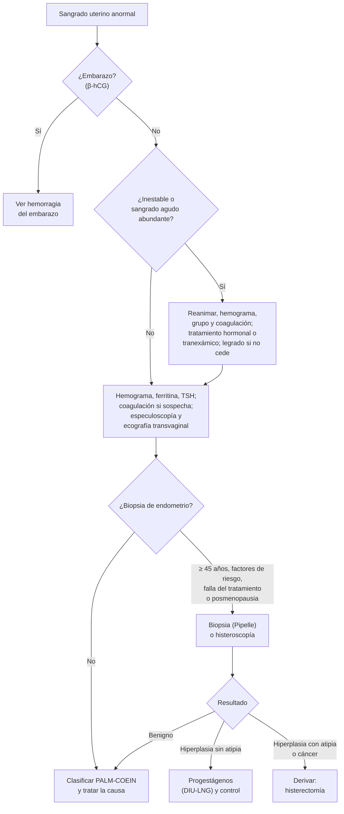

---
tags:
  - Ginecología y obstetricia
  - Frecuente en sala
---

# Sangrado uterino anormal, mioma uterino y patología endometrial (hiperplasia, pólipos y cáncer de endometrio)

**Subespecialidad**
Ginecología · Oncología ginecológica

**Guías principales**
FIGO 2018: sistemas de sangrado uterino normal y anormal (PALM-COEIN) · ACOG 2013: sangrado uterino anormal agudo (CO 557) · ACOG 2021: miomas sintomáticos (PB 228) · FIGO 2023: etapificación del cáncer de endometrio · ESGO/ESTRO/ESP 2025: cáncer de endometrio

**Otras fuentes**
Ver [hemorragia del primer trimestre](hemorragia-del-primer-trimestre-aborto-ectopico-y-mola.md), [cáncer cervicouterino](cancer-cervicouterino-lesiones-preinvasoras-y-tamizaje.md), [SOP y amenorrea](../endocrinologia/hirsutismo-amenorrea-y-ovario-poliquistico.md), [climaterio](../endocrinologia/climaterio-y-menopausia.md), [anemias](../hematologia/anemias.md), [coagulopatías](../hematologia/coagulopatias-cid-y-reversion-de-anticoagulantes.md) y [tiroides](../endocrinologia/hipotiroidismo-e-hipertiroidismo.md)

**GES**
No como problemas propios.

**EUNACOM**
3.01.1.018 Hemorragia genital anormal (sospecha, inicial, no requiere) · 3.01.2.008 Hemorragia genital aguda: metrorragia disfuncional, cervicorragia por cáncer cervicouterino (sospecha, inicial, no requiere) · 3.01.1.021 Mioma uterino (específico, inicial, completo) · 3.01.1.023 Patología benigna del endometrio (sospecha, inicial, derivar) · 3.01.1.024 Patología maligna del endometrio (sospecha, inicial, derivar)

**Revisado**
Octubre 2026

!!! abstract "Resumen en 60 segundos"
    - **Sangrado uterino anormal (SUA)**: alteración de la **frecuencia**, **regularidad**, **duración** o **volumen** de la menstruación, o sangrado **intermenstrual**. Las causas se ordenan con **PALM-COEIN** (FIGO): estructurales (**P**ólipo, **A**denomiosis, **L**eiomioma, **M**alignidad e hiperplasia) y no estructurales (**C**oagulopatía, disfunción **O**vulatoria, **E**ndometrial, **I**atrogénica, **N**o clasificada).
    - **Siempre descartar un embarazo** (β-hCG) en edad fértil.
    - **Estudio**: hemograma y ferritina, **TSH**, prolactina si es anovulatorio, coagulación si hay sospecha (**von Willebrand**), **ecografía transvaginal**. **Biopsia de endometrio** desde los **45 años** o antes si hay **factores de riesgo** (obesidad, SOP, anovulación crónica) o falla del tratamiento.
    - **SUA agudo**: estabilizar, luego **anticonceptivos combinados** o **progestágenos** en dosis altas, **ácido tranexámico**; si no cede o hay inestabilidad, **legrado** o histeroscopía.
    - **Miomas**: tumores benignos del músculo liso, muy frecuentes (**20–40 %** de las mujeres). La mayoría son asintomáticos. Los **submucosos** dan sangrado e infertilidad. Tratamiento médico (DIU con levonorgestrel, tranexámico, análogos o antagonistas de GnRH) o quirúrgico (**histeroscópico**, **miomectomía**, **histerectomía**).
    - **Metrorragia posmenopáusica** = **cáncer de endometrio** hasta demostrar lo contrario: **ecografía** (endometrio **> 4 mm** → biopsia) o **biopsia** directa.
    - **Hiperplasia sin atipia**: progestágenos (**DIU-LNG**). **Con atipia**: **histerectomía** (riesgo alto de cáncer concomitante).
    - **Cáncer de endometrio**: el cáncer ginecológico **más frecuente** en los países desarrollados. Factores: **exposición a estrógenos sin oposición** (obesidad, SOP, nuliparidad, tamoxifeno), **síndrome de Lynch**. Tratamiento: **histerectomía total + salpingooforectomía bilateral + ganglio centinela**.

## Definición

- **Menstruación normal** (FIGO 2018): **frecuencia** cada **24–38 días**, **duración ≤ 8 días**, **regular** (variación entre ciclos ≤ 7–9 días) y **volumen** que la mujer no considera excesivo.
- **Sangrado uterino anormal (SUA)**: sangrado del cuerpo uterino fuera de esos parámetros, en una mujer no embarazada.
    - **Agudo**: episodio abundante que requiere intervención **inmediata** para evitar más pérdida.
    - **Crónico**: presente la mayor parte de los últimos **6 meses**.
- **Sangrado menstrual abundante** (antes "menorragia"): pérdida excesiva que **interfiere con la calidad de vida**.
- **Sangrado intermenstrual** y **poscoital** (sinusorragia).
- **Metrorragia posmenopáusica**: sangrado **≥ 12 meses** después de la última menstruación.
- **Mioma (leiomioma)**: tumor **benigno** del músculo liso uterino, dependiente de estrógenos y progesterona.
- **Hiperplasia endometrial**: proliferación de glándulas endometriales con aumento de la relación glándula/estroma.
    - **Sin atipia**.
    - **Con atipia** = **neoplasia intraepitelial endometrial (EIN)**: precursora del carcinoma endometrioide.
- **Pólipo endometrial**: proliferación localizada de glándulas y estroma, cubierta de endometrio.
- **Cáncer de endometrio**: carcinoma del endometrio (**endometrioide** en ~ 80 %).

## Epidemiología

### Mundial

- El **SUA** afecta a ~ **1 de cada 3** mujeres en edad fértil; es uno de los motivos de consulta ginecológica más frecuentes y una causa principal de **anemia ferropénica**.
- **Miomas**: los tumores pélvicos más frecuentes; hasta **70–80 %** de las mujeres tiene miomas a los 50 años (en ecografía), pero solo un **20–40 %** es sintomático. Más frecuentes en mujeres **afrodescendientes**.
- **Cáncer de endometrio**: el cáncer ginecológico **más frecuente** en los países de altos ingresos; en aumento por la **obesidad** y el envejecimiento. Edad media al diagnóstico: **~ 60 años**; ~ 90 % se presenta con **sangrado** y ~ **70 %** se diagnostica en **etapa I** (buen pronóstico).
- En la **metrorragia posmenopáusica**, el riesgo de cáncer de endometrio es de **~ 9 %** (más si hay factores de riesgo).

!!! chile "Datos nacionales"
    - El **cáncer de endometrio** **no** tiene GES propio; su estudio y tratamiento se hacen en la red de oncología ginecológica. El cáncer **cervicouterino** sí es GES (N.° 3).
    - La **obesidad** (ENS 2016–2017: obesidad en el 31,2 % y obesidad mórbida en el 3,2 % de los adultos) es un factor de riesgo creciente de hiperplasia y cáncer de endometrio.
    - El **DIU con levonorgestrel** está disponible en la red pública (programa de regulación de la fertilidad) y es la primera línea del sangrado menstrual abundante.

## Etiología

### PALM-COEIN (FIGO 2018)

| Grupo | Causa | Claves |
|---|---|---|
| **P** | **Pólipo** endometrial o endocervical | Sangrado intermenstrual; ecografía o histerosonografía |
| **A** | **Adenomiosis** | Dismenorrea, sangrado abundante, útero globuloso y blando; ecografía o RM |
| **L** | **Leiomioma** (submucoso o de otras localizaciones) | Sangrado abundante, útero aumentado de tamaño e irregular |
| **M** | **Malignidad e hiperplasia** | Mayores de 45 años, obesidad, anovulación, posmenopausia |
| **C** | **Coagulopatía** | **Von Willebrand** (la más frecuente), trombocitopenia, anticoagulantes. Sangrado abundante **desde la menarquia** |
| **O** | **Disfunción ovulatoria** | **Anovulación**: extremos de la vida reproductiva (**adolescencia, perimenopausia**), **SOP**, hipotiroidismo, hiperprolactinemia, obesidad, estrés, ejercicio intenso, TCA |
| **E** | **Endometrial** | Alteración primaria de la hemostasia local, endometritis crónica |
| **I** | **Iatrogénica** | **Anticonceptivos** (sangrado intermenstrual), DIU de cobre, anticoagulantes, tamoxifeno, antipsicóticos (prolactina) |
| **N** | **No clasificada** | Malformaciones arteriovenosas, istmocele (nicho de cesárea) |

- En la **mujer joven**, la causa más frecuente es la **disfunción ovulatoria**; en la **adolescencia**, pensar también en **von Willebrand**.
- **Hemorragia genital aguda** de **origen no uterino**: **cervicorragia** por **cáncer cervicouterino**, pólipo cervical, lesiones vaginales o vulvares, traumatismos (incluido el abuso sexual), cuerpos extraños.

### Factores de riesgo de hiperplasia y cáncer de endometrio (tipo endometrioide)

- **Estrógenos sin oposición de progesterona**: **obesidad** (aromatización periférica), **SOP** y **anovulación crónica**, terapia hormonal con estrógenos solos, tumores productores de estrógenos (de la granulosa).
- **Nuliparidad**, **menarquia precoz y menopausia tardía**, **diabetes**, **HTA**.
- **Tamoxifeno** (efecto agonista en el endometrio).
- **Síndrome de Lynch** (riesgo de por vida de **40–60 %**; también colon y ovario).
- **Protectores**: **anticonceptivos combinados**, **DIU-LNG**, multiparidad, tabaco (paradójicamente), actividad física.

### Miomas

- Monoclonales, **dependientes de estrógenos y progesterona**: crecen en la edad fértil y en el embarazo, **involucionan** en la menopausia.
- Factores: **edad** (40–50 años), **afrodescendencia**, nuliparidad, **menarquia precoz**, obesidad, antecedente familiar, hipertensión. Las **multíparas** y las usuarias de anticonceptivos tienen menos riesgo.

## Fisiopatología

- **Anovulación**: sin cuerpo lúteo no hay **progesterona**; el endometrio prolifera bajo estrógenos sin oposición, se engruesa, se vuelve frágil y descama de forma **irregular, prolongada y abundante**. A largo plazo lleva a **hiperplasia** y **cáncer**.
- **Miomas**: aumentan la superficie endometrial, alteran la contractilidad y la vasculatura local. Los **submucosos** (que deforman la cavidad) son los que más sangran.
- **Cáncer de endometrio**: dos vías clásicas, hoy complementadas por la **clasificación molecular** (*POLE* mutado, deficiencia de reparación de errores de apareamiento **MMRd**, **p53 anormal**, sin perfil molecular específico).

| Característica | Tipo I (endometrioide) | Tipo II (no endometrioide) |
|---|---|---|
| Frecuencia | ~ 80 % | ~ 10–20 % |
| Hormonodependiente | **Sí** (estrógenos) | No |
| Precursor | **Hiperplasia con atipia** | Endometrio atrófico |
| Histología | Endometrioide de bajo grado | **Seroso**, **células claras**, carcinosarcoma |
| Molecular | POLE, MMRd, sin perfil específico | **p53 anormal** |
| Pronóstico | **Bueno** | **Malo** |

## Clasificación

### Miomas: clasificación FIGO

| Tipo | Ubicación |
|---|---|
| **0** | **Submucoso pediculado** (intracavitario) |
| **1** | Submucoso, **< 50 %** intramural |
| **2** | Submucoso, **≥ 50 %** intramural |
| **3** | Intramural en contacto con el endometrio |
| **4** | **Intramural** |
| **5** | Subseroso, ≥ 50 % intramural |
| **6** | Subseroso, < 50 % intramural |
| **7** | **Subseroso pediculado** |
| **8** | Otros: **cervical**, parasítico, del ligamento ancho |

### Etapificación FIGO 2023 del cáncer de endometrio (simplificada)

| Etapa | Extensión |
|---|---|
| **I** | Confinado al **cuerpo uterino** (IA: < 50 % del miometrio en tipos no agresivos; IB: ≥ 50 %; IC: histologías agresivas limitadas a un pólipo o al endometrio) |
| **II** | Invasión del **estroma cervical**, o histologías agresivas con invasión miometrial, o invasión linfovascular extensa |
| **III** | Extensión **local o regional**: **anexos**, serosa, **vagina** o parametrio, **ganglios** pélvicos o paraaórticos |
| **IV** | **Vejiga** o mucosa **intestinal**, **peritoneo** abdominal o **metástasis a distancia** |

- La FIGO 2023 incorpora la **clasificación molecular** cuando está disponible: el ***POLE* mutado** en etapas I–II se reclasifica como **IAm** (excelente pronóstico) y el **p53 anormal** con invasión miometrial como **IICm** (peor pronóstico).

## Clínica

- **SUA por anovulación**: ciclos **irregulares**, a veces con amenorrea seguida de sangrado abundante; sin dismenorrea. Contexto: adolescencia, perimenopausia, SOP (hirsutismo, acné, obesidad).
- **Coagulopatía**: sangrado abundante **desde la menarquia**, epistaxis, gingivorragia, equimosis, sangrado posparto o tras extracciones dentales.
- **Miomas**:
    - **Asintomáticos** en la mayoría.
    - **Sangrado menstrual abundante** (submucosos e intramurales grandes) con **anemia**.
    - **Compresión**: polaquiuria, retención urinaria, constipación, **hidronefrosis**; aumento del perímetro abdominal.
    - **Dolor**: dismenorrea, **degeneración** (roja en el embarazo: dolor agudo y fiebre), **torsión** de un mioma pediculado, **mioma parido** (submucoso que protruye por el cuello con dolor tipo cólico y sangrado).
    - **Infertilidad** y pérdidas reproductivas (submucosos).
    - Examen: **útero aumentado de tamaño, irregular, firme**, móvil.
- **Pólipos**: sangrado **intermenstrual** o poscoital, a veces asintomáticos.
- **Hiperplasia y cáncer de endometrio**: **metrorragia posmenopáusica** (el síntoma clave), SUA en mayores de 45 años o en jóvenes con anovulación crónica; en etapas avanzadas, dolor pélvico, masa, ascitis, baja de peso.

!!! alarma "Signos de alarma"
    - **Sangrado abundante con taquicardia, hipotensión o Hb < 7 g/dL** → SUA agudo grave: reanimar y detener el sangrado.
    - **Metrorragia posmenopáusica** → estudio del endometrio **siempre**.
    - **Mioma que crece rápido en la posmenopausia** → sospechar un **sarcoma** (raro).
    - **Lesión visible en el cuello con sangrado** → biopsia (cáncer cervicouterino).
    - **Sangrado en una adolescente que requiere transfusión** → descartar **von Willebrand** y otras coagulopatías.

## Diagnóstico

!!! guia "Puntos clave (FIGO 2018; ACOG 2013 y 2021; ESGO/ESTRO/ESP 2025)"
    - **β-hCG** en toda mujer en edad fértil con sangrado anormal.
    - **Anamnesis** del patrón de sangrado (calendario menstrual, número de toallas, coágulos, inundaciones), síntomas de anemia, antecedentes de coagulopatía (tamizaje estructurado de von Willebrand), fármacos.
    - **Especuloscopía** (descartar una causa cervical o vaginal) y **tacto bimanual**.
    - **Ecografía transvaginal**: miomas, adenomiosis, pólipos, grosor endometrial. **Histerosonografía** o **histeroscopía** para las lesiones intracavitarias.
    - **Biopsia de endometrio** (aspirativa tipo **Pipelle**, ambulatoria, o dirigida por **histeroscopía**):
        - Edad **≥ 45 años** con SUA.
        - **Menores de 45** con **estrógenos sin oposición** (obesidad, SOP, anovulación), **falla del tratamiento médico** o **síndrome de Lynch**.
        - **Posmenopáusicas** con sangrado y endometrio **> 4 mm** (o con sangrado persistente aunque sea ≤ 4 mm).
    - **Cáncer de endometrio**: el diagnóstico es **histológico**. Etapificación con **RM de pelvis** (invasión miometrial y cervical), TC de tórax y abdomen en los de alto riesgo, y **cirugía**. Solicitar el **perfil molecular** (p53, MMR, POLE).

## Laboratorio

- **β-hCG**.
- **Hemograma** y **ferritina** (anemia ferropénica).
- **TSH** (hipotiroidismo e hipertiroidismo); **prolactina** si hay anovulación o galactorrea.
- **Pruebas de coagulación** (TP, TTPK, plaquetas) y **estudio de von Willebrand** (factor de von Willebrand antigénico y actividad, factor VIII) si la historia lo sugiere; idealmente antes de iniciar estrógenos.
- **Grupo y Rh** en el sangrado agudo.
- Andrógenos y estudio de **SOP** según el contexto.
- **Cáncer de endometrio**: inmunohistoquímica para **MMR** (tamizaje del **síndrome de Lynch** en todos los casos); **CA-125** en los de alto riesgo o con sospecha de extensión.

## Imágenes

- **Ecografía transvaginal** (primera línea):
    - **Grosor endometrial** en la posmenopausia: **≤ 4 mm** tiene un valor predictivo negativo muy alto para cáncer; **> 4 mm** → biopsia.
    - En la premenopausia el grosor varía con el ciclo y no sirve como criterio aislado.
    - Miomas (número, tamaño, ubicación FIGO), **adenomiosis** (útero globuloso, miometrio heterogéneo, quistes), pólipos.
- **Histerosonografía** (suero en la cavidad): distingue pólipos de miomas submucosos.
- **Histeroscopía**: diagnóstico y tratamiento de las lesiones intracavitarias, biopsia dirigida.
- **RM de pelvis**: mapeo de los miomas antes de una miomectomía o embolización, adenomiosis, **etapificación** del cáncer de endometrio.

## Diagnóstico diferencial

| Cuadro | Claves |
|---|---|
| **Complicaciones del embarazo** (aborto, ectópico, mola) | **β-hCG positiva** |
| **Causa cervical** (cervicitis, pólipo, **cáncer**) | Especuloscopía, sinusorragia |
| **Causa vaginal o vulvar** (atrofia, trauma, cuerpo extraño, tumores) | Examen genital |
| **Sangrado no genital** (urinario, rectal) | Hematuria, rectorragia; examen |
| **Sarcoma uterino** (leiomiosarcoma) | Mioma de crecimiento rápido en la posmenopausia, heterogéneo en la RM; diagnóstico frecuentemente posoperatorio |
| **Adenomiosis** vs. **miomas** | Útero globuloso y simétrico con dismenorrea intensa vs. útero irregular |
| **Atrofia endometrial** | La causa más frecuente de metrorragia posmenopáusica (endometrio ≤ 4 mm) |

## Tratamiento

### Sangrado uterino anormal agudo

1. **Evaluar la estabilidad**: vías venosas, hemograma, grupo y Rh, coagulación; **transfusión** si es necesario.
2. **Tratamiento médico** (si está estable y no hay contraindicación):
    - **Anticonceptivo oral combinado** monofásico (etinilestradiol 30–35 µg) **1 comprimido cada 8 h por 7 días**, luego 1 al día.
    - **Progestágeno** en dosis altas: **acetato de medroxiprogesterona 20 mg cada 8 h por 7 días** (o noretisterona).
    - **Estrógenos conjugados EV 25 mg cada 4–6 h** (máximo 24 h), donde estén disponibles.
    - **Ácido tranexámico** **1–1,3 g VO cada 8 h** (o 10 mg/kg EV) por hasta 5 días.
3. **Si no cede o está inestable**: **taponamiento** con sonda Foley intrauterina, **legrado** uterino (diagnóstico y terapéutico) o **histeroscopía**; embolización de las arterias uterinas o histerectomía en los casos refractarios.
4. Tratar la **causa** (coagulopatía, mioma submucoso) y la **anemia** (hierro).

### Sangrado uterino anormal crónico

| Opción | Uso |
|---|---|
| **DIU con levonorgestrel (52 mg)** | **Primera línea** del sangrado menstrual abundante sin lesión estructural importante; reduce el sangrado ~ 80–90 % y protege el endometrio |
| **Anticonceptivos combinados** | Regulan el ciclo (anovulación, SOP) y reducen el volumen |
| **Progestágenos** cíclicos (medroxiprogesterona 10 mg/día por 10–14 días al mes) o continuos | Anovulación; protección endometrial |
| **Ácido tranexámico** | **1 g cada 8 h** durante la menstruación (máximo 5 días); no hormonal; contraindicado si hay trombosis activa |
| **AINE** (ibuprofeno, ácido mefenámico) | Reducen el sangrado ~ 30 % y la dismenorrea |
| **Hierro** | Corregir la ferropenia |
| **Ablación endometrial** | Paridad cumplida, cavidad normal, falla del tratamiento médico (descartar antes el cáncer) |
| **Histerectomía** | Tratamiento definitivo cuando fallan las otras opciones |

### Miomas

- **Asintomáticos**: **observación** con control clínico y ecográfico (no requieren tratamiento aunque sean grandes, salvo hidronefrosis o crecimiento rápido).
- **Tratamiento médico** (control de síntomas):
    - **DIU-LNG** (si la cavidad no está deformada), **ácido tranexámico**, **AINE**, **anticonceptivos**.
    - **Agonistas de GnRH** (leuprolide): reducen el tamaño y el sangrado; se usan **antes de la cirugía** (3–6 meses) para corregir la anemia. Efectos de hipoestrogenismo (bochornos, pérdida ósea).
    - **Antagonistas orales de GnRH** (relugolix o elagolix con *add-back* de estradiol y noretisterona): tratamiento a largo plazo donde estén disponibles.
    - El **acetato de ulipristal** tiene uso restringido por casos de **daño hepático grave**.
- **Tratamiento quirúrgico o intervencionista**:
    - **Miomectomía histeroscópica**: tipos **0–2** (sangrado, infertilidad).
    - **Miomectomía** laparoscópica o abierta: desea **preservar la fertilidad**.
    - **Histerectomía**: paridad cumplida, síntomas importantes; tratamiento **definitivo**.
    - **Embolización de las arterias uterinas**: alternativa a la cirugía en mujeres que no desean embarazo.
- **Mioma en el embarazo**: manejo **expectante**; la degeneración roja se trata con **analgesia** (paracetamol, AINE por corto tiempo antes de las 30 semanas).

### Pólipos endometriales

- **Resección histeroscópica** si son sintomáticos, en la posmenopausia, mayores de 1,5 cm o con infertilidad. Los pequeños y asintomáticos en premenopáusicas pueden observarse.

### Hiperplasia endometrial

| Tipo | Riesgo de cáncer | Tratamiento |
|---|---|---|
| **Sin atipia** | **< 5 %** de progresión | **Progestágenos**: **DIU-LNG** (primera línea) o progestágenos orales continuos por **6 meses**; corregir la causa (baja de peso, SOP). **Biopsia de control** cada 6 meses hasta tener 2 negativas |
| **Con atipia (EIN)** | **~ 25–40 %** de cáncer **concomitante** | **Histerectomía total** (± salpingooforectomía según la edad), sin morcelación. Con **deseo de fertilidad**: progestágenos en dosis altas o DIU-LNG con biopsias cada 3–6 meses y cirugía al completar la paridad |

### Cáncer de endometrio (derivación a oncología ginecológica)

- **Etapas iniciales**: **histerectomía total + salpingooforectomía bilateral** (laparoscópica de preferencia) con **ganglio centinela**; lavado peritoneal; en los serosos, **omentectomía**.
- **Adyuvancia según el riesgo** (histología, grado, invasión miometrial, invasión linfovascular y **perfil molecular**):
    - **Bajo riesgo**: sin tratamiento adicional.
    - **Intermedio**: **braquiterapia vaginal**.
    - **Alto riesgo**: **radioterapia** externa ± **quimioterapia** (carboplatino-paclitaxel).
- **Avanzado o recurrente**: **quimioterapia** con carboplatino-paclitaxel + **inmunoterapia** (anti-PD-1: dostarlimab o pembrolizumab, sobre todo en los **MMRd**); **hormonoterapia** (progestágenos) en los de bajo grado con receptores positivos.
- **Preservación de la fertilidad** (casos seleccionados: endometrioide de bajo grado limitado al endometrio): progestágenos en dosis altas o DIU-LNG con controles histológicos.
- **Síndrome de Lynch**: consejería genética; vigilancia y cirugía reductora de riesgo a la familia.

!!! dosis "Fármacos habituales"
    | Fármaco | Dosis | Comentarios |
    |---|---|---|
    | **Anticonceptivo oral combinado** (SUA agudo) | **1 comprimido (30–35 µg) cada 8 h por 7 días**, luego 1 al día | Náuseas; contraindicado con riesgo trombótico |
    | **Medroxiprogesterona** (SUA agudo) | **20 mg VO cada 8 h por 7 días** | Alternativa si hay contraindicación de estrógenos |
    | **Medroxiprogesterona** (cíclica) | **10 mg/día por 10–14 días** cada mes | Anovulación |
    | **Ácido tranexámico** | **1 g VO cada 8 h** por hasta 5 días (agudo: hasta 1,3 g cada 8 h o 10 mg/kg EV) | Contraindicado con trombosis activa |
    | **Ibuprofeno** | **400–600 mg cada 6–8 h** durante la menstruación | También alivia la dismenorrea |
    | **DIU-LNG 52 mg** | Inserción; dura **5–8 años** | Primera línea en el sangrado abundante y en la hiperplasia sin atipia |
    | **Leuprolide** (agonista de GnRH) | **3,75 mg IM mensual** o 11,25 mg trimestral | Preoperatorio en miomas (3–6 meses) |
    | **Sulfato ferroso** | **100–200 mg de hierro elemental al día** | Anemia ferropénica |

!!! alarma "Urgencia"
    - **SUA agudo con inestabilidad**: reanimación, transfusión, **ácido tranexámico** EV, sonda Foley intrauterina y **legrado**; no esperar el efecto hormonal.
    - **Mioma parido** con sangrado: extirpación por vía vaginal (torsión del pedículo) o histeroscópica.

## Complicaciones

- **SUA**: **anemia ferropénica**, deterioro de la calidad de vida, ausentismo; shock en el SUA agudo grave.
- **Miomas**: anemia, **degeneración** (hialina, quística, roja, calcificación), torsión, **infertilidad**, aborto, parto prematuro, presentación anómala, **hemorragia posparto**; **hidronefrosis**. **Sarcoma** (< 1 %; no se origina de un mioma previo en la mayoría).
- **Hiperplasia con atipia**: progresión a **cáncer**.
- **Cáncer de endometrio**: metástasis ganglionares, pulmonares, vaginales; complicaciones del tratamiento (linfedema, proctitis, estenosis vaginal).
- **Tratamientos**: tromboembolismo (estrógenos, tranexámico en pacientes de riesgo), osteoporosis (agonistas de GnRH prolongados), perforación uterina (legrado, histeroscopía), **síndrome de Asherman**.

## Pronóstico y seguimiento

- La mayoría de los SUA por **anovulación** responde al tratamiento hormonal; en la adolescencia mejoran al madurar el eje.
- **Miomas**: recurren tras la miomectomía en ~ 25–50 %; involucionan en la menopausia.
- **Cáncer de endometrio**: sobrevida a 5 años **> 90 %** en la etapa I, menor en las etapas avanzadas y en los tipos **p53 anormal** y serosos. Seguimiento cada 3–6 meses los primeros 2–3 años con examen clínico y vaginal.

## Perlas para el internado

!!! perla "Para recordar en la sala"
    - **SUA en edad fértil = β-hCG primero**.
    - **PALM-COEIN**: estructural (PALM) y no estructural (COEIN). En la adolescente: **anovulación** y **von Willebrand**.
    - **Metrorragia posmenopáusica** = **cáncer de endometrio** hasta demostrar lo contrario; **endometrio > 4 mm → biopsia**.
    - **Biopsia de endometrio** con SUA desde los **45 años**, o antes si hay obesidad, SOP o anovulación crónica.
    - El **DIU-LNG** es la **primera línea** del sangrado menstrual abundante y de la hiperplasia sin atipia.
    - **Mioma submucoso** = sangrado e infertilidad → **histeroscopía**.
    - **Hiperplasia con atipia = histerectomía** (riesgo alto de cáncer concomitante).
    - **Cáncer de endometrio**: pedir **MMR** a todos (síndrome de Lynch).

## Preguntas de repaso

??? repaso "1. Mujer de 16 años con menstruaciones abundantes desde la menarquia, Hb 8,5 g/dL y epistaxis frecuentes. β-hCG negativa. ¿Qué sospecha y qué pide?"
    - Sospechar una **coagulopatía**, sobre todo la **enfermedad de von Willebrand** (y anovulación propia de la edad).
    - Hemograma, ferritina, **TP, TTPK, plaquetas**, **factor de von Willebrand** y **factor VIII**, TSH.
    - Tratamiento: **ácido tranexámico** y/o hormonal, hierro; derivar a hematología.

??? repaso "2. Mujer de 50 años con ciclos irregulares y sangrados abundantes los últimos 6 meses. IMC 34. ¿Qué estudio necesita?"
    - β-hCG, hemograma y ferritina, TSH, **ecografía transvaginal**.
    - **Biopsia de endometrio** (≥ 45 años y obesidad): descartar **hiperplasia** o **cáncer**.

??? repaso "3. Mujer de 65 años con un sangrado genital escaso hace una semana. La ecografía muestra un endometrio de 9 mm. ¿Qué hace?"
    - **Metrorragia posmenopáusica** con **endometrio > 4 mm** → **biopsia de endometrio** (Pipelle o histeroscopía).
    - Si confirma un cáncer: derivación a oncología ginecológica para **histerectomía total + salpingooforectomía bilateral + ganglio centinela** y perfil molecular.

??? repaso "4. Mujer de 38 años con sangrado menstrual abundante, anemia y un mioma submucoso FIGO 1 de 3 cm. Desea embarazarse. ¿Qué indica?"
    - **Miomectomía histeroscópica** (tipos 0–2): resuelve el sangrado y mejora la fertilidad.
    - Corregir la anemia (hierro; agonista de GnRH preoperatorio si la anemia es importante).

??? repaso "5. Biopsia de endometrio de una mujer de 52 años: hiperplasia con atipia. ¿Conducta?"
    - **Histerectomía total** (± salpingooforectomía bilateral, según la edad): hasta un tercio tiene un **cáncer concomitante**.
    - Si deseara fertilidad (no es este caso): progestágenos en dosis altas o DIU-LNG con biopsias seriadas.

??? repaso "6. Mujer de 42 años consulta en urgencia con sangrado genital abundante, FC 112/min, Hb 7,2 g/dL, β-hCG negativa. ¿Cómo la maneja?"
    - **SUA agudo**: dos vías, grupo y Rh, coagulación, **transfusión** si es necesario.
    - **Ácido tranexámico** y tratamiento hormonal en dosis altas (anticonceptivo combinado o medroxiprogesterona); si no cede o se inestabiliza: **sonda Foley** intrauterina y **legrado** (que además entrega una muestra del endometrio).
    - Luego, estudio de la causa (ecografía, biopsia por la edad).

## Referencias

1. Munro MG, Critchley HOD, Fraser IS; FIGO Menstrual Disorders Committee. The two FIGO systems for normal and abnormal uterine bleeding symptoms and classification of causes of abnormal uterine bleeding in the reproductive years: 2018 revisions. *Int J Gynaecol Obstet.* 2018;143(3):393–408. doi:[10.1002/ijgo.12666](https://doi.org/10.1002/ijgo.12666)
2. American College of Obstetricians and Gynecologists. Committee Opinion No. 557: Management of acute abnormal uterine bleeding in nonpregnant reproductive-aged women. *Obstet Gynecol.* 2013;121(4):891–896. doi:[10.1097/01.AOG.0000428646.67925.9a](https://doi.org/10.1097/01.AOG.0000428646.67925.9a)
3. American College of Obstetricians and Gynecologists. Management of symptomatic uterine leiomyomas: ACOG Practice Bulletin No. 228. *Obstet Gynecol.* 2021;137(6):e100–e115. doi:[10.1097/AOG.0000000000004401](https://doi.org/10.1097/AOG.0000000000004401)
4. Berek JS, Matias-Guiu X, Creutzberg C, et al. FIGO staging of endometrial cancer: 2023. *Int J Gynaecol Obstet.* 2023;162(2):383–394. doi:[10.1002/ijgo.14923](https://doi.org/10.1002/ijgo.14923)
5. Concin N, Matias-Guiu X, Cibula D, et al. ESGO-ESTRO-ESP guidelines for the management of patients with endometrial carcinoma: update 2025. *Lancet Oncol.* 2025;26(8):e423–e435. doi:[10.1016/S1470-2045(25)00167-6](https://doi.org/10.1016/S1470-2045(25)00167-6)
