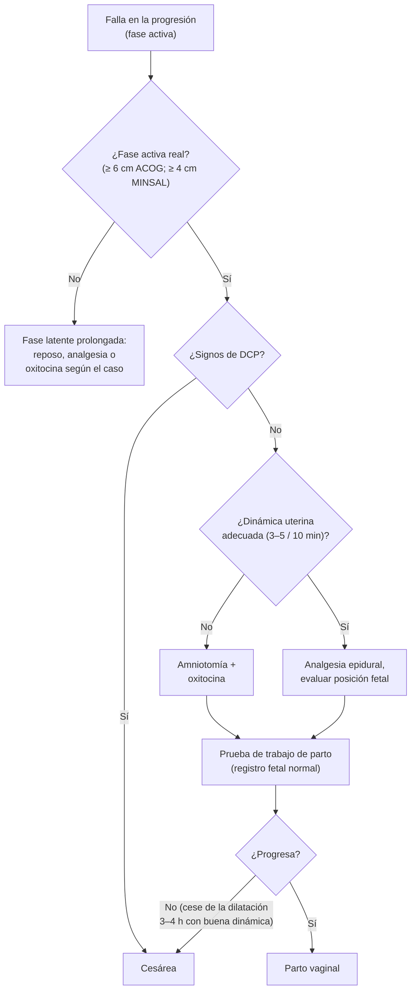

---
tags:
  - Ginecología y obstetricia
  - Urgencia
---

# Trabajo de parto distócico, presentaciones anómalas, sufrimiento fetal agudo, macrosomía y embarazo múltiple

**Subespecialidad**
Obstetricia · Sala de partos

**Guías principales**
MINSAL 2015: Guía Perinatal (capítulos de trabajo de parto, monitorización intraparto, embarazo gemelar, cesárea y urgencias obstétricas) · ACOG/SMFM 2014: prevención segura de la primera cesárea (Obstetric Care Consensus 1) · ACOG 2009: monitorización intraparto (PB 106) · ACOG 2017: distocia de hombros (PB 178) · ACOG 2020: macrosomía (PB 216) y versión cefálica externa (PB 221) · ACOG 2021: embarazo múltiple (PB 231)

**Otras fuentes**
Ver [parto prematuro y RPM](parto-prematuro-y-rotura-prematura-de-membranas.md), [metrorragia de la segunda mitad del embarazo](metrorragia-de-la-segunda-mitad-del-embarazo.md), [diabetes y embarazo](../endocrinologia/diabetes-y-embarazo.md) y [control prenatal](control-prenatal-edad-gestacional-e-isoinmunizacion-rh.md)

**GES**
Sí: problema N.° 54, analgesia del parto (analgesia epidural garantizada).

**EUNACOM**
3.01.2.021 Trabajo de parto distócico (sospecha, inicial, no requiere) · 3.01.2.013 Presentaciones fetales anómalas (sospecha, inicial, no requiere) · 3.01.2.017 Sufrimiento fetal agudo (específico, inicial, no requiere) · 3.01.1.009 Macrosomía fetal (sospecha, inicial, no requiere) · 3.01.1.007 Embarazo múltiple (sospecha, inicial, derivar)

**Revisado**
Octubre 2026

!!! abstract "Resumen en 60 segundos"
    - **Trabajo de parto**: ≥ 2 contracciones en 10 minutos con **modificaciones cervicales**. Tres etapas: **dilatación** (fase latente y activa), **expulsivo** y **alumbramiento**.
    - **Distocia** = progreso lento o nulo. Causas: las **3 P**: **potencia** (dinámica uterina insuficiente, la más frecuente en nulíparas), **pasajero** (macrosomía, mala posición o presentación) y **pelvis** (desproporción céfalo-pélvica).
        - Antes de diagnosticarla: estar en **fase activa** (≥ 6 cm según ACOG/SMFM 2014; ≥ 4 cm según la Guía Perinatal 2015).
        - Manejo: descartar una **DCP**, **amniotomía** y **oxitocina** para lograr **3–5 contracciones en 10 minutos**, analgesia y **prueba de trabajo de parto**. Si fracasa → **cesárea**.
    - **Sufrimiento fetal agudo** (mejor: **estado fetal no tranquilizador**): hipoxia y acidosis fetal intraparto. Se detecta con el **registro de la frecuencia cardíaca fetal**.
        - **Categoría I**: normal. **Categoría II**: indeterminado, corregir y vigilar. **Categoría III**: anormal (variabilidad ausente con desaceleraciones tardías o variables recurrentes, bradicardia o patrón sinusoidal).
        - **Reanimación intrauterina** (decúbito lateral, suspender oxitocina, volumen, tocolisis aguda) y, si no mejora, **parto por la vía más rápida**.
    - **Presentaciones anómalas**:
        - **Podálica** (3–4 % al término): ofrecer **versión cefálica externa** desde las 37 semanas; si persiste, **cesárea** (Guía Perinatal 2015).
        - **Transversa** (tronco): **cesárea** siempre.
        - **Frente** y **cara mentoposterior**: cesárea.
    - **Macrosomía**: peso al nacer **> 4000 g** (o > 4500 g). Riesgo: **distocia de hombros**. Cesárea electiva si el peso estimado es **> 4500 g** (Guía Perinatal 2015).
    - **Distocia de hombros**: **McRoberts + presión suprapúbica** resuelven ~ 90 %. **Nunca** tracción excesiva ni Kristeller.
    - **Embarazo múltiple**: definir la **corionicidad** a las **11–14 semanas** (signo lambda = bicorial; signo T = monocorial). La principal complicación es el **parto prematuro**; los monocoriales tienen además **síndrome de transfusión feto-fetal**. **Derivar** a alto riesgo.

## Definición

- **Trabajo de parto** (Guía Perinatal 2015): **≥ 2 contracciones en 10 minutos**, de ≥ 30 segundos, durante al menos una hora, con **borramiento ≥ 50 %** y **dilatación ≥ 1 cm**.
- **Etapas**:
    - **Primera (dilatación)**: **fase latente** (hasta ~ 3–6 cm, cuello borrado) y **fase activa** (hasta 10 cm). La Guía Perinatal 2015 sitúa el inicio de la fase activa en los 3–4 cm; ACOG/SMFM 2014 en los **6 cm**.
    - **Segunda (expulsivo)**: de la dilatación completa al nacimiento.
    - **Tercera (alumbramiento)**: del nacimiento a la salida de la placenta.
- **Distocia**: progreso **lento o detenido** del trabajo de parto.
- **Desproporción céfalo-pélvica (DCP)**: desproporción entre la cabeza fetal y la pelvis materna que impide el parto vaginal.
- **Sufrimiento fetal agudo**: alteración del intercambio gaseoso fetal durante el parto que lleva a **hipoxemia, hipoxia y acidosis**. Hoy se prefiere el término **estado fetal no tranquilizador** porque el registro solo **sugiere** la hipoxia.
- **Presentación**: parte fetal que se apoya en la pelvis (**cefálica**, **podálica**, **tronco**). **Posición**: relación del punto de reparo (occipucio, mentón, sacro) con la pelvis materna.
- **Macrosomía**: peso al nacer **> 4000 g** (algunas guías > 4500 g), independiente de la edad gestacional. **Grande para la edad gestacional (GEG)**: peso > p90.
- **Embarazo múltiple**: gestación con **dos o más fetos**.

## Epidemiología

### Mundial

- La **distocia** (falla de la progresión) es la **primera indicación de cesárea primaria**, seguida del **registro fetal no tranquilizador**.
- **Podálica**: **3–4 %** de los embarazos de término (más frecuente a menor edad gestacional).
- **Distocia de hombros**: **0,2–2 %** de los partos; **> 50 %** ocurre **sin factores de riesgo** (Guía Perinatal 2015).
- **Macrosomía** > 4000 g: ~ 8 % de los nacidos vivos; > 4500 g: ~ 1 % (ACOG 2020).
- **Gemelos**: ~ **1 de cada 80–100** embarazos, hasta 3 % por la **reproducción asistida** y la mayor edad materna. **Un tercio** de los monocigotos es monocorial.

!!! chile "Datos nacionales y GES"
    - La Guía Perinatal 2015 recomienda **ingresar a las mujeres en fase activa**, usar el **partograma** cuando la progresión no es la esperada y **evitar intervenciones de rutina** (rasurado, enema, episiotomía universal, maniobra de **Kristeller**).
    - Chile tiene una de las **tasas de cesárea más altas** de América Latina, mayor en el sector privado.
    - **GES N.° 54**: **analgesia del parto** (epidural u otra técnica) para toda mujer en trabajo de parto que la requiera.
    - El programa **Chile Crece Contigo** promueve el **acompañamiento** continuo y la atención personalizada del parto.

## Etiología

### Distocias (las 3 P)

| Factor | Causas |
|---|---|
| **Potencia** (motor) | **Hipodinamia** (< 3 contracciones en 10 minutos o de baja intensidad), dinámica **incoordinada**, agotamiento materno. La más frecuente en **nulíparas** |
| **Pasajero** (feto) | **Macrosomía**, **occipito posterior** persistente, **asinclitismo**, **deflexión** (frente, cara), presentaciones anómalas, hidrocefalia |
| **Pelvis** (canal) | **Pelvis estrecha**, tumores previos (miomas, quistes), cicatrices cervicales. La **DCP** es más frecuente en **multíparas** con falla de la progresión |

### Presentaciones anómalas

- **Podálica**: **prematurez**, gemelar, **placenta previa**, polihidramnios u oligoamnios, malformaciones uterinas (útero bicorne, miomas), malformaciones fetales (hidrocefalia, anencefalia), multiparidad, cordón corto.
- **Transversa**: **gran multiparidad**, **placenta previa**, malformaciones uterinas, polihidramnios, prematurez, segundo gemelo.
- **Cara y frente**: tumores del cuello, anencefalia, pelvis estrecha.

### Macrosomía

- **Diabetes** (pregestacional y gestacional mal controladas), **obesidad** materna, **ganancia de peso** excesiva, **embarazo prolongado**, multiparidad, macrosomía previa, sexo masculino, síndromes de sobrecrecimiento (Beckwith-Wiedemann).

### Sufrimiento fetal agudo

- **Maternas**: **hipotensión** (analgesia, decúbito supino), hipoxemia, shock, convulsiones.
- **Uterinas**: **taquisistolía** (≥ 6 contracciones en 10 minutos; por oxitocina o prostaglandinas), **hipertonía**, **rotura uterina**.
- **Placentarias**: **DPPNI**, insuficiencia placentaria (RCF, preeclampsia), embarazo prolongado.
- **Funiculares**: **compresión** (oligoamnios), **prolapso** del cordón, circulares, nudos.

## Fisiopatología

- **Mecanismo del parto en vértice** (occipito anterior): encajamiento, **flexión**, descenso, **rotación interna**, **extensión** (deflexión), rotación externa (restitución) y expulsión de los hombros.
- **Hipoxia fetal**: durante cada contracción disminuye el flujo uteroplacentario. Un feto sano tolera las contracciones gracias a sus reservas. Si la reserva es baja o el estrés es mayor, aparecen **desaceleraciones tardías** (insuficiencia uteroplacentaria) o **variables** (compresión del cordón), luego pérdida de la **variabilidad** (depresión del SNC por acidosis) y finalmente **bradicardia**.

## Clasificación

### Alteraciones del trabajo de parto (Guía Perinatal 2015; ACOG/SMFM 2014)

| Alteración | Criterio |
|---|---|
| **Fase latente prolongada** | > **20 h** en nulíparas, > **14 h** en multíparas. No es indicación de cesárea |
| **Fase activa prolongada** | Dilatación < 1,2 cm/h (nulípara) o < 1,5 cm/h (multípara) |
| **Detención (cese) de la dilatación** | Sin progreso por **≥ 2 h** (Guía Perinatal). ACOG/SMFM: con ≥ 6 cm y membranas rotas, **≥ 4 h** con dinámica adecuada o **≥ 6 h** con oxitocina y dinámica inadecuada |
| **Expulsivo prolongado** | Guía Perinatal: > **90 min** en nulíparas y > **60 min** en multíparas. ACOG/SMFM: detención con **≥ 3 h** de pujo en nulíparas y **≥ 2 h** en multíparas (más con epidural) |
| **Falla o detención del descenso** | Sin descenso por ≥ 1 h |
| **Parto precipitado** | > 5 cm/h (nulípara) o > 10 cm/h (multípara) |

### Registro de la frecuencia cardíaca fetal intraparto (NICHD/ACOG 2009)

| Categoría | Características | Conducta |
|---|---|---|
| **I (normal)** | Basal **110–160**, variabilidad **moderada (6–25 lpm)**, sin desaceleraciones tardías ni variables; puede haber aceleraciones y desaceleraciones **precoces** | Vigilancia habitual |
| **II (indeterminado)** | Todo lo que no es I ni III: taquicardia, variabilidad mínima o marcada, desaceleraciones tardías o variables recurrentes **con variabilidad conservada**, desaceleraciones prolongadas | **Reanimación intrauterina**, buscar la causa, reevaluar |
| **III (anormal)** | **Variabilidad ausente** + desaceleraciones **tardías recurrentes**, **variables recurrentes** o **bradicardia**; o **patrón sinusoidal** | Reanimación intrauterina y **parto inmediato** si no se corrige |

- La **Guía Perinatal 2015** propone además un sistema de **5 colores** (verde, azul, amarillo, naranjo, rojo) que gradúa el riesgo de acidemia dentro de la categoría II.
- **Desaceleración precoz**: compresión cefálica, benigna. **Tardía**: insuficiencia uteroplacentaria. **Variable**: compresión del cordón.

### Embarazo múltiple según corionicidad

| Tipo | Origen | Frecuencia | Riesgos |
|---|---|---|---|
| **Bicorial biamniótico** | Dicigótico (siempre) o monocigótico precoz (días 0–3) | ~ 80 % | Los generales del gemelar (prematurez, RCF, preeclampsia) |
| **Monocorial biamniótico** | Monocigótico (días 4–8) | ~ 20 % | + **transfusión feto-fetal**, RCF selectiva, secuencia anemia-policitemia, muerte del cogemelo |
| **Monocorial monoamniótico** | Monocigótico (días 8–13) | ~ 1 % | + **entrelazamiento del cordón** |
| **Siameses** | Monocigótico (> día 13) | Muy raro | Fusión de órganos |

## Clínica

- **Distocia**: trabajo de parto que no avanza en el **partograma**; signos de **DCP**: feto grande, cabeza alta que no se encaja (**rebalse suprapúbico**), **edema del cuello**, **caput** y **moldeamiento**, asinclitismo, pujo antes de la dilatación completa, **prueba de Hillis-Müller** negativa.
- **Presentación podálica**: polo duro y redondo (cabeza) en el **fondo uterino** con las **maniobras de Leopold**; latidos sobre el ombligo; al tacto, sacro, nalgas o pies.
- **Presentación transversa**: útero ancho, polos fetales en las fosas ilíacas, pelvis vacía. Riesgo de **prolapso de cordón o de un brazo**.
- **Macrosomía**: **altura uterina** > p90, ganancia de peso excesiva, diabetes.
- **Embarazo múltiple**: altura uterina mayor a la esperada, hiperemesis, palpación de muchas partes fetales, **dos focos** de latidos. Hoy casi siempre se diagnostica en la **ecografía precoz**.
- **Sufrimiento fetal**: alteración del registro, **líquido con meconio** espeso (signo indirecto; no diagnóstico por sí solo).

!!! alarma "Signos de alarma"
    - **Registro categoría III** o **bradicardia** sostenida < 110 lpm (sobre todo < 80) → reanimación intrauterina y parto urgente.
    - **Prolapso de cordón** → elevar la presentación con la mano vaginal, decúbito genupectoral o Trendelenburg y **cesárea inmediata**.
    - **Dolor brusco, cese de las contracciones y alteración del registro** en una cesárea previa → **rotura uterina**.
    - **Signo de la tortuga** (la cabeza se retrae contra el periné) → **distocia de hombros**.
    - **Anillo de Bandl** (retracción visible entre el cuerpo y el segmento) con contracciones intensas → **inminencia de rotura uterina** en un trabajo de parto obstruido.

## Diagnóstico

!!! guia "Puntos clave (Guía Perinatal 2015; ACOG/SMFM 2014; ACOG 2009, 2017, 2020 y 2021)"
    - El diagnóstico de distocia de la fase activa exige **fase activa establecida** y **dinámica adecuada**. Usar el **partograma**.
    - **Prueba de trabajo de parto**: membranas rotas, **3–5 contracciones en 10 minutos**, analgesia epidural, **registro fetal normal** y fase activa. **Fracasa** si no progresa la dilatación en **3–4 h** (≥ 2 h con buena dinámica) o el descenso en **2 h**.
    - El **registro fetal** se interpreta en **categorías**. La **variabilidad moderada** predice con alta probabilidad la **ausencia de acidemia** (~ 98 %, Guía Perinatal 2015).
    - **Presentación**: confirmar con **ecografía** al final del embarazo o al ingreso si hay duda.
    - **Macrosomía**: la estimación del peso (clínica o ecográfica) tiene un **error de ± 10–15 %**; sobrestima con frecuencia.
    - **Corionicidad**: ecografía de **11–14 semanas**. **Signo lambda** (twin peak) = **bicorial**; **signo T** (membrana fina) = **monocorial**. Sexos distintos o dos placentas separadas = bicorial.

## Laboratorio

- **Gases de cordón** (arteria umbilical) tras un registro alterado: **acidemia** si pH < 7,0 y déficit de bases ≥ 12 mmol/L.
- **Muestra de sangre de cuero cabelludo fetal**: poco usada hoy.
- Diabetes: **glicemia** materna en el trabajo de parto.
- Preparación para cesárea: hemograma, grupo y Rh, pruebas de coagulación si corresponde.

## Imágenes

- **Ecografía**: presentación, posición, biometría y **peso fetal estimado**, líquido amniótico, placenta, número de fetos y **corionicidad**.
- **Monitorización electrónica fetal** (cardiotocografía) intermitente o continua según el riesgo.
- **Gemelos monocoriales**: ecografía cada **2 semanas** desde las **16 semanas** (líquido de cada saco, vejigas, Doppler) para detectar la **transfusión feto-fetal**. **Bicoriales**: cada 4 semanas desde la ecografía morfológica.

## Diagnóstico diferencial

| Cuadro | Claves |
|---|---|
| **Falso trabajo de parto** | Contracciones irregulares sin cambios cervicales; ceden con reposo |
| **Fase latente prolongada** | Cambios cervicales lentos antes de la fase activa; no es una indicación de cesárea |
| **Distocia por dinámica** vs. **DCP** | La primera responde a la oxitocina; la segunda tiene signos de DCP y no progresa pese a buena dinámica |
| **Sufrimiento fetal** vs. **otras alteraciones del registro** | Taquicardia por **fiebre materna** (corioamnionitis), fármacos (betamiméticos), arritmias fetales; variabilidad mínima por **sueño fetal** u opioides |
| **Macrosomía** vs. **error de edad gestacional** o **polihidramnios** | Ecografía precoz, medición del líquido |

## Tratamiento

### Manejo del trabajo de parto normal y de las distocias

- **Ingresar en fase activa** (salvo patología materna o fetal). Acompañamiento continuo, **posición erguida**, hidratación (~ 250 mL/h de cristaloides si no come), **analgesia** (GES).
- **Amniotomía**: no de rutina; solo con indicación (ver el líquido, optimizar la dinámica, prueba de trabajo de parto, electrodo cefálico).
- **Aceleración oxitócica** por **hipodinamia** o dinámica incoordinada que no produce progreso. Objetivo: **3–5 contracciones en 10 minutos**. Reducir o suspender ante **taquisistolía** (≥ 6 en 10 minutos).
- **Fase latente prolongada**: reposo o sedación, o aceleración oxitócica (útil en multíparas).
- **Falla de la progresión de la fase activa**: descartar **DCP** → amniotomía y oxitocina si la dinámica es insuficiente → **prueba de trabajo de parto** → **cesárea** si fracasa.
- **Expulsivo detenido** con presentación encajada (≥ +2) y dilatación completa: **parto instrumental** (fórceps o ventosa). Si la cabeza está alta: cesárea.
- **Manejo activo del alumbramiento**: **oxitocina 5–10 UI IM o EV** tras la salida del hombro anterior, tracción controlada del cordón y masaje uterino. Previene la hemorragia posparto.
- **No** hacer **Kristeller**, rasurado, enema ni **episiotomía de rutina**.

### Sufrimiento fetal agudo (registro categoría II o III)

**Reanimación intrauterina:**

1. **Decúbito lateral** (izquierdo o derecho) para liberar la compresión de la vena cava o del cordón.
2. **Suspender la oxitocina**.
3. **Volumen** EV (cristaloides) y corregir la **hipotensión** (efedrina o fenilefrina si es por la analgesia).
4. **Tocolisis aguda** si hay **taquisistolía** o hipertonía.
5. **Tacto vaginal**: descartar **prolapso de cordón**, evaluar el progreso y la posibilidad de un parto instrumental.
6. **Amnioinfusión** en las desaceleraciones variables recurrentes por oligoamnios (según disponibilidad).
7. Oxígeno materno solo si hay hipoxemia (su uso rutinario no tiene beneficio demostrado).

- **Sin mejoría o categoría III persistente** → **parto por la vía más rápida**: fórceps o ventosa si la presentación está baja y la dilatación es completa; si no, **cesárea de urgencia**. Avisar a **neonatología**.
- Tomar **gases de cordón** al nacer.

### Presentaciones anómalas

| Presentación | Conducta |
|---|---|
| **Podálica** | **Versión cefálica externa** desde las **37 semanas** (éxito ~ 50–60 %; ACOG 2020) si no hay contraindicación (placenta previa, RPM, cesárea corporal, compromiso fetal). Si persiste: **cesárea** electiva (Guía Perinatal 2015), salvo un protocolo de parto en nalgas con personal entrenado. **Anti-D** en las Rh negativas tras la versión |
| **Transversa (tronco)** | **Cesárea** (al término o si inicia el trabajo de parto). Versión externa como alternativa antes del trabajo de parto |
| **Cara** | **Mentoanterior**: puede nacer por vía vaginal. **Mentoposterior**: **cesárea** |
| **Frente** | Suele convertirse a cara o vértice; si persiste: **cesárea** |
| **Occipito posterior persistente** | Analgesia, cambios de posición, rotación manual o instrumental; cesárea si no progresa |
| **Segundo gemelo no cefálico** | Extracción en podálica o versión interna por un operador entrenado, o cesárea |

### Macrosomía

- **Prevenir**: control de la **diabetes** y de la **ganancia de peso**.
- **Cesárea electiva** si el peso estimado es **> 4500 g** (Guía Perinatal 2015). ACOG 2020: considerarla con **≥ 5000 g** sin diabetes o **≥ 4500 g** con diabetes.
- La **inducción** precoz por sospecha de macrosomía (≥ 39 semanas) puede considerarse; no se recomienda antes de las 39 semanas solo por esta razón (ACOG 2020).
- En el parto vaginal: estar **preparado para la distocia de hombros** y la **hemorragia posparto**; evitar el parto instrumental con presentación alta.

### Distocia de hombros

1. **Pedir ayuda** (matrona, neonatólogo, anestesista), **no pujar**, **no traccionar**, **no Kristeller**, anotar la hora.
2. **McRoberts**: hiperflexión de los muslos sobre el abdomen.
3. **Presión suprapúbica** (Mazzanti) sobre el hombro anterior desde el dorso fetal. McRoberts + presión suprapúbica resuelven ~ **90 %**.
4. **Maniobras internas**: **Rubin** (aducción del hombro anterior), **Woods** (rotación del hombro posterior), **extracción del brazo posterior**. Episiotomía para facilitar el acceso.
5. **Gaskin** (cuatro apoyos).
6. Último recurso: fractura deliberada de la clavícula, **Zavanelli** (reintroducir la cabeza y cesárea), sinfisiotomía.
7. Después: manejo activo del alumbramiento, revisar desgarros, gases de cordón, examen del recién nacido (**plexo braquial**, clavícula, húmero) y registro detallado.

### Embarazo múltiple

- **Derivar** a un policlínico de alto riesgo con experiencia en gemelares.
- **Prevención**: **aspirina** (riesgo de preeclampsia), **ácido fólico**, hierro. **Ni reposo ni cerclaje ni progesterona** de rutina reducen el parto prematuro (Guía Perinatal 2015).
- **Transfusión feto-fetal**: secuencia **polihidramnios** en el receptor (bolsa > 8 cm) y **oligoamnios** en el donante (< 2 cm). Estadios de **Quintero**. Tratamiento: **láser fetoscópico** de las anastomosis entre las **16 y 26 semanas**.
- **Momento del parto** (ACOG 2021):

| Tipo | Interrupción (sin complicaciones) |
|---|---|
| **Bicorial biamniótico** | **38+0–38+6 semanas** |
| **Monocorial biamniótico** | **34+0–37+6 semanas** (la Guía Perinatal 2015 propone ~ 37) |
| **Monocorial monoamniótico** | **32+0–34+0 semanas**, por **cesárea** |

- **Vía**: parto vaginal posible si el **primer gemelo** está en **cefálica** (y es biamniótico); **cesárea** si el primero no es cefálico, si es monoamniótico o por otras indicaciones obstétricas.

!!! dosis "Fármacos habituales"
    | Fármaco | Dosis | Comentarios |
    |---|---|---|
    | **Oxitocina** (aceleración o inducción) | Infusión EV con **bomba**: inicio 1–2 mU/min, aumentar 1–2 mU/min cada 20–40 min (máximo habitual 20–40 mU/min) | Meta 3–5 contracciones en 10 min. Suspender si hay taquisistolía o registro alterado. Riesgo de **intoxicación hídrica** con dosis altas |
    | **Oxitocina** (alumbramiento) | **5–10 UI IM** o EV lenta tras el hombro anterior; o 20–40 UI en infusión | Prevención de la hemorragia posparto |
    | **Carbetocina** | **100 µg EV** en dosis única | Cesárea (alternativa a la oxitocina) |
    | **Profilaxis del estreptococo grupo B** | **Penicilina G sódica 5 millones UI EV**, luego **2,5 millones cada 4 h**; o **ampicilina 2 g EV**, luego 1 g cada 4 h | Hasta el parto. Alergia: clindamicina 900 mg EV cada 8 h (o según susceptibilidad) |
    | **Analgesia epidural** (GES) | Anestésico local en dosis bajas + opioide (por anestesiología) | Hidratación previa; vigilar hipotensión y registro |
    | **Efedrina / fenilefrina** | Bolos EV según anestesiología | Hipotensión materna por la analgesia regional |

!!! alarma "Urgencia"
    - **Categoría III**, **bradicardia** persistente, **prolapso de cordón**, **rotura uterina** y **DPPNI** son indicaciones de **parto inmediato** (meta: decisión-nacimiento ≤ 30 minutos en la cesárea de urgencia).
    - **Distocia de hombros**: el tiempo cuenta (resolver en **5–6 minutos**, Guía Perinatal 2015). Seguir la secuencia; nunca tracción del cuello ni presión del fondo uterino.

## Complicaciones

- **Distocia y trabajo de parto prolongado**: **corioamnionitis**, **endometritis**, **hemorragia posparto** (atonía), **desgarros** perineales, **fístulas** obstétricas (parto obstruido), **rotura uterina**, cesárea.
- **Sufrimiento fetal**: **encefalopatía hipóxico-isquémica**, convulsiones, **parálisis cerebral**, falla multiorgánica, muerte.
- **Macrosomía y distocia de hombros**: **lesión del plexo braquial** (Erb-Duchenne), **fractura de clavícula o húmero**, asfixia; maternas: **hemorragia posparto**, desgarros de 3.er y 4.º grado. Neonatal: **hipoglicemia** (sobre todo en hijos de madre diabética).
- **Podálica**: **atrapamiento de la cabeza última**, prolapso de cordón, lesiones del plexo y del SNC.
- **Embarazo múltiple**:
    - **Maternas**: **preeclampsia**, diabetes gestacional, **anemia**, hiperemesis, **hemorragia posparto** (sobredistensión), cesárea.
    - **Fetales**: **parto prematuro** (la principal), RCF y **crecimiento discordante**, malformaciones, **muerte de un gemelo**, transfusión feto-fetal, secuencia anemia-policitemia, **TRAP**.

## Pronóstico y seguimiento

- La mayoría de las distocias por dinámica se resuelven con **oxitocina**. Después de una cesárea por distocia, el **parto vaginal después de cesárea** sigue siendo posible en el próximo embarazo (éxito menor si la causa fue la DCP).
- **Distocia de hombros**: recurrencia ~ 10 % o más; discutir la vía del próximo parto. La mayoría de las lesiones del plexo braquial se recuperan en el primer año.
- **Encefalopatía neonatal**: hipotermia terapéutica en las primeras 6 h en los centros con neonatología.
- **Embarazo múltiple**: mortalidad perinatal varias veces mayor que la del embarazo único, sobre todo en los **monocoriales**.

## Perlas para el internado

!!! perla "Para recordar en la sala"
    - **No hay distocia de la fase activa sin fase activa**: no diagnosticar falla de la progresión con 3 cm.
    - La causa más frecuente de distocia en la **nulípara** es la **dinámica**; en la **multípara**, la **DCP** o la mala posición.
    - **Variabilidad moderada = feto oxigenado** (aunque haya desaceleraciones).
    - Desaceleraciones: **precoces** = cabeza; **tardías** = placenta; **variables** = cordón.
    - Ante un registro alterado: **lateralizar, suspender oxitocina, volumen, tacto** (prolapso, progreso).
    - **Podálica** al término: **versión externa** a las 37 semanas; si fracasa, **cesárea**.
    - **Distocia de hombros**: **McRoberts + suprapúbica**; nunca tirar ni empujar el fondo.
    - **Gemelar**: la **corionicidad** se define a las **11–14 semanas** (lambda = bicorial; T = monocorial) y determina todo el seguimiento.

## Preguntas de repaso

??? repaso "1. Nulípara de término con 7 cm de dilatación hace 4 horas, membranas rotas, dos contracciones en 10 minutos de baja intensidad. Registro fetal normal. ¿Qué hace?"
    - **Fase activa** con **cese de la dilatación** por **hipodinamia**.
    - Descartar signos de **DCP**, **aceleración oxitócica** para lograr 3–5 contracciones en 10 minutos, analgesia epidural y reevaluar (**prueba de trabajo de parto**).
    - Si no progresa con buena dinámica en 3–4 horas → **cesárea**.

??? repaso "2. Multípara en trabajo de parto con oxitocina presenta 7 contracciones en 10 minutos y desaceleraciones tardías recurrentes con variabilidad mínima. ¿Qué hace?"
    - **Taquisistolía** con registro **categoría II** (cercano a III).
    - **Suspender la oxitocina**, **decúbito lateral**, **volumen** EV, **tocolisis aguda**, tacto vaginal (prolapso, progreso).
    - Si el registro no mejora o pasa a categoría III → **parto por la vía más rápida**.

??? repaso "3. Embarazada de 37 semanas con feto en podálica, sin otras complicaciones. ¿Qué le ofrece?"
    - **Versión cefálica externa** (si no hay contraindicaciones), con registro previo y posterior, y **anti-D** si es Rh negativa.
    - Si fracasa o la rechaza: **cesárea** electiva al término (Guía Perinatal 2015).

??? repaso "4. En un parto, tras la salida de la cabeza, esta se retrae contra el periné y no rota. ¿Qué ocurre y cuál es la secuencia?"
    - **Distocia de hombros** (signo de la tortuga).
    - Pedir ayuda, **no pujar ni traccionar**, **McRoberts**, **presión suprapúbica**, luego maniobras internas (**Rubin, Woods**, extracción del brazo posterior) y **Gaskin**.
    - Después: manejo activo del alumbramiento (riesgo de hemorragia), revisar desgarros y examinar al recién nacido (plexo braquial, clavícula).

??? repaso "5. Ecografía a las 12 semanas: embarazo gemelar con una membrana fina que se inserta en T sobre una sola placenta. ¿Qué implica?"
    - **Monocorial biamniótico**.
    - **Derivar** a alto riesgo: ecografías **cada 2 semanas** desde las 16 semanas para detectar la **transfusión feto-fetal** (polihidramnios en uno, oligoamnios en el otro), RCF selectiva y anemia-policitemia.
    - Parto entre las **34 y 37 semanas** si no hay complicaciones.

??? repaso "6. Diabética gestacional con peso fetal estimado de 4700 g a las 39 semanas. ¿Qué vía de parto indica?"
    - **Macrosomía** con peso estimado **> 4500 g** → **cesárea electiva** (Guía Perinatal 2015; ACOG la sugiere con ≥ 4500 g en diabéticas).
    - Riesgo principal del parto vaginal: **distocia de hombros** con lesión del plexo braquial.

## Referencias

1. Ministerio de Salud de Chile. Guía Perinatal 2015 (capítulos X: complicaciones del embarazo gemelar; XXV: evaluación y manejo del trabajo de parto y parto; XXVI: monitorización intraparto; XXXI: cesárea; XXXII: urgencias obstétricas). Santiago: MINSAL; 2015. [minsal.cl](https://www.minsal.cl/salud-de-la-mujer/)
2. American College of Obstetricians and Gynecologists; Society for Maternal-Fetal Medicine. Obstetric Care Consensus No. 1: Safe prevention of the primary cesarean delivery. *Obstet Gynecol.* 2014;123(3):693–711. doi:[10.1097/01.AOG.0000444441.04111.1d](https://doi.org/10.1097/01.AOG.0000444441.04111.1d)
3. American College of Obstetricians and Gynecologists. ACOG Practice Bulletin No. 106: Intrapartum fetal heart rate monitoring: nomenclature, interpretation, and general management principles. *Obstet Gynecol.* 2009;114(1):192–202. doi:[10.1097/AOG.0b013e3181aef106](https://doi.org/10.1097/AOG.0b013e3181aef106)
4. American College of Obstetricians and Gynecologists. Practice Bulletin No. 178: Shoulder dystocia. *Obstet Gynecol.* 2017;129(5):e123–e133. doi:[10.1097/AOG.0000000000002043](https://doi.org/10.1097/AOG.0000000000002043)
5. American College of Obstetricians and Gynecologists. Macrosomia: ACOG Practice Bulletin No. 216. *Obstet Gynecol.* 2020;135(1):e18–e35. doi:[10.1097/AOG.0000000000003606](https://doi.org/10.1097/AOG.0000000000003606)
6. American College of Obstetricians and Gynecologists. External cephalic version: ACOG Practice Bulletin No. 221. *Obstet Gynecol.* 2020;135(5):e203–e212. doi:[10.1097/AOG.0000000000003837](https://doi.org/10.1097/AOG.0000000000003837)
7. American College of Obstetricians and Gynecologists; Society for Maternal-Fetal Medicine. Multifetal gestations: twin, triplet, and higher-order multifetal pregnancies: ACOG Practice Bulletin No. 231. *Obstet Gynecol.* 2021;137(6):e145–e162. doi:[10.1097/AOG.0000000000004397](https://doi.org/10.1097/AOG.0000000000004397)
