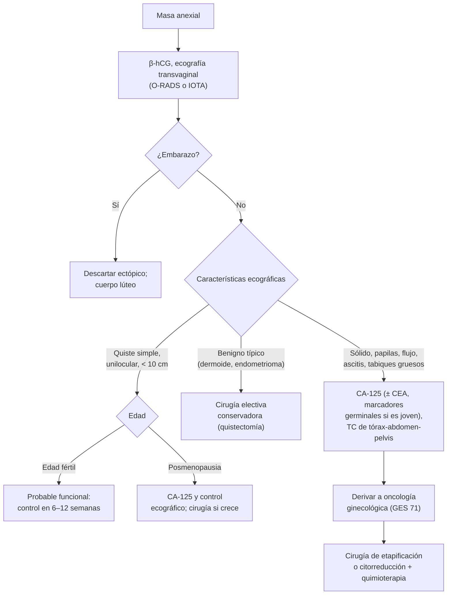

---
tags:
  - Ginecología y obstetricia
  - GES
---

# Tumores ováricos y masa anexial (incluido el cáncer de ovario epitelial)

**Subespecialidad**
Ginecología · Oncología ginecológica

**Guías principales**
MINSAL: guía GES de cáncer de ovario epitelial (recomendaciones GRADE, actualizaciones 2024–2025) · ACOG 2016: evaluación y manejo de las masas anexiales (PB 174) · ACR 2020: O-RADS US · FIGO 2014 y actualización 2021: cáncer de ovario, trompa y peritoneo

**Otras fuentes**
Ver [dolor pélvico y torsión anexial](dolor-pelvico-dismenorrea-endometriosis-y-torsion-anexial.md), [sangrado uterino anormal y endometrio](sangrado-uterino-anormal-miomas-y-patologia-endometrial.md), [hirsutismo y SOP](../endocrinologia/hirsutismo-amenorrea-y-ovario-poliquistico.md), [síndromes paraneoplásicos](../hematologia/sindromes-paraneoplasicos.md) y [epidemiología del cáncer](../cirugia/anestesia-y-perioperatorio/epidemiologia-del-cancer.md)

**GES**
Sí: problema N.° 71, cáncer de ovario epitelial (personas de 15 años y más).

**EUNACOM**
3.01.1.028 Tumores ováricos (sospecha, inicial, derivar)

**Revisado**
Octubre 2026

!!! abstract "Resumen en 60 segundos"
    - **Masa anexial**: la mayoría es **benigna**, sobre todo en la edad fértil (**quistes funcionales**, **teratoma maduro**, **endometrioma**, cistoadenomas). Primero: **β-hCG** (ectópico) y **ecografía transvaginal**.
    - **Signos ecográficos de benignidad**: quiste **unilocular, anecogénico, de pared fina**, < 10 cm. **De malignidad**: componente **sólido** o **papilas**, **tabiques gruesos**, **flujo** en el Doppler, **ascitis**, bilateralidad. Clasificación **O-RADS** o reglas simples de **IOTA**.
    - **Quiste simple en la edad fértil**: en general funcional → **control ecográfico** en 6–12 semanas.
    - **CA-125**: útil en la **posmenopausia**; en la edad fértil se eleva por endometriosis, miomas, PIP, menstruación y embarazo.
    - **Cáncer de ovario**: el cáncer ginecológico **más letal**; ~ **75 %** se diagnostica en **etapas avanzadas** (III–IV) por síntomas **vagos** (distensión, saciedad precoz, dolor pélvico, síntomas urinarios). **No hay tamizaje eficaz**.
        - **Epitelial** (~ 90 %), sobre todo **seroso de alto grado** (origen en la **trompa**). Factores: edad, **BRCA1/2**, **Lynch**, nuliparidad, endometriosis.
        - **Germinales** en **niñas y jóvenes** (marcadores: **AFP**, **β-hCG**, **LDH**). **Estromales**: granulosa (**estrógenos**, inhibina), Sertoli-Leydig (**andrógenos**).
    - **Tratamiento** (GES): **cirugía** de etapificación o **citorreducción** completa (sin tumor residual) + **carboplatino-paclitaxel**; **mantención con inhibidores de PARP** en el avanzado sensible a platino. **Estudio de BRCA** a todas.
    - **Prevención**: **salpingectomía** oportunista en histerectomías y esterilizaciones (guía GES 2024); anticonceptivos orales; cirugía reductora de riesgo en portadoras de BRCA.

## Definición

- **Masa anexial**: masa del **ovario**, la **trompa** o los tejidos vecinos (ligamento ancho, paraovario).
- **Quiste funcional**: quiste **folicular** (folículo que no se rompe) o **del cuerpo lúteo**; fisiológico, se resuelve solo.
- **Tumores ováricos**: neoplasias **benignas**, **limítrofes** (*borderline*, de bajo potencial maligno) o **malignas**, según su origen:
    - **Epiteliales** (de superficie): serosos, mucinosos, endometrioides, de células claras, de Brenner.
    - **De células germinales**: teratoma maduro (quiste dermoide), disgerminoma, tumor del saco vitelino, coriocarcinoma, teratoma inmaduro.
    - **De los cordones sexuales y el estroma**: tumor de la granulosa, tecoma, **fibroma**, tumor de Sertoli-Leydig.
    - **Metastásicos**: **tumor de Krukenberg** (células en anillo de sello, de origen **gástrico** o colorrectal), mama, endometrio.
- **Cáncer de ovario epitelial**: incluye por su biología y manejo el carcinoma de la **trompa** y el **peritoneal primario**.

## Epidemiología

### Mundial

- ~ **5–10 %** de las mujeres tendrá una cirugía por una masa anexial en su vida; la mayoría son **benignas**.
- El **teratoma maduro** es el tumor ovárico **más frecuente** en las mujeres jóvenes; es la principal causa de **torsión**.
- **Cáncer de ovario**: ~ 8.° cáncer en frecuencia en las mujeres a nivel mundial y la **primera causa de muerte** por cáncer ginecológico en muchos países de altos ingresos. Edad media al diagnóstico: **~ 63 años**.
- **Riesgo de por vida**: ~ **1–1,5 %** en la población general; **~ 40–45 %** con **BRCA1** y **~ 15–20 %** con **BRCA2**; ~ 5–10 % con el **síndrome de Lynch**.
- Sobrevida global a 5 años **< 50 %**, por el diagnóstico tardío.

!!! chile "Datos nacionales"
    - **GES N.° 71** (cáncer de ovario epitelial): cubre la **confirmación diagnóstica**, el **tratamiento** (cirugía y quimioterapia) y el **seguimiento** en los centros de la red oncológica.
    - La **guía GES** vigente (actualizaciones 2024–2025) sugiere:
        - **Salpingectomía profiláctica** en las histerectomías por causa benigna y en las esterilizaciones.
        - **Estudio de variantes de BRCA1 y BRCA2** en toda persona con cáncer de ovario epitelial.
        - **Laparoscopía diagnóstica** cuando hay dudas sobre la resecabilidad completa.
        - **Cirugía primaria** por sobre la quimioterapia neoadyuvante cuando se puede lograr una resección completa.
        - **Mantención con inhibidores de PARP** en el cáncer avanzado (III–IV) sensible a platino.
        - **Bevacizumab** con quimioterapia en la recurrencia en tratamiento paliativo.
        - Seguimiento **clínico**, sin CA-125 ni TC de rutina.

## Etiología

### Masa anexial según la edad

| Edad | Causas más frecuentes |
|---|---|
| **Niñas y adolescentes** | Quistes funcionales, **teratoma maduro**, **tumores germinales malignos** (disgerminoma), torsión |
| **Edad fértil** | **Quistes funcionales**, **endometrioma**, **teratoma maduro**, cistoadenomas, **embarazo ectópico**, absceso tuboovárico, hidrosálpinx, mioma pediculado |
| **Posmenopausia** | **Cistoadenomas**, **cáncer epitelial**, fibroma, metástasis; los quistes simples pequeños siguen siendo casi siempre benignos |

### Factores de riesgo del cáncer de ovario epitelial

- **Edad** (posmenopausia).
- **Genéticos** (~ 15–20 % de los serosos de alto grado): **BRCA1 y BRCA2**, **síndrome de Lynch**, otros genes de la recombinación homóloga (RAD51C, RAD51D, BRIP1, PALB2).
- **Antecedente familiar** de cáncer de ovario o de mama.
- **Número de ovulaciones** ("ovulación incesante"): **nuliparidad**, **infertilidad**, menarquia precoz, menopausia tardía.
- **Endometriosis** (carcinomas de células claras y endometrioides).
- **Factores protectores**: **anticonceptivos orales** (reducen el riesgo ~ 50 % con 5 años de uso), **multiparidad**, **lactancia**, **ligadura tubaria** y **salpingectomía**.

## Fisiopatología

- **Seroso de alto grado**: la mayoría se origina en el **epitelio de la fimbria de la trompa** (carcinoma seroso tubario intraepitelial, **STIC**) y se implanta en el ovario y el peritoneo. Por eso la **salpingectomía** reduce el riesgo. Mutación de **TP53** casi universal; deficiencia de recombinación homóloga en ~ 50 % (base del uso de los **inhibidores de PARP**).
- **Diseminación**: sobre todo **transcelómica** (peritoneo, **epiplón**, superficie del diafragma), con **ascitis**; también linfática (ganglios pélvicos y paraaórticos). La hematógena es tardía (pleura, hígado, pulmón).
- **Tumores germinales**: crecimiento rápido, sensibles a la quimioterapia (BEP); afectan a niñas y mujeres jóvenes.
- **Tumores estromales funcionantes**:
    - **Granulosa**: producen **estrógenos** (pubertad precoz, SUA, **hiperplasia o cáncer de endometrio**); marcador **inhibina**.
    - **Sertoli-Leydig**: producen **andrógenos** (virilización rápida).
- **Síndrome de Meigs**: **fibroma** + **ascitis** + **derrame pleural** (derecho), que se resuelven tras extirpar el tumor.

## Clasificación

### O-RADS US (ACR 2020), simplificada

| Categoría | Riesgo de malignidad | Ejemplos | Conducta |
|---|---|---|---|
| **O-RADS 1** | Normal | Folículo, cuerpo lúteo | Nada |
| **O-RADS 2** | **< 1 %** (casi seguramente benigno) | **Quiste simple** < 10 cm, quiste hemorrágico típico, dermoide y endometrioma típicos < 10 cm | Control o nada según la edad y el tamaño |
| **O-RADS 3** | **1–10 %** (bajo) | Quiste unilocular liso ≥ 10 cm, multilocular liso sin componente sólido < 10 cm, lesiones benignas típicas ≥ 10 cm | Ecografía por especialista o RM; ginecólogo |
| **O-RADS 4** | **10–50 %** (intermedio) | Multilocular ≥ 10 cm o con componente sólido, unilocular con 1–3 papilas | **Ginecólogo con apoyo de oncología ginecológica** |
| **O-RADS 5** | **≥ 50 %** (alto) | **Sólido irregular**, ≥ 4 papilas, **ascitis** o nódulos peritoneales | **Oncología ginecológica** |

### Etapificación FIGO 2014 (con la actualización 2021) del cáncer de ovario, trompa y peritoneo

| Etapa | Extensión |
|---|---|
| **I** | Limitado a los **ovarios** o las trompas (IA: uno; IB: ambos; IC: rotura de la cápsula, tumor en la superficie o citología peritoneal positiva) |
| **II** | Extensión a la **pelvis** (útero, trompas, otros órganos pélvicos) |
| **III** | **Peritoneo fuera de la pelvis** y/o **ganglios retroperitoneales** (IIIA1: solo ganglios; IIIA2: microscópico; IIIB: ≤ 2 cm; IIIC: > 2 cm, incluida la cápsula hepática o esplénica) |
| **IV** | **Metástasis a distancia**: **derrame pleural** con citología positiva (IVA); parénquima hepático o esplénico, ganglios extraabdominales (IVB) |

## Clínica

- **Masas benignas**: a menudo **asintomáticas** (hallazgo ecográfico) o con **dolor pélvico** o sensación de peso; **torsión** o **rotura** (dolor agudo).
- **Cáncer de ovario**: síntomas **inespecíficos y persistentes** (más de 12 veces al mes, de inicio reciente):
    - **Distensión** o aumento del perímetro abdominal, **saciedad precoz**, dispepsia, náuseas.
    - **Dolor** pélvico o abdominal.
    - **Síntomas urinarios** (urgencia, polaquiuria), cambio del hábito intestinal.
    - Baja de peso, fatiga.
    - Avanzado: **ascitis**, **masa pélvica** fija e irregular, nódulos en el fondo de saco (tacto rectovaginal), **derrame pleural**, **obstrucción intestinal**, nódulo umbilical (**Sister Mary Joseph**), **trombosis** (síndrome de Trousseau).
- **Tumores germinales**: masa abdominal de **crecimiento rápido** y dolor en una niña o mujer joven.
- **Tumores estromales**: signos **hormonales** (pubertad precoz, SUA posmenopáusico, virilización).

!!! alarma "Signos de alarma"
    - **Masa anexial en una posmenopáusica** con **ascitis** o CA-125 elevado → sospecha de **cáncer**: derivar a oncología ginecológica.
    - **Masa sólida** o compleja de **crecimiento rápido** en una **niña** → tumor germinal: marcadores y derivación urgente.
    - **Virilización rápida** → tumor productor de andrógenos (ovario o suprarrenal).
    - **Dolor súbito** con una masa → **torsión** o **rotura**.
    - Mujer con **distensión, saciedad precoz y baja de peso** persistentes: pensar en el ovario, no solo en el tubo digestivo.

## Diagnóstico

!!! guia "Puntos clave (ACOG 2016; ACR O-RADS 2020; guía GES)"
    - **β-hCG** en la edad fértil.
    - **Examen pélvico** y **ecografía transvaginal** (la herramienta principal). Clasificar con **O-RADS** o las **reglas simples de IOTA**.
    - **CA-125**: indicado en la **posmenopausia** con masa anexial y cuando la ecografía es sospechosa. En la premenopausia tiene muchos **falsos positivos**.
    - **Índice de riesgo de malignidad (RMI)**: combina la ecografía, el estado menopáusico y el CA-125.
    - **Marcadores germinales** en niñas y mujeres jóvenes con masa sólida: **AFP**, **β-hCG**, **LDH**; **inhibina** (granulosa); **CEA** y **CA 19-9** (mucinosos o metástasis digestivas).
    - **Sospecha de cáncer**: **TC de tórax, abdomen y pelvis** (extensión, ascitis, carcinomatosis); derivar a **oncología ginecológica** para la **cirugía**. El diagnóstico definitivo y la etapa son **quirúrgicos y histológicos**.
    - **No** hacer **punción** de una masa sospechosa (riesgo de diseminación).
    - **Tamizaje**: **no** se recomienda en la población general (ni CA-125 ni ecografía; no reducen la mortalidad). En las portadoras de BRCA: consejo genético y cirugía reductora de riesgo.

## Laboratorio

| Marcador | Tumor | Comentarios |
|---|---|---|
| **CA-125** | Epitelial seroso | Elevado en ~ 80 % de los avanzados, solo ~ 50 % de la etapa I. Falsos positivos: endometriosis, miomas, PIP, embarazo, menstruación, cirrosis, ascitis o derrames de otra causa, insuficiencia cardíaca |
| **HE4** | Epitelial | Junto al CA-125 en el índice **ROMA** |
| **CEA, CA 19-9** | Mucinoso, metástasis digestivas | Pedir endoscopía si son altos (Krukenberg) |
| **AFP** | Tumor del **saco vitelino**, teratoma inmaduro | Germinales |
| **β-hCG** | **Coriocarcinoma**, disgerminoma (a veces) | Germinales |
| **LDH** | **Disgerminoma** | Germinales |
| **Inhibina B** | Tumor de la **granulosa** | Seguimiento |
| **Testosterona** | Sertoli-Leydig | Virilización |

- **Estudio genético**: **BRCA1 y BRCA2** (germinal y/o tumoral) a **toda** paciente con cáncer de ovario epitelial (guía GES); consejo genético familiar.

## Imágenes

- **Ecografía transvaginal** (± abdominal) con **Doppler**: tamaño, tabiques, componente sólido, papilas, flujo, ascitis.
    - **Teratoma maduro**: nódulo hiperecogénico (**tapón de Rokitansky**), sombra acústica, "**iceberg**", líneas y puntos (pelos).
    - **Endometrioma**: "**vidrio esmerilado**".
    - **Quiste hemorrágico**: patrón **reticular** ("telaraña") y coágulo retráctil; se resuelve en 6–12 semanas.
- **RM de pelvis**: caracterización de las masas **indeterminadas** (O-RADS MRI).
- **TC de tórax, abdomen y pelvis**: etapificación del cáncer (carcinomatosis, epiplón "en torta", ganglios, derrame pleural).

## Diagnóstico diferencial

| Cuadro | Claves |
|---|---|
| **Embarazo ectópico** | **β-hCG positiva** |
| **Quiste funcional o hemorrágico** | Edad fértil, se resuelve en 6–12 semanas |
| **Endometrioma** | Dismenorrea, "vidrio esmerilado" |
| **Absceso tuboovárico, hidrosálpinx** | Fiebre, PIP; estructura tubular |
| **Mioma pediculado o del ligamento ancho** | Sólido, en continuidad con el útero |
| **Quiste paraovárico** | Separado del ovario |
| **Masa no ginecológica** | Absceso apendicular o diverticular, tumor de colon, riñón pélvico, quiste peritoneal |
| **Síndrome de ovario poliquístico** | Múltiples folículos periféricos, no es una masa |
| **Luteoma o quistes tecaluteínicos** | Embarazo, mola, hiperestimulación |

## Tratamiento

### Masas benignas

- **Quiste simple** asintomático en la **edad fértil**: **observación** y **ecografía** en 6–12 semanas (la mayoría se resuelve). Los anticonceptivos **no** aceleran la resolución.
- **Quiste simple en la posmenopausia** < 10 cm con CA-125 normal: **seguimiento** ecográfico.
- **Teratoma maduro**, **endometrioma** sintomático o grande, **cistoadenomas**, masas persistentes: **cirugía laparoscópica** **conservadora** (**quistectomía**) en las jóvenes; **anexectomía** en las posmenopáusicas.
- **Fibroma** (Meigs): anexectomía.

### Cáncer de ovario epitelial (GES N.° 71, oncología ginecológica)

- **Cirugía** (por un oncólogo ginecológico, el factor pronóstico modificable más importante):
    - **Etapas iniciales**: **etapificación quirúrgica completa** (histerectomía total, salpingooforectomía bilateral, omentectomía, biopsias peritoneales, lavado y linfadenectomía). En jóvenes con etapa IA de bajo grado se puede **preservar la fertilidad**.
    - **Etapas avanzadas**: **citorreducción primaria** con el objetivo de **no dejar tumor residual visible (R0)**. La guía GES sugiere la cirugía primaria si se puede lograr y la **laparoscopía diagnóstica** si hay dudas sobre la resecabilidad.
    - Si no es resecable: **quimioterapia neoadyuvante** (3 ciclos) y **cirugía de intervalo**.
- **Quimioterapia**: **carboplatino + paclitaxel** cada 3 semanas por **6 ciclos** (excepto en la etapa IA-IB de bajo grado). **Bevacizumab** en casos seleccionados.
- **Mantención**: **inhibidores de PARP** (olaparib, niraparib) en el cáncer **avanzado sensible a platino**, sobre todo con **BRCA mutado** o deficiencia de recombinación homóloga (guía GES 2025).
- **Recurrencia**: según el intervalo libre de platino; quimioterapia ± **bevacizumab** (la guía GES lo sugiere en la recurrencia paliativa).
- **Tumores germinales**: cirugía **conservadora de la fertilidad** + quimioterapia **BEP** (bleomicina, etopósido, cisplatino); curación > 90 %.
- **Tumores limítrofes**: cirugía (conservadora en jóvenes); buen pronóstico.

### Prevención

- **Salpingectomía oportunista** en las **histerectomías** por causa benigna y en las **esterilizaciones** (guía GES 2024).
- **Portadoras de BRCA1/2**: **salpingooforectomía bilateral reductora de riesgo** a los **35–40 años** (BRCA1) o **40–45** (BRCA2), al completar la paridad; anticonceptivos orales mientras tanto.
- **Anticonceptivos orales**: reducen el riesgo en la población general.

!!! dosis "Fármacos habituales (oncología)"
    | Fármaco | Esquema | Comentarios |
    |---|---|---|
    | **Carboplatino + paclitaxel** | Carboplatino AUC 5–6 + paclitaxel 175 mg/m² EV cada 21 días × 6 | Mielosupresión, neuropatía, alopecia |
    | **Olaparib / niraparib** (inhibidores de PARP) | VO, mantención tras la respuesta a platino | Anemia, trombocitopenia, náuseas; riesgo bajo de SMD/LMA |
    | **Bevacizumab** | 7,5–15 mg/kg EV cada 21 días | HTA, proteinuria, perforación intestinal |
    | **BEP** | Bleomicina, etopósido, cisplatino | Tumores germinales; toxicidad pulmonar por bleomicina |

!!! alarma "Urgencia"
    - **Torsión** o **rotura** de una masa anexial: laparoscopía urgente.
    - **Obstrucción intestinal maligna**, **derrame pleural** masivo o **ascitis a tensión** en el cáncer avanzado: manejo sintomático, paracentesis o toracocentesis, cirugía o cuidados paliativos según el caso.

## Complicaciones

- **Masas benignas**: **torsión**, **rotura** (hemoperitoneo; peritonitis química en el dermoide), infección, compresión.
- **Cáncer de ovario**: **ascitis**, **obstrucción intestinal** (la causa de muerte más frecuente), derrame pleural, desnutrición, **trombosis venosa**, síndromes paraneoplásicos (degeneración cerebelosa con anticuerpos anti-Yo, dermatomiositis).
- **Tratamiento**: complicaciones quirúrgicas, **menopausia quirúrgica**, toxicidad de la quimioterapia.

## Pronóstico y seguimiento

- **Sobrevida a 5 años** aproximada: **> 90 %** en la etapa I, ~ 70 % en la II, ~ 40 % en la III y ~ 20 % en la IV.
- **Factores pronósticos**: **etapa**, **tumor residual** tras la cirugía, histología y grado, estado de **BRCA**, sensibilidad al platino.
- **Recurrencia**: ~ **70 %** de las etapas avanzadas recurre en los primeros 2–3 años.
- **Seguimiento** (guía GES): **clínico** (anamnesis y examen físico) cada 3–4 meses los primeros 2 años; **sin CA-125 ni TC de rutina** (no mejoran la sobrevida); imágenes ante síntomas.
- **Familiares** de portadoras de BRCA: consejo y estudio genético.

## Perlas para el internado

!!! perla "Para recordar en la sala"
    - Masa anexial en edad fértil: **β-hCG** y ecografía; la mayoría es **funcional** y se resuelve.
    - **Quiste simple, unilocular, anecogénico** = benigno; **sólido, papilas, flujo, ascitis** = sospecha de malignidad.
    - **CA-125** sirve en la **posmenopausia**; en la joven tiene muchos falsos positivos.
    - **Niña con masa sólida** → **AFP, β-hCG, LDH** (tumor germinal).
    - **Masa ovárica + ascitis + derrame pleural** que se resuelve con la cirugía = **síndrome de Meigs** (fibroma).
    - **Krukenberg**: metástasis ovárica bilateral de un cáncer **gástrico**.
    - **No hay tamizaje** del cáncer de ovario; la clave es **sospechar** con síntomas persistentes y derivar a **oncología ginecológica** (GES 71).
    - **Estudio de BRCA** a toda paciente con cáncer de ovario epitelial.

## Preguntas de repaso

??? repaso "1. Mujer de 27 años con un quiste ovárico de 4 cm, unilocular, anecogénico, de pared fina, hallado en una ecografía. Asintomática, β-hCG negativa. ¿Qué hace?"
    - **Quiste simple** (O-RADS 2), probablemente **funcional**.
    - **Control ecográfico** en 6–12 semanas (idealmente en la fase folicular). No requiere CA-125 ni cirugía.

??? repaso "2. Mujer de 62 años con distensión abdominal, saciedad precoz y baja de 5 kg en 3 meses. Ecografía: masa anexial sólido-quística de 9 cm con papilas y ascitis. ¿Qué hace?"
    - **Sospecha de cáncer de ovario** (O-RADS 5).
    - **CA-125** (± CEA, CA 19-9), **TC de tórax, abdomen y pelvis** y **derivación GES** a **oncología ginecológica**.
    - Tratamiento: **cirugía** (citorreducción completa) + **carboplatino-paclitaxel**; estudio de **BRCA**.

??? repaso "3. Niña de 14 años con una masa abdominal sólida que creció rápidamente. ¿Qué marcadores pide?"
    - Sospecha de **tumor germinal** maligno.
    - **AFP** (saco vitelino), **β-hCG** (coriocarcinoma), **LDH** (disgerminoma); además CA-125 e inhibina.
    - Derivación urgente: **cirugía conservadora de la fertilidad** ± quimioterapia **BEP**.

??? repaso "4. Mujer de 58 años con metrorragia posmenopáusica, endometrio engrosado y una masa ovárica sólida. ¿Qué tumor sospecha?"
    - **Tumor de la granulosa** (productor de **estrógenos**), que causa **hiperplasia o cáncer de endometrio**.
    - **Inhibina**, biopsia de endometrio y cirugía.

??? repaso "5. Paciente de 40 años, portadora de BRCA1, con dos hijos y paridad cumplida. ¿Qué le recomienda?"
    - **Salpingooforectomía bilateral reductora de riesgo** (BRCA1: a los 35–40 años, una vez cumplida la paridad).
    - Vigilancia mamaria de alto riesgo (RM + mamografía) o mastectomía reductora; consejo genético a la familia.

??? repaso "6. ¿Qué medida de prevención del cáncer de ovario sugiere la guía GES durante una histerectomía por causa benigna?"
    - **Salpingectomía** bilateral profiláctica (oportunista), porque muchos carcinomas serosos de alto grado se originan en la **trompa**.
    - También en las **esterilizaciones** (en lugar de la ligadura).

## Referencias

1. Ministerio de Salud de Chile. Guía de práctica clínica GES: cáncer de ovario epitelial. Recomendaciones GRADE (actualizaciones 2024–2025; consultado en octubre de 2026). [diprece.minsal.cl](https://diprece.minsal.cl/garantias-explicitas-en-salud-auge-o-ges/guias-de-practica-clinica/cancer-de-ovario-epitelial/recomendaciones/)
2. American College of Obstetricians and Gynecologists. Practice Bulletin No. 174: Evaluation and management of adnexal masses. *Obstet Gynecol.* 2016;128(5):e210–e226. doi:[10.1097/AOG.0000000000001768](https://doi.org/10.1097/AOG.0000000000001768)
3. Andreotti RF, Timmerman D, Strachowski LM, et al. O-RADS US risk stratification and management system: a consensus guideline from the ACR Ovarian-Adnexal Reporting and Data System Committee. *Radiology.* 2020;294(1):168–185. doi:[10.1148/radiol.2019191150](https://doi.org/10.1148/radiol.2019191150)
4. Prat J; FIGO Committee on Gynecologic Oncology. Staging classification for cancer of the ovary, fallopian tube, and peritoneum. *Int J Gynaecol Obstet.* 2014;124(1):1–5. doi:[10.1016/j.ijgo.2013.10.001](https://doi.org/10.1016/j.ijgo.2013.10.001)
5. Berek JS, Renz M, Kehoe S, et al. Cancer of the ovary, fallopian tube, and peritoneum: 2021 update. *Int J Gynaecol Obstet.* 2021;155(Suppl 1):61–85. doi:[10.1002/ijgo.13878](https://doi.org/10.1002/ijgo.13878)
