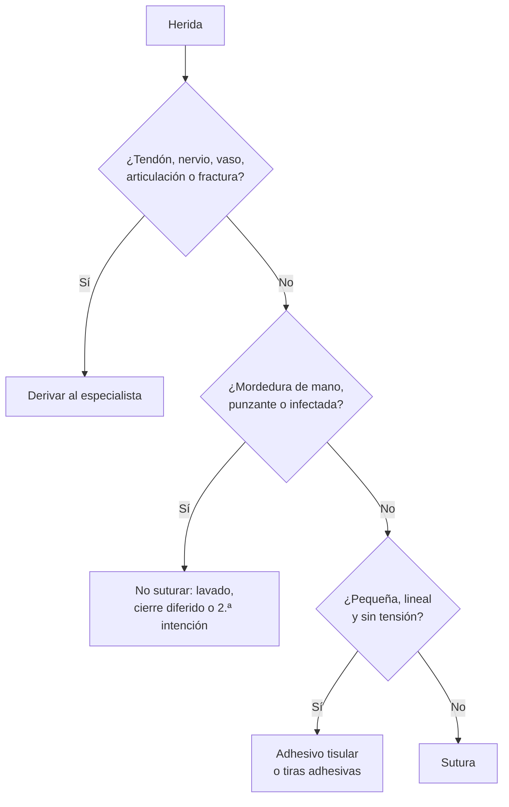

# Sutura de heridas

**Procedimiento**
Aseo y sutura de heridas cortantes o contusas simples de la piel, con anestesia local

**Fuentes principales**
Forsch 2017 (*Am Fam Physician*): reparación de laceraciones · Mankowitz 2017 (*J Emerg Med*) · IDSA 2014: mordeduras · ACIP 2018: profilaxis antitetánica

**Otras fuentes**
Fernandez 2022 (Cochrane): agua para lavar heridas · Heal 2006 (*BMJ*): mojar la herida suturada · Cummings 1995: antibióticos en heridas simples · Ilicki 2015: epinefrina en los dedos · Lineaweaver 1985 y Gravett 1987: antisépticos · Ver [heridas, mordeduras y onicocriptosis](../cirugia/piel-partes-blandas-y-quemaduras/heridas-menores-mordeduras-y-onicocriptosis.md) y [tétanos](../infectologia/tetanos.md)

**Revisado**
Octubre 2026

!!! abstract "Resumen en 60 segundos"
    - **Antes**: hora y mecanismo de la herida, **vacuna antitetánica**, alergias, anticoagulantes, diabetes. Examina la **función motora, sensitiva y vascular distal**, los **tendones** y busca **cuerpos extraños** (radiografía si fue con vidrio o metal).
    - **No hay una "hora de oro" fija**: una herida limpia y no infectada se puede cerrar hasta **18 horas** después (**24 h** en la cabeza).
    - **No suturar**: mordeduras de la **mano**, heridas **punzantes**, infectadas o muy contaminadas (cierre diferido o segunda intención).
    - **Anestesia**: **lidocaína 1–2 %**, máximo **4,5 mg/kg** sin epinefrina y **7 mg/kg** con epinefrina. La epinefrina **se puede usar en los dedos** si no hay compromiso vascular.
    - **Lavado**: el **agua potable** es tan segura como el suero; **50–100 mL por cada cm** de herida, a presión.
    - **Antisépticos**: en la **piel sana alrededor**, sí (povidona yodada o clorhexidina). **Dentro de la herida, no**: la povidona concentrada, el agua oxigenada y el alcohol dañan el tejido y retrasan la cicatrización.
    - **Hilo**: nylon **5-0/6-0 en la cara**, **4-0 en la mayoría**, **3-0 en el cuero cabelludo, la espalda, las palmas y las plantas**.
    - **Sin antibiótico** en las heridas simples. **Sí** en las **mordeduras de riesgo** (amoxicilina-ácido clavulánico).
    - **Retiro de puntos**: cara **3–5 días**, cuero cabelludo y brazos **7–10**, tronco, piernas, manos y pies **10–14**, palmas y plantas **14–21**.

## Cuándo suturar y cuándo no

| Situación | Conducta | Por qué |
|---|---|---|
| Herida limpia, **≤ 18 h** (≤ 24 h en la cabeza) | **Cierre primario** (sutura) | No hay una "hora de oro" definida; en un estudio de cohorte, cerrar después de 12 h no aumentó la infección |
| Herida pequeña, lineal, sin tensión, < 12 h | **Adhesivo tisular** o **tiras adhesivas** | Igual resultado estético; el adhesivo tiene algo más de dehiscencia (NNH 25) |
| **Mordedura en la mano** | **No suturar**; lavado, antibiótico, derivar a cirugía de la mano | Alto riesgo de infección profunda (tendones, articulaciones) |
| Mordedura en la **cara** | Cierre primario tras lavado y desbridamiento | Prima la estética; buena irrigación |
| Herida **punzante**, **infectada** o muy **contaminada** | No cerrar: **cierre primario diferido** (3–5 días) o **segunda intención** | Cerrarla encierra las bacterias |
| Compromiso de **tendón, nervio, vaso, articulación** o **fractura expuesta** | **Derivar** al especialista | Requiere reparación en pabellón |

Fuentes: Forsch 2017; IDSA 2014.

*Figura 1. ¿Suturar o no? Esquema propio basado en Forsch 2017 e IDSA 2014.*

## Antes de empezar

### Qué buscar en el paciente

- **Hora y mecanismo**: corte limpio, contusión, aplastamiento, mordedura (¿de qué animal?), vidrio o metal.
- **Vacunación antitetánica**: número de dosis y fecha de la última (ver la tabla de [tétanos](#tetanos)).
- **Alergias** (anestésicos locales, látex, antibióticos), **anticoagulantes** y antiagregantes, **diabetes**, inmunosupresión.
- **Examen**: sensibilidad y movilidad distal, **llene capilar**, función de cada **tendón** del área (contra resistencia), profundidad y **cuerpos extraños**.
- **Radiografía** si fue con **vidrio o metal**, si hay sospecha de **fractura** o en las mordeduras de la mano.

### Qué preparar

- **Consentimiento** verbal, explicando el procedimiento y la cicatriz esperable.
- **Guantes**: los guantes de **examen limpios** no aumentan la infección frente a los estériles (Forsch 2017).
- **Lavado**: suero fisiológico o agua potable, jeringa de 20–35 mL con aguja o catéter.
- **Antiséptico** para la piel alrededor: povidona yodada o clorhexidina.
- **Anestesia**: lidocaína 1 % o 2 % (con o sin epinefrina), jeringa y aguja fina (25–27 G).
- **Caja de sutura**: porta-agujas, pinza, tijera; campo estéril; hilo según la zona.
- **Apósito**: gasa o apósito transparente; vaselina.

## Paso a paso

1. **Posición cómoda** y buena luz. Higiene de manos y guantes.
2. **Anestesia local**: infiltrar lentamente por los **bordes de la herida** (no por la piel sana), con aguja fina. Calcular la **dosis máxima** antes: la lidocaína al **2 %** tiene **20 mg/mL** (un adulto de 70 kg puede recibir hasta ~ **15 mL** de lidocaína al 2 % sin epinefrina). En los dedos, **bloqueo digital**.
3. **Lavado** a presión con **50–100 mL por cada cm** de herida (agua potable o suero).
4. **Antisepsia de la piel alrededor** de la herida, desde el borde hacia afuera, sin que el antiséptico escurra dentro. Poner el **campo**.
5. **Explorar** la herida en todo su recorrido: cuerpos extraños, tendones, fondo.
6. **Desbridar** el tejido desvitalizado y regularizar los bordes muy irregulares.
7. **Planos profundos**: si la herida es profunda o con tensión, afrontar el subcutáneo con hilo **reabsorbible** (puntos invertidos, nudo hacia abajo).
8. **Piel**: entrar **perpendicular** a la piel, a la **misma distancia del borde y la misma profundidad** a ambos lados, para que los bordes queden **evertidos**. Nudo hacia un lado, sin estrangular el tejido.
9. **Hemostasia** y control final: sin sangrado activo, bordes bien afrontados.
10. **Apósito** y **profilaxis antitetánica** si corresponde.
11. **Registrar** el procedimiento y entregar las **indicaciones**.

### ¿Y los antisépticos?

| Dónde | Conducta | Por qué |
|---|---|---|
| **Piel sana alrededor** | Pincelar con **povidona yodada** o **clorhexidina** antes de poner el campo (evitar la clorhexidina cerca de los ojos y los oídos) | Es parte de la técnica aséptica: baja la carga bacteriana de la piel que rodea la herida |
| **Dentro de la herida** | **No** aplicar antisépticos concentrados: povidona al 10 %, **agua oxigenada**, **alcohol**, clorhexidina | Son **tóxicos para los fibroblastos** y en modelos animales empeoran la cicatrización; el agua oxigenada y el ácido acético son más tóxicos que bactericidas (Lineaweaver 1985). Lo que limpia la herida es el **lavado a presión** |
| **Herida sucia o contaminada** | Se puede lavar con **povidona yodada diluida al 1 %** | En un ensayo de 1987 (395 pacientes analizados), lavar y escobillar con povidona al 1 % redujo la infección (11 de 201 frente a 30 de 194). Es antiguo y perdió a uno de cada cinco pacientes en el seguimiento, así que no es obligatorio en las heridas limpias |

Fuentes: Lineaweaver 1985; Gravett 1987; Mankowitz 2017 (la mayoría de los agentes tópicos sobre la herida tienen un beneficio limitado).

### Elegir el hilo y el punto

| Zona | Hilo de piel | Retiro de puntos |
|---|---|---|
| **Cara** | Nylon **5-0 o 6-0** | **3–5 días** |
| **Párpado** | Nylon **6-0** | 3–5 días |
| **Labio** | Piel con nylon 6-0; mucosa y músculo con reabsorbible 3-0 o 4-0 | 3–5 días |
| **Cuero cabelludo** | Nylon **3-0 o 4-0**, o corchetes; galea con reabsorbible 2-0 o 3-0 | **7–10 días** |
| **Brazos** | Nylon **4-0** | **7–10 días** |
| **Manos y antebrazo** | Nylon **4-0 o 5-0** | **10–14 días** |
| **Tronco** | Nylon **4-0** (espalda **3-0**) | **10–14 días** |
| **Piernas y pies** | Nylon **4-0** | **10–14 días** |
| **Palmas y plantas** | Nylon **3-0** | **14–21 días** |

Fuente: Forsch 2017 (los días de retiro son opinión de expertos).

| Punto | Cuándo |
|---|---|
| **Simple** | El de uso general; cada punto es independiente |
| **Colchonero vertical** | Bordes que tienden a invertirse, zonas con tensión |
| **Colchonero horizontal** | Piel con tensión o frágil |
| **Intradérmico** | Heridas lineales y limpias de la cara, por estética |
| **Corchetes** | Cuero cabelludo y tronco: rápidos |

## Cómo se escribe

Completa los datos y copia el texto con la descripción y las indicaciones. Las **indicaciones se pueden editar**: desmarca las que no quieras, cambia el texto, agrega las tuyas y guárdalas como **tus indicaciones** (quedan en este dispositivo). También puedes corregir el texto final antes de copiarlo. **No escribas el nombre ni el RUT del paciente**: el texto se arma solo en tu dispositivo, pero lo copiarás a otro lugar.

La herida
<label class="calc-campo">Largo (cm) <input type="text" name="cm" inputmode="decimal" placeholder="3"></label>
<label class="calc-campo">Ubicación <input type="text" name="lugar" placeholder="región frontal derecha"></label>
<label class="calc-campo">Tipo de herida <select name="tipo"><option value="cortante">Cortante</option><option value="contusa">Contusa</option><option value="cortocontusa">Cortocontusa</option><option value="por mordedura">Por mordedura</option></select></label>
<label class="calc-campo">Zona (para el retiro de puntos) <select name="zona"><option value="cara">Cara</option><option value="cuero">Cuero cabelludo</option><option value="brazo">Brazo</option><option value="mano" selected>Mano, antebrazo o pie</option><option value="tronco">Tronco</option><option value="pierna">Pierna</option><option value="palma">Palma o planta</option></select></label>
El procedimiento
<label class="calc-campo">Anestesia <select name="anest"><option value="lidocaína al 2 %">Lidocaína 2 %</option><option value="lidocaína al 1 %">Lidocaína 1 %</option><option value="lidocaína al 2 % con epinefrina">Lidocaína 2 % con epinefrina</option><option value="lidocaína al 2 % (bloqueo digital)">Lidocaína 2 %, bloqueo digital</option></select></label>
<label class="calc-campo">Volumen (mL, opcional) <input type="text" name="ml" inputmode="decimal" placeholder="4"></label>
<label class="calc-campo">Tipo de punto <select name="punto"><option value="simples">Simples</option><option value="colchoneros verticales">Colchonero vertical</option><option value="colchoneros horizontales">Colchonero horizontal</option><option value="intradérmicos">Intradérmico</option></select></label>
<label class="calc-campo">N.° de puntos <input type="text" name="n" inputmode="numeric" placeholder="4"></label>
<label class="calc-campo">Hilo de piel <select name="hilo"><option value="nylon 6-0">Nylon 6-0</option><option value="nylon 5-0">Nylon 5-0</option><option value="nylon 4-0" selected>Nylon 4-0</option><option value="nylon 3-0">Nylon 3-0</option></select></label>
<label class="calc-campo">Hilo del plano profundo <select name="hiloprof"><option value="poliglactina (Vicryl) 4-0">Reabsorbible 4-0</option><option value="poliglactina (Vicryl) 3-0">Reabsorbible 3-0</option></select></label>
<label class="calc-campo">Antiséptico para la piel <select name="antiseptico"><option value="povidona yodada">Povidona yodada</option><option value="clorhexidina">Clorhexidina</option></select></label>
<label><input type="checkbox" name="antisepsia" checked> Antisepsia de la piel alrededor</label>
<label><input type="checkbox" name="lavado" checked> Irrigación con suero</label>
<label><input type="checkbox" name="explora" checked> Exploración sin cuerpo extraño ni lesión de estructuras</label>
<label><input type="checkbox" name="desbrida"> Desbridamiento</label>
<label><input type="checkbox" name="profundo"> Plano subcutáneo</label>
<label><input type="checkbox" name="ungüento"> Vaselina en el apósito</label>
Profilaxis antitetánica
<label><input type="radio" name="tet" value="no" checked> No requiere</label>
<label><input type="radio" name="tet" value="vac"> Vacuna dT</label>
<label><input type="radio" name="tet" value="vacig"> Vacuna dT + inmunoglobulina</label>
Antibiótico
<label><input type="radio" name="mordedura" value="no" checked> No (herida simple)</label>
<label><input type="radio" name="mordedura" value="si"> Mordedura de riesgo: amoxicilina-ácido clavulánico</label>

!!! plantilla "Ejemplo de descripción"
    Se realiza aseo y sutura de herida cortante de 3 cm en región palmar de mano izquierda, bajo técnica aséptica y anestesia local con lidocaína al 2 % (4 mL). Se realiza antisepsia de la piel perilesional con povidona yodada. Se irriga con abundante suero fisiológico y se explora la herida sin evidencia de cuerpo extraño ni compromiso de tendones, vasos o nervios. Se afronta piel con 4 puntos simples de nylon 3-0. Procedimiento sin complicaciones, sin sangrado activo al término. Se cubre con apósito. Se entregan indicaciones.

## Indicaciones después de la sutura

| Indicación | Qué escribir | Por qué |
|---|---|---|
| **Cuidado de la herida** | Mantener limpia y seca; **puede ducharse** desde el día siguiente, secando sin frotar | Mojar la herida suturada en las primeras 48 h **no aumentó la infección** (8,4 % vs 8,9 %) en un ensayo aleatorizado (Heal 2006) |
| **Apósito** | Cambiarlo si se moja, se ensucia o se despega; vaselina o ungüento antibiótico en la herida | El ungüento sobre la herida suturada reduce la infección (Forsch 2017). Los apósitos transparentes o hidrocoloides pueden quedar 3–7 días |
| **Curaciones** | En una herida limpia y suturada **no se necesitan curaciones programadas**; control a las **48 h** en las heridas de riesgo (mordeduras, contaminadas, diabéticos) | Permite detectar la infección precozmente donde es más probable |
| **Antibiótico** | **No** en las heridas simples | Un metaanálisis de ensayos aleatorizados **no mostró beneficio** de los antibióticos sistémicos en las heridas que no son mordeduras (Cummings 1995) |
| | **Sí** en las mordeduras de riesgo (gato, mano, cara, profundas o punzantes, inmunosuprimidos): **amoxicilina-ácido clavulánico 875/125 mg cada 12 h por 3–5 días** | Cubre *Pasteurella*, estafilococos, estreptococos y anaerobios (IDSA 2014) |
| **Analgesia** | Paracetamol 1 g cada 8 h si hay dolor; o ibuprofeno 400 mg cada 8 h | El dolor suele ser leve y de pocos días |
| **Retiro de puntos** | Según la zona (tabla de arriba), en el CESFAM o en el servicio de urgencia | Retirarlos antes deja una herida débil; después, marcas de los puntos |
| **Signos de alarma** | Consultar si hay **fiebre**, enrojecimiento que se extiende, más dolor, **pus** o apertura de la herida | Infección o dehiscencia |
| **Antitetánica** | Según las dosis previas y el tipo de herida (tabla siguiente) | Prevenir el tétanos |

!!! plantilla "Indicaciones al alta (herida simple)"
    - Mantener la herida limpia y seca. Puede ducharse desde mañana, secando sin frotar.
    - Cambiar el apósito si se moja, se ensucia o se despega.
    - Paracetamol 1 g VO cada 8 horas si hay dolor.
    - Retiro de puntos en 10 a 14 días en su CESFAM.
    - Consultar antes si presenta fiebre, enrojecimiento que se extiende, aumento del dolor, salida de pus o apertura de la herida.

### Tétanos

| Dosis previas de vacuna | Herida **limpia y menor** | **Otras heridas** (sucias, punzantes, mordeduras, aplastamiento, quemaduras) |
|---|---|---|
| **Desconocidas o < 3** | **Vacuna** (dT) | **Vacuna + inmunoglobulina antitetánica 250 UI IM** |
| **≥ 3** | Vacuna solo si la última fue hace **> 10 años** | Vacuna solo si la última fue hace **≥ 5 años** |

Fuente: ACIP 2018. Los adultos no tienen refuerzos programados en el PNI: la profilaxis se hace al consultar por la herida.

## Complicaciones

| Complicación | Cómo se ve | Qué hacer |
|---|---|---|
| **Infección** | Eritema que se extiende, calor, dolor creciente, pus, fiebre | Retirar algunos puntos para drenar; antibiótico (cefalexina o según el caso); en mordeduras, amoxicilina-ácido clavulánico |
| **Dehiscencia** | La herida se abre | Si está limpia y es reciente, puede volver a cerrarse; si está infectada, segunda intención |
| **Hematoma** | Aumento de volumen azulado bajo la sutura | Compresión; drenaje si es grande |
| **Cuerpo extraño retenido** | Dolor persistente, infección que no cede | Radiografía o ecografía y extracción |
| **Cicatriz hipertrófica o queloide** | Cicatriz gruesa y elevada | Fotoprotección, silicona; derivar si es queloide |
| **Toxicidad por anestésico local** | Sabor metálico, parestesias peribucales, tinnitus, convulsiones, arritmias | Detener la infiltración, ABC, benzodiacepina si convulsiona; **emulsión lipídica al 20 %** en la toxicidad grave (ASRA 2017) |

!!! alarma "Errores frecuentes"
    - Suturar sin **explorar la función de los tendones** ni buscar **cuerpos extraños**.
    - Suturar una **mordedura de la mano** o una herida **punzante**.
    - Pasarse de la **dosis máxima de lidocaína** en las heridas grandes (calcula los mL antes de empezar).
    - Indicar **antibiótico "por si acaso"** en una herida simple.
    - Echar **povidona yodada concentrada, agua oxigenada o alcohol dentro** de la herida.
    - Olvidar la **profilaxis antitetánica**.
    - Dejar los **puntos de la cara** 10 días: quedan marcas.

!!! perla "Para el internado"
    Escribe la descripción con los **datos que otro médico necesita** para seguir el caso: **largo, ubicación, tipo de herida, anestesia, n.° de puntos e hilo**, si exploraste estructuras y **cuándo se retiran los puntos**.

## Preguntas de repaso

??? repaso "1. Hombre de 30 años con una herida cortante de 4 cm en el antebrazo hecha con un cuchillo de cocina hace 6 horas. Recibió 3 dosis de vacuna antitetánica en la infancia y un refuerzo hace 12 años. ¿Qué haces?"
    Explorar la **función de tendones y nervios** y el llene capilar. Si están indemnes: lavado, anestesia con lidocaína, sutura con **nylon 4-0** con puntos simples y retiro en **10–14 días** (antebrazo). Es una herida limpia y menor con ≥ 3 dosis y la última hace **> 10 años**: corresponde **vacuna dT** (sin inmunoglobulina). **Sin antibiótico**.

??? repaso "2. Mujer de 25 años mordida por su gato en el dorso de la mano hace 2 horas, con 2 heridas punzantes. ¿La suturas?"
    **No**: es una mordedura de **mano** y además **punzante**, con alto riesgo de infección. Lavado intenso, desbridamiento, **amoxicilina-ácido clavulánico 875/125 mg cada 12 h por 3–5 días**, profilaxis antitetánica según sus dosis, evaluar la **profilaxis antirrábica** y **control a las 48 h**.

??? repaso "3. Niño de 8 años con una herida de 2 cm en la frente, lineal, de bordes netos y sin sangrado, hace 1 hora. ¿Qué alternativa a la sutura tienes?"
    **Adhesivo tisular** o **tiras adhesivas**: la herida es pequeña, lineal, sin tensión, de menos de 12 horas y no está en una zona con pelo. Evita la anestesia y el retiro de puntos, con resultado estético similar (algo más de dehiscencia que la sutura).

??? repaso "4. Vas a suturar una herida de 12 cm en el muslo de un adulto de 60 kg. ¿Cuánta lidocaína al 2 % sin epinefrina puedes usar como máximo?"
    Máximo **4,5 mg/kg** × 60 kg = **270 mg**. La lidocaína al 2 % tiene 20 mg/mL: **13,5 mL**. Si necesitas más, usa lidocaína **con epinefrina** (máximo 7 mg/kg = 420 mg = 21 mL) o diluye al 1 %.

??? repaso "5. Paciente con una herida suturada en la pierna hace 3 días consulta porque la enfermera de su CESFAM le dijo que debía hacerse curaciones cada 48 horas. No tiene fiebre y la herida se ve limpia. ¿Qué le recomiendas?"
    En una herida **limpia y suturada** sin signos de infección no se necesitan curaciones programadas: basta **mantenerla limpia**, **ducharse** normalmente y **cambiar el apósito** si se moja, se ensucia o se despega. Retiro de puntos a los **10–14 días** (pierna) y consultar si aparecen signos de infección.

## Referencias

1. Forsch RT, Little SH, Williams C. Laceration Repair: A Practical Approach. *Am Fam Physician.* 2017;95(10):628–636. [aafp.org](https://www.aafp.org/pubs/afp/issues/2017/0515/p628.html)
2. Mankowitz SL. Laceration Management. *J Emerg Med.* 2017;53(3):369–382. doi:[10.1016/j.jemermed.2017.05.026](https://doi.org/10.1016/j.jemermed.2017.05.026)
3. Stevens DL, Bisno AL, Chambers HF, et al. Practice Guidelines for the Diagnosis and Management of Skin and Soft Tissue Infections: 2014 Update by the Infectious Diseases Society of America. *Clin Infect Dis.* 2014;59(2):e10–e52. doi:[10.1093/cid/ciu296](https://doi.org/10.1093/cid/ciu296)
4. Liang JL, Tiwari T, Moro P, et al. Prevention of pertussis, tetanus, and diphtheria with vaccines in the United States: recommendations of the Advisory Committee on Immunization Practices (ACIP). *MMWR Recomm Rep.* 2018;67(2):1–44. doi:[10.15585/mmwr.rr6702a1](https://doi.org/10.15585/mmwr.rr6702a1)
5. Fernandez R, Green HL, Griffiths R, Atkinson RA, Ellwood LJ. Water for wound cleansing. *Cochrane Database Syst Rev.* 2022;9(9):CD003861. doi:[10.1002/14651858.CD003861.pub4](https://doi.org/10.1002/14651858.CD003861.pub4)
6. Heal C, Buettner P, Raasch B, et al. Can sutures get wet? Prospective randomised controlled trial of wound management in general practice. *BMJ.* 2006;332(7549):1053–1056. doi:[10.1136/bmj.38800.628704.AE](https://doi.org/10.1136/bmj.38800.628704.AE)
7. Cummings P, Del Beccaro MA. Antibiotics to prevent infection of simple wounds: a meta-analysis of randomized studies. *Am J Emerg Med.* 1995;13(4):396–400. doi:[10.1016/0735-6757(95)90122-1](https://doi.org/10.1016/0735-6757(95)90122-1)
8. Ilicki J. Safety of Epinephrine in Digital Nerve Blocks: A Literature Review. *J Emerg Med.* 2015;49(5):799–809. doi:[10.1016/j.jemermed.2015.05.038](https://doi.org/10.1016/j.jemermed.2015.05.038)
9. Neal JM, Woodward CM, Harrison TK. The American Society of Regional Anesthesia and Pain Medicine Checklist for Managing Local Anesthetic Systemic Toxicity: 2017 Version. *Reg Anesth Pain Med.* 2018;43(2):150–153. doi:[10.1097/AAP.0000000000000726](https://doi.org/10.1097/AAP.0000000000000726)
10. Gravett A, Sterner S, Clinton JE, Ruiz E. A trial of povidone-iodine in the prevention of infection in sutured lacerations. *Ann Emerg Med.* 1987;16(2):167–171. doi:[10.1016/s0196-0644(87)80008-2](https://doi.org/10.1016/s0196-0644(87)80008-2)
11. Lineaweaver W, Howard R, Soucy D, et al. Topical antimicrobial toxicity. *Arch Surg.* 1985;120(3):267–270. doi:[10.1001/archsurg.1985.01390270007001](https://doi.org/10.1001/archsurg.1985.01390270007001)
