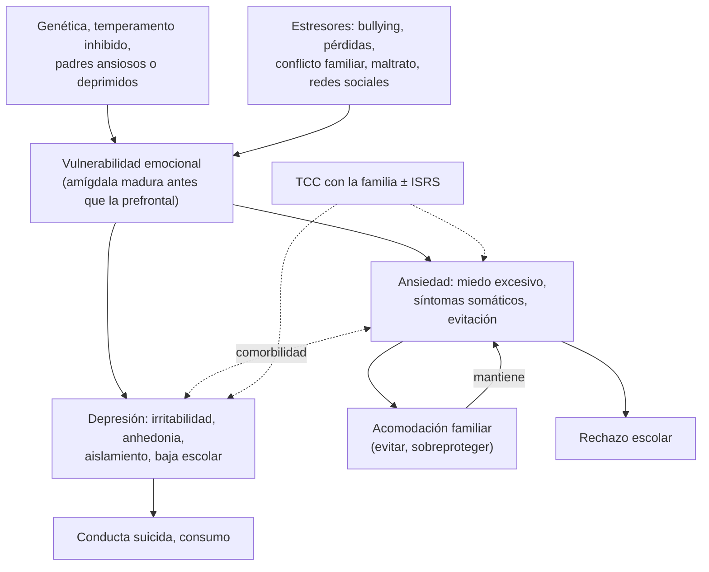

---
tags:
  - Psiquiatría
  - GES
  - Frecuente en sala
---

# Trastornos de ansiedad y del ánimo en niños y adolescentes

**Subespecialidad**
Psiquiatría infantojuvenil · Pediatría · Medicina familiar · Atención primaria

**Guías principales**
AACAP 2020: evaluación y tratamiento de niños y adolescentes con trastornos de ansiedad · GLAD-PC 2018: depresión adolescente en la atención primaria (partes I y II) · USPSTF 2022: tamizaje de ansiedad, depresión y riesgo suicida en niños y adolescentes · MINSAL: guía clínica GES de depresión en personas de 15 años y más

**Otras fuentes**
Ensayo CAMS (Walkup, *N Engl J Med* 2008) · Ensayo TADS (March, *JAMA* 2004) · Prevalencia de trastornos mentales en niños y adolescentes chilenos (Vicente 2012) · Ver [trastornos de ansiedad del adulto](trastornos-de-ansiedad-y-toc.md), [depresión](../geriatria/depresion.md), [conducta suicida](conducta-suicida.md), [trastorno bipolar](trastorno-bipolar.md), [TDAH](tdah-y-trastornos-de-conducta.md) y [trastornos somatomorfos](trastornos-somatomorfos-disociativos-y-facticios.md)

**GES**
**Depresión en personas de 15 años y más** (N.° 34) y **tratamiento hospitalario de menores de 15 años con depresión grave refractaria o psicótica con riesgo suicida** (N.° 89).

**EUNACOM**
5.01.1.033 Trastornos ansiosos en niños (sospecha, inicial, completo) · 5.01.1.034 Trastornos del ánimo en niños (sospecha, inicial, completo)

**Revisado**
Octubre 2026

!!! abstract "Resumen en 60 segundos"
    - Los **trastornos de ansiedad** son los trastornos psiquiátricos **más frecuentes** en los niños y adolescentes (~ 7–10 %); la **depresión** aumenta en la **adolescencia** (~ 5–8 % al año), sobre todo en las **mujeres**.
    - **Ansiedad**: **ansiedad de separación** (preescolares y escolares), **fobias específicas**, **mutismo selectivo**, **fobia social** y **TAG** (escolares y adolescentes), **pánico** (adolescentes). Suelen consultar por **síntomas somáticos** (dolor abdominal, cefalea) y **rechazo escolar**.
    - **Depresión** en niños y adolescentes: a menudo con **irritabilidad** en vez de tristeza, baja del rendimiento, aislamiento, quejas somáticas, cambios del sueño y el apetito; riesgo de **conducta suicida**.
    - **Tamizaje** (USPSTF 2022): **ansiedad** desde los **8 años** y **depresión** desde los **12 años** (PHQ-A, SCARED, GAD-7).
    - **Tratamiento**: **TCC** como primera línea (con la **familia**); en los casos **moderados a graves**, **ISRS** (sertralina o fluoxetina en la ansiedad; **fluoxetina** o escitalopram en la depresión). La **combinación** TCC + ISRS es la más eficaz (CAMS, TADS).
    - **Advertencia de la FDA**: los antidepresivos pueden aumentar la **ideación suicida** en los **< 25 años** al inicio: **control estrecho**, no es razón para no tratar.
    - **Trastorno bipolar** en la adolescencia: preguntar por manía; un **antidepresivo solo** puede inducir viraje. **Trastorno de desregulación disruptiva del ánimo**: irritabilidad crónica con rabietas graves (6–18 años).

## Definición

- **Ansiedad normal** del desarrollo: miedo a los extraños (8–12 meses), a la separación (1–3 años), a la oscuridad, los monstruos y los animales (preescolar), al rendimiento y la salud (escolar), a la evaluación social (adolescencia). Es **transitoria** y **no** deteriora.
- **Trastorno de ansiedad**: miedo o ansiedad **excesivos** para la edad, **persistentes** (≥ 4 semanas en la ansiedad de separación; en general ≥ 6 meses), con **deterioro** (escolar, familiar, social).
- **Trastorno de ansiedad por separación**: miedo excesivo a separarse de las figuras de apego (preocupación de que les pase algo, rechazo a ir al colegio o a dormir solo, pesadillas, **síntomas somáticos** al separarse), **≥ 4 semanas** en los niños.
- **Mutismo selectivo**: incapacidad persistente de hablar en situaciones sociales específicas (colegio) pese a hablar en otras (casa), **≥ 1 mes** (no el primer mes de clases).
- **Depresión mayor** en niños y adolescentes: mismos criterios que en el adulto (≥ 5 síntomas, ≥ 2 semanas), pero el ánimo puede ser **irritable** en vez de deprimido y se considera el **no aumento de peso** esperado.
- **Trastorno depresivo persistente** (distimia): ánimo deprimido o **irritable** la mayor parte de los días por **≥ 1 año** en niños y adolescentes.
- **Trastorno de desregulación disruptiva del estado de ánimo** (DSM-5): **rabietas** graves y recurrentes (**≥ 3 por semana**) desproporcionadas, con **irritabilidad persistente** entre ellas, por **≥ 12 meses**, en **≥ 2 contextos**, de inicio **antes de los 10 años** (diagnóstico entre los 6 y 18 años). Se creó para evitar el sobrediagnóstico de trastorno bipolar en los niños.

## Epidemiología

### Mundial

- **Ansiedad**: prevalencia **~ 7–10 %** (de vida hasta ~ 30 % al final de la adolescencia); edad media de inicio **~ 11 años**. Fobias y ansiedad de separación en la niñez; fobia social y pánico en la adolescencia.
- **Depresión**: **1–2 %** en los niños prepuberales (igual por sexo) y **~ 5–8 % al año** en los adolescentes (**mujeres : hombres ≈ 2 : 1** desde la pubertad); aumento marcado después de la pandemia.
- **Comorbilidad**: ansiedad y depresión coexisten con frecuencia; también con **TDAH**, consumo de sustancias y trastornos de conducta.
- El **suicidio** es una de las primeras causas de muerte en los adolescentes.

### Chile

!!! chile "Datos nacionales"
    - En el **estudio chileno de prevalencia** (Vicente 2012; 4–18 años), el **22,5 %** tenía un trastorno psiquiátrico en el último año (**25,8 % en las niñas**); los trastornos **ansiosos** y **disruptivos** fueron los más frecuentes, y menos de la mitad de quienes lo necesitaban consultó.
    - **GES**: la **depresión en personas de 15 años y más** (N.° 34) y el **tratamiento hospitalario de menores de 15 años** con depresión **grave** refractaria o psicótica con **riesgo suicida** (N.° 89).
    - El MINSAL tiene orientaciones para la **prevención del suicidio en establecimientos educacionales** (2019) y el programa **Habilidades para la Vida** (JUNAEB) trabaja la salud mental en los colegios.

## Etiología y factores de riesgo

- **Genética** y **temperamento**: **inhibición conductual** (niño tímido, retraído ante lo nuevo), afectividad negativa.
- **Familia**: **padres ansiosos o deprimidos** (genética y modelado), crianza **sobreprotectora** o crítica, conflicto familiar, divorcio, violencia, **maltrato**.
- **Eventos vitales**: pérdidas, duelo, cambios de colegio, ***bullying*** y ciberacoso, abuso sexual.
- **Sociales**: pobreza, aislamiento, **uso problemático de redes sociales** y pantallas (alteración del sueño, comparación social).
- **Factores de riesgo de depresión**: sexo femenino después de la pubertad, antecedentes familiares de depresión o **bipolaridad**, enfermedades crónicas, **minorías sexuales y de género** (estigma), consumo de sustancias.

## Fisiopatología

- Similar a la del adulto (ver [trastornos de ansiedad](trastornos-de-ansiedad-y-toc.md) y [depresión](../geriatria/depresion.md)), con un componente **del desarrollo**: el sistema límbico (amígdala) madura **antes** que la corteza **prefrontal** reguladora, lo que explica la mayor **reactividad emocional** de la adolescencia.
- La **acomodación familiar** (los padres evitan las situaciones temidas o responden por el niño) **mantiene** la ansiedad; por eso el tratamiento incluye a los padres.

*Figura 1. Ansiedad y depresión en niños y adolescentes: vulnerabilidad, estresores y mecanismos de mantención. Esquema propio basado en AACAP 2020 y GLAD-PC 2018.*

## Clasificación

| Trastorno | Edad típica | Claves |
|---|---|---|
| **Ansiedad por separación** | Preescolar y escolar | Miedo a separarse, rechazo escolar, síntomas somáticos al separarse |
| **Mutismo selectivo** | 2–5 años | No habla en el colegio; habla en la casa |
| **Fobia específica** | Niñez | Animales, oscuridad, inyecciones |
| **Fobia social** | Adolescencia | Miedo a la evaluación de otros; en niños, también con sus pares |
| **TAG** | Escolar y adolescente | Preocupación excesiva por el rendimiento, la salud, el futuro; perfeccionismo |
| **Pánico** | Adolescencia | Crisis de angustia |
| **Depresión mayor** | Más en la adolescencia | Ánimo deprimido o **irritable**, anhedonia |
| **Distimia** | — | ≥ 1 año en niños y adolescentes |
| **Desregulación disruptiva del ánimo** | 6–18 años (inicio < 10) | Irritabilidad crónica + rabietas graves |
| **Trastorno bipolar** | Adolescencia | Episodios de manía o hipomanía |

## Clínica

- **Ansiedad en los niños**:
    - **Síntomas somáticos**: dolor abdominal, cefalea, náuseas, sobre todo **antes de ir al colegio**.
    - **Rechazo escolar**, llanto, dependencia de los padres, dificultad para dormir solos, pesadillas.
    - Preguntas reiteradas buscando **tranquilización**, irritabilidad, rabietas ante las separaciones.
- **Depresión según la edad**:
    - **Preescolares**: tristeza, irritabilidad, **pérdida del interés en el juego**, regresión (enuresis), quejas somáticas, alteración del apetito.
    - **Escolares**: **irritabilidad**, baja del rendimiento, aislamiento, quejas somáticas, baja autoestima ("soy tonto"), conductas oposicionistas.
    - **Adolescentes**: tristeza o irritabilidad, **anhedonia**, aislamiento, **hipersomnia** o insomnio, cambios del apetito, consumo de sustancias, **autolesiones**, ideación suicida.

!!! alarma "Signos de alarma: derivar con urgencia"
    - **Ideación suicida** con plan, **intento** de suicidio, autolesiones graves.
    - **Síntomas psicóticos** o depresión **grave** (GES N.° 89 en < 15 años si es refractaria o psicótica con riesgo suicida).
    - **Manía** o hipomanía (sobre todo tras iniciar un antidepresivo), antecedente familiar de **bipolaridad**.
    - **Rechazo escolar** prolongado, **rechazo de alimentos**, baja de peso (descartar un TCA).
    - **Abuso**, maltrato o violencia en curso.
    - Consumo de sustancias.

## Diagnóstico

!!! guia "Puntos clave (AACAP 2020; GLAD-PC 2018; USPSTF 2022)"
    - **Tamizaje** en la APS: **ansiedad** en los niños y adolescentes de **8–18 años** y **depresión** en los adolescentes de **12–18 años** (USPSTF 2022).
    - **Instrumentos**: **PHQ-A** o PHQ-9 modificado para adolescentes (depresión), **SCARED** (ansiedad en niños, versión para padres e hijo), **GAD-7** (adolescentes), **ASQ** o C-SSRS (riesgo suicida).
    - **Entrevistar al niño o adolescente a solas** (confidencialidad con límites: riesgo vital) y a los **padres**; pedir información al **colegio**.
    - Evaluar siempre el **riesgo suicida**, la **bipolaridad** (historia personal y familiar), el **consumo**, el **abuso** o maltrato, el *bullying* y la **comorbilidad** (TDAH, TEA, TCA).
    - Descartar **causas médicas**: hipertiroidismo, anemia, enfermedades crónicas, fármacos (corticoides, salbutamol, isotretinoína, anticonceptivos).

## Laboratorio

- **No** hay exámenes diagnósticos.
- Según la clínica: **TSH**, hemograma y ferritina, glicemia, tóxicos en orina (adolescentes), β-hCG.

## Imágenes

- **No** se requieren, salvo signos neurológicos o una presentación atípica.

## Diagnóstico diferencial

| Diagnóstico | Claves |
|---|---|
| **Miedos normales** del desarrollo | Transitorios, sin deterioro |
| **TDAH** | Inquietud e inatención sin preocupación excesiva |
| **TEA** | Ansiedad social con déficit de la reciprocidad y conductas restringidas |
| **Trastorno bipolar** | Episodios de manía o hipomanía; antecedentes familiares |
| **Trastorno de adaptación** | Estresor reciente, sin criterios de otro trastorno |
| **TEPT** | Evento traumático (abuso, violencia) |
| **Abuso sexual o maltrato** | Cambios bruscos de conducta, conductas sexualizadas, síntomas somáticos |
| **Trastornos de la conducta alimentaria** | Restricción, preocupación por el peso |
| **Causas médicas** | Hipertiroidismo, hipoglicemia, asma (salbutamol), anemia |
| **Consumo de sustancias** | Cannabis, alcohol, estimulantes |

## Tratamiento

### Principios

- **Psicoeducación** del niño, los padres y el colegio.
- **TCC** (con **exposición** gradual en la ansiedad) como **primera línea**; incluir a los **padres** (reducir la **acomodación** y la sobreprotección) y coordinar con el **colegio** (retorno escolar **gradual** en el rechazo escolar).
- **Medidas generales**: rutinas, **sueño** regular, actividad física, límite al uso de pantallas y redes sociales, abordar el *bullying*.
- **Fármacos** en la ansiedad o depresión **moderada a grave**, sin respuesta a la psicoterapia o sin acceso a ella; **combinación** con TCC.

!!! guia "Fármacos y evidencia (AACAP 2020; GLAD-PC 2018)"
    - **Ansiedad**: **ISRS** (sertralina, fluoxetina, escitalopram) e **IRSN** (duloxetina). En el ensayo **CAMS**, la **combinación** de TCC + **sertralina** tuvo la mejor respuesta (~ **81 %**), frente a cada una sola (~ 55–60 %).
    - **Depresión**: **fluoxetina** (desde los 8 años) y **escitalopram** (desde los 12 años) son los de mejor evidencia y aprobados por la FDA. En el ensayo **TADS**, la **combinación** de fluoxetina + TCC fue la más eficaz.
    - **Iniciar con dosis bajas**, subir lento y evaluar la respuesta a las **6–8 semanas**; mantener **6–12 meses** tras la remisión.
    - **Advertencia de la FDA** (recuadro negro): aumento de la **ideación y conducta suicida** en los **< 25 años** con los antidepresivos (sin aumento de suicidios consumados en los ensayos). **Advertir** a la familia, entregar un **plan de seguridad** y **controlar** cada 1–2 semanas al inicio. El beneficio supera el riesgo.
    - **Evitar** las **benzodiacepinas** en los niños (salvo situaciones puntuales) y los **tricíclicos** (sin eficacia y con riesgo cardíaco y en sobredosis).
    - **Antes del ISRS**: descartar **bipolaridad** (riesgo de viraje).

!!! dosis "ISRS en niños y adolescentes"
    | Fármaco | Dosis inicial | Dosis habitual | Comentario |
    |---|---|---|---|
    | **Fluoxetina** | 10 mg/día | 20–40 mg/día | Primera línea en la depresión (≥ 8 años); vida media larga |
    | **Escitalopram** | 5 mg/día | 10–20 mg/día | Depresión ≥ 12 años |
    | **Sertralina** | 12,5–25 mg/día | 50–200 mg/día | Primera línea en la ansiedad (CAMS) y el TOC |
    - Efectos adversos: molestias digestivas, cefalea, insomnio, **activación** (inquietud, irritabilidad), **ideación suicida** (vigilar), sangrado, viraje a manía.

### Depresión según la gravedad (GLAD-PC 2018)

- **Leve**: **monitorización activa** (6–8 semanas) con apoyo, psicoeducación y actividad física; si no mejora, psicoterapia.
- **Moderada**: **psicoterapia** (TCC o terapia interpersonal) y/o **ISRS**.
- **Grave**, con riesgo suicida o psicosis: **derivación urgente** a psiquiatría infantojuvenil, ISRS + psicoterapia; hospitalización si el riesgo es alto (GES N.° 89 en < 15 años).

## Complicaciones

- **Conducta suicida** y suicidio.
- **Rechazo** y **deserción escolar**, aislamiento social.
- **Consumo de sustancias** (automedicación).
- **Cronicidad**: ansiedad y depresión en la adultez; trastorno bipolar (~ 20–40 % de las depresiones de inicio precoz evolucionan a bipolaridad).
- Efectos adversos de los fármacos (activación, viraje).

## Pronóstico y seguimiento

- **Ansiedad**: con tratamiento, la mayoría mejora; sin él, tiende a persistir y a predisponer a la depresión y el consumo.
- **Depresión**: un episodio dura **~ 7–9 meses** en promedio; **recurrencia** de hasta **50–70 %** en 5 años.
- **Seguimiento**: controles cada **1–2 semanas** al iniciar fármacos y luego mensuales, escalas (PHQ-A, SCARED), **riesgo suicida**, efectos adversos, rendimiento escolar, funcionamiento familiar.

## Perlas para el internado

!!! perla "Para recordar"
    - En los niños, la depresión puede ser **irritabilidad**; la ansiedad, **dolor abdominal** antes del colegio.
    - Entrevistar al adolescente **a solas** y preguntar por **suicidio**, consumo, abuso y *bullying*.
    - Tamizaje: **ansiedad desde los 8 años**, **depresión desde los 12** (USPSTF 2022).
    - **TCC** primero; **ISRS** en los casos moderados a graves; la **combinación** es lo más eficaz (CAMS, TADS).
    - **Fluoxetina** es el antidepresivo de primera línea en la depresión infantojuvenil.
    - **Recuadro negro**: más ideación suicida en < 25 años al inicio: **advertir y controlar**, no dejar de tratar.
    - Antes del antidepresivo: **descartar bipolaridad** (preguntar por manía y antecedentes familiares).
    - **Rechazo escolar**: retorno **gradual** al colegio; no prolongar el ausentismo.

## Preguntas de repaso

??? repaso "1. Niña de 7 años con dolor abdominal todas las mañanas de colegio, llanto al despedirse de su madre y miedo a que a ella le pase algo; no quiere dormir sola. ¿Diagnóstico y manejo?"
    **Trastorno de ansiedad por separación** (≥ 4 semanas). Descartar causas orgánicas del dolor con la clínica. Manejo: psicoeducación, **TCC** con exposición gradual, trabajo con los **padres** (reducir la acomodación) y con el **colegio** (retorno gradual). ISRS (sertralina) si es moderado a grave o no responde.

??? repaso "2. Adolescente de 15 años con 2 meses de irritabilidad, aislamiento, abandono del fútbol, hipersomnia y baja de notas. PHQ-A: 17. Niega ideación suicida y antecedentes de manía. ¿Qué hace?"
    **Depresión mayor moderada a grave** (GES N.° 34 desde los 15 años). Evaluar el riesgo suicida, el consumo, el *bullying* y el abuso; descartar hipotiroidismo. Tratamiento: **psicoterapia** (TCC o interpersonal) + **fluoxetina** 10 mg/día, subir a 20 mg, con **advertencia** sobre la ideación suicida, **plan de seguridad** y control en 1–2 semanas.

??? repaso "3. ¿Qué advertencia debe dar al iniciar un antidepresivo en un adolescente?"
    Que en los **< 25 años** puede **aumentar transitoriamente la ideación suicida** al inicio (advertencia de la FDA). Indicar a la familia que vigile cambios de conducta, agitación o ideas de muerte, entregar un **plan de seguridad**, limitar el acceso a medios letales y controlar cada 1–2 semanas al inicio.

??? repaso "4. Niño de 5 años que habla normalmente en su casa pero no ha dicho una palabra en el jardín en 6 meses. ¿Qué tiene?"
    **Mutismo selectivo** (un trastorno de ansiedad). Descartar trastornos del lenguaje, hipoacusia y TEA. Tratamiento: **TCC** con exposición gradual, trabajo con la familia y el jardín; ISRS en los casos persistentes.

??? repaso "5. Niño de 9 años con rabietas explosivas casi a diario desde los 6 años e irritabilidad constante entre ellas, en la casa y el colegio. ¿Qué diagnóstico considera?"
    **Trastorno de desregulación disruptiva del estado de ánimo** (rabietas graves ≥ 3 veces por semana con irritabilidad persistente ≥ 12 meses, inicio antes de los 10 años, en ≥ 2 contextos). Es distinto del trastorno bipolar (que es episódico). Tratamiento: intervención parental y TCC; tratar el TDAH comórbido si existe.

??? repaso "6. Adolescente de 16 años en fluoxetina por depresión que a las 3 semanas duerme 3 horas, habla rápido y gasta dinero sin control. ¿Qué ocurre?"
    **Viraje a manía o hipomanía** inducido por el antidepresivo, que sugiere un **trastorno bipolar**. Suspender la fluoxetina, evaluar el riesgo y derivar con urgencia a psiquiatría infantojuvenil para iniciar un estabilizador del ánimo o un antipsicótico atípico.

## Referencias

1. Walter HJ, Bukstein OG, Abright AR, et al. Clinical practice guideline for the assessment and treatment of children and adolescents with anxiety disorders. *J Am Acad Child Adolesc Psychiatry.* 2020;59(10):1107–1124. doi:[10.1016/j.jaac.2020.05.005](https://doi.org/10.1016/j.jaac.2020.05.005)
2. Zuckerbrot RA, Cheung A, Jensen PS, et al. Guidelines for Adolescent Depression in Primary Care (GLAD-PC): part I. Practice preparation, identification, assessment, and initial management. *Pediatrics.* 2018;141(3):e20174081. doi:[10.1542/peds.2017-4081](https://doi.org/10.1542/peds.2017-4081)
3. Cheung AH, Zuckerbrot RA, Jensen PS, et al. Guidelines for Adolescent Depression in Primary Care (GLAD-PC): part II. Treatment and ongoing management. *Pediatrics.* 2018;141(3):e20174082. doi:[10.1542/peds.2017-4082](https://doi.org/10.1542/peds.2017-4082)
4. US Preventive Services Task Force; Mangione CM, Barry MJ, Nicholson WK, et al. Screening for anxiety in children and adolescents: US Preventive Services Task Force recommendation statement. *JAMA.* 2022;328(14):1438–1444. doi:[10.1001/jama.2022.16936](https://doi.org/10.1001/jama.2022.16936)
5. US Preventive Services Task Force; Mangione CM, Barry MJ, Nicholson WK, et al. Screening for depression and suicide risk in children and adolescents: US Preventive Services Task Force recommendation statement. *JAMA.* 2022;328(15):1534–1542. doi:[10.1001/jama.2022.16946](https://doi.org/10.1001/jama.2022.16946)
6. Walkup JT, Albano AM, Piacentini J, et al. Cognitive behavioral therapy, sertraline, or a combination in childhood anxiety. *N Engl J Med.* 2008;359(26):2753–2766. doi:[10.1056/NEJMoa0804633](https://doi.org/10.1056/NEJMoa0804633)
7. March J, Silva S, Petrycki S, et al. Fluoxetine, cognitive-behavioral therapy, and their combination for adolescents with depression: Treatment for Adolescents With Depression Study (TADS) randomized controlled trial. *JAMA.* 2004;292(7):807–820. doi:[10.1001/jama.292.7.807](https://doi.org/10.1001/jama.292.7.807)
8. Vicente B, Saldivia S, de la Barra F, et al. Prevalence of child and adolescent mental disorders in Chile: a community epidemiological study. *J Child Psychol Psychiatry.* 2012;53(10):1026–1035. doi:[10.1111/j.1469-7610.2012.02566.x](https://doi.org/10.1111/j.1469-7610.2012.02566.x)
9. American Psychiatric Association. *Diagnostic and Statistical Manual of Mental Disorders, Fifth Edition, Text Revision (DSM-5-TR).* Washington, DC: APA; 2022.
