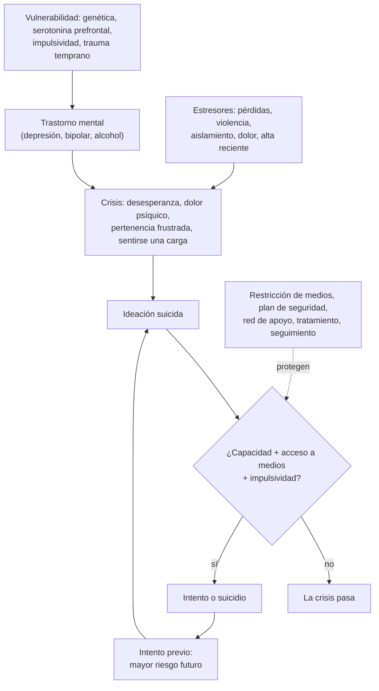

---
tags:
  - Psiquiatría
  - Urgencia
  - Frecuente en sala
---

# Conducta suicida (adultos, niños y adolescentes)

**Subespecialidad**
Psiquiatría · Psiquiatría infantojuvenil · Medicina de urgencia · Atención primaria

**Guías principales**
MINSAL 2013: Programa Nacional de Prevención del Suicidio, orientaciones para su implementación · MINSAL 2019: recomendaciones para la prevención de la conducta suicida en establecimientos educacionales · NICE NG225 (2022): autolesiones · Escala de Columbia (C-SSRS) y ASQ

**Otras fuentes**
Revisión del suicidio (Fazel y Runeson, *N Engl J Med* 2020) · Estrategias de prevención: revisión de 10 años (Zalsman, *Lancet Psychiatry* 2016) · Plan de seguridad en la urgencia (Stanley, *JAMA Psychiatry* 2018) · Suicidio en adolescentes y jóvenes en Chile (Araneda, *Rev Panam Salud Publica* 2021) · Ver [depresión](../geriatria/depresion.md), [trastorno bipolar](trastorno-bipolar.md), [consumo de sustancias](consumo-de-alcohol-tabaco-y-drogas.md) e [intoxicación por sustancias](intoxicacion-por-sustancias-psicoactivas.md)

**GES**
No como problema propio. Son GES la **depresión en personas de 15 años y más** (N.° 34) y el **tratamiento hospitalario de menores de 15 años con depresión grave refractaria o psicótica con riesgo suicida** (N.° 89).

**EUNACOM**
5.01.2.001 Conducta suicida (sospecha, inicial, derivar) · 5.01.3.002 Conducta suicida (conocimientos generales) · 5.01.1.029 Intento de suicidio en niños y adolescentes (sospecha, inicial, derivar)

**Revisado**
Octubre 2026

!!! abstract "Resumen en 60 segundos"
    - **Conducta suicida**: espectro que va de la **ideación** (pasiva o activa) a la **planificación**, el **intento** y el **suicidio consumado**. Las **autolesiones sin intención suicida** son un factor de riesgo importante.
    - En Chile la tasa de suicidio es **~ 10–11 por 100 000** habitantes al año; **4–5 veces más en hombres**; las **mujeres** hacen más **intentos**. Las tasas más altas están en los **hombres mayores de 70–80 años**; en los jóvenes es una de las primeras causas de muerte.
    - **Preguntar por el suicidio no lo induce**: hay que preguntar **directamente** ("¿Ha pensado en quitarse la vida?").
    - **Evaluar**: ideación, **plan**, **método y acceso** a medios letales, **intentos previos** (el mayor predictor), trastorno mental (depresión, bipolar, consumo de alcohol), desesperanza, eventos recientes y **factores protectores**. Escalas: **C-SSRS** (adultos) y **ASQ** (niños y adolescentes) como apoyo, no como predicción.
    - **Riesgo alto** (plan, intento con alta letalidad o intención, psicosis, agitación, falta de red): **no dejar solo**, retirar los medios, **hospitalizar** (internación no voluntaria si es necesario, Ley 21.331).
    - **Riesgo bajo o moderado**: **plan de seguridad** escrito, **restricción de medios letales** (fármacos, armas, plaguicidas), involucrar a la **familia**, tratar el trastorno de base y **contacto de seguimiento** en **≤ 7 días**.
    - Tras el alta de una urgencia o de un hospital el riesgo es **máximo**: el seguimiento activo salva vidas.

## Definición

- **Ideación suicida**: pensamientos de muerte o de quitarse la vida. **Pasiva** ("sería mejor no despertar") o **activa** ("quiero matarme").
- **Plan suicida**: ideación con un **método**, un **lugar** o un **momento** definidos.
- **Intento de suicidio**: conducta **autoinfligida, potencialmente lesiva**, con **alguna intención de morir**, que no termina en la muerte.
- **Suicidio**: muerte causada por una conducta autoinfligida con intención de morir.
- **Autolesión no suicida**: daño deliberado del propio cuerpo **sin intención de morir** (cortes, quemaduras), como forma de regular emociones intensas. Frecuente en adolescentes; **aumenta el riesgo** de suicidio futuro.
- **Autolesión** (*self-harm*, NICE): cualquier acto de autoenvenenamiento o autoagresión, **independiente** de la intención.
- **Conducta suicida**: término que agrupa la ideación, la planificación y los intentos.

## Epidemiología

### Mundial

- **~ 700 000** muertes por suicidio al año (OMS); es una de las **principales causas de muerte** entre los **15 y 29 años**.
- Por cada suicidio hay **≥ 20 intentos**.
- **Hombres**: más suicidios consumados (métodos más letales). **Mujeres**: más ideación e intentos.
- **Métodos** más frecuentes en el mundo: ahorcamiento, **plaguicidas** y armas de fuego (según el país).
- **~ 90 %** de quienes mueren por suicidio tenía un **trastorno mental**, sobre todo **depresión**, **trastorno bipolar**, **consumo de sustancias**, esquizofrenia y trastornos de personalidad.

### Chile

!!! chile "Datos nacionales"
    - El MINSAL creó el **Programa Nacional de Prevención del Suicidio** (2013) cuando la tasa promedio 2001–2010 era de **14,7 por 100 000**. Hoy la tasa es **~ 10–11 por 100 000** (unos **2000 suicidios al año**), **mayor que la de homicidios**.
    - **Hombres : mujeres ≈ 4–5 : 1**. Las tasas más altas están en los **hombres mayores de 70–80 años**; el **ahorcamiento** es el método más frecuente.
    - **Adolescentes y jóvenes** (2000–2017, Araneda 2021): tasas promedio de **5,4 por 100 000** entre los 10 y 19 años y de **14,7** entre los 20 y 24 años, con mayor riesgo en los hombres y desigualdades territoriales.
    - El MINSAL publicó recomendaciones para la prevención en **establecimientos educacionales** (2019) y sometió a consulta pública la **Estrategia Nacional para la Prevención del Suicidio 2025–2034**.
    - Línea de prevención del suicidio del MINSAL: **\*4141** (desde celulares, gratuita, 24 horas, atendida por psicólogos; creada en 2022).

## Etiología y factores de riesgo

| Tipo | Factores |
|---|---|
| **Mayores predictores** | **Intento de suicidio previo** (el más importante), **autolesiones**, **trastorno mental** (depresión, bipolar, esquizofrenia, consumo de alcohol y drogas, trastornos de personalidad, TCA, TEPT) |
| **Clínicos** | **Desesperanza**, impulsividad, agitación o ansiedad intensa, **insomnio**, dolor crónico, enfermedad médica grave o discapacitante, **alta reciente** de una hospitalización psiquiátrica |
| **Demográficos** | **Hombre**, **adulto mayor** (en especial > 80 años), adolescente o adulto joven, soltero, viudo o separado, **minorías sexuales y de género** (LGBTIQ+), pueblos originarios en algunos contextos |
| **Psicosociales** | **Aislamiento**, pérdidas recientes (duelo, separación, trabajo), problemas económicos o legales, **violencia** (intrafamiliar, sexual), **maltrato o abuso infantil**, ***bullying*** y ciberacoso, **suicidio de un cercano** (contagio), exposición mediática irresponsable |
| **Acceso a medios** | **Armas de fuego**, fármacos en la casa, plaguicidas, lugares elevados |
| **Protectores** | **Red de apoyo** familiar y social, sentido de **pertenencia**, hijos a cargo, creencias religiosas o culturales, habilidades de afrontamiento, **acceso a atención** de salud mental, **restricción de medios** |

**Niños y adolescentes**: conflictos familiares, **abuso sexual**, *bullying*, consumo de sustancias, ruptura amorosa, fracaso escolar, **identidad de género o sexual** no aceptada por el entorno, impulsividad, exposición al suicidio de pares o en redes sociales.

## Fisiopatología

- **Modelo de estrés-diátesis**: una **vulnerabilidad** (genética, alteración del sistema **serotoninérgico** prefrontal, impulsividad, trauma temprano) interactúa con **estresores** agudos.
- **Teoría interpersonal** (Joiner): el deseo suicida surge de la **pertenencia frustrada** y la **percepción de ser una carga**; la **capacidad** de hacerlo se adquiere por la exposición al dolor y al miedo (autolesiones e intentos previos).
- **Modelo de la ideación a la acción**: muchos piensan en el suicidio, pocos actúan; el paso depende de la **capacidad**, el **acceso a medios** y la **impulsividad** (por eso la restricción de medios funciona).
- **Crisis suicida**: suele ser **transitoria** (minutos a horas); retrasar el acceso al método permite que la crisis pase.

*Figura 1. De la ideación a la acción: factores de riesgo, crisis suicida y puntos de prevención. Esquema propio basado en Fazel y Runeson (2020) y Zalsman (2016).*

## Clasificación

**Niveles de riesgo** (orientativos; la decisión es **clínica**):

| Riesgo | Características | Conducta |
|---|---|---|
| **Bajo** | Ideación **pasiva** o fugaz, **sin plan** ni intención, sin intentos previos, buena red de apoyo, factores protectores | Tratamiento ambulatorio, **plan de seguridad**, restricción de medios, control precoz |
| **Moderado** | Ideación **activa** sin plan concreto o con plan vago, factores de riesgo presentes, sin intento reciente, con **red de apoyo** confiable | Derivación **prioritaria** a salud mental (en días), plan de seguridad, familia informada, restricción de medios, seguimiento estrecho |
| **Alto** | **Plan** concreto, **intención**, acceso a medios, **intento reciente** (sobre todo de alta letalidad o con medidas para no ser descubierto), **psicosis**, agitación, **desesperanza** intensa, consumo activo, **sin red** | **No dejar solo**, retirar los medios, **evaluación psiquiátrica urgente** y **hospitalización** (no voluntaria si es necesario) |

- **Letalidad del intento**: método (ahorcamiento, armas, saltar, plaguicidas = **alta**), **planificación**, precauciones para **no ser descubierto**, **nota** de despedida, arrepentimiento o no de haber sobrevivido.

## Clínica

- **Señales de alerta**: hablar de **querer morir** o de ser una carga, buscar métodos (internet, fármacos), **despedirse**, regalar pertenencias, escribir notas, aislamiento, aumento del consumo de alcohol o drogas, cambios bruscos de ánimo (una **calma repentina** tras una depresión grave puede indicar una decisión tomada).
- **Adulto mayor**: ideación a menudo **no expresada**; consulta por síntomas somáticos; métodos **más letales** y menos intentos previos.
- **Niños y adolescentes**:
    - Autolesiones (cortes en antebrazos y muslos), cambios de conducta, irritabilidad, baja escolar, aislamiento, mensajes en **redes sociales**.
    - La ideación puede ser **impulsiva**, gatillada por un conflicto reciente; menos planificación, pero alta impulsividad.
    - Buscar **abuso sexual**, maltrato, *bullying*, consumo y **disforia de género**.

!!! alarma "Riesgo inminente: actuar de inmediato"
    - **Plan concreto** con **acceso** al método e **intención** declarada.
    - Intento **reciente** de alta letalidad o con **arrepentimiento de haber sobrevivido**.
    - **Psicosis** (alucinaciones de comando), **agitación**, **intoxicación** aguda, depresión grave con **desesperanza**.
    - **Sin red de apoyo** o con una red incapaz de supervisar.
    - Conducta: **no dejar solo** al paciente, **retirar** objetos peligrosos (cinturones, cordones, fármacos, elementos cortantes), llamar al **psiquiatra de turno** y **hospitalizar**.

## Diagnóstico

!!! guia "Evaluación del riesgo suicida (MINSAL 2013; NICE NG225)"
    - **Preguntar directamente** y sin juicio, de lo general a lo específico:
        1. "¿Ha sentido que la vida no vale la pena?"
        2. "¿Ha pensado en morir o en hacerse daño?"
        3. "¿Ha pensado en **cómo** lo haría? ¿Tiene acceso a eso?"
        4. "¿Lo ha **intentado** antes? ¿Qué pasó?"
        5. "¿Qué lo ha detenido?" (factores protectores).
    - **Instrumentos de apoyo**: **C-SSRS** (Columbia: ideación, intensidad y conducta) en adultos y adolescentes; **ASQ** (4 preguntas + 1 de urgencia) en niños y adolescentes de **10–24 años** en la urgencia o la consulta; PHQ-9 (ítem 9).
    - **NICE** advierte: **no** usar escalas ni clasificaciones de riesgo para **predecir** el suicidio ni para decidir quién recibe tratamiento o el alta; la evaluación debe ser **integral** y centrada en las **necesidades** y la seguridad.
    - Evaluar el **trastorno mental** de base, el **consumo**, la **red de apoyo** y obtener información de **terceros** (familia), sobre todo en adolescentes.
    - En un **intento**: primero estabilizar (intoxicación, heridas), luego la evaluación psicosocial **antes del alta**, cuando el paciente esté sobrio y lúcido.

## Laboratorio

- No hay exámenes que evalúen el riesgo.
- En el **intento por intoxicación**: niveles de **paracetamol**, alcoholemia, tóxicos, ECG, función renal y hepática, β-hCG (ver [intoxicación por sustancias](intoxicacion-por-sustancias-psicoactivas.md)).
- Según la clínica: TSH, hemograma, glicemia (causas médicas de la depresión).

## Imágenes

- No se requieren para la evaluación del riesgo. Según las lesiones del intento (TC en el ahorcamiento frustrado: lesiones cervicales y anoxia; imágenes por traumatismos).

## Diagnóstico diferencial

- **Autolesión no suicida** (sin intención de morir) frente a **intento** de suicidio: preguntar por la **intención**; ambas requieren evaluación y seguimiento.
- **Conductas de riesgo** sin intención suicida (consumo, conducción temeraria).
- **Ideación suicida** en el contexto de la **depresión**, el **trastorno bipolar** (estado mixto), la **psicosis**, la **intoxicación** o la **abstinencia**, el **trastorno límite de la personalidad** (crónica, reactiva), el **TEPT** o un **delirium**.
- **Simulación** o amenaza instrumental (no subestimar: también se asocia a riesgo real).

## Tratamiento

### Intervención en crisis y plan de seguridad

!!! guia "Plan de seguridad (Stanley y Brown)"
    Se escribe **con** el paciente y se entrega por escrito. Reduce los intentos tras la urgencia (Stanley 2018):

    1. **Señales de alerta** personales de una crisis.
    2. **Estrategias propias** para afrontarla (distracción, actividad física, respiración).
    3. **Personas y lugares** sociales que ayudan a distraerse.
    4. **Personas de confianza** a quienes pedir ayuda (nombres y teléfonos).
    5. **Profesionales y servicios** de urgencia (centro de salud, urgencia, **\*4141**).
    6. **Hacer el entorno seguro**: **restricción de medios letales** (entregar los fármacos a un tercero, retirar las armas, guardar los plaguicidas).

- **Restricción de medios letales**: la intervención poblacional con **mejor evidencia** (Zalsman 2016). Indicar a la familia que guarde los **fármacos** (incluido el paracetamol), **armas** y plaguicidas.
- **Involucrar a la familia** o a la red (con el consentimiento del paciente; en los menores, siempre a los padres o cuidadores, salvo que sean la fuente del riesgo).
- **Contacto de seguimiento** activo: llamada o control dentro de **≤ 7 días** tras el alta (período de máximo riesgo).

### Tratamiento del trastorno de base

- **Depresión**: antidepresivo + psicoterapia. En los **< 25 años**, los antidepresivos pueden aumentar transitoriamente la ideación al inicio: **control estrecho** las primeras semanas (no es razón para no tratar). Entregar cantidades **limitadas** de fármacos.
- **Trastorno bipolar** y depresión recurrente: el **litio** reduce el suicidio.
- **Esquizofrenia** con riesgo suicida persistente: **clozapina**.
- **Consumo de alcohol y drogas**: tratarlo.
- **Psicoterapias** con evidencia en la conducta suicida: **TCC** para la prevención del suicidio, **terapia dialéctico-conductual** (DBT, sobre todo en adolescentes con autolesiones y en el trastorno límite).
- **Ketamina o esketamina** y **TEC**: en la depresión grave con alto riesgo suicida, por especialista.

### Hospitalización

- **Indicaciones**: riesgo **alto** o inminente, intento de alta letalidad, psicosis, intoxicación grave, falta de red, imposibilidad de un plan de seguridad.
- La **Ley 21.331** permite la **internación no voluntaria** cuando hay **riesgo real e inminente** para sí o para terceros, como **último recurso**, con evaluación psiquiátrica y notificación a la autoridad sanitaria.
- **Menores de 15 años** con depresión grave refractaria o psicótica con riesgo suicida: tratamiento hospitalario **GES N.° 89**.

!!! alarma "Antes del alta de un intento de suicidio"
    - Paciente **sobrio**, lúcido y evaluado por **salud mental**.
    - **Plan de seguridad** escrito y **restricción de medios** acordada con la familia.
    - **Hora de control** fijada (idealmente en **≤ 7 días**) y datos de contacto de emergencia.
    - Registrar y comunicar el caso según los protocolos locales del programa de prevención del suicidio, para asegurar el seguimiento.

## Complicaciones

- **Muerte** o **secuelas** del intento: encefalopatía anóxica (ahorcamiento), falla hepática (paracetamol), lesiones medulares o traumatismos (saltos), quemaduras, amputaciones.
- **Repetición**: ~ 15–25 % repite un intento en el año siguiente; el riesgo de suicidio consumado tras un intento es **decenas de veces** mayor que el de la población general.
- **Duelo complicado** y riesgo de suicidio en los **sobrevivientes** (familiares, pares: "**contagio**" o efecto imitación).

## Pronóstico y seguimiento

- El riesgo es **máximo** en los **días y semanas** después del alta de una hospitalización psiquiátrica o de una urgencia por un intento.
- El seguimiento activo, el plan de seguridad, la restricción de medios y el tratamiento del trastorno de base **reducen** los intentos y las muertes.
- **Posvención**: apoyo a los familiares, compañeros de curso o de trabajo después de un suicidio (prevenir el contagio). **Comunicación responsable** en los medios (no detallar métodos, no presentarlo como solución, informar dónde pedir ayuda).

## Perlas para el internado

!!! perla "Para recordar en la sala y el turno"
    - **Preguntar por el suicidio no lo induce**: pregúntalo **directo**.
    - El **intento previo** es el **mayor predictor**.
    - Hombre **mayor de 80 años**, viudo, con dolor o enfermedad crónica y alcohol: riesgo **altísimo**, aunque no lo diga.
    - Las escalas **apoyan** la evaluación pero **no predicen**: la decisión es **clínica**.
    - **Restricción de medios** + **plan de seguridad** + **seguimiento en ≤ 7 días**.
    - Todo intento por **fármacos**: medir **paracetamol**.
    - Riesgo inminente: **no dejar solo**, retirar objetos peligrosos y hospitalizar (Ley 21.331 si no acepta).
    - En el adolescente, buscar **abuso**, *bullying*, consumo, **identidad de género**; hablar a solas y con la familia.
    - Línea de prevención del suicidio: **\*4141**.

## Preguntas de repaso

??? repaso "1. Hombre de 82 años, viudo hace 6 meses, con cáncer de próstata y dolor mal controlado, que dice 'ya no tiene sentido seguir'. Vive solo y tiene una escopeta. ¿Cómo evalúa y qué hace?"
    Riesgo **alto**: hombre, > 80 años, viudo, enfermedad grave con dolor, aislamiento, **acceso a un arma** y desesperanza. Preguntar **directamente** por la ideación, el plan y la intención; buscar **depresión**. Conducta: **retirar el arma** (con la familia), **evaluación psiquiátrica urgente**, **control del dolor**, tratar la depresión y considerar la hospitalización si hay plan o intención. Activar la red familiar y social.

??? repaso "2. Adolescente de 15 años en la urgencia tras ingerir 10 comprimidos de sertralina luego de una pelea con su pareja. Está estable. ¿Qué hace?"
    Estabilizar y pedir **nivel de paracetamol** (coingesta), ECG (QT) y observación (síndrome serotoninérgico). Antes del alta: evaluación de salud mental (ASQ o C-SSRS como apoyo), entrevista **a solas** y con los **padres**, buscar **abuso**, *bullying*, consumo y depresión. Si el riesgo no es alto: **plan de seguridad**, **restricción de medios** (fármacos guardados por un adulto) y **control en ≤ 7 días** con salud mental. Si es alto: hospitalizar.

??? repaso "3. ¿Qué diferencia una autolesión no suicida de un intento de suicidio y por qué importa?"
    La **intención**: en la autolesión no suicida (por ejemplo, cortes para aliviar la angustia) **no** hay intención de morir; en el intento, sí. Importa porque cambia el abordaje inmediato, pero **ambas** aumentan el riesgo de suicidio futuro y requieren evaluación, tratamiento (por ejemplo, DBT) y seguimiento.

??? repaso "4. Mujer de 35 años con depresión grave, plan de ahorcarse este fin de semana y sin red de apoyo, que se niega a hospitalizarse. ¿Qué hace?"
    Riesgo **alto e inminente**. **No dejarla sola**, retirar objetos peligrosos y solicitar la **evaluación psiquiátrica urgente**. Si persiste el riesgo y se niega, procede la **internación no voluntaria** según la **Ley 21.331** (riesgo real e inminente, último recurso, con notificación a la autoridad sanitaria).

??? repaso "5. ¿Qué medidas tienen la mejor evidencia en la prevención del suicidio?"
    La **restricción del acceso a medios letales** (armas, plaguicidas, fármacos, lugares elevados), la **detección** y el **tratamiento** de la depresión (incluido el litio en los trastornos del ánimo), el **seguimiento activo** tras un intento (contacto en ≤ 7 días), el **plan de seguridad**, los programas **escolares** de prevención y la **comunicación responsable** en los medios (Zalsman 2016).

??? repaso "6. Joven de 19 años que inicia fluoxetina por depresión. ¿Qué le advierte y cómo lo controla?"
    En los **< 25 años**, los antidepresivos pueden **aumentar transitoriamente** la ideación suicida en las primeras semanas (advertencia de la FDA). Explicarlo al paciente y la familia, entregar cantidades **limitadas**, controlar en **1–2 semanas** y luego con frecuencia, y entregar el **plan de seguridad** y los teléfonos de ayuda. El beneficio del tratamiento supera el riesgo.

## Referencias

1. Ministerio de Salud de Chile. *Programa Nacional de Prevención del Suicidio: orientaciones para su implementación.* Santiago: MINSAL; 2013. [uchile.cl](https://portaluchile.uchile.cl/dam/jcr:a952b085-6686-4a7b-81e4-c015bccf18ab/programa-nacional-prevencion.pdf)
2. Ministerio de Salud de Chile. *Recomendaciones para la prevención de la conducta suicida en establecimientos educacionales.* Santiago: MINSAL; 2019. [minsal.cl](https://www.minsal.cl/wp-content/uploads/2019/03/GUIA-PREVENCION-SUICIDIO-EN-ESTABLECIMIENTOS-EDUCACIONALES-web.pdf)
3. National Institute for Health and Care Excellence. Self-harm: assessment, management and preventing recurrence. NICE guideline NG225. Londres: NICE; 2022. [nice.org.uk](https://www.nice.org.uk/guidance/ng225)
4. Fazel S, Runeson B. Suicide. *N Engl J Med.* 2020;382(3):266–274. doi:[10.1056/NEJMra1902944](https://doi.org/10.1056/NEJMra1902944)
5. Zalsman G, Hawton K, Wasserman D, et al. Suicide prevention strategies revisited: 10-year systematic review. *Lancet Psychiatry.* 2016;3(7):646–659. doi:[10.1016/S2215-0366(16)30030-X](https://doi.org/10.1016/S2215-0366(16)30030-X)
6. Stanley B, Brown GK, Brenner LA, et al. Comparison of the safety planning intervention with follow-up vs usual care of suicidal patients treated in the emergency department. *JAMA Psychiatry.* 2018;75(9):894–900. doi:[10.1001/jamapsychiatry.2018.1776](https://doi.org/10.1001/jamapsychiatry.2018.1776)
7. Posner K, Brown GK, Stanley B, et al. The Columbia–Suicide Severity Rating Scale: initial validity and internal consistency findings from three multisite studies with adolescents and adults. *Am J Psychiatry.* 2011;168(12):1266–1277. doi:[10.1176/appi.ajp.2011.10111704](https://doi.org/10.1176/appi.ajp.2011.10111704)
8. Horowitz LM, Bridge JA, Teach SJ, et al. Ask Suicide-Screening Questions (ASQ): a brief instrument for the pediatric emergency department. *Arch Pediatr Adolesc Med.* 2012;166(12):1170–1176. doi:[10.1001/archpediatrics.2012.1276](https://doi.org/10.1001/archpediatrics.2012.1276)
9. Araneda N, Sanhueza P, Pacheco G, et al. Suicidio en adolescentes y jóvenes en Chile: riesgos relativos, tendencias y desigualdades. *Rev Panam Salud Publica.* 2021;45:e4. doi:[10.26633/RPSP.2021.4](https://doi.org/10.26633/RPSP.2021.4)
10. Ministerio de Salud de Chile. Línea de atención \*4141: no estás solo, no estás sola. [minsal.cl](https://www.minsal.cl/linea-de-atencion-4141-no-estas-solo-no-estas-sola/)
11. Ministerio de Salud de Chile. Consulta pública: Estrategia Nacional para la Prevención del Suicidio 2025–2034. [diprece.minsal.cl](https://diprece.minsal.cl/consulta-publica-estrategia-nacional-para-la-prevencion-del-suicidio-2025-2034/)
