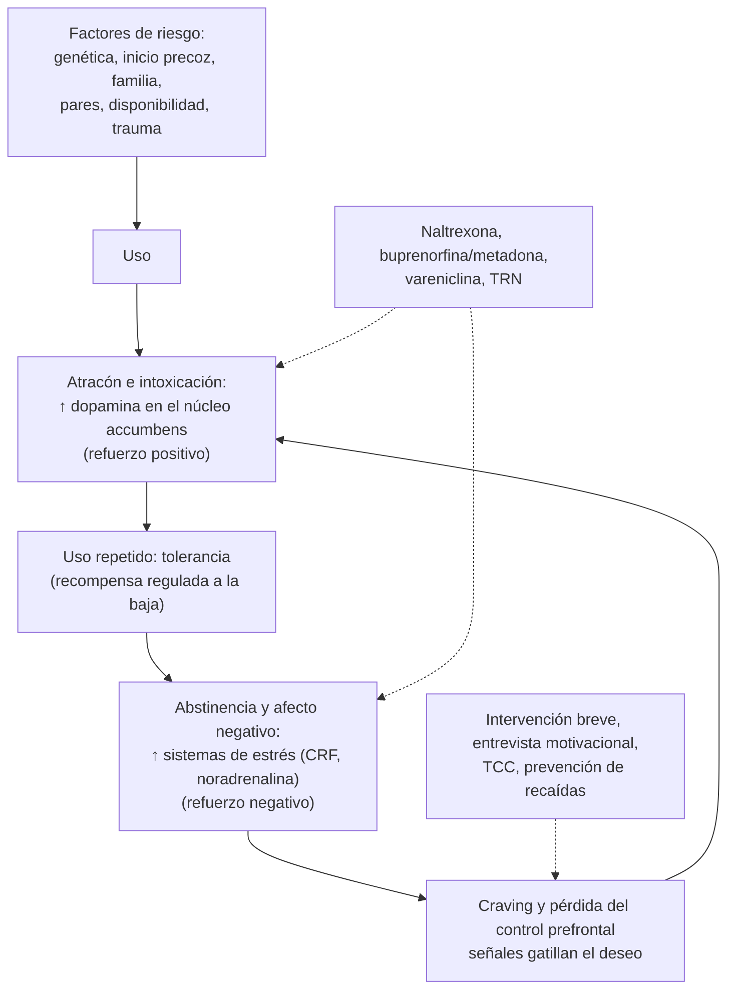

---
tags:
  - Psiquiatría
  - GES
  - Frecuente en sala
---

# Consumo perjudicial y dependencia de alcohol, tabaco y otras drogas (incluidos niños y adolescentes, y prevención)

**Subespecialidad**
Psiquiatría · Adicciones · Medicina familiar · Atención primaria · Salud pública

**Guías principales**
MINSAL: guía clínica GES de consumo perjudicial y dependencia de alcohol y drogas en personas menores de 20 años · APA 2018: tratamiento farmacológico del trastorno por consumo de alcohol · USPSTF 2018 (alcohol), 2020 (drogas) y 2021 (tabaco) · ASAM 2020: trastorno por consumo de opioides · Criterios DSM-5-TR (2022) y CIE-11

**Otras fuentes**
Estudio Nacional de Drogas en Población General, SENDA (16.° estudio, 2024) · Encuesta Nacional de Salud 2016–2017 · Ensayo EAGLES de seguridad de la vareniclina (Anthenelli, *Lancet* 2016) · AUDIT-C (Bush 1998) · Ver [abstinencia alcohólica y Wernicke](../neurologia/abstinencia-alcoholica-y-wernicke.md), [cirrosis](../gastroenterologia/cirrosis-y-complicaciones.md), [ansiedad](trastornos-de-ansiedad-y-toc.md) y [agitación psicomotora](../geriatria/agitacion-psicomotora-y-agresividad.md)

**GES**
Sí: **consumo perjudicial o dependencia de riesgo bajo a moderado de alcohol y drogas en personas menores de 20 años** (N.° 53) y **cesación del consumo de tabaco en personas de 25 años y más** (N.° 90).

**EUNACOM**
5.01.1.011 Consumo perjudicial de alcohol y drogas (específico, completo, completo) · 5.01.1.012 Dependencia de alcohol (específico, inicial, completo) · 5.01.1.013 Dependencia de otras drogas (sospecha, inicial, derivar) · 5.01.1.035 Consumo perjudicial de drogas en niños y adolescentes (específico, completo, completo) · 5.01.3.011 Prevención: alcohol, tabaco, drogas; modelo de prevención primaria

**Revisado**
Octubre 2026

!!! abstract "Resumen en 60 segundos"
    - **Espectro**: uso → **consumo de riesgo** → **consumo perjudicial** (ya hay daño físico o mental) → **dependencia** (tolerancia, abstinencia, pérdida de control, prioridad del consumo). El DSM-5 lo unifica como **trastorno por consumo** leve (2–3 criterios), moderado (4–5) o grave (≥ 6 de 11).
    - **Chile**: consumo de **riesgo de alcohol 11,7 %** (ENS 2016–2017), **tabaquismo ~ 33 %**; marihuana en el último año **~ 10 %** (SENDA 2024), con alza del uso de **tranquilizantes sin receta**.
    - **Tamizaje universal** en la APS y en la sala: **AUDIT-C / AUDIT** (alcohol), **ASSIST** (drogas), **CRAFFT** (adolescentes) y preguntar por el **tabaco** en toda consulta.
    - **Consumo de riesgo o perjudicial**: **intervención breve** (5–15 minutos, modelo FRAMES) con **entrevista motivacional**, según la **etapa de cambio**.
    - **Dependencia de alcohol**: manejo de la **abstinencia** (benzodiacepinas, **tiamina**) y prevención de recaídas con **naltrexona**, acamprosato o **disulfiram**, más psicoterapia y grupos de autoayuda.
    - **Opioides**: buprenorfina o metadona (reducen la mortalidad) y **naloxona**. **Cocaína y pasta base**: no hay fármacos aprobados; tratamiento psicosocial.
    - **Tabaco**: consejo breve (**5A**) + fármacos: **vareniclina** (la más eficaz), **terapia de reemplazo de nicotina** combinada, bupropión. GES N.° 90 desde los 25 años.
    - **Prevención**: universal, selectiva e indicada; factores de riesgo y protectores; **retrasar la edad de inicio** en los adolescentes. GES N.° 53 en menores de 20 años.

## Definición

- **Consumo de riesgo**: patrón que **aumenta el riesgo** de daño (por ejemplo, alcohol sobre los límites de bajo riesgo, consumo en el embarazo o al conducir), aún sin daño.
- **Consumo perjudicial** (CIE-10) o **nocivo** (CIE-11): patrón que **ya causó daño** físico (hepatopatía, pancreatitis) o mental (depresión secundaria), sin cumplir criterios de dependencia.
- **Dependencia** (CIE-10/11): **deseo intenso** (*craving*), **pérdida de control**, **tolerancia**, **abstinencia**, **abandono** de otras actividades y **persistencia** pese al daño.
- **Trastorno por consumo de sustancias** (DSM-5-TR): patrón problemático con **≥ 2 de 11 criterios** en 12 meses:
    - **Control deficiente**: más cantidad o tiempo del previsto; deseo o intentos fallidos de reducir; mucho tiempo dedicado; *craving*.
    - **Deterioro social**: incumplimiento de obligaciones; problemas sociales; abandono de actividades.
    - **Consumo de riesgo**: en situaciones peligrosas; pese a saber que causa daño.
    - **Farmacológicos**: **tolerancia** y **abstinencia** (no cuentan si el fármaco se usa con indicación médica).
    - **Gravedad**: **leve 2–3**, **moderado 4–5**, **grave ≥ 6**.
- **Trago estándar** (OMS): **~ 10 g de alcohol puro**. Equivale aproximadamente a una lata pequeña de cerveza, una copa de vino o un corto de destilado.
- **Consumo episódico excesivo** (*binge*): **≥ 5 tragos** (hombres) o **≥ 4** (mujeres) en una ocasión.

## Epidemiología

### Mundial

- El **alcohol** causa **~ 2,6 millones de muertes al año** (OMS) y es un factor causal de **> 200** enfermedades (cirrosis, cánceres, lesiones, violencia).
- El **tabaco** mata a **> 8 millones** de personas al año (incluido el humo ajeno).
- Las **drogas** más usadas son el **cannabis**, seguido de los opioides, las anfetaminas y la cocaína. Las **sobredosis por opioides** (fentanilo) son una epidemia en Norteamérica.
- El **inicio** del consumo es casi siempre en la **adolescencia**: cuanto **más precoz**, mayor riesgo de dependencia.

### Chile

!!! chile "Datos nacionales"
    - **ENS 2016–2017**: **consumo de riesgo de alcohol** (AUDIT) en el **11,7 %** de los mayores de 15 años, más en los **jóvenes de 15–24 años**; **tabaquismo actual ~ 33 %**.
    - **SENDA, 16.° Estudio Nacional de Drogas en Población General (2024)**: consumo de **alcohol en el último mes 34,6 %** (el más bajo en 30 años); **marihuana en el último año 10,1 %**; **cocaína 0,8 %** y **pasta base 0,3 %**, estables; **alza** del uso de **tranquilizantes sin receta**. Persiste el patrón de **embriaguez** (consumo episódico excesivo).
    - **GES N.° 53**: consumo perjudicial o dependencia de **riesgo bajo a moderado** de alcohol y drogas en **menores de 20 años** (tratamiento ambulatorio básico e intensivo). **GES N.° 90**: **cesación del tabaco** en personas de **25 años y más**.
    - La **pasta base de cocaína** es una droga de alto poder adictivo típica del Cono Sur, asociada a pobreza y exclusión.
    - **SENDA** financia programas de tratamiento ambulatorio y residencial. Marco legal: **Ley 20.000** (drogas) y **Ley 19.419** de tabaco (modificada por la **Ley 20.660** de 2013, que prohibió fumar en lugares cerrados de uso público).

## Etiología y factores de riesgo

| Nivel | Factores de riesgo | Factores protectores |
|---|---|---|
| **Individual** | **Inicio precoz**, genética (heredabilidad 40–60 %), impulsividad, búsqueda de sensaciones, **TDAH**, depresión, ansiedad, trauma | Habilidades sociales y de resolución de problemas, autoestima, proyecto de vida |
| **Familiar** | Consumo de los padres, **conflicto**, maltrato, falta de supervisión, **actitudes permisivas** | **Vínculo** afectivo, supervisión, normas claras, comunicación |
| **Pares y escuela** | Pares que consumen, fracaso o deserción escolar | Integración escolar, pares prosociales |
| **Comunidad** | **Disponibilidad** y bajo precio, publicidad, normas sociales permisivas, pobreza | Políticas públicas (impuestos, restricción de venta y publicidad), oportunidades de ocio |

## Fisiopatología

- Todas las drogas de abuso aumentan la **dopamina** en el **sistema de recompensa** (área tegmental ventral → **núcleo accumbens**), directa o indirectamente.
- **Etapas** del ciclo adictivo:
    1. **Atracón e intoxicación**: refuerzo positivo (placer).
    2. **Abstinencia y afecto negativo**: con el uso crónico, el sistema de recompensa se **regula a la baja** (tolerancia) y se activan los sistemas de **estrés** (CRF, noradrenalina): se consume para **aliviar el malestar** (refuerzo negativo).
    3. **Preocupación y anticipación** (*craving*): la **corteza prefrontal** pierde el control inhibitorio; las **señales** asociadas (lugares, personas) disparan el deseo.
- **Alcohol**: potencia **GABA-A** e inhibe **NMDA**; la abstinencia produce hiperexcitabilidad (temblor, convulsiones, *delirium tremens*). **Nicotina**: agonista de receptores **nicotínicos α4β2** (blanco de la vareniclina). **Opioides**: receptores **μ**. **Cocaína**: bloquea la recaptación de dopamina, noradrenalina y serotonina.

*Figura 1. Ciclo de la adicción: intoxicación, abstinencia y *craving*. Esquema propio basado en el modelo neurobiológico de las adicciones y la guía APA 2018.*

## Clasificación

**Patrones de consumo** (OMS): abstinencia → consumo de bajo riesgo → **consumo de riesgo** → **consumo perjudicial** → **dependencia**.

**Puntaje AUDIT** (10 preguntas, 0–40) y conducta:

| AUDIT | Patrón | Conducta |
|---|---|---|
| **0–7** | Bajo riesgo | Educación y refuerzo |
| **8–15** | **Consumo de riesgo** | **Consejo breve** |
| **16–19** | **Consumo perjudicial** | **Intervención breve** + seguimiento |
| **≥ 20** | Probable **dependencia** | **Derivar** a tratamiento especializado |

**Etapas de cambio** (Prochaska y DiClemente): **precontemplación** (no ve el problema) → **contemplación** (ambivalencia) → **preparación** → **acción** → **mantención** (y recaída, que es parte del proceso).

**Niveles de prevención**:

| Nivel | Objetivo | Ejemplos |
|---|---|---|
| **Primaria** | **Evitar o retrasar el inicio** | Programas escolares de habilidades para la vida, parentalidad positiva, impuestos al alcohol y tabaco, restricción de la venta a menores y de la publicidad, ambientes libres de humo |
| **Secundaria** | **Detección precoz** e intervención en el consumo de riesgo | Tamizaje con AUDIT, ASSIST y CRAFFT; **intervención breve** en la APS |
| **Terciaria** | Tratar la dependencia, **reducir daños** y recaídas | Tratamiento ambulatorio o residencial, naloxona, programas de sustitución |

- Clasificación según la **población**: **universal** (toda la población), **selectiva** (grupos de riesgo: hijos de consumidores), **indicada** (personas que ya muestran consumo o signos precoces).

## Clínica

### Alcohol

- **Señales**: accidentes, **traumatismos**, violencia, ausentismo, conflictos familiares, **HTA** de difícil control, **macrocitosis**, **GGT** elevada, **hígado graso**, gastritis, pancreatitis, insomnio, depresión.
- **Abstinencia** (6–24 horas tras la última ingesta): temblor, sudoración, taquicardia, náuseas, ansiedad, insomnio; **convulsiones** (12–48 horas); ***delirium tremens*** (48–96 horas). Ver [abstinencia alcohólica y Wernicke](../neurologia/abstinencia-alcoholica-y-wernicke.md).

### Otras drogas

| Sustancia | Consumo crónico y dependencia | Abstinencia |
|---|---|---|
| **Cannabis** | Síndrome amotivacional, deterioro cognitivo, **psicosis** (sobre todo en adolescentes), **síndrome de hiperémesis cannabinoide** (vómitos cíclicos que alivian las duchas calientes) | Irritabilidad, insomnio, ansiedad, inapetencia (leve) |
| **Cocaína y pasta base** | Paranoia, psicosis, baja de peso, **IAM y ACV**, perforación del tabique nasal, problemas legales | **"Crash"**: disforia, hipersomnia, hiperfagia, **ideación suicida** |
| **Opioides** | Tolerancia, sobredosis, infecciones por uso EV (endocarditis, VIH, VHC) | Rinorrea, lagrimeo, bostezos, **midriasis**, piloerección, diarrea, mialgias (molesta, **no letal** en el adulto sano) |
| **Benzodiacepinas** | Deterioro cognitivo, caídas, accidentes | Ansiedad, insomnio, temblor, **convulsiones** y delirium (**potencialmente grave**, como el alcohol) |
| **Tabaco (nicotina)** | Enfermedad CV, EPOC, cánceres | Irritabilidad, ansiedad, aumento del apetito, *craving* (2–4 semanas) |

### Niños y adolescentes

- **Señales de alerta**: baja del rendimiento, **ausentismo**, cambio brusco de amigos, irritabilidad, aislamiento, pérdida de dinero u objetos de la casa, olor a alcohol o tabaco, ojos rojos.
- El cerebro adolescente (corteza prefrontal inmadura) es **más vulnerable** a la dependencia y al daño cognitivo; el **cannabis** precoz aumenta el riesgo de psicosis.
- Buscar **comorbilidad**: **TDAH**, depresión, **conducta suicida**, trastornos de conducta, **abuso sexual** o maltrato.
- La entrevista debe incluir un momento **a solas** con el adolescente, con **confidencialidad** (con sus límites: riesgo vital).

!!! alarma "Signos de alarma"
    - **Abstinencia de alcohol o benzodiacepinas** con convulsiones, alucinaciones o confusión: **hospitalizar**.
    - **Sobredosis de opioides**: depresión respiratoria, miosis, coma → **naloxona**.
    - **Ideación suicida** (el consumo la multiplica), **psicosis**, **violencia**.
    - **Embarazo** con consumo; niños a cargo de un adulto con consumo grave (evaluar la **protección**).
    - Consumo EV, prácticas sexuales de riesgo (VIH, VHB, VHC).

## Diagnóstico

!!! guia "Tamizaje y diagnóstico (USPSTF 2018 y 2020; guía GES; DSM-5-TR)"
    - **Alcohol**: tamizar a **todos los adultos** (incluidas las embarazadas) con **AUDIT-C** (3 preguntas; positivo **≥ 4 en hombres y ≥ 3 en mujeres**) y luego el **AUDIT** completo. Pregunta única: "¿Cuántas veces en el último año tomó **5 o más tragos** (4 en mujeres) en una ocasión?" (≥ 1 = positivo).
    - **Drogas**: tamizar a los **adultos** con preguntas simples ("¿Cuántas veces en el último año usó una droga ilegal o un medicamento sin receta por razones no médicas?") o el **ASSIST** (OMS).
    - **Adolescentes**: **CRAFFT** (6 preguntas; ≥ 2 = riesgo alto), con **entrevista a solas** y confidencialidad.
    - **Tabaco**: preguntar en **toda consulta**; registrar el índice paquete-año y la **dependencia** (test de **Fagerström**: fumar dentro de los 30 minutos de despertar indica dependencia alta).
    - **Diagnóstico** del trastorno por consumo con los **11 criterios del DSM-5-TR** (o CIE-10/11: perjudicial o dependencia) y evaluación del **compromiso biopsicosocial** (en la guía GES: riesgo bajo, moderado o alto, que define la intensidad del plan).

## Laboratorio

- Útiles como **apoyo** y para evaluar el **daño**, no para diagnosticar el trastorno:

| Examen | Hallazgo |
|---|---|
| **GGT** | Elevada en el consumo crónico de alcohol (sensible, poco específica) |
| **VCM** | **Macrocitosis** (alcohol) |
| **AST/ALT** | **Razón AST/ALT > 2** sugiere hepatopatía alcohólica |
| **CDT** (transferrina deficiente en carbohidratos) | Consumo intenso reciente (no siempre disponible) |
| Triglicéridos, ácido úrico, plaquetas | Elevados (los primeros dos) y bajas (alcohol) |
| **Tóxicos en orina** | Detección (cannabis hasta semanas; cocaína 2–4 días; opioides 1–3 días); falsos positivos y negativos |
| **VIH, VHB, VHC, sífilis** | Consumo EV o conductas sexuales de riesgo |
| **Alcoholemia**, etanol en el aliento | Intoxicación aguda; también tiene valor médico-legal |

## Imágenes

- No son parte del diagnóstico. Según el daño: **ecografía abdominal** (esteatosis, cirrosis), radiografía de tórax (fumador, consumo inhalado), **TC cerebral** en el TEC o el compromiso de conciencia.

## Diagnóstico diferencial

- **Trastornos psiquiátricos primarios** que coexisten o se confunden: **depresión**, **ansiedad**, **trastorno bipolar**, **TDAH**, **psicosis**, **TEPT** y trastornos de personalidad (**patología dual**: tratar ambos).
- **Cuadros inducidos** por la sustancia (depresión, ansiedad o psicosis que **remiten** con la abstinencia en semanas).
- **Uso de medicamentos con prescripción** (opioides, benzodiacepinas) con dependencia física **sin** trastorno por consumo.
- Causas médicas de los síntomas (hipertiroidismo, encefalopatía hepática, hipoglicemia).

## Tratamiento

### Intervención breve (consumo de riesgo o perjudicial)

!!! guia "Modelo FRAMES de intervención breve (5–15 minutos)"
    - **F**eedback: devolver los resultados del AUDIT y los riesgos personales.
    - **R**esponsabilidad: el cambio es decisión del paciente.
    - **A**dvice (consejo): recomendación **clara** de reducir o dejar el consumo.
    - **M**enú de opciones: estrategias concretas (límites, evitar situaciones de riesgo).
    - **E**mpatía: estilo **motivacional**, sin confrontación ni juicio.
    - **S**elf-efficacy (autoeficacia): reforzar la confianza en su capacidad de cambio.
    - Adaptar a la **etapa de cambio** y **acordar un seguimiento**.

- **Entrevista motivacional**: preguntas abiertas, afirmaciones, **escucha reflexiva** y resúmenes; explorar la **ambivalencia** y evocar las razones propias para cambiar.
- **Tratamiento psicosocial** en la dependencia: TCC, **prevención de recaídas**, terapia familiar (fundamental en adolescentes), manejo de contingencias, comunidades terapéuticas, grupos de autoayuda (Alcohólicos Anónimos, Narcóticos Anónimos).
- **Adolescentes** (GES N.° 53): plan **ambulatorio básico** (riesgo bajo) o **intensivo** (riesgo moderado), con intervención **familiar** y coordinación con la escuela y la red. Riesgo alto o comorbilidad grave: programas especializados o residenciales.

### Fármacos

!!! dosis "Dependencia de alcohol (APA 2018)"
    | Fármaco | Dosis | Comentario |
    |---|---|---|
    | **Tiamina** | 100 mg/día VO (EV en dosis altas si hay riesgo de Wernicke) | **A todos** los consumidores crónicos; **antes de la glucosa** |
    | **Naltrexona** | **50 mg/día** VO | Primera línea: reduce los días de consumo intenso. **Contraindicada** con opioides (precipita abstinencia) y en la **insuficiencia hepática** grave |
    | **Acamprosato** | 666 mg c/8 h | Primera línea para mantener la abstinencia; ajustar en la ERC; no disponible en todos los países |
    | **Disulfiram** | 250 mg/día | Solo con **abstinencia** de ≥ 12 horas, consentimiento y supervisión; reacción aversiva con el alcohol (rubor, náuseas, taquicardia, hipotensión). No en cardiopatía ni psicosis |
    | **Topiramato** o **gabapentina** | Topiramato 50–300 mg/día; gabapentina 900–1800 mg/día | Segunda línea |
    | **Abstinencia** | Benzodiacepinas (**diazepam**, **lorazepam** si hay daño hepático) según el **CIWA-Ar** | Ver la página de abstinencia alcohólica |

!!! dosis "Tabaco (USPSTF 2021; GES N.° 90)"
    - **5A**: **Averiguar** si fuma, **Aconsejar** dejarlo, **Apreciar** la disposición, **Ayudar** (fecha de término, fármacos), **Acordar** el seguimiento. Si no está preparado: **5R** motivacionales.
    - **Vareniclina** (la más eficaz): 0,5 mg/día × 3 días, 0,5 mg c/12 h × 4 días, luego **1 mg c/12 h** por **12 semanas** (iniciar 1 semana antes de la fecha de término). Náuseas, sueños vívidos. El ensayo **EAGLES** no mostró más eventos neuropsiquiátricos que el placebo.
    - **Terapia de reemplazo de nicotina** (TRN): **parche** (21 mg/día si fuma > 10 cigarrillos al día) **+** forma de acción corta (chicle o comprimido de 2–4 mg) para el *craving*. La **combinación** es más eficaz que una sola forma.
    - **Bupropión**: 150 mg/día × 3 días, luego 150 mg c/12 h por 7–12 semanas. **Contraindicado** con antecedente de **convulsiones** y en los trastornos de la conducta alimentaria.
    - **Embarazo**: intervención conductual (primera línea); la evidencia de los fármacos es insuficiente.
    - Los **cigarrillos electrónicos** no están recomendados por la USPSTF como método de cesación (evidencia insuficiente).

!!! dosis "Opioides, cocaína y benzodiacepinas"
    - **Sobredosis de opioides**: **naloxona** 0,4–2 mg EV, IM o intranasal; repetir cada 2–3 minutos (vida media corta: puede reaparecer la depresión respiratoria).
    - **Trastorno por consumo de opioides** (ASAM 2020): **buprenorfina** (sola o con naloxona) o **metadona** de mantención; **naltrexona** de depósito como alternativa. Reducen la **mortalidad** y las infecciones. Entregar **naloxona** para el hogar.
    - **Cocaína y pasta base**: **no hay** fármacos aprobados; tratamiento **psicosocial** (manejo de contingencias, TCC) y de la comorbilidad.
    - **Dependencia de benzodiacepinas**: **retiro gradual** (10–25 % de la dosis cada 2–4 semanas), a veces cambiando a una de vida media larga (diazepam o clonazepam). **No** suspender bruscamente (convulsiones).

## Complicaciones

- **Alcohol**: **cirrosis**, pancreatitis, cardiomiopatía, HTA, **cánceres** (boca, faringe, esófago, hígado, colon, **mama**), **Wernicke-Korsakoff**, neuropatía, demencia, síndrome alcohólico fetal, traumatismos, violencia, suicidio.
- **Tabaco**: **enfermedad coronaria**, ACV, EPOC, cánceres (pulmón, cabeza y cuello, vejiga, páncreas), enfermedad arterial periférica.
- **Drogas**: sobredosis, psicosis, IAM y ACV (**cocaína**), infecciones (VIH, VHC, endocarditis), problemas legales, pérdida del trabajo y de la familia, **deserción escolar** en adolescentes.
- **Comorbilidad psiquiátrica** y **suicidio**.

## Pronóstico y seguimiento

- La dependencia es una **enfermedad crónica y recurrente**: las **recaídas** son frecuentes (40–60 % en el primer año, similar a otras enfermedades crónicas) y no son un fracaso del tratamiento.
- La **intervención breve** reduce el consumo de alcohol y los episodios de consumo excesivo en los bebedores de riesgo (USPSTF 2018).
- El tratamiento con **sustitución de opioides** reduce la mortalidad a la mitad o más.
- **Dejar de fumar** a cualquier edad reduce el riesgo; antes de los 40 años recupera casi toda la esperanza de vida perdida.
- **Seguimiento**: AUDIT o autorreporte, exámenes (GGT, VCM), adherencia, comorbilidad psiquiátrica, **red de apoyo**.

## Perlas para el internado

!!! perla "Para recordar en la sala y el turno"
    - Preguntar **siempre** por alcohol, tabaco y drogas: **AUDIT-C** en adultos, **CRAFFT** en adolescentes (a solas).
    - **AUDIT 8–15** consejo breve; **16–19** intervención breve; **≥ 20** derivar.
    - **Tiamina antes que glucosa** en todo consumidor crónico de alcohol.
    - **Naltrexona** no se usa con **opioides**; el **disulfiram** solo con abstinencia y consentimiento.
    - La abstinencia de **alcohol** y de **benzodiacepinas** puede **matar** (convulsiones, delirium); la de opioides es muy molesta pero rara vez letal.
    - **Vareniclina** es el fármaco más eficaz para dejar de fumar; la TRN **combinada** (parche + chicle) supera a una sola forma.
    - **Prevención primaria** = evitar o **retrasar el inicio**; secundaria = detección precoz e intervención breve; terciaria = tratamiento y reducción de daños.
    - GES: **N.° 53** (< 20 años, alcohol y drogas) y **N.° 90** (tabaco, ≥ 25 años).

## Preguntas de repaso

??? repaso "1. Hombre de 45 años con HTA de difícil control y GGT elevada. AUDIT: 17 puntos, sin síntomas de abstinencia. ¿Qué patrón tiene y qué hace?"
    **Consumo perjudicial** (AUDIT 16–19). Conducta: **intervención breve** con estilo motivacional (modelo **FRAMES**): devolver los resultados, aconsejar reducir o dejar, acordar metas y un **seguimiento**. Indicar **tiamina**, controlar la PA (mejora al reducir el alcohol) y reevaluar en semanas. Si llega a ≥ 20 o hay dependencia, derivar a un programa especializado.

??? repaso "2. Adolescente de 16 años con baja del rendimiento escolar, ausentismo y consumo de marihuana los fines de semana y alcohol en fiestas. CRAFFT: 3. ¿Qué hace?"
    Riesgo alto de **consumo problemático**. Entrevista **a solas** con confidencialidad, evaluar el **compromiso biopsicosocial**, la **comorbilidad** (depresión, TDAH, conducta suicida, abuso) y la familia. Intervención motivacional y derivación a un plan **ambulatorio** con intervención **familiar** (**GES N.° 53**, consumo perjudicial o dependencia de riesgo bajo a moderado en menores de 20 años).

??? repaso "3. Paciente con dependencia de alcohol, en abstinencia hace 1 semana, que quiere prevenir recaídas. Usa tramadol por lumbago. ¿Qué fármaco evitaría y qué ofrecería?"
    Evitar la **naltrexona** (antagonista opioide: precipita la abstinencia y anula el analgésico). Ofrecer **acamprosato** (si está disponible) o **disulfiram** (con abstinencia, consentimiento y supervisión), más tratamiento **psicosocial** (prevención de recaídas, grupos de autoayuda). Revisar el uso de tramadol.

??? repaso "4. Fumador de 50 años, 30 paquetes-año, que fuma el primer cigarrillo a los 5 minutos de despertar y quiere dejarlo. ¿Qué le ofrece?"
    **Dependencia alta** a la nicotina (Fagerström). Consejería (**5A**), fijar una **fecha de término** y **vareniclina** (0,5 mg/día con aumento hasta 1 mg c/12 h, por 12 semanas, iniciando 1 semana antes) o **TRN combinada** (parche de 21 mg + chicle o comprimido). Seguimiento cercano. GES N.° 90 (≥ 25 años).

??? repaso "5. Joven de 24 años encontrado inconsciente con respiración de 6 por minuto, pupilas puntiformes y marcas de punción. ¿Qué hace?"
    **Sobredosis de opioides**: asegurar la vía aérea y ventilar con bolsa-mascarilla, **naloxona** 0,4–2 mg EV, IM o intranasal (repetir cada 2–3 minutos), monitorizar (puede **recurrir** la depresión respiratoria por la vida media corta de la naloxona). Luego: tamizaje de VIH, VHB y VHC, **derivación** a tratamiento de sustitución y naloxona para el hogar.

??? repaso "6. ¿Qué diferencia la prevención universal, selectiva e indicada? Dé un ejemplo de cada una."
    **Universal**: dirigida a **toda la población** (programa escolar de habilidades para la vida, impuestos al alcohol). **Selectiva**: grupos con **mayor riesgo** sin consumo problemático (hijos de padres con dependencia). **Indicada**: personas que **ya muestran** consumo de riesgo o signos precoces (adolescente con CRAFFT positivo que recibe intervención breve).

## Referencias

1. Ministerio de Salud de Chile. Guía de práctica clínica GES: consumo perjudicial y dependencia de alcohol y otras drogas en personas menores de 20 años (recomendaciones). [diprece.minsal.cl](https://diprece.minsal.cl/garantias-explicitas-en-salud-auge-o-ges/guias-de-practica-clinica/consumo-perjudicial-y-dependencia-de-alcohol-y-otras-drogas-en-personas-menores-de-20-anos/recomendaciones/)
2. Reus VI, Fochtmann LJ, Bukstein O, et al. The American Psychiatric Association practice guideline for the pharmacological treatment of patients with alcohol use disorder. *Am J Psychiatry.* 2018;175(1):86–90. doi:[10.1176/appi.ajp.2017.1750101](https://doi.org/10.1176/appi.ajp.2017.1750101)
3. US Preventive Services Task Force; Curry SJ, Krist AH, Owens DK, et al. Screening and behavioral counseling interventions to reduce unhealthy alcohol use in adolescents and adults: US Preventive Services Task Force recommendation statement. *JAMA.* 2018;320(18):1899–1909. doi:[10.1001/jama.2018.16789](https://doi.org/10.1001/jama.2018.16789)
4. US Preventive Services Task Force; Krist AH, Davidson KW, Mangione CM, et al. Screening for unhealthy drug use: US Preventive Services Task Force recommendation statement. *JAMA.* 2020;323(22):2301–2309. doi:[10.1001/jama.2020.8020](https://doi.org/10.1001/jama.2020.8020)
5. US Preventive Services Task Force; Krist AH, Davidson KW, Mangione CM, et al. Interventions for tobacco smoking cessation in adults, including pregnant persons: US Preventive Services Task Force recommendation statement. *JAMA.* 2021;325(3):265–279. doi:[10.1001/jama.2020.25019](https://doi.org/10.1001/jama.2020.25019)
6. The ASAM national practice guideline for the treatment of opioid use disorder: 2020 focused update. *J Addict Med.* 2020;14(2S Suppl 1):1–91. doi:[10.1097/ADM.0000000000000633](https://doi.org/10.1097/ADM.0000000000000633)
7. Anthenelli RM, Benowitz NL, West R, et al. Neuropsychiatric safety and efficacy of varenicline, bupropion, and nicotine patch in smokers with and without psychiatric disorders (EAGLES): a double-blind, randomised, placebo-controlled clinical trial. *Lancet.* 2016;387(10037):2507–2520. doi:[10.1016/S0140-6736(16)30272-0](https://doi.org/10.1016/S0140-6736(16)30272-0)
8. Bush K, Kivlahan DR, McDonell MB, et al. The AUDIT alcohol consumption questions (AUDIT-C): an effective brief screening test for problem drinking. *Arch Intern Med.* 1998;158(16):1789–1795. doi:[10.1001/archinte.158.16.1789](https://doi.org/10.1001/archinte.158.16.1789)
9. Ministerio del Interior y Seguridad Pública; SENDA. Consumo de alcohol alcanza su nivel más bajo en 30 años y marihuana en adolescentes llega a mínimo histórico (16.° Estudio Nacional de Drogas en Población General). Diciembre de 2025. [interior.gob.cl](https://interior.gob.cl/noticias/2025/12/04/consumo-de-alcohol-alcanza-su-nivel-mas-bajo-en-30-anos-y-marihuana-en-adolescentes-llega-a-minimo-historico/)
10. Ministerio de Salud de Chile. Encuesta Nacional de Salud 2016–2017: consumo de alcohol. [minsal.cl](https://www.minsal.cl/encuesta-minsal-revela-alto-nivel-de-consumo-de-alcohol-en-chile/)
11. American Psychiatric Association. *Diagnostic and Statistical Manual of Mental Disorders, Fifth Edition, Text Revision (DSM-5-TR).* Washington, DC: APA; 2022.
