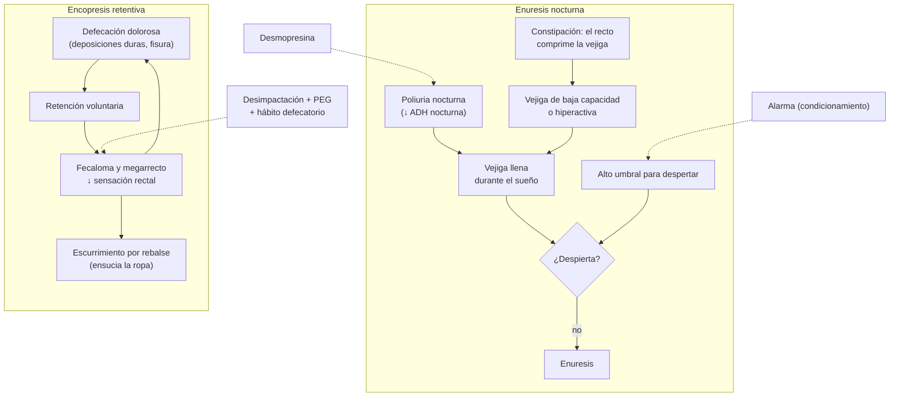

---
tags:
  - Psiquiatría
  - Frecuente en sala
---

# Enuresis y encopresis

**Subespecialidad**
Pediatría · Psiquiatría infantojuvenil · Urología y nefrología infantil · Gastroenterología infantil

**Guías principales**
ICCS 2020: manejo y tratamiento de la enuresis nocturna · ICCS 2016: terminología de la función del tracto urinario inferior en niños · ESPGHAN/NASPGHAN 2026: tratamiento de la constipación funcional de 0 a 18 años · Criterios de Roma IV (2016) y DSM-5-TR (2022)

**Otras fuentes**
Revisiones Cochrane de alarmas (Glazener 2005) y de desmopresina (Hahn 2025) · Ver [constipación](../gastroenterologia/constipacion-intestino-irritable-y-diarrea-cronica.md), [infección urinaria](../nefrologia/infeccion-urinaria.md) y [TDAH](tdah-y-trastornos-de-conducta.md)

**GES**
No.

**EUNACOM**
5.01.1.026 Enuresis (específico, completo, completo) · 5.01.1.027 Encopresis (sospecha, inicial, derivar)

**Revisado**
Octubre 2026

!!! abstract "Resumen en 60 segundos"
    - **Enuresis**: escape de orina **intermitente durante el sueño** en un niño **≥ 5 años**. **Monosintomática** (sin síntomas diurnos) o **no monosintomática** (con urgencia, incontinencia o polaquiuria diurnas). **Primaria** (nunca estuvo seco ≥ 6 meses) o **secundaria** (tras ≥ 6 meses seco).
    - Muy frecuente (**~ 10 %** a los 7 años) y con **resolución espontánea** de **~ 15 % al año**. Base: **poliuria nocturna**, **vejiga de baja capacidad** o hiperactiva y **dificultad para despertar**; fuerte carga **genética**.
    - **Estudio**: historia, **diario miccional**, examen (columna lumbosacra, genitales, PA), **examen de orina** (glucosuria, densidad, infección). Buscar **constipación**, apnea del sueño, diabetes y **estrés** o abuso (sobre todo en la secundaria).
    - **Tratamiento** (si al niño le molesta, desde los 5–6 años): **uroterapia** (horario de micciones, líquidos de día, orinar antes de dormir, no castigar), tratar la **constipación**; luego **alarma de enuresis** (curación más duradera) o **desmopresina** (efecto rápido; **restringir líquidos** 1 hora antes y 8 horas después: riesgo de **hiponatremia**).
    - **Encopresis**: evacuación de heces en lugares inapropiados en un niño **≥ 4 años**, al menos 1 vez al mes por 3 meses. En **~ 80–90 %** es **retentiva**: **constipación** con **escurrimiento** fecal por rebalse.
    - **Tratamiento de la encopresis retentiva**: **desimpactación** (PEG en dosis altas o enemas) → **mantención con PEG** por meses + **entrenamiento del hábito** (sentarse después de comer) y refuerzo positivo, sin castigo. La **no retentiva** sugiere un problema **emocional o conductual**: evaluar abuso y derivar.

## Definición

- **Enuresis** (ICCS 2016): incontinencia **intermitente** de orina **durante el sueño** en un niño de **≥ 5 años**.
    - **DSM-5-TR**: emisión repetida de orina en la cama o la ropa, **≥ 2 veces por semana durante ≥ 3 meses** o con malestar o deterioro significativo, en **≥ 5 años** (o el nivel de desarrollo equivalente), no atribuible a una sustancia ni a otra afección médica.
    - **Monosintomática**: sin otros síntomas del tracto urinario inferior.
    - **No monosintomática**: con síntomas **diurnos** (urgencia, incontinencia diurna, polaquiuria, posposición de la micción, chorro débil): sugiere una **disfunción vesical** y requiere más estudio.
    - **Primaria**: el niño **nunca** estuvo seco por ≥ 6 meses. **Secundaria**: reaparece tras un período seco de **≥ 6 meses** (buscar causas médicas o estresores).
- **Encopresis** (DSM-5-TR): evacuación repetida de heces en lugares inapropiados (ropa, suelo), voluntaria o involuntaria, **≥ 1 vez al mes durante ≥ 3 meses**, en un niño de **≥ 4 años**, no atribuible a una sustancia ni a otra afección (salvo por un mecanismo de constipación).
    - **Con constipación e incontinencia por rebalse** (retentiva): la más frecuente.
    - **Sin constipación** (no retentiva): menos frecuente, asociada a problemas emocionales o de conducta.
- **Constipación funcional** (Roma IV, ≥ 4 años): ≥ 2 de: ≤ 2 deposiciones por semana, ≥ 1 episodio de incontinencia fecal por semana, postura retentiva, deposiciones dolorosas o duras, masa fecal grande en el recto, deposiciones de gran diámetro que pueden obstruir el inodoro; por ≥ 1 mes.

## Epidemiología

### Mundial

- **Enuresis**: **~ 15–20 %** a los **5 años**, **~ 10 %** a los **7 años**, ~ 5 % a los 10 años y **0,5–1 %** en los adolescentes y adultos. Más en **niños** (~ 2 : 1). **Resolución espontánea ~ 15 % por año**.
- **Encopresis**: **~ 1–3 %** de los escolares, más en **niños** (3–6 : 1). La constipación funcional afecta al **~ 10 %** de los niños.
- **Comorbilidad**: **TDAH** (más frecuente en los niños con enuresis y encopresis), trastornos del sueño, ansiedad, problemas de conducta.

### Chile

!!! chile "Datos nacionales"
    - La enuresis y la constipación funcional son motivos frecuentes de consulta en el **control de salud infantil** de la APS.
    - La **desmopresina** y las **alarmas** de enuresis están disponibles en el país; las alarmas suelen ser de costo del paciente.
    - Ante una enuresis o encopresis **secundaria**, considerar el **maltrato** o el **abuso sexual** dentro del abordaje, con la red de protección si corresponde.

## Etiología y factores de riesgo

**Enuresis**:

- **Genética**: si un padre tuvo enuresis, el riesgo del hijo es **~ 40–45 %**; si ambos, **~ 75–80 %**.
- **Poliuria nocturna** (menor secreción nocturna de **hormona antidiurética**).
- **Vejiga de baja capacidad funcional** o **hiperactividad del detrusor**.
- **Alto umbral para despertar** ante la señal de vejiga llena.
- **Constipación** (el recto lleno comprime la vejiga).
- **Apnea obstructiva del sueño** (hipertrofia adenoamigdalina).
- **Secundaria**: estrés (nacimiento de un hermano, separación de los padres, cambio de colegio), **abuso sexual**, ITU, **diabetes mellitus** o insípida, constipación, apnea del sueño.

**Encopresis**:

- **Retentiva**: **defecación dolorosa** (fisura, deposiciones duras) → **retención** voluntaria → **megarrecto** con pérdida de la sensación → escurrimiento de heces líquidas alrededor del fecaloma. Desencadenantes: el **control de esfínter** forzado, el inicio del jardín o colegio (baños inadecuados), cambios en la dieta.
- **No retentiva**: problemas **emocionales**, oposicionismo, **abuso**, desorganización familiar.

## Fisiopatología

*Figura 1. Mecanismos de la enuresis nocturna y de la encopresis retentiva, y sitio de acción de los tratamientos. Esquema propio basado en ICCS 2020 y ESPGHAN/NASPGHAN 2026.*

## Clasificación

| Trastorno | Tipos |
|---|---|
| **Enuresis** | **Monosintomática** o **no monosintomática**; **primaria** o **secundaria**; DSM-5-TR: **nocturna**, diurna o mixta |
| **Encopresis** | **Retentiva** (con constipación e incontinencia por rebalse, ~ 80–90 %) o **no retentiva** |

## Clínica

### Enuresis

- **Historia**: edad, frecuencia (noches por semana), episodios por noche, **síntomas diurnos** (urgencia, incontinencia, maniobras de retención como cruzar las piernas o sentarse en el talón), ingesta de líquidos en la tarde, **ronquido** o apneas, **constipación**, polidipsia y poliuria, antecedentes familiares, impacto emocional, actitud de la familia (**castigos**).
- **Diario miccional** de 2 días (volúmenes y frecuencia diurnos) y registro de las noches mojadas y del **peso del pañal** (volumen nocturno).
- **Examen físico**: PA, genitales (estenosis del meato, adherencias), **columna lumbosacra** (fosita, mechón de pelo, lipoma: **disrafia oculta**), examen neurológico de las extremidades inferiores, abdomen (fecaloma), amígdalas.

### Encopresis

- **Retentiva**: deposiciones **infrecuentes, grandes y duras**, dolor al defecar, postura **retentiva** (se pone rígido, se esconde), escurrimiento de heces líquidas o pastosas en la ropa (los padres lo confunden con **diarrea**), **masa fecal** palpable en el abdomen o en el tacto rectal, dolor abdominal, hiporexia, a veces enuresis e **ITU** asociadas.
- **No retentiva**: deposiciones **normales** depositadas en lugares inadecuados, sin constipación; conducta oposicionista o problemas emocionales.
- **Consecuencias psicosociales**: vergüenza, **burlas** en el colegio, aislamiento, conflictos familiares.

!!! alarma "Signos de alarma: buscar causa orgánica"
    - **Enuresis**: síntomas **diurnos** importantes, **chorro débil** o goteo continuo (válvulas de uretra posterior, uréter ectópico en niñas: **siempre mojada**), **ITU** recurrentes, **poliuria y polidipsia** (diabetes mellitus o insípida), **baja de peso**, **HTA**, alteraciones de la **columna lumbosacra** o del examen neurológico, **ronquido** con apneas.
    - **Encopresis o constipación**: inicio en el **primer mes de vida**, **retraso en la eliminación del meconio** (> 48 h: enfermedad de **Hirschsprung**), deposiciones acintadas, **sangre** en las deposiciones sin fisura, **vómitos**, distensión abdominal importante, **retraso del crecimiento**, alteraciones de la columna o neurológicas, **ampolla rectal vacía** con constipación grave.
    - **Enuresis o encopresis secundaria** con cambios de conducta, lesiones o conductas sexualizadas: evaluar **abuso sexual** o maltrato.

## Diagnóstico

!!! guia "Puntos clave (ICCS 2020; Roma IV; ESPGHAN/NASPGHAN 2026)"
    - **Enuresis**: el diagnóstico es **clínico**. En la **monosintomática** basta con la historia, el examen físico, el **diario miccional** y el **examen de orina** (con tira reactiva: glucosa, densidad, leucocitos y nitritos).
    - En la **no monosintomática**: además, buscar **constipación** e ITU, y derivar (ecografía, flujometría, nefrourología) si no mejora con la uroterapia o hay signos de alarma.
    - **Encopresis y constipación funcional**: diagnóstico **clínico** con los criterios de **Roma IV**; **no** se requieren exámenes ni radiografía de abdomen de rutina. El **tacto rectal** solo si hay dudas o signos de alarma.
    - Preguntar siempre por la **constipación** en el niño con enuresis, y por los **síntomas urinarios** en el niño con constipación (disfunción vesicointestinal).

## Laboratorio

| Examen | Para qué |
|---|---|
| **Examen de orina** (tira y sedimento) | **Glucosuria** (diabetes), **densidad** baja persistente (diabetes insípida, enfermedad renal), **ITU** |
| **Urocultivo** | Si hay síntomas o leucocituria y nitritos |
| **Glicemia**, creatinina, electrolitos | Poliuria y polidipsia, HTA, enuresis secundaria |
| **TSH** y anticuerpos de enfermedad celíaca | Constipación refractaria o con otros síntomas |
| **Calcio** y plomo | Constipación refractaria según la clínica |

## Imágenes

- **Enuresis monosintomática**: **no** requiere imágenes.
- **Ecografía renal y vesical** (residuo posmiccional, grosor de la pared vesical, diámetro rectal) en la no monosintomática, con ITU o signos de alarma.
- **RM lumbosacra** si hay estigmas cutáneos o alteración neurológica (médula anclada).
- **Encopresis**: la **radiografía de abdomen** no es necesaria; solo si el examen no es concluyente. **Enema baritado** y **biopsia rectal** si se sospecha Hirschsprung.

## Diagnóstico diferencial

| Diagnóstico | Claves |
|---|---|
| **Disfunción vesical** (vejiga hiperactiva, micción disfuncional) | Síntomas diurnos, maniobras de retención |
| **ITU** | Disuria, fiebre, urocultivo |
| **Diabetes mellitus** o **insípida** | Poliuria, polidipsia, baja de peso, glucosuria o densidad baja |
| **Uréter ectópico** (niñas) | Goteo **continuo** (siempre mojada) con micciones normales |
| **Válvulas de uretra posterior** (niños) | Chorro débil, ITU, hidronefrosis |
| **Vejiga neurógena** y **disrafia oculta** | Estigmas lumbosacros, alteración neurológica, encopresis asociada |
| **Apnea obstructiva del sueño** | Ronquido, apneas, somnolencia; la enuresis mejora con la adenoamigdalectomía |
| **Epilepsia nocturna** | Crisis durante el sueño con pérdida de orina |
| **Hirschsprung** | Retraso en la eliminación del meconio, constipación desde el nacimiento, **ampolla vacía** |
| **Hipotiroidismo**, **enfermedad celíaca**, **hipercalcemia** | Constipación con otros síntomas |
| **Abuso sexual** | Enuresis o encopresis secundaria, conductas sexualizadas, lesiones |

## Tratamiento

### Enuresis

!!! guia "Manejo escalonado (ICCS 2020)"
    1. **Desmitificar** y educar: es frecuente, **involuntaria**, mejora sola y **no** se debe **castigar** ni avergonzar.
    2. Tratar si **molesta al niño** (en general **desde los 6 años**; a los 5, si el niño está motivado).
    3. **Uroterapia básica**: ingesta de líquidos **durante el día** y menos en la tarde y noche; **orinar antes de dormir**; micciones regulares de día (cada 3 horas); evitar las bebidas con cafeína y gaseosas en la noche; acceso fácil al baño; calendario de noches secas con refuerzo positivo.
    4. **Tratar la constipación** si existe (puede resolver la enuresis) y la apnea del sueño.
    5. **Primera línea específica** (elegir con la familia):
        - **Alarma de enuresis**: suena al detectar humedad y condiciona al niño a despertar. **Curación más duradera** y menos recaídas; requiere **familia motivada** y **6–8 semanas** (hasta 14 noches secas seguidas).
        - **Desmopresina**: reduce la producción de orina nocturna. **Efecto rápido** (útil en campamentos o pijamadas), pero **recaídas** frecuentes al suspender. Mejor en la **poliuria nocturna** con capacidad vesical normal.
    6. **Sin respuesta**: combinar alarma y desmopresina, agregar un **anticolinérgico** (oxibutinina) si hay sospecha de vejiga hiperactiva (tras descartar constipación y residuo posmiccional) y derivar a nefrourología.

!!! dosis "Fármacos en la enuresis"
    | Fármaco | Dosis | Precauciones |
    |---|---|---|
    | **Desmopresina** (liofilizado sublingual) | **120 µg** (hasta 240 µg) **1 hora antes de dormir** | **Restricción de líquidos** desde 1 hora antes hasta 8 horas después (máx. 200–250 mL en la noche): riesgo de **hiponatremia** e intoxicación hídrica (cefalea, vómitos, convulsiones). Suspender si hay vómitos o diarrea. Tratamiento por 3 meses y luego retiro **gradual** |
    | **Desmopresina** (comprimidos) | **0,2 mg** (hasta 0,4 mg) 1 hora antes de dormir | Ídem |
    | **Oxibutinina** | 2,5–5 mg en la noche (combinada) | Constipación, boca seca; descartar residuo posmiccional |
    | **Imipramina** | Tercera línea, por especialista | **Cardiotoxicidad** y riesgo de sobredosis grave: uso excepcional |

### Encopresis

!!! guia "Encopresis retentiva y constipación funcional (ESPGHAN/NASPGHAN 2026)"
    1. **Educación**: explicar el círculo vicioso de la retención y el **escurrimiento involuntario** (el niño **no** lo hace a propósito); eliminar el **castigo** y la culpa.
    2. **Desimpactación** si hay fecaloma: **PEG en dosis altas** por vía oral o **enemas**. El PEG es el **único tratamiento con recomendación fuerte** en la guía de 2026.
    3. **Mantención con PEG** por **≥ 2 meses** (y al menos 1 mes sin síntomas), con **retiro gradual**; muchos lo requieren 6–12 meses.
    4. **Entrenamiento del hábito**: sentarse en el inodoro **5–10 minutos** después de las comidas (reflejo gastrocólico), con los pies apoyados (piso o banquito), **calendario** y **refuerzo positivo**.
    5. **Dieta y líquidos** normales para la edad (la fibra y el agua en exceso no han demostrado beneficio adicional).
    6. **Sin respuesta** o con problemas emocionales: derivar a gastroenterología infantil y a **salud mental** (en la no retentiva, siempre: TCC, intervención conductual y familiar).

!!! dosis "Laxantes en la constipación funcional infantil (ESPGHAN/NASPGHAN 2026)"
    | Fármaco | Desimpactación | Mantención |
    |---|---|---|
    | **Polietilenglicol (PEG) 3350/4000** | **1–1,5 g/kg/día** (máximo 6 días) | **0,4–0,8 g/kg/día**, ajustar según la respuesta |
    | **Lactulosa** | — | 1–2 g/kg/día (alternativa si no hay PEG) |
    | **Enemas** (fosfato o suero) | Alternativa al PEG oral | — |

## Complicaciones

- **Psicosociales**: **baja autoestima**, vergüenza, **burlas** y *bullying*, aislamiento, evitación de actividades (campamentos, pijamadas), conflictos familiares y **maltrato** por castigos.
- **Enuresis**: dermatitis, ITU.
- **Encopresis**: **megarrecto**, ITU y enuresis asociadas (disfunción vesicointestinal), dolor abdominal crónico, fisuras.
- **Desmopresina**: **hiponatremia** (por no restringir líquidos).

## Pronóstico y seguimiento

- **Enuresis**: **resolución espontánea ~ 15 % por año**; con alarma, ~ **2/3** logra la sequedad y la mayoría la mantiene; con desmopresina, muchos responden, pero ~ 60–70 % recae al suspender.
- **Encopresis retentiva**: ~ **50–60 %** se recupera en 6–12 meses con tratamiento adecuado; las **recaídas** son frecuentes (es un problema **crónico**). Peor pronóstico con constipación de larga evolución y comorbilidad conductual.
- **Seguimiento** cada **4–8 semanas** al inicio: calendario, adherencia, ajuste de laxantes o de la alarma, aspectos emocionales.

## Perlas para el internado

!!! perla "Para recordar"
    - Enuresis desde los **5 años**; encopresis desde los **4 años**.
    - **Primaria** (nunca seco ≥ 6 meses) frente a **secundaria** (tras ≥ 6 meses seco): en la secundaria buscar **estrés, abuso, ITU, diabetes, constipación**.
    - Enuresis **monosintomática**: historia, examen (columna y PA) y **examen de orina**; **no** imágenes.
    - **Trata la constipación** primero: puede curar la enuresis.
    - **Alarma** = curación más duradera; **desmopresina** = efecto rápido, más recaídas; con desmopresina **restringir líquidos** (hiponatremia).
    - **Encopresis**: el 80–90 % es **retentiva**; el "**escurrimiento**" se confunde con diarrea.
    - Encopresis retentiva: **desimpactación con PEG** → **mantención con PEG** meses → **hábito** defecatorio después de comer.
    - **Nunca** castigar: empeora el cuadro y daña al niño.

## Preguntas de repaso

??? repaso "1. Niño de 7 años que moja la cama 5 noches por semana desde siempre, sin síntomas diurnos. Su padre tuvo lo mismo. Examen y orina normales. ¿Diagnóstico y manejo?"
    **Enuresis nocturna primaria monosintomática**. Manejo: educación (es involuntaria, sin castigos), **uroterapia** (líquidos de día, orinar antes de dormir, calendario), descartar constipación, y si al niño le molesta, **alarma de enuresis** (curación más duradera) o **desmopresina** 120 µg sublingual 1 hora antes de dormir con **restricción de líquidos**.

??? repaso "2. Niña de 8 años, seca desde los 4, que vuelve a mojar la cama hace 2 meses, con polidipsia y baja de peso. ¿Qué hace?"
    **Enuresis secundaria** con signos de alarma: descartar **diabetes mellitus** de inmediato (**glicemia** capilar y examen de orina con glucosuria y cetonas). También evaluar diabetes insípida, ITU y estresores o abuso.

??? repaso "3. Niño de 6 años con 'diarrea' que mancha la ropa casi todos los días; sus padres cuentan que hace deposiciones grandes y duras cada 5 días y se esconde para no ir al baño. Al examen se palpa una masa en la fosa ilíaca izquierda. ¿Diagnóstico y tratamiento?"
    **Encopresis retentiva** (constipación funcional con incontinencia por **rebalse**; el "escurrimiento" no es diarrea). Tratamiento: educación sin castigos, **desimpactación con PEG** 1–1,5 g/kg/día por hasta 6 días (o enemas), **mantención con PEG** 0,4–0,8 g/kg/día por meses y **entrenamiento del hábito** (sentarse después de las comidas, refuerzo positivo).

??? repaso "4. ¿Qué indicaciones da a una familia que inicia desmopresina para la enuresis?"
    Darla **1 hora antes de dormir** y **restringir líquidos** desde 1 hora antes hasta 8 horas después (para evitar la **hiponatremia**), **suspenderla** si hay vómitos, diarrea o fiebre, y vigilar cefalea, náuseas o confusión. Usarla por 3 meses y retirarla gradualmente.

??? repaso "5. Niño de 9 años con encopresis sin constipación, deposiciones normales en lugares inadecuados y conductas sexualizadas recientes. ¿Qué le preocupa?"
    Una **encopresis no retentiva** con conductas sexualizadas obliga a evaluar un posible **abuso sexual** o maltrato, además de problemas emocionales o conductuales. Derivar a salud mental infantojuvenil y activar la red de **protección** y la denuncia si corresponde.

??? repaso "6. ¿Qué signos en un niño con enuresis requieren estudio adicional?"
    Síntomas **diurnos** importantes, **goteo continuo** (uréter ectópico en niñas), chorro débil (válvulas en niños), **ITU** recurrentes, poliuria y polidipsia, **HTA**, baja de peso, alteraciones de la **columna lumbosacra** o del examen neurológico, y ronquido con apneas.

## Referencias

1. Nevéus T, Fonseca E, Franco I, et al. Management and treatment of nocturnal enuresis—an updated standardization document from the International Children's Continence Society. *J Pediatr Urol.* 2020;16(1):10–19. doi:[10.1016/j.jpurol.2019.12.020](https://doi.org/10.1016/j.jpurol.2019.12.020)
2. Austin PF, Bauer SB, Bower W, et al. The standardization of terminology of lower urinary tract function in children and adolescents: update report from the standardization committee of the International Children's Continence Society. *Neurourol Urodyn.* 2016;35(4):471–481. doi:[10.1002/nau.22751](https://doi.org/10.1002/nau.22751)
3. Gordon M, de Geus A, Boruta M, et al. European Society for Paediatric Gastroenterology, Hepatology and Nutrition/North American Society for Pediatric Gastroenterology, Hepatology and Nutrition guidelines for treatment of functional constipation in children aged 0–18 years. *J Pediatr Gastroenterol Nutr.* 2026;83(2):335–366. doi:[10.1002/jpn3.70447](https://doi.org/10.1002/jpn3.70447)
4. Hyams JS, Di Lorenzo C, Saps M, et al. Childhood functional gastrointestinal disorders: child/adolescent. *Gastroenterology.* 2016;150(6):1456–1468.e2. doi:[10.1053/j.gastro.2016.02.015](https://doi.org/10.1053/j.gastro.2016.02.015)
5. Glazener CM, Evans JH, Peto RE. Alarm interventions for nocturnal enuresis in children. *Cochrane Database Syst Rev.* 2005;(2):CD002911. doi:[10.1002/14651858.CD002911.pub2](https://doi.org/10.1002/14651858.CD002911.pub2)
6. Hahn D, Stewart F, Raman G, et al. Desmopressin for nocturnal enuresis in children. *Cochrane Database Syst Rev.* 2025;(7):CD002112. doi:[10.1002/14651858.CD002112.pub2](https://doi.org/10.1002/14651858.CD002112.pub2)
7. American Psychiatric Association. *Diagnostic and Statistical Manual of Mental Disorders, Fifth Edition, Text Revision (DSM-5-TR).* Washington, DC: APA; 2022.
